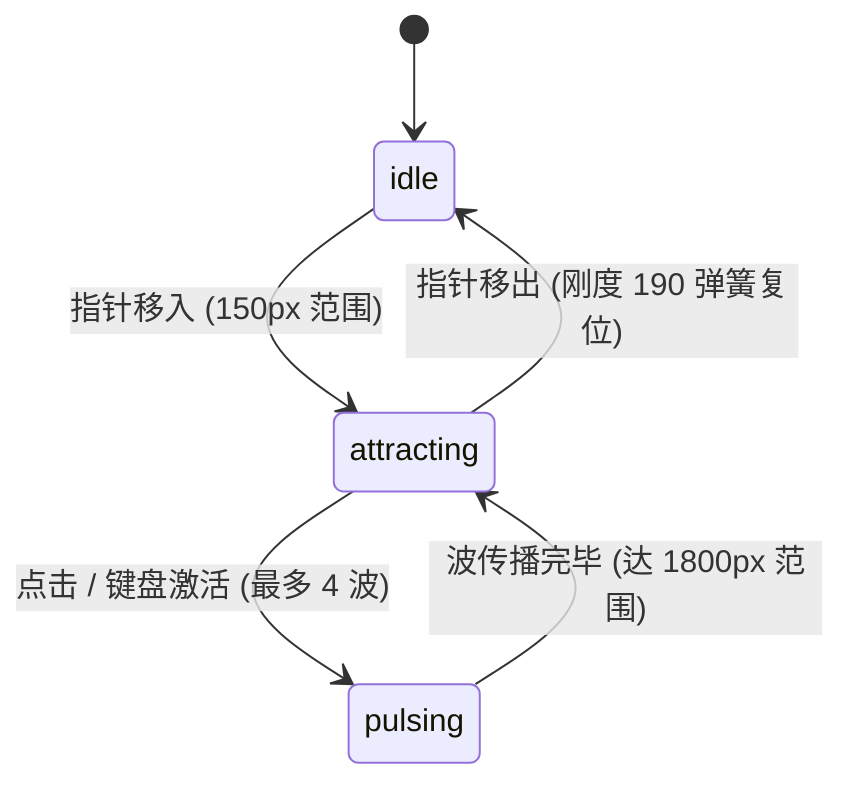

# Gravity Well · 交互式光标引力情绪板

基于光标引力吸附与扩散脉冲波的图片网格物理微交互。包含三大核心机制：

1. **高斯引力场向心吸引（Gaussian Gravity Pull）**：在光标 150px 半径范围内建立高斯引力势阱；范围内的网格图片向光标中心产生物理吸附位移（位移系数 0.36），伴随微缩放（最大降至 0.54）与透明度渐变（最低 0.62），光标移开后通过刚度 190、阻尼 15 的弹簧平滑回归。
2. **高速径向外推扩散波（Expanding Shockwaves）**：点击画布或键盘按键激活以 900px/s 速度向外扩散的引力脉冲波（最多叠加 4 个波）；脉冲掠过图片时注入 `720 * exp(-r / 480)` 的离心外推速度与高光轮廓。
3. **全键盘 Roving 网格巡检与全维物理状态数组**：基于 Float32Array 维护全部瓦片的位置、速度、缩放与轮廓环；支持方向键在网格内平移引力焦点，按 Space / Enter 原地发射扩散脉冲。

## 原型清单

| 原型分组 | 原型元素 | 动效 / 状态变化 | 去向 |
| --- | --- | --- | --- |
| — | 情绪板网格宿主 `.gravity-well_root__6V8Hi` | 响应式多列 CSS Grid 排版、引力场范围计算 | `.gravity-well-root` |
| — | 图片瓦片 `.gravity-well_tile__gMvsx` | 向心位移吸附、微缩放、高光轮廓环、受波外推 | `.gravity-well-tile` |
| — | 瓦片内图片 `img.gravity-well_image__eGJ42` | 圆角、抗锯齿、阴影与裁剪 | `.tile-img` |
| — | 顶栏、外观切换 `#themeBtn`、舞台外壳 | — | 演示外壳，已删除 |

## 适用

- 摄影、建筑、设计作品集画廊或情绪板（Moodboard）。
- 科技感产品品牌视觉展台。
- 允许鼠标移动即时吸引周围元素、点击产生震撼涟漪扩散反馈的场景。

## 不适用

- 纯 2D 点阵排斥与水波纹扩散 → [dot-grid](dot-grid.md)
- 3D 双轨道差频公转与集成卡片展开 → [orbit-logos](../playful/orbit-logos.md)
- 几何路径连续变形加载器 → [morph-loader](../loaders/morph-loader.md)

## 状态机

| 状态 | 进入条件 | 视觉表现 | 退出到 |
| --- | --- | --- | --- |
| idle | 初始；指针离开且无正在传播的波 | 图片平稳位于各自网格槽位中，缩放为 1，停止动画帧 | attracting |
| attracting | 指针进入网格并在 150px 范围内移动 | 附近图片向光标方向聚拢吸附并适度缩小，周围图片产生微弱张力 | idle / pulsing |
| pulsing | 鼠标点击或按键盘 Space / Enter | 产生向外辐射的 900px/s 引力波，扫过的图片先向外被推开再弹回 | attracting / idle |



## 最小 DOM

```html
<div class="gravity-well-root" role="group" aria-label="Studio moodboard" aria-roledescription="gravity well" tabindex="0">
  <div class="gravity-well-tile" data-index="0">
    <div class="tile-inner" style="background-color: #3b82f6;">Tile 1</div>
  </div>
  <div class="gravity-well-tile" data-index="1">
    <div class="tile-inner" style="background-color: #10b981;">Tile 2</div>
  </div>
  <div class="gravity-well-tile" data-index="2">
    <div class="tile-inner" style="background-color: #f59e0b;">Tile 3</div>
  </div>
  <div class="gravity-well-tile" data-index="3">
    <div class="tile-inner" style="background-color: #8b5cf6;">Tile 4</div>
  </div>
  <div class="gravity-well-tile" data-index="4">
    <div class="tile-inner" style="background-color: #ec4899;">Tile 5</div>
  </div>
  <div class="gravity-well-tile" data-index="5">
    <div class="tile-inner" style="background-color: #6366f1;">Tile 6</div>
  </div>
  <div class="gravity-well-tile" data-index="6">
    <div class="tile-inner" style="background-color: #14b8a6;">Tile 7</div>
  </div>
  <div class="gravity-well-tile" data-index="7">
    <div class="tile-inner" style="background-color: #f43f5e;">Tile 8</div>
  </div>
</div>
```

- `.gravity-well-root`：宿主容器，定义自适应网格列与手势捕获。
- `.gravity-well-tile`：单个物理受力图元节点，承载 `translate3d` 与 `scale` 变换。
- `.tile-inner`：内容图层或图片容器，带有圆角与边缘描边。

## 参数

| 名称 | 值 | 用于 | 来源 |
| --- | --- | --- | --- |
| radiusPx | `150px` | 光标引力势阱影响物理半径 | 原型 |
| attraction.translationFactor | `0.36` | 向心位移强度因子 | 原型 |
| attraction.scaleFactor | `0.46` | 吸引聚拢时图片微缩放比例 | 原型 |
| tileSpring | `{ stiffness: 190, damping: 15 }` | 瓦片受扰动后弹回复位的物理弹簧 | 原型 |
| wave.speedPxPerSecond | `900px/s` | 点击引力波外推扩散速度 | 原型 |
| wave.max | `4` | 允许同时并存的扩散冲击波上限 | 原型 |
| wave.velocity | `720` | 波纹扫过瓦片时注入的瞬时外推初速度 | 原型 |
| wave.decayRadius | `480px` | 冲击波强度随扩散半径衰减的参考距离 | 原型 |
| ring.decay | `5` | 瓦片受脉冲高光环衰减速率 | 原型 |

## CSS

```css
.gravity-well-root {
  --tile-min: 72px;
  --well-gap: 10px;
  --well-bg: #f9f9f9;
  --well-border: rgba(0, 0, 0, 0.08);
  position: relative;
  display: grid;
  grid-template-columns: repeat(auto-fill, minmax(var(--tile-min), 1fr));
  gap: var(--well-gap);
  width: 100%;
  max-width: 680px;
  margin-inline: auto;
  padding: 24px;
  border-radius: 16px;
  background: var(--well-bg);
  border: 1px solid var(--well-border);
  overflow: hidden;
  user-select: none;
  touch-action: pan-y;
  outline: none;
}

@media (prefers-color-scheme: dark) {
  .gravity-well-root {
    --well-bg: #111827;
    --well-border: rgba(255, 255, 255, 0.1);
  }
}

.gravity-well-tile {
  position: relative;
  aspect-ratio: 1;
  border-radius: 10px;
  will-change: transform, opacity;
  cursor: pointer;
}

.tile-inner {
  position: absolute;
  inset: 0;
  border-radius: inherit;
  display: flex;
  align-items: center;
  justify-content: center;
  color: #ffffff;
  font-weight: 600;
  font-size: 13px;
  box-shadow: 0 2px 8px rgba(0, 0, 0, 0.1);
  transition: box-shadow 0.2s ease;
}

.gravity-well-tile:hover .tile-inner {
  box-shadow: 0 4px 16px rgba(0, 0, 0, 0.2);
}

@media (prefers-reduced-motion: reduce) {
  .gravity-well-tile {
    transform: none !important;
    transition: none !important;
  }
}
```

## JS

```js
export function createGravityWell(el, options = {}) {
  const root = el;
  const tiles = Array.from(el.querySelectorAll('.gravity-well-tile'));

  let tileCenters = [];
  let animId = null;
  let disposed = false;
  let waves = [];

  const pointer = { x: -1000, y: -1000, inside: false };
  const isReduced = window.matchMedia('(prefers-reduced-motion: reduce)').matches;

  // 物理状态：每个瓦片对应当前 x, y, vx, vy, scale
  const states = tiles.map(() => ({
    x: 0,
    y: 0,
    vx: 0,
    vy: 0,
    scale: 1,
    vScale: 0
  }));

  function measure() {
    const rootRect = root.getBoundingClientRect();
    tileCenters = tiles.map((tile) => {
      const r = tile.getBoundingClientRect();
      return {
        cx: r.left - rootRect.left + r.width / 2,
        cy: r.top - rootRect.top + r.height / 2
      };
    });
  }

  let lastTime = performance.now();

  function loop(now) {
    if (disposed) return;
    const dt = Math.min((now - lastTime) / 1000, 0.033);
    lastTime = now;

    let hasMotion = false;
    const waveRadiusSpeed = 900; // px/s

    // 更新波纹
    waves = waves.filter((w) => {
      w.radius += waveRadiusSpeed * dt;
      return w.radius < 1800;
    });

    if (waves.length > 0) hasMotion = true;

    tiles.forEach((tile, i) => {
      const center = tileCenters[i];
      if (!center) return;
      const st = states[i];

      let targetX = 0;
      let targetY = 0;
      let targetScale = 1;

      if (!isReduced) {
        // 1. 光标向心吸引
        if (pointer.inside) {
          const dx = pointer.x - center.cx;
          const dy = pointer.y - center.cy;
          const dist = Math.hypot(dx, dy);
          if (dist < 150) {
            const pull = (1 - dist / 150) * 0.36;
            targetX = dx * pull;
            targetY = dy * pull;
            targetScale = 1 - (1 - dist / 150) * 0.46;
            hasMotion = true;
          }
        }

        // 2. 冲击波外推
        for (const w of waves) {
          const dx = center.cx - w.x;
          const dy = center.cy - w.y;
          const dist = Math.hypot(dx, dy);
          const diff = Math.abs(dist - w.radius);
          if (diff < 60 && !w.hit[i]) {
            w.hit[i] = true;
            const push = 720 * Math.exp(-dist / 480);
            st.vx += ((dx / (dist || 1)) * push) * 0.05;
            st.vy += ((dy / (dist || 1)) * push) * 0.05;
            st.vScale -= 1.2;
            hasMotion = true;
          }
        }

        // 3. 弹簧力学积分
        const k = 190;
        const d = 15;
        const ax = (targetX - st.x) * k - st.vx * d;
        const ay = (targetY - st.y) * k - st.vy * d;
        const as = (targetScale - st.scale) * k - st.vScale * d;

        st.vx += ax * dt;
        st.vy += ay * dt;
        st.vScale += as * dt;

        st.x += st.vx * dt;
        st.y += st.vy * dt;
        st.scale += st.vScale * dt;

        if (Math.hypot(st.vx, st.vy) > 0.05 || Math.abs(st.x) > 0.1) {
          hasMotion = true;
        }

        tile.style.transform = `translate3d(${st.x.toFixed(2)}px, ${st.y.toFixed(2)}px, 0) scale(${st.scale.toFixed(3)})`;
      }
    });

    if (hasMotion || pointer.inside || waves.length > 0) {
      animId = requestAnimationFrame(loop);
    } else {
      animId = null;
    }
  }

  function requestFrame() {
    if (!animId && !disposed) {
      animId = requestAnimationFrame(loop);
    }
  }

  function onPointerMove(e) {
    const rootRect = root.getBoundingClientRect();
    pointer.x = e.clientX - rootRect.left;
    pointer.y = e.clientY - rootRect.top;
    pointer.inside = true;
    requestFrame();
  }

  function onPointerLeave() {
    pointer.inside = false;
    requestFrame();
  }

  function emitPulse(x, y) {
    if (waves.length >= 4) return;
    waves.push({
      x,
      y,
      radius: 0,
      hit: new Array(tiles.length).fill(false)
    });
    requestFrame();
  }

  function onClick(e) {
    const rootRect = root.getBoundingClientRect();
    emitPulse(e.clientX - rootRect.left, e.clientY - rootRect.top);
  }

  function onKeyDown(e) {
    if (e.key === ' ' || e.key === 'Enter') {
      e.preventDefault();
      const rect = root.getBoundingClientRect();
      emitPulse(rect.width / 2, rect.height / 2);
    }
  }

  root.addEventListener('pointermove', onPointerMove);
  root.addEventListener('pointerleave', onPointerLeave);
  root.addEventListener('click', onClick);
  root.addEventListener('keydown', onKeyDown);

  const resizeObserver = new ResizeObserver(() => {
    if (!disposed) {
      measure();
      requestFrame();
    }
  });
  resizeObserver.observe(root);

  measure();

  return {
    pulse(x, y) {
      emitPulse(x, y);
    },
    destroy() {
      disposed = true;
      if (animId) cancelAnimationFrame(animId);
      resizeObserver.disconnect();
      root.removeEventListener('pointermove', onPointerMove);
      root.removeEventListener('pointerleave', onPointerLeave);
      root.removeEventListener('click', onClick);
      root.removeEventListener('keydown', onKeyDown);
      tiles.forEach((t) => {
        t.style.transform = '';
      });
    }
  };
}
```

## 接入目标项目

- 状态来源：目标页面的卡片集合，挂载在具有 `grid` 布局的容器上。
- 尺寸策略：各图元采用 `aspect-ratio: 1` 保持正方形，通过 CSS Grid 自适应行列。
- 驱动方式：`const well = createGravityWell(gridEl);`，页面销毁时调用 `well.destroy()`。

## 重入与清理

- 连续点击发射冲击波时，通过最多 4 个并发队列与半径 1800px 上限自然消亡，避免过多物理计算。
- 销毁时恢复所有图元的原始内联样式并解绑监听。

## 减少动态效果

- 在 `prefers-reduced-motion: reduce` 设置下，关闭向心吸附位移与缩放，保持静态网格对齐。

## 焦点与键盘

- 宿主容器支持 `tabindex="0"` 聚焦，聚焦时按 Space 或 Enter 在网格中心发射引力冲击波。
- 各图元设置合理的 `aria-label`。

## 兼容回退

| 特性 | 不支持时 |
| --- | --- |
| `aspect-ratio` | 使用传统 `padding-top: 100%` 保持等宽等高 |
| `ResizeObserver` | 降级使用 window resize 事件触发重新测量 |

## 验收清单

- [ ] 鼠标在网格内移动时，光标周围 150px 内的瓦片平滑向光标靠拢并适度缩小。
- [ ] 鼠标离开网格后，所有瓦片平滑弹回复位，动画停止。
- [ ] 点击网格内任意位置，以点击点为中心向外扩散引力波，将经过的瓦片向外推开后弹回。
- [ ] 开启系统的“减少动态效果”时，瓦片静止对齐，不产生位移吸引与缩放。
