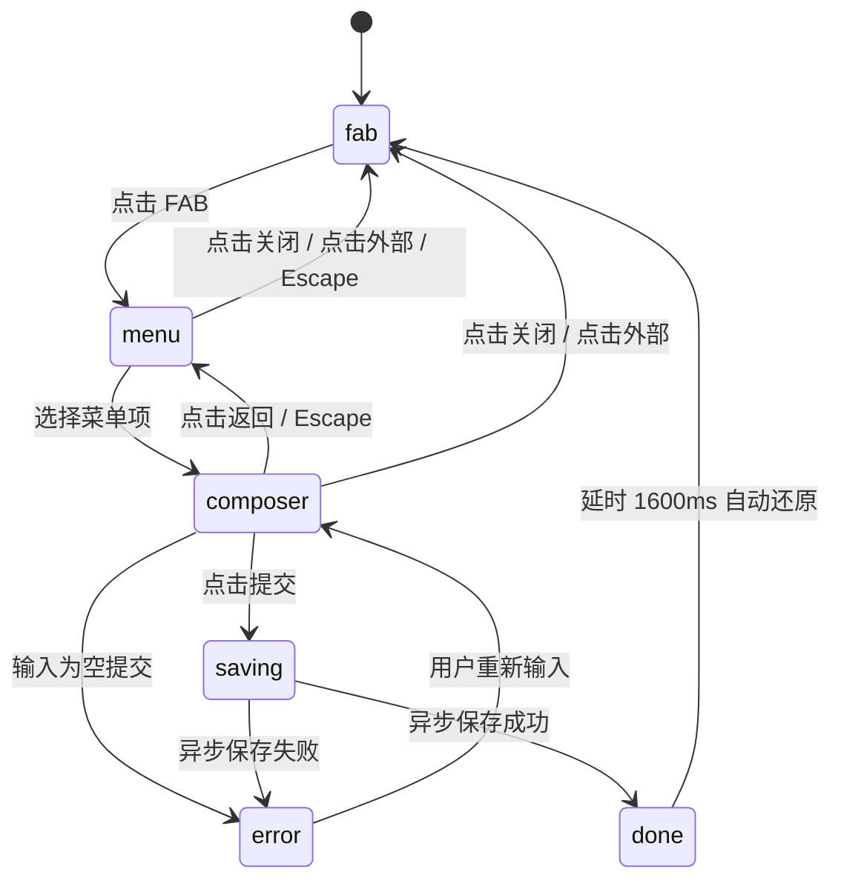

# Action Morph · 浮动操作形变面板

浮动操作按钮（FAB）在原地物理形变为多级操作菜单及就地录入表单，通过弹簧插值连续同步外壳宽高与圆角，实现零跳变内容交接与异步反馈。

## 原型清单

| 原型分组 | 原型元素 | 动效 / 状态变化 | 去向 |
| --- | --- | --- | --- |
| 悬浮操作 | FAB 主按钮（`.action-morph_fab`） | 按压微缩（scale 0.94）、加号旋转 90° 与对勾笔触书写切换 | 最小 DOM 及 JS 交互核心 |
| 外壳形变 | 形变容器（`.action-morph_shape`） | 测量子面板内容，物理弹簧连续插值宽、高、圆角与阴影层级 | 最小 DOM 容器及弹簧引擎 |
| 菜单面板 | 操作菜单（`.action-morph_menu`） | 纵向排列选项、滑动高光胶囊（`.action-morph_highlight`）平滑吸附跟随光标与焦点、选项错峰 35ms 滑入 | 菜单视图及高光驱动 |
| 表单面板 | 创建表单（`.action-morph_form`） | 标题与返回按钮横向交接、单选胶囊弹性滑动、输入校验失败弹性摇晃（nudge shake）、异步提交加载与成功态流转 | 表单视图及校验/提交机制 |
| 演示外壳 | 顶部标题、任务列表、完成统计、保存成功/失败切换器 | 静态展示与演示切换 | 演示外壳，已删除 |
| 演示外壳 | 顶栏、外观切换按钮、舞台居中容器 | 演示环境布局 | 演示外壳，已删除 |

## 适用

- 移动端或富桌面应用的全局快捷新建操作，需要在右下角原地平滑展开为多类型操作入口。
- 用户需要就地录入轻量任务、便签、提醒，避免弹出全屏遮罩或跳转新页面打断心流。
- 追求极致物理质感，要求尺寸、圆角、阴影在多级状态切换中保持单壳体连续平滑过渡。

## 不适用

- 单纯的局部表单提交或异步按钮，不需要层级菜单和面板形变 → [action-button](../buttons/action-button.md)
- 危险删除操作需要原地展开倒计时确认与撤销 → [confirm-morph](../buttons/confirm-morph.md)
- 传统的全局顶部导航栏与下拉菜单展开 → [morph-nav](morph-nav.md)
- 桌面底部应用托盘与多工具切换 → [dock](dock.md)

## 状态机

| 状态 | 进入条件 | 视觉表现 | 退出到 |
| --- | --- | --- | --- |
| fab | 初始默认态；或关闭/提交完成恢复 | 56×56px 圆形胶囊，中心显示加号图标，悬浮阴影 | menu |
| menu | 点击 FAB 触发展开 | 壳体弹簧扩展为菜单尺寸（宽约 256px），选项错峰滑入，高亮胶囊就绪 | fab / composer |
| composer | 点击菜单项（如 Task/Note/Reminder） | 壳体横向轻滑展开为表单尺寸（宽约 320px），输入框与单选组滑入，聚焦输入框 | menu / fab / saving / error |
| error | 表单校验为空或保存失败 | 输入框外层触发 900 刚度强阻尼快速左右弹性摇晃，状态栏显现错误提示 | composer |
| saving | 校验通过并点击提交 | 提交按钮文案微模糊切换为加载中，Spinner 旋转，表单元素禁用 | done / error |
| done | 异步保存成功 | 壳体收缩回 56×56px 圆形，图标展示对勾路径书写描边，停留 1600ms 后自动重置 | fab |



## 最小 DOM

```html
<div class="action-morph" data-corner="end" data-view="fab">
  <!-- 物理形变外壳：宽、高、圆角由弹簧直接驱动 -->
  <div class="action-morph-shape" style="width: 56px; height: 56px; border-radius: 28px;">
    <!-- 1. FAB 悬浮按钮视图 -->
    <div class="action-morph-face" data-face="fab">
      <button type="button" class="action-morph-fab" aria-label="创建新事项" aria-haspopup="menu" aria-expanded="false">
        <span class="action-morph-glyph" aria-hidden="true">
          <svg class="action-morph-icon-plus" width="22" height="22" viewBox="0 0 24 24" fill="none" stroke="currentColor" stroke-width="1.75" stroke-linecap="round" stroke-linejoin="round">
            <path d="M5 12h14" />
            <path d="M12 5v14" />
          </svg>
          <svg class="action-morph-icon-check" width="22" height="22" viewBox="0 0 24 24" fill="none" stroke="currentColor" stroke-width="2" stroke-linecap="round" stroke-linejoin="round">
            <path class="action-morph-check-path" d="M20 6 9 17l-5-5" />
          </svg>
        </span>
      </button>
    </div>

    <!-- 2. 操作菜单视图 -->
    <div class="action-morph-face" data-face="menu" inert>
      <div class="action-morph-header" data-child>
        <span class="action-morph-title">创建</span>
        <button type="button" class="action-morph-icon-btn" data-action="close" aria-label="关闭菜单">
          <svg width="16" height="16" viewBox="0 0 24 24" fill="none" stroke="currentColor" stroke-width="2" stroke-linecap="round"><path d="m18 6-12 12M6 6l12 12"/></svg>
        </button>
      </div>
      <div class="action-morph-menu" role="menu">
        <span class="action-morph-highlight" aria-hidden="true"></span>
        <button type="button" role="menuitem" class="action-morph-item" data-action="task" data-child>
          <span class="action-morph-item-icon">
            <svg width="18" height="18" viewBox="0 0 24 24" fill="none" stroke="currentColor" stroke-width="1.75"><path d="M13 5h8M13 12h8M13 19h8M3 5l2 2 4-4M3 12l2 2 4-4M3 19l2 2 4-4"/></svg>
          </span>
          <span class="action-morph-item-text">
            <span class="action-morph-item-label">新任务</span>
            <span class="action-morph-item-desc">添加到任务清单</span>
          </span>
          <kbd class="action-morph-kbd">T</kbd>
        </button>
        <button type="button" role="menuitem" class="action-morph-item" data-action="note" data-child>
          <span class="action-morph-item-icon">
            <svg width="18" height="18" viewBox="0 0 24 24" fill="none" stroke="currentColor" stroke-width="1.75"><path d="M21 9a2.4 2.4 0 0 0-.7-1.7l-3.6-3.6A2.4 2.4 0 0 0 15 3H5a2 2 0 0 0-2 2v14a2 2 0 0 0 2 2h14a2 2 0 0 0 2-2zM15 3v5a1 1 0 0 0 1 1h5"/></svg>
          </span>
          <span class="action-morph-item-text">
            <span class="action-morph-item-label">新便签</span>
            <span class="action-morph-item-desc">私密随手记</span>
          </span>
          <kbd class="action-morph-kbd">N</kbd>
        </button>
      </div>
    </div>

    <!-- 3. 表单录入视图 -->
    <div class="action-morph-face" data-face="composer" inert>
      <form class="action-morph-form">
        <div class="action-morph-header" data-child>
          <button type="button" class="action-morph-icon-btn" data-action="back" aria-label="返回菜单">
            <svg width="16" height="16" viewBox="0 0 24 24" fill="none" stroke="currentColor" stroke-width="2"><path d="m12 19-7-7 7-7M5 12h14"/></svg>
          </button>
          <span class="action-morph-title">新建事项</span>
          <button type="button" class="action-morph-icon-btn" data-action="close" aria-label="关闭表单">
            <svg width="16" height="16" viewBox="0 0 24 24" fill="none" stroke="currentColor" stroke-width="2"><path d="m18 6-12 12M6 6l12 12"/></svg>
          </button>
        </div>
        <div class="action-morph-shake-wrap" data-child>
          <input type="text" class="action-morph-field" placeholder="需要做点什么？" aria-label="事项内容" autocomplete="off" />
        </div>
        <div class="action-morph-choice-block" data-child>
          <span class="action-morph-choice-label">截止日期</span>
          <div class="action-morph-choices" role="radiogroup" aria-label="截止时间">
            <button type="button" role="radio" aria-checked="true" class="action-morph-choice" data-index="0">
              <span class="action-morph-choice-pill" aria-hidden="true"></span>
              <span class="action-morph-choice-text">今天</span>
            </button>
            <button type="button" role="radio" aria-checked="false" class="action-morph-choice" data-index="1">
              <span class="action-morph-choice-text">明天</span>
            </button>
          </div>
        </div>
        <div class="action-morph-footer" data-child>
          <span class="action-morph-status" aria-live="polite"></span>
          <button type="submit" class="action-morph-submit">
            <span class="action-morph-submit-face" data-idle>保存<svg width="14" height="14" viewBox="0 0 24 24" fill="none" stroke="currentColor" stroke-width="2"><path d="M9 10 4 15l5 5M20 4v7a4 4 0 0 1-4 4H4"/></svg></span>
            <span class="action-morph-submit-face" data-busy aria-hidden="true"><svg class="action-morph-spinner" width="16" height="16" viewBox="0 0 24 24" fill="none" stroke="currentColor" stroke-width="2.5"><path d="M12 2a10 10 0 1 0 10 10"/></svg>保存中</span>
          </button>
        </div>
      </form>
    </div>
  </div>
  <span class="action-morph-sr-only" role="status" aria-live="polite"></span>
</div>
```

- `.action-morph`：宿主定位根容器，设置定位锚点（如 `data-corner="end"` 贴齐右下角）。
- `.action-morph-shape`：核心物理外壳，通过 JS 弹簧动态赋值 `width`、`height`、`border-radius`，并负责外层阴影与背景。
- `.action-morph-face`：子面板挂载槽，采用绝对定位叠加，在切换时执行横向位移与模糊交接，非活动面板设置 `inert` 属性阻断焦点。
- `.action-morph-highlight`：菜单内部共享滑动高光条，跟随光标或键盘聚焦项在 Y 轴物理滑动。
- `.action-morph-shake-wrap`：输入框弹性摇晃承载层，校验失败时驱动 X 轴快速物理颤动。
- `.action-morph-choice-pill`：单选组高亮滑块，点击不同选项时在 X 轴平滑过渡。

## 参数

| 名称 | 值 | 用于 | 来源 |
| --- | --- | --- | --- |
| 外壳展开弹簧 | `visualDuration: 0.46s, bounce: 0.16` | `.action-morph-shape` 宽高展开插值 | 原型 |
| 外壳收缩弹簧 | `visualDuration: 0.38s, bounce: 0.04` | `.action-morph-shape` 宽高收起插值 | 原型 |
| 高光滑动弹簧 | `visualDuration: 0.28s, bounce: 0.08` | `.action-morph-highlight` 纵向滑动 | 原型 |
| 面板交接滑动 | `visualDuration: 0.4s, bounce: 0.06` | `.action-morph-face` 横向滑入滑出 | 原型 |
| 按压微缩弹簧 | `visualDuration: 0.2s, bounce: 0.1` | FAB 按压缩放（scale 0.94） | 原型 |
| 面板交接位移 | `28px`（退场位移系数 `0.7`） | 横向切换滑行距离 | 原型 |
| 面板入场缩放 | `scale(0.9)` 至 `scale(1)` | 面板淡入几何缩放 | 原型 |
| 面板退场缩放 | `scale(1)` 至 `scale(0.92)` | 面板退出几何缩放 | 原型 |
| 面板入场渐显 | `220ms` 延迟 `50ms` | opacity & blur 过渡 | 原型 |
| 面板退场渐隐 | `120ms` | opacity & blur 过渡 | 原型 |
| 子元素错峰步长 | `60ms + index * 35ms` / `translateY(8px)` | 面板内部项错峰进场 | 原型 |
| 成功展示保持 | `1600ms` | 对勾图标保持展示时长 | 原型 |
| 校验失败摇晃 | `stiffness: 900, damping: 12, velocity: -260` | 输入框 X 轴弹性阻尼摇晃 | 原型 |
| 面板展开圆角 | `24px`（FAB 态为 `28px`） | `.action-morph-shape` 圆角过渡 | 原型 |

## CSS

```css
.action-morph {
  --am-size: 56px;
  --am-accent: #0b0b0b;
  --am-accent-fg: #ffffff;
  --am-surface: #ffffff;
  --am-text: #111111;
  --am-text-muted: #737373;
  --am-border: rgba(0, 0, 0, 0.08);
  --am-border-strong: rgba(0, 0, 0, 0.18);
  --am-shadow-fab: 0 6px 18px rgba(0, 0, 0, 0.12), 0 1px 3px rgba(0, 0, 0, 0.05);
  --am-shadow-panel: 0 20px 48px rgba(0, 0, 0, 0.16), 0 3px 10px rgba(0, 0, 0, 0.06);
  --am-success: #16a34a;
  --am-danger: #e11d48;

  position: relative;
  z-index: 40;
  width: var(--am-size);
  height: var(--am-size);
  font-family: system-ui, -apple-system, BlinkMacSystemFont, "Segoe UI", Roboto, sans-serif;
  font-size: 14px;
  color: var(--am-text);
}

.action-morph[data-corner="end"] {
  --am-origin-x: 100%;
}
.action-morph[data-corner="start"] {
  --am-origin-x: 0%;
}

.action-morph-shape {
  position: absolute;
  right: 0;
  bottom: 0;
  overflow: hidden;
  background: var(--am-accent);
  color: var(--am-accent-fg);
  box-shadow: var(--am-shadow-fab);
  transform-origin: var(--am-origin-x) 100%;
  transition: background-color 240ms cubic-bezier(0.22, 1, 0.36, 1),
              box-shadow 400ms cubic-bezier(0.22, 1, 0.36, 1);
}
.action-morph[data-corner="start"] .action-morph-shape {
  right: auto;
  left: 0;
}

.action-morph:not([data-view="fab"]) .action-morph-shape {
  background: var(--am-surface);
  color: var(--am-text);
  box-shadow: var(--am-shadow-panel);
  border: 1px solid var(--am-border);
}
.action-morph[data-view="fab"][data-done] .action-morph-shape {
  background: var(--am-success);
  color: #ffffff;
}

.action-morph-face {
  position: absolute;
  right: 0;
  bottom: 0;
  box-sizing: border-box;
  transform-origin: var(--am-origin-x) 100%;
}
.action-morph[data-corner="start"] .action-morph-face {
  right: auto;
  left: 0;
}
.action-morph-face[inert] {
  pointer-events: none;
  visibility: hidden;
}

/* FAB 面板 */
.action-morph-face[data-face="fab"] {
  width: var(--am-size);
  height: var(--am-size);
}
.action-morph-fab {
  display: grid;
  place-items: center;
  width: 100%;
  height: 100%;
  padding: 0;
  border: 0;
  border-radius: 50%;
  background: transparent;
  color: inherit;
  cursor: pointer;
  outline: none;
}
.action-morph-fab:focus-visible {
  outline: 2px solid currentColor;
  outline-offset: 2px;
}
.action-morph-glyph {
  display: grid;
  place-items: center;
  width: 24px;
  height: 24px;
}
.action-morph-glyph > * {
  grid-area: 1 / 1;
  transition: opacity 160ms ease, transform 240ms cubic-bezier(0.16, 1, 0.3, 1);
}
.action-morph-icon-check {
  opacity: 0;
  transform: scale(0.6) rotate(-45deg);
}
.action-morph[data-done] .action-morph-icon-plus {
  opacity: 0;
  transform: scale(0.6) rotate(45deg);
}
.action-morph[data-done] .action-morph-icon-check {
  opacity: 1;
  transform: scale(1) rotate(0deg);
}
.action-morph-check-path {
  stroke-dasharray: 24;
  stroke-dashoffset: 0;
  transition: stroke-dashoffset 320ms ease;
}

/* 菜单与表单通用顶栏 */
.action-morph-face[data-face="menu"] {
  width: min(16rem, calc(100vw - 2rem));
  padding: 8px;
}
.action-morph-face[data-face="composer"] {
  width: min(20rem, calc(100vw - 2rem));
  padding: 10px;
}
.action-morph-header {
  display: flex;
  align-items: center;
  justify-content: space-between;
  min-height: 36px;
  padding: 0 4px 6px;
}
.action-morph-title {
  font-weight: 600;
  font-size: 14px;
  color: var(--am-text);
}
.action-morph-icon-btn {
  display: grid;
  place-items: center;
  width: 28px;
  height: 28px;
  padding: 0;
  border: 0;
  border-radius: 9999px;
  background: transparent;
  color: var(--am-text-muted);
  cursor: pointer;
}
.action-morph-icon-btn:hover {
  background: rgba(0, 0, 0, 0.06);
  color: var(--am-text);
}
.action-morph-icon-btn:focus-visible {
  outline: 2px solid currentColor;
}

/* 菜单项 */
.action-morph-menu {
  position: relative;
  display: grid;
  gap: 2px;
}
.action-morph-highlight {
  position: absolute;
  top: 0;
  right: 0;
  left: 0;
  border-radius: 10px;
  background: rgba(0, 0, 0, 0.05);
  pointer-events: none;
  opacity: 0;
  will-change: transform, height, opacity;
}
.action-morph-item {
  position: relative;
  display: flex;
  align-items: center;
  gap: 10px;
  padding: 8px 10px;
  border: 0;
  border-radius: 10px;
  background: transparent;
  color: inherit;
  cursor: pointer;
  text-align: left;
}
.action-morph-item:focus-visible {
  outline: 2px solid currentColor;
}
.action-morph-item-icon {
  display: grid;
  place-items: center;
  color: var(--am-text-muted);
}
.action-morph-item-text {
  flex: 1;
  display: grid;
  gap: 1px;
}
.action-morph-item-label {
  font-weight: 500;
  font-size: 13.5px;
}
.action-morph-item-desc {
  font-size: 12px;
  color: var(--am-text-muted);
}
.action-morph-kbd {
  display: grid;
  place-items: center;
  min-width: 20px;
  height: 20px;
  padding: 0 4px;
  border: 1px solid var(--am-border);
  border-radius: 5px;
  font-size: 11px;
  color: var(--am-text-muted);
}

/* 表单与输入框 */
.action-morph-form {
  display: grid;
  gap: 10px;
}
.action-morph-shake-wrap {
  will-change: transform;
}
.action-morph-field {
  display: block;
  width: 100%;
  box-sizing: border-box;
  padding: 9px 12px;
  border: 1px solid var(--am-border-strong);
  border-radius: 10px;
  background: #fbfbfb;
  color: var(--am-text);
  font: inherit;
  font-size: 14px;
  outline: none;
  transition: border-color 160ms ease, box-shadow 160ms ease;
}
.action-morph-field:focus {
  border-color: var(--am-text);
  box-shadow: 0 0 0 1px var(--am-text);
}
.action-morph-field[aria-invalid="true"] {
  border-color: var(--am-danger);
  box-shadow: 0 0 0 1px var(--am-danger);
}

/* 单选日期组 */
.action-morph-choice-block {
  display: grid;
  gap: 6px;
}
.action-morph-choice-label {
  font-size: 12px;
  color: var(--am-text-muted);
}
.action-morph-choices {
  position: relative;
  display: grid;
  grid-template-columns: 1fr 1fr;
  gap: 2px;
  padding: 3px;
  border-radius: 9999px;
  background: rgba(0, 0, 0, 0.05);
}
.action-morph-choice {
  position: relative;
  display: grid;
  place-items: center;
  height: 28px;
  border: 0;
  border-radius: 9999px;
  background: transparent;
  color: var(--am-text-muted);
  cursor: pointer;
  font: inherit;
  font-size: 12px;
  font-weight: 500;
}
.action-morph-choice[aria-checked="true"] {
  color: var(--am-text);
}
.action-morph-choice-pill {
  position: absolute;
  inset: 0;
  border-radius: inherit;
  background: #ffffff;
  box-shadow: 0 1px 3px rgba(0, 0, 0, 0.08);
}
.action-morph-choice-text {
  position: relative;
  z-index: 1;
}

/* 底部提交 */
.action-morph-footer {
  display: flex;
  align-items: center;
  justify-content: space-between;
  min-height: 36px;
  gap: 8px;
}
.action-morph-status {
  font-size: 12px;
  color: var(--am-danger);
}
.action-morph-submit {
  display: grid;
  place-items: center;
  height: 34px;
  padding: 0 16px;
  border: 0;
  border-radius: 9999px;
  background: var(--am-accent);
  color: var(--am-accent-fg);
  font: inherit;
  font-weight: 500;
  font-size: 13px;
  cursor: pointer;
  transition: opacity 160ms ease, transform 120ms ease;
}
.action-morph-submit:active {
  transform: scale(0.97);
}
.action-morph-submitFace,
.action-morph-submit-face {
  display: inline-flex;
  align-items: center;
  gap: 6px;
  grid-area: 1 / 1;
  transition: opacity 160ms ease, filter 160ms ease;
}
.action-morph-submit-face[data-busy] {
  opacity: 0;
  filter: blur(2px);
  pointer-events: none;
}
.action-morph-submit[data-state="busy"] .action-morph-submit-face[data-idle] {
  opacity: 0;
  filter: blur(2px);
}
.action-morph-submit[data-state="busy"] .action-morph-submit-face[data-busy] {
  opacity: 1;
  filter: none;
}
.action-morph-spinner {
  animation: actionMorphSpin 0.7s linear infinite;
}
@keyframes actionMorphSpin {
  to { transform: rotate(360deg); }
}

.action-morph-sr-only {
  position: absolute;
  width: 1px;
  height: 1px;
  padding: 0;
  margin: -1px;
  overflow: hidden;
  clip: rect(0, 0, 0, 0);
  border: 0;
}

@media (prefers-reduced-motion: reduce) {
  .action-morph-shape,
  .action-morph-submit,
  .action-morph-glyph > * {
    transition: none !important;
  }
  .action-morph-spinner {
    animation-duration: 2s;
  }
}
```

## JS

```js
export function createActionMorph(root, options = {}) {
  const shape = root.querySelector('.action-morph-shape');
  const fabFace = root.querySelector('.action-morph-face[data-face="fab"]');
  const menuFace = root.querySelector('.action-morph-face[data-face="menu"]');
  const composerFace = root.querySelector('.action-morph-face[data-face="composer"]');
  const fabBtn = root.querySelector('.action-morph-fab');
  const menuHighlight = root.querySelector('.action-morph-highlight');
  const menuItems = Array.from(root.querySelectorAll('.action-morph-item'));
  const shakeWrap = root.querySelector('.action-morph-shake-wrap');
  const input = root.querySelector('.action-morph-field');
  const choices = Array.from(root.querySelectorAll('.action-morph-choice'));
  const submitBtn = root.querySelector('.action-morph-submit');
  const statusEl = root.querySelector('.action-morph-status');
  const srOnly = root.querySelector('.action-morph-sr-only');

  const reducedMotion = window.matchMedia('(prefers-reduced-motion: reduce)').matches;
  let view = 'fab'; // 'fab' | 'menu' | 'composer'
  let busy = false;
  let done = false;
  let animId = null;
  let doneTimer = null;
  let shakeAnimId = null;

  // 物理阻尼弹簧积分器
  function springStep(state, target, stiffness, damping, dt) {
    const force = -stiffness * (state.pos - target);
    const dampingForce = -damping * state.vel;
    const accel = force + dampingForce;
    state.vel += accel * dt;
    state.pos += state.vel * dt;
  }

  // 动画状态管理
  const shapeMotion = {
    w: { pos: 56, vel: 0 },
    h: { pos: 56, vel: 0 },
    r: { pos: 28, vel: 0 }
  };

  function updateShape(instant = false) {
    cancelAnimationFrame(animId);
    let targetW = 56, targetH = 56, targetR = 28;

    if (view === 'menu' && menuFace) {
      targetW = menuFace.offsetWidth || 256;
      targetH = menuFace.offsetHeight || 160;
      targetR = 20;
    } else if (view === 'composer' && composerFace) {
      targetW = composerFace.offsetWidth || 320;
      targetH = composerFace.offsetHeight || 220;
      targetR = 24;
    }

    if (instant || reducedMotion) {
      shapeMotion.w.pos = targetW; shapeMotion.w.vel = 0;
      shapeMotion.h.pos = targetH; shapeMotion.h.vel = 0;
      shapeMotion.r.pos = targetR; shapeMotion.r.vel = 0;
      shape.style.width = `${targetW}px`;
      shape.style.height = `${targetH}px`;
      shape.style.borderRadius = `${targetR}px`;
      return;
    }

    const stiffness = 220;
    const damping = 22;
    let lastTime = performance.now();

    function step(now) {
      const dt = Math.min((now - lastTime) / 1000, 0.032);
      lastTime = now;

      springStep(shapeMotion.w, targetW, stiffness, damping, dt);
      springStep(shapeMotion.h, targetH, stiffness, damping, dt);
      springStep(shapeMotion.r, targetR, stiffness, damping, dt);

      shape.style.width = `${Math.round(shapeMotion.w.pos)}px`;
      shape.style.height = `${Math.round(shapeMotion.h.pos)}px`;
      shape.style.borderRadius = `${Math.round(shapeMotion.r.pos)}px`;

      const doneW = Math.abs(shapeMotion.w.pos - targetW) < 0.5 && Math.abs(shapeMotion.w.vel) < 2;
      const doneH = Math.abs(shapeMotion.h.pos - targetH) < 0.5 && Math.abs(shapeMotion.h.vel) < 2;
      const doneR = Math.abs(shapeMotion.r.pos - targetR) < 0.5 && Math.abs(shapeMotion.r.vel) < 2;

      if (!doneW || !doneH || !doneR) {
        animId = requestAnimationFrame(step);
      } else {
        shape.style.width = `${targetW}px`;
        shape.style.height = `${targetH}px`;
        shape.style.borderRadius = `${targetR}px`;
      }
    }
    animId = requestAnimationFrame(step);
  }

  // 校验失败弹性微晃
  function nudge() {
    if (reducedMotion || !shakeWrap) return;
    cancelAnimationFrame(shakeAnimId);
    let pos = 0, vel = -260;
    const stiffness = 900;
    const damping = 12;
    let last = performance.now();

    function tick(now) {
      const dt = Math.min((now - last) / 1000, 0.032);
      last = now;
      const accel = -stiffness * pos - damping * vel;
      vel += accel * dt;
      pos += vel * dt;
      shakeWrap.style.transform = `translateX(${pos.toFixed(2)}px)`;

      if (Math.abs(pos) > 0.2 || Math.abs(vel) > 5) {
        shakeAnimId = requestAnimationFrame(tick);
      } else {
        shakeWrap.style.transform = 'none';
      }
    }
    shakeAnimId = requestAnimationFrame(tick);
  }

  // 切换面板视图
  function setView(nextView, instant = false) {
    if (view === nextView && !instant) return;
    view = nextView;
    root.dataset.view = nextView;

    [fabFace, menuFace, composerFace].forEach(face => {
      if (!face) return;
      const isActive = face.dataset.face === nextView;
      if (isActive) {
        face.removeAttribute('inert');
      } else {
        face.setAttribute('inert', '');
      }
    });

    if (nextView === 'fab') {
      fabBtn?.setAttribute('aria-expanded', 'false');
    } else if (nextView === 'menu') {
      fabBtn?.setAttribute('aria-expanded', 'true');
      menuItems[0]?.focus({ preventScroll: true });
    } else if (nextView === 'composer') {
      input?.focus({ preventScroll: true });
    }

    updateShape(instant);
  }

  // 菜单项高亮跟随
  function highlightItem(item) {
    if (!menuHighlight) return;
    if (!item) {
      menuHighlight.style.opacity = '0';
      return;
    }
    menuHighlight.style.opacity = '1';
    menuHighlight.style.transform = `translateY(${item.offsetTop}px)`;
    menuHighlight.style.height = `${item.offsetHeight}px`;
  }

  // 事件绑定
  function onFabClick() {
    if (view === 'fab') setView('menu');
  }

  function onCloseClick() {
    setView('fab');
  }

  function onBackClick() {
    setView('menu');
  }

  function onItemClick(e) {
    const btn = e.currentTarget;
    const action = btn.dataset.action;
    setView('composer');
  }

  function onItemEnter(e) {
    highlightItem(e.currentTarget);
  }

  function onMenuLeave() {
    highlightItem(null);
  }

  function onChoiceClick(e) {
    const clicked = e.currentTarget;
    choices.forEach(c => {
      const isSel = c === clicked;
      c.setAttribute('aria-checked', String(isSel));
      const pill = c.querySelector('.action-morph-choice-pill');
      if (pill) pill.remove();
    });
    const pill = document.createElement('span');
    pill.className = 'action-morph-choice-pill';
    pill.setAttribute('aria-hidden', 'true');
    clicked.prepend(pill);
  }

  async function onSubmit(e) {
    e.preventDefault();
    if (busy) return;
    const val = input ? input.value.trim() : '';
    if (!val) {
      if (statusEl) statusEl.textContent = '请输入内容';
      if (input) input.setAttribute('aria-invalid', 'true');
      nudge();
      input?.focus();
      return;
    }

    if (input) input.removeAttribute('aria-invalid');
    if (statusEl) statusEl.textContent = '';
    busy = true;
    submitBtn?.setAttribute('data-state', 'busy');

    // 模拟或调用外部保存
    if (typeof options.onSubmit === 'function') {
      await options.onSubmit(val);
    } else {
      await new Promise(r => setTimeout(r, 600));
    }

    busy = false;
    submitBtn?.removeAttribute('data-state');
    done = true;
    root.setAttribute('data-done', '');
    if (srOnly) srOnly.textContent = '保存成功';
    setView('fab');

    clearTimeout(doneTimer);
    doneTimer = setTimeout(() => {
      done = false;
      root.removeAttribute('data-done');
    }, 1600);
  }

  function onKeyDown(e) {
    if (e.key === 'Escape' && view !== 'fab') {
      e.preventDefault();
      if (view === 'composer') setView('menu');
      else setView('fab');
    }
  }

  function onDocPointerDown(e) {
    if (view !== 'fab' && !root.contains(e.target)) {
      setView('fab');
    }
  }

  // 绑定监听器
  fabBtn?.addEventListener('click', onFabClick);
  root.querySelectorAll('[data-action="close"]').forEach(b => b.addEventListener('click', onCloseClick));
  root.querySelectorAll('[data-action="back"]').forEach(b => b.addEventListener('click', onBackClick));
  menuItems.forEach(item => {
    item.addEventListener('click', onItemClick);
    item.addEventListener('pointerenter', onItemEnter);
    item.addEventListener('focus', onItemEnter);
  });
  root.querySelector('.action-morph-menu')?.addEventListener('pointerleave', onMenuLeave);
  choices.forEach(c => c.addEventListener('click', onChoiceClick));
  root.querySelector('.action-morph-form')?.addEventListener('submit', onSubmit);
  document.addEventListener('keydown', onKeyDown);
  document.addEventListener('pointerdown', onDocPointerDown);

  // 初始化
  setView('fab', true);

  return {
    open: () => setView('menu'),
    compose: () => setView('composer'),
    close: () => setView('fab'),
    submit: () => submitBtn?.click(),
    getState: () => ({ view, busy, done }),
    destroy: () => {
      cancelAnimationFrame(animId);
      cancelAnimationFrame(shakeAnimId);
      clearTimeout(doneTimer);
      fabBtn?.removeEventListener('click', onFabClick);
      root.querySelectorAll('[data-action="close"]').forEach(b => b.removeEventListener('click', onCloseClick));
      root.querySelectorAll('[data-action="back"]').forEach(b => b.removeEventListener('click', onBackClick));
      menuItems.forEach(item => {
        item.removeEventListener('click', onItemClick);
        item.removeEventListener('pointerenter', onItemEnter);
        item.removeEventListener('focus', onItemEnter);
      });
      choices.forEach(c => c.removeEventListener('click', onChoiceClick));
      document.removeEventListener('keydown', onKeyDown);
      document.removeEventListener('pointerdown', onDocPointerDown);
    }
  };
}
```

## 接入目标项目

- 状态来源：
  - 外部可直接调用 `createActionMorph(rootEl, { onSubmit: async (val) => { ... } })` 挂载实例。
  - 数据提交通过 `onSubmit` 回调注入项目业务 API，成功后自动触发成功对勾与 1600ms 定时复原。
- 尺寸策略：
  - 外壳采用 `min(20rem, calc(100vw - 2rem))` 约束最大宽度，确保在移动端 320px 屏幕至桌面宽屏皆可自适应居中或锚定。
  - 面板高度由 DOM 内容自然撑开，测量引擎在视图切换时即时读取并调度物理弹簧插值。
- 驱动方式：
  - 挂载时返回控制句柄对象，包含 `open()`、`compose()`、`close()`、`submit()`、`getState()` 与 `destroy()`。
  - 卸载时调用 `destroy()` 清理全局事件监听、定时器与动画帧。

## 重入与清理

- 连续快速切换：每次调用 `setView` 时均自动取消上一次未完成的 `requestAnimationFrame` 弹簧帧，并以当前实际宽高/位置为初值启动新一轮物理动画，绝无跳变或重叠执行。
- 成功状态防抖：在对勾展示的 1600ms 内，再次点击 FAB 会即时清理 `doneTimer`，提前退出成功态并进入操作菜单。
- 卸载清理：`destroy()` 完整解绑 document 级别的 `pointerdown` 与 `keydown` 监听器，取消全部 requestAnimationFrame 和延迟定时器。

## 减少动态效果

- 满足 `prefers-reduced-motion: reduce` 时：
  - 停用外壳宽高与圆角的物理弹簧连续过渡，直接将最终目标尺寸赋值给 DOM 节点。
  - 停用面板交接横向位移与模糊滤镜，仅保留即时透明度切换。
  - 停用输入框校验失败时的物理摇晃（nudge shake），仅通过高亮边框和文本展示错误。
  - 加载 Spinner 旋转动画放缓至 2.4s。

## 焦点与键盘

- 键盘可达性：
  - FAB 聚焦后按回车展开菜单，菜单项可通过上下方向键循环聚焦，或按快捷键字母直达对应项。
  - 展开面板时焦点自动流转至首个关键交互节点（菜单首项或表单输入框）。
  - 非活动面板节点设置 HTML5 原生 `inert` 属性，彻底防止屏幕阅读器或键盘 Tab 键误穿透聚焦隐藏节点。
  - 支持按下 `Escape` 键逐级返回：表单视图退出到菜单，菜单视图退出并关闭至 FAB。
  - 悬停与聚焦均同步驱动高亮胶囊滑动。

## 兼容回退

| 特性 | 不支持时 |
| --- | --- |
| `inert` 属性 | 降级为通过 CSS `visibility: hidden` 配合 `pointer-events: none` 阻断非活动层交互 |
| `ResizeObserver` | 降级为在视图切换或窗口 resize 时单次同步测量 `offsetWidth` / `offsetHeight` |

## 验收清单

- [ ] 点击 FAB 悬浮按钮，外壳平滑形变为菜单面板，圆角与尺寸连续流转无闪烁。
- [ ] 鼠标悬停或方向键切换菜单项，背景高亮胶囊平滑吸附跟随。
- [ ] 点击菜单项进入表单录入视图，输入框自动获得焦点。
- [ ] 输入为空点击保存时，输入框触发弹性微晃（nudge shake）并显示错误文案。
- [ ] 录入有效内容提交后，按钮显示 Spinner，成功后外壳收缩为圆形并展示对勾描边，1600ms 后自动恢复为加号。
- [ ] 开启系统减少动态效果偏好时，尺寸瞬时定位，无多余晃动与位移。
