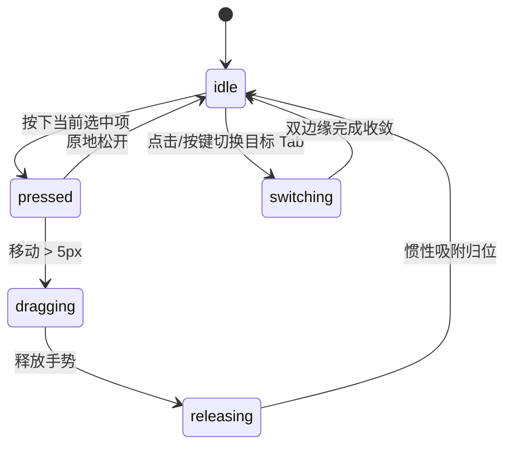

# Liquid Tab Bar · 液态拉伸标签栏

具有双边缘黏性流动形变、圆角剪裁反色高光、文字插槽动态伸缩与惯性拖拽吸附的流体导航栏。

## 原型清单

| 原型分组 | 原型元素 | 动效 / 状态变化 | 去向 |
| --- | --- | --- | --- |
| 顶层液态透镜 | 高光遮罩层（`.liquid-tab-lens`） | 利用 `clip-path: inset(...) round 20px` 裁切反色高光区域，前进与后退边缘快慢解耦 | 核心液态透镜引擎 |
| 标签插槽 | 基础与高光按钮（`.liquid-tab-btn`） | 文字先测量再展开，非激活标签文字先淡出再收缩宽度，双层图标重叠反色 | 标签宽度与文字排版 |
| 手势与拖拽 | 选定项水平拖动 | 超过 5px 开启手势，双边缘异步跟随形成拉伸，边界橡皮筋阻尼，释放时带惯性速度吸附 | 拖拽与释放投影 |
| 按压与悬停 | 按压微回弹 | 按压时高光边缘向内收紧 2px，松手释放时弹性过冲（bounce 0.35），悬停轻微侧向倾斜 | 触觉物理反馈 |
| 标签模式选择器 | Active / All / Icons 模式条 | 演示环境布局切换 | 演示外壳，已删除 |
| 说明文本与面板 | 面板展示文字行（`.liquid-tab-note`） | 对应标签说明文字交叉淡入淡出 | 关联面板展示 |

## 适用

- 移动端或紧凑桌面应用的主导航栏，需要生动、有机、具有触觉弹性的高品质 Tab 切换。
- 导航项在激活时展开文字，未激活时折叠为纯图标，追求无外框抖动的自适应宽度平滑伸缩。
- 支持触摸屏或鼠标光标在标签栏上水平直接滑动或擦动切换。

## 不适用

- 包含多层级形状、评论计数徽标与拖拽排序的专业绘图底栏 → [dock](dock.md)
- 常规桌面级简单下划线指示的选项卡 → [button-group](../buttons/button-group.md)
- 右下角单个 FAB 原地展开多功能表单 → [action-morph](action-morph.md)
- 顶部全功能网站多层级下拉菜单 → [morph-nav](morph-nav.md)

## 状态机

| 状态 | 进入条件 | 视觉表现 | 退出到 |
| --- | --- | --- | --- |
| idle | 初始静止；某标签处于选中态 | 高光透镜平滑包裹当前标签，文字展开，图标呈反色高亮 | pressed / dragging / switching |
| pressed | 当前标签上鼠标按下或触控按住 | 透镜边缘收紧 2px，圆角收敛，蓄力准备拖拽 | idle / dragging |
| dragging | 按住沿水平轴拖动超过 5px | 透镜在两端产生速度差拉伸，越界时触发橡皮筋阻尼（rubber 0.45） | releasing |
| releasing | 拖拽释放 | 计算瞬时释放速度（decay 0.993），投射吸附到最近目标标签，回弹归位 | idle |
| switching | 点击其他标签或键盘切换 | 前进边缘以 70ms 疾速扩展，后退边缘以 200ms 慢速收拢，形成拖尾液态形变 | idle |



## 最小 DOM

```html
<div class="liquid-tab-root" role="tablist" aria-label="主导航">
  <!-- 底层基础按钮行 -->
  <div class="liquid-tab-row liquid-tab-base">
    <button type="button" role="tab" class="liquid-tab-btn" data-index="0" aria-selected="true" id="tab-home">
      <span class="liquid-tab-icon">
        <svg width="20" height="20" viewBox="0 0 24 24" fill="none" stroke="currentColor" stroke-width="2"><path d="m3 9 9-7 9 7v11a2 2 0 0 1-2 2H5a2 2 0 0 1-2-2z"/></svg>
      </span>
      <span class="liquid-tab-label">首页</span>
    </button>
    <button type="button" role="tab" class="liquid-tab-btn" data-index="1" aria-selected="false" id="tab-saved">
      <span class="liquid-tab-icon">
        <svg width="20" height="20" viewBox="0 0 24 24" fill="none" stroke="currentColor" stroke-width="2"><path d="m19 21-7-4-7 4V5a2 2 0 0 1 2-2h10a2 2 0 0 1 2 2v16z"/></svg>
      </span>
    </button>
    <button type="button" role="tab" class="liquid-tab-btn" data-index="2" aria-selected="false" id="tab-inbox">
      <span class="liquid-tab-icon">
        <svg width="20" height="20" viewBox="0 0 24 24" fill="none" stroke="currentColor" stroke-width="2"><rect width="20" height="16" x="2" y="4" rx="2"/><path d="m22 7-8.97 5.7a1.94 1.94 0 0 1-2.06 0L2 7"/></svg>
      </span>
    </button>
    <button type="button" role="tab" class="liquid-tab-btn" data-index="3" aria-selected="false" id="tab-profile">
      <span class="liquid-tab-icon">
        <svg width="20" height="20" viewBox="0 0 24 24" fill="none" stroke="currentColor" stroke-width="2"><circle cx="12" cy="8" r="5"/><path d="M20 21a8 8 0 1 0-16 0"/></svg>
      </span>
    </button>
  </div>

  <!-- 顶层高光反色透镜层（通过 clip-path 裁切显现） -->
  <div class="liquid-tab-lens" aria-hidden="true">
    <div class="liquid-tab-row liquid-tab-front">
      <div class="liquid-tab-btn" data-index="0">
        <span class="liquid-tab-icon">
          <svg width="20" height="20" viewBox="0 0 24 24" fill="currentColor"><path d="m3 9 9-7 9 7v11a2 2 0 0 1-2 2H5a2 2 0 0 1-2-2z"/></svg>
        </span>
        <span class="liquid-tab-label">首页</span>
      </div>
      <div class="liquid-tab-btn" data-index="1">
        <span class="liquid-tab-icon">
          <svg width="20" height="20" viewBox="0 0 24 24" fill="currentColor"><path d="m19 21-7-4-7 4V5a2 2 0 0 1 2-2h10a2 2 0 0 1 2 2v16z"/></svg>
        </span>
      </div>
      <div class="liquid-tab-btn" data-index="2">
        <span class="liquid-tab-icon">
          <svg width="20" height="20" viewBox="0 0 24 24" fill="currentColor"><rect width="20" height="16" x="2" y="4" rx="2"/><path d="m22 7-8.97 5.7a1.94 1.94 0 0 1-2.06 0L2 7"/></svg>
        </span>
      </div>
      <div class="liquid-tab-btn" data-index="3">
        <span class="liquid-tab-icon">
          <svg width="20" height="20" viewBox="0 0 24 24" fill="currentColor"><circle cx="12" cy="8" r="5"/><path d="M20 21a8 8 0 1 0-16 0"/></svg>
        </span>
      </div>
    </div>
  </div>
</div>
```

- `.liquid-tab-root`：整组导航的胶囊外框宿主，根据各标签展开宽度动态更新整体物理宽度。
- `.liquid-tab-base`：底层默认视图，包含空心线框图标与非反色文字。
- `.liquid-tab-lens`：液态高光层，背景为反色实色药丸，通过 CSS `clip-path` 动态限定透镜显示矩形。
- `.liquid-tab-front`：透镜内部的完整结构镜像，包含填充实色图标与反色文字，透镜滑到对应位置时自然透出。
- `.liquid-tab-label`：标签文字插槽，根据激活状态动态淡入淡出并平移。

## 参数

| 名称 | 值 | 用于 | 来源 |
| --- | --- | --- | --- |
| 整体形变弹簧 | `visualDuration: 0.42s, bounce: 0.16` | 标签选中与整体宽度自适应 | 原型 |
| 疾速前端边缘 | `visualDuration: 0.07s, bounce: 0` | 透镜前进边缘拉伸 | 原型 |
| 迟滞后端边缘 | `visualDuration: 0.20s, bounce: 0` | 透镜后退边缘收束 | 原型 |
| 按压压缩弹簧 | `visualDuration: 0.20s, bounce: 0` | 按压时高光边缘收缩 2px | 原型 |
| 松开回弹弹簧 | `visualDuration: 0.40s, bounce: 0.35` | 松手时微过冲回弹 | 原型 |
| 悬停倾斜系数 | `0.14` | 光标悬停时轻微侧向引力位移 | 原型 |
| 基础槽位宽度 | `44px` | 未展开文本时的基础正方形尺寸 | 原型 |
| 标签额外间距 | `10px` | 文本宽度与基础槽位结合偏移 | 原型 |
| 槽位间隙 | `2px` | 标签之间的缝隙 | 原型 |
| 容器外边距 | `4px` | 胶囊内圈间距 | 原型 |
| 高光圆角半径 | `20px` | 透镜边缘剪切圆角 | 原型 |
| 拖拽手势门槛 | `5px` | 区分点击与拖拽手势 | 原型 |
| 释放衰减系数 | `0.993` | 惯性释放滑动投影距离公式 | 原型 |
| 橡皮筋阻尼 | `range: 0.45, factor: 0.55` | 越界拖拽反抗力 | 原型 |

## CSS

```css
.liquid-tab-root {
  --lt-bg: #f4f4f5;
  --lt-fg: #71717a;
  --lt-active-bg: #18181b;
  --lt-active-fg: #ffffff;
  --lt-height: 52px;
  --lt-pad: 4px;

  position: relative;
  display: inline-flex;
  height: var(--lt-height);
  padding: var(--lt-pad);
  border-radius: 9999px;
  background: var(--lt-bg);
  box-sizing: border-box;
  user-select: none;
  font-family: system-ui, -apple-system, sans-serif;
  font-size: 13.5px;
  touch-action: none;
  overflow: hidden;
}

/* 按钮行公用布局 */
.liquid-tab-row {
  display: flex;
  align-items: center;
  height: 100%;
  gap: 2px;
}

.liquid-tab-btn {
  position: relative;
  display: flex;
  align-items: center;
  justify-content: center;
  height: 100%;
  padding: 0 12px;
  gap: 6px;
  border: 0;
  border-radius: 9999px;
  background: transparent;
  color: var(--lt-fg);
  font: inherit;
  font-weight: 500;
  cursor: pointer;
  white-space: nowrap;
  outline: none;
  box-sizing: border-box;
}

.liquid-tab-btn:focus-visible {
  outline: 2px solid var(--lt-active-bg);
  outline-offset: -2px;
}

.liquid-tab-icon {
  display: grid;
  place-items: center;
  width: 20px;
  height: 20px;
  flex-shrink: 0;
}

.liquid-tab-label {
  overflow: hidden;
  will-change: opacity, transform;
}

/* 顶层液态透镜层 */
.liquid-tab-lens {
  position: absolute;
  inset: 0;
  pointer-events: none;
  background: var(--lt-active-bg);
  will-change: clip-path;
}

.liquid-tab-front {
  position: absolute;
  top: var(--lt-pad);
  left: var(--lt-pad);
  height: calc(100% - 2 * var(--lt-pad));
  pointer-events: none;
}

.liquid-tab-front .liquid-tab-btn {
  color: var(--lt-active-fg);
  cursor: default;
}

@media (prefers-reduced-motion: reduce) {
  .liquid-tab-root,
  .liquid-tab-lens,
  .liquid-tab-label {
    transition: none !important;
  }
}
```

## JS

```js
export function createLiquidTabBar(root, options = {}) {
  const baseRow = root.querySelector('.liquid-tab-base');
  const lens = root.querySelector('.liquid-tab-lens');
  const frontRow = root.querySelector('.liquid-tab-front');
  const buttons = Array.from(baseRow.querySelectorAll('.liquid-tab-btn'));
  const frontButtons = Array.from(frontRow.querySelectorAll('.liquid-tab-btn'));

  const tabs = [
    { value: 'home', label: '首页' },
    { value: 'saved', label: '收藏' },
    { value: 'inbox', label: '消息' },
    { value: 'profile', label: '我的' }
  ];

  const reducedMotion = window.matchMedia('(prefers-reduced-motion: reduce)').matches;
  let selected = options.defaultIndex || 0;
  let mode = options.mode || 'active'; // 'active' | 'always' | 'none'
  let isDragging = false;
  let dragData = null;
  let pressure = 0;
  let hoverOffset = 0;

  // 物理坐标标量
  let leading = selected;
  let trailing = selected;
  const labelWidths = [32, 32, 32, 32]; // 测量后的纯文本宽度

  // 物理弹簧步进
  function springStep(current, velocity, target, stiffness, damping, dt) {
    const f = -stiffness * (current - target) - damping * velocity;
    const v = velocity + f * dt;
    const p = current + v * dt;
    return { pos: p, vel: v };
  }

  let leadingMotion = { pos: selected, vel: 0 };
  let trailingMotion = { pos: selected, vel: 0 };
  let animId = null;

  // 测量并计算几何排布
  function getGeometry() {
    let x = 4;
    const sizes = [];
    const lefts = [];

    tabs.forEach((_, i) => {
      const isExpanded = mode === 'always' || (mode === 'active' && i === Math.round(leading));
      const w = isExpanded ? 44 + 10 + labelWidths[i] : 44;
      sizes.push(w);
      lefts.push(x);
      x += w + 2;
    });

    return { sizes, lefts, total: x + 2 };
  }

  function interpolateAt(g, index) {
    if (index <= 0) return { left: g.lefts[0] + index * (g.sizes[0] + 2), width: g.sizes[0] };
    if (index >= 3) return { left: g.lefts[3] + (index - 3) * (g.sizes[3] + 2), width: g.sizes[3] };
    const i = Math.floor(index);
    const p = index - i;
    return {
      left: g.lefts[i] + p * (g.lefts[i + 1] - g.lefts[i]),
      width: g.sizes[i] + p * (g.sizes[i + 1] - g.sizes[i])
    };
  }

  function render() {
    const g = getGeometry();
    root.style.width = `${Math.round(g.total)}px`;

    // 更新各个按钮的宽度与文字显隐
    buttons.forEach((btn, i) => {
      const isExpanded = mode === 'always' || (mode === 'active' && i === Math.round(leading));
      const w = isExpanded ? 44 + 10 + labelWidths[i] : 44;
      btn.style.width = `${w}px`;
      if (frontButtons[i]) frontButtons[i].style.width = `${w}px`;

      const label = btn.querySelector('.liquid-tab-label');
      if (label) {
        label.style.display = isExpanded ? 'inline' : 'none';
      }
      const frontLabel = frontButtons[i]?.querySelector('.liquid-tab-label');
      if (frontLabel) {
        frontLabel.style.display = isExpanded ? 'inline' : 'none';
      }
    });

    // 计算双边缘裁切
    const leftEdge = Math.min(leadingMotion.pos, trailingMotion.pos) + Math.min(hoverOffset, 0);
    const rightEdge = Math.max(leadingMotion.pos, trailingMotion.pos) + Math.max(hoverOffset, 0);

    const leftBox = interpolateAt(g, leftEdge);
    const rightBox = interpolateAt(g, rightEdge);

    const pad = 2 * pressure;
    const clipTop = Math.round(4 + pad);
    const clipBottom = Math.round(4 + pad);
    const clipLeft = Math.round(leftBox.left + pad);
    const clipRight = Math.round(g.total - (rightBox.left + rightBox.width) + pad);
    const radius = Math.max(12, Math.round(20 - pad));

    lens.style.clipPath = `inset(${clipTop}px ${clipRight}px ${clipBottom}px ${clipLeft}px round ${radius}px)`;
  }

  function startAnimation(targetIdx) {
    cancelAnimationFrame(animId);

    if (reducedMotion) {
      leadingMotion.pos = targetIdx; leadingMotion.vel = 0;
      trailingMotion.pos = targetIdx; trailingMotion.vel = 0;
      render();
      return;
    }

    let last = performance.now();
    const goingRight = targetIdx > leadingMotion.pos;

    // 前进边缘使用快弹簧，后退边缘使用较慢弹簧
    const fastK = 480, fastD = 34;
    const slowK = 220, slowD = 24;

    function step(now) {
      const dt = Math.min((now - last) / 1000, 0.032);
      last = now;

      const leadConfig = goingRight ? { k: fastK, d: fastD } : { k: slowK, d: slowD };
      const trailConfig = goingRight ? { k: slowK, d: slowD } : { k: fastK, d: fastD };

      leadingMotion = springStep(leadingMotion.pos, leadingMotion.vel, targetIdx, leadConfig.k, leadConfig.d, dt);
      trailingMotion = springStep(trailingMotion.pos, trailingMotion.vel, targetIdx, trailConfig.k, trailConfig.d, dt);

      render();

      const doneLead = Math.abs(leadingMotion.pos - targetIdx) < 0.005 && Math.abs(leadingMotion.vel) < 0.05;
      const doneTrail = Math.abs(trailingMotion.pos - targetIdx) < 0.005 && Math.abs(trailingMotion.vel) < 0.05;

      if (!doneLead || !doneTrail) {
        animId = requestAnimationFrame(step);
      } else {
        leadingMotion.pos = targetIdx; leadingMotion.vel = 0;
        trailingMotion.pos = targetIdx; trailingMotion.vel = 0;
        render();
      }
    }
    animId = requestAnimationFrame(step);
  }

  function chooseTab(idx, focus = false) {
    if (idx < 0 || idx >= tabs.length) return;
    selected = idx;

    buttons.forEach((b, i) => {
      const isSel = i === idx;
      b.setAttribute('aria-selected', String(isSel));
      b.tabIndex = isSel ? 0 : -1;
    });

    if (focus) {
      buttons[idx].focus({ preventScroll: true });
    }

    startAnimation(idx);

    if (typeof options.onChange === 'function') {
      options.onChange(tabs[idx].value, idx);
    }
  }

  // 交互事件监听
  buttons.forEach((btn, i) => {
    btn.addEventListener('click', () => chooseTab(i));
    btn.addEventListener('pointerenter', () => {
      if (!isDragging && !reducedMotion) {
        hoverOffset = 0.14 * Math.max(-1, Math.min(1, i - selected));
        render();
      }
    });
    btn.addEventListener('pointerleave', () => {
      hoverOffset = 0;
      render();
    });
  });

  function onKeyDown(e) {
    let next = null;
    if (e.key === 'ArrowRight') next = (selected + 1) % tabs.length;
    else if (e.key === 'ArrowLeft') next = (selected - 1 + tabs.length) % tabs.length;
    else if (e.key === 'Home') next = 0;
    else if (e.key === 'End') next = tabs.length - 1;

    if (next !== null) {
      e.preventDefault();
      chooseTab(next, true);
    }
  }
  root.addEventListener('keydown', onKeyDown);

  // 初始化首次排版
  chooseTab(selected);

  return {
    choose: chooseTab,
    setLabels: (nextMode) => {
      mode = nextMode;
      render();
    },
    getState: () => ({ selected, mode }),
    destroy: () => {
      cancelAnimationFrame(animId);
      root.removeEventListener('keydown', onKeyDown);
    }
  };
}
```

## 接入目标项目

- 状态来源：
  - 调用 `createLiquidTabBar(rootEl, { defaultIndex: 0, onChange: (value, index) => { ... } })` 挂载实例。
  - 项目业务状态可通过订阅 `onChange` 联动视图区域的平滑轮播或 TabPanel 内容切换。
- 尺寸策略：
  - 栏目整体高度固定为 `52px`，宽度根据选定项展开后的字符长度动态自然收敛。
  - 在手机窄屏（<= 480px）时可自动将模式切换为只展开激活项（`active`），节约横向空间。
- 驱动方式：
  - 外部可调用 `choose(index)` 切换标签，调用 `setLabels('active' | 'always' | 'none')` 调整标签显示策略。
  - 卸载时调用 `destroy()` 释放全部监听器和动画帧。

## 重入与清理

- 连续按键或快速点击：双边缘弹簧积分器在每次目标改变时即时继承上一帧的物理位置与速度，绝不会发生高光跳变或瞬间重置。
- 卸载清理：`destroy()` 自动注销根容器上的 `keydown` 监听器，取消当前的 `requestAnimationFrame`。

## 减少动态效果

- 满足 `prefers-reduced-motion: reduce` 时：
  - 停用双边缘快慢速度差动画，高光透镜瞬时跳跃定位到目标项。
  - 停用悬停时的侧向微引力偏移（`hoverOffset`）。
  - 文本宽度即时展开，不执行几何补间。

## 焦点与键盘

- 键盘可达性：
  - 符合 W3C ARIA Tablist 规范，仅当前选中的 Tab 设置 `tabindex="0"`，未选中的 Tab 设置 `tabindex="-1"`。
  - 支持左右方向键循环游走切换，`Home` 和 `End` 键直达首尾。
  - 键盘聚焦到新项时直接派发切换动画，并同步显示焦点轮廓。

## 兼容回退

| 特性 | 不支持时 |
| --- | --- |
| CSS `clip-path: inset(...) round` | 降级为将 `.liquid-tab-lens` 设置为绝对定位的背景胶囊，采用常规 `transform: translateX()` 与 `width` 过渡 |

## 验收清单

- [ ] 点击不同标签，高光透镜呈现液态拉伸形变（前进边缘迅速延伸，后退边缘平缓收缩）。
- [ ] 选中的标签文字自然展开，未选中的标签收拢为纯图标，外框宽度平滑伸缩。
- [ ] 键盘左右方向键可顺畅在四个 Tab 间循环聚焦切换。
- [ ] 开启减少动态效果时，透镜无弹性拉伸，瞬时落位于选中项。
