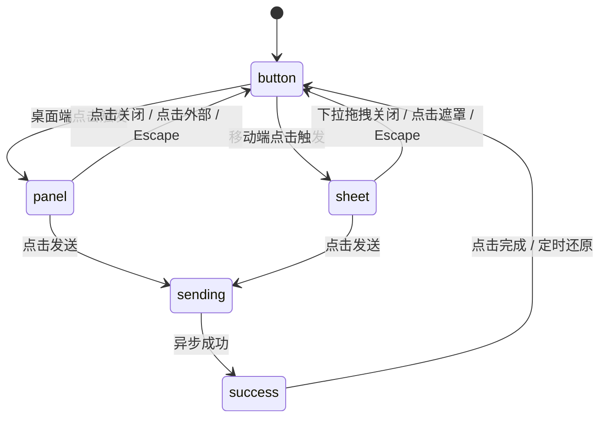

# Share Sheet · 分享面板与抽屉

桌面端原地物理弹簧形变展开、移动端自适应底部滑出抽屉并支持手势拖拽关闭与链接复制反馈的协作分享面板。

## 原型清单

| 原型分组 | 原型元素 | 动效 / 状态变化 | 去向 |
| --- | --- | --- | --- |
| 桌面形变外壳 | 共享表面外壳（`.share-sheet-shape`） | 桌面端由 108×40px 分享胶囊按钮平滑物理插值展开为 360px 宽度多功能面板 | 桌面形变外壳引擎 |
| 移动端抽屉 | 底部滑出浮层（`.share-sheet-drawer`） | 520px 以下视口转为底部抽屉，自视口底端弹簧滑入，含背景遮罩淡入 | 移动端抽屉机制 |
| 拖拽把手 | 抽屉抓手（`.share-sheet-handle`） | 支持手指/光标向下拖拽关闭，滑动距离超过 1/3 或速度 > 600px/s 触发退出 | 手势拖拽关闭 |
| 链接复制按钮 | 复制链接（`.share-sheet-copy`） | 文本与图标通过 120ms 高斯微模糊原位置换为 "已复制"，2000ms 后自动还原 | 复制反馈微交互 |
| 权限选择 | 访问权限下拉项（`.share-sheet-policy`） | 展开权限选项，带选中对勾与说明切换 | 权限选择交互 |
| 发送与成功态 | 发送按钮与确认面板 | 按钮切换 Spinner 加载状态，成功后切换为对勾确认视图 | 异步提交流转 |
| 演示外壳 | 结果切换条、演示提示文字、顶栏外观切换 | 演示环境布局与状态切换 | 演示外壳，已删除 |

## 适用

- 协作应用、文档系统或媒体内容中的分享、邀请协作者、导出链接等核心功能。
- 需要兼顾大屏桌面端原地高品质弹簧膨胀与移动端沉浸式原生底部抽屉体验。
- 要求完善的手势下拉关闭阻尼、复制成功即时触感反馈与键盘焦点恢复。

## 不适用

- 右下角单个 FAB 原地展开多功能表单 → [action-morph](action-morph.md)
- 围绕单点向外放射展开的圆形操作菜单 → [orbit-menu](orbit-menu.md)
- 多层级面板在 Z 轴连续深度堆叠抽屉 → [sheet-stack](../surfaces/sheet-stack.md)
- 常规的轻量级下拉操作菜单 → [dropdown-menu](../menus/dropdown-menu.md)

## 状态机

| 状态 | 进入条件 | 视觉表现 | 退出到 |
| --- | --- | --- | --- |
| button | 初始静止态；或面板关闭复原 | 呈现为 108×40px 的 "Share" 药丸按钮 | panel / sheet |
| panel | 桌面端点击按钮 | 外壳原地弹簧膨胀至 360px 面板，内容淡入展开 | button / sending |
| sheet | 移动端（<= 520px）点击按钮 | 背景遮罩淡入，抽屉自屏幕底端滑升至贴底展示 | button / sending |
| sending | 点击发送按钮 | 提交按钮切换为 Spinner 旋转，表单交互禁用 | success / panel |
| success | 异步发送成功 | 面板展示对勾图标与成功文案，停留后自动或手动关闭 | button |



## 最小 DOM

```html
<div class="share-sheet-root">
  <!-- 触发按钮 -->
  <button type="button" class="share-sheet-trigger" aria-haspopup="dialog" aria-expanded="false">
    <svg width="16" height="16" viewBox="0 0 24 24" fill="none" stroke="currentColor" stroke-width="2"><path d="M4 12v8a2 2 0 0 0 2 2h12a2 2 0 0 0 2-2v-8M16 6l-4-4-4 4M12 2v13"/></svg>
    <span>分享</span>
  </button>

  <!-- 背景遮罩 (移动端抽屉使用) -->
  <div class="share-sheet-scrim" aria-hidden="true"></div>

  <!-- 核心弹窗/抽屉面板 -->
  <div class="share-sheet-panel" role="dialog" aria-label="分享与权限设置" inert>
    <!-- 移动端拖拽抓手 -->
    <div class="share-sheet-handle" aria-hidden="true"></div>

    <div class="share-sheet-header">
      <div class="share-sheet-title">分享文档</div>
      <button type="button" class="share-sheet-close-btn" aria-label="关闭面板">
        <svg width="16" height="16" viewBox="0 0 24 24" fill="none" stroke="currentColor" stroke-width="2"><path d="m18 6-12 12M6 6l12 12"/></svg>
      </button>
    </div>

    <!-- 联系人选择行 -->
    <div class="share-sheet-section">
      <div class="share-sheet-label">邀请成员</div>
      <div class="share-sheet-people">
        <button type="button" class="share-sheet-person" data-person="1">
          <span class="share-sheet-avatar">S</span>
          <span class="share-sheet-name">Sarah Chen</span>
        </button>
        <button type="button" class="share-sheet-person" data-person="2">
          <span class="share-sheet-avatar">M</span>
          <span class="share-sheet-name">Marcus Ray</span>
        </button>
      </div>
    </div>

    <!-- 复制链接行 -->
    <div class="share-sheet-section">
      <div class="share-sheet-copy-row">
        <input type="text" class="share-sheet-url" value="https://example.com/doc/share-99" readonly />
        <button type="button" class="share-sheet-copy-btn">
          <span class="share-sheet-copy-text">复制链接</span>
        </button>
      </div>
    </div>

    <!-- 底部操作 -->
    <div class="share-sheet-footer">
      <div class="share-sheet-policy">
        <span class="share-sheet-policy-label">团队成员均可编辑</span>
      </div>
      <button type="button" class="share-sheet-send-btn">
        <span class="share-sheet-send-text">发送邀请</span>
        <svg class="share-sheet-spinner" width="16" height="16" viewBox="0 0 24 24" fill="none" stroke="currentColor" stroke-width="2.5"><path d="M12 2a10 10 0 1 0 10 10"/></svg>
      </button>
    </div>
  </div>
</div>
```

- `.share-sheet-root`：组件宿主容器。
- `.share-sheet-trigger`：初始未展开时的胶囊触发按钮。
- `.share-sheet-scrim`：半透明暗色背景遮罩，移动端展开时渐显。
- `.share-sheet-panel`：面板外壳，在桌面端作为原地弹簧定位容器，在移动端贴视口底端滑出。
- `.share-sheet-handle`：移动端顶部拖动指示横条。
- `.share-sheet-copy-btn`：支持微模糊状态置换的链接复制按钮。
- `.share-sheet-send-btn`：支持 Spinner 异步流转的发送按钮。

## 参数

| 名称 | 值 | 用于 | 来源 |
| --- | --- | --- | --- |
| 桌面展开弹簧 | `visualDuration: 0.48s, bounce: 0.14` | 桌面面板尺寸膨胀 | 原型 |
| 桌面收起弹簧 | `visualDuration: 0.38s, bounce: 0.02` | 桌面面板尺寸收缩 | 原型 |
| 移动端滑入弹簧 | `visualDuration: 0.44s, bounce: 0.04` | 移动端抽屉自底端滑入 | 原型 |
| 移动端退出弹簧 | `visualDuration: 0.32s, bounce: 0` | 移动端抽屉滑出 | 原型 |
| 下拉关闭门槛 | `min(120px, height / 3)` 或 `速度 > 600px/s` | 手势判定释放关闭 | 原型 |
| 复制反馈保持 | `2000ms` | "已复制"文案保持展示时长 | 原型 |
| 遮罩渐显时长 | `240ms` | `.share-sheet-scrim` 透明度 | 原型 |
| 响应式断点 | `520px` | 桌面卡片与移动抽屉切换边界 | 原型 |

## CSS

```css
.share-sheet-root {
  --ss-bg: #ffffff;
  --ss-fg: #111111;
  --ss-muted: #737373;
  --ss-border: rgba(0, 0, 0, 0.08);
  --ss-shadow: 0 20px 48px rgba(0, 0, 0, 0.16), 0 3px 10px rgba(0, 0, 0, 0.06);
  --ss-accent: #0b0b0b;
  --ss-accent-fg: #ffffff;
  --ss-success: #16a34a;

  position: relative;
  display: inline-block;
  font-family: system-ui, -apple-system, sans-serif;
  font-size: 14px;
  color: var(--ss-fg);
  user-select: none;
}

/* 触发按钮 */
.share-sheet-trigger {
  display: inline-flex;
  align-items: center;
  gap: 8px;
  height: 40px;
  padding: 0 16px;
  border: 1px solid var(--ss-border);
  border-radius: 9999px;
  background: var(--ss-bg);
  color: var(--ss-fg);
  font: inherit;
  font-weight: 500;
  cursor: pointer;
  box-shadow: 0 1px 3px rgba(0, 0, 0, 0.05);
  outline: none;
  transition: transform 120ms ease, background-color 140ms ease;
}
.share-sheet-trigger:active {
  transform: scale(0.96);
}
.share-sheet-trigger:focus-visible {
  outline: 2px solid currentColor;
}

/* 遮罩层 */
.share-sheet-scrim {
  position: fixed;
  inset: 0;
  z-index: 99;
  background: rgba(0, 0, 0, 0.4);
  opacity: 0;
  pointer-events: none;
  transition: opacity 240ms ease;
}
.share-sheet-root[data-open="true"] .share-sheet-scrim {
  opacity: 1;
  pointer-events: auto;
}

/* 核心面板 */
.share-sheet-panel {
  position: absolute;
  top: 0;
  left: 0;
  z-index: 100;
  width: 360px;
  padding: 16px;
  border-radius: 20px;
  background: var(--ss-bg);
  box-shadow: var(--ss-shadow);
  border: 1px solid var(--ss-border);
  box-sizing: border-box;
  opacity: 0;
  pointer-events: none;
  transform-origin: top left;
  transform: scale(0.95);
  transition: opacity 200ms ease, transform 340ms cubic-bezier(0.16, 1, 0.3, 1);
}
.share-sheet-panel:not([inert]) {
  opacity: 1;
  pointer-events: auto;
  transform: scale(1);
}

.share-sheet-handle {
  display: none;
  width: 36px;
  height: 4px;
  margin: 0 auto 12px;
  border-radius: 2px;
  background: rgba(0, 0, 0, 0.2);
}

.share-sheet-header {
  display: flex;
  align-items: center;
  justify-content: space-between;
  margin-bottom: 14px;
}
.share-sheet-title {
  font-weight: 600;
  font-size: 15px;
}
.share-sheet-close-btn {
  display: grid;
  place-items: center;
  width: 28px;
  height: 28px;
  border: 0;
  border-radius: 50%;
  background: transparent;
  color: var(--ss-muted);
  cursor: pointer;
}
.share-sheet-close-btn:hover {
  background: rgba(0, 0, 0, 0.05);
  color: var(--ss-fg);
}

.share-sheet-section {
  margin-bottom: 14px;
}
.share-sheet-label {
  font-size: 12px;
  color: var(--ss-muted);
  margin-bottom: 6px;
}

.share-sheet-people {
  display: flex;
  gap: 8px;
}
.share-sheet-person {
  display: inline-flex;
  align-items: center;
  gap: 6px;
  padding: 4px 10px 4px 6px;
  border: 1px solid var(--ss-border);
  border-radius: 9999px;
  background: #fbfbfb;
  cursor: pointer;
  font: inherit;
  font-size: 12.5px;
}
.share-sheet-avatar {
  display: grid;
  place-items: center;
  width: 20px;
  height: 20px;
  border-radius: 50%;
  background: #e4e4e7;
  font-size: 10px;
  font-weight: 600;
}

/* 复制链接 */
.share-sheet-copy-row {
  display: flex;
  gap: 6px;
}
.share-sheet-url {
  flex: 1;
  padding: 8px 10px;
  border: 1px solid var(--ss-border);
  border-radius: 8px;
  background: #f4f4f5;
  color: var(--ss-muted);
  font: inherit;
  font-size: 12px;
  outline: none;
}
.share-sheet-copy-btn {
  padding: 0 12px;
  border: 0;
  border-radius: 8px;
  background: #f4f4f5;
  color: var(--ss-fg);
  font: inherit;
  font-size: 12.5px;
  font-weight: 500;
  cursor: pointer;
  white-space: nowrap;
  transition: background-color 140ms ease;
}
.share-sheet-copy-btn:hover {
  background: #e4e4e7;
}

.share-sheet-footer {
  display: flex;
  align-items: center;
  justify-content: space-between;
  padding-top: 10px;
  border-top: 1px solid var(--ss-border);
}
.share-sheet-policy-label {
  font-size: 12px;
  color: var(--ss-muted);
}
.share-sheet-send-btn {
  display: inline-flex;
  align-items: center;
  gap: 6px;
  height: 34px;
  padding: 0 16px;
  border: 0;
  border-radius: 9999px;
  background: var(--ss-accent);
  color: var(--ss-accent-fg);
  font: inherit;
  font-size: 13px;
  font-weight: 500;
  cursor: pointer;
  transition: opacity 160ms ease, transform 120ms ease;
}
.share-sheet-send-btn:active {
  transform: scale(0.97);
}

.share-sheet-spinner {
  display: none;
  animation: shareSpin 0.7s linear infinite;
}
.share-sheet-send-btn[data-state="busy"] .share-sheet-spinner {
  display: inline-block;
}
@keyframes shareSpin {
  to { transform: rotate(360deg); }
}

/* 移动端 <= 520px 底部抽屉适配 */
@media (max-width: 520px) {
  .share-sheet-panel {
    position: fixed;
    top: auto;
    bottom: 0;
    left: 0;
    width: 100%;
    border-radius: 20px 20px 0 0;
    transform: translateY(100%);
    transition: transform 380ms cubic-bezier(0.16, 1, 0.3, 1);
  }
  .share-sheet-panel:not([inert]) {
    transform: translateY(0);
  }
  .share-sheet-handle {
    display: block;
  }
}

@media (prefers-reduced-motion: reduce) {
  .share-sheet-panel,
  .share-sheet-scrim,
  .share-sheet-trigger {
    transition: none !important;
  }
}
```

## JS

```js
export function createShareSheet(root, options = {}) {
  const trigger = root.querySelector('.share-sheet-trigger');
  const scrim = root.querySelector('.share-sheet-scrim');
  const panel = root.querySelector('.share-sheet-panel');
  const handle = root.querySelector('.share-sheet-handle');
  const closeBtn = root.querySelector('.share-sheet-close-btn');
  const copyBtn = root.querySelector('.share-sheet-copy-btn');
  const copyText = root.querySelector('.share-sheet-copy-text');
  const sendBtn = root.querySelector('.share-sheet-send-btn');
  const urlInput = root.querySelector('.share-sheet-url');

  const reducedMotion = window.matchMedia('(prefers-reduced-motion: reduce)').matches;
  let isOpen = false;
  let copyTimer = null;
  let isDragging = false;
  let dragStartY = 0;
  let currentY = 0;

  function setOpen(open) {
    if (isOpen === open) return;
    isOpen = open;
    root.dataset.open = String(open);
    trigger.setAttribute('aria-expanded', String(open));

    if (open) {
      panel.removeAttribute('inert');
      panel.focus?.();
    } else {
      panel.setAttribute('inert', '');
      trigger.focus();
    }

    if (typeof options.onToggle === 'function') {
      options.onToggle(open);
    }
  }

  // 复制链接并触发微模糊置换
  function copyLink() {
    if (urlInput) {
      navigator.clipboard?.writeText(urlInput.value).catch(() => {});
    }

    if (copyText) {
      copyText.style.filter = 'blur(2px)';
      copyText.style.opacity = '0';
      clearTimeout(copyTimer);

      setTimeout(() => {
        copyText.textContent = '已复制！';
        copyText.style.filter = 'none';
        copyText.style.opacity = '1';

        copyTimer = setTimeout(() => {
          copyText.style.filter = 'blur(2px)';
          copyText.style.opacity = '0';
          setTimeout(() => {
            copyText.textContent = '复制链接';
            copyText.style.filter = 'none';
            copyText.style.opacity = '1';
          }, 120);
        }, 2000);
      }, 120);
    }
  }

  // 异步发送
  async function send() {
    if (sendBtn.dataset.state === 'busy') return;
    sendBtn.dataset.state = 'busy';

    if (typeof options.onSend === 'function') {
      await options.onSend();
    } else {
      await new Promise(r => setTimeout(r, 650));
    }

    sendBtn.removeAttribute('data-state');
    setOpen(false);
  }

  // 移动端手势拖拽关闭
  function onPointerDown(e) {
    if (window.innerWidth > 520) return;
    isDragging = true;
    dragStartY = e.clientY;
    currentY = 0;
    handle.setPointerCapture(e.pointerId);
  }

  function onPointerMove(e) {
    if (!isDragging) return;
    const dy = e.clientY - dragStartY;
    if (dy > 0) {
      currentY = dy;
      panel.style.transform = `translateY(${dy}px)`;
    }
  }

  function onPointerUp(e) {
    if (!isDragging) return;
    isDragging = false;
    try {
      if (handle.hasPointerCapture(e.pointerId)) {
        handle.releasePointerCapture(e.pointerId);
      }
    } catch {}

    const threshold = Math.min(120, (panel.offsetHeight || 300) / 3);
    if (currentY > threshold) {
      panel.style.transform = '';
      setOpen(false);
    } else {
      panel.style.transform = '';
    }
  }

  // 事件绑定
  trigger.addEventListener('click', () => setOpen(true));
  closeBtn?.addEventListener('click', () => setOpen(false));
  scrim?.addEventListener('click', () => setOpen(false));
  copyBtn?.addEventListener('click', copyLink);
  sendBtn?.addEventListener('click', send);

  handle?.addEventListener('pointerdown', onPointerDown);
  handle?.addEventListener('pointermove', onPointerMove);
  handle?.addEventListener('pointerup', onPointerUp);
  handle?.addEventListener('pointercancel', onPointerUp);

  function onKeyDown(e) {
    if (e.key === 'Escape' && isOpen) {
      e.preventDefault();
      setOpen(false);
    }
  }
  document.addEventListener('keydown', onKeyDown);

  return {
    open: () => setOpen(true),
    close: () => setOpen(false),
    copyLink,
    send,
    getState: () => ({ isOpen }),
    destroy: () => {
      clearTimeout(copyTimer);
      document.removeEventListener('keydown', onKeyDown);
    }
  };
}
```

## 接入目标项目

- 状态来源：
  - 调用 `createShareSheet(rootEl, { onSend: async () => { ... } })` 挂载实例。
  - 项目集成时可通过 `onSend` 注入真实的分享权限修改或邮件分发 API。
- 尺寸策略：
  - 桌面端面板宽度锁定为 `360px`，高度随联系人列表和分享项动态撑开。
  - 视口宽度 `<= 520px` 自动切换为原生 Bottom Sheet 贴底展示。
- 驱动方式：
  - 支持直接点击触发器展开，或外部代码调用 `open()` 与 `close()` 控制显隐。
  - 组件注销时调用 `destroy()` 清理定时器与文档监听。

## 重入与清理

- 连续复制防护：在 `2000ms` 还原计时器内再次点击复制链接，自动刷新定时器，保持 "已复制！" 状态并避免文案错乱。
- 手势重置：手势中途发生 `pointercancel` 时安全回弹至贴底原位。
- 卸载清理：`destroy()` 清除 `copyTimer`，解绑全局 `keydown` 监听器。

## 减少动态效果

- 满足 `prefers-reduced-motion: reduce` 时：
  - 停用抽屉滑动与桌面缩放动画，面板与遮罩即时显隐。
  - 复制成功直接切换文本，跳过高斯模糊。

## 焦点与键盘

- 键盘可达性：
  - 展开面板时焦点流转至面板内首个可交互按钮（或关闭按钮）。
  - 面板关闭时设置 `inert`，键盘 Tab 无法穿透至隐藏面板。
  - 支持按 `Escape` 键即时收回并恢复触发按钮焦点。

## 兼容回退

| 特性 | 不支持时 |
| --- | --- |
| `navigator.clipboard` | 降级为选中文本框内容提示用户手动 `Ctrl/Cmd+C` |

## 验收清单

- [ ] 桌面端点击分享按钮，面板原地放大展开；移动端（<= 520px）自底端平滑滑出。
- [ ] 移动端按住顶部把手向下滑动超过阈值，抽屉顺势关闭。
- [ ] 点击复制链接，文案经过微模糊过渡变为“已复制！”，2 秒后自动还原。
- [ ] 点击发送按钮显示 Spinner 加载转圈，异步完成后自动关闭面板。
- [ ] 开启系统减少动态效果时，无位移与缩放，面板瞬时显隐。
