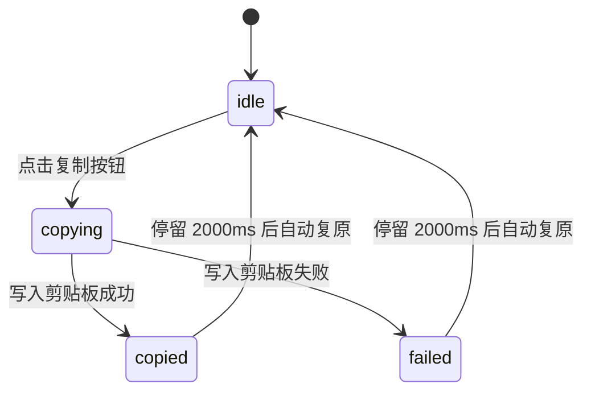

# Code Block · 代码块

用于代码展示与文档集成的高保真代码块组件。集成动态视口高度测量伸缩（Measured Viewport Height）、文件名幽灵标尺防抖置换（Ghost Sizer Swap）、行数折叠展开以及微动画反馈复制按钮。涵盖四大核心机制：

1. 视口高度测量平滑伸缩（Measured Viewport Height Settle）：代码内容变更或触发多行折叠/展开时，测量目标像素高度并通过弹簧曲线（340ms cubic-bezier(0.16, 1, 0.3, 1)）平滑补间过渡，避免页面内容瞬间跳变。
2. 幽灵标尺文本置换（Ghost Sizer & Micro-Blur Filename Swap）：文件名切换时，通过隐藏的 `.code-block-sizer` 提前锁定物理尺寸，新旧文件名通过 `translateY` 配合微模糊淡入淡出（120ms），外框绝对 0 像素抖动。
3. 复制按钮多态笔触反馈（Multi-Phase Copy Feedback）：内置复制按钮集成 Idle → Copying → Copied 三态状态机，成功态下复制图标 3D 翻转为绿色勾选，文案逐字形变，停留 2000ms 后自动平滑复原。
4. 语法着色微动画与水平滚动隔离（Syntax Highlighting & Scroll Containment）：代码区域支持独立水平滚动，代码更新时整体产生轻微微模糊重绘淡入，保持视觉柔和。

## 原型清单

| 原型分组 | 原型元素 | 动效 / 状态变化 | 去向 |
| --- | --- | --- | --- |
| 官方代码块舞台 | 代码块容器 `.code-block-block` | 面板外框、边框、投影与圆角 16px | 最小 DOM |
| 官方代码块舞台 | 顶栏头部 `.code-block-header` | 左右两端对齐排版、分隔底边线 | 最小 DOM |
| 官方代码块舞台 | 文件名槽位 `.code-block-filename` | Sizer 尺寸防抖锁定、文件名微模糊上下切换 | 幽灵标尺文本置换 |
| 官方代码块舞台 | 语言标签 `.code-block-language` | 小写灰色单色胶囊 | 最小 DOM |
| 官方代码块舞台 | 复制按钮 `.code-block-copy-button` | 按压缩放 0.96、成功图标翻转对勾、2s 自动复位 | 复制按钮多态笔触反馈 |
| 官方代码块舞台 | 视口滚动容器 `.code-block-viewport` | 动态测量高度平滑伸缩、水平自然滚动 | 视口高度测量平滑伸缩 |
| 官方代码块舞台 | 代码本体 `<pre><code>` | 等宽字体排版、语法着色节点 | 最小 DOM |
| — | 顶栏独立主题切换器 `#themeBtn` | 演示主题切换 | 演示外壳，已删除 |
| — | 外层演示画布与间距包装 | 演示外壳 | 演示外壳，已删除 |

## 适用

- 技术文档、开发者控制台、博客系统中的代码段展示与示例。
- 需要一键可靠复制到系统剪贴板并带有清晰状态反馈的场景。
- 代码行数较多、需要折叠/展开动画或切换不同文件名的复合代码展示卡。

## 不适用

- 允许用户自由编辑格式、排版样式的富文本编辑器 → [rich-text-editor](rich-text-editor.md)
- 文件拖拽上传与媒体投递区 → [file-dropzone](file-dropzone.md)
- 单行纯文本/密码输入框 → [input](../text-fields/input.md)

## 状态机

| 状态 | 进入条件 | 视觉表现 | 退出到 |
| --- | --- | --- | --- |
| `idle` | 初始载入 / 复制反馈复位完成 | 复制按钮显示复制图标与 "Copy code"，代码块稳定展示 | `copying`, `expanded`, `collapsed` |
| `copying` | 点击复制按钮 | 按钮触发按压缩放，剪贴板 API 异步写入中 | `copied`, `failed` |
| `copied` | 剪贴板写入成功 | 图标翻转为绿色对勾，文字形变为 "Copied"，停留 2000ms | `idle` |
| `failed` | 剪贴板写入拒绝/异常 | 图标变为感叹号，文字变为 "Failed"，停留 2000ms | `idle` |



## 最小 DOM

```html
<section class="code-block-block" aria-label="Source code">
  <header class="code-block-header">
    <div class="code-block-file">
      <svg class="file-icon" width="16" height="16" viewBox="0 0 24 24" fill="none" stroke="currentColor" stroke-width="1.75">
        <path d="M4 12.15V4a2 2 0 0 1 2-2h8a2.4 2.4 0 0 1 1.706.706l3.588 3.588A2.4 2.4 0 0 1 20 8v12a2 2 0 0 1-2 2h-3.35"/>
        <path d="M14 2v5a1 1 0 0 0 1 1h5"/>
      </svg>
      <span class="code-block-swap code-block-filename">
        <span class="code-block-sizer" aria-hidden="true">button.tsx</span>
        <span class="code-block-swap-stack" aria-hidden="true">
          <span class="code-block-swap-text">button.tsx</span>
        </span>
      </span>
      <span class="code-block-language">tsx</span>
    </div>

    <button type="button" class="code-block-copy-btn" aria-label="Copy code" data-state="idle">
      <span class="copy-icon-slot">
        <svg class="icon-copy" width="15" height="15" viewBox="0 0 24 24" fill="none" stroke="currentColor" stroke-width="1.75">
          <rect width="14" height="14" x="8" y="8" rx="2" ry="2"/>
          <path d="M4 16c-1.1 0-2-.9-2-2V4c0-1.1.9-2 2-2h10c1.1 0 2 .9 2 2"/>
        </svg>
        <svg class="icon-check" width="15" height="15" viewBox="0 0 24 24" fill="none" stroke="currentColor" stroke-width="2">
          <path d="M20 6 9 17l-5-5"/>
        </svg>
      </span>
      <span class="copy-label">Copy code</span>
    </button>
  </header>

  <div class="code-block-viewport">
    <pre class="code-block-pre" tabindex="0"><code><span class="token-punct">&lt;</span><span class="token-tag">Button</span> <span class="token-attr">variant</span><span class="token-punct">=</span><span class="token-str">"secondary"</span><span class="token-punct">&gt;</span>Review changes<span class="token-punct">&lt;</span><span class="token-punct">/</span><span class="token-tag">Button</span><span class="token-punct">&gt;</span></code></pre>
  </div>
</section>
```

- `.code-block-block`：代码块根卡片容器。
- `.code-block-header`：顶栏工具行，包含文件名与复制按钮。
- `.code-block-sizer`：隐藏的幽灵尺寸标记，锁死文件名宽度防止抖动。
- `.code-block-copy-btn`：复合复制按钮，内部包含三态图标切换与文案更新。
- `.code-block-viewport`：高度动画视口容器，接管 `height` 补间与滚动条隔离。
- `.code-block-pre`：等宽代码渲染区，支持键盘 Tab 聚焦。

## 参数

| 名称 | 值 | 用于 | 来源 |
| --- | --- | --- | --- |
| 视口高度过渡 | `340ms cubic-bezier(0.16, 1, 0.3, 1)` | `.code-block-viewport` height | 原型 |
| 文件名切换时长 | `120ms` | 文件名微模糊淡入淡出 | 原型 |
| 复制按钮按压缩放 | `scale(0.96)` | `.code-block-copy-btn:active` | 原型 |
| 成功停留时长 | `2000ms` | 复制成功反馈展示保持时间 | 原型 |
| 语言标签字体 | `ui-monospace, monospace` | `.code-block-language` | 原型 |

## CSS

```css
.code-block-block {
  --cb-bg: #0f1117;
  --cb-header-bg: #161822;
  --cb-fg: #e2e8f0;
  --cb-muted: #8492a6;
  --cb-border: rgba(255, 255, 255, 0.08);
  --cb-accent: #38bdf8;
  --cb-success: #22c55e;
  --cb-danger: #ef4444;

  position: relative;
  width: 100%;
  max-width: 560px;
  border: 1px solid var(--cb-border);
  border-radius: 16px;
  background: var(--cb-bg);
  color: var(--cb-fg);
  overflow: hidden;
  box-shadow: 0 16px 36px -10px rgba(0, 0, 0, 0.4);
  font-family: -apple-system, BlinkMacSystemFont, "Segoe UI", Roboto, sans-serif;
  box-sizing: border-box;
}

.code-block-header {
  display: flex;
  align-items: center;
  justify-content: space-between;
  height: 42px;
  padding: 0 14px;
  background: var(--cb-header-bg);
  border-bottom: 1px solid var(--cb-border);
}

.code-block-file {
  display: flex;
  align-items: center;
  gap: 8px;
  font-size: 13px;
  font-weight: 500;
}

.file-icon {
  color: var(--cb-muted);
}

.code-block-swap {
  position: relative;
  display: inline-flex;
  align-items: center;
}

.code-block-sizer {
  visibility: hidden;
  font-family: ui-monospace, SFMono-Regular, monospace;
}

.code-block-swap-stack {
  position: absolute;
  inset: 0;
  display: flex;
  align-items: center;
}

.code-block-swap-text {
  font-family: ui-monospace, SFMono-Regular, monospace;
  color: var(--cb-fg);
  transition: opacity 120ms ease, transform 120ms ease, filter 120ms ease;
}

.code-block-language {
  padding: 1px 6px;
  border-radius: 4px;
  background: rgba(255, 255, 255, 0.06);
  color: var(--cb-muted);
  font-family: ui-monospace, SFMono-Regular, monospace;
  font-size: 11px;
  text-transform: uppercase;
}

/* 复制按钮 */
.code-block-copy-btn {
  display: inline-flex;
  align-items: center;
  gap: 6px;
  height: 28px;
  padding: 0 10px;
  border: 1px solid var(--cb-border);
  border-radius: 6px;
  background: rgba(255, 255, 255, 0.04);
  color: var(--cb-muted);
  font: inherit;
  font-size: 12px;
  font-weight: 500;
  cursor: pointer;
  transition: background-color 140ms ease, color 140ms ease, transform 120ms ease;
}
.code-block-copy-btn:hover {
  background: rgba(255, 255, 255, 0.08);
  color: var(--cb-fg);
}
.code-block-copy-btn:active {
  transform: scale(0.96);
}

.copy-icon-slot {
  position: relative;
  width: 15px;
  height: 15px;
  display: grid;
  place-items: center;
}

.icon-copy, .icon-check {
  position: absolute;
  inset: 0;
  transition: opacity 160ms ease, transform 160ms cubic-bezier(0.18, 0.89, 0.32, 1.25);
}

.icon-check {
  opacity: 0;
  transform: scale(0.6) rotate(-20deg);
  color: var(--cb-success);
}

.code-block-copy-btn[data-state="copied"] .icon-copy {
  opacity: 0;
  transform: scale(0.6) rotate(20deg);
}

.code-block-copy-btn[data-state="copied"] .icon-check {
  opacity: 1;
  transform: scale(1) rotate(0);
}

.code-block-copy-btn[data-state="copied"] {
  border-color: rgba(34, 197, 94, 0.4);
  color: var(--cb-success);
}

/* 视口与代码展示 */
.code-block-viewport {
  position: relative;
  overflow-x: auto;
  transition: height 340ms cubic-bezier(0.16, 1, 0.3, 1);
  box-sizing: border-box;
}

.code-block-pre {
  margin: 0;
  padding: 16px;
  font-family: ui-monospace, SFMono-Regular, Menlo, Monaco, Consolas, monospace;
  font-size: 13.5px;
  line-height: 1.55;
  outline: none;
  overflow-x: auto;
}

/* 语法高亮角色 */
.token-punct { color: #94a3b8; }
.token-tag { color: #f43f5e; font-weight: 500; }
.token-attr { color: #38bdf8; }
.token-str { color: #a5b4fc; }

@media (prefers-reduced-motion: reduce) {
  .code-block-viewport, .code-block-copy-btn, .icon-copy, .icon-check, .code-block-swap-text {
    transition: none !important;
    animation: none !important;
    transform: none !important;
  }
}
```

## JS

```js
/**
 * 初始化 Code Block 动效控制器
 * @param {HTMLElement} root 代码块根节点
 * @param {Object} [options] 配置选项
 * @param {string} [options.filename='button.tsx'] 初始文件名
 * @param {string} [options.language='tsx'] 语言标注
 * @param {number} [options.hold=2000] 复制成功保持时间
 * @returns {{ copy: Function, setFilename: Function, destroy: Function }}
 */
export function createCodeBlock(root, options = {}) {
  const copyBtn = root.querySelector('.code-block-copy-btn');
  const copyLabel = root.querySelector('.copy-label');
  const viewport = root.querySelector('.code-block-viewport');
  const pre = root.querySelector('.code-block-pre');
  const sizer = root.querySelector('.code-block-sizer');
  const swapText = root.querySelector('.code-block-swap-text');

  let copyTimer = 0;
  let currentState = 'idle';
  const holdDuration = options.hold || 2000;

  async function performCopy() {
    if (currentState === 'copied') return;
    const textToCopy = pre ? pre.textContent : '';

    try {
      if (navigator.clipboard && navigator.clipboard.writeText) {
        await navigator.clipboard.writeText(textToCopy);
      }
      setCopyState('copied');
    } catch (_) {
      setCopyState('failed');
    }
  }

  function setCopyState(state) {
    clearTimeout(copyTimer);
    currentState = state;
    if (copyBtn) copyBtn.setAttribute('data-state', state);

    if (state === 'copied') {
      if (copyLabel) copyLabel.textContent = 'Copied';
      copyTimer = setTimeout(() => {
        setCopyState('idle');
      }, holdDuration);
    } else if (state === 'failed') {
      if (copyLabel) copyLabel.textContent = 'Failed';
      copyTimer = setTimeout(() => {
        setCopyState('idle');
      }, holdDuration);
    } else {
      if (copyLabel) copyLabel.textContent = 'Copy code';
    }
  }

  function setFilename(name) {
    if (sizer) sizer.textContent = name;
    if (swapText) {
      swapText.style.opacity = '0';
      swapText.style.transform = 'translateY(-4px)';
      swapText.style.filter = 'blur(2px)';
      setTimeout(() => {
        swapText.textContent = name;
        swapText.style.opacity = '1';
        swapText.style.transform = 'translateY(0)';
        swapText.style.filter = 'blur(0)';
      }, 120);
    }
  }

  const onCopyClick = (e) => {
    e.stopPropagation();
    performCopy();
  };

  if (copyBtn) copyBtn.addEventListener('click', onCopyClick);

  return {
    copy: performCopy,
    setFilename,
    destroy: () => {
      clearTimeout(copyTimer);
      if (copyBtn) copyBtn.removeEventListener('click', onCopyClick);
    }
  };
}
```

## 接入目标项目

- 状态来源：代码高亮插件输出（如 Shiki 或 Prism.js 输出的 HTML 结构）。
- 尺寸策略：卡片最大宽度 560px，视口高度自适应内容测量高度；代码单行过长时视口内部平滑横向滚动。
- 驱动方式：实例化 `createCodeBlock(root, { hold })` 绑定复制状态机与尺寸防抖。

## 重入与清理

- 连续快速点击复制按钮时，重入重置 `copyTimer`，避免状态提早退回。
- 卸载时通过 `destroy()` 清理延迟计时器并解绑事件。

## 减少动态效果

- 激活 `prefers-reduced-motion: reduce` 时：
  - 复制图标与对勾的旋转缩放动画禁用，以瞬切呈现。
  - 文件名微模糊位移过渡停用。

## 焦点与键盘

- 复制按钮支持使用 `Tab` 键聚焦及 `Enter` / `Space` 激活。
- 代码 `<pre>` 区域拥有 `tabindex="0"`，允许使用键盘左右方向键进行水平无障碍滚动。

## 兼容回退

| 特性 | 不支持时 |
| --- | --- |
| `navigator.clipboard.writeText` | 优雅降级进入 `failed` 反馈态，或使用经典 `execCommand('copy')` |
| CSS `filter: blur(...)` | 滤镜不生效，透明度渐变正常工作 |

## 验收清单

- [ ] 点击复制按钮，复制图标平滑翻转并变更为绿色对勾，文字切换为 "Copied"。
- [ ] 停留 2000ms 后，按钮平滑恢复为初始态 "Copy code"。
- [ ] 切换文件名时，通过 Ghost Sizer 机制保持外框稳定，无任何像素晃动。
- [ ] 开启减弱动态效果时，所有位移与缩放动画禁用，功能正常。
