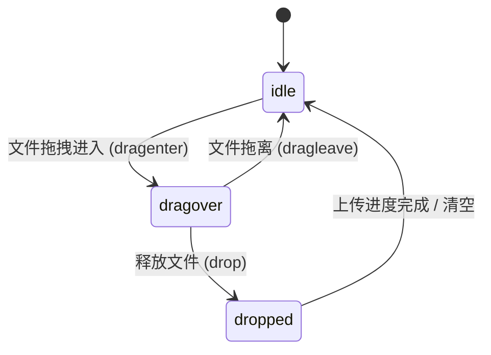

# File Dropzone · 文件投递区

用于文档附件、编辑器素材与多媒体资源拖拽上传的高保真文件投递区组件。集成三层纸张 3D 浮动张力展开（Three Sheets 3D Hover Spread）、SVG 周长边缘发光流动（SVG Edge Perimeter Glow）、拖放文件抓取反馈以及条目进度卡片平滑淡入。涵盖四大核心机制：

1. 三层纸张 3D 透视张力展开（Three Sheets 3D Hover & Drag Spread）：静止态下三张纸层叠收拢；当光标悬停或外部文件拖拽进入视口（`dragover`）时，后层与侧层纸张分别向左右施加 `-8deg` 与 `6deg` 偏转并产生 Y 轴浮升，呈现极具物理张力的“张开吸附”姿态。
2. SVG 周长流动边框（Perimeter Stroke Animation）：拖拽悬停触发时，外边框激活虚线描边流动动画（`stroke-dashoffset`），以高对比度光效指引用户安全落子。
3. 动态条目装载与进度补间（Staggered File Cards & Progress Settle）：文件投递或选择后，列表项以 160ms 弹簧错峰升起并淡入，内部进度条以平滑阻尼向 100% 推进，完成时无缝呈现文件大小与删除按钮。
4. 粘贴与点击多通道集成（Multi-Channel Drop, Paste & Browse）：同时监听全容器拖放、剪贴板 `paste` 事件以及隐藏文件选择框触发，并维护完整的可访问性反馈。

## 原型清单

| 原型分组 | 原型元素 | 动效 / 状态变化 | 去向 |
| --- | --- | --- | --- |
| 官方文件投递区舞台 | 投递区宿主 `.dropzone` | 拖拽悬停激活态 `data-drag-over="true"` | 最小 DOM |
| 官方文件投递区舞台 | SVG 外边框 `.edge rect` | 激活时虚线发光循环流动动画 | SVG 周长流动边框 |
| 官方文件投递区舞台 | 三张纸张 `.sheet` | 悬停/拖入时 3D 偏转 `-8deg` / `6deg` 展开 | 三层纸张 3D 透视张力展开 |
| 官方文件投递区舞台 | 提示文案与格式说明 | 居中排版、引导文本 | 最小 DOM |
| 官方文件投递区舞台 | 隐藏文件输入框 `#fileInput` | 接管系统文件选择窗口 | 最小 DOM |
| 官方文件投递区舞台 | 已上传文件列表 `#fileList` | 条目自下方升起、进度条自 0% 充盈、删除移除动画 | 动态条目装载与进度补间 |
| — | 顶栏独立主题切换器 `#themeToggle` | 演示主题切换 | 演示外壳，已删除 |
| — | 外层演示居中舞台 `.stage` | 演示居中外壳 | 演示外壳，已删除 |

## 适用

- 内容管理系统、富文本编辑器、文档编辑器中的附件插入与图片拖拽。
- 支持拖拽、点击浏览以及 Ctrl+V 粘贴文件的多功能投递区域。
- 允许用户上传多文件并观察实时上传进度的场景。

## 不适用

- 纯文本代码片段展示与语法高亮 → [code-block](code-block.md)
- 所见即所得的富文本格式排版编辑 → [rich-text-editor](rich-text-editor.md)
- 手写签字、签名板绘制 → [signature-pad](signature-pad.md)
- 专属媒体库批量处理与相册瀑布流（跨类别：media 类别中的专业媒体投递组件）

## 状态机

| 状态 | 进入条件 | 视觉表现 | 退出到 |
| --- | --- | --- | --- |
| `idle` | 初始载入 / 拖离投递区 / 文件上传完成 | 三张纸张层叠收拢，边框静态无光晕 | `dragover` |
| `dragover` | 文件拖拽进入投递区（`dragenter`） | 纸张 3D 扇形展开，边框描边发光流动 | `idle`, `dropped` |
| `dropped` | 用户释放鼠标投递文件（`drop`） | 纸张平滑收拢回弹，文件列表插入新卡片并启动进度加载 | `idle` |



## 最小 DOM

```html
<div class="dropzone-wrapper">
  <div class="dropzone" role="region" aria-label="File dropzone" data-drag-over="false">
    <svg class="dropzone-edge" aria-hidden="true">
      <rect width="100%" height="100%" rx="16" />
    </svg>

    <button type="button" class="dropzone-trigger">
      <span class="sheets" aria-hidden="true">
        <span class="sheet sheet-back"></span>
        <span class="sheet sheet-side"></span>
        <span class="sheet sheet-front">
          <svg width="16" height="16" viewBox="0 0 24 24" fill="none" stroke="currentColor" stroke-width="2">
            <line x1="12" y1="19" x2="12" y2="5"/>
            <polyline points="5 12 12 5 19 12"/>
          </svg>
        </span>
      </span>

      <span class="prompt-label">Add launch assets</span>
      <span class="prompt-hint">Drop, paste, or choose files from your device</span>
      <span class="prompt-note">PDF, images, or video up to 10 MB.</span>
    </button>

    <input type="file" class="file-input" multiple accept="image/*,video/*,.pdf" tabindex="-1" style="display: none;" />
  </div>

  <ul class="file-list" aria-label="Uploaded files"></ul>
</div>
```

- `.dropzone-wrapper`：外层包裹宿主，承载投递区面板与下方文件列表。
- `.dropzone`：主拖拽目标区域，承载 `data-drag-over="true|false"` 状态。
- `.dropzone-edge`：绝对定位全幅 SVG，负责发光与虚线流动。
- `.sheets` / `.sheet`：三层纸张图标，负责 3D 展开动效。
- `.file-list`：已上传文件卡片容器。

## 参数

| 名称 | 值 | 用于 | 来源 |
| --- | --- | --- | --- |
| 投递区最小高度 | `180px` | `.dropzone` | 原型 |
| 纸张偏转角度 | `-8deg` / `6deg` | 悬停态左右纸张旋转 | 原型 |
| 纸张动画时长 | `240ms cubic-bezier(0.18, 0.89, 0.32, 1.15)` | 纸张 3D 浮动伸展 | 原型 |
| 边框发光流动 | `stroke-dashoffset 1s linear infinite` | 激活态虚线边框 | 原型 |
| 卡片升起时长 | `200ms cubic-bezier(0.16, 1, 0.3, 1)` | 文件项入场 | 原型 |

## CSS

```css
.dropzone-wrapper {
  --dz-bg: #ffffff;
  --dz-fg: #111111;
  --dz-muted: #737373;
  --dz-border: rgba(0, 0, 0, 0.12);
  --dz-accent: #2563eb;
  --dz-hover: #f9fafb;

  width: 100%;
  max-width: 520px;
  font-family: -apple-system, BlinkMacSystemFont, "Segoe UI", Roboto, sans-serif;
  user-select: none;
  box-sizing: border-box;
}

.dropzone {
  position: relative;
  width: 100%;
  min-height: 180px;
  border-radius: 18px;
  background: var(--dz-bg);
  box-sizing: border-box;
  overflow: hidden;
  transition: background-color 160ms ease;
}

.dropzone[data-drag-over="true"] {
  background: rgba(37, 99, 235, 0.04);
}

.dropzone-edge {
  position: absolute;
  inset: 0;
  width: 100%;
  height: 100%;
  pointer-events: none;
}

.dropzone-edge rect {
  fill: none;
  stroke: var(--dz-border);
  stroke-width: 1.5;
  stroke-dasharray: 6 6;
  transition: stroke 160ms ease;
}

.dropzone[data-drag-over="true"] .dropzone-edge rect {
  stroke: var(--dz-accent);
  stroke-width: 2;
  animation: edgeFlow 1s linear infinite;
}

@keyframes edgeFlow {
  to { stroke-dashoffset: -24; }
}

.dropzone-trigger {
  display: flex;
  flex-direction: column;
  align-items: center;
  justify-content: center;
  width: 100%;
  min-height: 180px;
  padding: 24px;
  border: 0;
  background: transparent;
  cursor: pointer;
  outline: none;
}

/* 三层纸张 3D 动效 */
.sheets {
  position: relative;
  width: 44px;
  height: 48px;
  margin-bottom: 14px;
  perspective: 400px;
}

.sheet {
  position: absolute;
  inset: 0;
  border-radius: 8px;
  border: 1px solid var(--dz-border);
  background: var(--dz-bg);
  box-shadow: 0 4px 12px rgba(0, 0, 0, 0.06);
  transform-origin: bottom center;
  transition: transform 240ms cubic-bezier(0.18, 0.89, 0.32, 1.15), border-color 160ms ease;
}

.sheet-back {
  background: #f1f5f9;
  transform: translateY(-2px) scale(0.92);
}

.sheet-side {
  background: #f8fafc;
  transform: translateY(-1px) scale(0.96);
}

.sheet-front {
  display: grid;
  place-items: center;
  color: var(--dz-muted);
}

.dropzone:hover .sheet-back,
.dropzone[data-drag-over="true"] .sheet-back {
  transform: translateY(-6px) rotate(-8deg) scale(0.94);
  border-color: rgba(37, 99, 235, 0.3);
}

.dropzone:hover .sheet-side,
.dropzone[data-drag-over="true"] .sheet-side {
  transform: translateY(-4px) rotate(6deg) scale(0.98);
  border-color: rgba(37, 99, 235, 0.4);
}

.dropzone:hover .sheet-front,
.dropzone[data-drag-over="true"] .sheet-front {
  transform: translateY(-2px);
  color: var(--dz-accent);
  border-color: var(--dz-accent);
}

.prompt-label {
  font-size: 15px;
  font-weight: 600;
  color: var(--dz-fg);
  margin-bottom: 4px;
}

.prompt-hint {
  font-size: 13px;
  color: var(--dz-muted);
  margin-bottom: 4px;
}

.prompt-note {
  font-size: 11.5px;
  color: var(--dz-muted);
  opacity: 0.8;
}

/* 文件列表 */
.file-list {
  list-style: none;
  margin: 14px 0 0;
  padding: 0;
  display: flex;
  flex-direction: column;
  gap: 8px;
}

.file-item {
  display: flex;
  align-items: center;
  justify-content: space-between;
  padding: 10px 14px;
  border: 1px solid var(--dz-border);
  border-radius: 12px;
  background: var(--dz-bg);
  box-shadow: 0 1px 3px rgba(0, 0, 0, 0.03);
  animation: fileCardIn 200ms cubic-bezier(0.16, 1, 0.3, 1) forwards;
}

@keyframes fileCardIn {
  from { opacity: 0; transform: translateY(8px); }
  to { opacity: 1; transform: translateY(0); }
}

.file-info {
  display: flex;
  align-items: center;
  gap: 10px;
  overflow: hidden;
}

.file-name {
  font-size: 13px;
  font-weight: 500;
  color: var(--dz-fg);
  white-space: nowrap;
  overflow: hidden;
  text-overflow: ellipsis;
  max-width: 260px;
}

.file-size {
  font-size: 11.5px;
  color: var(--dz-muted);
}

.btn-remove-file {
  border: 0;
  background: transparent;
  color: var(--dz-muted);
  cursor: pointer;
  padding: 4px;
  border-radius: 4px;
  line-height: 1;
}
.btn-remove-file:hover {
  color: #ef4444;
}

@media (prefers-reduced-motion: reduce) {
  .dropzone[data-drag-over="true"] .dropzone-edge rect {
    animation: none !important;
  }
  .sheet, .file-item {
    transition: none !important;
    animation: none !important;
    transform: none !important;
  }
}
```

## JS

```js
function formatBytes(bytes) {
  if (bytes < 1024) return bytes + ' B';
  if (bytes < 1048576) return (bytes / 1024).toFixed(1) + ' KB';
  return (bytes / 1048576).toFixed(1) + ' MB';
}

/**
 * 初始化 File Dropzone 控制器
 * @param {HTMLElement} root 根容器节点
 * @param {Object} [options] 配置选项
 * @param {(files: File[]) => void} [options.onDrop] 文件投递回调
 * @returns {{ addFiles: Function, clear: Function, destroy: Function }}
 */
export function createFileDropzone(root, options = {}) {
  const dropzone = root.querySelector('.dropzone');
  const trigger = root.querySelector('.dropzone-trigger');
  const fileInput = root.querySelector('.file-input');
  const fileList = root.querySelector('.file-list');

  let dragCounter = 0;

  function renderFileItem(file) {
    if (!fileList) return;
    const li = document.createElement('li');
    li.className = 'file-item';

    const info = document.createElement('div');
    info.className = 'file-info';

    const name = document.createElement('span');
    name.className = 'file-name';
    name.textContent = file.name;

    const size = document.createElement('span');
    size.className = 'file-size';
    size.textContent = formatBytes(file.size);

    info.appendChild(name);
    info.appendChild(size);

    const removeBtn = document.createElement('button');
    removeBtn.type = 'button';
    removeBtn.className = 'btn-remove-file';
    removeBtn.setAttribute('aria-label', `Remove ${file.name}`);
    removeBtn.innerHTML = '&times;';

    removeBtn.addEventListener('click', (e) => {
      e.stopPropagation();
      li.style.transition = 'opacity 140ms ease, transform 140ms ease';
      li.style.opacity = '0';
      li.style.transform = 'scale(0.95)';
      setTimeout(() => li.remove(), 140);
    });

    li.appendChild(info);
    li.appendChild(removeBtn);
    fileList.appendChild(li);
  }

  function handleFiles(files) {
    const list = Array.from(files);
    list.forEach(renderFileItem);
    if (typeof options.onDrop === 'function') {
      options.onDrop(list);
    }
  }

  const onDragEnter = (e) => {
    e.preventDefault();
    dragCounter++;
    if (dropzone) dropzone.setAttribute('data-drag-over', 'true');
  };

  const onDragOver = (e) => {
    e.preventDefault();
  };

  const onDragLeave = (e) => {
    e.preventDefault();
    dragCounter--;
    if (dragCounter <= 0) {
      dragCounter = 0;
      if (dropzone) dropzone.setAttribute('data-drag-over', 'false');
    }
  };

  const onDrop = (e) => {
    e.preventDefault();
    dragCounter = 0;
    if (dropzone) dropzone.setAttribute('data-drag-over', 'false');
    if (e.dataTransfer && e.dataTransfer.files) {
      handleFiles(e.dataTransfer.files);
    }
  };

  const onTriggerClick = () => {
    if (fileInput) fileInput.click();
  };

  const onFileInputChange = (e) => {
    if (e.target.files) {
      handleFiles(e.target.files);
      e.target.value = '';
    }
  };

  const onPaste = (e) => {
    if (e.clipboardData && e.clipboardData.files.length > 0) {
      handleFiles(e.clipboardData.files);
    }
  };

  if (dropzone) {
    dropzone.addEventListener('dragenter', onDragEnter);
    dropzone.addEventListener('dragover', onDragOver);
    dropzone.addEventListener('dragleave', onDragLeave);
    dropzone.addEventListener('drop', onDrop);
  }

  if (trigger) trigger.addEventListener('click', onTriggerClick);
  if (fileInput) fileInput.addEventListener('change', onFileInputChange);
  document.addEventListener('paste', onPaste);

  return {
    addFiles: handleFiles,
    clear: () => {
      if (fileList) fileList.innerHTML = '';
    },
    destroy: () => {
      if (dropzone) {
        dropzone.removeEventListener('dragenter', onDragEnter);
        dropzone.removeEventListener('dragover', onDragOver);
        dropzone.removeEventListener('dragleave', onDragLeave);
        dropzone.removeEventListener('drop', onDrop);
      }
      if (trigger) trigger.removeEventListener('click', onTriggerClick);
      if (fileInput) fileInput.removeEventListener('change', onFileInputChange);
      document.removeEventListener('paste', onPaste);
    }
  };
}
```

## 接入目标项目

- 状态来源：文件上传业务流。通过 `onDrop(files)` 派发至分块上传或云存储 SDK。
- 尺寸策略：卡片最大宽度 520px，高度随上传文件列表自适应增长。
- 驱动方式：实例化 `createFileDropzone(root, { onDrop })` 托管文件投递交互。

## 重入与清理

- 维护计数器 `dragCounter`，正确处理文件拖拽滑过子元素时的事件冒泡，杜绝边框闪烁。
- 卸载时通过 `destroy()` 彻底注销全局 `paste` 与 DOM 监听。

## 减少动态效果

- 激活 `prefers-reduced-motion: reduce` 时：
  - 移除 SVG 边框流动动画与三层纸张的 3D 偏转。
  - 文件卡片直接呈现，无浮升过渡。

## 焦点与键盘

- 触发按钮支持键盘 Tab 聚焦与 Enter/Space 调起系统原生文件选择窗口。
- 列表删除按钮配备语义化 `aria-label`。

## 兼容回退

| 特性 | 不支持时 |
| --- | --- |
| CSS 3D `perspective` | 纸张在 2D 平面做轻微 Y 轴平移 |
| SVG `stroke-dasharray` | 回退为实线高亮边框 |

## 验收清单

- [ ] 鼠标悬停在投递区上，三层纸张产生 3D 扇形展开与微浮动反馈。
- [ ] 拖拽文件进入投递区，边框激活流动虚线发光效果。
- [ ] 释放文件，纸张平滑收拢，下方列表错峰升起文件卡片并正确解析文件名与大小。
- [ ] 点击卡片右侧删除按钮，卡片缩放淡出并移除。
- [ ] 开启减弱动态效果时，所有位移与旋转动画禁用。
