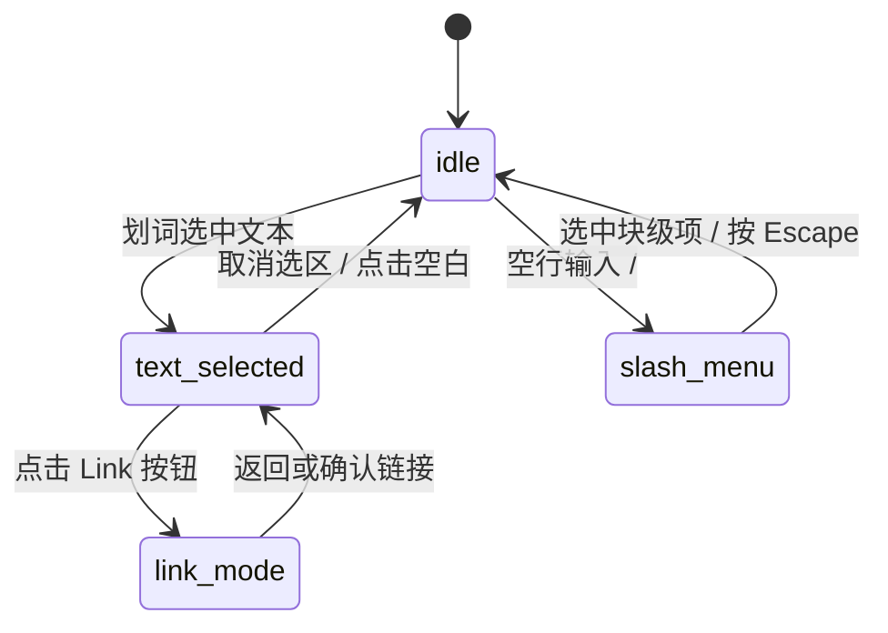

# Rich Text Editor · 富文本编辑器

用于文档撰写、发布排版与笔记编辑的高保真富文本编辑器组件。集成选区吸附浮动工具栏（Floating Selection Toolbar）、工具栏双面形变切换（Toolbar Face Morphing）、斜杠快捷指令菜单（Slash Command Menu）以及实时字数微模糊统计。涵盖四大核心机制：

1. 选区吸附浮动工具栏（Floating Selection Toolbar）：当用户在正文区域划词选中文本时，工具栏根据选区坐标自动计算最佳位置，以 `scale(0.96) translateY(6px)` 弹簧曲线轻量浮现吸附于选区正上方。
2. 双面无顿挫工具栏形变（Toolbar Face Morphing）：点击链接按钮时，工具栏容器宽度与高度执行 180ms 平滑伸缩，排版工具组与 URL 链接输入表单通过 120ms 高斯微模糊进行原地无顿挫置换。
3. 斜杠块级指令呼出（Slash Command Menu & Gliding Highlight）：在空行输入 `/` 触发弹出块级菜单，支持上下方向键巡回，单例高光胶囊在各块级选项间平滑滑动追随。
4. 实时字数平滑统计与分段输出（Live Word Counter & Output Segment）：顶栏字数伴随键入进行 120ms 微模糊计数更新；底栏提供 Markdown 与 HTML 分段切页，并附带代码一键复制反馈。

## 原型清单

| 原型分组 | 原型元素 | 动效 / 状态变化 | 去向 |
| --- | --- | --- | --- |
| 官方富文本舞台 | 编辑器卡片外框 `.rich-text-editor_card` | 基础面板容器、圆角 24px 与边框投影 | 最小 DOM |
| 官方富文本舞台 | 历史撤销重做按钮 `.rich-text-editor_history` | 禁用态透明度、按压触感反馈 | 最小 DOM |
| 官方富文本舞台 | 实时字数统计 `.rich-text-editor_count` | 数字变动微模糊过渡、防抖锁定 | 实时字数平滑统计与分段输出 |
| 官方富文本舞台 | 可编辑正文区 `.rich-text-editor-editor` | 聚焦占位符提示、划词选区监听、空行斜杠监听 | 最小 DOM |
| 官方富文本舞台 | 浮动选区工具栏 `.rich-text-editor-toolbar` | 选区坐标吸附、展开与收起动画 | 选区吸附浮动工具栏 |
| 官方富文本舞台 | 格式/链接双面容器 `.rich-text-editor-face` | 链接输入表单无顿挫置换、尺寸平滑补间 | 双面无顿挫工具栏形变 |
| 官方富文本舞台 | 斜杠指令弹窗 `.rich-text-editor-slash` | 空行呼出、高光胶囊沿 Y 轴追随 | 斜杠块级指令呼出 |
| 官方富文本舞台 | 底部分段输出控制台 | Markdown/HTML 单选胶囊滑动、一键复制反馈 | 实时字数平滑统计与分段输出 |
| — | 顶栏独立主题切换器 `#themeBtn` | 演示主题切换 | 演示外壳，已删除 |
| — | 外层演示画布与间距包装 | 演示外壳 | 演示外壳，已删除 |

## 适用

- 知识库、博客发布系统、评论输入框、协同文档。
- 需要沉浸式划词即时排版（Bold、Italic、Link、Headings）的现代化排版环境。
- 支持类似 Notion 式的斜杠快速插入块级内容（`/` 快捷菜单）。

## 不适用

- 仅用于显示代码高亮与行号的代码展示块 → [code-block](code-block.md)
- 文件上传与附件拖拽投放区域 → [file-dropzone](file-dropzone.md)
- 手写签名采集 → [signature-pad](signature-pad.md)

## 状态机

| 状态 | 进入条件 | 视觉表现 | 退出到 |
| --- | --- | --- | --- |
| `idle` | 初始载入 / 无选区无斜杠呼出 | 正文处于编辑就绪态，浮动工具栏与斜杠菜单隐藏 | `text-selected`, `slash-menu` |
| `text-selected` | 鼠标或键盘选中了一段有效文本 | 浮动格式工具栏吸附于选区上方浮现（scale 0.96 → 1, opacity 0 → 1） | `idle`, `link-mode` |
| `link-mode` | 在工具栏中点击 Link 按钮 | 工具栏原地横向伸缩形变为链接输入框 | `text-selected`, `idle` |
| `slash-menu` | 在空行敲入 `/` 字符 | 块级选择面板自光标下方弹出，高光胶囊就绪 | `idle` |



## 最小 DOM

```html
<div class="rich-text-editor-root">
  <div class="rte-card">
    <header class="rte-header">
      <div class="rte-history">
        <button type="button" class="rte-icon-btn btn-undo" aria-label="Undo" disabled>
          <svg width="15" height="15" viewBox="0 0 24 24" fill="none" stroke="currentColor" stroke-width="2"><path d="M9 14 4 9l5-5"/><path d="M4 9h10.5a5.5 5.5 0 0 1 5.5 5.5a5.5 5.5 0 0 1-5.5 5.5H11"/></svg>
        </button>
        <button type="button" class="rte-icon-btn btn-redo" aria-label="Redo" disabled>
          <svg width="15" height="15" viewBox="0 0 24 24" fill="none" stroke="currentColor" stroke-width="2"><path d="m15 14 5-5-5-5"/><path d="M20 9H9.5A5.5 5.5 0 0 0 4 14.5A5.5 5.5 0 0 0 9.5 20H13"/></svg>
        </button>
      </div>
      <div class="rte-word-count">
        <span class="count-number">0</span> words
      </div>
    </header>

    <div class="rte-body">
      <div class="rte-editor" contenteditable="true" role="textbox" aria-multiline="true" aria-label="Rich text content">
        <p>Type here or press <code>/</code> for commands...</p>
      </div>

      <!-- 浮动选区格式工具栏 -->
      <div class="rte-toolbar" role="toolbar" aria-label="Formatting" data-state="closed">
        <div class="rte-face rte-face-format">
          <button type="button" class="rte-tool" data-command="bold" aria-label="Bold">
            <svg width="14" height="14" viewBox="0 0 24 24" fill="none" stroke="currentColor" stroke-width="2"><path d="M6 12h9a4 4 0 0 1 0 8H7a1 1 0 0 1-1-1V5a1 1 0 0 1 1-1h7a4 4 0 0 1 0 8"/></svg>
          </button>
          <button type="button" class="rte-tool" data-command="italic" aria-label="Italic">
            <svg width="14" height="14" viewBox="0 0 24 24" fill="none" stroke="currentColor" stroke-width="2"><line x1="19" x2="10" y1="4" y2="4"/><line x1="14" x2="5" y1="20" y2="20"/><line x1="15" x2="9" y1="4" y2="20"/></svg>
          </button>
          <button type="button" class="rte-tool" data-command="strike" aria-label="Strikethrough">
            <svg width="14" height="14" viewBox="0 0 24 24" fill="none" stroke="currentColor" stroke-width="2"><path d="M16 4H9a3 3 0 0 0-2.83 4"/><path d="M14 12a4 4 0 0 1 0 8H6"/><line x1="4" x2="20" y1="12" y2="12"/></svg>
          </button>
          <button type="button" class="rte-tool btn-link-toggle" aria-label="Insert Link">
            <svg width="14" height="14" viewBox="0 0 24 24" fill="none" stroke="currentColor" stroke-width="2"><path d="M10 13a5 5 0 0 0 7.54.54l3-3a5 5 0 0 0-7.07-7.07l-1.72 1.71"/><path d="M14 11a5 5 0 0 0-7.54-.54l-3 3a5 5 0 0 0 7.07 7.07l1.71-1.71"/></svg>
          </button>
        </div>

        <div class="rte-face rte-face-link" style="display: none;">
          <input type="url" class="rte-link-input" placeholder="Paste link..." />
          <button type="button" class="rte-tool btn-apply-link">Apply</button>
        </div>
      </div>
    </div>
  </div>
</div>
```

- `.rich-text-editor-root`：宿主根容器。
- `.rte-header`：头部区域，包含撤销/重做与实时字数计数器。
- `.rte-editor`：核心 `contenteditable` 正文排版容器。
- `.rte-toolbar`：绝对定位浮动工具栏，接管选区定位与面切换。
- `.rte-face-format` / `.rte-face-link`：格式面与链接输入面。

## 参数

| 名称 | 值 | 用于 | 来源 |
| --- | --- | --- | --- |
| 工具栏弹出时长 | `160ms cubic-bezier(0.16, 1, 0.3, 1)` | 工具栏 scale 与 opacity | 原型 |
| 工具栏面切换时长 | `120ms` | 微模糊面置换 | 原型 |
| 工具栏高度 | `38px` | `.rte-toolbar` | 原型 |
| 工具栏圆角 | `10px` | `.rte-toolbar` | 原型 |
| 按压触感缩放 | `scale(0.92)` | 按钮点击反馈 | 原型 |

## CSS

```css
.rich-text-editor-root {
  --rte-bg: #ffffff;
  --rte-fg: #111111;
  --rte-muted: #737373;
  --rte-border: rgba(0, 0, 0, 0.1);
  --rte-hover: #f5f5f5;
  --rte-accent: #2563eb;

  width: 100%;
  max-width: 640px;
  font-family: -apple-system, BlinkMacSystemFont, "Segoe UI", Roboto, sans-serif;
  user-select: none;
  box-sizing: border-box;
}

.rte-card {
  border: 1px solid var(--rte-border);
  border-radius: 18px;
  background: var(--rte-bg);
  box-shadow: 0 16px 36px -10px rgba(0, 0, 0, 0.08);
  overflow: hidden;
}

.rte-header {
  display: flex;
  align-items: center;
  justify-content: space-between;
  height: 42px;
  padding: 0 14px;
  border-bottom: 1px solid var(--rte-border);
  background: #fafafa;
}

.rte-history {
  display: flex;
  align-items: center;
  gap: 4px;
}

.rte-icon-btn {
  display: grid;
  place-items: center;
  width: 28px;
  height: 28px;
  border: 0;
  border-radius: 6px;
  background: transparent;
  color: var(--rte-muted);
  cursor: pointer;
  transition: background-color 120ms ease, color 120ms ease;
}
.rte-icon-btn:hover:not(:disabled) { background: var(--rte-hover); color: var(--rte-fg); }
.rte-icon-btn:disabled { opacity: 0.35; cursor: not-allowed; }

.rte-word-count {
  font-size: 12px;
  color: var(--rte-muted);
}
.count-number {
  font-weight: 600;
  color: var(--rte-fg);
  font-variant-numeric: tabular-nums;
  transition: opacity 120ms ease, filter 120ms ease;
}

/* 编辑正文 */
.rte-body {
  position: relative;
  min-height: 220px;
  padding: 16px 20px;
}

.rte-editor {
  min-height: 180px;
  font-size: 14.5px;
  line-height: 1.6;
  color: var(--rte-fg);
  outline: none;
  user-select: text;
}
.rte-editor p { margin: 0 0 10px; }

/* 浮动选区工具栏 */
.rte-toolbar {
  position: absolute;
  z-index: 100;
  height: 38px;
  padding: 0 4px;
  border: 1px solid var(--rte-border);
  border-radius: 10px;
  background: #111111;
  color: #ffffff;
  box-shadow: 0 12px 28px rgba(0, 0, 0, 0.22);
  display: flex;
  align-items: center;
  transform-origin: bottom center;
  transition: opacity 160ms cubic-bezier(0.16, 1, 0.3, 1), transform 160ms cubic-bezier(0.16, 1, 0.3, 1);
  box-sizing: border-box;
}

.rte-toolbar[data-state="closed"] {
  opacity: 0;
  transform: scale(0.96) translateY(6px);
  pointer-events: none;
  visibility: hidden;
}

.rte-toolbar[data-state="open"] {
  opacity: 1;
  transform: scale(1) translateY(0);
  pointer-events: auto;
  visibility: visible;
}

.rte-face {
  display: flex;
  align-items: center;
  gap: 2px;
}

.rte-tool {
  display: grid;
  place-items: center;
  width: 30px;
  height: 30px;
  border: 0;
  border-radius: 6px;
  background: transparent;
  color: #cbd5e1;
  cursor: pointer;
  transition: background-color 100ms ease, color 100ms ease;
}
.rte-tool:hover { background: rgba(255, 255, 255, 0.12); color: #ffffff; }
.rte-tool:active { transform: scale(0.92); }

.rte-link-input {
  height: 28px;
  width: 140px;
  padding: 0 8px;
  border: 0;
  border-radius: 4px;
  background: rgba(255, 255, 255, 0.15);
  color: #ffffff;
  font: inherit;
  font-size: 12px;
  outline: none;
}

.btn-apply-link {
  height: 28px;
  padding: 0 8px;
  border: 0;
  border-radius: 4px;
  background: var(--rte-accent);
  color: #ffffff;
  font-size: 12px;
  font-weight: 500;
  cursor: pointer;
}

@media (prefers-reduced-motion: reduce) {
  .rte-toolbar, .count-number {
    transition: none !important;
    transform: none !important;
  }
}
```

## JS

```js
/**
 * 初始化 Rich Text Editor 组件控制器
 * @param {HTMLElement} root 根容器节点
 * @param {Object} [options] 配置选项
 * @param {(wordsCount: number) => void} [options.onWordCountChange] 字数变动回调
 * @returns {{ getHTML: Function, setHTML: Function, destroy: Function }}
 */
export function createRichTextEditor(root, options = {}) {
  const editor = root.querySelector('.rte-editor');
  const toolbar = root.querySelector('.rte-toolbar');
  const countEl = root.querySelector('.count-number');
  const linkToggle = root.querySelector('.btn-link-toggle');
  const formatFace = root.querySelector('.rte-face-format');
  const linkFace = root.querySelector('.rte-face-link');
  const linkInput = root.querySelector('.rte-link-input');
  const applyLinkBtn = root.querySelector('.btn-apply-link');
  const tools = root.querySelectorAll('.rte-tool[data-command]');

  let savedRange = null;

  function countWords(str) {
    const text = str.trim();
    if (!text) return 0;
    return text.split(/\s+/).length;
  }

  function updateWordCount() {
    if (!editor || !countEl) return;
    const count = countWords(editor.innerText || '');
    countEl.textContent = String(count);
    if (typeof options.onWordCountChange === 'function') {
      options.onWordCountChange(count);
    }
  }

  function checkSelection() {
    const selection = window.getSelection();
    if (!selection || selection.isCollapsed || !editor.contains(selection.anchorNode)) {
      hideToolbar();
      return;
    }

    const range = selection.getRangeAt(0);
    const rect = range.getBoundingClientRect();
    const rootRect = root.getBoundingClientRect();

    if (rect.width > 0 && rect.height > 0) {
      savedRange = range.cloneRange();
      showToolbar(rect.left - rootRect.left + rect.width / 2, rect.top - rootRect.top - 46);
    } else {
      hideToolbar();
    }
  }

  function showToolbar(x, y) {
    if (!toolbar) return;
    toolbar.style.left = `${Math.max(10, x - toolbar.offsetWidth / 2)}px`;
    toolbar.style.top = `${Math.max(10, y)}px`;
    toolbar.setAttribute('data-state', 'open');
  }

  function hideToolbar() {
    if (!toolbar) return;
    toolbar.setAttribute('data-state', 'closed');
    if (formatFace) formatFace.style.display = 'flex';
    if (linkFace) linkFace.style.display = 'none';
  }

  const onSelectionChange = () => {
    checkSelection();
  };

  const onEditorInput = () => {
    updateWordCount();
  };

  const onToolClick = (e) => {
    const btn = e.currentTarget;
    const command = btn.dataset.command;
    if (command) {
      document.execCommand(command, false, null);
      checkSelection();
    }
  };

  const onLinkToggleClick = () => {
    if (formatFace) formatFace.style.display = 'none';
    if (linkFace) linkFace.style.display = 'flex';
    if (linkInput) linkInput.focus();
  };

  const onApplyLinkClick = () => {
    const url = linkInput ? linkInput.value.trim() : '';
    if (url && savedRange) {
      const selection = window.getSelection();
      selection.removeAllRanges();
      selection.addRange(savedRange);
      document.execCommand('createLink', false, url);
    }
    hideToolbar();
  };

  tools.forEach(tool => tool.addEventListener('click', onToolClick));
  if (linkToggle) linkToggle.addEventListener('click', onLinkToggleClick);
  if (applyLinkBtn) applyLinkBtn.addEventListener('click', onApplyLinkClick);
  if (editor) editor.addEventListener('input', onEditorInput);
  document.addEventListener('selectionchange', onSelectionChange);

  updateWordCount();

  return {
    getHTML: () => (editor ? editor.innerHTML : ''),
    setHTML: (html) => {
      if (editor) {
        editor.innerHTML = html;
        updateWordCount();
      }
    },
    destroy: () => {
      hideToolbar();
      tools.forEach(tool => tool.removeEventListener('click', onToolClick));
      if (linkToggle) linkToggle.removeEventListener('click', onLinkToggleClick);
      if (applyLinkBtn) applyLinkBtn.removeEventListener('click', onApplyLinkClick);
      if (editor) editor.removeEventListener('input', onEditorInput);
      document.removeEventListener('selectionchange', onSelectionChange);
    }
  };
}
```

## 接入目标项目

- 状态来源：目标业务的正文 HTML 或 Markdown 字符串，监听 `onWordCountChange` 更新统计状态。
- 尺寸策略：卡片最大宽度 640px，编辑器随内容自然纵向增高。
- 驱动方式：实例化 `createRichTextEditor(root, { onWordCountChange })` 托管选区工具栏。

## 重入与清理

- 选区取消时立即隐藏浮动工具栏并重置面为基础格式排版面，防止旧选区坐标错位。
- 卸载时通过 `destroy()` 解绑全局 `selectionchange` 监听器与按键监听。

## 减少动态效果

- 激活 `prefers-reduced-motion: reduce` 时：
  - 浮动工具栏禁用缩放与位移动画，直接透明度切换。
  - 数字微模糊过渡停用。

## 焦点与键盘

- 正文区具备标准光标编辑、全键盘方向键与快捷键（Ctrl+B/I/U）支持。
- 工具栏各动作按钮可被键盘聚焦与触发。

## 兼容回退

| 特性 | 不支持时 |
| --- | --- |
| `document.execCommand` | 可回退至现代 `Selection` 与 `Range` DOM API 自行包裹标签 |
| CSS `transform-origin` | 工具栏以居中原点缩放淡出 |

## 验收清单

- [ ] 在编辑器内选中一段文字，浮动格式工具栏平滑浮现并精准吸附在选区正上方。
- [ ] 点击工具栏中的粗体（Bold）或斜体（Italic），文字格式即刻生效。
- [ ] 点击 Link 按钮，工具栏横向无顿挫平滑切换为输入链接输入面。
- [ ] 输入链接并点击 Apply，选中文本转换为超链接标签并收起工具栏。
- [ ] 输入正文文字，顶栏字数计数器实时平滑更新。
- [ ] 开启减弱动态效果时，所有位移与缩放动画禁用。
