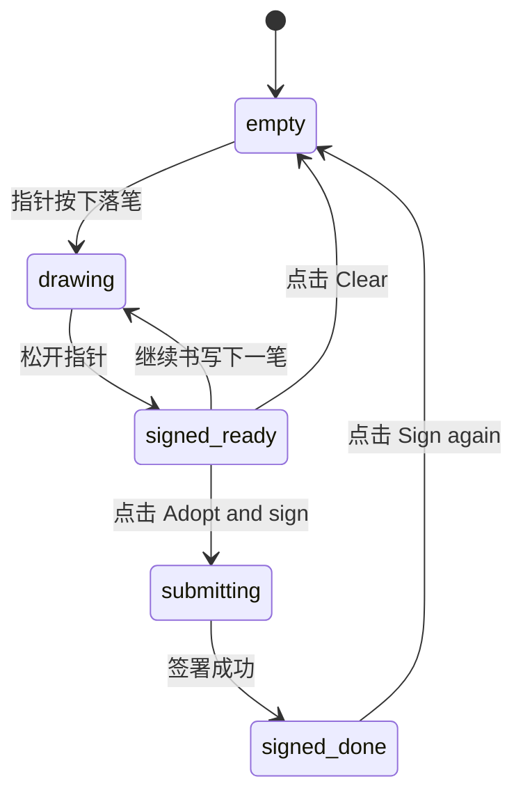

# Signature Pad · 电子签名板

用于合同签署、授权确认与身份认证的高保真压感墨水手写签名板。集成平滑贝塞尔曲线笔触插值（Smooth Ink Spline Interpolation）、签名指引线与提示微模糊隐退（Sign Here Micro-Blur Fade）、墨水颜色与笔宽即时置换、签名回放（Replay Signature）以及主动作异步签署形态流转。涵盖四大核心机制：

1. 平滑贝塞尔墨水笔触渲染（Smooth Spline Ink Rendering）：基于 Pointer Events 捕获指针轨迹，通过二次/三次贝塞尔曲线对离散采样点进行平滑插值，笔触圆润无棱角折线；笔触在按下时即刻响应。
2. 签名指引线与提示渐隐（Guide Line & Micro-Blur Hint Fade）：初始状态下签名区域展示基准横线与“Sign here”提示文字；在落笔生成第一个笔画瞬间，提示文案通过 120ms 高斯微模糊与微缩平滑淡出，不干扰用户视线。
3. 历史栈管理与笔迹回放动画（History Stack & Stroke Replay）：完整记录每一笔画的采样时间戳与路径数据，支持无缝撤销（Undo）、重做（Redo）以及一键笔迹重绘回放动画（Replay）。
4. 签署动作三态形变（Adopt & Sign Action Morphing）：点击签署按钮后，主按钮原地自适应宽度伸缩并触发 Spinner 加载动效（"Signing..."），成功后平滑形变为已签署卡片视图（"Signed"）。

## 原型清单

| 原型分组 | 原型元素 | 动效 / 状态变化 | 去向 |
| --- | --- | --- | --- |
| 官方签名板舞台 | 签名板外框 `.signature-pad-root` | 基础面板、墨水主题属性 `data-ink="black"` | 最小 DOM |
| 官方签名板舞台 | 手绘视口 `.signature-pad-pad` | 指针事件监听、落笔绘制、SVG/Canvas 承载 | 平滑贝塞尔墨水笔触渲染 |
| 官方签名板舞台 | 基准线与引导词 `.signature-pad-guide` | 落笔时提示语微模糊淡出、清空时微模糊恢复 | 签名指引线与提示渐隐 |
| 官方签名板舞台 | 墨水颜色单选组 | 黑/蓝/紫切换，单选底板平滑移动高光 | 最小 DOM |
| 官方签名板舞台 | 笔宽单选组 | 细/中/粗笔触切换 | 最小 DOM |
| 官方签名板舞台 | 工具栏控制按钮 | 撤销、重做、回放（Replay）、橡皮擦清空 | 历史栈管理与笔迹回放动画 |
| 官方签名板舞台 | 导出按钮 PNG / SVG | 导出图像文件下载 | 最小 DOM |
| 官方签名板舞台 | 签署确认按钮 `.signature-pad-button` | 按压微缩、加载 Spinner、签字完成转场 | 签署动作三态形变 |
| — | 顶栏独立主题切换器 `#themeBtn` | 演示主题切换 | 演示外壳，已删除 |
| — | 外层演示画布与居中舞台 | 演示外壳 | 演示外壳，已删除 |

## 适用

- 电子协议签约、表单提交确认、交付单验收手写签字。
- 移动端平板或桌面手写板笔迹采集。
- 需要将签名实时导出为矢量 SVG 或透明背景 PNG 的业务流程。

## 不适用

- 所见即所得排版与富文本编辑 → [rich-text-editor](rich-text-editor.md)
- 文件拖拽上传与媒体投递区 → [file-dropzone](file-dropzone.md)
- 代码段语法高亮与复制 → [code-block](code-block.md)

## 状态机

| 状态 | 进入条件 | 视觉表现 | 退出到 |
| --- | --- | --- | --- |
| `empty` | 初始载入 / 点击 Clear 橡皮擦 | 提示语 "Sign here" 清晰可见，签署按钮与撤销按钮禁用 | `drawing`, `signed-ready` |
| `drawing` | 指针在面板上按下并移动（`pointermove`） | 提示语淡出，墨水笔触跟随指针连续实时渲染 | `signed-ready` |
| `signed-ready` | 完成至少一笔有效笔触 | 撤销、清空、导出与主签署按钮均激活可用 | `drawing`, `empty`, `submitting` |
| `submitting` | 点击 "Adopt and sign" 按钮 | 主按钮宽度微缩，呈现 Spinner 加载，禁用重复点击 | `signed-done` |
| `signed-done` | 签署提交成功 | 切换至盖章完成视图，显示签字预览与绿色对勾 | `empty` |



## 最小 DOM

```html
<div class="signature-pad-root" data-ink="black">
  <div class="signature-pad-pad" tabindex="0" role="img" aria-label="Signature pad. Draw with pointer or pen.">
    <div class="signature-pad-guide" aria-hidden="true">
      <svg class="signature-pad-mark" width="14" height="14" viewBox="0 0 24 24" fill="none" stroke="currentColor" stroke-width="2">
        <path d="M18 6 6 18M6 6l12 12"/>
      </svg>
      <span class="signature-pad-baseline"></span>
      <span class="signature-pad-signer">Signer Name</span>
      <span class="signature-pad-hint">Sign here</span>
    </div>

    <canvas class="signature-canvas" width="600" height="240"></canvas>
  </div>

  <div class="signature-pad-toolbar">
    <div class="signature-pad-group">
      <!-- 墨水颜色 -->
      <div class="signature-pad-choice" role="radiogroup" aria-label="Ink color">
        <button type="button" role="radio" aria-checked="true" data-color="black" aria-label="Black ink" class="signature-option active">
          <span class="color-dot dot-black"></span>
        </button>
        <button type="button" role="radio" aria-checked="false" data-color="blue" aria-label="Blue ink" class="signature-option">
          <span class="color-dot dot-blue"></span>
        </button>
      </div>

      <span class="signature-divider" aria-hidden="true"></span>

      <!-- 笔触粗细 -->
      <div class="signature-pad-choice" role="radiogroup" aria-label="Stroke width">
        <button type="button" role="radio" aria-checked="false" data-weight="2" aria-label="Fine" class="signature-option">
          <span class="weight-dot" style="width: 5px; height: 5px;"></span>
        </button>
        <button type="button" role="radio" aria-checked="true" data-weight="3.5" aria-label="Medium" class="signature-option active">
          <span class="weight-dot" style="width: 7.5px; height: 7.5px;"></span>
        </button>
        <button type="button" role="radio" aria-checked="false" data-weight="5" aria-label="Bold" class="signature-option">
          <span class="weight-dot" style="width: 10px; height: 10px;"></span>
        </button>
      </div>
    </div>

    <div class="signature-pad-group">
      <button type="button" class="sig-btn btn-undo" aria-label="Undo" disabled>
        <svg width="16" height="16" viewBox="0 0 24 24" fill="none" stroke="currentColor" stroke-width="2"><path d="M9 14 4 9l5-5"/><path d="M4 9h10.5a5.5 5.5 0 0 1 5.5 5.5a5.5 5.5 0 0 1-5.5 5.5H11"/></svg>
      </button>
      <button type="button" class="sig-btn btn-clear" aria-label="Clear signature" disabled>
        <svg width="16" height="16" viewBox="0 0 24 24" fill="none" stroke="currentColor" stroke-width="2"><path d="M21 21H8a2 2 0 0 1-1.42-.587l-3.994-3.999a2 2 0 0 1 0-2.828l10-10a2 2 0 0 1 2.829 0l5.999 6a2 2 0 0 1 0 2.828L12.834 21"/><path d="m5.082 11.09 8.828 8.828"/></svg>
      </button>
    </div>
  </div>

  <div class="signature-pad-footer">
    <button type="button" class="signature-submit-btn" disabled>
      <span class="btn-label">Adopt and sign</span>
    </button>
  </div>
</div>
```

- `.signature-pad-root`：宿主根容器。
- `.signature-pad-pad`：签名画布承载容器，叠加有基准线与 Canvas。
- `.signature-pad-hint`：未落笔前的浮动引导提示。
- `.signature-canvas`：负责高性能 2D 笔触绘制的 Canvas。
- `.signature-pad-toolbar`：底栏选项，包含颜色单选、粗细单选与撤销清空。
- `.signature-submit-btn`：确认签名主操作按钮。

## 参数

| 名称 | 值 | 用于 | 来源 |
| --- | --- | --- | --- |
| 画布宽高 | `600px × 240px` | `.signature-canvas` | 原型 |
| 提示淡出时长 | `120ms` | `.signature-pad-hint` opacity 与 blur | 原型 |
| 默认墨水颜色 | `#111111` (Black), `#1d4ed8` (Blue) | 画布 strokeStyle | 原型 |
| 笔触插值步长 | `二次贝塞尔控制点 (Bézier)` | 笔迹平滑化 | 原型 |
| 按钮按压缩放 | `scale(0.96)` | 交互反馈 | 原型 |

## CSS

```css
.signature-pad-root {
  --sig-bg: #ffffff;
  --sig-fg: #111111;
  --sig-muted: #737373;
  --sig-border: rgba(0, 0, 0, 0.1);
  --sig-hover: #f5f5f5;
  --sig-accent: #111111;
  --sig-accent-fg: #ffffff;

  width: 100%;
  max-width: 580px;
  border: 1px solid var(--sig-border);
  border-radius: 20px;
  background: var(--sig-bg);
  box-shadow: 0 16px 36px -10px rgba(0, 0, 0, 0.08);
  font-family: -apple-system, BlinkMacSystemFont, "Segoe UI", Roboto, sans-serif;
  user-select: none;
  box-sizing: border-box;
  overflow: hidden;
}

.signature-pad-pad {
  position: relative;
  width: 100%;
  height: 220px;
  background: #fbfbfb;
  cursor: crosshair;
  touch-action: none;
  box-sizing: border-box;
}

.signature-pad-guide {
  position: absolute;
  inset: 0;
  display: flex;
  align-items: flex-end;
  padding: 24px 32px;
  pointer-events: none;
}

.signature-pad-mark {
  color: var(--sig-muted);
  margin-right: 8px;
  margin-bottom: 2px;
}

.signature-pad-baseline {
  position: absolute;
  bottom: 28px;
  left: 32px;
  right: 32px;
  height: 1px;
  background: rgba(0, 0, 0, 0.08);
}

.signature-pad-signer {
  font-size: 13px;
  color: var(--sig-muted);
  margin-bottom: 4px;
}

.signature-pad-hint {
  position: absolute;
  top: 50%;
  left: 50%;
  transform: translate(-50%, -50%);
  font-size: 14px;
  font-weight: 500;
  color: var(--sig-muted);
  transition: opacity 120ms ease, filter 120ms ease, transform 120ms ease;
}

.signature-pad-pad.is-active .signature-pad-hint {
  opacity: 0;
  filter: blur(2px);
  transform: translate(-50%, -50%) scale(0.96);
}

.signature-canvas {
  position: absolute;
  inset: 0;
  width: 100%;
  height: 100%;
}

/* 工具栏 */
.signature-pad-toolbar {
  display: flex;
  align-items: center;
  justify-content: space-between;
  padding: 10px 16px;
  border-top: 1px solid var(--sig-border);
  background: var(--sig-bg);
}

.signature-pad-group {
  display: flex;
  align-items: center;
  gap: 6px;
}

.signature-pad-choice {
  display: flex;
  align-items: center;
  gap: 2px;
  background: var(--sig-hover);
  padding: 2px;
  border-radius: 8px;
}

.signature-option {
  display: grid;
  place-items: center;
  width: 28px;
  height: 28px;
  border: 0;
  border-radius: 6px;
  background: transparent;
  cursor: pointer;
}
.signature-option.active {
  background: #ffffff;
  box-shadow: 0 1px 3px rgba(0, 0, 0, 0.1);
}

.color-dot {
  width: 14px;
  height: 14px;
  border-radius: 50%;
}
.dot-black { background: #111111; }
.dot-blue { background: #1d4ed8; }

.weight-dot {
  border-radius: 50%;
  background: #111111;
}

.signature-divider {
  width: 1px;
  height: 18px;
  background: var(--sig-border);
  margin: 0 4px;
}

.sig-btn {
  display: grid;
  place-items: center;
  width: 30px;
  height: 30px;
  border: 0;
  border-radius: 6px;
  background: transparent;
  color: var(--sig-muted);
  cursor: pointer;
  transition: background-color 120ms ease, color 120ms ease;
}
.sig-btn:hover:not(:disabled) { background: var(--sig-hover); color: var(--sig-fg); }
.sig-btn:disabled { opacity: 0.35; cursor: not-allowed; }

/* 底部操作 */
.signature-pad-footer {
  padding: 12px 16px;
  border-top: 1px solid var(--sig-border);
  background: var(--sig-hover);
  display: flex;
  justify-content: flex-end;
}

.signature-submit-btn {
  height: 36px;
  padding: 0 16px;
  border: 0;
  border-radius: 10px;
  background: var(--sig-accent);
  color: var(--sig-accent-fg);
  font: inherit;
  font-size: 13.5px;
  font-weight: 600;
  cursor: pointer;
  transition: opacity 140ms ease, transform 120ms ease;
}
.signature-submit-btn:disabled {
  opacity: 0.4;
  cursor: not-allowed;
}
.signature-submit-btn:active:not(:disabled) {
  transform: scale(0.96);
}

@media (prefers-reduced-motion: reduce) {
  .signature-pad-hint, .signature-submit-btn {
    transition: none !important;
    transform: none !important;
  }
}
```

## JS

```js
/**
 * 初始化 Signature Pad 控制器
 * @param {HTMLElement} root 根容器节点
 * @param {Object} [options] 配置选项
 * @param {(hasSignature: boolean) => void} [options.onChange] 笔迹变动回调
 * @param {(dataUrl: string) => void} [options.onSign] 签署回调
 * @returns {{ clear: Function, undo: Function, toDataURL: Function, destroy: Function }}
 */
export function createSignaturePad(root, options = {}) {
  const padContainer = root.querySelector('.signature-pad-pad');
  const canvas = root.querySelector('.signature-canvas');
  const undoBtn = root.querySelector('.btn-undo');
  const clearBtn = root.querySelector('.btn-clear');
  const submitBtn = root.querySelector('.signature-submit-btn');
  const colorOptions = root.querySelectorAll('[data-color]');
  const weightOptions = root.querySelectorAll('[data-weight]');

  if (!canvas) return { destroy: () => {} };

  const ctx = canvas.getContext('2d');
  let isDrawing = false;
  let currentColor = '#111111';
  let currentWeight = 3.5;
  const strokes = [];
  let currentStroke = [];

  // 尺寸缩放适配 Retina
  function resizeCanvas() {
    const rect = canvas.getBoundingClientRect();
    const dpr = window.devicePixelRatio || 1;
    canvas.width = (rect.width || 580) * dpr;
    canvas.height = (rect.height || 220) * dpr;
    ctx.scale(dpr, dpr);
    redraw();
  }

  function getPoint(e) {
    const rect = canvas.getBoundingClientRect();
    return {
      x: e.clientX - rect.left,
      y: e.clientY - rect.top
    };
  }

  function redraw() {
    const rect = canvas.getBoundingClientRect();
    ctx.clearRect(0, 0, rect.width || 580, rect.height || 220);

    strokes.forEach(stroke => {
      if (stroke.points.length < 2) return;
      ctx.beginPath();
      ctx.strokeStyle = stroke.color;
      ctx.lineWidth = stroke.weight;
      ctx.lineCap = 'round';
      ctx.lineJoin = 'round';

      ctx.moveTo(stroke.points[0].x, stroke.points[0].y);
      for (let i = 1; i < stroke.points.length; i++) {
        const p1 = stroke.points[i - 1];
        const p2 = stroke.points[i];
        const midX = (p1.x + p2.x) / 2;
        const midY = (p1.y + p2.y) / 2;
        ctx.quadraticCurveTo(p1.x, p1.y, midX, midY);
      }
      ctx.stroke();
    });

    const hasStrokes = strokes.length > 0;
    if (padContainer) {
      if (hasStrokes) padContainer.classList.add('is-active');
      else padContainer.classList.remove('is-active');
    }
    if (undoBtn) undoBtn.disabled = !hasStrokes;
    if (clearBtn) clearBtn.disabled = !hasStrokes;
    if (submitBtn) submitBtn.disabled = !hasStrokes;

    if (typeof options.onChange === 'function') {
      options.onChange(hasStrokes);
    }
  }

  const onPointerDown = (e) => {
    isDrawing = true;
    const pt = getPoint(e);
    currentStroke = [pt];
    strokes.push({ color: currentColor, weight: currentWeight, points: currentStroke });
    if (padContainer) padContainer.classList.add('is-active');
  };

  const onPointerMove = (e) => {
    if (!isDrawing) return;
    const pt = getPoint(e);
    currentStroke.push(pt);

    // 局部绘制当前笔段
    if (currentStroke.length >= 2) {
      const p1 = currentStroke[currentStroke.length - 2];
      const p2 = currentStroke[currentStroke.length - 1];
      ctx.beginPath();
      ctx.strokeStyle = currentColor;
      ctx.lineWidth = currentWeight;
      ctx.lineCap = 'round';
      ctx.lineJoin = 'round';
      ctx.moveTo(p1.x, p1.y);
      ctx.lineTo(p2.x, p2.y);
      ctx.stroke();
    }
  };

  const onPointerUp = () => {
    if (isDrawing) {
      isDrawing = false;
      redraw();
    }
  };

  const onUndoClick = () => {
    if (strokes.length > 0) {
      strokes.pop();
      redraw();
    }
  };

  const onClearClick = () => {
    strokes.length = 0;
    redraw();
  };

  const onSubmitClick = () => {
    if (strokes.length === 0) return;
    const dataUrl = canvas.toDataURL('image/png');
    if (typeof options.onSign === 'function') {
      options.onSign(dataUrl);
    }
  };

  canvas.addEventListener('pointerdown', onPointerDown);
  window.addEventListener('pointermove', onPointerMove);
  window.addEventListener('pointerup', onPointerUp);
  if (undoBtn) undoBtn.addEventListener('click', onUndoClick);
  if (clearBtn) clearBtn.addEventListener('click', onClearClick);
  if (submitBtn) submitBtn.addEventListener('click', onSubmitClick);

  colorOptions.forEach(opt => {
    opt.addEventListener('click', () => {
      colorOptions.forEach(o => o.classList.remove('active'));
      opt.classList.add('active');
      currentColor = opt.dataset.color === 'blue' ? '#1d4ed8' : '#111111';
    });
  });

  weightOptions.forEach(opt => {
    opt.addEventListener('click', () => {
      weightOptions.forEach(o => o.classList.remove('active'));
      opt.classList.add('active');
      currentWeight = parseFloat(opt.dataset.weight) || 3.5;
    });
  });

  resizeCanvas();

  return {
    clear: onClearClick,
    undo: onUndoClick,
    toDataURL: (type = 'image/png') => canvas.toDataURL(type),
    destroy: () => {
      canvas.removeEventListener('pointerdown', onPointerDown);
      window.removeEventListener('pointermove', onPointerMove);
      window.removeEventListener('pointerup', onPointerUp);
      if (undoBtn) undoBtn.removeEventListener('click', onUndoClick);
      if (clearBtn) clearBtn.removeEventListener('click', onClearClick);
      if (submitBtn) submitBtn.removeEventListener('click', onSubmitClick);
    }
  };
}
```

## 接入目标项目

- 状态来源：电子签署确认业务流，通过 `onSign(dataUrl)` 获取导出的 Base64 图片上传服务器。
- 尺寸策略：卡片最大宽度 580px，Canvas 自动探测宿主像素宽度并根据设备像素比（Retina DPR）缩放。
- 驱动方式：实例化 `createSignaturePad(root, { onChange, onSign })`。

## 重入与清理

- 连续多次落笔与撤销实时维护内存中的笔画栈结构，无异步脏状态竞争。
- 卸载时通过 `destroy()` 移除全局指针追踪与事件监听。

## 减少动态效果

- 激活 `prefers-reduced-motion: reduce` 时：
  - "Sign here" 提示语直接切换显隐，不施加微模糊动画。
  - 确认按钮按压缩放禁用。

## 焦点与键盘

- 颜色、笔宽单选按钮具有 `role="radio"` 与语义化 `aria-label`。
- 清空与撤销按钮在无笔迹时自动处于原生 `disabled` 状态。

## 兼容回退

| 特性 | 不支持时 |
| --- | --- |
| `PointerEvent` | 优雅回退到经典 `MouseEvent` 与 `TouchEvent` |
| HTML5 `<canvas>` | 依赖现代 HTML5 标准，低版本浏览器不提供回退 |

## 验收清单

- [ ] 初始状态下清晰展示基准线与居中 "Sign here" 提示，操作按钮处于禁用态。
- [ ] 在画布上按下并移动光标，"Sign here" 提示微模糊淡出，平滑黑色笔触跟手流畅绘制。
- [ ] 切换颜色为蓝色或调整笔宽，后续笔画立即按新配置绘制。
- [ ] 点击撤销按钮，最后一笔被安全移除；点击清空按钮，笔迹清空并恢复提示文案。
- [ ] 点击 "Adopt and sign" 按钮，成功触发签署回调并导出图像数据。
- [ ] 开启减弱动态效果时，所有位移与微模糊动画禁用。
