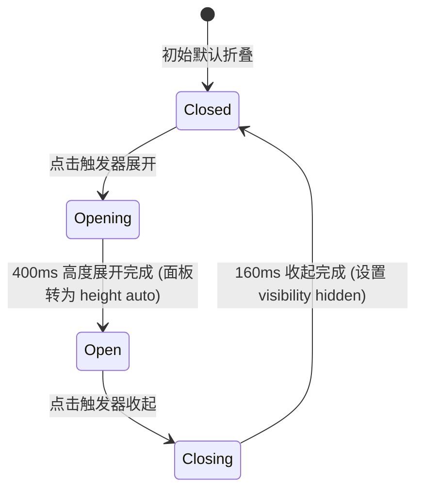

# Accordion · 手风琴折叠面板

用于垂直区域内容按需展开与折叠的信息架构组件。包含四大核心动效机制：

1. 真实高度平滑展开与收起（Smooth Height Expansion & Collapse）：展开时内容从 `0` 过渡到自然内容高度（400ms `cubic-bezier(0.16, 1, 0.3, 1)`），展开完毕后转为 `auto` 保持动态重排适应；收起时从当前高度过渡到 `0` 并在收起完成后附加 `visibility: hidden`。
2. 内容微位移与高斯模糊沉降（Micro-Blur & Translate Drop）：展开时内容面板内部由 `translateY(-6px) blur(2px)` 伴随 240ms `cubic-bezier(0.16, 1, 0.3, 1)` 平滑升起还原；收起时 160ms `translateY(-6px) blur(2px)` 加速淡出隐去。
3. 折角箭头 180° 旋转弹簧（Chevron Spring Flip）：触发器右侧的箭头 `.accordion-icon` 展开时顺时针旋转 180°，收起时逆向复位 0°，配合 260ms 弹簧曲线（`cubic-bezier(0.18, 0.89, 0.32, 1.15)`）。
4. 全键盘垂直巡礼导向（WAI-ARIA Keybindings）：上下方向键在触发器之间循环对焦，Home/End 瞬跳首尾项，Enter/Space 执行展开或折叠。

## 原型清单

| 原型分组 | 原型元素 | 动效 / 状态变化 | 去向 |
| --- | --- | --- | --- |
| 手风琴列表外壳 | 列表容器 `.accordion-accordion` | 承载纵向条目与整体外边框 | 最小 DOM |
| 手风琴条目 | 条目容器 `.accordion-item` | 承载条目边界底线与 `data-state` 状态 | 最小 DOM |
| 标题触发器 | 触发器标题 `.accordion-header` | 语义化 `<h3>` 标头 | 最小 DOM |
| 标题触发器 | 触发器按钮 `.accordion-trigger` | 悬停颜色过渡；点击触发展开/折叠；上下方向键循环 | 全键盘垂直巡礼导向 |
| 标题触发器 | 状态箭头 `.accordion-icon` | 展开时旋转 180°，关闭时复位 0° | 折角箭头 180° 旋转弹簧 |
| 内容折叠面板 | 折叠面板 `.accordion-panel` | 高度从 0 变动至真实高度；展开后置为 auto；关闭后 `visibility: hidden` | 真实高度平滑展开与收起 |
| 内容折叠面板 | 面包内容载体 `.accordion-panel-inner` | 展开时 `translateY(-6px) blur(2px)` 升起复原；关闭时下沉模糊 | 内容微位移与高斯模糊沉降 |
| — | 顶栏独立主题切换器 `#themeBtn` | 演示主题切换 | 演示外壳，已删除 |
| — | 外层演示居中舞台卡片 | 演示卡片外框 | 演示外壳，已删除 |

## 适用

- 常见问题（FAQ）、设置分组、多章节帮助文档等垂直多模块折叠展示。
- 纵向展示空间有限，希望默认只展示概览标题、由用户主动点击展开详情。
- 需要平滑展开/折叠、箭头旋转与文字微模糊升起的优雅微动效。

## 不适用

- 单个卡片包含双向（宽与高）弹性伸展 → [expandable-card](expandable-card.md)
- 水平横向分段同级视图切换 → [tabs](../navigation/tabs.md)
- 模态居中弹出浮层 → [dialog](../overlays/dialog.md)

## 状态机



| 状态 | 进入条件 | 视觉表现 | 退出到 |
| --- | --- | --- | --- |
| closed | 初始或收起完成 | 面板高度为 0，`opacity: 0`，`visibility: hidden`，箭头角度 0° | opening |
| opening | 点击折叠状态的触发器 | 面板显示，高度从 0 弹簧过渡到内容高度，箭头旋转 180°，文字淡入升起 | open |
| open | 展开动画结束 | 面板高度设为 `auto`，文字清晰显示，箭头保持 180° | closing |
| closing | 点击已展开项的触发器 | 面板高度从当前高度平滑过渡到 0，文字下沉模糊淡出，箭头复位 0° | closed |

## 最小 DOM

```html
<div class="accordion-accordion" data-orientation="vertical">
  <div class="accordion-item" data-state="closed">
    <h3 class="accordion-header">
      <button type="button" class="accordion-trigger" aria-expanded="false" id="accordion-trig-1" aria-controls="accordion-panel-1">
        <span>What is included?</span>
        <span class="accordion-icon" aria-hidden="true">
          <svg width="17" height="17" viewBox="0 0 24 24" fill="none" stroke="currentColor" stroke-width="2" stroke-linecap="round" stroke-linejoin="round">
            <path d="m6 9 6 6 6-6" />
          </svg>
        </span>
      </button>
    </h3>
    <div class="accordion-panel" id="accordion-panel-1" role="region" aria-labelledby="accordion-trig-1">
      <div class="accordion-panel-inner">
        A focused set of accessible primitives, with sensible keyboard behavior and motion.
      </div>
    </div>
  </div>
</div>
```

- `.accordion-accordion`：手风琴宿主根容器。
- `.accordion-item`：单条手风琴容器，由 `data-state="open"|"closed"` 驱动整体状态。
- `.accordion-header`：原生标题标签 `<h3>`。
- `.accordion-trigger`：可交互标题按钮，配置 `aria-expanded` 与 `aria-controls`。
- `.accordion-icon`：折角箭头指示图标，承载 180° 旋转弹簧。
- `.accordion-panel`：内容折叠面板容器，`overflow: hidden`，动态变化高度。
- `.accordion-panel-inner`：内容承载节点，负责高度测算与内容升起微模糊淡入。

## 参数

| 名称 | 值 | 用于 | 来源 |
| --- | --- | --- | --- |
| 面板展开弹簧过渡 | `400ms` / `cubic-bezier(0.16, 1, 0.3, 1)` | `.accordion-panel` height 展开 | 原型 |
| 面板收起加速过渡 | `240ms` / `cubic-bezier(0.22, 1, 0.36, 1)` | `.accordion-panel` height 收起 | 原型 |
| 箭头旋转弹簧过渡 | `260ms` / `cubic-bezier(0.18, 0.89, 0.32, 1.15)` | `.accordion-icon` transform 旋转 | 原型 |
| 内部文字入场延时与曲线 | `240ms` / `cubic-bezier(0.16, 1, 0.3, 1)` | `.accordion-panel-inner` 升起淡入 | 原型 |
| 内部文字退场时长 | `160ms` / `cubic-bezier(0.22, 1, 0.36, 1)` | `.accordion-panel-inner` 下沉淡出 | 原型 |
| 内部文字微下沉与模糊 | `translateY(-6px) blur(2px)` | 折叠或退场初始帧 | 原型 |

## CSS

```css
.accordion-accordion {
  --accordion-border: oklch(90% 0 0);
  --accordion-text-title: oklch(15% 0 0);
  --accordion-text-body: oklch(46% 0 0);
  --accordion-text-muted: oklch(59% 0 0);
  --accordion-ease-spring: cubic-bezier(0.16, 1, 0.3, 1);
  --accordion-ease-standard: cubic-bezier(0.22, 1, 0.36, 1);
  --accordion-ease-snappy: cubic-bezier(0.18, 0.89, 0.32, 1.15);
  --accordion-duration-expand: 400ms;
  --accordion-duration-collapse: 240ms;
  --accordion-duration-icon: 260ms;

  width: 100%;
  border-top: 1px solid var(--accordion-border);
}

.accordion-item {
  border-bottom: 1px solid var(--accordion-border);
}

.accordion-header {
  margin: 0;
  padding: 0;
}

.accordion-trigger {
  display: flex;
  width: 100%;
  min-height: 48px;
  align-items: center;
  justify-content: space-between;
  gap: 16px;
  padding: 12px 0;
  border: 0;
  background: transparent;
  color: var(--accordion-text-title);
  font: inherit;
  font-size: 0.875rem;
  font-weight: 500;
  line-height: 1.4;
  text-align: left;
  cursor: pointer;
  -webkit-tap-highlight-color: transparent;
  transition: color 160ms var(--accordion-ease-standard);
}

.accordion-trigger:hover {
  color: var(--accordion-text-body);
}

.accordion-icon {
  display: inline-flex;
  align-items: center;
  justify-content: center;
  flex: 0 0 auto;
  color: var(--accordion-text-muted);
  transform-origin: center;
  transition:
    transform var(--accordion-duration-icon) var(--accordion-ease-snappy),
    color 160ms var(--accordion-ease-standard);
}

.accordion-item[data-state="open"] .accordion-icon {
  transform: rotate(180deg);
  color: var(--accordion-text-title);
}

.accordion-panel {
  overflow: hidden;
  height: 0;
  opacity: 0;
  visibility: hidden;
  color: var(--accordion-text-body);
  font-size: 0.875rem;
  line-height: 1.5;
  transition:
    height var(--accordion-duration-collapse) var(--accordion-ease-standard),
    opacity 160ms var(--accordion-ease-standard);
  will-change: height, opacity;
}

.accordion-item[data-state="open"] .accordion-panel {
  opacity: 1;
  visibility: visible;
  transition:
    height var(--accordion-duration-expand) var(--accordion-ease-spring),
    opacity 240ms var(--accordion-ease-spring);
}

.accordion-panel-inner {
  padding: 0 16px 16px 0;
  transform: translateY(-6px);
  filter: blur(2px);
  transition:
    transform 160ms var(--accordion-ease-standard),
    filter 160ms var(--accordion-ease-standard);
}

.accordion-item[data-state="open"] .accordion-panel-inner {
  transform: translateY(0);
  filter: blur(0);
  transition:
    transform 240ms var(--accordion-ease-spring),
    filter 240ms var(--accordion-ease-spring);
}

@media (prefers-reduced-motion: reduce) {
  .accordion-trigger,
  .accordion-icon,
  .accordion-panel,
  .accordion-panel-inner {
    transition: none !important;
  }
  .accordion-panel-inner {
    transform: none !important;
    filter: none !important;
  }
}
```

## JS

```js
/**
 * 创建纯原生 Accordion 手风琴控制器
 * @param {HTMLElement} el 包含 .accordion-item 的容器
 * @param {Object} [options] 配置选项
 * @param {boolean} [options.collapsible=true] 是否允许全部折叠
 * @param {boolean} [options.multiple=false] 是否允许多项同时展开
 * @param {number} [options.defaultOpen=-1] 默认展开项索引
 * @param {(openIndices: number[]) => void} [options.onChange] 展开状态变动回调
 * @returns {{ open: Function, close: Function, toggle: Function, destroy: Function }}
 */
export function createAccordion(el, options = {}) {
  const root = el.classList.contains('accordion-accordion') ? el : (el.querySelector('.accordion-accordion') || el);
  const items = Array.from(root.querySelectorAll('.accordion-item'));
  if (!items.length) return { destroy: () => {} };

  const collapsible = options.collapsible !== false;
  const multiple = Boolean(options.multiple);
  let isReduced = window.matchMedia('(prefers-reduced-motion: reduce)').matches;
  let disposed = false;

  function setItemState(item, isOpen, animate = true) {
    const trigger = item.querySelector('.accordion-trigger');
    const panel = item.querySelector('.accordion-panel');
    const inner = item.querySelector('.accordion-panel-inner');
    if (!panel || !inner) return;

    item.setAttribute('data-state', isOpen ? 'open' : 'closed');
    if (trigger) {
      trigger.setAttribute('aria-expanded', String(isOpen));
      trigger.setAttribute('data-state', isOpen ? 'open' : 'closed');
    }

    if (isOpen) {
      panel.style.visibility = 'visible';
      const targetHeight = inner.offsetHeight;
      if (!animate || isReduced) {
        panel.style.height = 'auto';
        panel.style.opacity = '1';
        inner.style.transform = 'none';
        inner.style.filter = 'none';
      } else {
        panel.style.height = `${targetHeight}px`;
        const onTransitionEnd = (e) => {
          if (e.propertyName === 'height' && item.getAttribute('data-state') === 'open') {
            panel.style.height = 'auto';
            panel.removeEventListener('transitionend', onTransitionEnd);
          }
        };
        panel.addEventListener('transitionend', onTransitionEnd);
      }
    } else {
      if (panel.style.height === 'auto' || !panel.style.height) {
        panel.style.height = `${panel.offsetHeight}px`;
        void panel.offsetHeight; // 强制回流
      }
      if (!animate || isReduced) {
        panel.style.height = '0px';
        panel.style.opacity = '0';
        panel.style.visibility = 'hidden';
      } else {
        panel.style.height = '0px';
        const onTransitionEnd = (e) => {
          if (e.propertyName === 'height' && item.getAttribute('data-state') === 'closed') {
            panel.style.visibility = 'hidden';
            panel.removeEventListener('transitionend', onTransitionEnd);
          }
        };
        panel.addEventListener('transitionend', onTransitionEnd);
      }
    }
  }

  function toggle(index) {
    if (disposed || index < 0 || index >= items.length) return;
    const targetItem = items[index];
    const isCurrentlyOpen = targetItem.getAttribute('data-state') === 'open';

    if (isCurrentlyOpen) {
      if (collapsible) setItemState(targetItem, false, true);
    } else {
      if (!multiple) {
        items.forEach((item, i) => {
          if (i !== index && item.getAttribute('data-state') === 'open') {
            setItemState(item, false, true);
          }
        });
      }
      setItemState(targetItem, true, true);
    }

    if (typeof options.onChange === 'function') {
      const openIndices = items
        .map((it, idx) => (it.getAttribute('data-state') === 'open' ? idx : -1))
        .filter(idx => idx !== -1);
      options.onChange(openIndices);
    }
  }

  // 1. 点击事件与键盘上下键巡礼
  const triggers = items.map(item => item.querySelector('.accordion-trigger')).filter(Boolean);

  const onTriggerClick = (e) => {
    const trigger = e.currentTarget;
    const item = trigger.closest('.accordion-item');
    const idx = items.indexOf(item);
    if (idx !== -1) toggle(idx);
  };

  const onKeydown = (e) => {
    const trigger = e.currentTarget;
    const idx = triggers.indexOf(trigger);
    if (idx === -1) return;

    if (e.key === 'ArrowDown') {
      e.preventDefault();
      const next = (idx + 1) % triggers.length;
      triggers[next]?.focus();
    } else if (e.key === 'ArrowUp') {
      e.preventDefault();
      const prev = (idx - 1 + triggers.length) % triggers.length;
      triggers[prev]?.focus();
    } else if (e.key === 'Home') {
      e.preventDefault();
      triggers[0]?.focus();
    } else if (e.key === 'End') {
      e.preventDefault();
      triggers[triggers.length - 1]?.focus();
    }
  };

  triggers.forEach(t => {
    t.addEventListener('click', onTriggerClick);
    t.addEventListener('keydown', onKeydown);
  });

  // 2. 初始化初始状态
  const defaultOpenIndex = options.defaultOpen !== undefined ? options.defaultOpen : 0;
  items.forEach((item, i) => {
    const shouldOpen = i === defaultOpenIndex;
    setItemState(item, shouldOpen, false);
  });

  const motionQuery = window.matchMedia('(prefers-reduced-motion: reduce)');
  const onMotionChange = (e) => {
    isReduced = e.matches;
  };
  motionQuery.addEventListener('change', onMotionChange);

  return {
    open: (idx) => {
      if (items[idx]) setItemState(items[idx], true, true);
    },
    close: (idx) => {
      if (items[idx]) setItemState(items[idx], false, true);
    },
    toggle,
    destroy() {
      disposed = true;
      triggers.forEach(t => {
        t.removeEventListener('click', onTriggerClick);
        t.removeEventListener('keydown', onKeydown);
      });
      motionQuery.removeEventListener('change', onMotionChange);
    }
  };
}
```

## 接入目标项目

- 状态来源：
  - 维护已展开项索引数组 `openIndices`，通过 `onChange` 回调将最新展开状态同步给应用层。
- 尺寸策略：
  - 宽度流式 100% 充满父容器；高度在展开过渡完成后自动切回 `auto`，当内容发生动态增删（如嵌套评论）时能自然重排。
- 驱动方式：
  - 调用 `createAccordion(rootEl, { defaultOpen: 0, multiple: false })`；
  - 外部需要联动展开某项时，直接调用 `instance.open(index)`；
  - 页面卸载时调用 `instance.destroy()`。

## 重入与清理

- 连续快速切换展开项时，通过精确计算当前高度与 `transitionend` 监听保护，避免高度锁死或动画错位；
- 卸载时 `destroy()` 负责卸载全部触发器监听，取消媒体查询监听，防止内存泄露。

## 减少动态效果

- 在 `prefers-reduced-motion: reduce` 下：
  - 停用所有高度平滑过渡（`transition: none`），高度瞬时置为 `auto` 或 `0`；
  - 停用折角箭头的 180° 旋转过渡与文字位移模糊，直接瞬时切换；
  - 完整保留所有的 WAI-ARIA 状态标签与键盘巡礼功能。

## 焦点与键盘

- 触发器按钮支持标准的键盘导航：
  - `ArrowDown` / `ArrowUp`：顺次循环转移焦点到相邻条目的触发按钮；
  - `Home` / `End`：直接跳转至首项或尾项触发按钮；
  - `Enter` / `Space`：触发展开或折叠；
- 折叠处于关闭状态的面板会设置 `visibility: hidden`，防止内部残留表单或链接被键盘 Tab 错误捕获。

## 兼容回退

| 特性 | 不支持时 |
| --- | --- |
| CSS `oklch()` | 降级为 HEX/RGB 色值（如 `#e5e5e5`、`#111`）。 |
| CSS `filter: blur()` | 回退为纯透明度过渡，无高斯模糊。 |

## 验收清单

- [ ] 初始渲染首项默认展开（高度 auto，箭头 180°），其余项折叠（高度 0，visibility hidden）。
- [ ] 点击折叠项标题，对应面板以 400ms 弹簧平滑展开，文字微模糊升起，箭头顺滑旋转。
- [ ] 点击已展开项标题，面板平滑收缩至 0，动画完成后元素正确添加 `visibility: hidden`。
- [ ] 在单展开模式下，点击新条目自动收起先前已展开项，无高度跳变。
- [ ] 聚焦在标题上按上下方向键可在各面板触发器之间顺畅循环对焦。
- [ ] 开启减少动态效果，面板展开与箭头切换瞬时完成，无任何卡顿。
