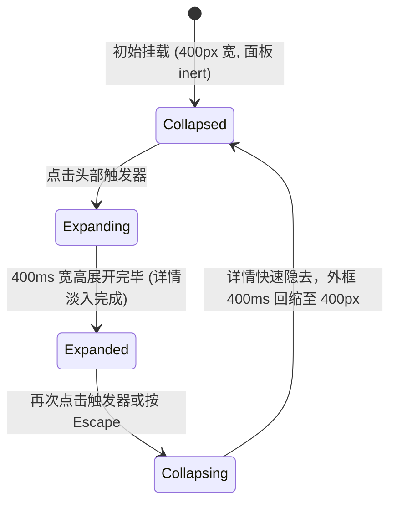

# Expandable Card · 可展开卡片

用于承载多阶段复杂摘要并在原地平滑拉伸展开详情的双维形变卡片。包含四大核心动效机制：

1. 双维横纵弹性形变（Dual-Dimensional Spring Expansion）：折叠时保持紧凑胶囊宽度（400px）与固定高度；展开时通过 400ms 平滑弹簧曲线同时驱动横向宽度伸展（400px → 600px）与纵向高度展开。内部面板 `.expandable-card-panel-inner` 物理锁定在最终展开宽度（598px），展开形变期间内部文字绝不发生换行重排抖动。
2. 逐词微模糊文字滚转（Word Roll & Micro-Blur Morph）：标题副标题中的动态完成度文案（例如 "4 of 6 items complete"）发生变化时，新旧单词通过差分比对，新词从 `translateY(0.35em) blur(4px)` 240ms 升起淡入，旧词从 `translateY(-0.3em) blur(2px)` 160ms 隐去。
3. 展开错峰显现与从容闭合（Staggered Detail Fade & Stable Close）：展开时内部详情延迟 120ms 错峰淡入（240ms）；收起时详情在 100ms 内加速隐去，卡片外框保持 60ms 物理阻尼稳健回缩，折角箭头 180° 同步翻转。
4. 全键盘交互与 Escape 逃生（Inert Isolation & Escape Dismiss）：折叠状态下整个详情面板被施加原生 `inert` 属性，彻底隔绝键盘与辅助工具访问；在展开状态下的任何子控件中按下 `Escape` 键，卡片安全收起并将焦点无缝归还至主触发器。

## 原型清单

| 原型分组 | 原型元素 | 动效 / 状态变化 | 去向 |
| --- | --- | --- | --- |
| 轨道展示容器 | 弹性卡片外层 `.expandable-card-track` | 弹性居中外框与边界测算 | 最小 DOM |
| 核心卡片表面 | 卡片实体 `.expandable-card-card` | 400ms 弹簧驱动宽度横向伸展（400px ↔ 600px）与阴影变化 | 双维横纵弹性形变 |
| 头部触发操作 | 头部触发器 `.expandable-card-trigger` | 悬停底色变化；点击触发展开/折叠；Enter/Space 操作 | 展开错峰显现与从容闭合 |
| 头部信息标题 | 标题主文案 `strong` | 静态加粗展示 | 最小 DOM |
| 头部信息副标题 | 动态滚轮副标题 `.expandable-card-roll` | 逐词差分动画；新词升起淡入，旧词下沉淡出 | 逐词微模糊文字滚转 |
| 头部折角图标 | 折角箭头 `.expandable-card-arrow` | 展开时旋转 180°，关闭时复原 0° | 展开错峰显现与从容闭合 |
| 展开详情区域 | 内容折叠面板 `.expandable-card-panel` | 高度平滑展开与收起；折叠时设为 `inert` | 全键盘交互与 Escape 逃生 |
| 展开详情内容 | 内部详情载体 `.expandable-card-panel-inner` | 锁定 598px 防抖宽度；120ms 错峰延迟透明度淡入 | 双维横纵弹性形变 |
| — | 顶栏独立主题切换器 `#themeBtn` | 演示主题切换 | 演示外壳，已删除 |
| — | 外层演示居中舞台 `.demo-raw` | 演示卡片外框 | 演示外壳，已删除 |

## 适用

- 任务进度卡片、发布检查清单（Launch Checklist）、复杂表单阶段性摘要。
- 空间有限，折叠时需要作为紧凑小卡片呈现进度，点击后原地膨胀为完整控制面板。
- 追求顶级物理质感：拒绝文字在容器缩放时发生丑陋换行跳变。

## 不适用

- 多个连续垂直排布的折叠列表项 → [accordion](accordion.md)
- 仅需横向滑动切换维度的胶囊选项卡 → [tabs](../navigation/tabs.md)
- 独立于原位、浮于页面正中的全屏遮罩弹窗 → [dialog](../overlays/dialog.md)

## 状态机



| 状态 | 进入条件 | 视觉表现 | 退出到 |
| --- | --- | --- | --- |
| collapsed | 初始挂载或收起完毕 | 宽度为 400px，高度为折叠态，箭头 0°，面板设置 `inert` | expanding |
| expanding | 点击触发器 | 宽度弹性拉伸至 600px，高度展开，箭头翻转，详情延迟 120ms 淡入 | expanded |
| expanded | 展开动画结束 | 宽度稳定在 600px，高度 auto，内容完全可见，移除 `inert` | collapsing |
| collapsing | 点击触发器或按 Escape | 详情 100ms 快速淡出，外框 400ms 回缩至 400px，箭头复原 0° | collapsed |

## 最小 DOM

```html
<div class="expandable-card-track">
  <article class="expandable-card-card" data-expanded="false" style="width: 400px;">
    <button type="button" class="expandable-card-trigger" aria-expanded="false" aria-controls="card-panel-1">
      <span class="expandable-card-copy">
        <strong>Launch checklist</strong>
        <span class="expandable-card-description">
          <span class="expandable-card-roll">
            <span class="expandable-card-word">4</span>
            <span class="expandable-card-word">of</span>
            <span class="expandable-card-word">6</span>
            <span class="expandable-card-word">items</span>
            <span class="expandable-card-word">complete</span>
          </span>
        </span>
      </span>
      <span class="expandable-card-arrow" aria-hidden="true">
        <svg width="18" height="18" viewBox="0 0 24 24" fill="none" stroke="currentColor" stroke-width="2" stroke-linecap="round" stroke-linejoin="round">
          <path d="m6 9 6 6 6-6" />
        </svg>
      </span>
    </button>
    <div id="card-panel-1" class="expandable-card-panel" inert style="height: 0px;">
      <div class="expandable-card-panel-inner" style="width: 598px; opacity: 0;">
        <div class="expandable-card-content">
          <strong>Two small steps remain</strong>
          <p>Invite reviewers and add a release note before publishing.</p>
        </div>
      </div>
    </div>
  </article>
</div>
```

- `.expandable-card-track`：布局轨道，支撑弹性居中对齐。
- `.expandable-card-card`：主卡片，承载宽度横向形变与阴影。
- `.expandable-card-trigger`：头部交互按钮，配置 `aria-expanded`。
- `.expandable-card-copy`：头部文本插槽，包含加粗标题与动态副标题。
- `.expandable-card-roll`：逐词动画容器。
- `.expandable-card-arrow`：折角箭头指示图标。
- `.expandable-card-panel`：详情折叠面板，承载高度过渡；收起时配置 `inert`。
- `.expandable-card-panel-inner`：内容承载实体，宽度锁定 598px，承载错峰淡入。

## 参数

| 名称 | 值 | 用于 | 来源 |
| --- | --- | --- | --- |
| 折叠卡片默认宽度 | `400px` | `.expandable-card-card` 初始 width | 原型 |
| 展开卡片默认宽度 | `600px` | `.expandable-card-card` 展开 width | 原型 |
| 内部固定锁死宽度 | `598px` | `.expandable-card-panel-inner` width | 原型 |
| 尺寸弹簧形变时长 | `400ms` / `cubic-bezier(0.16, 1, 0.3, 1)` | 宽度与高度伸展过渡 | 原型 |
| 详情展开淡入延迟 | `120ms` | 详情透明度开始进入的延时 | 原型 |
| 详情展开淡入时长 | `240ms` / `cubic-bezier(0.16, 1, 0.3, 1)` | 详情透明度淡入 | 原型 |
| 详情收起淡出时长 | `100ms` / `cubic-bezier(0.22, 1, 0.36, 1)` | 详情透明度加速隐去 | 原型 |
| 折角箭头旋转过渡 | `260ms` / `cubic-bezier(0.18, 0.89, 0.32, 1.15)` | `.expandable-card-arrow` 旋转 | 原型 |

## CSS

```css
.expandable-card-track {
  --card-bg: oklch(100% 0 0);
  --card-border: oklch(90% 0 0);
  --card-text: oklch(15% 0 0);
  --card-text-muted: oklch(50% 0 0);
  --card-hover-bg: oklch(98% 0 0);
  --card-shadow: 0 4px 18px rgba(0, 0, 0, 0.06), 0 1px 3px rgba(0, 0, 0, 0.04);
  --card-ease-spring: cubic-bezier(0.16, 1, 0.3, 1);
  --card-ease-standard: cubic-bezier(0.22, 1, 0.36, 1);
  --card-ease-snappy: cubic-bezier(0.18, 0.89, 0.32, 1.15);
  --card-duration-size: 400ms;

  display: flex;
  justify-content: center;
  width: 100%;
}

.expandable-card-card {
  position: relative;
  overflow: hidden;
  border-radius: 16px;
  border: 1px solid var(--card-border);
  background: var(--card-bg);
  box-shadow: var(--card-shadow);
  transition: width var(--card-duration-size) var(--card-ease-spring);
  will-change: width;
}

.expandable-card-trigger {
  display: flex;
  width: 100%;
  align-items: center;
  justify-content: space-between;
  padding: 16px 20px;
  border: 0;
  background: transparent;
  color: var(--card-text);
  font: inherit;
  cursor: pointer;
  text-align: left;
  -webkit-tap-highlight-color: transparent;
  transition: background-color 160ms var(--card-ease-standard);
}

.expandable-card-trigger:hover {
  background-color: var(--card-hover-bg);
}

.expandable-card-copy {
  display: flex;
  flex-direction: column;
  gap: 3px;
}

.expandable-card-copy strong {
  font-size: 0.9375rem;
  font-weight: 600;
}

.expandable-card-description {
  color: var(--card-text-muted);
  font-size: 0.8125rem;
}

.expandable-card-roll {
  display: inline-flex;
  gap: 4px;
}

.expandable-card-word {
  display: inline-block;
  transition:
    transform 240ms var(--card-ease-spring),
    opacity 240ms var(--card-ease-spring),
    filter 240ms var(--card-ease-spring);
}

.expandable-card-arrow {
  display: inline-flex;
  align-items: center;
  justify-content: center;
  color: var(--card-text-muted);
  transition: transform 260ms var(--card-ease-snappy);
}

.expandable-card-card[data-expanded="true"] .expandable-card-arrow {
  transform: rotate(180deg);
}

.expandable-card-panel {
  overflow: hidden;
  height: 0;
  transition: height var(--card-duration-size) var(--card-ease-spring);
  will-change: height;
}

.expandable-card-panel-inner {
  box-sizing: border-box;
  padding: 4px 20px 20px 20px;
  transition: opacity 240ms var(--card-ease-spring) 120ms;
}

.expandable-card-card[data-expanded="false"] .expandable-card-panel-inner {
  opacity: 0 !important;
  transition: opacity 100ms var(--card-ease-standard) 0ms;
}

.expandable-card-content strong {
  display: block;
  font-size: 0.875rem;
  margin-bottom: 6px;
}

.expandable-card-content p {
  margin: 0;
  color: var(--card-text-muted);
  font-size: 0.8125rem;
  line-height: 1.5;
}

@media (prefers-reduced-motion: reduce) {
  .expandable-card-card,
  .expandable-card-panel,
  .expandable-card-panel-inner,
  .expandable-card-arrow,
  .expandable-card-word {
    transition: none !important;
  }
}
```

## JS

```js
/**
 * 创建纯原生 ExpandableCard 展开卡片控制器
 * @param {HTMLElement} el 包含 .expandable-card-card 的根节点
 * @param {Object} [options] 配置选项
 * @param {number} [options.width=400] 折叠宽度 (px)
 * @param {number} [options.expandedWidth=600] 展开宽度 (px)
 * @param {boolean} [options.defaultExpanded=false] 初始展开状态
 * @param {(expanded: boolean) => void} [options.onChange] 状态变动回调
 * @returns {{ setExpanded: Function, toggle: Function, destroy: Function }}
 */
export function createExpandableCard(el, options = {}) {
  const card = el.classList.contains('expandable-card-card') ? el : el.querySelector('.expandable-card-card');
  if (!card) return { destroy: () => {} };

  const trigger = card.querySelector('.expandable-card-trigger');
  const panel = card.querySelector('.expandable-card-panel');
  const inner = card.querySelector('.expandable-card-panel-inner');

  const collapsedWidth = parseInt(options.width, 10) || 400;
  const expandedWidth = parseInt(options.expandedWidth, 10) || 600;
  let isExpanded = Boolean(options.defaultExpanded);
  let isReduced = window.matchMedia('(prefers-reduced-motion: reduce)').matches;
  let disposed = false;

  if (inner) {
    inner.style.width = `${expandedWidth - 2}px`;
  }

  function setExpanded(expanded, animate = true) {
    if (disposed) return;
    isExpanded = expanded;
    card.setAttribute('data-expanded', String(expanded));
    if (trigger) trigger.setAttribute('aria-expanded', String(expanded));

    if (expanded) {
      if (panel) panel.removeAttribute('inert');
      card.style.width = `${expandedWidth}px`;
      if (panel && inner) {
        const targetHeight = inner.offsetHeight;
        if (!animate || isReduced) {
          panel.style.height = `${targetHeight}px`;
          inner.style.opacity = '1';
        } else {
          panel.style.height = `${targetHeight}px`;
          inner.style.opacity = '1';
        }
      }
    } else {
      if (panel) panel.setAttribute('inert', '');
      card.style.width = `${collapsedWidth}px`;
      if (panel && inner) {
        inner.style.opacity = '0';
        if (!animate || isReduced) {
          panel.style.height = '0px';
        } else {
          panel.style.height = '0px';
        }
      }
    }

    if (typeof options.onChange === 'function') {
      options.onChange(isExpanded);
    }
  }

  // 1. 点击交互
  const onTriggerClick = () => {
    setExpanded(!isExpanded, true);
  };
  if (trigger) trigger.addEventListener('click', onTriggerClick);

  // 2. Escape 键盘闭环
  const onKeydown = (e) => {
    if (e.key === 'Escape' && isExpanded) {
      e.stopPropagation();
      setExpanded(false, true);
      trigger?.focus();
    }
  };
  card.addEventListener('keydown', onKeydown);

  // 3. 初始化就位
  setExpanded(isExpanded, false);

  const motionQuery = window.matchMedia('(prefers-reduced-motion: reduce)');
  const onMotionChange = (e) => {
    isReduced = e.matches;
  };
  motionQuery.addEventListener('change', onMotionChange);

  return {
    setExpanded: (exp) => setExpanded(exp, true),
    toggle: () => setExpanded(!isExpanded, true),
    destroy() {
      disposed = true;
      if (trigger) trigger.removeEventListener('click', onTriggerClick);
      card.removeEventListener('keydown', onKeydown);
      motionQuery.removeEventListener('change', onMotionChange);
    }
  };
}
```

## 接入目标项目

- 状态来源：
  - 绑定仪表盘中的待办项或发布进度模型，通过 `setExpanded(boolean)` 控制开闭。
- 尺寸策略：
  - 折叠时宽度为 400px，展开时宽度伸展为 600px；内部内容锁定在 598px，容器通过 CSS 动画平滑横向展开。
- 驱动方式：
  - 调用 `createExpandableCard(containerEl, { width: 400, expandedWidth: 600 })`；
  - 外部可直接调用 `instance.toggle()` 触发开闭；
  - 容器卸载时调用 `instance.destroy()`。

## 重入与清理

- 连续快速点击卡片头部时，宽度与高度通过纯原生 CSS transition 连续追随当前状态，无状态覆盖与 DOM 冗余；
- `destroy()` 解绑点击与键盘 Escape 事件，清除媒体查询监听。

## 减少动态效果

- 在 `prefers-reduced-motion: reduce` 下：
  - 停用外卡片的宽度拉伸与详情面板的高度过渡（`transition: none`）；
  - 箭头旋转与文字透明度瞬间切换；
  - 保留完整的 `aria-expanded` 与 `inert` 无障碍隔离。

## 焦点与键盘

- 卡片头部触发器为原生 `<button>`，支持 Tab 聚焦与 Enter/Space 操作；
- 收起时通过原生 `inert` 属性阻断内部所有的键盘焦点访问；
- 展开后在面板内部按 `Escape` 键即可即刻收回卡片并将焦点还给头部按钮。

## 兼容回退

| 特性 | 不支持时 |
| --- | --- |
| 原生 HTML `inert` | 回退为手动对内部可聚焦元素设置 `tabindex="-1"`。 |
| CSS `oklch()` | 降级为等价 HEX/RGB 颜色。 |

## 验收清单

- [ ] 初始渲染为紧凑的 400px 宽度卡片，折叠面板高度为 0 并处于 inert 隔离状态。
- [ ] 点击卡片头部，外框以 400ms 弹簧顺畅从 400px 展开至 600px，高度自适应展开，箭头翻转。
- [ ] 展开过程中内部详情文字保持锁定宽度，排版文字无任何折行跳动。
- [ ] 展开后在内部按下 Escape 键，卡片顺畅收起，焦点精准归还到触发器。
- [ ] 开启系统减少动态效果，宽高与箭头瞬时呈现目标状态。
