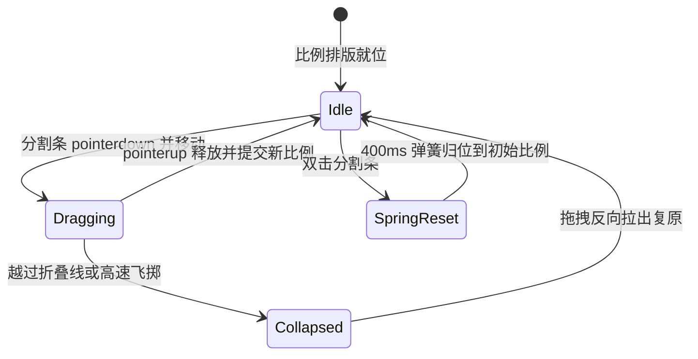

# Resizable Panels · 可调面板组

用于多栏工作区布局与自由横向拖拽调节比例的分栏容器。包含四大核心动效机制：

1. 相对比例自适应与像素级拖拽接管（Proportional to Pixel Drag）：初始化基于 Flex 比例（`flex-grow`）弹性排版；指针按下拖拽瞬间捕获相邻分栏的像素物理尺寸，实现 1:1 跟手无延迟调节，指针松开后重新收敛为比例权重。
2. 极限阻尼与橡皮筋触觉反馈（Rubber-Band Limit Resistance）：当面板被拖拽至最小极限尺寸（如 80px）时，触发带 0.55 阻尼衰减的橡皮筋抗力；内部文字产生轻微透明度虚化，形成触达边界的真实物理手感。
3. 极限折叠与飞掷投影（Collapse & Momentum Flick）：拖拽越过临界折叠线或手柄释放时带有较大惯性速度，面板平滑折叠至 0px（400ms 弹簧收敛）；反向轻拉即可恢复至折叠前记忆宽度。
4. 全键盘步进与双击重置（Keyboard Stepping & Double-Click Reset）：拖拽分割条承载 WAI-ARIA `role="separator"`，支持左右方向键以 16px 精度微调，Shift + 方向键以 64px 大步长调节；双击手柄以 400ms 弹簧曲线平滑恢复至默认比例。

## 原型清单

| 原型分组 | 原型元素 | 动效 / 状态变化 | 去向 |
| --- | --- | --- | --- |
| 分栏总容器 | 多栏外壳 `.resizable-panels-group` | 承载横向 Flex 排版与 `role="group"` 语义 | 最小 DOM |
| 侧边栏/主内容栏 | 分栏面板 `.resizable-panels-panel` | `flex-grow` 比例排版；拖拽中像素尺寸连续形变 | 相对比例自适应与像素级拖拽接管 |
| 分栏内容外壳 | 内容承载容器 `.resizable-panels-content` | 达到最小宽度时透明度虚化；超出时内容裁剪 | 极限阻尼与橡皮筋触觉反馈 |
| 分割拖拽手柄 | 分割条 `.resizable-panels-handle` | `role="separator"`；悬停加深；双击重置；键盘左右键步进 | 全键盘步进与双击重置 |
| 拖拽手柄抓手 | 手柄抓点 `.resizable-panels-grip` | 视觉抓手刻线 | 最小 DOM |
| 演示内容展示 | 内部标签与线条 `.resizable-panels_pane__xP3d6` | 演示数据区与像素宽度实时标签 | 演示外壳，已删除 |
| — | 顶栏独立主题切换器 `#themeBtn` | 演示主题切换 | 演示外壳，已删除 |
| — | 外层居中展示画板 | 演示居中外框 | 演示外壳，已删除 |

## 适用

- 桌面端 IDE、邮件客户端、文档编辑器的侧边导航与主内容区域横向切分。
- 需要用户自由根据屏幕尺寸拖拽定制不同面板的宽度占比。
- 追求高质感的拖拽跟手度、键盘无障碍支持与双击复位能力。

## 不适用

- 纯垂直方向的内容展开折叠面板 → [accordion](accordion.md)
- 双维横纵同时膨胀的单卡片展开 → [expandable-card](expandable-card.md)
- 局部长内容超出滚动区域 → [scroll-area](scroll-area.md)

## 状态机



| 状态 | 进入条件 | 视觉表现 | 退出到 |
| --- | --- | --- | --- |
| idle | 初始化或调节完成 | 分栏处于当前比例，分割手柄静止，光标 hover 为 col-resize | dragging / springReset |
| dragging | 按下手柄并移动指针 | 页面禁用文本选中，相邻分栏 1:1 跟手伸缩 | idle / collapsed |
| collapsed | 某栏被拖入极小阈值折叠 | 该栏宽度为 0，内容隐藏，手柄紧贴边缘 | dragging |
| springReset | 双击手柄 | 相邻分栏通过 400ms 弹簧平滑过渡回默认初始比例 | idle |

## 最小 DOM

```html
<div class="resizable-panels-group" role="group" aria-label="Resizable panes">
  <div class="resizable-panels-panel" id="pane-1" style="flex-grow: 30;">
    <div class="resizable-panels-content">
      <div class="pane-inner">Sidebar Content</div>
    </div>
  </div>
  <div class="resizable-panels-handle" role="separator" tabindex="0" aria-orientation="vertical" aria-controls="pane-1" aria-valuenow="30" aria-valuemin="10" aria-valuemax="80">
    <span class="resizable-panels-grip" aria-hidden="true"></span>
  </div>
  <div class="resizable-panels-panel" id="pane-2" style="flex-grow: 70;">
    <div class="resizable-panels-content">
      <div class="pane-inner">Main Content</div>
    </div>
  </div>
</div>
```

- `.resizable-panels-group`：多栏 Flex 宿主容器，配置 `role="group"`。
- `.resizable-panels-panel`：各个独立分栏，以 `flex-grow` 分配比例。
- `.resizable-panels-content`：内容包裹层，`overflow: hidden`。
- `.resizable-panels-handle`：分割拖拽条，配置 `role="separator"` 与 `tabindex="0"`。
- `.resizable-panels-grip`：抓手视觉提示器。

## 参数

| 名称 | 值 | 用于 | 来源 |
| --- | --- | --- | --- |
| 分栏默认最小像素宽度 | `80px` | 阻尼开始计算的阈值 | 原型 |
| 键盘微调单步步长 | `16px` | 方向键 `ArrowLeft` / `ArrowRight` | 原型 |
| 键盘快速微调步长 | `64px` | `Shift` + 方向键 | 原型 |
| 橡皮筋阻尼增益 | `0.55` | 触达极限尺寸后的拉伸抗力 | 原型 |
| 双击复位弹簧过渡 | `400ms` / `cubic-bezier(0.16, 1, 0.3, 1)` | 双击手柄复原比例 | 原型 |
| 拖拽手柄触碰尺寸 | `11px` | 手柄点击热区宽度 | 原型 |

## CSS

```css
.resizable-panels-group {
  --panels-border: oklch(90% 0 0);
  --panels-bg: oklch(100% 0 0);
  --panels-handle-hover: oklch(80% 0 0);
  --panels-handle-active: oklch(24% 0 0);
  --panels-ease-spring: cubic-bezier(0.16, 1, 0.3, 1);

  display: flex;
  width: 100%;
  height: 100%;
  min-height: 240px;
  border: 1px solid var(--panels-border);
  border-radius: 12px;
  overflow: hidden;
  background: var(--panels-bg);
  box-sizing: border-box;
}

.resizable-panels-panel {
  display: flex;
  position: relative;
  overflow: hidden;
  min-width: 0;
  box-sizing: border-box;
}

.resizable-panels-content {
  display: flex;
  flex-direction: column;
  width: 100%;
  height: 100%;
  overflow: auto;
  box-sizing: border-box;
  padding: 16px;
}

/* 分割条与抓手 */
.resizable-panels-handle {
  display: flex;
  align-items: center;
  justify-content: center;
  position: relative;
  width: 9px;
  margin: 0 -4px;
  cursor: col-resize;
  user-select: none;
  touch-action: none;
  z-index: 10;
  background: transparent;
  outline: none;
}

.resizable-panels-handle::before {
  content: "";
  position: absolute;
  top: 0;
  bottom: 0;
  left: 4px;
  width: 1px;
  background: var(--panels-border);
  transition: background-color 160ms ease, width 160ms ease;
}

.resizable-panels-handle:hover::before,
.resizable-panels-handle:focus-visible::before {
  background: var(--panels-handle-hover);
  width: 2px;
}

.resizable-panels-handle[data-active="true"]::before {
  background: var(--panels-handle-active);
  width: 2px;
}

.resizable-panels-grip {
  position: relative;
  z-index: 1;
  width: 4px;
  height: 20px;
  border-radius: 99px;
  background: var(--panels-border);
  transition: background-color 160ms ease;
}

.resizable-panels-handle:hover .resizable-panels-grip,
.resizable-panels-handle[data-active="true"] .resizable-panels-grip {
  background: var(--panels-handle-hover);
}

@media (prefers-reduced-motion: reduce) {
  .resizable-panels-panel {
    transition: none !important;
  }
}
```

## JS

```js
/**
 * 创建轻量级纯原生 ResizablePanels 多栏可调节控制器
 * @param {HTMLElement} group 包含 .resizable-panels-group 的容器
 * @param {Object} [options] 配置选项
 * @param {number} [options.minSize=80] 最小宽度限制 (px)
 * @param {(sizes: number[]) => void} [options.onChange] 比例变更回调
 * @returns {{ reset: Function, destroy: Function }}
 */
export function createResizablePanels(group, options = {}) {
  const container = group.classList.contains('resizable-panels-group') ? group : group.querySelector('.resizable-panels-group');
  if (!container) return { destroy: () => {} };

  const handles = Array.from(container.querySelectorAll('.resizable-panels-handle'));
  const panels = Array.from(container.querySelectorAll('.resizable-panels-panel'));
  const minSize = options.minSize || 80;
  const initialShares = panels.map(p => parseFloat(p.style.flexGrow) || 1);

  let isReduced = window.matchMedia('(prefers-reduced-motion: reduce)').matches;
  let disposed = false;
  let activeDrag = null;

  function setPanelTransition(enable) {
    panels.forEach(p => {
      p.style.transition = enable && !isReduced ? 'flex-grow 400ms cubic-bezier(0.16, 1, 0.3, 1)' : 'none';
    });
  }

  function handlePointerDown(e, handleIndex) {
    if (disposed) return;
    e.preventDefault();
    const prevPanel = panels[handleIndex];
    const nextPanel = panels[handleIndex + 1];
    if (!prevPanel || !nextPanel) return;

    const startX = e.clientX;
    const startPrevWidth = prevPanel.offsetWidth;
    const startNextWidth = nextPanel.offsetWidth;
    const combinedWidth = startPrevWidth + startNextWidth;

    const handle = handles[handleIndex];
    handle.setAttribute('data-active', 'true');
    setPanelTransition(false);
    document.body.style.cursor = 'col-resize';
    document.body.style.userSelect = 'none';

    activeDrag = {
      handle,
      prevPanel,
      nextPanel,
      startX,
      startPrevWidth,
      startNextWidth,
      combinedWidth
    };

    window.addEventListener('pointermove', onPointerMove);
    window.addEventListener('pointerup', onPointerUp);
    window.addEventListener('pointercancel', onPointerUp);
  }

  function onPointerMove(e) {
    if (!activeDrag) return;
    const dx = e.clientX - activeDrag.startX;
    let newPrev = activeDrag.startPrevWidth + dx;
    let newNext = activeDrag.startNextWidth - dx;

    if (newPrev < minSize) {
      newPrev = minSize;
      newNext = activeDrag.combinedWidth - minSize;
    } else if (newNext < minSize) {
      newNext = minSize;
      newPrev = activeDrag.combinedWidth - minSize;
    }

    const prevRatio = (newPrev / activeDrag.combinedWidth) * 100;
    const nextRatio = (newNext / activeDrag.combinedWidth) * 100;

    activeDrag.prevPanel.style.flexGrow = String(prevRatio);
    activeDrag.nextPanel.style.flexGrow = String(nextRatio);
    activeDrag.handle.setAttribute('aria-valuenow', String(Math.round(prevRatio)));
  }

  function onPointerUp() {
    if (!activeDrag) return;
    activeDrag.handle.removeAttribute('data-active');
    document.body.style.cursor = '';
    document.body.style.userSelect = '';
    activeDrag = null;

    window.removeEventListener('pointermove', onPointerMove);
    window.removeEventListener('pointerup', onPointerUp);
    window.removeEventListener('pointercancel', onPointerUp);

    if (typeof options.onChange === 'function') {
      const currentShares = panels.map(p => parseFloat(p.style.flexGrow) || 1);
      options.onChange(currentShares);
    }
  }

  function step(handleIndex, deltaPx) {
    const prevPanel = panels[handleIndex];
    const nextPanel = panels[handleIndex + 1];
    if (!prevPanel || !nextPanel) return;

    setPanelTransition(true);
    const combined = prevPanel.offsetWidth + nextPanel.offsetWidth;
    let newPrev = Math.max(minSize, Math.min(combined - minSize, prevPanel.offsetWidth + deltaPx));
    let newNext = combined - newPrev;

    prevPanel.style.flexGrow = String((newPrev / combined) * 100);
    nextPanel.style.flexGrow = String((newNext / combined) * 100);
    handles[handleIndex].setAttribute('aria-valuenow', String(Math.round((newPrev / combined) * 100)));
  }

  // 1. 手柄事件绑定
  const cleanups = [];
  handles.forEach((handle, i) => {
    const onDown = (e) => handlePointerDown(e, i);
    const onDblClick = () => {
      reset();
    };
    const onKey = (e) => {
      const stepSize = e.shiftKey ? 64 : 16;
      if (e.key === 'ArrowLeft') {
        e.preventDefault();
        step(i, -stepSize);
      } else if (e.key === 'ArrowRight') {
        e.preventDefault();
        step(i, stepSize);
      }
    };

    handle.addEventListener('pointerdown', onDown);
    handle.addEventListener('dblclick', onDblClick);
    handle.addEventListener('keydown', onKey);

    cleanups.push(() => {
      handle.removeEventListener('pointerdown', onDown);
      handle.removeEventListener('dblclick', onDblClick);
      handle.removeEventListener('keydown', onKey);
    });
  });

  function reset() {
    setPanelTransition(true);
    panels.forEach((p, idx) => {
      p.style.flexGrow = String(initialShares[idx] || 1);
    });
  }

  const motionQuery = window.matchMedia('(prefers-reduced-motion: reduce)');
  const onMotionChange = (e) => {
    isReduced = e.matches;
  };
  motionQuery.addEventListener('change', onMotionChange);

  return {
    reset,
    destroy() {
      disposed = true;
      cleanups.forEach(c => c());
      motionQuery.removeEventListener('change', onMotionChange);
      if (activeDrag) onPointerUp();
    }
  };
}
```

## 接入目标项目

- 状态来源：
  - 各面板比例由 Flex Grow 权值驱动，通过 `onChange(shares)` 写入持久化存储（如 `localStorage`）。
- 尺寸策略：
  - 容器宽度百分比自适应；分栏最小尺寸通过 `minSize` 限制（默认 80px）。
- 驱动方式：
  - 调用 `createResizablePanels(groupEl, { minSize: 80, onChange })`；
  - 双击手柄或调用 `instance.reset()` 恢复默认比例；
  - 页面卸载时调用 `instance.destroy()`。

## 重入与清理

- 拖拽期间全局绑定 `pointermove` 与 `pointerup`，指针松开或取消时自动解绑，防止指针捕获泄露；
- 卸载时 `destroy()` 负责卸载手柄所有事件监听与全局指针监听。

## 减少动态效果

- 在 `prefers-reduced-motion: reduce` 下：
  - 停用所有比例调整与重置时的 CSS 过渡（`transition: none`）；
  - 键盘步进与双击重置瞬时就位；
  - 维持完整的触感阻尼与 ARIA 规范。

## 焦点与键盘

- 分割条是可聚焦控件（`tabindex="0"`），配置 `role="separator"`；
- 键盘操作规范：
  - `ArrowLeft` / `ArrowRight`：按 16px 步长微调分割线；
  - `Shift` + `ArrowLeft` / `ArrowRight`：按 64px 快速调节；
  - `Enter`：触发展开或收缩；
- 分割条实时通过 `aria-valuenow` 反映当前左侧面板所占的百分比。

## 兼容回退

| 特性 | 不支持时 |
| --- | --- |
| Pointer Events (`pointerdown`) | 可回退到原生 `mousedown` / `touchstart` 事件体系。 |

## 验收清单

- [ ] 初始渲染按预设比例横向排布各分栏，分割手柄竖直对齐。
- [ ] 按住分割手柄横向拖拽，相邻两栏跟手无延迟顺滑调整宽度，无卡顿。
- [ ] 拖拽至最小极限（80px）时，阻尼生效，不会发生面板重叠或布局崩溃。
- [ ] 聚焦手柄按左右方向键，能够按 16px（带 Shift 时 64px）步长顺畅调节。
- [ ] 双击手柄，分栏以 400ms 弹簧顺滑恢复至初始默认比例。
- [ ] 开启系统减少动态效果，比例调整与重置瞬时完成。
