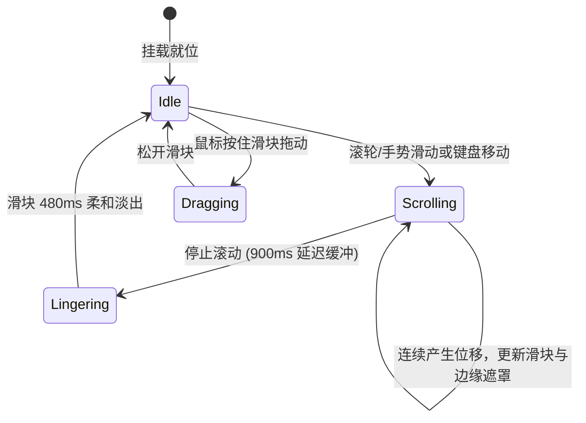

# Scroll Area · 滚动区域

用于限制内容视口并提供动态边缘渐隐遮罩与平滑悬浮滚动条的滚动容器。包含四大核心动效机制：

1. 边缘动态遮罩渐隐（Proportional Edge Fade）：基于 CSS `mask-image` 与 CSS 变量 `--fade-top`、`--fade-bottom`、`--fade-left`、`--fade-right`，根据视口隐藏内容的实际像素距离动态计算边缘渐变遮罩（最高 28px）。到达顶部或底部时对应遮罩平滑归零，直观提示溢出边界。
2. 浮动阻尼悬浮滚动条（Custom Overlay Scrollbar）：自定义滚动滑块 `.scroll-area-thumb` 悬浮于内容之上，滚动激活时以 160ms 淡入，滚动停止后经过 900ms 缓冲防抖以 480ms 柔和淡出；支持指针抓取与比例位移映射。
3. 纵向滚轮横向转换（Wheel to Horizontal Scrolling）：在横向单轴滚动模式下，智能拦截鼠标垂直滚轮事件（`deltaY`），在无 `Ctrl` 缩放键时平滑转换为水平 `scrollLeft` 推进。
4. 视口无障碍键盘导航（Accessible Scroll Region）：视口挂载 `tabindex="0"` 与 `role="region"`，完整保留浏览器原生的上下左右方向键、PageUp/PageDown 与 Space 滚动惯性。

## 原型清单

| 原型分组 | 原型元素 | 动效 / 状态变化 | 去向 |
| --- | --- | --- | --- |
| 滚动容器根节点 | 滚动根节点 `.scroll-area-root` | 相对定位；`max-height` 限制；承载轨道 | 最小 DOM |
| 滚动视口容器 | 视口容器 `.scroll-area-viewport` | 隐藏原生滚动条；动态 CSS 变量注入；CSS Mask 遮罩 | 边缘动态遮罩渐隐 |
| 自定义滚动条轨道 | 滚动条轨道 `.scroll-area-track` | 绝对定位贴边；`aria-hidden="true"` | 浮动阻尼悬浮滚动条 |
| 自定义滚动条滑块 | 滑块 `.scroll-area-thumb` | 尺寸按视口比例动态计算；跟随位移；滚动时淡入/停留后淡出 | 浮动阻尼悬浮滚动条 |
| 演示内容列表 | 列表条目 `.scroll-area_items__JuZ8F` | 演示头像与用户动态内容 | 演示外壳，已删除 |
| — | 顶栏独立主题切换器 `#themeBtn` | 演示主题切换 | 演示外壳，已删除 |
| — | 外层演示舞台卡片 `.scroll-area_demo__js2sQ` | 演示卡片外框 | 演示外壳，已删除 |

## 适用

- 抽屉、模态框、侧边栏或小部件中内容超出可视高度（如通知列表、动态记录）。
- 横向轮播卡片或横向标签轨道的平滑滚动。
- 需要彻底消除浏览器丑陋原生灰条，同时用边缘高斯遮罩指引溢出内容的场景。

## 不适用

- 简单的点击折叠/展开分段面板 → [accordion](accordion.md)
- 多栏布局的宽度比例拖拽切分 → [resizable-panels](resizable-panels.md)
- 全屏页面的顶层滚动流 → 浏览器原生 body 滚动

## 状态机



| 状态 | 进入条件 | 视觉表现 | 退出到 |
| --- | --- | --- | --- |
| idle | 静止状态 | 滑块透明度为 0（隐藏），边缘遮罩根据内容位置静态显示 | scrolling / dragging |
| scrolling | 产生滚动事件 | 滑块 160ms 快速淡入，位移跟手，边缘遮罩尺寸动态更新 | lingering |
| lingering | 滚动停止 | 滑块保持完全不透明，等待 900ms | idle / scrolling |
| dragging | 指针按住滑块拖拽 | 滑块加粗，高亮显示，视口随指针拖动快速滚动 | idle |

## 最小 DOM

```html
<div class="scroll-area-root" data-orientation="vertical">
  <div class="scroll-area-viewport" tabindex="0" role="region" aria-label="Scrollable content" style="--fade-top: 0px; --fade-bottom: 28px;">
    <div class="scroll-area-content">
      <div class="scroll-item">Item 1</div>
      <div class="scroll-item">Item 2</div>
      <div class="scroll-item">Item 3</div>
    </div>
  </div>
  <div class="scroll-area-track" aria-hidden="true">
    <div class="scroll-area-thumb"></div>
  </div>
</div>
```

- `.scroll-area-root`：组件根容器，相对定位，限定宽高。
- `.scroll-area-viewport`：隐藏系统滚动条的原生滚动视口，应用渐变遮罩。
- `.scroll-area-content`：实际承载超长内容的节点。
- `.scroll-area-track`：自定义滚动条轨道，对辅助工具隐藏。
- `.scroll-area-thumb`：自定义浮动滚动条滑块。

## 参数

| 名称 | 值 | 用于 | 来源 |
| --- | --- | --- | --- |
| 边缘渐变最大厚度 | `28px` | `--fade-top`, `--fade-bottom` 最大值 | 原型 |
| 滑块最小长度 | `28px` | `.scroll-area-thumb` 最小 height | 原型 |
| 滑块进入淡入时长 | `160ms` / `cubic-bezier(0.16, 1, 0.3, 1)` | 滑块显示过渡 | 原型 |
| 滑块停留延时时长 | `900ms` | 停止滚动后保持可见的等待期 | 原型 |
| 滑块离场淡出时长 | `480ms` / `cubic-bezier(0.22, 1, 0.36, 1)` | 滑块隐藏淡出 | 原型 |
| 滑块静止厚度 | `5px` | `.scroll-area-thumb` width | 原型 |
| 滑块悬停加粗厚度 | `7px` | `.scroll-area-thumb:hover` width | 原型 |

## CSS

```css
.scroll-area-root {
  --scrollbar-track-bg: transparent;
  --scrollbar-thumb-bg: rgba(0, 0, 0, 0.25);
  --scrollbar-thumb-hover: rgba(0, 0, 0, 0.45);
  --fade-top: 0px;
  --fade-bottom: 0px;

  position: relative;
  display: flex;
  flex-direction: column;
  overflow: hidden;
  width: 100%;
  max-height: 320px;
}

/* 视口：原生滚动但消除灰色滚动条，应用 CSS Mask 边缘动态虚化 */
.scroll-area-viewport {
  position: relative;
  overflow-y: scroll;
  overflow-x: hidden;
  width: 100%;
  height: 100%;
  scrollbar-width: none;
  outline: none;
  mask-image: linear-gradient(
    to bottom,
    transparent 0px,
    black var(--fade-top),
    black calc(100% - var(--fade-bottom)),
    transparent 100%
  );
  -webkit-mask-image: linear-gradient(
    to bottom,
    transparent 0px,
    black var(--fade-top),
    black calc(100% - var(--fade-bottom)),
    transparent 100%
  );
}

.scroll-area-viewport::-webkit-scrollbar {
  display: none;
}

.scroll-area-content {
  display: flex;
  flex-direction: column;
  box-sizing: border-box;
  padding: 8px 12px;
}

/* 浮动悬挂滚动轨道与滑块 */
.scroll-area-track {
  position: absolute;
  top: 3px;
  right: 3px;
  bottom: 3px;
  width: 7px;
  pointer-events: none;
  z-index: 10;
  border-radius: 99px;
  background: var(--scrollbar-track-bg);
}

.scroll-area-thumb {
  position: absolute;
  top: 0;
  right: 0;
  width: 5px;
  border-radius: 99px;
  background: var(--scrollbar-thumb-bg);
  opacity: 0;
  pointer-events: auto;
  cursor: default;
  transition:
    opacity 480ms cubic-bezier(0.22, 1, 0.36, 1),
    width 160ms cubic-bezier(0.16, 1, 0.3, 1);
  will-change: transform, opacity;
}

.scroll-area-root[data-scrolling="true"] .scroll-area-thumb,
.scroll-area-root[data-dragging="true"] .scroll-area-thumb {
  opacity: 1;
  transition: opacity 160ms cubic-bezier(0.16, 1, 0.3, 1);
}

.scroll-area-thumb:hover,
.scroll-area-root[data-dragging="true"] .scroll-area-thumb {
  width: 7px;
  background: var(--scrollbar-thumb-hover);
}

@media (prefers-reduced-motion: reduce) {
  .scroll-area-thumb {
    transition: none !important;
  }
}
```

## JS

```js
/**
 * 创建纯原生 ScrollArea 滚动控制器
 * @param {HTMLElement} root 包含 .scroll-area-root 的根节点
 * @param {Object} [options] 配置项
 * @param {number} [options.fade=28] 最大渐隐遮罩尺寸 (px)
 * @param {number} [options.hideDelay=900] 隐藏延迟 (ms)
 * @returns {{ sync: Function, destroy: Function }}
 */
export function createScrollArea(root, options = {}) {
  const container = root.classList.contains('scroll-area-root') ? root : root.querySelector('.scroll-area-root');
  if (!container) return { destroy: () => {} };

  const viewport = container.querySelector('.scroll-area-viewport');
  const track = container.querySelector('.scroll-area-track');
  const thumb = container.querySelector('.scroll-area-thumb');
  if (!viewport || !thumb) return { destroy: () => {} };

  const maxFade = options.fade || 28;
  const hideDelay = options.hideDelay || 900;
  let hideTimer = null;
  let isDragging = false;
  let dragStartY = 0;
  let dragStartScroll = 0;
  let disposed = false;
  let resizeObserver = null;

  function update() {
    if (disposed) return;
    const clientH = viewport.clientHeight;
    const scrollH = viewport.scrollHeight;
    const scrollTop = viewport.scrollTop;
    const maxScroll = scrollH - clientH;

    if (maxScroll <= 0) {
      if (track) track.style.display = 'none';
      container.style.setProperty('--fade-top', '0px');
      container.style.setProperty('--fade-bottom', '0px');
      return;
    }

    if (track) track.style.display = 'block';

    // 1. 动态边缘遮罩
    const topFade = Math.min(maxFade, Math.max(0, scrollTop));
    const bottomFade = Math.min(maxFade, Math.max(0, maxScroll - scrollTop));
    viewport.style.setProperty('--fade-top', `${topFade}px`);
    viewport.style.setProperty('--fade-bottom', `${bottomFade}px`);

    // 2. 滑块高度与位置
    const trackH = (track ? track.clientHeight : clientH) || 200;
    const thumbH = Math.max(28, (clientH / scrollH) * trackH);
    const thumbY = (scrollTop / maxScroll) * (trackH - thumbH);

    thumb.style.height = `${thumbH}px`;
    thumb.style.transform = `translate3d(0, ${thumbY}px, 0)`;
  }

  function onScroll() {
    container.setAttribute('data-scrolling', 'true');
    update();

    clearTimeout(hideTimer);
    if (!isDragging) {
      hideTimer = setTimeout(() => {
        container.removeAttribute('data-scrolling');
      }, hideDelay);
    }
  }

  // 3. 拖拽滚动
  function onThumbDown(e) {
    e.preventDefault();
    isDragging = true;
    dragStartY = e.clientY;
    dragStartScroll = viewport.scrollTop;
    container.setAttribute('data-dragging', 'true');

    window.addEventListener('pointermove', onPointerMove);
    window.addEventListener('pointerup', onPointerUp);
    window.addEventListener('pointercancel', onPointerUp);
  }

  function onPointerMove(e) {
    if (!isDragging) return;
    const deltaY = e.clientY - dragStartY;
    const clientH = viewport.clientHeight;
    const scrollH = viewport.scrollHeight;
    const maxScroll = scrollH - clientH;
    const trackH = (track ? track.clientHeight : clientH) || 200;
    const thumbH = Math.max(28, (clientH / scrollH) * trackH);
    const scrollRatio = maxScroll / (trackH - thumbH);

    viewport.scrollTop = dragStartScroll + deltaY * scrollRatio;
  }

  function onPointerUp() {
    if (!isDragging) return;
    isDragging = false;
    container.removeAttribute('data-dragging');
    window.removeEventListener('pointermove', onPointerMove);
    window.removeEventListener('pointerup', onPointerUp);
    window.removeEventListener('pointercancel', onPointerUp);

    hideTimer = setTimeout(() => {
      container.removeAttribute('data-scrolling');
    }, hideDelay);
  }

  viewport.addEventListener('scroll', onScroll, { passive: true });
  thumb.addEventListener('pointerdown', onThumbDown);

  if (typeof ResizeObserver !== 'undefined') {
    resizeObserver = new ResizeObserver(() => {
      update();
    });
    resizeObserver.observe(viewport);
  }

  // 初始更新
  update();

  return {
    sync: update,
    destroy() {
      disposed = true;
      clearTimeout(hideTimer);
      if (resizeObserver) resizeObserver.disconnect();
      viewport.removeEventListener('scroll', onScroll);
      thumb.removeEventListener('pointerdown', onThumbDown);
      if (isDragging) onPointerUp();
    }
  };
}
```

## 接入目标项目

- 状态来源：
  - 容器内部内容动态追加（如聊天室消息、活动流刷新）时，自动触发或调用 `instance.sync()` 重新测算滑块比例。
- 尺寸策略：
  - 根容器设定固定的 `max-height` 或充满父级高度 `height: 100%`。
- 驱动方式：
  - 调用 `createScrollArea(rootEl, { fade: 28, hideDelay: 900 })`；
  - 卸载时调用 `instance.destroy()`。

## 重入与清理

- 滚动事件防抖：通过 `hideTimer` 在连续滚动时重置退出倒计时，停止滚动后统一执行优雅淡出；
- `destroy()` 负责解除视口与滑块的原生监听，断开 `ResizeObserver`，防止闭包驻留。

## 减少动态效果

- 在 `prefers-reduced-motion: reduce` 下：
  - 停用滑块的不透明度渐入渐出动画（`transition: none`），滑块根据滚动状态直接显隐；
  - 边缘 CSS Mask 遮罩根据位置即时映射，保持清晰的内容溢出指示。

## 焦点与键盘

- 滚动视口配置 `tabindex="0"` 与 `role="region"`，使键盘焦点可以顺畅停留于内容区；
- 用户使用上下方向键、`PageUp` / `PageDown`、`Home` / `End` 即可直接操控视口滚动。

## 兼容回退

| 特性 | 不支持时 |
| --- | --- |
| CSS `mask-image` | 降级为常规硬截断展示，内容照常滚动。 |
| `ResizeObserver` | 窗口尺寸变更时不会自动重算，但再次滚动时会自动刷新滑块。 |

## 验收清单

- [ ] 初始有超长内容时，底部显现最大 28px 的渐隐羽化遮罩，提示下方有更多内容。
- [ ] 产生滚动时，自定义滑块迅速淡入，其高度与位置精确反映视口相对全文的比例。
- [ ] 滚动触达最底部时，底部遮罩收敛为 0px，顶部显现遮罩，边界触达感知直观。
- [ ] 停止滚动后经过 900ms 延迟，滑块以 480ms 平滑淡出隐藏。
- [ ] 按住滑块纵向拖拽，视口跟手滚动无断层。
- [ ] 开启系统减少动态效果，滑块淡入淡出动画停用，直接瞬时切换。
