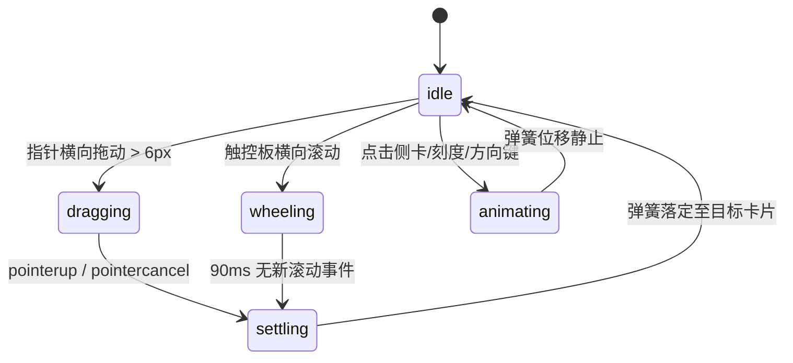

# Cover Flow · 3D 封面流

用于专辑封面、路线画廊、电影海报等富媒体序列展示的立体透视轮播组件。包含五大核心动效机制：

1. 3D 空间透视与多层级景深（3D Perspective & Depth Stacking）：中心活动卡片平视正对屏幕，两侧卡片以 45° 偏折（`rotateY(±45deg)`），沿 Z 轴深度沉降与 X 轴错峰排列，伴随边缘阴影（edge gradient）、环境光晕（ambient glow）与侧面遮罩（veil）。
2. 地面镜像反射（Floor Reflection）：卡片下方通过负向垂直缩放（`scaleY(-1)`）生成镜像投影，并随偏转角叠加线性渐变遮罩（`mask-image`），活动态透明度最高（1.0），侧偏态降至 0.55。
3. 临界阻尼弹簧定格（Critical Spring Settlement）：卡片切换采用解析解弹簧模型（角频率 $\omega=17$，即刚度 `stiffness: 289`、阻尼 `damping: 34`），松手时根据拖拽投影速度（`projected velocity`）预估停靠卡片，并在越界时提供对数橡皮筋阻尼（`rubber: room 0.6, k 0.55`）。
4. 标题与游标连动（Captions & Tick Thumb）：卡片滑动时标题水平双向错峰位移（`translate3d(18 * clamp(i - p, -1, 1)px, 0, 0)`），底部刻度游标与连续坐标轴保持毫秒级像素对齐。
5. 指针手势与滚轮仲裁（Gesture Arbitration）：设置 6px 移动死区以隔离横向拖拽与纵向滚动；支持触控板横向滚轮采样与惯性释放。

## 原型清单

| 原型分组 | 原型元素 | 动效 / 状态变化 | 去向 |
| --- | --- | --- | --- |
| 舞台容器 | 3D 舞台卡槽（`.cover-flow-stage`） | 透视景深 `perspective: 3.4 * card`，指针抓取光标 `grab/grabbing` | 最小 DOM / CSS |
| 卡片集合 | 立体相片卡片（`.cover-flow-card`） | 连续坐标插值计算 `translate3d`、`rotateY`、`zIndex`、`opacity` 与可见性裁剪 | 3D 空间透视与多层级景深 |
| 视觉修饰 | 环境光晕（`.cover-flow-ambient`）与接触阴影（`.cover-flow-contact`） | 径向渐变阴影，随暗浅色主题调整遮光强度 | CSS |
| 地面倒影 | 反射卡片镜像（`.cover-flow-reflection`） | `scaleY(-1)` 倒置，透明度随偏移衰减 `1 - 0.45 * min(d, 1)` | 地面镜像反射 |
| 表面遮罩 | 侧面渐变遮罩（`.cover-flow-veil` / `.cover-flow-edge`） | 两侧暗化与渐变边缘增强立体转折感 | CSS |
| 底部标题 | 标题切换行（`.cover-flow-caption-item`） | 水平位移与透明度双向淡入淡出 | 标题与游标连动 |
| 刻度导航 | 底部刻度按钮组与滑动滑块（`.cover-flow-thumb`） | 游标根据浮点坐标连续平移 `translate3d(16 * p, 0, 0)` | 标题与游标连动 |
| 演示外壳 | 顶部主题切换按钮（`#themeBtn`）与顶栏 | 切换浅色/深色主题 | 演示外壳，已删除 |
| 演示外壳 | 路线统计数值展示与收藏保存按钮 | 演示业务信息与计数器 | 演示外壳，已删除 |

## 适用

- 音乐专辑、播客封面、艺术摄影、图书封面等视觉主导型序列的高质感立体浏览。
- 用户期望通过鼠标指针水平抓拽、触控板横向轻扫或触屏滑动获得真实的物理惯性沉降体验。
- 需要在紧凑水平空间内展示当前项全貌，同时显露相邻 1–2 项透视缩略预览。

## 不适用

- 密集自适应摄影网格与全屏沉浸灯箱浏览 → [lightbox-gallery](lightbox-gallery.md)
- 多列缩放网格与胶卷胶片轴浏览 → [photo-grid](photo-grid.md)
- 包含主图切换、规格选色与商品加购的电商页面 → [product-gallery](product-gallery.md)
- 列表项轻量滑动决策（保留/忽略）→ [card-stack](../cards/card-stack.md)
- 单张卡片展开为阅读文章 → [card](../cards/card.md)

## 状态机

| 状态 | 进入条件 | 视觉表现 | 退出到 |
| --- | --- | --- | --- |
| idle | 初始加载完成；弹簧静止落定 | 当前卡片居中正面朝向，两侧卡片 45° 侧立叠放；游标对齐当前刻度 | dragging / animating |
| dragging | 指针按下且横向位移超出 6px | 舞台光标变为 `grabbing`；卡片与游标随指针毫秒级跟手位移；超界呈现橡皮筋阻尼 | settling |
| wheeling | 触控板检测到水平滚轮脉冲 | 坐标随滚轮增量移动，90ms 内持续采样角速度 | settling |
| settling | 释放拖拽或滚轮停止采样 | 结合释放瞬时速度投影落点目标卡片，启动阻尼弹簧运动 | idle |
| animating | 点击侧面卡片、刻度或按下方向键 | 目标设为对应整数索引，启动 $\omega=17$ 弹簧过渡到目标项 | idle |



## 最小 DOM

```html
<div class="cover-flow" role="region" aria-roledescription="carousel" aria-label="Cover flow gallery">
  <div class="cover-flow-stage" tabindex="0" aria-label="Cover gallery stage">
    <div class="cover-flow-sizer" aria-hidden="true"></div>
    <div class="cover-flow-cards">
      <div class="cover-flow-card" role="group" aria-roledescription="slide" aria-label="1 of 5: Alpine Lake" data-index="0">
        <span class="cover-flow-ambient" aria-hidden="true"></span>
        <span class="cover-flow-reflection" aria-hidden="true">
          
        </span>
        <span class="cover-flow-contact" aria-hidden="true"></span>
        <div class="cover-flow-face">
          
          <span class="cover-flow-veil" aria-hidden="true"></span>
          <span class="cover-flow-edge" aria-hidden="true"></span>
        </div>
      </div>
      <div class="cover-flow-card" role="group" aria-roledescription="slide" aria-label="2 of 5: Forest Trail" data-index="1">
        <span class="cover-flow-ambient" aria-hidden="true"></span>
        <span class="cover-flow-reflection" aria-hidden="true">
          
        </span>
        <span class="cover-flow-contact" aria-hidden="true"></span>
        <div class="cover-flow-face">
          
          <span class="cover-flow-veil" aria-hidden="true"></span>
          <span class="cover-flow-edge" aria-hidden="true"></span>
        </div>
      </div>
      <div class="cover-flow-card" role="group" aria-roledescription="slide" aria-label="3 of 5: Mountain Ridge" data-index="2" data-active="true">
        <span class="cover-flow-ambient" aria-hidden="true"></span>
        <span class="cover-flow-reflection" aria-hidden="true">
          
        </span>
        <span class="cover-flow-contact" aria-hidden="true"></span>
        <div class="cover-flow-face">
          
          <span class="cover-flow-veil" aria-hidden="true"></span>
          <span class="cover-flow-edge" aria-hidden="true"></span>
        </div>
      </div>
      <div class="cover-flow-card" role="group" aria-roledescription="slide" aria-label="4 of 5: Coastal Cliffs" data-index="3">
        <span class="cover-flow-ambient" aria-hidden="true"></span>
        <span class="cover-flow-reflection" aria-hidden="true">
          
        </span>
        <span class="cover-flow-contact" aria-hidden="true"></span>
        <div class="cover-flow-face">
          
          <span class="cover-flow-veil" aria-hidden="true"></span>
          <span class="cover-flow-edge" aria-hidden="true"></span>
        </div>
      </div>
      <div class="cover-flow-card" role="group" aria-roledescription="slide" aria-label="5 of 5: Desert Dunes" data-index="4">
        <span class="cover-flow-ambient" aria-hidden="true"></span>
        <span class="cover-flow-reflection" aria-hidden="true">
          
        </span>
        <span class="cover-flow-contact" aria-hidden="true"></span>
        <div class="cover-flow-face">
          
          <span class="cover-flow-veil" aria-hidden="true"></span>
          <span class="cover-flow-edge" aria-hidden="true"></span>
        </div>
      </div>
    </div>
  </div>

  <div class="cover-flow-footer">
    <div class="cover-flow-caption">
      <div class="cover-flow-caption-item" data-index="0">
        <p class="cover-flow-title">Alpine Lake</p>
        <p class="cover-flow-subtitle">Cortina, Italy</p>
      </div>
      <div class="cover-flow-caption-item" data-index="1">
        <p class="cover-flow-title">Forest Trail</p>
        <p class="cover-flow-subtitle">Banff, Alberta</p>
      </div>
      <div class="cover-flow-caption-item" data-index="2">
        <p class="cover-flow-title">Mountain Ridge</p>
        <p class="cover-flow-subtitle">Val Gardena, Italy</p>
      </div>
      <div class="cover-flow-caption-item" data-index="3">
        <p class="cover-flow-title">Coastal Cliffs</p>
        <p class="cover-flow-subtitle">Victoria, Australia</p>
      </div>
      <div class="cover-flow-caption-item" data-index="4">
        <p class="cover-flow-title">Desert Dunes</p>
        <p class="cover-flow-subtitle">Namib, Africa</p>
      </div>
    </div>
    <div class="cover-flow-ticks" role="group" aria-label="Position indicator">
      <button type="button" class="cover-flow-tick" aria-label="Slide 1" data-index="0" tabindex="-1"></button>
      <button type="button" class="cover-flow-tick" aria-label="Slide 2" data-index="1" tabindex="-1"></button>
      <button type="button" class="cover-flow-tick" aria-label="Slide 3" data-index="2" aria-current="true" tabindex="-1"></button>
      <button type="button" class="cover-flow-tick" aria-label="Slide 4" data-index="3" tabindex="-1"></button>
      <button type="button" class="cover-flow-tick" aria-label="Slide 5" data-index="4" tabindex="-1"></button>
      <span class="cover-flow-thumb" aria-hidden="true"></span>
    </div>
  </div>
  <p class="cover-flow-sr" role="status" aria-live="polite" aria-atomic="true"></p>
</div>
```

- `.cover-flow`：宿主网格容器，绑定内联尺寸与键盘事件。
- `.cover-flow-stage`：3D 舞台层，赋予 `perspective` 与 `grab` 手势，承载卡片绝对定位。
- `.cover-flow-sizer`：隐藏的卡片宽度基准测量探针。
- `.cover-flow-card`：独立立体卡片，由 JS 实时赋予 `translate3d`、`rotateY`、`zIndex`。
- `.cover-flow-reflection`：倒置反射层，内嵌 `scaleY(-1)` 镜像图片与渐隐遮罩。
- `.cover-flow-face`：卡片正面载体，包裹原图与侧偏渐变遮罩。
- `.cover-flow-caption`：标题区域，各标题项根据当前浮点位置横向错峰淡化。
- `.cover-flow-thumb`：底部刻度滑动胶囊指示条。

## 参数

| 名称 | 值 | 用于 | 来源 |
| --- | --- | --- | --- |
| 卡片基准宽度 | `clamp(148px, 31cqw, 228px)` | `--flow-card` 宽度计算 | 原型 |
| 卡片纵横比 | `1.25` (5:4) | 卡片高度与倒影基准 | 原型 |
| 舞台透视距离 | `calc(var(--flow-card) * 3.4)` | `.cover-flow-stage` perspective | 原型 |
| 偏折倾斜角度 | `±45deg` | 非中心卡片 Y 轴旋转 | 原型 |
| 弹簧角频率 $\omega$ | `17` | 刚度 `k=289`, 阻尼 `d=34`, 质量 `m=1` | 原型 |
| 边界橡皮筋阻尼 | `room: 0.6, k: 0.55` | 超出 0 与 max 边界时的非线性形变 | 原型 |
| 拖拽死区判断 | `6px` | 区分纵向滑动与横向拖拽意图 | 原型 |
| 标题错峰位移 | `18px * clamp(i - p, -1, 1)` | `.cover-flow-caption-item` X 平移 | 原型 |
| 刻度游标移动步长 | `16px` | `.cover-flow-thumb` X 轴平移 | 原型 |
| 滚轮释放速度上限 | `±12` | 防止滚轮极速甩动越界过多 | 原型 |

## CSS

```css
.cover-flow {
  --flow-card: clamp(148px, 31cqw, 228px);
  --flow-height: calc(var(--flow-card) * 1.25);
  --flow-radius: calc(var(--flow-card) * 0.085);
  --flow-top: 8px;
  --flow-mirror: calc(var(--flow-height) * 0.15);
  --flow-floor: calc(var(--flow-mirror) + 12px);
  --flow-contact: 0.36;
  --flow-ambient: 0.14;
  --flow-reflect: 0.28;
  --flow-contact-k: 0.62;
  --flow-veil: rgba(0, 0, 0, 0.62);

  display: grid;
  width: 100%;
  min-width: 0;
  gap: 1rem;
  container-type: inline-size;
  color: #111;
  user-select: none;
}

.cover-flow-stage {
  position: relative;
  display: grid;
  height: calc(var(--flow-top) + var(--flow-height) + var(--flow-floor));
  perspective: calc(var(--flow-card) * 3.4);
  perspective-origin: 50% calc(var(--flow-top) + var(--flow-height));
  overflow-x: clip;
  overflow-y: visible;
  place-items: center;
  cursor: grab;
  touch-action: pan-y;
  outline: none;
}

.cover-flow-stage[data-dragging] {
  cursor: grabbing;
}

.cover-flow-sizer {
  width: var(--flow-card);
  height: 0;
  visibility: hidden;
  grid-area: 1 / 1;
}

.cover-flow-cards {
  position: absolute;
  inset: 0;
  pointer-events: none;
}

.cover-flow-card {
  position: absolute;
  top: var(--flow-top);
  left: calc(50% - var(--flow-card) / 2);
  width: var(--flow-card);
  height: var(--flow-height);
  cursor: pointer;
  pointer-events: auto;
  will-change: transform;
  transform: translateZ(0);
  transform-origin: 50% 50%;
  backface-visibility: hidden;
}

.cover-flow-card[data-active="true"] {
  cursor: default;
}

.cover-flow-ambient {
  position: absolute;
  inset: 6% -3% -4%;
  background: radial-gradient(closest-side, rgba(0, 0, 0, var(--flow-ambient)), rgba(0, 0, 0, calc(var(--flow-ambient) * 0.4)) 55%, transparent);
  pointer-events: none;
}

.cover-flow-contact {
  position: absolute;
  top: calc(100% - 7px);
  right: 5%;
  left: 5%;
  height: 16px;
  background: radial-gradient(closest-side, rgba(0, 0, 0, calc(var(--flow-contact) * var(--flow-contact-k))), rgba(0, 0, 0, calc(var(--flow-contact) * var(--flow-contact-k) * 0.35)) 60%, transparent);
  pointer-events: none;
}

.cover-flow-reflection {
  position: absolute;
  top: calc(100% + 2px);
  right: 0;
  left: 0;
  height: var(--flow-mirror);
  overflow: hidden;
  border-radius: var(--flow-radius) var(--flow-radius) 0 0;
  pointer-events: none;
  will-change: opacity;
  mask-image: linear-gradient(rgba(0, 0, 0, var(--flow-reflect)), transparent 88%);
  -webkit-mask-image: linear-gradient(rgba(0, 0, 0, var(--flow-reflect)), transparent 88%);
}

.cover-flow-reflection .cover-flow-img {
  position: absolute;
  top: 0;
  left: 0;
  width: 100%;
  height: var(--flow-height);
  transform: scaleY(-1);
  transform-origin: top;
}

.cover-flow-face {
  position: absolute;
  inset: 0;
  border-radius: var(--flow-radius);
  background: #e5e5e5;
  overflow: hidden;
}

.cover-flow-face::after {
  position: absolute;
  inset: 0;
  border-radius: inherit;
  box-shadow: inset 0 0 0 1px rgba(0, 0, 0, 0.08);
  content: "";
  pointer-events: none;
}

.cover-flow-img {
  width: 100%;
  height: 100%;
  object-fit: cover;
  pointer-events: none;
}

.cover-flow-veil,
.cover-flow-edge {
  position: absolute;
  inset: 0;
  border-radius: var(--flow-radius);
  pointer-events: none;
  will-change: opacity;
}

.cover-flow-veil {
  background: var(--flow-veil);
}

.cover-flow-footer {
  display: grid;
  justify-items: center;
  gap: 0.75rem;
  padding-inline: 1rem;
}

.cover-flow-caption {
  display: grid;
  width: 100%;
  min-height: 2.75rem;
  justify-items: center;
  text-align: center;
}

.cover-flow-caption-item {
  display: grid;
  justify-items: center;
  align-content: start;
  gap: 2px;
  grid-area: 1 / 1;
  will-change: opacity, transform;
}

.cover-flow-title {
  margin: 0;
  font-size: 1.125rem;
  font-weight: 600;
  line-height: 1.3;
}

.cover-flow-subtitle {
  margin: 0;
  color: #666;
  font-size: 0.875rem;
}

.cover-flow-ticks {
  position: relative;
  display: flex;
  height: 24px;
  align-items: center;
}

.cover-flow-tick {
  position: relative;
  width: 16px;
  height: 24px;
  padding: 0;
  border: 0;
  background: none;
  cursor: pointer;
  outline: none;
}

.cover-flow-tick::before {
  position: absolute;
  top: 50%;
  left: 50%;
  width: 5px;
  height: 5px;
  margin: -2.5px 0 0 -2.5px;
  border-radius: 50%;
  background: rgba(0, 0, 0, 0.22);
  content: "";
  transition: background-color 160ms cubic-bezier(0.22, 1, 0.36, 1);
}

.cover-flow-thumb {
  position: absolute;
  top: 50%;
  left: 2px;
  width: 12px;
  height: 5px;
  margin-top: -2.5px;
  border-radius: 999px;
  background: #111;
  pointer-events: none;
  will-change: transform;
}

.cover-flow-sr {
  position: absolute;
  width: 1px;
  height: 1px;
  overflow: hidden;
  clip-path: inset(50%);
  white-space: nowrap;
}

@container (max-width: 520px) {
  .cover-flow {
    --flow-card: clamp(148px, 54cqw, 228px);
    --flow-floor: 22px;
    --flow-contact-k: 1;
  }
  .cover-flow-reflection {
    display: none;
  }
}

@media (prefers-reduced-motion: reduce) {
  .cover-flow-card,
  .cover-flow-caption-item,
  .cover-flow-thumb {
    transition: none !important;
  }
}
```

## JS

```js
export function createCoverFlow(el, options = {}) {
  const root = el;
  const stage = root.querySelector('.cover-flow-stage');
  const sizer = root.querySelector('.cover-flow-sizer');
  const cards = Array.from(root.querySelectorAll('.cover-flow-card'));
  const captions = Array.from(root.querySelectorAll('.cover-flow-caption-item'));
  const ticks = Array.from(root.querySelectorAll('.cover-flow-tick'));
  const thumb = root.querySelector('.cover-flow-thumb');
  const srStatus = root.querySelector('.cover-flow-sr');

  const maxIndex = Math.max(0, cards.length - 1);
  let active = Math.min(Math.max(0, options.initialIndex ?? 2), maxIndex);
  let goal = active;
  let p = active;
  let velocity = 0;
  let animId = 0;
  let disposed = false;

  const clamp = (n, a, b) => Math.min(b, Math.max(a, n));
  const round = (n, places = 2) => Math.round(n * 10 ** places) / 10 ** places;
  const rubber = (n, room = 0.6, k = 0.55) => (n * room * k) / (room + k * Math.abs(n));

  let size = { stage: stage.clientWidth || 720, card: sizer?.offsetWidth || 232 };
  let layout = { reach: 2, near: 160, far: 74 };
  let drag = null;
  let suppressClick = false;
  let gestureStart = active;

  const isReduced = () => window.matchMedia('(prefers-reduced-motion: reduce)').matches;

  function measure() {
    if (disposed) return;
    const stageWidth = stage.clientWidth || 720;
    const cardWidth = sizer?.offsetWidth || 232;
    size = { stage: stageWidth, card: cardWidth };
    const reach = stageWidth >= 2.85 * cardWidth ? 2 : 1;
    const perspective = 3.4 * cardWidth;
    const half = cardWidth / 2;
    const z = -cardWidth * (0.38 + 0.14 * (reach - 1)) + half * Math.sin(Math.PI / 4);
    const near = clamp(
      ((stageWidth / 2 - Math.max(10, 0.05 * cardWidth)) * (perspective - z) / perspective - half * Math.cos(Math.PI / 4)) /
        (1 + (reach - 1) * 0.46),
      0.4 * cardWidth,
      0.8 * cardWidth
    );
    layout = { reach, near, far: 0.46 * near };
    paint();
  }

  function paint() {
    if (disposed) return;
    cards.forEach((node, i) => {
      const offset = i - p;
      const d = Math.abs(offset);
      const side = Math.sign(offset);
      const first = Math.min(d, 1);
      const extra = Math.max(0, d - 1);
      const far = Math.min(extra, layout.reach - 1) + 0.35 * Math.max(0, d - layout.reach);
      const z = -size.card * (0.38 * first + 0.14 * Math.min(extra, layout.reach));

      node.style.transform = `translate3d(${round(side * (layout.near * first + layout.far * far))}px, 0, ${round(z)}px) rotateY(${round(-side * first * 45)}deg)`;
      node.style.opacity = String(round(clamp((layout.reach + 0.7 - d) / 0.7, 0, 1)));
      node.style.zIndex = String(Math.round(100 - 10 * d));
      node.style.visibility = d > layout.reach + 0.75 ? 'hidden' : 'visible';

      const veil = node.querySelector('.cover-flow-veil');
      if (veil) {
        veil.style.opacity = String(round(0.42 * Math.min(d, 1) + 0.16 * clamp(d - 1, 0, layout.reach)));
      }
      const edge = node.querySelector('.cover-flow-edge');
      if (edge) {
        edge.style.opacity = String(round(0.45 * clamp(d, 0, 1)));
        edge.style.backgroundImage = `linear-gradient(${offset < 0 ? 90 : 270}deg, transparent 40%, rgba(0, 0, 0, 0.5))`;
      }
      const refl = node.querySelector('.cover-flow-reflection');
      if (refl) {
        refl.style.opacity = String(round(1 - 0.45 * Math.min(d, 1)));
      }
    });

    captions.forEach((node, i) => {
      const dist = Math.abs(i - p);
      node.style.opacity = String(round(clamp((0.55 - dist) / 0.45, 0, 1)));
      node.style.transform = `translate3d(${round(18 * clamp(i - p, -1, 1))}px, 0, 0)`;
      node.style.visibility = dist < 0.56 ? 'visible' : 'hidden';
    });

    if (thumb) {
      thumb.style.transform = `translate3d(${round(16 * clamp(p, -0.4, maxIndex + 0.4))}px, 0, 0)`;
    }
  }

  function syncAria() {
    cards.forEach((node, i) => {
      const isCur = i === active;
      node.setAttribute('aria-hidden', String(!isCur));
      if (isCur) node.dataset.active = 'true';
      else delete node.dataset.active;
    });
    captions.forEach((node, i) => {
      node.setAttribute('aria-hidden', String(i !== active));
    });
    ticks.forEach((node, i) => {
      if (i === active) node.setAttribute('aria-current', 'true');
      else node.removeAttribute('aria-current');
    });
    if (srStatus) {
      const title = captions[active]?.querySelector('.cover-flow-title')?.textContent || `Item ${active + 1}`;
      srStatus.textContent = `${title}, ${active + 1} of ${cards.length}`;
    }
    if (typeof options.onSelect === 'function') {
      options.onSelect(active);
    }
  }

  function commit(next) {
    if (next !== active) {
      active = next;
      syncAria();
    }
  }

  let springTarget = p;
  let springVelocity = 0;
  let lastTime = 0;

  function tickSpring(now) {
    if (disposed) return;
    if (!lastTime) lastTime = now;
    const dt = Math.min((now - lastTime) / 1000, 0.05);
    lastTime = now;

    const omega = 17;
    const k = omega * omega;
    const d = 2 * omega;
    const error = p - springTarget;
    const force = -k * error - d * springVelocity;

    springVelocity += force * dt;
    p += springVelocity * dt;

    if (Math.abs(p - springTarget) < 0.001 && Math.abs(springVelocity) < 0.01) {
      p = springTarget;
      springVelocity = 0;
      paint();
      commit(Math.round(p));
      animId = 0;
      return;
    }

    paint();
    commit(clamp(Math.round(p), 0, maxIndex));
    animId = requestAnimationFrame(tickSpring);
  }

  function animateTo(target, initialVelocity = 0) {
    if (animId) cancelAnimationFrame(animId);
    springTarget = clamp(target, 0, maxIndex);
    springVelocity = initialVelocity;
    goal = springTarget;

    if (isReduced()) {
      p = springTarget;
      springVelocity = 0;
      paint();
      commit(springTarget);
      return;
    }

    lastTime = performance.now();
    animId = requestAnimationFrame(tickSpring);
  }

  function pick(index) {
    if (disposed) return;
    animateTo(clamp(index, 0, maxIndex), 0);
  }

  function step(delta) {
    pick(goal + delta);
  }

  function finishDrag(v = 0) {
    const projected = p + (v / 1000) * 0.33;
    let target = clamp(Math.round(projected), 0, maxIndex);
    const start = Math.round(gestureStart);
    if (Math.abs(v) > 1.6 && target === start) {
      target = clamp(start + Math.sign(v), 0, maxIndex);
    }
    animateTo(target, v);
  }

  function onPointerDown(e) {
    if (e.button !== 0 || !e.isPrimary || drag) return;
    suppressClick = false;
    if (animId) {
      cancelAnimationFrame(animId);
      animId = 0;
    }
    drag = {
      pointer: e.pointerId,
      x: e.clientX,
      y: e.clientY,
      start: p,
      dragging: false,
      samples: [{ t: e.timeStamp, p }]
    };
    gestureStart = p;
  }

  function onPointerMove(e) {
    if (!drag || drag.pointer !== e.pointerId) return;
    const dx = e.clientX - drag.x;
    const dy = e.clientY - drag.y;

    if (!drag.dragging) {
      if (Math.abs(dx) < 6 || Math.abs(dx) < Math.abs(dy)) {
        if (Math.abs(dy) > 10) drag = null;
        return;
      }
      drag.dragging = true;
      drag.x = e.clientX;
      stage.dataset.dragging = '';
      try { stage.setPointerCapture(e.pointerId); } catch {}
      return;
    }

    if (isReduced()) return;
    const raw = drag.start - (e.clientX - drag.x) / layout.near;
    const next = raw < 0 ? rubber(raw) : raw > maxIndex ? maxIndex + rubber(raw - maxIndex) : raw;
    p = next;
    drag.samples.push({ t: e.timeStamp, p: next });
    if (drag.samples.length > 12) drag.samples.shift();
    paint();
    commit(clamp(Math.round(p), 0, maxIndex));
  }

  function onPointerUp(e) {
    if (!drag || drag.pointer !== e.pointerId) return;
    const held = drag;
    drag = null;
    delete stage.dataset.dragging;

    if (!held.dragging) return;
    suppressClick = true;

    if (isReduced()) {
      const delta = e.clientX - held.x;
      if (Math.abs(delta) > 40) step(delta < 0 ? 1 : -1);
      return;
    }

    let v = 0;
    const samples = held.samples.filter(s => e.timeStamp - s.t < 100);
    if (samples.length >= 2) {
      const first = samples[0];
      const last = samples[samples.length - 1];
      if (last.t > first.t) {
        v = ((last.p - first.p) / (last.t - first.t)) * 1000;
      }
    }
    finishDrag(v);
  }

  function onKeyDown(e) {
    if (e.key === 'ArrowRight') {
      e.preventDefault();
      step(1);
    } else if (e.key === 'ArrowLeft') {
      e.preventDefault();
      step(-1);
    } else if (e.key === 'Home') {
      e.preventDefault();
      pick(0);
    } else if (e.key === 'End') {
      e.preventDefault();
      pick(maxIndex);
    }
  }

  cards.forEach((card, idx) => {
    card.addEventListener('click', () => {
      if (suppressClick) {
        suppressClick = false;
        return;
      }
      if (idx !== goal) pick(idx);
    });
  });

  ticks.forEach((tick, idx) => {
    tick.addEventListener('click', () => pick(idx));
  });

  stage.addEventListener('pointerdown', onPointerDown);
  stage.addEventListener('pointermove', onPointerMove);
  stage.addEventListener('pointerup', onPointerUp);
  stage.addEventListener('pointercancel', onPointerUp);
  stage.addEventListener('keydown', onKeyDown);

  const observer = new ResizeObserver(measure);
  observer.observe(stage);
  if (sizer) observer.observe(sizer);

  measure();
  syncAria();

  return {
    pick,
    step,
    destroy() {
      disposed = true;
      if (animId) cancelAnimationFrame(animId);
      observer.disconnect();
      stage.removeEventListener('pointerdown', onPointerDown);
      stage.removeEventListener('pointermove', onPointerMove);
      stage.removeEventListener('pointerup', onPointerUp);
      stage.removeEventListener('pointercancel', onPointerUp);
      stage.removeEventListener('keydown', onKeyDown);
    }
  };
}
```

## 接入目标项目

- 状态来源：由目标项目的数据集合驱动；当前选中索引 `active` 可通过 `onSelect(index)` 双向同步至外部状态。
- 尺寸策略：组件依赖 CSS 容器查询（Container Queries `--flow-card: clamp(148px, 31cqw, 228px)`），可无缝嵌入任何网格或全宽画廊容器。
- 驱动方式：
  ```js
  import { createCoverFlow } from './cover-flow.js';
  const gallery = createCoverFlow(document.querySelector('.cover-flow'), {
    initialIndex: 2,
    onSelect: (idx) => console.log('Current slide:', idx)
  });
  // 外部编程式导航
  gallery.pick(3);
  // 卸载
  gallery.destroy();
  ```

## 重入与清理

- 连续快速触发：用户在上一轮弹簧尚未落定时再次点击或快速甩动手势，新速度与新目标无缝注入弹簧状态变量（`springTarget` 与 `springVelocity`），旧的动画帧持续推演，杜绝坐标突变。
- 卸载销毁：`destroy()` 取消正在运行的 `requestAnimationFrame`，断开 `ResizeObserver` 观察器，移除全部 Pointer 与 Keydown 事件监听。

## 减少动态效果

- 在 `prefers-reduced-motion: reduce` 环境下：
  - 禁用连续的 `requestAnimationFrame` 物理阻尼弹簧运动，索引切换直接瞬间落定（`p = springTarget`）。
  - 禁用 3D 旋转的过渡缓动，仅保留清晰的层次排列与即时选中态。
  - 拖拽仅在滑动位移超出 40px 后按步长单张切换，杜绝持续视觉眩晕。

## 焦点与键盘

- 键盘可访问性：`.cover-flow-stage` 具有 `tabindex="0"` 与 `role="region"`；获取焦点后支持：
  - `ArrowLeft` / `ArrowRight`：步进切换前一张 / 后一张。
  - `Home` / `End`：直接瞬跳第一张 / 最后一张。
- 屏幕阅读器语义：活动卡片赋予 `data-active="true"` 与 `aria-hidden="false"`；隐藏与退场卡片设置 `aria-hidden="true"`。底部 live region（`.cover-flow-sr`）在每次变更时实时播报当前幻灯片名称与序数。

## 兼容回退

| 特性 | 不支持时 |
| --- | --- |
| CSS Container Queries (`cqw`) | 降级为固定 `clamp(160px, 30vw, 240px)` 或媒体查询断点 |
| CSS `perspective` 与 `rotateY` | 回退为 2D 扁平水平轮播，卡片仅保留 `translateX` 与 `scale` |
| `ResizeObserver` | 回退为监听 `window.addEventListener('resize')` |

## 验收清单

- [ ] 打开页面，当前选中的封面居中正对视线，两侧封面以 45° 侧立并向深处层叠。
- [ ] 倒影层镜像呈现当前与侧面封面，底色随背景自然渐隐。
- [ ] 鼠标在舞台区域按下拖拽时，光标呈 `grabbing`，全部封面与底部刻度滑块精准跟手位移。
- [ ] 释放拖动后，弹簧惯性滑行并磁吸平滑停驻在最近或投影卡片处。
- [ ] 键盘聚焦舞台后按左右方向键，封面平滑翻转切换，屏幕阅读器播报新卡片名称。
- [ ] 开启操作系统的“减少动态效果”，封面切换无弹簧过渡，直接瞬跳就绪。
