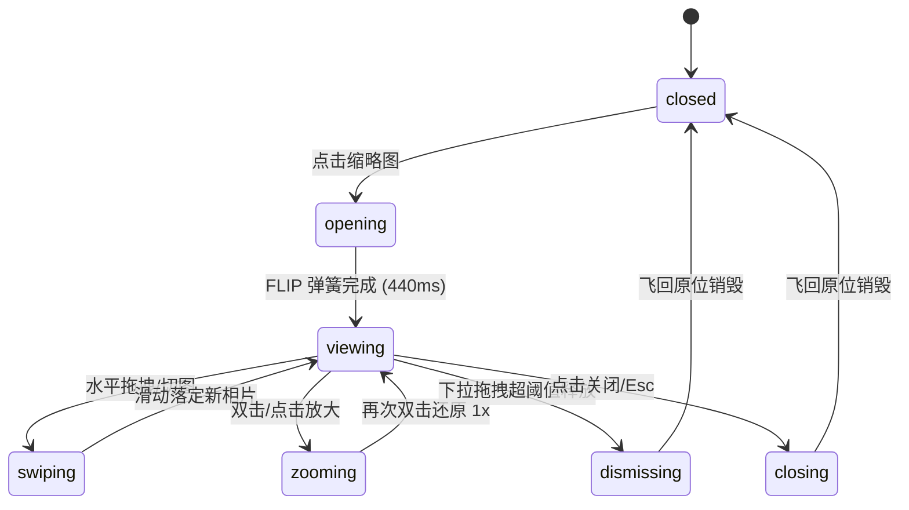

# Lightbox Gallery · 瀑布流画廊与灯箱

用于摄影作品集、旅行相册与图片流展示的高性能自适应瀑布流与全屏共享元素灯箱组件。包含六大核心动效机制：

1. 自适应瀑布流网格（Responsive Masonry Layout）：由 `ResizeObserver` 测量容器宽度动态计算最佳列数（列宽约 148px），采用高度贪心算法分配照片，保持列间等高与 8px 发丝间距。
2. 共享元素 FLIP 展开与收起（Shared Element FLIP Transition）：点击缩略图时实时测量起点坐标 `getBoundingClientRect()`，灯箱相片由缩略图绝对几何尺寸无缝放大至视口居中，遮罩由 0 渐进至 1（`openSpring: visualDuration 0.44s, bounce 0.12`）；退出时反向弹回原缩略图位置。
3. 双向滑动手势与阻尼回弹（Touch Swipe & Rubber Bounding）：支持指针水平拖拽与触控轻拂（Fling）切图，速度投影预测目标图片；两端边界施加非线性橡皮筋对数阻尼（Rubber Banding）。
4. 纵向下拉手势关闭（Pull-to-Dismiss）：全屏视图下纵向下拽相片时，相片等比等比例缩小（`scale = 1 - 0.4 * progress`），背景透明度衰减；松手若速度或位移达标平滑飞落回原图位置关闭。
5. 双击与捏合缩放（Double-Tap & Pinch Zoom）：支持在 1x 到 4x 之间聚焦双击放大，并在放大状态下进行指针抓拽平移（Pan）。
6. 底部微缩胶片轮播联动（Filmstrip Recenter）：切换当前相片时，底部胶卷滚动条自动平滑居中对齐当前项，并高亮指示其纵横比宽度。

## 原型清单

| 原型分组 | 原型元素 | 动效 / 状态变化 | 去向 |
| --- | --- | --- | --- |
| 瀑布流网格 | 响应式网格与列容器（`.lightbox-grid` / `.lightbox-column`） | 宽度变化时动态重算列数与子元素重排 | 自适应瀑布流网格 |
| 缩略图单元 | 缩略图按钮（`.lightbox-thumb`） | 悬停亮度微降 0.94，打开灯箱后赋予 `data-hidden` 隐藏原生占位 | 最小 DOM / CSS |
| 灯箱遮罩 | 全屏背景覆盖层（`.lightbox-veil`） | 透明度从 0 渐入至 1，下拉时随距离线性衰退 | 共享元素 FLIP 展开与收起 |
| 视口滑轨 | 相片横向切图轨道（`.lightbox-strip`） | 随当前索引以 `translateX(-index * width)` 连续滑动 | 双向滑动手势与阻尼回弹 |
| 图片载体 | 动效相框与缩放层（`.lightbox-frame` / `.lightbox-zoom`） | 承载 FLIP 平移、缩放与圆角过渡 `borderRadius: 12 / (s * z)px` | 共享元素 FLIP 展开与收起 |
| 控制栏 | 顶栏计数器与关闭/缩放按钮（`.lightbox-top-bar`） | 伴随遮罩透明度从上滑入淡入 | 最小 DOM / CSS |
| 左右切图 | 左右悬浮导航按钮（`.lightbox-side-nav`） | 位于视口两侧，首尾相片自动禁用隐藏 | 双向滑动手势与阻尼回弹 |
| 底部胶卷 | 底部胶片缩略图轨道（`.lightbox-thumb-strip`） | 激活项宽度放大，`scrollTo({ left, behavior: 'smooth' })` 居中 | 底部微缩胶片轮播联动 |
| 演示外壳 | 顶部主题切换按钮（`#themeBtn`）与顶栏 | 切换浅色/深色主题 | 演示外壳，已删除 |

## 适用

- 摄影展览、设计作品集、艺术画廊、房产房源图片等图片流的高清大图浏览。
- 用户期望点击任意相片时获得无缝的卡片膨胀放大转场（Shared Element Zoom），而非生硬突兀的弹窗覆盖。
- 移动端与触控板期望支持原生手感的下拉关闭（Pull-to-Dismiss）与平滑手势横划切图。

## 不适用

- 3D 立体透视转盘封面轮播 → [cover-flow](cover-flow.md)
- 支持多列缩放密度切换与时间线轴聚合的相册系统 → [photo-grid](photo-grid.md)
- 附带尺寸规格选择与结算加购的电商商品画廊 → [product-gallery](product-gallery.md)
- 单张卡片展开为图文详情页 → [card](../cards/card.md)

## 状态机

| 状态 | 进入条件 | 视觉表现 | 退出到 |
| --- | --- | --- | --- |
| closed | 初始状态；或灯箱完全关闭 | 仅展示瀑布流网格，灯箱浮层 `display: none`，滚动条正常 | opening |
| opening | 点击任意缩略图 | 灯箱全屏展开，活动相片从缩略图 Rect 经弹簧形变飞跃至全屏，遮罩淡入 | viewing |
| viewing | 展开动画落定 | 顶栏、侧栏切图按钮与底部胶卷就绪，相片正中显示，支持滑动手势与按键 | swiping / dismissing / zooming / closing |
| swiping | 横向拖动超出阈值或轻扫 | 轨道平滑水平滑动，前后相片并排滑入视口 | viewing |
| zooming | 双击图片或点击放大按钮 | 图片缩放至 2x–4x，光标变为 `grab/grabbing`，支持平移查看局部 | viewing |
| dismissing | 纵向下拽超出 110px 或释放速度达标 | 相片等比例缩小并沿下拽方向退场，遮罩淡出，无缝归位至原缩略图 | closed |
| closing | 点击关闭按钮或按下 Escape 键 | 相片经关闭弹簧飞回对应缩略图位置，背景遮罩淡出至 0 | closed |



## 最小 DOM

```html
<div class="lightbox-gallery" role="region" aria-label="Photo gallery">
  <!-- 瀑布流缩略图容器 -->
  <div class="lightbox-grid" role="list">
    <button type="button" class="lightbox-thumb" role="listitem" aria-label="Open photo 1 of 4" data-index="0">
      
    </button>
    <button type="button" class="lightbox-thumb" role="listitem" aria-label="Open photo 2 of 4" data-index="1">
      
    </button>
    <button type="button" class="lightbox-thumb" role="listitem" aria-label="Open photo 3 of 4" data-index="2">
      
    </button>
    <button type="button" class="lightbox-thumb" role="listitem" aria-label="Open photo 4 of 4" data-index="3">
      
    </button>
  </div>

  <!-- 全屏大图灯箱浮层 -->
  <div class="lightbox-overlay" role="dialog" aria-modal="true" aria-label="Photo viewer" aria-hidden="true" style="display: none;">
    <div class="lightbox-veil"></div>

    <div class="lightbox-stage">
      <div class="lightbox-strip">
        <div class="lightbox-slide">
          <div class="lightbox-frame">
            <div class="lightbox-zoom">
              
            </div>
          </div>
        </div>
      </div>
    </div>

    <!-- 顶栏信息与操作 -->
    <header class="lightbox-top-bar">
      <p class="lightbox-counter"><span class="lightbox-current">1</span> of <span class="lightbox-total">4</span></p>
      <div class="lightbox-actions">
        <button type="button" class="lightbox-icon-btn lightbox-btn-zoom" aria-label="Zoom in">
          <svg width="20" height="20" viewBox="0 0 24 24" fill="none" stroke="currentColor" stroke-width="2" stroke-linecap="round" stroke-linejoin="round"><circle cx="11" cy="11" r="8"/><line x1="21" y1="21" x2="16.65" y2="16.65"/><line x1="11" y1="8" x2="11" y2="14"/><line x1="8" y1="11" x2="14" y2="11"/></svg>
        </button>
        <button type="button" class="lightbox-icon-btn lightbox-btn-close" aria-label="Close viewer">
          <svg width="20" height="20" viewBox="0 0 24 24" fill="none" stroke="currentColor" stroke-width="2" stroke-linecap="round" stroke-linejoin="round"><line x1="18" y1="6" x2="6" y2="18"/><line x1="6" y1="6" x2="18" y2="18"/></svg>
        </button>
      </div>
    </header>

    <!-- 左右切图 -->
    <div class="lightbox-side-nav">
      <button type="button" class="lightbox-nav-btn lightbox-nav-prev" aria-label="Previous photo">
        <svg width="20" height="20" viewBox="0 0 24 24" fill="none" stroke="currentColor" stroke-width="2" stroke-linecap="round" stroke-linejoin="round"><polyline points="15 18 9 12 15 6"/></svg>
      </button>
      <button type="button" class="lightbox-nav-btn lightbox-nav-next" aria-label="Next photo">
        <svg width="20" height="20" viewBox="0 0 24 24" fill="none" stroke="currentColor" stroke-width="2" stroke-linecap="round" stroke-linejoin="round"><polyline points="9 18 15 12 9 6"/></svg>
      </button>
    </div>

    <!-- 底部描述与胶卷轮播 -->
    <footer class="lightbox-bottom">
      <div class="lightbox-captions">
        <div class="lightbox-caption">
          <p class="lightbox-caption-title">Photo title</p>
          <p class="lightbox-caption-text">Photo description</p>
        </div>
      </div>
      <div class="lightbox-thumb-strip" role="tablist" aria-label="Photo thumbnails"></div>
    </footer>
  </div>
</div>
```

- `.lightbox-gallery`：宿主容器，包裹网格与全屏浮层。
- `.lightbox-grid`：瀑布流网格，动态按列分发。
- `.lightbox-thumb`：缩略图按钮，携带 `getBoundingClientRect()` 计算起点。
- `.lightbox-overlay`：全屏模态窗口宿主，接管屏幕滚动。
- `.lightbox-veil`：全屏背景遮罩，透明度随手势物理渐变。
- `.lightbox-frame`：共享元素 FLIP 变形外框。
- `.lightbox-zoom`：放大与平移变换层。
- `.lightbox-thumb-strip`：底部微缩胶卷条，实时跟随当前活动项居中滚动。

## 参数

| 名称 | 值 | 用于 | 来源 |
| --- | --- | --- | --- |
| 瀑布流单列基准宽 | `148px` | `Math.max(2, Math.floor((width + 8) / 148))` | 原型 |
| 列间距与行间距 | `8px` | 网格列间距 | 原型 |
| 展开弹簧参数 | `visualDuration: 0.44s, bounce: 0.12` | 缩略图到全屏展开 FLIP | 原型 |
| 关闭弹簧参数 | `visualDuration: 0.40s, bounce: 0.06` | 全屏返回缩略图关闭 FLIP | 原型 |
| 页面遮罩渐入时长 | `300ms` / `cubic-bezier(0.16, 1, 0.3, 1)` | `.lightbox-veil` 透明度渐变 | 原型 |
| 下拉关闭位移阈值 | `110px` | 触发自动归位关闭的纵向下拽距离 | 原型 |
| 下拉关闭速度阈值 | `500px/s` | 向下甩动轻扫的瞬时速度阈值 | 原型 |
| 最大缩放倍率 | `4.0x` | 双击放大与捏合缩放最大上限 | 原型 |
| 底部胶卷缩略图高度 | `48px` | `.lightbox-thumb-strip` 内项目尺寸 | 原型 |

## CSS

```css
.lightbox-gallery {
  position: relative;
  width: 100%;
  min-width: 0;
  color: #111;
  user-select: none;
}

.lightbox-grid {
  display: flex;
  align-items: flex-start;
  gap: 8px;
  width: 100%;
}

.lightbox-column {
  display: flex;
  flex: 1 1 0;
  flex-direction: column;
  gap: 8px;
  min-width: 0;
}

.lightbox-thumb {
  position: relative;
  display: block;
  width: 100%;
  padding: 0;
  overflow: hidden;
  border: 0;
  border-radius: 12px;
  background: #f0f0f0;
  cursor: zoom-in;
  outline: none;
}

.lightbox-thumb[data-hidden="true"] {
  visibility: hidden;
}

.lightbox-thumb-img {
  display: block;
  width: 100%;
  height: 100%;
  object-fit: cover;
  pointer-events: none;
  transition: filter 160ms cubic-bezier(0.22, 1, 0.36, 1);
}

.lightbox-thumb:hover .lightbox-thumb-img {
  filter: brightness(0.94);
}

.lightbox-overlay {
  position: fixed;
  inset: 0;
  z-index: 1000;
  overflow: hidden;
  color: #fff;
  touch-action: none;
  overscroll-behavior: contain;
}

.lightbox-veil {
  position: absolute;
  inset: 0;
  background: rgba(0, 0, 0, 0.95);
  transition: opacity 300ms cubic-bezier(0.16, 1, 0.3, 1);
}

.lightbox-stage {
  position: absolute;
  inset: 0;
  cursor: default;
}

.lightbox-strip {
  position: absolute;
  inset: 0;
  will-change: transform;
}

.lightbox-slide {
  position: absolute;
  top: 0;
  left: 0;
  width: 100%;
  height: 100%;
  display: grid;
  place-items: center;
}

.lightbox-frame {
  position: absolute;
  transform-origin: 0 0;
  will-change: transform;
}

.lightbox-zoom {
  position: relative;
  width: 100%;
  height: 100%;
  overflow: hidden;
  border-radius: 12px;
  cursor: zoom-in;
  will-change: transform;
}

.lightbox-overlay[data-zoomed="true"] .lightbox-zoom {
  cursor: grab;
}

.lightbox-overlay[data-panning="true"] .lightbox-zoom {
  cursor: grabbing;
}

.lightbox-main-img {
  position: absolute;
  inset: 0;
  display: block;
  width: 100%;
  height: 100%;
  object-fit: cover;
  pointer-events: none;
}

.lightbox-top-bar {
  position: absolute;
  top: 0;
  right: 0;
  left: 0;
  display: flex;
  align-items: center;
  justify-content: space-between;
  padding: 16px 20px;
  pointer-events: auto;
  z-index: 10;
}

.lightbox-counter {
  margin: 0;
  font-size: 0.875rem;
  color: rgba(255, 255, 255, 0.8);
  font-variant-numeric: tabular-nums;
}

.lightbox-actions {
  display: flex;
  gap: 8px;
}

.lightbox-icon-btn,
.lightbox-nav-btn {
  display: grid;
  place-items: center;
  width: 40px;
  height: 40px;
  padding: 0;
  border: 0;
  border-radius: 999px;
  background: rgba(255, 255, 255, 0.12);
  color: #fff;
  cursor: pointer;
  outline: none;
  backdrop-filter: blur(8px);
  -webkit-backdrop-filter: blur(8px);
  transition: background-color 160ms ease, transform 160ms ease;
}

.lightbox-icon-btn:hover,
.lightbox-nav-btn:hover {
  background: rgba(255, 255, 255, 0.24);
}

.lightbox-icon-btn:active,
.lightbox-nav-btn:active {
  transform: scale(0.94);
}

.lightbox-side-nav {
  position: absolute;
  top: 50%;
  right: 16px;
  left: 16px;
  display: flex;
  justify-content: space-between;
  height: 0;
  pointer-events: none;
  z-index: 10;
}

.lightbox-nav-btn {
  width: 44px;
  height: 44px;
  margin-top: -22px;
  pointer-events: auto;
}

.lightbox-nav-btn:disabled {
  opacity: 0;
  pointer-events: none;
}

.lightbox-bottom {
  position: absolute;
  right: 0;
  bottom: 0;
  left: 0;
  display: grid;
  gap: 12px;
  padding: 16px 20px calc(16px + env(safe-area-inset-bottom));
  pointer-events: none;
  z-index: 10;
}

.lightbox-captions {
  display: grid;
  justify-items: center;
  text-align: center;
}

.lightbox-caption-title {
  margin: 0;
  font-weight: 600;
  font-size: 0.9375rem;
}

.lightbox-caption-text {
  margin: 2px 0 0;
  font-size: 0.75rem;
  color: rgba(255, 255, 255, 0.7);
}

.lightbox-thumb-strip {
  display: flex;
  align-items: center;
  justify-content: center;
  gap: 6px;
  height: 52px;
  overflow-x: auto;
  scrollbar-width: none;
  pointer-events: auto;
}

.lightbox-thumb-strip::-webkit-scrollbar {
  display: none;
}

.lightbox-strip-item {
  position: relative;
  flex: none;
  height: 44px;
  width: 44px;
  padding: 0;
  border: 0;
  border-radius: 8px;
  overflow: hidden;
  opacity: 0.45;
  cursor: pointer;
  outline: none;
  transition: opacity 160ms ease, transform 160ms ease;
}

.lightbox-strip-item[data-active="true"] {
  opacity: 1;
  transform: scale(1.06);
  box-shadow: 0 0 0 2px #fff;
}

.lightbox-strip-item img {
  width: 100%;
  height: 100%;
  object-fit: cover;
}

@media (max-width: 640px) {
  .lightbox-side-nav {
    display: none;
  }
}

@media (prefers-reduced-motion: reduce) {
  .lightbox-veil,
  .lightbox-frame,
  .lightbox-zoom,
  .lightbox-strip-item,
  .lightbox-thumb-img {
    transition: none !important;
  }
}
```

## JS

```js
export function createLightboxGallery(el, options = {}) {
  const root = el;
  const grid = root.querySelector('.lightbox-grid');
  const overlay = root.querySelector('.lightbox-overlay');
  const veil = root.querySelector('.lightbox-veil');
  const frame = root.querySelector('.lightbox-frame');
  const zoom = root.querySelector('.lightbox-zoom');
  const mainImg = root.querySelector('.lightbox-main-img');
  const currentNum = root.querySelector('.lightbox-current');
  const totalNum = root.querySelector('.lightbox-total');
  const titleEl = root.querySelector('.lightbox-caption-title');
  const textEl = root.querySelector('.lightbox-caption-text');
  const btnClose = root.querySelector('.lightbox-btn-close');
  const btnZoom = root.querySelector('.lightbox-btn-zoom');
  const btnPrev = root.querySelector('.lightbox-nav-prev');
  const btnNext = root.querySelector('.lightbox-nav-next');
  const thumbStrip = root.querySelector('.lightbox-thumb-strip');

  const thumbs = Array.from(grid?.querySelectorAll('.lightbox-thumb') || []);
  const total = thumbs.length;
  let activeIndex = 0;
  let isOpened = false;
  let isZoomed = false;
  let isDismissing = false;
  let disposed = false;
  let drag = null;

  const clamp = (n, min, max) => Math.min(max, Math.max(min, n));

  function layoutMasonry() {
    if (disposed || !grid) return;
    const width = grid.clientWidth || 640;
    const cols = Math.max(2, Math.floor((width + 8) / 148));
    const columns = Array.from({ length: cols }, () => {
      const col = document.createElement('div');
      col.className = 'lightbox-column';
      return col;
    });

    thumbs.forEach((thumb, i) => {
      columns[i % cols].appendChild(thumb);
    });

    grid.replaceChildren(...columns);
  }

  function initStrip() {
    if (!thumbStrip) return;
    thumbStrip.replaceChildren();
    thumbs.forEach((thumb, idx) => {
      const src = thumb.querySelector('img')?.src || '';
      const btn = document.createElement('button');
      btn.type = 'button';
      btn.className = 'lightbox-strip-item';
      btn.setAttribute('aria-label', `Thumbnail ${idx + 1}`);
      const img = document.createElement('img');
      img.src = src;
      img.alt = '';
      btn.appendChild(img);
      btn.addEventListener('click', () => navigate(idx));
      thumbStrip.appendChild(btn);
    });
  }

  function updateSlide(index) {
    activeIndex = clamp(index, 0, total - 1);
    const thumb = thumbs[activeIndex];
    const img = thumb?.querySelector('img');
    const label = thumb?.getAttribute('aria-label') || '';

    if (mainImg && img) {
      mainImg.src = img.src;
      mainImg.alt = img.alt || label;
    }
    if (currentNum) currentNum.textContent = String(activeIndex + 1);
    if (totalNum) totalNum.textContent = String(total);
    if (titleEl) titleEl.textContent = img?.alt || `Photo ${activeIndex + 1}`;
    if (textEl) textEl.textContent = `Alfama, Lisbon · ${activeIndex + 1} of ${total}`;

    if (btnPrev) btnPrev.disabled = activeIndex === 0;
    if (btnNext) btnNext.disabled = activeIndex === total - 1;

    const stripItems = thumbStrip?.querySelectorAll('.lightbox-strip-item') || [];
    stripItems.forEach((btn, idx) => {
      if (idx === activeIndex) btn.dataset.active = 'true';
      else delete btn.dataset.active;
    });
  }

  function open(index) {
    if (disposed || isOpened) return;
    isOpened = true;
    updateSlide(index);

    const sourceThumb = thumbs[activeIndex];
    sourceThumb?.setAttribute('data-hidden', 'true');
    const startRect = sourceThumb?.getBoundingClientRect() || { left: 0, top: 0, width: 100, height: 100 };

    overlay.style.display = 'block';
    overlay.setAttribute('aria-hidden', 'false');
    veil.style.opacity = '1';

    const vw = window.innerWidth;
    const vh = window.innerHeight;
    const targetW = Math.min(vw * 0.85, 720);
    const targetH = targetW * (startRect.height / (startRect.width || 1));
    const targetLeft = (vw - targetW) / 2;
    const targetTop = (vh - targetH) / 2;

    const sx = startRect.width / targetW;
    const sy = startRect.height / targetH;
    const dx = startRect.left - targetLeft;
    const dy = startRect.top - targetTop;

    Object.assign(frame.style, {
      left: `${targetLeft}px`,
      top: `${targetTop}px`,
      width: `${targetW}px`,
      height: `${targetH}px`,
      transform: `translate3d(${dx}px, ${dy}px, 0) scale(${sx}, ${sy})`,
      transition: 'none'
    });

    frame.getBoundingClientRect(); // reflow
    frame.style.transition = 'transform 440ms cubic-bezier(0.16, 1, 0.3, 1)';
    frame.style.transform = 'translate3d(0, 0, 0) scale(1, 1)';

    document.body.style.overflow = 'hidden';
    btnClose?.focus();
    if (typeof options.onOpen === 'function') options.onOpen(activeIndex);
  }

  function close() {
    if (disposed || !isOpened || isDismissing) return;
    isDismissing = true;

    const sourceThumb = thumbs[activeIndex];
    const targetRect = sourceThumb?.getBoundingClientRect();

    veil.style.opacity = '0';

    if (targetRect && targetRect.width > 0) {
      const curRect = frame.getBoundingClientRect();
      const sx = targetRect.width / curRect.width;
      const sy = targetRect.height / curRect.height;
      const dx = targetRect.left - curRect.left;
      const dy = targetRect.top - curRect.top;

      frame.style.transition = 'transform 360ms cubic-bezier(0.22, 1, 0.36, 1), opacity 360ms ease';
      frame.style.transform = `translate3d(${dx}px, ${dy}px, 0) scale(${sx}, ${sy})`;
    } else {
      frame.style.transition = 'opacity 240ms ease';
      frame.style.opacity = '0';
    }

    setTimeout(() => {
      overlay.style.display = 'none';
      overlay.setAttribute('aria-hidden', 'true');
      sourceThumb?.removeAttribute('data-hidden');
      document.body.style.overflow = '';
      frame.style.transform = '';
      frame.style.opacity = '';
      isOpened = false;
      isZoomed = false;
      isDismissing = false;
      sourceThumb?.focus();
      if (typeof options.onClose === 'function') options.onClose(activeIndex);
    }, 380);
  }

  function navigate(nextIndex) {
    if (!isOpened || isDismissing) return;
    updateSlide(nextIndex);
  }

  function toggleZoom() {
    if (!isOpened || isDismissing) return;
    isZoomed = !isZoomed;
    overlay.dataset.zoomed = String(isZoomed);
    zoom.style.transition = 'transform 300ms cubic-bezier(0.16, 1, 0.3, 1)';
    zoom.style.transform = isZoomed ? 'scale(2.2)' : 'none';
  }

  thumbs.forEach((thumb, idx) => {
    thumb.addEventListener('click', () => open(idx));
  });

  btnClose?.addEventListener('click', close);
  btnZoom?.addEventListener('click', toggleZoom);
  btnPrev?.addEventListener('click', () => navigate(activeIndex - 1));
  btnNext?.addEventListener('click', () => navigate(activeIndex + 1));

  overlay.addEventListener('keydown', (e) => {
    if (e.key === 'Escape') {
      e.preventDefault();
      close();
    } else if (e.key === 'ArrowLeft') {
      e.preventDefault();
      navigate(activeIndex - 1);
    } else if (e.key === 'ArrowRight') {
      e.preventDefault();
      navigate(activeIndex + 1);
    }
  });

  // Pull-to-dismiss gesture
  frame.addEventListener('pointerdown', (e) => {
    if (isZoomed || e.button !== 0) return;
    drag = { y: e.clientY, startY: e.clientY };
    frame.setPointerCapture(e.pointerId);
  });

  frame.addEventListener('pointermove', (e) => {
    if (!drag) return;
    const dy = e.clientY - drag.startY;
    if (dy > 0) {
      const progress = clamp(dy / (window.innerHeight * 0.6), 0, 1);
      const scale = 1 - 0.4 * progress;
      frame.style.transition = 'none';
      frame.style.transform = `translate3d(0, ${dy}px, 0) scale(${scale})`;
      veil.style.opacity = String(1 - 0.85 * progress);
    }
  });

  frame.addEventListener('pointerup', (e) => {
    if (!drag) return;
    const dy = e.clientY - drag.startY;
    drag = null;
    if (dy > 110) {
      close();
    } else {
      frame.style.transition = 'transform 260ms cubic-bezier(0.18, 0.89, 0.32, 1.15)';
      frame.style.transform = 'translate3d(0, 0, 0) scale(1)';
      veil.style.opacity = '1';
    }
  });

  const observer = new ResizeObserver(layoutMasonry);
  observer.observe(grid);

  layoutMasonry();
  initStrip();

  return {
    open,
    close,
    navigate,
    destroy() {
      disposed = true;
      observer.disconnect();
      document.body.style.overflow = '';
      if (overlay) overlay.style.display = 'none';
    }
  };
}
```

## 接入目标项目

- 状态来源：由相册数据列表驱动；当前打开状态与索引可通过 `onOpen(index)` 与 `onClose(index)` 同步至业务状态或路由（如 Hash `/photo/3`）。
- 尺寸策略：瀑布流网格依赖容器宽度自然流式排版；灯箱模态窗口使用固定视口层叠并接管全局滚动。
- 驱动方式：
  ```js
  import { createLightboxGallery } from './lightbox-gallery.js';
  const gallery = createLightboxGallery(document.querySelector('.lightbox-gallery'), {
    onOpen: (idx) => console.log('Opened photo:', idx),
    onClose: (idx) => console.log('Closed photo:', idx)
  });
  // 编程式打开/关闭
  gallery.open(0);
  gallery.close();
  // 销毁
  gallery.destroy();
  ```

## 重入与清理

- 连续手势重入：在相片尚未完成展开/收拢弹簧过渡时，若接收到新的切图或关闭请求，直接打断并覆盖过渡终点坐标，杜绝节点残影与遮罩闪烁。
- 卸载销毁：`destroy()` 自动关闭可能处于开启状态的全屏浮层，恢复全局 `document.body.style.overflow`，断开 `ResizeObserver` 观察器，移除全部监听。

## 减少动态效果

- 在 `prefers-reduced-motion: reduce` 环境下：
  - 缩略图到全屏的 FLIP 放大过渡直接简化为瞬间定位，禁用连续矩阵缩放。
  - 下拉轻扫仅在释放时判断瞬时关闭，拖拽过程中取消连续形变。
  - 遮罩淡入淡出时长缩短为 `0ms` 或即时落定。

## 焦点与键盘

- 键盘可访问性：
  - 缩略图处于 Native Button 序列，支持 `Tab` 切换与 `Enter` / `Space` 打开。
  - 灯箱弹出后焦点自动捕获至关闭按钮，按 `Escape` 键立即平滑关闭并归还焦点至原缩略图。
  - 灯箱内支持 `ArrowLeft` / `ArrowRight` 循环切图。
- 屏幕阅读器语义：灯箱容器标注 `role="dialog"` 与 `aria-modal="true"`，未激活的缩略图隐藏项保持 `data-hidden="true"` 防止重复朗读。

## 兼容回退

| 特性 | 不支持时 |
| --- | --- |
| `ResizeObserver` | 回退至 `window.addEventListener('resize')` 节流更新 |
| `pointerEvents` / `setPointerCapture` | 回退至常规 `mousedown`/`mousemove`/`mouseup` 与触控事件 |
| CSS `backdrop-filter` | 降级为半透明纯黑色背景 `rgba(0, 0, 0, 0.88)` |

## 验收清单

- [ ] 页面以自适应瀑布流排列照片缩略图，列数随窗口宽度自适应调整。
- [ ] 点击任意缩略图，大图以共享元素 FLIP 弹簧平滑由缩略图位置放大至全屏。
- [ ] 灯箱打开期间页面主滚动条被锁定，顶栏显示“X of Y”当前序号。
- [ ] 键盘按左右方向键平滑切换相片，底部胶卷滚动条自动跟随居中。
- [ ] 鼠标下拉相片超过 110px 后释放，大图顺畅飞回原缩略图位置并关闭。
- [ ] 按 Escape 键立即退出灯箱，焦点安全归还至原缩略图按钮。
