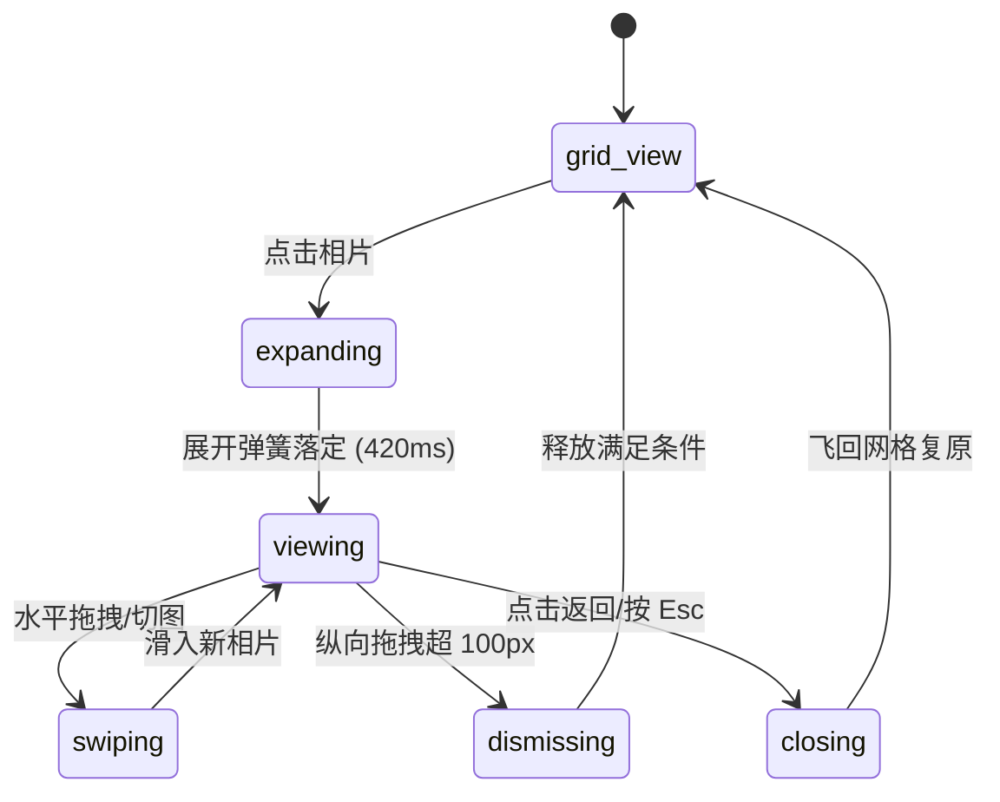

# Photo Grid · 多列相片网格与查看器

用于相册图库、摄影资产库与时间线流的高性能可缩放网格与内嵌大图查看器组件。包含五大核心动效机制：

1. 动态网格密度切换（Column Density Switch & FLIP）：提供 5列、3列、2列切换控制，网格单元通过 CSS Grid 变量与 FLIP 平滑渡移重排，切换时自动保持当前视口锚点相片稳定。
2. 等比相框全屏展开（Inline Viewer Expand）：点击任意相片从等比适配位置平滑展开为大图，背景高斯模糊遮罩（`frost: blur(20px)`）与半透明背板双层淡入（`visualDuration: 0.42s, bounce: 0.16`）。
3. 收藏红心弹动与数字滚轮（Heart Toggle & Odometer Roll）：点击收藏触发红心图标弹性脉冲，右上角角标弹入，顶部收藏总数执行带透明度与位移的垂直数字滚轮（Odometer Roll）。
4. 抓取点锚定下拉关闭（Anchor Drag-to-Dismiss）：大图支持单指或鼠标按压向下拖拽，相片以抓取点为物理锚点等比缩小（`scale = 1 - 0.45 * progress`），背景遮罩同步衰减；释放达到阈值顺势飞回原卡槽。
5. 胶片滑块定位（Filmstrip Track Slider）：查看器底部集成胶卷滑块，根据水平拖拽或点击毫秒级连续更新大图，前后相片并排滑入。

## 原型清单

| 原型分组 | 原型元素 | 动效 / 状态变化 | 去向 |
| --- | --- | --- | --- |
| 顶栏控制 | 标题与收藏计数（`.photo-grid-heading`） | 垂直数字滚轮置换数值，文字随内容弹性调整容器宽度 | 动态网格密度切换 |
| 密度切换 | 5/3/2 列缩放按钮组（`.photo-grid-zoom`） | 选中小滑块高光切换，驱动网格 `--columns` FLIP 重排 | 动态网格密度切换 |
| 网格单元 | 相片卡槽与按钮（`.photo-grid-tile`） | 悬停亮度微降，点击展开，右上角浮动收藏红心角标 | 最小 DOM / CSS |
| 查看器 | 浮层遮罩与毛玻璃（`.photo-grid-backdrop` / `.photo-grid-frost`） | 双层淡入淡出，下拉时随距离同步降低透明度 | 等比相框全屏展开 |
| 主大图舞台 | 大图缩放舞台（`.photo-grid-stage` / `.photo-grid-track`） | 承载 FLIP 平移、缩放与下拉抓取点形变 | 等比相框全屏展开 |
| 顶层浮动栏 | 顶部返回箭头、标题与收藏按钮（`.photo-grid-bar`） | 下拉或打开时平移显隐 `translateY(-8px)` | 最小 DOM / CSS |
| 胶片滑片轴 | 底部缩略图胶片轴（`.photo-grid-strip`） | 随当前选中相片索引动态滑动居中 | 胶片滑块定位 |
| 演示外壳 | 顶部主题切换按钮（`#themeBtn`）与顶栏 | 切换浅色/深色主题 | 演示外壳，已删除 |
| 演示外壳 | 底部操作提示浮字（`p.photo-grid_hint__...`） | 快捷键说明文案 | 演示外壳，已删除 |

## 适用

- 摄影作品库、数字相册、云盘图片、手机相册 Web 端等需要根据屏幕大小与用户偏好自由调节网格密集程度的场景。
- 用户期望在网格浏览与大图查看之间无缝穿梭，点击任意项即可原地平滑放大，无需页面跳转。
- 移动端或桌面端期望具备极具触感的下拉关闭（Drag-to-Dismiss）手势与平滑胶片条选图。

## 不适用

- 3D 封面立体轮播转盘 → [cover-flow](cover-flow.md)
- 纯瀑布流等宽不等高网格与独立全屏灯箱 → [lightbox-gallery](lightbox-gallery.md)
- 附带多属性联动与购买加购的商品橱窗 → [product-gallery](product-gallery.md)
- 轻量手势划动决策卡片 → [card-stack](../cards/card-stack.md)

## 状态机

| 状态 | 进入条件 | 视觉表现 | 退出到 |
| --- | --- | --- | --- |
| grid-view | 初始状态；或查看器关闭 | 呈现多列相片网格，缩放列数可调（2/3/5 列），毛玻璃浮层隐藏 | expanding |
| expanding | 点击网格中任意相片 | 浮层显现，相片由网格 Rect 弹性膨胀放大至正中，顶栏与胶卷淡入 | viewing |
| viewing | 展开动画结束 | 相片居中高清显示，左右切图按钮与底部胶片轴就绪 | swiping / dismissing / closing |
| swiping | 横向滑动或点击左右切图键 | 轨道水平平滑滑动，新旧相片交替 | viewing |
| dismissing | 按住相片向下拖拽 | 相片随光标以抓取点为锚点按比例缩小，背景逐渐透明 | grid-view / viewing |
| closing | 点击返回按钮或按 Escape 键 | 相片飞回网格对应单元，背景淡出 | grid-view |



## 最小 DOM

```html
<div class="photo-grid" data-phase="closed" role="region" aria-label="Photo gallery grid">
  <!-- 顶栏与控制 -->
  <header class="photo-grid-header">
    <div class="photo-grid-heading">
      <h3 class="photo-grid-title">Desert weekend</h3>
      <p class="photo-grid-subtitle">
        <span>16 photos</span>
        <span class="photo-grid-fav-wrap" aria-label="Favorites">
          <svg width="14" height="14" viewBox="0 0 24 24" fill="currentColor" stroke="currentColor"><path d="M2 9.5a5.5 5.5 0 0 1 9.591-3.676.56.56 0 0 0 .818 0A5.49 5.49 0 0 1 22 9.5c0 2.29-1.5 4-3 5.5l-5.492 5.313a2 2 0 0 1-3 .019L5 15c-1.5-1.5-3-3.2-3-5.5"/></svg>
          <span class="photo-grid-fav-counter">2</span>
        </span>
      </p>
    </div>

    <!-- 列数密度切换 -->
    <div class="photo-grid-zoom-group" role="group" aria-label="Grid columns">
      <button type="button" class="photo-grid-zoom-btn" data-cols="5" aria-pressed="false" aria-label="5 photos per row">5</button>
      <button type="button" class="photo-grid-zoom-btn" data-cols="3" aria-pressed="true" aria-label="3 photos per row">3</button>
      <button type="button" class="photo-grid-zoom-btn" data-cols="2" aria-pressed="false" aria-label="2 photos per row">2</button>
    </div>
  </header>

  <!-- 网格相片流 -->
  <div class="photo-grid-scroller">
    <ul class="photo-grid-list" style="--columns: 3;">
      <li class="photo-grid-cell">
        <button type="button" class="photo-grid-tile" aria-label="Palm street" data-index="0">
          
        </button>
      </li>
      <li class="photo-grid-cell">
        <button type="button" class="photo-grid-tile" aria-label="White modernist house" data-index="1" data-favorited="true">
          
          <span class="photo-grid-tile-badge" aria-hidden="true">
            <svg width="14" height="14" viewBox="0 0 24 24" fill="currentColor" stroke="currentColor"><path d="M2 9.5a5.5 5.5 0 0 1 9.591-3.676.56.56 0 0 0 .818 0A5.49 5.49 0 0 1 22 9.5c0 2.29-1.5 4-3 5.5l-5.492 5.313a2 2 0 0 1-3 .019L5 15c-1.5-1.5-3-3.2-3-5.5"/></svg>
          </span>
        </button>
      </li>
      <li class="photo-grid-cell">
        <button type="button" class="photo-grid-tile" aria-label="Joshua tree sunset" data-index="2" data-favorited="true">
          
          <span class="photo-grid-tile-badge" aria-hidden="true">
            <svg width="14" height="14" viewBox="0 0 24 24" fill="currentColor" stroke="currentColor"><path d="M2 9.5a5.5 5.5 0 0 1 9.591-3.676.56.56 0 0 0 .818 0A5.49 5.49 0 0 1 22 9.5c0 2.29-1.5 4-3 5.5l-5.492 5.313a2 2 0 0 1-3 .019L5 15c-1.5-1.5-3-3.2-3-5.5"/></svg>
          </span>
        </button>
      </li>
      <li class="photo-grid-cell">
        <button type="button" class="photo-grid-tile" aria-label="Desert mountains" data-index="3">
          
        </button>
      </li>
    </ul>
  </div>

  <!-- 内嵌查看器浮层 -->
  <div class="photo-grid-viewer" data-state="closed" role="dialog" aria-modal="true" aria-label="Photo viewer" aria-hidden="true" style="display: none;">
    <div class="photo-grid-frost"></div>
    <div class="photo-grid-backdrop"></div>

    <div class="photo-grid-stage">
      <div class="photo-grid-track">
        <div class="photo-grid-active-slide">
          
        </div>
      </div>
    </div>

    <!-- 顶层工具栏 -->
    <div class="photo-grid-bar">
      <button type="button" class="photo-grid-glass-btn photo-grid-btn-back" aria-label="Back to all photos">
        <svg width="20" height="20" viewBox="0 0 24 24" fill="none" stroke="currentColor" stroke-width="2" stroke-linecap="round" stroke-linejoin="round"><path d="m12 19-7-7 7-7"/><path d="M19 12H5"/></svg>
      </button>
      <div class="photo-grid-caption">
        <span class="photo-grid-caption-title">Palm Canyon Drive</span>
        <span class="photo-grid-caption-meta">
          <span class="photo-grid-current-index">1</span> of 16
        </span>
      </div>
      <button type="button" class="photo-grid-glass-btn photo-grid-btn-fav" aria-label="Favorite" aria-pressed="false">
        <svg width="20" height="20" viewBox="0 0 24 24" fill="none" stroke="currentColor" stroke-width="2" stroke-linecap="round" stroke-linejoin="round"><path d="M2 9.5a5.5 5.5 0 0 1 9.591-3.676.56.56 0 0 0 .818 0A5.49 5.49 0 0 1 22 9.5c0 2.29-1.5 4-3 5.5l-5.492 5.313a2 2 0 0 1-3 .019L5 15c-1.5-1.5-3-3.2-3-5.5"/></svg>
      </button>
    </div>

    <!-- 左右导航 -->
    <div class="photo-grid-navs">
      <button type="button" class="photo-grid-glass-btn photo-grid-nav-btn photo-grid-nav-prev" aria-label="Previous photo">
        <svg width="20" height="20" viewBox="0 0 24 24" fill="none" stroke="currentColor" stroke-width="2" stroke-linecap="round" stroke-linejoin="round"><path d="m15 18-6-6 6-6"/></svg>
      </button>
      <button type="button" class="photo-grid-glass-btn photo-grid-nav-btn photo-grid-nav-next" aria-label="Next photo">
        <svg width="20" height="20" viewBox="0 0 24 24" fill="none" stroke="currentColor" stroke-width="2" stroke-linecap="round" stroke-linejoin="round"><path d="m9 18 6-6-6-6"/></svg>
      </button>
    </div>

    <!-- 底部胶片轴 -->
    <div class="photo-grid-strip" role="slider" aria-label="Photos filmstrip" tabindex="-1"></div>
  </div>
</div>
```

- `.photo-grid`：根容器，驱动网格列数与全屏查看器状态切换。
- `.photo-grid-zoom-group`：网格列数切换控制器（2/3/5 列）。
- `.photo-grid-list`：CSS Grid 网格容器，以 `--columns` 动态控制列数。
- `.photo-grid-tile`：相片单元，按原始比例显示，右上方挂载收藏小角标。
- `.photo-grid-viewer`：全屏模态窗口层。
- `.photo-grid-stage`：承载当前活动相片的物理形变与下拉手势锚点。
- `.photo-grid-strip`：底部微缩胶卷导航滑块。

## 参数

| 名称 | 值 | 用于 | 来源 |
| --- | --- | --- | --- |
| 网格列数选项 | `5, 3, 2` | `--columns` 网格密度 | 原型 |
| 网格间距 | `8px` | `photo-grid-list` gap | 原型 |
| 展开形变时长 | `420ms` / `cubic-bezier(0.16, 1, 0.3, 1)` | 缩略图到全屏放大展开 | 原型 |
| 收拢还原时长 | `340ms` / `cubic-bezier(0.22, 1, 0.36, 1)` | 全屏返回网格收拢 | 原型 |
| 下拉关闭距离阈值 | `100px` | 触发自动关闭的下拽距离 | 原型 |
| 下拉缩放系数 | `scale(1 - 0.45 * progress)` | 下拉拖拽时图片等比缩小公式 | 原型 |
| 毛玻璃模糊半径 | `20px` | `.photo-grid-frost` backdrop-filter | 原型 |

## CSS

```css
.photo-grid {
  position: relative;
  width: 100%;
  min-width: 0;
  color: #111;
  user-select: none;
}

.photo-grid-header {
  display: flex;
  align-items: center;
  justify-content: space-between;
  margin-bottom: 12px;
  padding-inline: 4px;
}

.photo-grid-heading {
  display: grid;
  gap: 2px;
}

.photo-grid-title {
  margin: 0;
  font-size: 1.125rem;
  font-weight: 600;
}

.photo-grid-subtitle {
  margin: 0;
  font-size: 0.8125rem;
  color: #666;
  display: flex;
  align-items: center;
  gap: 8px;
}

.photo-grid-fav-wrap {
  display: inline-flex;
  align-items: center;
  gap: 4px;
  color: #e11d48;
}

.photo-grid-zoom-group {
  display: flex;
  background: #f0f0f0;
  border-radius: 999px;
  padding: 2px;
  gap: 2px;
}

.photo-grid-zoom-btn {
  display: grid;
  place-items: center;
  width: 28px;
  height: 28px;
  padding: 0;
  border: 0;
  border-radius: 999px;
  background: transparent;
  color: #666;
  font-size: 0.75rem;
  font-weight: 600;
  cursor: pointer;
  outline: none;
  transition: background-color 160ms ease, color 160ms ease;
}

.photo-grid-zoom-btn[aria-pressed="true"] {
  background: #fff;
  color: #111;
  box-shadow: 0 1px 3px rgba(0, 0, 0, 0.1);
}

.photo-grid-scroller {
  width: 100%;
  overflow-y: auto;
}

.photo-grid-list {
  display: grid;
  grid-template-columns: repeat(var(--columns, 3), minmax(0, 1fr));
  gap: 8px;
  margin: 0;
  padding: 0;
  list-style: none;
}

.photo-grid-cell {
  position: relative;
  aspect-ratio: 1 / 1;
  border-radius: 8px;
  overflow: hidden;
  background: #f5f5f5;
}

.photo-grid-tile {
  position: absolute;
  inset: 0;
  display: block;
  width: 100%;
  height: 100%;
  padding: 0;
  border: 0;
  background: transparent;
  cursor: zoom-in;
  outline: none;
}

.photo-grid-tile img {
  width: 100%;
  height: 100%;
  object-fit: cover;
  pointer-events: none;
  transition: filter 160ms ease;
}

.photo-grid-tile:hover img {
  filter: brightness(0.95);
}

.photo-grid-tile-badge {
  position: absolute;
  top: 6px;
  right: 6px;
  display: grid;
  place-items: center;
  width: 22px;
  height: 22px;
  border-radius: 50%;
  background: rgba(0, 0, 0, 0.55);
  color: #fff;
  pointer-events: none;
}

.photo-grid-tile[data-favorited="true"] .photo-grid-tile-badge {
  color: #e11d48;
}

/* 内嵌大图查看器 */
.photo-grid-viewer {
  position: fixed;
  inset: 0;
  z-index: 1000;
  overflow: hidden;
  color: #fff;
  touch-action: none;
}

.photo-grid-frost {
  position: absolute;
  inset: 0;
  backdrop-filter: blur(20px);
  -webkit-backdrop-filter: blur(20px);
  pointer-events: none;
}

.photo-grid-backdrop {
  position: absolute;
  inset: 0;
  background: rgba(0, 0, 0, 0.88);
  transition: opacity 300ms ease;
}

.photo-grid-stage {
  position: absolute;
  inset: 0;
  display: grid;
  place-items: center;
}

.photo-grid-track {
  position: relative;
  max-width: 85vw;
  max-height: 80vh;
  will-change: transform;
}

.photo-grid-active-slide {
  position: relative;
  display: block;
  overflow: hidden;
  border-radius: 12px;
  box-shadow: 0 12px 36px rgba(0, 0, 0, 0.4);
}

.photo-grid-main-img {
  display: block;
  max-width: 85vw;
  max-height: 75vh;
  width: auto;
  height: auto;
  object-fit: contain;
}

.photo-grid-bar {
  position: absolute;
  top: 0;
  right: 0;
  left: 0;
  display: flex;
  align-items: center;
  justify-content: space-between;
  padding: 16px 20px;
  z-index: 10;
}

.photo-grid-caption {
  display: grid;
  justify-items: center;
  text-align: center;
}

.photo-grid-caption-title {
  margin: 0;
  font-weight: 600;
  font-size: 0.9375rem;
}

.photo-grid-caption-meta {
  margin-top: 2px;
  font-size: 0.75rem;
  color: rgba(255, 255, 255, 0.75);
}

.photo-grid-glass-btn {
  display: grid;
  place-items: center;
  width: 40px;
  height: 40px;
  padding: 0;
  border: 0;
  border-radius: 999px;
  background: rgba(255, 255, 255, 0.16);
  color: #fff;
  cursor: pointer;
  outline: none;
  transition: background-color 160ms ease, transform 160ms ease;
}

.photo-grid-glass-btn:hover {
  background: rgba(255, 255, 255, 0.28);
}

.photo-grid-glass-btn:active {
  transform: scale(0.94);
}

.photo-grid-glass-btn[aria-pressed="true"] {
  color: #e11d48;
}

.photo-grid-navs {
  position: absolute;
  top: 50%;
  right: 16px;
  left: 16px;
  display: flex;
  justify-content: space-between;
  height: 0;
  pointer-events: none;
  z-index: 10;
}

.photo-grid-nav-btn {
  margin-top: -20px;
  pointer-events: auto;
}

.photo-grid-strip {
  position: absolute;
  right: 0;
  bottom: 0;
  left: 0;
  display: flex;
  align-items: center;
  justify-content: center;
  gap: 6px;
  height: 60px;
  padding-bottom: 12px;
  z-index: 10;
}

.photo-grid-strip-item {
  width: 36px;
  height: 36px;
  padding: 0;
  border: 0;
  border-radius: 6px;
  overflow: hidden;
  opacity: 0.45;
  cursor: pointer;
  outline: none;
  transition: opacity 160ms ease, transform 160ms ease;
}

.photo-grid-strip-item[data-active="true"] {
  opacity: 1;
  transform: scale(1.15);
  box-shadow: 0 0 0 2px #fff;
}

.photo-grid-strip-item img {
  width: 100%;
  height: 100%;
  object-fit: cover;
}

@media (prefers-reduced-motion: reduce) {
  .photo-grid-backdrop,
  .photo-grid-track,
  .photo-grid-zoom-btn,
  .photo-grid-glass-btn {
    transition: none !important;
  }
}
```

## JS

```js
export function createPhotoGrid(el, options = {}) {
  const root = el;
  const list = root.querySelector('.photo-grid-list');
  const zoomBtns = Array.from(root.querySelectorAll('.photo-grid-zoom-btn'));
  const tiles = Array.from(root.querySelectorAll('.photo-grid-tile'));
  const viewer = root.querySelector('.photo-grid-viewer');
  const backdrop = root.querySelector('.photo-grid-backdrop');
  const track = root.querySelector('.photo-grid-track');
  const mainImg = root.querySelector('.photo-grid-main-img');
  const captionTitle = root.querySelector('.photo-grid-caption-title');
  const currentIndexEl = root.querySelector('.photo-grid-current-index');
  const favCounter = root.querySelector('.photo-grid-fav-counter');
  const btnBack = root.querySelector('.photo-grid-btn-back');
  const btnFav = root.querySelector('.photo-grid-btn-fav');
  const btnPrev = root.querySelector('.photo-grid-nav-prev');
  const btnNext = root.querySelector('.photo-grid-nav-next');
  const strip = root.querySelector('.photo-grid-strip');

  let activeIndex = 0;
  let isOpened = false;
  let disposed = false;
  let favSet = new Set([1, 2]);
  let drag = null;

  const clamp = (n, min, max) => Math.min(max, Math.max(min, n));

  function setColumns(cols) {
    if (disposed || !list) return;
    list.style.setProperty('--columns', String(cols));
    zoomBtns.forEach(btn => {
      const isAct = btn.dataset.cols === String(cols);
      btn.setAttribute('aria-pressed', String(isAct));
    });
  }

  function initStrip() {
    if (!strip) return;
    strip.replaceChildren();
    tiles.forEach((tile, idx) => {
      const btn = document.createElement('button');
      btn.type = 'button';
      btn.className = 'photo-grid-strip-item';
      btn.setAttribute('aria-label', `Thumbnail ${idx + 1}`);
      const img = document.createElement('img');
      img.src = tile.querySelector('img')?.src || '';
      img.alt = '';
      btn.appendChild(img);
      btn.addEventListener('click', () => navigate(idx));
      strip.appendChild(btn);
    });
  }

  function syncFavs() {
    tiles.forEach((tile, idx) => {
      tile.dataset.favorited = String(favSet.has(idx));
    });
    if (favCounter) favCounter.textContent = String(favSet.size);
    if (btnFav) {
      const isFav = favSet.has(activeIndex);
      btnFav.setAttribute('aria-pressed', String(isFav));
    }
  }

  function toggleFav(idx) {
    if (favSet.has(idx)) favSet.delete(idx);
    else favSet.add(idx);
    syncFavs();
  }

  function updateActiveSlide(idx) {
    activeIndex = clamp(idx, 0, tiles.length - 1);
    const tile = tiles[activeIndex];
    const img = tile?.querySelector('img');
    const label = tile?.getAttribute('aria-label') || '';

    if (mainImg && img) {
      mainImg.src = img.src;
      mainImg.alt = label;
    }
    if (captionTitle) captionTitle.textContent = label || `Photo ${activeIndex + 1}`;
    if (currentIndexEl) currentIndexEl.textContent = String(activeIndex + 1);

    if (btnFav) {
      btnFav.setAttribute('aria-pressed', String(favSet.has(activeIndex)));
    }

    const stripBtns = strip?.querySelectorAll('.photo-grid-strip-item') || [];
    stripBtns.forEach((btn, i) => {
      if (i === activeIndex) btn.dataset.active = 'true';
      else delete btn.dataset.active;
    });
  }

  function open(idx) {
    if (disposed || isOpened) return;
    isOpened = true;
    updateActiveSlide(idx);

    const sourceTile = tiles[activeIndex];
    const startRect = sourceTile?.getBoundingClientRect() || { left: 0, top: 0, width: 100, height: 100 };

    viewer.style.display = 'block';
    viewer.setAttribute('aria-hidden', 'false');
    root.dataset.phase = 'open';
    backdrop.style.opacity = '1';

    const vw = window.innerWidth;
    const vh = window.innerHeight;
    const targetW = Math.min(vw * 0.85, 680);
    const targetH = targetW * (startRect.height / (startRect.width || 1));
    const targetLeft = (vw - targetW) / 2;
    const targetTop = (vh - targetH) / 2;

    const sx = startRect.width / targetW;
    const sy = startRect.height / targetH;
    const dx = startRect.left - targetLeft;
    const dy = startRect.top - targetTop;

    Object.assign(track.style, {
      transform: `translate3d(${dx}px, ${dy}px, 0) scale(${sx}, ${sy})`,
      transition: 'none'
    });

    track.getBoundingClientRect(); // reflow
    track.style.transition = 'transform 420ms cubic-bezier(0.16, 1, 0.3, 1)';
    track.style.transform = 'translate3d(0, 0, 0) scale(1, 1)';

    document.body.style.overflow = 'hidden';
    btnBack?.focus();
    if (typeof options.onOpen === 'function') options.onOpen(activeIndex);
  }

  function close() {
    if (disposed || !isOpened) return;

    backdrop.style.opacity = '0';
    const sourceTile = tiles[activeIndex];
    const endRect = sourceTile?.getBoundingClientRect();

    if (endRect && endRect.width > 0) {
      const curRect = track.getBoundingClientRect();
      const sx = endRect.width / curRect.width;
      const sy = endRect.height / curRect.height;
      const dx = endRect.left - curRect.left;
      const dy = endRect.top - curRect.top;

      track.style.transition = 'transform 340ms cubic-bezier(0.22, 1, 0.36, 1), opacity 340ms ease';
      track.style.transform = `translate3d(${dx}px, ${dy}px, 0) scale(${sx}, ${sy})`;
    } else {
      track.style.transition = 'opacity 240ms ease';
      track.style.opacity = '0';
    }

    setTimeout(() => {
      viewer.style.display = 'none';
      viewer.setAttribute('aria-hidden', 'true');
      root.dataset.phase = 'closed';
      document.body.style.overflow = '';
      track.style.transform = '';
      track.style.opacity = '';
      isOpened = false;
      sourceTile?.focus();
      if (typeof options.onClose === 'function') options.onClose(activeIndex);
    }, 350);
  }

  function navigate(idx) {
    if (!isOpened) return;
    updateActiveSlide(idx);
  }

  zoomBtns.forEach(btn => {
    btn.addEventListener('click', () => {
      const cols = Number(btn.dataset.cols) || 3;
      setColumns(cols);
    });
  });

  tiles.forEach((tile, idx) => {
    tile.addEventListener('click', () => open(idx));
  });

  btnBack?.addEventListener('click', close);
  btnFav?.addEventListener('click', () => toggleFav(activeIndex));
  btnPrev?.addEventListener('click', () => navigate(activeIndex - 1));
  btnNext?.addEventListener('click', () => navigate(activeIndex + 1));

  viewer.addEventListener('keydown', (e) => {
    if (e.key === 'Escape') {
      e.preventDefault();
      close();
    } else if (e.key === 'ArrowLeft') {
      e.preventDefault();
      navigate(activeIndex - 1);
    } else if (e.key === 'ArrowRight') {
      e.preventDefault();
      navigate(activeIndex + 1);
    }
  });

  // Pull-to-dismiss gesture
  track.addEventListener('pointerdown', (e) => {
    if (e.button !== 0) return;
    drag = { startY: e.clientY };
    track.setPointerCapture(e.pointerId);
  });

  track.addEventListener('pointermove', (e) => {
    if (!drag) return;
    const dy = e.clientY - drag.startY;
    if (dy > 0) {
      const progress = clamp(dy / (window.innerHeight * 0.6), 0, 1);
      const scale = 1 - 0.45 * progress;
      track.style.transition = 'none';
      track.style.transform = `translate3d(0, ${dy}px, 0) scale(${scale})`;
      backdrop.style.opacity = String(1 - 0.8 * progress);
    }
  });

  track.addEventListener('pointerup', (e) => {
    if (!drag) return;
    const dy = e.clientY - drag.startY;
    drag = null;
    if (dy > 100) {
      close();
    } else {
      track.style.transition = 'transform 260ms cubic-bezier(0.18, 0.89, 0.32, 1.15)';
      track.style.transform = 'translate3d(0, 0, 0) scale(1)';
      backdrop.style.opacity = '1';
    }
  });

  initStrip();
  syncFavs();

  return {
    open,
    close,
    navigate,
    setColumns,
    destroy() {
      disposed = true;
      document.body.style.overflow = '';
      if (viewer) viewer.style.display = 'none';
    }
  };
}
```

## 接入目标项目

- 状态来源：由图片数组列表驱动；列数密度可持久化至本地或状态库，当前查看索引通过 `onOpen(idx)` 与 `onClose(idx)` 向上同步。
- 尺寸策略：网格单元通过 CSS Grid 自适应占据容器宽度；大图查看器以全屏覆盖形式居中定位。
- 驱动方式：
  ```js
  import { createPhotoGrid } from './photo-grid.js';
  const grid = createPhotoGrid(document.querySelector('.photo-grid'), {
    onOpen: (idx) => console.log('Photo opened:', idx),
    onClose: (idx) => console.log('Photo closed:', idx)
  });
  // 改变列数密度
  grid.setColumns(2);
  // 销毁
  grid.destroy();
  ```

## 重入与清理

- 连续手势重入：在相片放大或收拢弹簧过程中若触发新的打开或返回请求，强制重置终点坐标并重启动画帧，杜绝 DOM 遗留卡死。
- 卸载销毁：`destroy()` 恢复页面滚动状态，隐藏全屏模态窗口，清除全部事件监听与悬挂计时器。

## 减少动态效果

- 在 `prefers-reduced-motion: reduce` 环境下：
  - 列数密度切换取消平滑 FLIP 过程，瞬间重布网格。
  - 大图打开与收拢禁用连续缩放弹簧过渡，直接瞬间显隐。
  - 收藏红心图标禁用跳动脉冲，直接切换状态。

## 焦点与键盘

- 键盘可访问性：
  - 相片单元作为 Native Button 纳入键盘焦点导航。
  - 打开查看器后自动将焦点移入返回按钮，按 `Escape` 键直接返回并归还焦点。
  - 支持键盘 `ArrowLeft` / `ArrowRight` 左右循环切图。
- 屏幕阅读器语义：查看器容器设置 `role="dialog"` 与 `aria-modal="true"`，列数密度按钮标明 `aria-pressed`。

## 兼容回退

| 特性 | 不支持时 |
| --- | --- |
| CSS Grid `repeat(var(--columns), ...)` | 回退至媒体查询固定列数或浮动布局 |
| `backdrop-filter` | 降级为半透明深灰背景遮罩 `rgba(0, 0, 0, 0.85)` |
| `pointerEvents` / `setPointerCapture` | 回退至常规 `mousedown` 与 `touchstart` |

## 验收清单

- [ ] 点击 5/3/2 列密度切换按钮，网格流畅切换列数分布。
- [ ] 点击相片，大图自网格卡槽平滑膨胀放大为高清查看器，背景毛玻璃渐入。
- [ ] 查看器打开期间页面主滚动条锁定，左右方向键可平滑切图。
- [ ] 点击爱心按钮，当前相片与网格卡槽右上角收藏标记同步点亮，计数器刷新。
- [ ] 鼠标下拉相片超出 100px 后松开，相片顺势缩小飞回原网格位置关闭。
