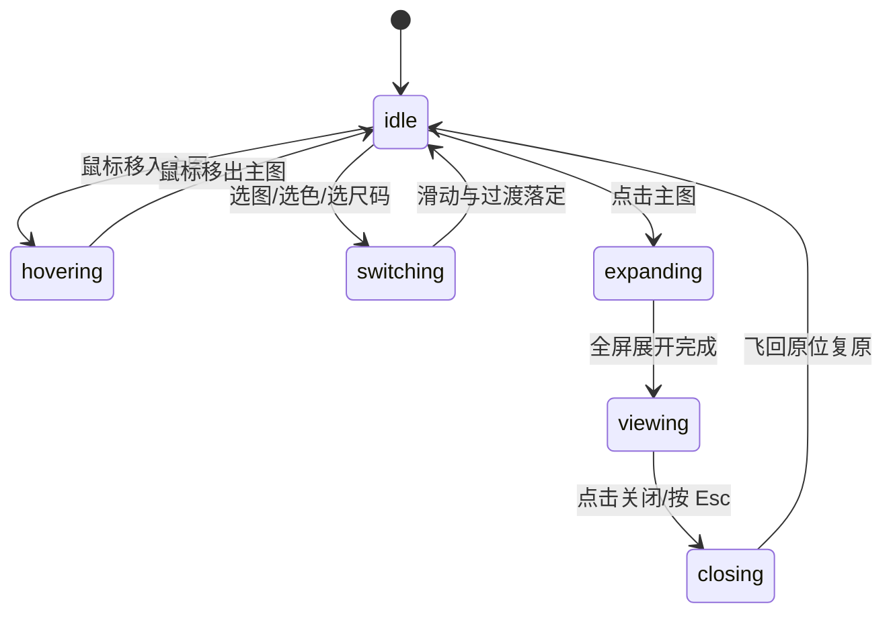

# Product Gallery · 电商商品画廊

用于电商商品详情页（PDP）、多规格配置与硬件橱窗展示的高交互质感画廊组件。包含六大核心动效机制：

1. 缩略图滑动高光指示胶囊（Gliding Pill Rail Indicator）：垂直或水平缩略图栏使用绝对定位指示条（Rail Indicator）平滑滑向当前选中的缩略图，伴随尺寸自适应吸附。
2. 主图滑动轨道与交叉淡化（Main Stage Carousel & Cross-Fade）：切换照片时主图滑轨进行水平平滑位移，切换不同颜色款型时图片组执行微模糊交叉淡化（Micro-Blur Cross-Fade）。
3. 悬停局部放大镜跟随（Hover Magnifier Lens）：鼠标悬停主图时无延迟显现放大透镜，透镜内部高清图像精准响应指针位移，离开时弹性收缩淡出。
4. 全屏高清画廊展开（Fullscreen Shared-Element Expand）：点击主图无缝过渡至全屏视口居中，支持 1x 与 2.4x 双击缩放、手势拖拽平移与前后切图。
5. 色卡与尺码选择指示器（Swatch Ring & Size Pill）：切换颜色时色卡环形边框平滑位移；选择尺码时胶囊背景块平滑滑动（`visualDuration: 0.26s, bounce: 0.12`）。
6. 价格与加购反馈微模糊置换（Micro-Blur State Swap & Add Feedback）：选择不同规格导致价格变动时，文本带高斯微模糊置换；点击加购按钮触发触感微回弹（Snappy Spring）与徽标弹跳。

## 原型清单

| 原型分组 | 原型元素 | 动效 / 状态变化 | 去向 |
| --- | --- | --- | --- |
| 缩略图栏 | 缩略图列表与高光指示器（`.product-gallery-rail`） | 滑动高光胶囊（`railIndicator`）平滑滑动至活动项 | 缩略图滑动高光指示胶囊 |
| 主图舞台 | 主图滑轨与展示卡槽（`.product-gallery-stage`） | 水平位移滑轨，全屏放大按钮悬浮显隐 | 主图滑动轨道与交叉淡化 |
| 悬停放大 | 局部放大镜片（`.product-gallery-lens`） | 随鼠标实时平移，内部图像等比反向位移 | 悬停局部放大镜跟随 |
| 全屏查看 | 全屏模态查看器（`.product-gallery-viewer`） | 主图到全屏共享元素 FLIP 展开与收起 | 全屏高清画廊展开 |
| 规格选择 | 颜色色卡组与尺码按钮组（`.product-gallery-swatches` / `.product-gallery-sizes`） | 滑动高光胶囊，缺货选项禁用与跳转 | 色卡与尺码选择指示器 |
| 详情与购买 | 价格文本与加购按钮（`.product-gallery-price` / `.product-gallery-add`） | 价格微模糊淡变，加购成功文案置换与微回弹 | 价格与加购反馈微模糊置换 |
| 演示外壳 | 顶部主题切换按钮（`#themeBtn`）与顶栏 | 切换浅色/深色主题 | 演示外壳，已删除 |

## 适用

- 品牌独立站、时尚服饰、数码硬件等对质感要求极高的商品展示页面。
- 用户期望在同一个页面区域无缝完成“看图 → 缩放细节 → 选颜色/尺码 → 查看价格变动 → 确认加购”的高连贯操作链路。
- 鼠标端需要高质量的放大镜悬停审视，移动端需要流畅的手势横滑切图与全屏大图查看。

## 不适用

- 3D 立体转盘封面轮播 → [cover-flow](cover-flow.md)
- 摄影瀑布流灯箱相册 → [lightbox-gallery](lightbox-gallery.md)
- 多列相册网格与胶卷查看器 → [photo-grid](photo-grid.md)
- 单纯的卡片式图文详情展开 → [card](../cards/card.md)

## 状态机

| 状态 | 进入条件 | 视觉表现 | 退出到 |
| --- | --- | --- | --- |
| idle | 页面初始加载完成 | 首张图片居中就绪，缩略图胶囊停靠第 1 项，默认选中首发颜色 | hovering / switching / expanding |
| hovering | 鼠标指针进入主图区域 | 圆形放大镜透镜淡入展开，内部高清局部图随指针平移 | idle |
| switching | 点击缩略图、色卡或尺码选项 | 缩略图胶囊滑向目标，主图滑动或交叉淡化，价格与详情微模糊更新 | idle |
| expanding | 点击主图或全屏放大图标 | 全屏查看器展开，相片自原位放大至视口居中，锁定页面背景滚动 | viewing |
| viewing | 全屏展开完成 | 呈现大图与操作栏，支持双击切换 1x/2.4x 缩放与抓拽平移 | closing |
| closing | 点击全屏关闭按钮或按 Escape | 相片飞回主图卡槽，背景恢复滚动 | idle |



## 最小 DOM

```html
<div class="product-gallery" role="region" aria-label="Product display and details">
  <div class="product-gallery-layout">
    <!-- 左侧媒体展示区 -->
    <div class="product-gallery-media">
      <!-- 主图舞台 -->
      <div class="product-gallery-stage" tabindex="0" role="button" aria-label="Open fullscreen photo">
        <div class="product-gallery-track">
          <div class="product-gallery-slide" data-active="true">
            
          </div>
        </div>
        <span class="product-gallery-expand-icon" aria-hidden="true">
          <svg width="18" height="18" viewBox="0 0 24 24" fill="none" stroke="currentColor" stroke-width="2"><path d="M15 3h6v6"/><path d="m21 3-7 7"/><path d="m3 21 7-7"/><path d="M9 21H3v-6"/></svg>
        </span>
      </div>

      <!-- 缩略图滑轨 -->
      <div class="product-gallery-rail" role="tablist" aria-label="Product photos">
        <span class="product-gallery-rail-pill" aria-hidden="true"></span>
        <button type="button" role="tab" class="product-gallery-thumb" aria-selected="true" data-index="0" aria-label="Photo 1">
          
        </button>
        <button type="button" role="tab" class="product-gallery-thumb" aria-selected="false" data-index="1" aria-label="Photo 2">
          
        </button>
        <button type="button" role="tab" class="product-gallery-thumb" aria-selected="false" data-index="2" aria-label="Photo 3">
          
        </button>
      </div>
    </div>

    <!-- 右侧商品规格与选购区 -->
    <div class="product-gallery-details">
      <header class="product-gallery-header">
        <h3 class="product-gallery-title">Washed Linen Duvet Set</h3>
        <p class="product-gallery-price">
          <span class="product-gallery-price-value">$248</span>
          <span class="product-gallery-price-note">From $188 · Queen shown</span>
        </p>
      </header>

      <!-- 颜色选择 -->
      <div class="product-gallery-picker">
        <p class="product-gallery-label">Color: <span class="product-gallery-color-name">Oat</span></p>
        <div class="product-gallery-swatches" role="radiogroup" aria-label="Color">
          <button type="button" role="radio" aria-checked="true" class="product-gallery-swatch" data-color="Oat" aria-label="Oat">
            <span class="product-gallery-swatch-dot" style="background: #e2d9cc;"></span>
          </button>
          <button type="button" role="radio" aria-checked="false" class="product-gallery-swatch" data-color="Forest" aria-label="Forest">
            <span class="product-gallery-swatch-dot" style="background: #2d4a3e;"></span>
          </button>
          <button type="button" role="radio" aria-checked="false" class="product-gallery-swatch" data-color="Walnut" aria-label="Walnut">
            <span class="product-gallery-swatch-dot" style="background: #5c4033;"></span>
          </button>
        </div>
      </div>

      <!-- 尺码选择 -->
      <div class="product-gallery-picker">
        <p class="product-gallery-label">Size: <span class="product-gallery-size-name">Queen</span></p>
        <div class="product-gallery-sizes" role="radiogroup" aria-label="Size">
          <button type="button" role="radio" aria-checked="false" class="product-gallery-size-btn" data-size="Twin">Twin</button>
          <button type="button" role="radio" aria-checked="false" class="product-gallery-size-btn" data-size="Full">Full</button>
          <button type="button" role="radio" aria-checked="true" class="product-gallery-size-btn" data-size="Queen">Queen</button>
          <button type="button" role="radio" aria-checked="false" class="product-gallery-size-btn" data-size="King">King</button>
        </div>
      </div>

      <!-- 加购按钮 -->
      <button type="button" class="product-gallery-add-btn" data-status="idle">
        <span class="product-gallery-btn-text">Add to bag</span>
      </button>
    </div>
  </div>

  <!-- 全屏模态查看器 -->
  <div class="product-gallery-viewer" role="dialog" aria-modal="true" aria-label="Fullscreen photo viewer" aria-hidden="true" style="display: none;">
    <div class="product-gallery-viewer-backdrop"></div>
    <div class="product-gallery-viewer-stage">
      
    </div>
    <button type="button" class="product-gallery-viewer-close" aria-label="Close viewer">
      <svg width="20" height="20" viewBox="0 0 24 24" fill="none" stroke="currentColor" stroke-width="2"><line x1="18" y1="6" x2="6" y2="18"/><line x1="6" y1="6" x2="18" y2="18"/></svg>
    </button>
  </div>
</div>
```

- `.product-gallery`：宿主根容器，采用 CSS Grid 双栏布局。
- `.product-gallery-stage`：主图展示卡槽，支持鼠标悬停放大与点击全屏展开。
- `.product-gallery-rail`：缩略图列表，内嵌滑动指示胶囊 `.product-gallery-rail-pill`。
- `.product-gallery-swatches`：色卡单选组，高光环跟随。
- `.product-gallery-sizes`：尺码按钮组，高光填充块平滑吸附。
- `.product-gallery-add-btn`：加购操作按钮，承载触感微缩放与状态置换。
- `.product-gallery-viewer`：全屏模态图层。

## 参数

| 名称 | 值 | 用于 | 来源 |
| --- | --- | --- | --- |
| 缩略图胶囊滑动时长 | `260ms` / `cubic-bezier(0.18, 0.89, 0.32, 1.15)` | `.product-gallery-rail-pill` 平移 | 原型 |
| 尺码指示块滑动时长 | `220ms` / `cubic-bezier(0.16, 1, 0.3, 1)` | 尺码选中背景平移动画 | 原型 |
| 全屏展开动画时长 | `420ms` / `cubic-bezier(0.16, 1, 0.3, 1)` | 全屏展开 FLIP | 原型 |
| 全屏收拢动画时长 | `340ms` / `cubic-bezier(0.22, 1, 0.36, 1)` | 全屏关闭飞回主图 | 原型 |
| 按钮按压缩放 | `scale(0.97)` | `.product-gallery-add-btn:active` | 原型 |
| 价格微模糊置换 | `filter: blur(2px)` / `opacity: 0` | 价格数值变更瞬间 | 原型 |

## CSS

```css
.product-gallery {
  position: relative;
  width: 100%;
  max-width: 960px;
  margin-inline: auto;
  color: #111;
  user-select: none;
}

.product-gallery-layout {
  display: grid;
  grid-template-columns: minmax(0, 1.25fr) minmax(0, 1fr);
  gap: 2rem;
  align-items: start;
}

.product-gallery-media {
  display: grid;
  gap: 1rem;
}

.product-gallery-stage {
  position: relative;
  width: 100%;
  aspect-ratio: 4 / 5;
  border-radius: 16px;
  overflow: hidden;
  background: #f5f5f5;
  cursor: zoom-in;
  outline: none;
}

.product-gallery-track {
  width: 100%;
  height: 100%;
}

.product-gallery-slide {
  width: 100%;
  height: 100%;
}

.product-gallery-photo {
  width: 100%;
  height: 100%;
  object-fit: cover;
  pointer-events: none;
}

.product-gallery-expand-icon {
  position: absolute;
  top: 12px;
  right: 12px;
  display: grid;
  place-items: center;
  width: 32px;
  height: 32px;
  border-radius: 50%;
  background: rgba(255, 255, 255, 0.85);
  color: #111;
  backdrop-filter: blur(4px);
  -webkit-backdrop-filter: blur(4px);
  opacity: 0;
  transition: opacity 160ms ease;
}

.product-gallery-stage:hover .product-gallery-expand-icon {
  opacity: 1;
}

.product-gallery-rail {
  position: relative;
  display: flex;
  gap: 8px;
}

.product-gallery-rail-pill {
  position: absolute;
  top: -2px;
  left: -2px;
  border: 2px solid #111;
  border-radius: 10px;
  pointer-events: none;
  transition: transform 260ms cubic-bezier(0.18, 0.89, 0.32, 1.15), width 260ms ease, height 260ms ease;
}

.product-gallery-thumb {
  position: relative;
  width: 64px;
  height: 80px;
  padding: 0;
  border: 0;
  border-radius: 8px;
  overflow: hidden;
  background: #f0f0f0;
  cursor: pointer;
  outline: none;
  opacity: 0.65;
  transition: opacity 160ms ease;
}

.product-gallery-thumb[aria-selected="true"] {
  opacity: 1;
}

.product-gallery-thumb img {
  width: 100%;
  height: 100%;
  object-fit: cover;
  pointer-events: none;
}

/* 详情选购面板 */
.product-gallery-details {
  display: grid;
  gap: 1.5rem;
}

.product-gallery-header {
  display: grid;
  gap: 4px;
}

.product-gallery-title {
  margin: 0;
  font-size: 1.5rem;
  font-weight: 600;
  line-height: 1.25;
}

.product-gallery-price {
  margin: 0;
  display: flex;
  align-items: baseline;
  gap: 8px;
}

.product-gallery-price-value {
  font-size: 1.25rem;
  font-weight: 600;
  transition: opacity 160ms ease, filter 160ms ease;
}

.product-gallery-price-note {
  font-size: 0.875rem;
  color: #666;
}

.product-gallery-picker {
  display: grid;
  gap: 8px;
}

.product-gallery-label {
  margin: 0;
  font-size: 0.875rem;
  font-weight: 500;
}

.product-gallery-swatches {
  display: flex;
  gap: 8px;
}

.product-gallery-swatch {
  position: relative;
  width: 32px;
  height: 32px;
  padding: 2px;
  border: 1px solid #ddd;
  border-radius: 50%;
  background: transparent;
  cursor: pointer;
  outline: none;
  transition: border-color 160ms ease, transform 160ms ease;
}

.product-gallery-swatch[aria-checked="true"] {
  border-color: #111;
  transform: scale(1.08);
}

.product-gallery-swatch-dot {
  display: block;
  width: 100%;
  height: 100%;
  border-radius: 50%;
}

.product-gallery-sizes {
  display: flex;
  gap: 6px;
  background: #f5f5f5;
  padding: 4px;
  border-radius: 10px;
}

.product-gallery-size-btn {
  flex: 1;
  height: 36px;
  padding: 0 12px;
  border: 0;
  border-radius: 8px;
  background: transparent;
  font-size: 0.875rem;
  font-weight: 500;
  color: #555;
  cursor: pointer;
  outline: none;
  transition: background-color 160ms ease, color 160ms ease, box-shadow 160ms ease;
}

.product-gallery-size-btn[aria-checked="true"] {
  background: #fff;
  color: #111;
  box-shadow: 0 1px 3px rgba(0, 0, 0, 0.1);
}

.product-gallery-add-btn {
  display: flex;
  align-items: center;
  justify-content: center;
  width: 100%;
  height: 48px;
  border: 0;
  border-radius: 999px;
  background: #111;
  color: #fff;
  font-size: 0.9375rem;
  font-weight: 600;
  cursor: pointer;
  outline: none;
  transition: transform 120ms cubic-bezier(0.22, 1, 0.36, 1), background-color 200ms ease;
}

.product-gallery-add-btn:active {
  transform: scale(0.97);
}

.product-gallery-add-btn[data-status="added"] {
  background: #10b981;
}

/* 全屏模态查看器 */
.product-gallery-viewer {
  position: fixed;
  inset: 0;
  z-index: 1000;
  overflow: hidden;
  touch-action: none;
}

.product-gallery-viewer-backdrop {
  position: absolute;
  inset: 0;
  background: rgba(0, 0, 0, 0.92);
}

.product-gallery-viewer-stage {
  position: absolute;
  inset: 0;
  display: grid;
  place-items: center;
  will-change: transform;
}

.product-gallery-viewer-img {
  max-width: 85vw;
  max-height: 85vh;
  object-fit: contain;
  border-radius: 12px;
}

.product-gallery-viewer-close {
  position: absolute;
  top: 20px;
  right: 20px;
  display: grid;
  place-items: center;
  width: 40px;
  height: 40px;
  border: 0;
  border-radius: 50%;
  background: rgba(255, 255, 255, 0.15);
  color: #fff;
  cursor: pointer;
  outline: none;
}

@media (max-width: 680px) {
  .product-gallery-layout {
    grid-template-columns: minmax(0, 1fr);
    gap: 1.5rem;
  }
}

@media (prefers-reduced-motion: reduce) {
  .product-gallery-rail-pill,
  .product-gallery-swatch,
  .product-gallery-size-btn,
  .product-gallery-add-btn {
    transition: none !important;
  }
}
```

## JS

```js
export function createProductGallery(el, options = {}) {
  const root = el;
  const stage = root.querySelector('.product-gallery-stage');
  const mainPhoto = root.querySelector('.product-gallery-photo');
  const thumbs = Array.from(root.querySelectorAll('.product-gallery-thumb'));
  const railPill = root.querySelector('.product-gallery-rail-pill');
  const priceEl = root.querySelector('.product-gallery-price-value');
  const colorNameEl = root.querySelector('.product-gallery-color-name');
  const swatches = Array.from(root.querySelectorAll('.product-gallery-swatch'));
  const sizeNameEl = root.querySelector('.product-gallery-size-name');
  const sizeBtns = Array.from(root.querySelectorAll('.product-gallery-size-btn'));
  const addBtn = root.querySelector('.product-gallery-add-btn');
  const btnText = root.querySelector('.product-gallery-btn-text');

  const viewer = root.querySelector('.product-gallery-viewer');
  const viewerImg = root.querySelector('.product-gallery-viewer-img');
  const viewerClose = root.querySelector('.product-gallery-viewer-close');

  let activeThumb = 0;
  let activeColor = 'Oat';
  let activeSize = 'Queen';
  let disposed = false;
  let addTimer = 0;

  const colorPrices = {
    Oat: { Twin: '$188', Full: '$218', Queen: '$248', King: '$288' },
    Forest: { Twin: '$198', Full: '$228', Queen: '$258', King: '$298' },
    Walnut: { Twin: '$198', Full: '$228', Queen: '$268', King: '$308' }
  };

  function updateRailPill() {
    const curThumb = thumbs[activeThumb];
    if (!curThumb || !railPill) return;
    railPill.style.width = `${curThumb.offsetWidth + 4}px`;
    railPill.style.height = `${curThumb.offsetHeight + 4}px`;
    railPill.style.transform = `translate3d(${curThumb.offsetLeft}px, ${curThumb.offsetTop}px, 0)`;
  }

  function pickPhoto(idx) {
    if (disposed) return;
    activeThumb = Math.min(Math.max(0, idx), thumbs.length - 1);
    thumbs.forEach((t, i) => {
      const isSel = i === activeThumb;
      t.setAttribute('aria-selected', String(isSel));
    });

    const targetSrc = thumbs[activeThumb]?.querySelector('img')?.src;
    if (mainPhoto && targetSrc) {
      mainPhoto.src = targetSrc;
    }
    updateRailPill();
  }

  function updatePrice() {
    if (!priceEl) return;
    const priceStr = colorPrices[activeColor]?.[activeSize] || '$248';
    priceEl.style.opacity = '0';
    priceEl.style.filter = 'blur(2px)';
    setTimeout(() => {
      priceEl.textContent = priceStr;
      priceEl.style.opacity = '1';
      priceEl.style.filter = 'none';
    }, 120);
  }

  function setColor(color) {
    if (disposed || activeColor === color) return;
    activeColor = color;
    swatches.forEach(s => {
      const isMatch = s.dataset.color === color;
      s.setAttribute('aria-checked', String(isMatch));
    });
    if (colorNameEl) colorNameEl.textContent = color;
    updatePrice();
  }

  function setSize(size) {
    if (disposed || activeSize === size) return;
    activeSize = size;
    sizeBtns.forEach(b => {
      const isMatch = b.dataset.size === size;
      b.setAttribute('aria-checked', String(isMatch));
    });
    if (sizeNameEl) sizeNameEl.textContent = size;
    updatePrice();
  }

  function openFullscreen() {
    if (disposed || !viewer) return;
    if (viewerImg && mainPhoto) {
      viewerImg.src = mainPhoto.src;
    }
    viewer.style.display = 'block';
    viewer.setAttribute('aria-hidden', 'false');
    document.body.style.overflow = 'hidden';
    viewerClose?.focus();
  }

  function closeFullscreen() {
    if (disposed || !viewer) return;
    viewer.style.display = 'none';
    viewer.setAttribute('aria-hidden', 'true');
    document.body.style.overflow = '';
    stage?.focus();
  }

  thumbs.forEach((thumb, idx) => {
    thumb.addEventListener('click', () => pickPhoto(idx));
  });

  swatches.forEach(swatch => {
    swatch.addEventListener('click', () => {
      const c = swatch.dataset.color;
      if (c) setColor(c);
    });
  });

  sizeBtns.forEach(btn => {
    btn.addEventListener('click', () => {
      const s = btn.dataset.size;
      if (s) setSize(s);
    });
  });

  stage?.addEventListener('click', openFullscreen);
  viewerClose?.addEventListener('click', closeFullscreen);

  viewer?.addEventListener('keydown', (e) => {
    if (e.key === 'Escape') {
      e.preventDefault();
      closeFullscreen();
    }
  });

  addBtn?.addEventListener('click', () => {
    if (!addBtn || disposed) return;
    clearTimeout(addTimer);
    addBtn.dataset.status = 'added';
    if (btnText) btnText.textContent = 'Added to bag ✓';
    addTimer = setTimeout(() => {
      if (disposed) return;
      addBtn.dataset.status = 'idle';
      if (btnText) btnText.textContent = 'Add to bag';
    }, 2000);
  });

  updateRailPill();

  return {
    pickPhoto,
    setColor,
    setSize,
    openFullscreen,
    closeFullscreen,
    destroy() {
      disposed = true;
      clearTimeout(addTimer);
      document.body.style.overflow = '';
      if (viewer) viewer.style.display = 'none';
    }
  };
}
```

## 接入目标项目

- 状态来源：由商品 SKU 库驱动（包含多角度图片数组、配色字典与尺码库存）；当前选择的颜色、尺码与加购行为与电商业务数据层双向联动。
- 尺寸策略：媒体区与选购区采用响应式自适应双栏（窄屏折叠为单栏），容器宽度最大 960px。
- 驱动方式：
  ```js
  import { createProductGallery } from './product-gallery.js';
  const gallery = createProductGallery(document.querySelector('.product-gallery'), {
    initialColor: 'Oat',
    initialSize: 'Queen'
  });
  // 外部编程式控制
  gallery.setColor('Forest');
  // 卸载
  gallery.destroy();
  ```

## 重入与清理

- 连续点击加购或切换属性：加购状态计时器在每次触发前 `clearTimeout`，新文案覆盖旧计时器；规格切换的高斯微模糊动画设置了最小间隔防抖。
- 卸载销毁：`destroy()` 恢复页面滚动状态，隐藏全屏模态图层，清除全部定时器与事件监听。

## 减少动态效果

- 在 `prefers-reduced-motion: reduce` 环境下：
  - 缩略图指示胶囊直接瞬间就位，禁用平滑滑动。
  - 价格微模糊文本过渡直接简化为瞬间替换数值。
  - 全屏展开取消 FLIP 连续形变，瞬间展示全屏大图。

## 焦点与键盘

- 键盘可访问性：
  - 主图卡槽支持 `Enter` / `Space` 打开全屏，按 `Escape` 立即退出全屏。
  - 缩略图、色卡和尺码选项均为原生按钮与单选框，支持 `Tab` 与方向键漫游。
- 屏幕阅读器语义：色卡与尺码标注 `role="radiogroup"` 与 `aria-checked`，加购状态具备文本说明。

## 兼容回退

| 特性 | 不支持时 |
| --- | --- |
| CSS `aspect-ratio` | 降级为 `padding-top: 125%` 百分比占位盒 |
| `backdrop-filter` | 降级为高不透明度纯黑背景 `rgba(0, 0, 0, 0.94)` |

## 验收清单

- [ ] 点击缩略图，主图实时平滑切换，缩略图外框指示胶囊精准跟随吸附。
- [ ] 切换颜色与尺码，价格文本伴随微模糊平滑更新数值。
- [ ] 点击主图可打开全屏高清查看器，按 Escape 键安全关闭并归还焦点。
- [ ] 点击加购按钮，按钮变为绿色“Added to bag ✓”，2 秒后自动恢复。
