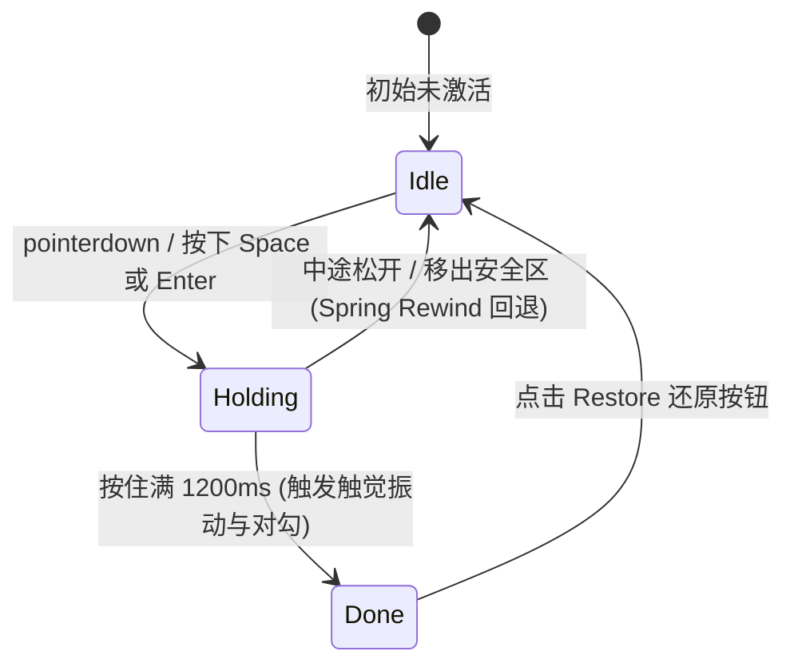

# Hold to Confirm · 长按手势确认

基于指针捕获与物理弹簧的长按蓄力确认交互。用于防止灾难性或不可逆操作的意外误触。通过双面同构层（Surface Face 与 Fill Face）的 `clip-path` 推进，呈现文字与图标随进度被新颜色精准“浸润”的效果；中途松开指针或移出按钮安全区时，进度以弹簧物理曲线平滑倒带归零。涵盖四大核心机制：

1. 双面同构剪裁推进（Dual-Face Clip-Path Fill）：底表面（Surface）与覆表面（Fill）拥有完全镜像的图标与文字，上层以 `clip-path: inset(0 ${100 - p}% 0 0)` 进行横向揭露，实现零锯齿、色彩精准翻转的流体进度填充。
2. 物理弹簧阻尼模型（Spring Engine）：
   - 按下时以 Snappy 弹簧进入 `scale(0.97)` 微下压态。
   - 蓄力由 1200ms 线性时间线驱动。
   - 中途释放或移出判定区时，以 Smooth 弹簧自当前中断位置平滑倒带归零（Rewind）。
3. 触觉反馈与完成态形态形变（Haptic & Face Morphing）：
   - 移动端触发完成瞬间通过 `navigator.vibrate(12)` 产生干脆的轻微触觉震颤。
   - 达成确认后，双面文字以轻微模糊（`blur(4px)`）与垂直位移切为过去式（如 Hold to delete → Deleted），宽度标尺自适应平滑收缩，垃圾桶图标转换为对勾并以 WAAPI 绘制笔触。
4. 全键盘等价与屏幕阅读器无障碍支持：长按键盘 `Space` 或 `Enter` 键享有与长按鼠标/触控完全一致的蓄力、回退与确认逻辑；通过 `aria-describedby` 与 `role="status"` 实时通报进度与达成状态。

## 原型清单

| 原型分组 | 原型元素 | 动效 / 状态变化 | 去向 |
| --- | --- | --- | --- |
| 官方手势舞台 | 主交互按钮 `#htcBtn` | 按压缩放 `scale(0.97)`；承载指针捕获与键盘长按 | 物理弹簧阻尼模型 + 全键盘等价 |
| 官方手势舞台 | 底表面 `.htc-face` | 默认未激活状态下的图标与文本展示 | 双面同构剪裁推进 |
| 官方手势舞台 | 填充遮罩层 `#htcFill` | 根据蓄力进度从左向右 `clip-path` 揭露反色面 | 双面同构剪裁推进 |
| 官方手势舞台 | 幽灵测量标尺 `#labelMeasure` | 测量并驱动当前文本的动态宽度收缩与伸展 | 触觉反馈与完成态形态形变 |
| 官方手势舞台 | 图标切换槽 `#surfaceIconSlot`, `#fillIconSlot` | 垃圾桶图标淡出，对勾图标淡入并执行路径描边 | 触觉反馈与完成态形态形变 |
| 官方手势舞台 | 标签切换槽 `#surfaceLabelFrame`, `#fillLabelFrame` | 文本逐字/逐面带模糊纵向位移流转 | 触觉反馈与完成态形态形变 |
| 官方手势舞台 | 下方提示槽 `#htcBelow` | 提示文案平滑流转为 Restore 还原按钮 | 触觉反馈与完成态形态形变 |
| 官方手势舞台 | 读屏无障碍提示 `#htcSrHint`, `#htcSrStatus` | 提供给盲人辅助设备的文案播报 | 全键盘等价与屏幕阅读器无障碍支持 |
| — | 舞台外壳 `.htc-stage`、标题、独立主题切换器 `#themeBtn` | 演示页面外壳 | 演示外壳，已删除 |
| — | embed/postMessage 同步逻辑 | iframe 适配 | 演示外壳，已删除 |
| — | 全局失去焦点补丁 `__arc_blur_installed` | 焦点清除逻辑 | 演示外壳，已删除 |

## 适用

- 破坏性或不可挽回的危险操作（例如删除大型工程、注销账号、清空数据库、格式化磁盘）。
- 移动端或触控优先界面，需要依靠“按住不放”的手势物理感知建立操作确定感。
- 用户需要明确的“蓄力进度感”，且中途反悔松手可即时无害回退。

## 不适用

- 依赖按钮原位展开菜单选择或倒计时自动触发的二次确认 → [confirm-morph](../buttons/confirm-morph.md)
- 常规异步操作或需要即时点击触发的业务流 → [action-button](../buttons/action-button.md)
- 列表行内横向滑动显露操作项的手势模型 → [swipe-actions](swipe-actions.md)

## 状态机



| 状态 | 进入条件 | 视觉表现 | 退出到 |
| --- | --- | --- | --- |
| `idle` | 初始状态 / 释放后回退归零 / 点击 Restore | 基础按钮形态，显示垃圾桶图标与“Hold to delete”，下方提示长按说明 | `holding` |
| `holding` | 按住鼠标主键 / 触控按压 / 按下 Space 或 Enter | 按钮微缩放至 0.97，覆表面从左至右线性填充，下方提示“Keep holding to delete” | `idle`, `done` |
| `done` | 蓄力持续满 1200ms | 触发 12ms 触觉振动，双面文字切为“Deleted”，图标切为绿色对勾，下方显露 Restore 按钮 | `idle` |

## 最小 DOM

```html
<div class="htc-container">
  <button type="button" class="htc-button" data-tone="accent" data-state="idle" aria-label="Hold to delete" aria-describedby="htcSrHint">
    <!-- 底表面 (Surface Face) -->
    <span class="htc-face">
      <span class="htc-icon-slot surface-icon-slot">
        <span class="htc-icon-phase" data-key="idle">
          <svg width="18" height="18" viewBox="0 0 24 24" fill="none" stroke="currentColor" stroke-width="1.75" stroke-linecap="round" stroke-linejoin="round" aria-hidden="true">
            <path d="M10 11v6"/><path d="M14 11v6"/><path d="M19 6v14a2 2 0 0 1-2 2H7a2 2 0 0 1-2-2V6"/><path d="M3 6h18"/><path d="M8 6V4a2 2 0 0 1 2-2h4a2 2 0 0 1 2 2v2"/>
          </svg>
        </span>
      </span>
      <span class="htc-label-frame surface-label-frame">
        <span class="htc-measure label-measure">Hold to delete</span>
        <span class="htc-label" data-key="Hold to delete">Hold to delete</span>
      </span>
    </span>

    <!-- 顶层反色填充面 (Fill Face) -->
    <span class="htc-fill" aria-hidden="true">
      <span class="htc-face">
        <span class="htc-icon-slot fill-icon-slot">
          <span class="htc-icon-phase" data-key="idle">
            <!-- 镜像 SVG -->
            <svg width="18" height="18" viewBox="0 0 24 24" fill="none" stroke="currentColor" stroke-width="1.75" stroke-linecap="round" stroke-linejoin="round">
              <path d="M10 11v6"/><path d="M14 11v6"/><path d="M19 6v14a2 2 0 0 1-2 2H7a2 2 0 0 1-2-2V6"/><path d="M3 6h18"/><path d="M8 6V4a2 2 0 0 1 2-2h4a2 2 0 0 1 2 2v2"/>
            </svg>
          </span>
        </span>
        <span class="htc-label-frame fill-label-frame">
          <span class="htc-label" data-key="Hold to delete">Hold to delete</span>
        </span>
      </span>
    </span>
  </button>

  <span id="htcSrHint" class="sr-only">Press and hold for 1.2 seconds to confirm. With a keyboard, hold Space or Enter.</span>
  <span id="htcSrStatus" class="sr-only" role="status"></span>

  <div class="htc-below" aria-live="polite">
    <p class="htc-hint">Hold for 1.2 seconds, or hold Space</p>
  </div>
</div>
```

- `.htc-button`：承载手势交互与按压缩放 `scale` 变形的主按钮。
- `.htc-fill`：绝对定位且 `inset: -1px` 完整覆盖父级的进度揭露层，通过 `clip-path` 动态横向裁剪。
- `.htc-measure`：不可见的幽灵测量文本，用于实时测量文字尺寸并通过弹簧更新 `.htc-label-frame` 宽度。
- `.htc-below`：下方动态操作提示槽，完成后呈现 Restore 撤回按钮。

## 参数

| 名称 | 值 | 用于 | 来源 |
| --- | --- | --- | --- |
| 蓄力确认时长 | `1200ms` | 长按蓄满所需持续时间 | 原型 |
| 移出容差边缘 (Slack) | `24px` | 指针移出按钮包围盒仍允许保持长按的阈值 | 原型 |
| 按压深度 (Depth) | `0.97` (小按钮) / `0.985` (大按钮) | 长按过程中的整体缩放系数 | 原型 |
| Snappy 弹簧 (按压) | `{ stiffness: 520, damping: 35, mass: 0.8 }` | 按钮下压与抬起缩放动画 | 原型 |
| Smooth 弹簧 (回弹倒带) | `{ stiffness: 300, damping: 32, mass: 1 }` | 提前松手时进度归零动画 | 原型 |
| Morph 弹簧 (文字宽度) | `{ stiffness: 380, damping: 32, mass: 0.9 }` | 标签在形态切换时的横向自适应宽度补间 | 原型 |
| 触觉振动 | `12ms` | 触屏达成确认瞬间的物理振动 | 原型 |
| 描边画出时长 | `320ms cubic-bezier(0.16, 1, 0.3, 1)` | 成功态对勾笔画动画 | 原型 |

## CSS

```css
.htc-container {
  display: flex;
  flex-direction: column;
  align-items: center;
  gap: 12px;
  font-family: inherit;
  user-select: none;
}

.htc-button {
  --hold-ink: #0b0b0b;
  --hold-fill: #141414;
  --hold-on-fill: #ffffff;
  --hold-border: rgba(0, 0, 0, 0.18);
  --border-strong: rgba(0, 0, 0, 0.16);
  --surface: #ffffff;
  --radius-control: 18px;

  position: relative;
  display: inline-flex;
  min-height: 44px;
  align-items: center;
  justify-content: center;
  padding: 0 20px;
  border: 1px solid var(--hold-border);
  border-radius: var(--radius-control);
  background: var(--surface);
  color: var(--hold-ink);
  font: inherit;
  font-size: 14px;
  font-weight: 500;
  line-height: 1.4;
  cursor: pointer;
  user-select: none;
  -webkit-user-select: none;
  -webkit-touch-callout: none;
  touch-action: manipulation;
  -webkit-tap-highlight-color: transparent;
  will-change: transform;
  transition: background-color 160ms cubic-bezier(0.22, 1, 0.36, 1),
              border-color 160ms cubic-bezier(0.22, 1, 0.36, 1),
              opacity 160ms cubic-bezier(0.22, 1, 0.36, 1);
}

.htc-button[data-tone="danger"] {
  --hold-ink: #f43f5e;
  --hold-fill: #f43f5e;
  --hold-on-fill: #ffffff;
  --hold-border: rgba(244, 63, 94, 0.32);
}

.htc-button:hover:not(:disabled):not([aria-disabled="true"]) {
  background: rgba(0, 0, 0, 0.04);
}

.htc-button[aria-disabled="true"] {
  cursor: default;
}

.htc-button:focus-visible {
  outline: 2px solid var(--hold-ink);
  outline-offset: 2px;
}

.htc-face {
  display: inline-flex;
  align-items: center;
  gap: 8px;
  white-space: nowrap;
}

/* 遮盖边框并保持同等圆角，clip-path 仅沿直线裁切边缘 */
.htc-fill {
  position: absolute;
  inset: -1px;
  display: flex;
  align-items: center;
  justify-content: center;
  border-radius: var(--radius-control);
  background: var(--hold-fill);
  color: var(--hold-on-fill);
  pointer-events: none;
  clip-path: inset(0 100% 0 0);
  will-change: clip-path;
}

.htc-icon-slot {
  display: grid;
  width: 18px;
  height: 18px;
  flex: none;
  place-items: center;
}

.htc-icon-phase {
  display: grid;
  grid-area: 1 / 1;
  place-items: center;
  will-change: transform, opacity, filter;
}
.htc-icon-phase svg {
  width: 18px;
  height: 18px;
  stroke: currentColor;
}

.htc-label-frame {
  position: relative;
  display: inline-grid;
  align-items: center;
  min-width: 0;
  clip-path: inset(-0.6em -3px);
}

.htc-label {
  grid-area: 1 / 1;
  display: block;
  white-space: nowrap;
  will-change: transform, opacity, filter;
}

.htc-measure {
  position: absolute;
  top: 0;
  left: 0;
  visibility: hidden;
  white-space: nowrap;
  pointer-events: none;
}

/* 下方提示与还原操作槽 */
.htc-below {
  position: relative;
  display: grid;
  min-height: 36px;
  place-items: center;
}
.htc-below > * {
  grid-area: 1 / 1;
}

.htc-hint {
  margin: 0;
  color: #888888;
  font-size: 13.5px;
  font-weight: 400;
  text-align: center;
  white-space: nowrap;
  will-change: transform, opacity, filter;
}

.htc-restore {
  display: inline-flex;
  min-height: 36px;
  align-items: center;
  gap: 8px;
  padding: 0 12px;
  border: 0;
  border-radius: 18px;
  background: transparent;
  color: #555555;
  font: inherit;
  font-size: 13.5px;
  font-weight: 500;
  cursor: pointer;
  will-change: transform, opacity, filter;
  transition: background-color 160ms cubic-bezier(0.22, 1, 0.36, 1),
              color 160ms cubic-bezier(0.22, 1, 0.36, 1);
}
.htc-restore:hover {
  background: rgba(0, 0, 0, 0.05);
  color: #0b0b0b;
}

.sr-only {
  position: absolute;
  width: 1px;
  height: 1px;
  overflow: hidden;
  clip: rect(0 0 0 0);
  white-space: nowrap;
}
```

## JS

```js
const TRASH_SVG = `<svg width="18" height="18" viewBox="0 0 24 24" fill="none" stroke="currentColor" stroke-width="1.75" stroke-linecap="round" stroke-linejoin="round" aria-hidden="true"><path d="M10 11v6"></path><path d="M14 11v6"></path><path d="M19 6v14a2 2 0 0 1-2 2H7a2 2 0 0 1-2-2V6"></path><path d="M3 6h18"></path><path d="M8 6V4a2 2 0 0 1 2-2h4a2 2 0 0 1 2 2v2"></path></svg>`;
const CHECK_SVG = `<svg width="18" height="18" viewBox="0 0 24 24" fill="none" stroke="currentColor" stroke-width="2" stroke-linecap="round" stroke-linejoin="round" aria-hidden="true"><path class="drawn-check-path" d="M4 12.5l5 5L20 6.5" pathLength="1" stroke-dasharray="1" stroke-dashoffset="1" style="opacity:0"></path></svg>`;
const RESTORE_ICON = `<svg width="16" height="16" viewBox="0 0 24 24" fill="none" stroke="currentColor" stroke-width="1.75" stroke-linecap="round" stroke-linejoin="round" aria-hidden="true"><path d="M3 12a9 9 0 1 0 9-9 9.75 9.75 0 0 0-6.74 2.74L3 8"></path><path d="M3 3v5h5"></path></svg>`;

const SPRINGS = {
  smooth: { stiffness: 300, damping: 32, mass: 1 },
  snappy: { stiffness: 520, damping: 35, mass: 0.8 },
  morph:  { stiffness: 380, damping: 32, mass: 0.9 }
};

function animateSpring(from, to, config, onUpdate, onComplete) {
  let current = from;
  let velocity = config.velocity || 0;
  const stiffness = config.stiffness || 300;
  const damping = config.damping || 32;
  const mass = config.mass || 1;
  const epsilon = config.epsilon || 0.001;
  let lastTime = performance.now();
  let rafId = null;
  let stopped = false;

  function step(now) {
    if (stopped) return;
    const dt = Math.min((now - lastTime) / 1000, 0.032);
    lastTime = now;
    const force = -stiffness * (current - to) - damping * velocity;
    const accel = force / mass;
    velocity += accel * dt;
    current += velocity * dt;

    if (Math.abs(current - to) < epsilon && Math.abs(velocity) < epsilon * 10) {
      current = to;
      onUpdate(current);
      if (onComplete) onComplete();
      return;
    }
    onUpdate(current);
    rafId = requestAnimationFrame(step);
  }

  rafId = requestAnimationFrame(step);
  return {
    stop() {
      stopped = true;
      if (rafId) cancelAnimationFrame(rafId);
    }
  };
}

function animateLinear(from, to, durationMs, onUpdate, onComplete) {
  const startTime = performance.now();
  let rafId = null;
  let stopped = false;

  function step(now) {
    if (stopped) return;
    const elapsed = now - startTime;
    const t = durationMs <= 0 ? 1 : Math.min(1, elapsed / durationMs);
    const val = from + (to - from) * t;
    onUpdate(val);
    if (t >= 1) {
      if (onComplete) onComplete();
      return;
    }
    rafId = requestAnimationFrame(step);
  }

  rafId = requestAnimationFrame(step);
  return {
    stop() {
      stopped = true;
      if (rafId) cancelAnimationFrame(rafId);
    }
  };
}

/**
 * 长按确认控制器
 * @param {HTMLElement} container 外部包装容器
 * @param {Object} options 配置项
 * @param {number} [options.duration=1200] 确认蓄力时间
 * @param {() => Promise<void>|void} options.onConfirm 达成确认回调
 * @param {() => void} [options.onRestore] 撤销还原回调
 * @returns {{ reset: Function, destroy: Function }} 控制接口
 */
export function createHoldToConfirm(container, {
  duration = 1200,
  onConfirm,
  onRestore
} = {}) {
  const htcBtn = container.querySelector(".htc-button");
  const htcFill = container.querySelector(".htc-fill");
  const surfaceIconSlot = container.querySelector(".surface-icon-slot");
  const fillIconSlot = container.querySelector(".fill-icon-slot");
  const surfaceLabelFrame = container.querySelector(".surface-label-frame");
  const fillLabelFrame = container.querySelector(".fill-label-frame");
  const labelMeasure = container.querySelector(".label-measure");
  const htcBelow = container.querySelector(".htc-below");
  const htcSrStatus = container.querySelector("#htcSrStatus");

  let isDone = false;
  let isHolding = false;
  let activeSource = null; // 'pointer' | 'key' | null
  let currentPointerType = 'mouse';
  let progress = 0;
  let scale = 1;
  let currentLabelWidth = 0;

  let fillAnim = null;
  let pressAnim = null;
  let widthAnim = null;

  function renderProgress(p) {
    progress = p;
    const insetRight = ((1 - Math.min(1, Math.max(0, p))) * 100).toFixed(3);
    htcFill.style.clipPath = `inset(0 ${insetRight}% 0 0)`;
  }

  function renderScale(s) {
    scale = s;
    htcBtn.style.transform = s === 1 ? "" : `scale(${s})`;
  }

  function renderWidth(w) {
    currentLabelWidth = w;
    surfaceLabelFrame.style.width = `${w}px`;
    fillLabelFrame.style.width = `${w}px`;
  }

  function initLabelWidth() {
    const w = labelMeasure.getBoundingClientRect().width || labelMeasure.offsetWidth;
    if (w > 0) renderWidth(w);
  }
  initLabelWidth();

  function morphFaces(doneState) {
    const nextText = doneState ? "Deleted" : "Hold to delete";
    const phaseKey = doneState ? "done" : "idle";

    htcBtn.setAttribute("aria-label", nextText);
    if (doneState) {
      htcBtn.setAttribute("aria-disabled", "true");
      htcBtn.removeAttribute("aria-describedby");
      if (htcSrStatus) htcSrStatus.textContent = "Deleted";
    } else {
      htcBtn.removeAttribute("aria-disabled");
      htcBtn.setAttribute("aria-describedby", "htcSrHint");
      if (htcSrStatus) htcSrStatus.textContent = "";
    }

    // 1. 测量并平滑调整宽度
    labelMeasure.textContent = nextText;
    const nextWidth = labelMeasure.getBoundingClientRect().width || labelMeasure.offsetWidth;
    if (widthAnim) widthAnim.stop();
    widthAnim = animateSpring(
      currentLabelWidth || nextWidth,
      nextWidth,
      { ...SPRINGS.morph, epsilon: 0.1 },
      renderWidth
    );

    // 2. 双面文字形变
    [surfaceLabelFrame, fillLabelFrame].forEach((frame) => {
      const oldLabel = frame.querySelector(".htc-label:last-of-type");
      const newLabel = document.createElement("span");
      newLabel.className = "htc-label";
      newLabel.dataset.key = nextText;
      newLabel.textContent = nextText;
      frame.appendChild(newLabel);

      if (oldLabel) {
        oldLabel.animate(
          [
            { opacity: 1, transform: "translateY(0em)", filter: "blur(0px)" },
            { opacity: 0, transform: "translateY(-0.3em)", filter: "blur(2px)" }
          ],
          { duration: 160, easing: "cubic-bezier(0.22, 1, 0.36, 1)", fill: "forwards" }
        ).onfinish = () => oldLabel.remove();
      }

      newLabel.animate(
        [
          { opacity: 0, transform: "translateY(0.3em)", filter: "blur(4px)" },
          { opacity: 1, transform: "translateY(0em)", filter: "blur(0px)" }
        ],
        { duration: 240, easing: "cubic-bezier(0.16, 1, 0.3, 1)", fill: "forwards" }
      );
    });

    // 3. 双面图标形变
    [surfaceIconSlot, fillIconSlot].forEach((slot) => {
      const oldIcon = slot.querySelector(".htc-icon-phase:last-of-type");
      const newIcon = document.createElement("span");
      newIcon.className = "htc-icon-phase";
      newIcon.dataset.key = phaseKey;
      newIcon.innerHTML = doneState ? CHECK_SVG : TRASH_SVG;
      slot.appendChild(newIcon);

      if (oldIcon) {
        oldIcon.animate(
          [
            { opacity: 1, transform: "scale(1)", filter: "blur(0px)" },
            { opacity: 0, transform: "scale(0.6)", filter: "blur(2px)" }
          ],
          { duration: 160, easing: "cubic-bezier(0.22, 1, 0.36, 1)", fill: "forwards" }
        ).onfinish = () => oldIcon.remove();
      }

      newIcon.animate(
        [
          { opacity: 0, transform: "scale(0.6)", filter: "blur(2px)" },
          { opacity: 1, transform: "scale(1)", filter: "blur(0px)" }
        ],
        { duration: 220, easing: "cubic-bezier(0.16, 1, 0.3, 1)", fill: "forwards" }
      );

      if (doneState) {
        const checkPath = newIcon.querySelector(".drawn-check-path");
        if (checkPath) {
          checkPath.animate(
            [
              { strokeDashoffset: 1, opacity: 0 },
              { strokeDashoffset: 1, opacity: 1, offset: 0.12 },
              { strokeDashoffset: 0, opacity: 1 }
            ],
            { duration: 320, delay: 80, easing: "cubic-bezier(0.16, 1, 0.3, 1)", fill: "forwards" }
          );
        }
      }
    });
  }

  function updateBelowHint() {
    const nextKey = isDone
      ? "restore"
      : isHolding
        ? "Keep holding to delete"
        : "Hold for 1.2 seconds, or hold Space";

    const oldNode = htcBelow.lastElementChild;
    let newNode;
    if (nextKey === "restore") {
      newNode = document.createElement("button");
      newNode.type = "button";
      newNode.className = "htc-restore";
      newNode.innerHTML = `${RESTORE_ICON}Restore`;
      newNode.addEventListener("click", () => {
        reset();
        htcBtn.focus();
        if (typeof onRestore === 'function') onRestore();
      });
    } else {
      newNode = document.createElement("p");
      newNode.className = "htc-hint";
      newNode.textContent = nextKey;
    }
    htcBelow.appendChild(newNode);

    if (oldNode) {
      oldNode.animate(
        [
          { opacity: 1, transform: "translateY(0em)", filter: "blur(0px)" },
          { opacity: 0, transform: "translateY(-0.3em)", filter: "blur(2px)" }
        ],
        { duration: 160, easing: "cubic-bezier(0.22, 1, 0.36, 1)", fill: "forwards" }
      ).onfinish = () => oldNode.remove();
    }

    newNode.animate(
      [
        { opacity: 0, transform: "translateY(0.3em)", filter: "blur(4px)" },
        { opacity: 1, transform: "translateY(0em)", filter: "blur(0px)" }
      ],
      { duration: 240, delay: nextKey === "restore" ? 200 : 0, easing: "cubic-bezier(0.16, 1, 0.3, 1)", fill: "both" }
    );
  }

  function pressTo(pressed) {
    if (pressAnim) pressAnim.stop();
    const depth = (htcBtn.offsetWidth || 0) > 220 ? 0.985 : 0.97;
    pressAnim = animateSpring(
      scale,
      pressed ? depth : 1,
      { ...SPRINGS.snappy, epsilon: 0.0005 },
      renderScale
    );
  }

  function rewind() {
    if (fillAnim) fillAnim.stop();
    fillAnim = animateSpring(
      progress,
      0,
      { ...SPRINGS.smooth, velocity: 0, epsilon: 0.001 },
      renderProgress
    );
  }

  function stopHolding() {
    activeSource = null;
    isHolding = false;
    htcBtn.setAttribute("data-state", isDone ? "done" : "idle");
    pressTo(false);
    updateBelowHint();
  }

  function complete() {
    if (!activeSource) return;
    isDone = true;
    stopHolding();
    if (currentPointerType === "touch" && navigator.vibrate) {
      navigator.vibrate(12);
    }
    morphFaces(true);
    updateBelowHint();
    if (typeof onConfirm === 'function') onConfirm();
  }

  function begin(fromSource) {
    if (isDone || activeSource) return;
    activeSource = fromSource;
    isHolding = true;
    htcBtn.setAttribute("data-state", "holding");
    pressTo(true);
    updateBelowHint();

    if (fillAnim) fillAnim.stop();
    const remainingDuration = (1 - progress) * duration;
    fillAnim = animateLinear(progress, 1, remainingDuration, renderProgress, complete);
  }

  function release() {
    if (!activeSource) return;
    stopHolding();
    rewind();
  }

  function reset() {
    if (!isDone) return;
    isDone = false;
    htcBtn.setAttribute("data-state", "idle");
    morphFaces(false);
    rewind();
    updateBelowHint();
  }

  // 指针与手势事件
  const onPointerDown = (e) => {
    if (e.isPrimary === false || e.button !== 0) return;
    currentPointerType = e.pointerType;
    try { htcBtn.setPointerCapture(e.pointerId); } catch {}
    begin("pointer");
  };

  const onPointerMove = (e) => {
    if (activeSource !== "pointer") return;
    const box = htcBtn.getBoundingClientRect();
    const slack = 24;
    if (
      e.clientX < box.left - slack ||
      e.clientX > box.right + slack ||
      e.clientY < box.top - slack ||
      e.clientY > box.bottom + slack
    ) {
      release();
    }
  };

  const onKeyDown = (e) => {
    if (e.key !== " " && e.key !== "Enter") return;
    e.preventDefault();
    if (!e.repeat) begin("key");
  };

  const onKeyUp = (e) => {
    if (e.key !== " " && e.key !== "Enter") return;
    e.preventDefault();
    if (activeSource === "key") release();
  };

  htcBtn.addEventListener("pointerdown", onPointerDown);
  htcBtn.addEventListener("pointermove", onPointerMove);
  htcBtn.addEventListener("pointerup", release);
  htcBtn.addEventListener("pointercancel", release);
  htcBtn.addEventListener("lostpointercapture", release);
  htcBtn.addEventListener("blur", release);
  htcBtn.addEventListener("contextmenu", (e) => e.preventDefault());
  htcBtn.addEventListener("keydown", onKeyDown);
  htcBtn.addEventListener("keyup", onKeyUp);

  return {
    reset,
    destroy() {
      if (fillAnim) fillAnim.stop();
      if (pressAnim) pressAnim.stop();
      if (widthAnim) widthAnim.stop();
      htcBtn.removeEventListener("pointerdown", onPointerDown);
      htcBtn.removeEventListener("pointermove", onPointerMove);
      htcBtn.removeEventListener("pointerup", release);
      htcBtn.removeEventListener("pointercancel", release);
      htcBtn.removeEventListener("lostpointercapture", release);
      htcBtn.removeEventListener("blur", release);
      htcBtn.removeEventListener("keydown", onKeyDown);
      htcBtn.removeEventListener("keyup", onKeyUp);
    }
  };
}
```

## 接入目标项目

- 状态来源：破坏性操作的业务确认流。通过 `onConfirm()` 接入远程删除/注销接口，通过 `onRestore()` 接入撤销接口。
- 尺寸策略：按钮固定高度 44px；宽度由内部幽灵标尺 `.htc-measure` 根据文字长短自动测量并以弹簧插值驱动。
- 驱动方式：实例化 `createHoldToConfirm(container, { duration: 1200, onConfirm })` 即可全权托管手势生命周期。

## 重入与清理

- 动画与 rAF 阻断：所有弹簧与线性补间均配备 `stop()` 机制，在 `begin()`、`rewind()` 或重新触发时率先停止先前未决的 requestAnimationFrame，杜绝多帧冲突。
- 卸载清理：组件 `destroy()` 方法全面移除指针捕获、键盘与失焦事件，终止正在运行的所有弹簧动画。

## 减少动态效果

系统偏好开启 `prefers-reduced-motion: reduce` 时：
1. 移除 `scale(0.97)` 下压弹簧与面切换时的微模糊滤镜（`blur`）。
2. 保留 `clip-path` 线性进度推进（使用户仍能感知长按时长要求），或在配置中支持点击即时弹窗确认。

```css
@media (prefers-reduced-motion: reduce) {
  .htc-button,
  .htc-label,
  .htc-icon-phase,
  .htc-hint,
  .htc-restore {
    transition-duration: 0.01ms !important;
  }
  .htc-label,
  .htc-icon-phase,
  .htc-hint,
  .htc-restore {
    filter: none !important;
  }
}
```

## 焦点与键盘

- 键盘长按等价：按住 `Space` 或 `Enter` 键触发 `begin("key")`，松开按键触发 `release()`，并过滤系统的 `e.repeat` 重复按键事件。
- 读屏辅助：通过 `aria-describedby="htcSrHint"` 指引读屏用户“长按 1.2 秒确认或长按空格键”，并在达成确认后向 `role="status"` 动态推入完成广播。

## 兼容回退

| 特性 | 不支持时 |
| --- | --- |
| `navigator.vibrate` | 自动降级为纯视觉对勾反馈，不抛出异常。 |
| CSS `clip-path: inset(...)` | 【降级方案】`.htc-fill` 改为带 `overflow: hidden` 的外层包裹容器，动态设置其 `width` 达到等价揭露效果。 |

## 验收清单

- [ ] 按下鼠标左键或在触控屏长按，按钮立即产生轻微物理缩放（0.97）并平滑向右推进填充色。
- [ ] 长按中途（如 600ms）松开指针，填充色以平滑弹簧阻尼自当前位置倒带缩回零点。
- [ ] 指针按住并向外拖出超过 24px 容差区，手势自动释放并执行倒带。
- [ ] 完整按住满 1200ms 后，按钮停止缩放，文字顺滑切换为 "Deleted"，对勾图标以笔触动画画出。
- [ ] 达成确认后，下方提示文字转为可点击的 "Restore" 按钮；点击 Restore 完整恢复至初始待命中状态。
- [ ] 聚焦按钮后按住键盘 Space 键，可观察到与鼠标长按完全一致的进度填充与完成反馈。
- [ ] 系统的减弱动态效果开启时，移除所有高斯模糊滤镜与弹簧缩放。
