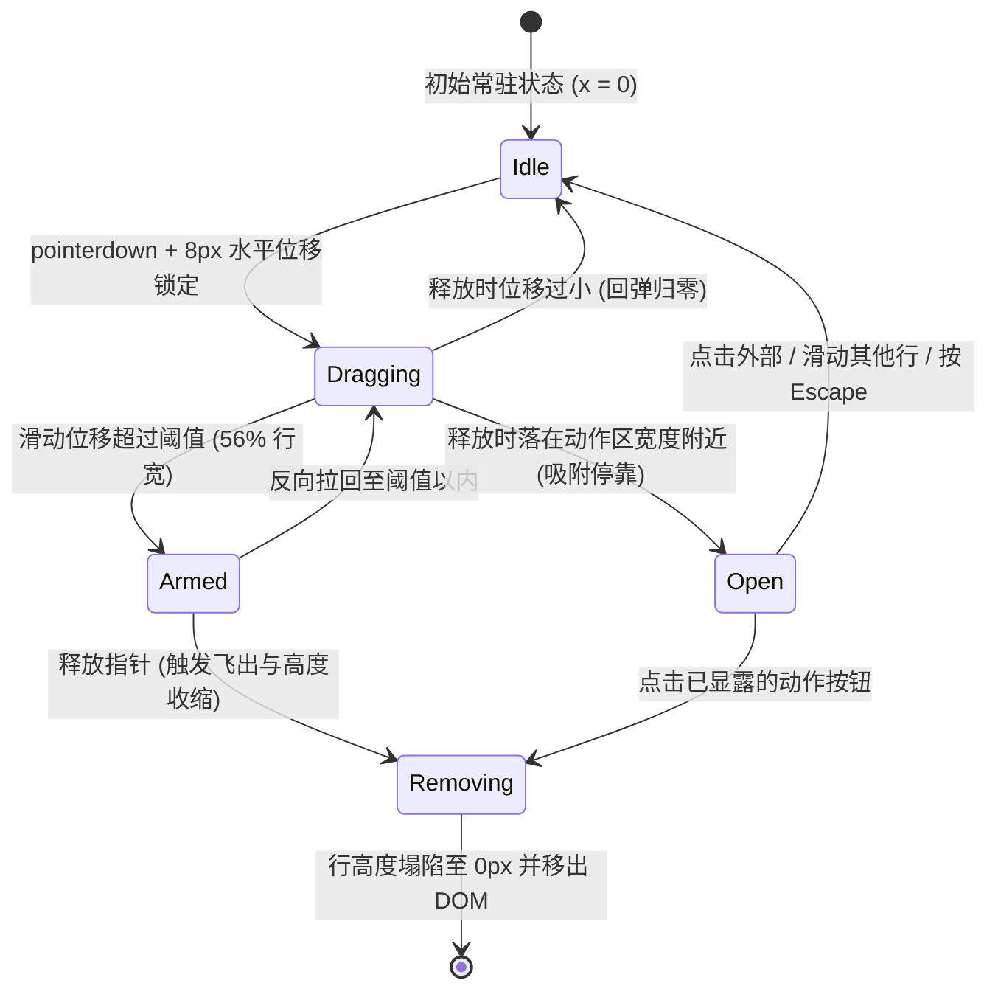

# Swipe Actions · 滑动手势操作行

移动端与触控交互中经典的高保真列表行手势操作。支持左右双向滑动揭露操作项、深滑蓄力直达（Deep Swipe to Commit）、投掷惯性判断（Flick Projection）以及橡皮筋越界阻尼。为无法使用滑动手势的用户和辅助技术提供无缝降级的辅助下拉菜单。涵盖四大核心机制：

1. 双轴手势冲突裁决（Axis Locking）：8px 微位移意图防抖，若垂直位移占优则锁定纵向并彻底让渡给原生页面垂直滚动；若横向占优则加锁并捕获指针（`setPointerCapture`）。
2. 阶梯错峰揭露与深滑蓄力（Staggered Layers & Threshold Arming）：
   - 浅滑：底层操作图标与文本根据拖拽距离梯次平移并平滑放大揭露。
   - 阈值深滑（超过 56% 容器宽度）：最外层主操作（如归档或删除）立即进入“蓄力态”，底层背景展开铺满整行，松手即触发飞出执行。
3. 真实惯性投影与弹簧吸附（Velocity Projection & Spring Settle）：
   - 释放瞬间采集最近 80ms 速度，通过投射公式计算惯性终点。
   - 支持轻甩（Flick）越过阈值快速触发；普通释放则吸附于动作宽度或平滑回弹归零。
4. 全键盘与读屏无障碍等价入口（Accessible Menu Fallback）：每行内置常驻但轻量的“More actions”辅助按钮，键盘聚焦或点击即可弹出浮动菜单执行同等操作，彻底解决手势组件在无障碍访问下的可达性死角。

## 原型清单

| 原型分组 | 原型元素 | 动效 / 状态变化 | 去向 |
| --- | --- | --- | --- |
| 邮件列表舞台 | 列表根容器 `#saList` / `#saSurface` | 承载各列表项高度塌陷与行进排版 | 真实惯性投影与弹簧吸附 |
| 邮件列表舞台 | 列表项行元素 `.sa-row` | 承载平移、拖拽属性 `[data-dragging]` 及移除时的物理高度收缩 | 阶梯错峰揭露与深滑蓄力 |
| 邮件列表舞台 | 前景内容卡片 `.sa-content` | 承载手指跟随平移 `translate3d(x, 0, 0)`、头像与摘要文本 | 双轴手势冲突裁决 |
| 邮件列表舞台 | 左侧滑出操作 (Leading: Archive) | 浅滑显露；深滑蓄力扩展铺满背景 | 阶梯错峰揭露与深滑蓄力 |
| 邮件列表舞台 | 右侧滑出操作 (Trailing: Snooze, Delete) | 双动作阶梯错峰露出；深滑蓄力 Delete 铺满背景 | 阶梯错峰揭露与深滑蓄力 |
| 邮件列表舞台 | 辅助菜单按钮 `.sa-more` | 键盘聚焦与点击唤出操作菜单入口 | 全键盘与读屏无障碍等价入口 |
| 邮件列表舞台 | 浮动下拉菜单 `#saMenu` | 浮动挂载，以菜单形式展示当前行全部动作 | 全键盘与读屏无障碍等价入口 |
| 演示外壳 | 顶部滚动计数器 `#rollingCount` / `#srCount` | 数字滚动变化与未读统计 | 演示外壳，已删除（机制已在 button-group 中收录） |
| 演示外壳 | 底部状态提示条 `#statusRise` 与 `#undoBtn` | 演示撤回提示与按钮 | 演示外壳，已删除 |
| 演示外壳 | 空状态恢复面板 `#saEmpty` / `#restoreAllBtn` | 列表全部清除后的空状态卡片 | 演示外壳，已删除 |
| — | 顶栏、主题切换器 `#themeBtn`、embed/postMessage 监听、全局 blur 补丁 | — | 演示外壳，已删除 |

## 适用

- 邮件客户端、即时通信会话列表、待办事项 Todo 列表或通知中心。
- 需要在列表单行上提供 2~3 个快速高频动作（如标记已读、归档、稍后提醒、删除）。
- 移动端或带有水平手势滑动意图的触摸屏环境。

## 不适用

- 仅包含单个原地危险操作、无需揭露多动作面板的交互 → [hold-to-confirm](hold-to-confirm.md)
- 常规表格内部操作列，有充裕水平空间常驻平铺按钮 → [button-group](../buttons/button-group.md)
- 需要原地展开二次确认并伴随倒计时的按钮 → [confirm-morph](../buttons/confirm-morph.md)

## 状态机



| 状态 | 进入条件 | 视觉表现 | 退出到 |
| --- | --- | --- | --- |
| `idle` | 初始载入 / 释放回弹完成 | 内容居中对齐，底层动作按钮完全隐藏不可见 | `dragging` |
| `dragging` | 指针移动量 > 8px 且水平分量优于垂直分量 | 内容卡片跟手水平位移，底层图标逐渐缩放淡入 | `armed`, `open`, `idle` |
| `armed` | 水平位移超越深度阈值（`> 56%` 行宽） | 最外侧动作背景顺滑铺满整行底色，图标平移居中 | `dragging`, `removing` |
| `open` | 释放时惯性预测值落在动作栏总宽（`76px ~ 152px`）附近 | 内容卡片平滑吸附停留在指定偏移量，动作按钮保持可见 | `idle`, `removing` |
| `removing` | 处于 `armed` 释放或点击具体动作 | 目标行快速沿滑动方向滑出视口，高度平滑塌陷为 0px 并移除 | `[*]` |

## 最小 DOM

```html
<ul class="sa-list" role="list" aria-label="Swipeable items">
  <li class="sa-row" data-msg-id="item-1">
    <!-- 1. 左侧滑动层 (Leading: Archive) -->
    <button type="button" class="sa-layer" data-side="leading" data-tone="accent" tabindex="-1" aria-hidden="true">
      <span class="sa-anchor">
        <span class="sa-glyph">
          <span class="sa-icon">
            <svg viewBox="0 0 24 24"><rect width="20" height="5" x="2" y="3" rx="1"/><path d="M4 8v11a2 2 0 0 0 2 2h12a2 2 0 0 0 2-2V8"/><path d="M10 12h4"/></svg>
          </span>
          <span class="sa-label">Archive</span>
        </span>
      </span>
    </button>

    <!-- 2. 右侧滑动层 (Trailing: Delete) -->
    <button type="button" class="sa-layer" data-side="trailing" data-tone="danger" tabindex="-1" aria-hidden="true">
      <span class="sa-anchor">
        <span class="sa-glyph">
          <span class="sa-icon">
            <svg viewBox="0 0 24 24"><path d="M10 11v6"/><path d="M14 11v6"/><path d="M19 6v14a2 2 0 0 1-2 2H7a2 2 0 0 1-2-2V6"/><path d="M3 6h18"/><path d="M8 6V4a2 2 0 0 1 2-2h4a2 2 0 0 1 2 2v2"/></svg>
          </span>
          <span class="sa-label">Delete</span>
        </span>
      </span>
    </button>

    <!-- 3. 前景卡片主体 (Content) -->
    <div class="sa-content">
      <div class="sa-body">
        <span class="sa-title">Notification title</span>
        <span class="sa-preview">Swipe to archive or delete this record.</span>
      </div>
      <!-- 辅助菜单唤出按钮 (提供无障碍等价入口) -->
      <button type="button" class="sa-more" aria-label="More actions for notification">
        <svg viewBox="0 0 24 24" width="18" height="18"><circle cx="12" cy="12" r="1"/><circle cx="19" cy="12" r="1"/><circle cx="5" cy="12" r="1"/></svg>
      </button>
    </div>
  </li>
</ul>

<!-- 4. 浮动动作菜单容器 (用于键盘与读屏辅助) -->
<div class="sa-menu" role="menu" data-state="closed" style="display: none;"></div>
```

- `.sa-row`：列表项物理行，承载整行的绝对层叠及删除时的高度塌陷过渡。
- `.sa-layer`：隐藏在底层的动作按钮，通过 `data-side="leading|trailing"` 区分左右。
- `.sa-content`：前景内容外壳，触摸平移通过 `translate3d(x, 0, 0)` 硬件加速执行。
- `.sa-more`：键盘可导航的无障碍辅助按钮。

## 参数

| 名称 | 值 | 用于 | 来源 |
| --- | --- | --- | --- |
| 单个动作槽宽 (`ACTION`) | `76px` | 每个滑出动作按钮的标准展开宽度 | 原型 |
| 轴向判定位移门槛 (`SLOP`) | `8px` | 区分用户意图为纵向滚动还是横向滑动的阈值 | 原型 |
| 惯性投射因子 (`PROJECTION`)| `0.1` | 将释放时的速度线性累加至位移的投影系数 | 原型 |
| 轻甩速度阈值 (`FLICK`) | `900px/s` | 判断快速滑动手势触发直达的最小速度 | 原型 |
| 蓄力触发门槛 (`threshold`)| `max(openWidth + 48, w * 0.56)` | 深滑进入 Armed 铺满背景的距离阈值 | 原型 |
| Snappy 弹簧 (吸附停靠) | `{ stiffness: 520, damping: 36, mass: 0.85 }` | 停留在动作槽位或释放回弹 | 原型 |
| Smooth 弹簧 (行飞出/高度收缩) | `{ stiffness: 300, damping: 32, mass: 1 }` | 飞离屏幕与列表高度由 65px 塌陷至 0px | 原型 |
| 橡皮筋系数 | `0.55` | 越界时非线性阻尼衰减系数 | 原型 |

## CSS

```css
.sa-list {
  list-style: none;
  margin: 0;
  padding: 0;
  width: 100%;
  max-width: 520px;
  background: var(--surface, #ffffff);
  border: 1px solid rgba(0, 0, 0, 0.08);
  border-radius: 16px;
  overflow: hidden;
  box-shadow: 0 4px 14px rgba(0, 0, 0, 0.05);
}

.sa-row {
  position: relative;
  display: block;
  width: 100%;
  min-height: 65px;
  overflow: hidden;
  user-select: none;
  touch-action: pan-y;
  background: var(--surface, #ffffff);
  border-bottom: 1px solid rgba(0, 0, 0, 0.06);
}
.sa-row:last-child {
  border-bottom: none;
}

/* 底层动作层 */
.sa-layer {
  position: absolute;
  top: 0;
  bottom: 0;
  display: flex;
  align-items: center;
  justify-content: center;
  width: 100%;
  padding: 0;
  border: 0;
  cursor: pointer;
  visibility: hidden;
  will-change: transform;
}
.sa-layer[data-side="leading"] {
  left: 0;
  justify-content: flex-start;
  background: var(--accent, #141414);
  color: #ffffff;
}
.sa-layer[data-side="trailing"] {
  right: 0;
  justify-content: flex-end;
  background: var(--surface-muted, #f4f4f4);
  color: #0b0b0b;
}
.sa-layer[data-tone="danger"] {
  background: #f43f5e;
  color: #ffffff;
}

.sa-anchor {
  display: inline-flex;
  align-items: center;
  justify-content: center;
  width: 76px;
  height: 100%;
  will-change: transform;
}

.sa-glyph {
  display: flex;
  flex-direction: column;
  align-items: center;
  gap: 4px;
}

.sa-icon {
  display: grid;
  width: 20px;
  height: 20px;
  place-items: center;
  will-change: transform, opacity;
}
.sa-icon svg {
  width: 20px;
  height: 20px;
  stroke: currentColor;
  fill: none;
  stroke-width: 1.75;
}

.sa-label {
  font-size: 11px;
  font-weight: 500;
  line-height: 1;
  white-space: nowrap;
  will-change: opacity;
}

/* 前景内容层 */
.sa-content {
  position: relative;
  z-index: 10;
  display: flex;
  align-items: center;
  justify-content: space-between;
  width: 100%;
  min-height: 65px;
  padding: 12px 16px;
  background: var(--surface, #ffffff);
  box-sizing: border-box;
  will-change: transform;
  cursor: grab;
}
.sa-row[data-dragging] .sa-content {
  cursor: grabbing;
}

.sa-body {
  display: flex;
  flex-direction: column;
  gap: 4px;
  min-width: 0;
}

.sa-title {
  font-size: 14px;
  font-weight: 600;
  color: #0b0b0b;
}

.sa-preview {
  font-size: 12.5px;
  color: #777777;
  overflow: hidden;
  text-overflow: ellipsis;
  white-space: nowrap;
}

/* 更多辅助按钮 */
.sa-more {
  display: inline-grid;
  width: 32px;
  height: 32px;
  flex: none;
  place-items: center;
  border: 0;
  border-radius: 50%;
  background: transparent;
  color: #888888;
  cursor: pointer;
  outline: none;
  transition: background-color 160ms ease, color 160ms ease;
}
.sa-more:hover {
  background: rgba(0, 0, 0, 0.05);
  color: #0b0b0b;
}
.sa-more:focus-visible {
  outline: 2px solid currentColor;
}

/* 浮动菜单容器 */
.sa-menu {
  position: fixed;
  z-index: 9999;
  min-width: 160px;
  padding: 4px;
  background: #ffffff;
  border: 1px solid rgba(0, 0, 0, 0.08);
  border-radius: 12px;
  box-shadow: 0 8px 24px rgba(0, 0, 0, 0.12);
  outline: none;
}
.sa-item {
  display: flex;
  align-items: center;
  gap: 8px;
  width: 100%;
  padding: 8px 12px;
  border: 0;
  border-radius: 8px;
  background: transparent;
  font-size: 13px;
  color: #0b0b0b;
  cursor: pointer;
}
.sa-item:hover {
  background: #f4f4f4;
}
.sa-item[data-tone="danger"] {
  color: #f43f5e;
}
```

## JS

```js
const ACTION = 76;
const SLOP = 8;
const PROJECTION = 0.1;
const FLICK = 900;
const clamp01 = (v) => Math.min(1, Math.max(0, v));
const rubberBand = (overshoot, dimension) => (1 - 1 / ((overshoot * 0.55) / dimension + 1)) * dimension;
const sideOf = (v) => (v > 0 ? "leading" : v < 0 ? "trailing" : null);

const SPRINGS = {
  smooth: { stiffness: 300, damping: 32, mass: 1 },
  snappy: { stiffness: 520, damping: 36, mass: 0.85 },
  morph:  { stiffness: 380, damping: 32, mass: 0.9 }
};

function animateSpring(from, to, config, onUpdate, onComplete) {
  let current = from;
  let velocity = config.velocity || 0;
  const stiffness = config.stiffness || 300;
  const damping = config.damping || 32;
  const mass = config.mass || 1;
  let lastTime = performance.now();
  let rafId = null;
  let stopped = false;

  function step(now) {
    if (stopped) return;
    const dt = Math.min((now - lastTime) / 1000, 0.032);
    lastTime = now;
    const force = -stiffness * (current - to) - damping * velocity;
    const accel = force / mass;
    velocity += accel * dt;
    current += velocity * dt;

    if (Math.abs(current - to) < 0.15 && Math.abs(velocity) < 2) {
      current = to;
      onUpdate(current);
      if (onComplete) onComplete();
      return;
    }
    onUpdate(current);
    rafId = requestAnimationFrame(step);
  }

  rafId = requestAnimationFrame(step);
  return {
    stop() {
      stopped = true;
      if (rafId) cancelAnimationFrame(rafId);
    }
  };
}

function velocityOf(samples) {
  const last = samples[samples.length - 1];
  if (!last) return 0;
  const first = samples.find((s) => last[0] - s[0] <= 80) ?? last;
  const elapsed = (last[0] - first[0]) / 1000;
  return elapsed > 0 ? (last[1] - first[1]) / elapsed : 0;
}

/**
 * 为单个列表项绑定完整的滑动手势与动作反馈
 * @param {HTMLElement} liRow 列表项 DOM
 * @param {Object} options 配置项
 * @param {Array<{label: string, icon: string, tone?: string, onSelect: Function}>} options.leading 左侧动作列表
 * @param {Array<{label: string, icon: string, tone?: string, onSelect: Function}>} options.trailing 右侧动作列表
 * @param {Function} [options.onRemove] 行被滑出移除后的回调
 * @returns {Object} 控制器对象
 */
export function bindSwipeRow(liRow, { leading = [], trailing = [], onRemove } = {}) {
  const content = liRow.querySelector(".sa-content");
  const moreBtn = liRow.querySelector(".sa-more");
  const layers = Array.from(liRow.querySelectorAll(".sa-layer")).map(btn => ({
    btn,
    side: btn.dataset.side,
    anchor: btn.querySelector(".sa-anchor"),
    iconSpan: btn.querySelector(".sa-icon"),
    labelSpan: btn.querySelector(".sa-label")
  }));

  let x = 0;
  let cover = 0;
  let armed = false;
  let isLeaving = false;
  let swallowClick = false;
  let drag = null;
  let travelAnim = null;
  let stretchAnim = null;

  function actionsOf(side) {
    return side === "leading" ? leading : trailing;
  }
  function openWidth(side) {
    return actionsOf(side).length * ACTION;
  }
  function threshold(side) {
    const w = liRow.offsetWidth || 440;
    return Math.max(openWidth(side) + 48, w * 0.56);
  }

  function render() {
    content.style.transform = x === 0 ? "" : `translate3d(${x}px, 0, 0)`;

    layers.forEach((layer) => {
      const { side, btn, anchor, iconSpan, labelSpan } = layer;
      const count = actionsOf(side).length;
      const direction = side === "leading" ? 1 : -1;
      const revealed = Math.max(0, x * direction);
      const share = revealed / count;

      const base = revealed;
      const shift = direction * base;
      const glyphX = -direction * (share / 2);

      const ownIcon = clamp01((share - ACTION * 0.25) / (ACTION * 0.55));
      const ownLabel = clamp01((share - ACTION * 0.72) / (ACTION * 0.24));

      btn.style.visibility = revealed > 0.2 ? "visible" : "hidden";
      btn.style.transform = shift === 0 ? "" : `translate3d(${shift}px, 0, 0)`;
      anchor.style.transform = glyphX === 0 ? "" : `translate3d(${glyphX}px, 0, 0)`;
      iconSpan.style.opacity = String(ownIcon);
      iconSpan.style.transform = `scale(${0.6 + 0.4 * ownIcon})`;
      labelSpan.style.opacity = String(ownLabel);
    });
  }

  function settle(target, velocity = 0) {
    armed = false;
    if (travelAnim) travelAnim.stop();

    const springCfg = target === 0 ? SPRINGS.smooth : SPRINGS.snappy;
    travelAnim = animateSpring(
      x,
      target,
      { ...springCfg, velocity },
      (v) => {
        x = v;
        render();
      },
      () => {
        if (target === 0) {
          cover = 0;
          render();
        }
      }
    );
  }

  function commit(side, index, velocity = 0) {
    const action = actionsOf(side)[index];
    if (!action || isLeaving) return;
    const direction = side === "leading" ? 1 : -1;
    isLeaving = true;
    liRow.setAttribute("data-removing", "");

    if (travelAnim) travelAnim.stop();
    const w = liRow.offsetWidth || 440;
    const end = direction * (w + 2);

    travelAnim = animateSpring(
      x,
      end,
      { ...SPRINGS.smooth, velocity },
      (v) => {
        x = v;
        render();
      },
      () => {
        // 行高度塌陷移除
        const h = liRow.offsetHeight;
        animateSpring(h, 0, SPRINGS.smooth, (curH) => {
          liRow.style.height = `${curH}px`;
        }, () => {
          liRow.remove();
          if (typeof onRemove === 'function') onRemove();
        });
      }
    );

    action.onSelect();
  }

  function constrain(raw) {
    const side = sideOf(raw);
    if (!side) return 0;
    const dimension = liRow.offsetWidth || 440;
    const limit = actionsOf(side).length === 0 ? 0 : dimension;
    const distance = Math.abs(raw);
    return (
      Math.sign(raw) *
      (distance <= limit ? distance : limit + rubberBand(distance - limit, dimension))
    );
  }

  function handleRelease(velocity) {
    const side = sideOf(x);
    if (!side || actionsOf(side).length === 0) {
      settle(0, velocity);
      return;
    }
    const direction = side === "leading" ? 1 : -1;
    const distance = Math.abs(x);
    const outward = velocity * direction;
    const open = openWidth(side);
    const projected = distance + outward * PROJECTION;
    const flung = distance > open && outward > FLICK && projected > threshold(side);

    if ((armed && outward > -FLICK) || flung) {
      commit(side, side === "leading" ? 0 : actionsOf(side).length - 1, velocity);
      return;
    }
    settle(projected > open / 2 ? direction * open : 0, velocity);
  }

  content.addEventListener("pointerdown", (e) => {
    swallowClick = false;
    if (isLeaving || !e.isPrimary || (e.pointerType === "mouse" && e.button !== 0)) return;
    if (moreBtn && moreBtn.contains(e.target)) return;
    if (travelAnim) travelAnim.stop();
    drag = {
      pointer: e.pointerId,
      startX: e.clientX,
      startY: e.clientY,
      origin: x,
      locked: null,
      samples: [[e.timeStamp, e.clientX]]
    };
  });

  content.addEventListener("pointermove", (e) => {
    if (!drag || drag.pointer !== e.pointerId || drag.locked === "y") return;
    if (!drag.locked) {
      const dx = e.clientX - drag.startX;
      const dy = e.clientY - drag.startY;
      if (Math.hypot(dx, dy) < SLOP) return;
      if (Math.abs(dy) > Math.abs(dx)) {
        drag.locked = "y";
        return;
      }
      drag.locked = "x";
      drag.startX = e.clientX;
      content.setPointerCapture(e.pointerId);
      liRow.setAttribute("data-dragging", "");
    }
    const value = constrain(drag.origin + e.clientX - drag.startX);
    x = value;
    render();
    drag.samples.push([e.timeStamp, e.clientX]);
    if (drag.samples.length > 12) drag.samples.shift();

    const side = sideOf(value);
    const limit = side ? threshold(side) : Infinity;
    armed = !!side && Math.abs(value) > limit;
  });

  function onPointerUp(e) {
    if (!drag || drag.pointer !== e.pointerId) return;
    const wasX = drag.locked === "x";
    drag = null;
    if (wasX) {
      swallowClick = true;
      liRow.removeAttribute("data-dragging");
      handleRelease(velocityOf([[e.timeStamp, e.clientX]]));
      return;
    }
    if (Math.abs(x) > 0.5) {
      swallowClick = true;
      settle(0);
    }
  }

  content.addEventListener("pointerup", onPointerUp);
  content.addEventListener("pointercancel", onPointerUp);
  content.addEventListener("click", (e) => {
    if (swallowClick) {
      swallowClick = false;
      e.preventDefault();
      e.stopPropagation();
    }
  }, true);

  return {
    settle,
    commit,
    close: () => settle(0)
  };
}
```

## 接入目标项目

- 状态来源：列表行数据项（如邮件对象、通知项目）。`action.onSelect()` 驱动具体业务操作，`onRemove()` 驱动前端数据列表同步删除该项。
- 尺寸策略：行高默认为 65px（可按需设定）；动作宽度固定为 76px；宽度随容器自动撑满（100%）。
- 驱动方式：列表渲染时遍历数据项并对每一行调用 `bindSwipeRow(rowEl, { leading, trailing, onRemove })`。

## 重入与清理

- 跨行排他互斥：当某一列表行进入滑动或展开态时，全局应调用其他已展开行的 `close()` 方法归零，确保同一时间屏幕上至多仅有一个列表行处于展开态。
- 动画中止与清理：进入拖拽时立即停止原有的 `travelAnim`，行被移除后自动从 DOM 中销毁，避免无意义的动画帧残余。

## 减少动态效果

系统开启 `prefers-reduced-motion: reduce` 时：
1. 取消行高度塌陷过渡和飞出动画，直接触发 DOM 节点瞬时移除。
2. 建议优先展示每行的更多菜单按钮（`.sa-more`），避免依赖滑动手势完成关键操作。

```css
@media (prefers-reduced-motion: reduce) {
  .sa-row,
  .sa-layer,
  .sa-content,
  .sa-anchor,
  .sa-icon,
  .sa-label {
    transition: none !important;
  }
}
```

## 焦点与键盘

- 键盘等价入口：每行内置带有标准 `aria-label` 的 `.sa-more` 按钮，可通过键盘 Tab 聚焦并通过 Enter 唤出操作列表。
- 隐藏无障碍冗余：底层滑动按钮使用 `tabindex="-1"` 与 `aria-hidden="true"`，防止键盘焦点意外穿透到未展开的底层按钮上。
- Escape 键防险退出：按下 Escape 键时，全局将已展开的滑动行和弹出菜单一并收起。

## 兼容回退

| 特性 | 不支持时 |
| --- | --- |
| 指针捕获 (`setPointerCapture`) | 降级监听 `window` 的 `pointermove` 与 `pointerup` 全局事件。 |
| CSS `touch-action: pan-y` | 在 JS 的 `pointermove` 中调用 `e.preventDefault()` 阻止原生滚动（仅在锁定 x 轴时）。 |

## 验收清单

- [ ] 手指/鼠标横向拖拽时，卡片跟手滑动，底层动作图标按位移比例平滑缩放淡入。
- [ ] 垂直方向快速划动时，横向拖拽不触发，页面正常平滑上下滚动。
- [ ] 拖拽位移超过半屏（阈值）并松手，目标行顺畅滑出屏幕，行高平滑收缩至 0px 并自动删除。
- [ ] 浅滑释放时，若未达阈值但超过半数展开区，顺畅吸附停靠；位移过小则顺畅回弹归零。
- [ ] 使用快速甩动（Flick）手势，即便位移较小，也能根据速度投影越过阈值触发动作。
- [ ] 使用 Tab 键聚焦每行的更多按钮（`.sa-more`），按 Enter 键可弹出完整的动作替代菜单。
- [ ] 按下键盘 Escape 键，所有处于展开状态的滑动行即刻平滑回弹收回。
- [ ] 系统的减弱动态效果开启时，行操作直接瞬时完成，不产生飞出动画。
