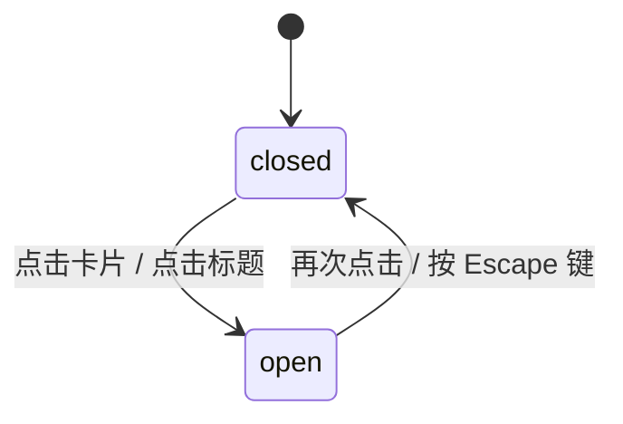

# Glass Card · 玻璃拟态卡片

集成 3D 空间弹簧倾斜、动态径向反光菲涅尔透镜、内容高度平滑展开与微模糊渐显的高质感毛玻璃名片。

## 原型清单

| 原型分组 | 原型元素 | 动效 / 状态变化 | 去向 |
| --- | --- | --- | --- |
| 3D 倾斜容器 | 卡片主体（`.glass-card`） | 跟随鼠标位置在 900px 透视下进行 ±6° X/Y 轴弹簧物理倾斜，离开时平滑复原 | 核心 3D 变换外壳 |
| 毛玻璃面板 | 悬浮玻璃面板（`.glass-card-panel`） | backdrop-filter 模糊（22px）与饱和度提升（1.7），随光标位置驱动 CSS 变量 `--gx`、`--gy` 移动高光焦点与高光透明度 `--glare` | 玻璃材质与高光系统 |
| 折叠详情 | 展开内容（`.glass-card-detail`） | 点击卡片或标题，高度弹簧（0.42s, bounce 0.16）自适应伸展，文字带 4px 模糊自下方 10px 升起 | 详情展开与微模糊入场 |
| 交互按钮 | 关注与预约按钮 | 按钮状态更新，关注对勾动画与文案切换 | 卡片内交互状态 |
| 演示外壳 | 舞台居中容器、外观切换按钮、评分组件 | 演示环境布局与辅助元素 | 演示外壳，已删除 |

## 适用

- 讲师、顾问、作者或核心团队成员的个人名片展示卡片，需要高端视觉表现与深度交互感。
- 用户希望在点击卡片后原地展开查看个人简介、近期场次统计及操作按钮，而无需弹出重型遮罩弹窗。
- 追求细腻的 3D 光影反射质感（玻璃边缘内高光、随鼠标移动的镜面高光）。

## 不适用

- 纯平面常规数据指标与统计卡片 → [metric-card](../cards/metric-card.md)
- 堆叠多张层叠抽拉卡片 → [card-stack](../cards/card-stack.md)
- 双面带有方向性翻转的全息闪粉会员卡 → [holo-card](../surfaces/holo-card.md)
- 纯文本或富媒体内容展示卡片 → [card](../cards/card.md)

## 状态机

| 状态 | 进入条件 | 视觉表现 | 退出到 |
| --- | --- | --- | --- |
| closed | 初始默认态；或点击收起 | 折叠高度，展示头像、姓名、职位；光标进入时响应 ±6° 倾斜与反光 | open |
| open | 点击卡片或标题展开 | 倾斜归零并锁定，玻璃面板高度弹簧伸展，简介、统计数据与操作按钮淡入升起 | closed |



## 最小 DOM

```html
<div class="glass-card" data-open="false">
  <!-- 背景大图 -->
  
  <div class="glass-card-scrim" aria-hidden="true"></div>

  <!-- 毛玻璃面板 -->
  <div class="glass-card-panel" style="height: 78px;">
    <!-- 玻璃边缘动态高光 -->
    <div class="glass-card-edge" aria-hidden="true"></div>

    <!-- 标题行 (触发器) -->
    <button type="button" class="glass-card-header" aria-expanded="false" aria-controls="glass-card-detail">
      <div class="glass-card-titles">
        <div class="glass-card-title">Elena Vance</div>
        <div class="glass-card-subtitle">设计系统负责人 · Meridian</div>
      </div>
      <div class="glass-card-aside">★ 4.9</div>
    </button>

    <!-- 展开详情面板 -->
    <div class="glass-card-detail" id="glass-card-detail" inert>
      <p class="glass-card-bio">主导设计系统架构，专注于微动效物理手感、字体排印与小团队极速交付。</p>
      <dl class="glass-card-stats">
        <div>
          <dt>辅导场次</dt>
          <dd>128</dd>
        </div>
        <div>
          <dt>关注者</dt>
          <dd data-followers>12.4k</dd>
        </div>
        <div>
          <dt>平均回复</dt>
          <dd>2 小时</dd>
        </div>
      </dl>
      <div class="glass-card-actions">
        <button type="button" class="glass-card-btn glass-card-btn-primary" data-action="follow">关注</button>
        <button type="button" class="glass-card-btn glass-card-btn-secondary" data-action="book">预约交流</button>
      </div>
    </div>
  </div>
</div>
```

- `.glass-card`：外层 3D 变换视口（perspective 900px），倾斜与缩放直接作用于此。
- `.glass-card-image`：卡片背景全幅照片，展开时带轻微放大（scale 1.05）。
- `.glass-card-panel`：核心毛玻璃容器，高度由 JS 弹簧动态测量并过渡。
- `.glass-card-edge`：玻璃边缘菲涅尔反光层，通过径向渐变跟随光标移动。
- `.glass-card-detail`：卡片展开内容插槽，在折叠时设置 `inert` 避免键盘误聚焦。

## 参数

| 名称 | 值 | 用于 | 来源 |
| --- | --- | --- | --- |
| 3D 空间透视 | `900px` | `.glass-card` perspective | 原型 |
| 最大倾斜角度 | `±6°` | rotateX / rotateY 倾斜限制 | 原型 |
| 倾斜阻尼弹簧 | `stiffness: 260, damping: 24, mass: 0.6` | 倾斜跟随与回正动画 | 原型 |
| 镜面反光弹簧 | `stiffness: 200, damping: 30` | `--glare` 强度插值 | 原型 |
| 面板高度弹簧 | `visualDuration: 0.42s, bounce: 0.16` | `.glass-card-panel` 高度展开 | 原型 |
| 详情入场时长 | `420ms` 延迟 `60ms` | 详情文字平滑进入 | 原型 |
| 详情退场时长 | `120ms` | 详情文字淡出 | 原型 |
| 详情位移/模糊 | `translateY(10px) blur(4px)` | 文字升起与清晰度渐显 | 原型 |

## CSS

```css
.glass-card {
  --glass-highlight: rgba(255, 255, 255, 0.5);
  --glass-edge: rgba(255, 255, 255, 0.42);
  --glass-surface: rgba(255, 255, 255, 0.65);
  --glass-text: #111111;
  --glass-muted: #666666;
  --glass-shadow: 0 20px 48px rgba(0, 0, 0, 0.15), 0 3px 10px rgba(0, 0, 0, 0.05);

  position: relative;
  isolation: isolate;
  overflow: hidden;
  width: 320px;
  aspect-ratio: 4 / 5;
  border-radius: 24px;
  background: #f4f4f5;
  box-shadow: var(--glass-shadow);
  cursor: pointer;
  user-select: none;
  font-family: system-ui, -apple-system, sans-serif;
  font-size: 14px;
  color: var(--glass-text);
  will-change: transform;
}

.glass-card-image {
  position: absolute;
  inset: 0;
  width: 100%;
  height: 100%;
  object-fit: cover;
  pointer-events: none;
  transition: transform 400ms cubic-bezier(0.22, 1, 0.36, 1);
}
.glass-card[data-open="true"] .glass-card-image {
  transform: scale(1.05);
}

.glass-card-scrim {
  position: absolute;
  inset: 0;
  background: linear-gradient(0deg, rgba(0, 0, 0, 0.3) 0%, transparent 50%);
  pointer-events: none;
}

/* 毛玻璃底板 */
.glass-card-panel {
  position: absolute;
  right: 12px;
  bottom: 12px;
  left: 12px;
  z-index: 1;
  overflow: hidden;
  max-height: calc(100% - 24px);
  border: 1px solid var(--glass-edge);
  border-radius: 18px;
  background: var(--glass-surface);
  -webkit-backdrop-filter: blur(22px) saturate(1.7);
  backdrop-filter: blur(22px) saturate(1.7);
  box-shadow: inset 0 1px 0 var(--glass-highlight), 0 12px 32px rgba(0, 0, 0, 0.12);
  cursor: default;
  box-sizing: border-box;
  will-change: height;
}

/* 边缘菲涅尔高光与镜面反光 */
.glass-card-edge {
  position: absolute;
  inset: 0;
  border-radius: inherit;
  opacity: var(--glare, 0);
  pointer-events: none;
  background: radial-gradient(160px circle at calc(var(--gx, -400) * 1px) calc(var(--gy, -400) * 1px), rgba(255, 255, 255, 0.95), transparent 70%);
  -webkit-mask: linear-gradient(#000 0 0) content-box, linear-gradient(#000 0 0);
  -webkit-mask-composite: xor;
  mask-composite: exclude;
  padding: 1px;
}

.glass-card-panel::before {
  content: "";
  position: absolute;
  inset: 0;
  border-radius: inherit;
  opacity: var(--glare, 0);
  pointer-events: none;
  background: radial-gradient(240px circle at calc(var(--gx, -400) * 1px) calc(var(--gy, -400) * 1px), rgba(255, 255, 255, 0.16), transparent 70%);
}

/* 标题栏 */
.glass-card-header {
  position: relative;
  z-index: 1;
  display: flex;
  align-items: center;
  gap: 12px;
  width: 100%;
  padding: 14px 16px;
  border: 0;
  background: transparent;
  color: inherit;
  font: inherit;
  text-align: left;
  cursor: pointer;
  outline: none;
}
.glass-card-header:focus-visible {
  outline: 2px solid currentColor;
}

.glass-card-titles {
  flex: 1;
  min-width: 0;
}
.glass-card-title {
  font-weight: 600;
  font-size: 15px;
  overflow: hidden;
  text-overflow: ellipsis;
  white-space: nowrap;
}
.glass-card-subtitle {
  font-size: 12.5px;
  color: var(--glass-muted);
  overflow: hidden;
  text-overflow: ellipsis;
  white-space: nowrap;
}
.glass-card-aside {
  font-weight: 600;
  font-size: 13px;
}

/* 详情展开内容 */
.glass-card-detail {
  position: relative;
  z-index: 1;
  padding: 0 16px 16px;
  opacity: 0;
  pointer-events: none;
  transform: translateY(10px);
  filter: blur(4px);
  transition: opacity 300ms ease, transform 300ms cubic-bezier(0.16, 1, 0.3, 1), filter 300ms ease;
}
.glass-card-detail:not([inert]) {
  opacity: 1;
  pointer-events: auto;
  transform: translateY(0);
  filter: blur(0);
}

.glass-card-bio {
  margin: 0 0 12px;
  font-size: 13px;
  color: var(--glass-muted);
  line-height: 1.45;
}

.glass-card-stats {
  display: grid;
  grid-template-columns: repeat(3, 1fr);
  gap: 8px;
  margin: 0 0 14px;
}
.glass-card-stats dt {
  font-size: 11px;
  color: var(--glass-muted);
}
.glass-card-stats dd {
  margin: 0;
  font-weight: 600;
  font-size: 15px;
}

.glass-card-actions {
  display: grid;
  grid-template-columns: 1fr 1fr;
  gap: 8px;
}
.glass-card-btn {
  height: 36px;
  padding: 0 12px;
  border: 0;
  border-radius: 10px;
  font: inherit;
  font-size: 13px;
  font-weight: 500;
  cursor: pointer;
  transition: transform 120ms ease, background-color 160ms ease;
}
.glass-card-btn:active {
  transform: scale(0.97);
}
.glass-card-btn-primary {
  background: #111111;
  color: #ffffff;
}
.glass-card-btn-secondary {
  background: rgba(0, 0, 0, 0.06);
  color: #111111;
}

@media (prefers-reduced-motion: reduce) {
  .glass-card,
  .glass-card-panel,
  .glass-card-detail,
  .glass-card-image {
    transition: none !important;
  }
}
```

## JS

```js
export function createGlassCard(root, options = {}) {
  const panel = root.querySelector('.glass-card-panel');
  const header = root.querySelector('.glass-card-header');
  const detail = root.querySelector('.glass-card-detail');
  const followBtn = root.querySelector('[data-action="follow"]');
  const bookBtn = root.querySelector('[data-action="book"]');
  const followersEl = root.querySelector('[data-followers]');

  const reducedMotion = window.matchMedia('(prefers-reduced-motion: reduce)').matches;
  let isOpen = false;
  let isFollowing = false;
  let isRequested = false;

  let rx = 0, ry = 0;
  let targetRx = 0, targetRy = 0;
  let glare = 0, targetGlare = 0;
  let tiltAnimId = null;
  let heightAnimId = null;

  // 物理倾斜弹簧
  function updateTilt() {
    cancelAnimationFrame(tiltAnimId);
    if (reducedMotion || isOpen) {
      root.style.transform = 'perspective(900px) rotateX(0deg) rotateY(0deg)';
      panel.style.setProperty('--glare', '0');
      return;
    }

    const stiffness = 260, damping = 24;
    let rxVel = 0, ryVel = 0, glareVel = 0;
    let last = performance.now();

    function step(now) {
      const dt = Math.min((now - last) / 1000, 0.032);
      last = now;

      const fRx = -stiffness * (rx - targetRx) - damping * rxVel;
      rxVel += fRx * dt; rx += rxVel * dt;

      const fRy = -stiffness * (ry - targetRy) - damping * ryVel;
      ryVel += fRy * dt; ry += ryVel * dt;

      const fG = -stiffness * (glare - targetGlare) - damping * glareVel;
      glareVel += fG * dt; glare += glareVel * dt;

      root.style.transform = `perspective(900px) rotateX(${rx.toFixed(2)}deg) rotateY(${ry.toFixed(2)}deg)`;
      panel.style.setProperty('--glare', glare.toFixed(2));

      const done = Math.abs(rx - targetRx) < 0.05 && Math.abs(ry - targetRy) < 0.05 && Math.abs(glare - targetGlare) < 0.02;
      if (!done) {
        tiltAnimId = requestAnimationFrame(step);
      } else {
        root.style.transform = `perspective(900px) rotateX(${targetRx}deg) rotateY(${targetRy}deg)`;
        panel.style.setProperty('--glare', targetGlare.toFixed(2));
      }
    }
    tiltAnimId = requestAnimationFrame(step);
  }

  // 高度弹簧展开
  function animateHeight(targetH) {
    cancelAnimationFrame(heightAnimId);
    const startH = panel.offsetHeight;

    if (reducedMotion) {
      panel.style.height = `${targetH}px`;
      return;
    }

    let hPos = startH, hVel = 0;
    const stiffness = 220, damping = 22;
    let last = performance.now();

    function step(now) {
      const dt = Math.min((now - last) / 1000, 0.032);
      last = now;

      const fH = -stiffness * (hPos - targetH) - damping * hVel;
      hVel += fH * dt; hPos += hVel * dt;

      panel.style.height = `${Math.round(hPos)}px`;

      if (Math.abs(hPos - targetH) > 0.5 || Math.abs(hVel) > 2) {
        heightAnimId = requestAnimationFrame(step);
      } else {
        panel.style.height = `${targetH}px`;
      }
    }
    heightAnimId = requestAnimationFrame(step);
  }

  function setOpen(open) {
    if (isOpen === open) return;
    isOpen = open;
    root.dataset.open = String(open);
    header.setAttribute('aria-expanded', String(open));

    if (open) {
      // 展开时重置倾斜
      targetRx = 0;
      targetRy = 0;
      targetGlare = 0;
      updateTilt();

      detail.removeAttribute('inert');
      const fullH = header.offsetHeight + detail.offsetHeight + 10;
      animateHeight(fullH);
    } else {
      detail.setAttribute('inert', '');
      const collapsedH = header.offsetHeight;
      animateHeight(collapsedH);
    }

    if (typeof options.onToggle === 'function') {
      options.onToggle(open);
    }
  }

  // 鼠标交互
  function onPointerMove(e) {
    if (e.pointerType === 'touch' || isOpen) return;
    const rect = root.getBoundingClientRect();
    const pRect = panel.getBoundingClientRect();

    const x = Math.max(0, Math.min(1, (e.clientX - rect.left) / rect.width));
    const y = Math.max(0, Math.min(1, (e.clientY - rect.top) / rect.height));

    panel.style.setProperty('--gx', `${e.clientX - pRect.left}`);
    panel.style.setProperty('--gy', `${e.clientY - pRect.top}`);

    targetRy = (x - 0.5) * 12; // ±6deg
    targetRx = (0.5 - y) * 12; // ±6deg
    targetGlare = 1;

    updateTilt();
  }

  function onPointerLeave() {
    targetRx = 0;
    targetRy = 0;
    targetGlare = 0;
    updateTilt();
  }

  function onFollowClick(e) {
    e.stopPropagation();
    isFollowing = !isFollowing;
    followBtn.textContent = isFollowing ? '已关注' : '关注';
    if (followersEl) followersEl.textContent = isFollowing ? '12.5k' : '12.4k';
  }

  function onBookClick(e) {
    e.stopPropagation();
    isRequested = !isRequested;
    bookBtn.textContent = isRequested ? '已申请' : '预约交流';
  }

  function onKeyDown(e) {
    if (e.key === 'Escape' && isOpen) {
      e.preventDefault();
      setOpen(false);
      header.focus();
    }
  }

  root.addEventListener('pointermove', onPointerMove);
  root.addEventListener('pointerleave', onPointerLeave);
  header.addEventListener('click', () => setOpen(!isOpen));
  followBtn?.addEventListener('click', onFollowClick);
  bookBtn?.addEventListener('click', onBookClick);
  root.addEventListener('keydown', onKeyDown);

  // 初始化折叠高度
  const initialH = header.offsetHeight || 78;
  panel.style.height = `${initialH}px`;

  return {
    setOpen,
    getState: () => ({ isOpen, isFollowing, isRequested }),
    destroy: () => {
      cancelAnimationFrame(tiltAnimId);
      cancelAnimationFrame(heightAnimId);
      root.removeEventListener('pointermove', onPointerMove);
      root.removeEventListener('pointerleave', onPointerLeave);
      root.removeEventListener('keydown', onKeyDown);
    }
  };
}
```

## 接入目标项目

- 状态来源：
  - 调用 `createGlassCard(rootEl, { onToggle: (open) => { ... } })` 挂载实例。
  - 用户关注与预约状态可通过按钮点击事件直接驱动目标业务层。
- 尺寸策略：
  - 卡片采用推荐固定比例 `aspect-ratio: 4 / 5`（如 `width: 320px; height: 400px`），在网格卡片流中整齐排列。
  - 玻璃面板在折叠时固定靠底贴紧，展开时高度向内容上方自然延展。
- 驱动方式：
  - 鼠标移动与悬停自动触发 3D 倾斜与反光跟随，点击触发高度与微模糊展开。
  - 组件注销时调用 `destroy()` 停止全部动画帧。

## 重入与清理

- 连续快速点击：面板高度测量与弹簧插值继承当前物理位置，中断旧帧平滑反向，绝无跳变。
- 展开与倾斜互斥：展开时强制令 3D 倾斜归零，避免在用户阅读长文案与操作按钮时发生空间晃动。
- 卸载清理：`destroy()` 取消未完成的 requestAnimationFrame，解绑光标与键盘监听器。

## 减少动态效果

- 满足 `prefers-reduced-motion: reduce` 时：
  - 停用 3D 空间倾斜与透视变换，卡片保持绝对水平静止。
  - 停用面板高度插值与详情文本模糊过渡，展开时高度即时切换。

## 焦点与键盘

- 键盘可达性：
  - 标题栏作为主操作按钮（`header`），支持 `Enter` 或 `Space` 键展开/收起。
  - 处于展开状态时按 `Escape` 键即时折叠卡片，并将焦点恢复至标题栏。
  - 折叠状态下详情面板设置 `inert`，键盘 Tab 不会游走到不可见的关注与预约按钮中。

## 兼容回退

| 特性 | 不支持时 |
| --- | --- |
| `backdrop-filter: blur(...)` | 降级为更高不透明度的纯色背景（如 `background: rgba(255, 255, 255, 0.94)`） |
| `CSS mask-composite: exclude` | 降级为常规外边框 `border: 1px solid rgba(255, 255, 255, 0.4)` |

## 验收清单

- [ ] 鼠标在卡片上移动时，卡片呈现 ±6° 的平滑 3D 倾斜跟随，玻璃边缘高光实时反光。
- [ ] 鼠标离开卡片，卡片柔和回正至 0° 平面，高光渐隐。
- [ ] 点击卡片，倾斜锁定回正，面板高度平滑展开，文字微模糊淡入。
- [ ] 点击关注按钮，文案即时切换为“已关注”，粉丝数更新。
- [ ] 键盘聚焦按回车可展开收起，按 `Escape` 键即时复原。
- [ ] 开启系统减少动态效果偏好时，无倾斜与高度补间，瞬时完成展开。
