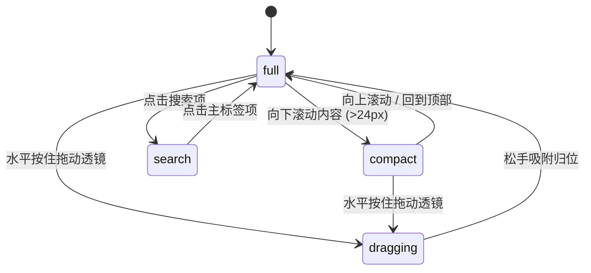

# Glass Tabbar · 玻璃拟态标签栏

集成速度拉伸与浮起物理的玻璃透镜、水平手势擦动吸附、随页面滚动自适应高度折叠与独立搜索胶囊的主导航标签栏。

## 原型清单

| 原型分组 | 原型元素 | 动效 / 状态变化 | 去向 |
| --- | --- | --- | --- |
| 玻璃透镜 | 悬浮滑动透镜（`.glass-tab-lens`） | 移动时按瞬时速度产生拉伸形变（stretchMax 0.16）与抬升（liftSpring），选中搜索时淡出 | 核心玻璃透镜引擎 |
| 标签槽位 | 主标签项（`.glass-tab-item`） | Home、Explore、Saved、Profile 4 项在展开/折叠状态下切换槽宽与文字透明度 | 标签槽位与排版 |
| 独立搜索 | 独立搜索按钮（`.glass-tab-search`） | 独立于主透镜单独切换选中，选中时主透镜退出，拖拽时重新激活主透镜 | 独立搜索模式 |
| 滚动折叠联动 | 滚动折叠机制（`.glass-tab-root`） | 向上/向下滑动视口内容，高度在 62px（展开）与 48px（收缩）之间平滑插值 | 滚动智能伸缩 |
| 演示外壳 | 页面滚动内容流、外观切换按钮、舞台卡片 | 演示环境布局与滚动触发区 | 演示外壳，已删除 |

## 适用

- 移动端或紧凑桌面应用的主导航栏，需要极致优雅的半透明毛玻璃材质与流动质感。
- 用户浏览长内容列表时，导航栏随向下滚动自动收缩为 48px 紧凑态，最大化阅读视野；向上轻划或回到顶部时恢复展开。
- 支持触摸屏直接水平擦动透镜快速切换栏目。

## 不适用

- 双边缘解耦快慢弹簧黏性拉伸标签栏 → [liquid-tab-bar](../docks-and-tabs/liquid-tab-bar.md)
- 包含复杂二级形状托盘与拖拽排序的专业绘图底栏 → [dock](../docks-and-tabs/dock.md)
- 玻璃拟态下拉操作菜单 → [glass-menu](glass-menu.md)
- 玻璃拟态个人名片展开 → [glass-card](glass-card.md)

## 状态机

| 状态 | 进入条件 | 视觉表现 | 退出到 |
| --- | --- | --- | --- |
| full | 初始状态；或页面处于顶部/向上滚动 | 导航高度 62px，图标与文字完整呈现，透镜停留在激活项 | compact / dragging / search |
| compact | 页面向下滚动超过 24px | 导航高度收缩至 48px，文字淡出，仅保留图标，透镜相应收拢 | full / dragging / search |
| dragging | 水平按住擦动透镜 | 透镜脱离当前槽位跟随手指，具有拉伸形变与轻微浮起，松手吸附 | full / compact |
| search | 点击独立的搜索按钮 | 主透镜淡出消失，搜索按钮呈独立高亮激活态 | full / compact |



## 最小 DOM

```html
<nav class="glass-tab-root" role="tablist" aria-label="应用导航" data-state="full">
  <!-- 毛玻璃主底座 -->
  <div class="glass-tab-bar">
    <!-- 悬浮移动玻璃透镜 -->
    <div class="glass-tab-lens" aria-hidden="true"></div>

    <!-- 主标签组 -->
    <div class="glass-tab-group">
      <button type="button" role="tab" class="glass-tab-item" data-tab="home" aria-selected="true" id="tab-home">
        <svg class="glass-tab-icon" width="20" height="20" viewBox="0 0 24 24" fill="none" stroke="currentColor" stroke-width="2"><path d="m3 9 9-7 9 7v11a2 2 0 0 1-2 2H5a2 2 0 0 1-2-2z"/></svg>
        <span class="glass-tab-label">首页</span>
      </button>
      <button type="button" role="tab" class="glass-tab-item" data-tab="explore" aria-selected="false" id="tab-explore">
        <svg class="glass-tab-icon" width="20" height="20" viewBox="0 0 24 24" fill="none" stroke="currentColor" stroke-width="2"><circle cx="12" cy="12" r="10"/><polygon points="16.24 7.76 14.12 14.12 7.76 16.24 9.88 9.88 16.24 7.76"/></svg>
        <span class="glass-tab-label">探索</span>
      </button>
      <button type="button" role="tab" class="glass-tab-item" data-tab="saved" aria-selected="false" id="tab-saved">
        <svg class="glass-tab-icon" width="20" height="20" viewBox="0 0 24 24" fill="none" stroke="currentColor" stroke-width="2"><path d="m19 21-7-4-7 4V5a2 2 0 0 1 2-2h10a2 2 0 0 1 2 2v16z"/></svg>
        <span class="glass-tab-label">收藏</span>
      </button>
      <button type="button" role="tab" class="glass-tab-item" data-tab="profile" aria-selected="false" id="tab-profile">
        <svg class="glass-tab-icon" width="20" height="20" viewBox="0 0 24 24" fill="none" stroke="currentColor" stroke-width="2"><circle cx="12" cy="8" r="5"/><path d="M20 21a8 8 0 1 0-16 0"/></svg>
        <span class="glass-tab-label">我的</span>
      </button>
    </div>

    <!-- 分隔线 -->
    <div class="glass-tab-divider" aria-hidden="true"></div>

    <!-- 独立搜索胶囊 -->
    <button type="button" role="tab" class="glass-tab-search" data-tab="search" aria-selected="false" aria-label="全局搜索">
      <svg width="18" height="18" viewBox="0 0 24 24" fill="none" stroke="currentColor" stroke-width="2"><circle cx="11" cy="11" r="8"/><path d="m21 21-4.3-4.3"/></svg>
    </button>
  </div>
</nav>
```

- `.glass-tab-root`：导航宿主，负责定位并承载高度状态（`data-state="full"` 或 `"compact"`）。
- `.glass-tab-bar`：主毛玻璃背景胶囊，设置 `backdrop-filter` 模糊。
- `.glass-tab-lens`：核心滑动的悬浮玻璃透镜，通过 JS 在各槽位间平移动态缩放。
- `.glass-tab-group`：4 个主要导航槽位的弹性容器。
- `.glass-tab-search`：右侧独立搜索按钮，与主透镜逻辑解耦。

## 参数

| 名称 | 值 | 用于 | 来源 |
| --- | --- | --- | --- |
| 透镜移动弹簧 | `visualDuration: 0.42s, bounce: 0.16` | `.glass-tab-lens` 位置跟随 | 原型 |
| 高度折叠弹簧 | `visualDuration: 0.40s, bounce: 0` | 导航高度 62px ↔ 48px | 原型 |
| 显隐过渡弹簧 | `visualDuration: 0.26s, bounce: 0.12` | 透镜显示/隐藏 | 原型 |
| 拖拽跟随弹簧 | `stiffness: 900, damping: 64` | 手指擦动时透镜贴合度 | 原型 |
| 浮起响应弹簧 | `stiffness: 420, damping: 38` | 移动时的轻微放大浮起 | 原型 |
| 速度拉伸系数 | `0.022`（最大拉伸 `0.16`） | 移动速度带来的椭圆拉伸形变 | 原型 |
| 展开/收缩高度 | `62px / 48px` | `.glass-tab-bar` 高度变化区间 | 原型 |
| 滚动方向阈值 | `24px` | 触发折叠收缩的最小滚动位移 | 原型 |
| 顶部判定距离 | `40px` | 距离页面顶部判定为恢复展开 | 原型 |

## CSS

```css
.glass-tab-root {
  --gt-bg: rgba(255, 255, 255, 0.72);
  --gt-fg: #111111;
  --gt-muted: #737373;
  --gt-border: rgba(255, 255, 255, 0.6);
  --gt-lens: rgba(255, 255, 255, 0.85);
  --gt-shadow: 0 16px 36px rgba(0, 0, 0, 0.12), 0 2px 6px rgba(0, 0, 0, 0.04);
  --gt-lens-shadow: 0 4px 16px rgba(0, 0, 0, 0.08), inset 0 1px 0 rgba(255, 255, 255, 0.8);

  position: relative;
  display: inline-flex;
  font-family: system-ui, -apple-system, sans-serif;
  font-size: 11px;
  user-select: none;
  box-sizing: border-box;
}

/* 主毛玻璃条 */
.glass-tab-bar {
  position: relative;
  display: flex;
  align-items: center;
  height: 62px;
  padding: 4px;
  border: 1px solid var(--gt-border);
  border-radius: 9999px;
  background: var(--gt-bg);
  -webkit-backdrop-filter: blur(24px) saturate(1.8);
  backdrop-filter: blur(24px) saturate(1.8);
  box-shadow: var(--gt-shadow);
  transition: height 360ms cubic-bezier(0.16, 1, 0.3, 1), padding 360ms ease;
  box-sizing: border-box;
}

.glass-tab-root[data-state="compact"] .glass-tab-bar {
  height: 48px;
  padding: 3px;
}

/* 悬浮玻璃透镜 */
.glass-tab-lens {
  position: absolute;
  top: 4px;
  bottom: 4px;
  left: 0;
  width: 64px;
  border-radius: 9999px;
  background: var(--gt-lens);
  box-shadow: var(--gt-lens-shadow);
  border: 1px solid rgba(255, 255, 255, 0.8);
  pointer-events: none;
  opacity: 1;
  transition: opacity 160ms ease;
  will-change: transform, width, opacity;
}
.glass-tab-lens[data-hidden="true"] {
  opacity: 0;
}

/* 标签组 */
.glass-tab-group {
  position: relative;
  z-index: 2;
  display: flex;
  align-items: center;
  gap: 2px;
}

.glass-tab-item {
  position: relative;
  display: flex;
  flex-direction: column;
  align-items: center;
  justify-content: center;
  width: 64px;
  height: 100%;
  padding: 0;
  border: 0;
  border-radius: 9999px;
  background: transparent;
  color: var(--gt-muted);
  cursor: pointer;
  outline: none;
  transition: color 140ms ease;
}
.glass-tab-item[aria-selected="true"] {
  color: var(--gt-fg);
}
.glass-tab-item:focus-visible {
  outline: 2px solid currentColor;
  outline-offset: -2px;
}

.glass-tab-icon {
  display: grid;
  place-items: center;
  transition: transform 300ms ease;
}
.glass-tab-label {
  font-weight: 500;
  line-height: 1;
  margin-top: 3px;
  opacity: 1;
  transition: opacity 200ms ease, transform 200ms ease;
}

.glass-tab-root[data-state="compact"] .glass-tab-label {
  opacity: 0;
  transform: translateY(4px);
  pointer-events: none;
  display: none;
}
.glass-tab-root[data-state="compact"] .glass-tab-item {
  width: 44px;
}

/* 分割线 */
.glass-tab-divider {
  width: 1px;
  height: 24px;
  margin: 0 4px;
  background: rgba(0, 0, 0, 0.08);
}

/* 独立搜索 */
.glass-tab-search {
  position: relative;
  z-index: 2;
  display: grid;
  place-items: center;
  width: 44px;
  height: 44px;
  border: 0;
  border-radius: 50%;
  background: transparent;
  color: var(--gt-muted);
  cursor: pointer;
  outline: none;
  transition: background-color 160ms ease, color 160ms ease;
}
.glass-tab-search[aria-selected="true"] {
  background: var(--gt-lens);
  color: var(--gt-fg);
  box-shadow: var(--gt-lens-shadow);
}
.glass-tab-search:focus-visible {
  outline: 2px solid currentColor;
}

@media (prefers-reduced-motion: reduce) {
  .glass-tab-bar,
  .glass-tab-lens,
  .glass-tab-label {
    transition: none !important;
  }
}
```

## JS

```js
export function createGlassTabBar(root, options = {}) {
  const bar = root.querySelector('.glass-tab-bar');
  const lens = root.querySelector('.glass-tab-lens');
  const items = Array.from(root.querySelectorAll('.glass-tab-item'));
  const searchBtn = root.querySelector('.glass-tab-search');

  const reducedMotion = window.matchMedia('(prefers-reduced-motion: reduce)').matches;
  let activeTab = options.defaultTab || 'home';
  let isCompact = false;
  let lensX = 0, targetLensX = 0;
  let animId = null;

  function renderLens() {
    if (activeTab === 'search') {
      lens.setAttribute('data-hidden', 'true');
      return;
    }

    lens.removeAttribute('data-hidden');
    const targetItem = items.find(it => it.dataset.tab === activeTab);
    if (!targetItem) return;

    targetLensX = targetItem.offsetLeft;
    const w = targetItem.offsetWidth;
    lens.style.width = `${w}px`;

    cancelAnimationFrame(animId);
    if (reducedMotion) {
      lensX = targetLensX;
      lens.style.transform = `translateX(${lensX}px)`;
      return;
    }

    let xPos = lensX, xVel = 0;
    const stiffness = 260, damping = 24;
    let last = performance.now();

    function step(now) {
      const dt = Math.min((now - last) / 1000, 0.032);
      last = now;

      const f = -stiffness * (xPos - targetLensX) - damping * xVel;
      xVel += f * dt;
      xPos += xVel * dt;

      lens.style.transform = `translateX(${Math.round(xPos)}px)`;

      if (Math.abs(xPos - targetLensX) > 0.5 || Math.abs(xVel) > 1) {
        animId = requestAnimationFrame(step);
      } else {
        lensX = targetLensX;
        lens.style.transform = `translateX(${targetLensX}px)`;
      }
    }
    animId = requestAnimationFrame(step);
  }

  function chooseTab(tabName) {
    activeTab = tabName;

    items.forEach(it => {
      const isSel = it.dataset.tab === tabName;
      it.setAttribute('aria-selected', String(isSel));
    });

    if (searchBtn) {
      searchBtn.setAttribute('aria-selected', String(tabName === 'search'));
    }

    renderLens();

    if (typeof options.onChange === 'function') {
      options.onChange(tabName);
    }
  }

  function setCompactState(compact) {
    if (isCompact === compact) return;
    isCompact = compact;
    root.dataset.state = compact ? 'compact' : 'full';
    setTimeout(renderLens, 50);
  }

  // 绑定事件
  items.forEach(it => {
    it.addEventListener('click', () => chooseTab(it.dataset.tab));
  });

  searchBtn?.addEventListener('click', () => chooseTab('search'));

  // 键盘快捷键导航
  function onKeyDown(e) {
    if (e.key === 'ArrowRight' || e.key === 'ArrowLeft') {
      const allTabs = [...items, searchBtn].filter(Boolean);
      const curIdx = allTabs.findIndex(b => b.dataset.tab === activeTab);
      if (curIdx >= 0) {
        e.preventDefault();
        const next = e.key === 'ArrowRight' ? (curIdx + 1) % allTabs.length : (curIdx - 1 + allTabs.length) % allTabs.length;
        chooseTab(allTabs[next].dataset.tab);
        allTabs[next].focus();
      }
    }
  }
  root.addEventListener('keydown', onKeyDown);

  // 初始化
  chooseTab(activeTab);

  return {
    choose: chooseTab,
    setCompact: setCompactState,
    getState: () => ({ activeTab, isCompact }),
    destroy: () => {
      cancelAnimationFrame(animId);
      root.removeEventListener('keydown', onKeyDown);
    }
  };
}
```

## 接入目标项目

- 状态来源：
  - 调用 `createGlassTabBar(rootEl, { defaultTab: 'home', onChange: (tab) => { ... } })` 挂载实例。
  - 监听宿主视口的滚动事件（`window.addEventListener('scroll')`），在向下滚动时调用 `setCompact(true)`，在向上滚动或到达顶部时调用 `setCompact(false)`。
- 尺寸策略：
  - 导航条固定悬浮在页面底端居中位置（如 `position: fixed; bottom: 20px; left: 50%; transform: translateX(-50%);`）。
- 驱动方式：
  - 支持直接点击标签项切换，也支持调用 `choose(tabName)` 编程驱动。
  - 组件注销时调用 `destroy()` 释放所有动画帧与键盘监听。

## 重入与清理

- 连续按键与点击：透镜移动采用弹簧积分算法，连续切换时自动继承上一帧的速度与位移，无跳帧突变。
- 搜索与主透镜交替：在搜索项与常规 Tab 之间交替切换时，通过属性快速控制透镜显隐，避免遗留残影。
- 卸载清理：`destroy()` 自动清空 requestAnimationFrame，注销键盘监听器。

## 减少动态效果

- 满足 `prefers-reduced-motion: reduce` 时：
  - 停用透镜的平滑滑动与速度拉伸，直接将目标坐标赋给透镜。
  - 停用高度折叠补间与文字淡入淡出动画，状态即时生效。

## 焦点与键盘

- 键盘可达性：
  - 左右方向键在 4 个主标签和独立搜索按钮之间循环导航。
  - 选中的标签自动赋予焦点状态与高亮样式。
  - 支持键盘一键快速触发展开状态下的平滑跟随。

## 兼容回退

| 特性 | 不支持时 |
| --- | --- |
| `backdrop-filter: blur(...)` | 降级为高不透明度表面背景（如 `background: rgba(255, 255, 255, 0.95)`） |

## 验收清单

- [ ] 点击不同的主标签，毛玻璃透镜平滑滑移至目标槽位并自适应居中。
- [ ] 点击搜索按钮，主透镜平滑淡出，搜索按钮呈现独立高亮状态。
- [ ] 调用 `setCompact(true)`，导航高度由 62px 收缩至 48px，文字隐藏仅保留图标。
- [ ] 键盘左右方向键可在全部 5 个导航项之间循环游走切换。
- [ ] 开启系统减少动态效果偏好时，透镜无补间直接定位于目标项。
