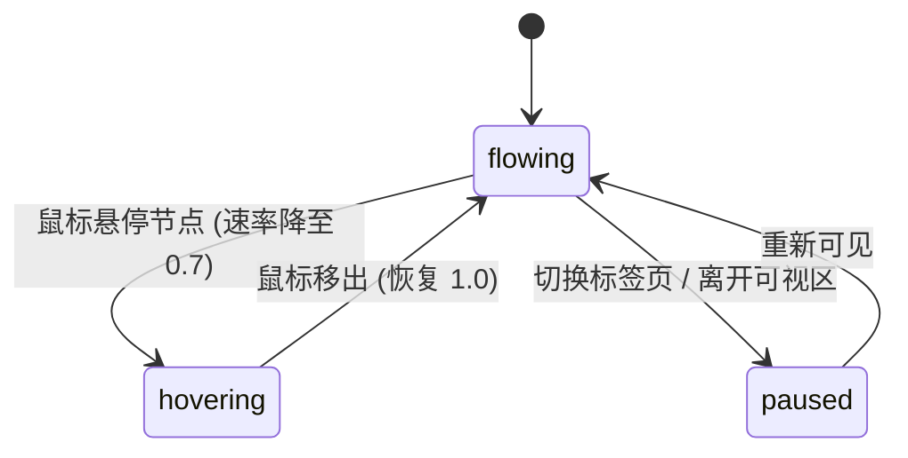

# Data Flow · 数据流管道示意图

基于离散采样路径、形态融合与实时吞吐计数的动态 ETL 数据流架构示意图。包含三大核心机制：

1. **三路汇聚与离散弧长采样（72-Segment Path Sampling）**：App、Database、Events 三路数据记录以圆形原始粒子进入处理管道；路径被细分为 72 段均匀采样点，确保拖尾与粒子以匀速弧长推进。
2. **核心节点融合与多路分流（Core Morph & Fanout）**：数据粒子到达中央 Transform 节点时发生形态混合并变形为圆角矩形清洁数据，随后分流至 Warehouse、Dashboard 与 Alerts（按 1:1:0.34 比例分流）。
3. **悬停智能减速与吞吐量递增**：鼠标悬停在任意输入/输出节点时，流速经刚度 40 的弹簧从 1.0 减速至 0.7；中央处理计数从 12,480 随数据处理周期平滑向上累加。

## 原型清单

| 原型分组 | 原型元素 | 动效 / 状态变化 | 去向 |
| --- | --- | --- | --- |
| — | 数据流 SVG 画布 `.data-flow-svg` | 曲线管道、数据粒子流动、42px 渐变拖尾 | `.data-flow-canvas` |
| — | 输入/输出/转换节点卡片 | 悬停高亮、关联管线变色、速率平滑降至 0.7 | `.flow-node` |
| — | 吞吐量统计计数器 | 处理计数由 12,480 随周期递增 | `.flow-counter` |
| — | 顶栏、外观切换 `#themeBtn`、舞台外壳 | — | 演示外壳，已删除 |

## 适用

- 基础架构平台、数据湖、ETL 流水线或云服务产品架构图。
- 复杂分布式系统的数据流动、过滤与分发过程可视化。
- 允许鼠标悬停审视各个环节，并保持低 CPU 消耗的宣传图解。

## 不适用

- 多区域容灾故障切换等具备阶段跳转的拓扑图 → [multi-region-failover](multi-region-failover.md)
- 金融支付流水与账户结算示意图 → [payment-flow](payment-flow.md)
- 高维向量嵌入与最近邻检索图解 → [vector-search](vector-search.md)
- 真实打字终端命令执行 → [typewriter-terminal](../special-type/typewriter-terminal.md)

## 状态机

| 状态 | 进入条件 | 视觉表现 | 退出到 |
| --- | --- | --- | --- |
| flowing | 初始；或鼠标移出节点 | 粒子以标准速率（1.0）沿管道流动，吞吐量持续自增 | hovering |
| hovering | 鼠标悬停在输入/核心/输出节点上 | 速率平滑降至 0.7，所关联的管线与目标节点突出高亮 | flowing |
| paused | 页面切入后台（document hidden） | 动画帧循环挂起，保持当前画面状态 | flowing |



## 最小 DOM

```html
<div class="data-flow-root" role="region" aria-label="Data flow pipeline illustration">
  <div class="flow-header">
    <span class="flow-badge">Live Pipeline</span>
    <div class="flow-metric">
      <span class="metric-label">Processed:</span>
      <span class="metric-value">12,480</span>
    </div>
  </div>

  <div class="flow-stage">
    <svg class="data-flow-svg" viewBox="0 0 600 280" width="100%" height="280" aria-hidden="true">
      <!-- 管道底轨 -->
      <path class="flow-track in-1" d="M80 60 C 180 60, 220 140, 300 140"/>
      <path class="flow-track in-2" d="M80 140 L 300 140"/>
      <path class="flow-track in-3" d="M80 220 C 180 220, 220 140, 300 140"/>

      <path class="flow-track out-1" d="M300 140 C 380 140, 420 60, 520 60"/>
      <path class="flow-track out-2" d="M300 140 L 520 140"/>
      <path class="flow-track out-3" d="M300 140 C 380 140, 420 220, 520 220"/>

      <!-- 动态数据粒子 -->
      <circle class="flow-particle p-in1" r="4"/>
      <circle class="flow-particle p-in2" r="4"/>
      <circle class="flow-particle p-in3" r="4"/>
      <rect class="flow-particle p-out1" width="8" height="8" rx="2"/>
      <rect class="flow-particle p-out2" width="8" height="8" rx="2"/>
      <rect class="flow-particle p-out3" width="8" height="8" rx="2"/>

      <!-- 核心 Transform 节点 -->
      <circle class="flow-core" cx="300" cy="140" r="24"/>
    </svg>

    <!-- 节点标签卡片 -->
    <div class="flow-nodes">
      <div class="flow-node node-in" style="top: 40px; left: 20px;">App</div>
      <div class="flow-node node-in" style="top: 120px; left: 20px;">Database</div>
      <div class="flow-node node-in" style="top: 200px; left: 20px;">Events</div>

      <div class="flow-node node-core" style="top: 120px; left: 260px;">Transform</div>

      <div class="flow-node node-out" style="top: 40px; right: 20px;">Warehouse</div>
      <div class="flow-node node-out" style="top: 120px; right: 20px;">Dashboard</div>
      <div class="flow-node node-out" style="top: 200px; right: 20px;">Alerts</div>
    </div>
  </div>
</div>
```

- `.data-flow-root`：宿主容器。
- `.flow-metric`：展示动态累加处理计数的统计区。
- `.data-flow-svg`：绘制三路汇聚与三路分流曲线管道的矢量容器。
- `.flow-particle`：沿路径移动的数据流动粒子。
- `.flow-core`：中央 Transform 转换圆盘。
- `.flow-node`：供悬停互动的各系统节点。

## 参数

| 名称 | 值 | 用于 | 来源 |
| --- | --- | --- | --- |
| baseCount | `12480` | 处理记录的初始数值 | 原型 |
| periodSeconds | `6.6s` | 单次数据流完整大周期 | 原型 |
| incomingSeconds | `1.75s` | 输入汇聚流动时长 | 原型 |
| transformSeconds | `0.55s` | 核心处理停留与形状融合时长 | 原型 |
| outgoingSeconds | `1.85s` | 输出分流时长 | 原型 |
| trailPx | `42px` | 粒子尾部渐变光影长度 | 原型 |
| rate.normal / hover | `1.0 / 0.7` | 正常流速与节点悬停时的阻尼降速 | 原型 |
| rate.stiffness | `40` | 流速切换时的物理弹簧刚度 | 原型 |

## CSS

```css
.data-flow-root {
  --flow-bg: #f9f9f9;
  --flow-border: rgba(0, 0, 0, 0.08);
  --track-color: rgba(0, 0, 0, 0.1);
  --track-active: #2563eb;
  --node-bg: #ffffff;
  --text-main: #111827;
  --text-muted: #6b7280;
  position: relative;
  display: flex;
  flex-direction: column;
  width: 100%;
  max-width: 680px;
  margin-inline: auto;
  border-radius: 16px;
  background: var(--flow-bg);
  border: 1px solid var(--flow-border);
  overflow: hidden;
  font-family: system-ui, -apple-system, sans-serif;
  user-select: none;
}

@media (prefers-color-scheme: dark) {
  .data-flow-root {
    --flow-bg: #111827;
    --flow-border: rgba(255, 255, 255, 0.1);
    --track-color: rgba(255, 255, 255, 0.12);
    --track-active: #60a5fa;
    --node-bg: #1f2937;
    --text-main: #f9fafb;
    --text-muted: #9ca3af;
  }
}

.flow-header {
  display: flex;
  align-items: center;
  justify-content: space-between;
  padding: 16px 20px;
  border-bottom: 1px solid var(--flow-border);
}

.flow-badge {
  font-size: 12px;
  font-weight: 600;
  color: var(--track-active);
  text-transform: uppercase;
}

.flow-metric {
  font-size: 13px;
  color: var(--text-muted);
}

.metric-value {
  font-weight: 600;
  color: var(--text-main);
  font-family: ui-monospace, monospace;
}

.flow-stage {
  position: relative;
  width: 100%;
  height: 280px;
}

.data-flow-svg {
  position: absolute;
  inset: 0;
}

.flow-track {
  fill: none;
  stroke: var(--track-color);
  stroke-width: 2;
  stroke-dasharray: 4 4;
}

.flow-core {
  fill: var(--node-bg);
  stroke: var(--track-active);
  stroke-width: 3;
}

.flow-particle {
  fill: var(--track-active);
}

.flow-node {
  position: absolute;
  padding: 6px 12px;
  border-radius: 8px;
  background: var(--node-bg);
  border: 1px solid var(--flow-border);
  box-shadow: 0 2px 8px rgba(0, 0, 0, 0.05);
  font-size: 12px;
  font-weight: 500;
  color: var(--text-main);
  cursor: pointer;
  transition: background-color 0.2s ease, color 0.2s ease, border-color 0.2s ease, transform 0.2s ease, opacity 0.2s ease, box-shadow 0.2s ease;
}

.flow-node:hover {
  border-color: var(--track-active);
  box-shadow: 0 4px 14px rgba(37, 99, 235, 0.15);
}

@media (prefers-reduced-motion: reduce) {
  .flow-particle {
    display: none;
  }
}
```

## JS

```js
export function createDataFlow(el, options = {}) {
  const metricVal = el.querySelector('.metric-value');
  const nodes = el.querySelectorAll('.flow-node');
  const svg = el.querySelector('.data-flow-svg');

  const pIn1 = el.querySelector('.p-in1');
  const pIn2 = el.querySelector('.p-in2');
  const pIn3 = el.querySelector('.p-in3');
  const pOut1 = el.querySelector('.p-out1');
  const pOut2 = el.querySelector('.p-out2');
  const pOut3 = el.querySelector('.p-out3');

  let baseCount = 12480;
  let animId = null;
  let isHovered = false;
  let currentRate = 1.0;
  let targetRate = 1.0;
  let elapsed = 0;
  let lastTime = performance.now();
  let disposed = false;
  const isReduced = window.matchMedia('(prefers-reduced-motion: reduce)').matches;

  function loop(now) {
    if (disposed) return;
    const dt = Math.min((now - lastTime) / 1000, 0.05);
    lastTime = now;

    // 速率平滑弹簧
    currentRate += (targetRate - currentRate) * 0.1;
    elapsed += dt * currentRate;

    // 更新计数
    baseCount += dt * currentRate * 3.5;
    if (metricVal) metricVal.textContent = Math.floor(baseCount).toLocaleString();

    if (!isReduced) {
      const cycle = elapsed % 4.15; // 1.75s in + 0.55s core + 1.85s out

      // 输入阶段 (0 ~ 1.75s)
      if (cycle < 1.75) {
        const prog = cycle / 1.75;
        const x = 80 + prog * (300 - 80);
        const y1 = 60 + Math.sin(prog * Math.PI / 2) * 80;
        const y2 = 140;
        const y3 = 220 - Math.sin(prog * Math.PI / 2) * 80;

        pIn1?.setAttribute('cx', x.toFixed(1));
        pIn1?.setAttribute('cy', y1.toFixed(1));
        pIn2?.setAttribute('cx', x.toFixed(1));
        pIn2?.setAttribute('cy', y2.toFixed(1));
        pIn3?.setAttribute('cx', x.toFixed(1));
        pIn3?.setAttribute('cy', y3.toFixed(1));

        if (pOut1) pOut1.style.opacity = '0';
        if (pOut2) pOut2.style.opacity = '0';
        if (pOut3) pOut3.style.opacity = '0';
      } else if (cycle < 2.3) {
        // 核心 Transform 阶段
        if (pIn1) pIn1.setAttribute('cx', '300');
        if (pIn1) pIn1.setAttribute('cy', '140');
      } else {
        // 输出阶段 (2.3 ~ 4.15s)
        const prog = (cycle - 2.3) / 1.85;
        const x = 300 + prog * (520 - 300);
        const y1 = 140 - Math.sin(prog * Math.PI / 2) * 80;
        const y2 = 140;
        const y3 = 140 + Math.sin(prog * Math.PI / 2) * 80;

        if (pOut1) {
          pOut1.style.opacity = '1';
          pOut1.setAttribute('x', (x - 4).toFixed(1));
          pOut1.setAttribute('y', (y1 - 4).toFixed(1));
        }
        if (pOut2) {
          pOut2.style.opacity = '1';
          pOut2.setAttribute('x', (x - 4).toFixed(1));
          pOut2.setAttribute('y', (y2 - 4).toFixed(1));
        }
        if (pOut3) {
          pOut3.style.opacity = '1';
          pOut3.setAttribute('x', (x - 4).toFixed(1));
          pOut3.setAttribute('y', (y3 - 4).toFixed(1));
        }
      }
    }

    animId = requestAnimationFrame(loop);
  }

  nodes.forEach((node) => {
    node.addEventListener('mouseenter', () => { targetRate = 0.7; });
    node.addEventListener('mouseleave', () => { targetRate = 1.0; });
  });

  animId = requestAnimationFrame(loop);

  return {
    destroy() {
      disposed = true;
      if (animId) cancelAnimationFrame(animId);
      nodes.forEach((node) => node.replaceWith(node.cloneNode(true)));
    }
  };
}
```

## 接入目标项目

- 状态来源：目标业务的实时或周期性处理吞吐指标，更新流速与计数。
- 尺寸策略：SVG 使用 `viewBox="0 0 600 280"` 结合 `width="100%"`，在窄屏与宽屏自适应缩放。
- 驱动方式：`const flow = createDataFlow(rootEl);`，离开页面时调用 `flow.destroy()`。

## 重入与清理

- 频繁划过不同节点时，通过连续弹簧目标值 `targetRate` 平滑收敛，防止急刹顿挫。
- 销毁时停止 `requestAnimationFrame`。

## 减少动态效果

- 在 `prefers-reduced-motion: reduce` 设置下，隐藏动态流动粒子，静态保留全部拓扑管道与核心节点。

## 焦点与键盘

- 架构图提供整体区域语义描述，各节点提供标准文本标签。

## 兼容回退

| 特性 | 不支持时 |
| --- | --- |
| SVG 虚线 `stroke-dasharray` | 降级为常规实线显示 |
| `Math.hypot` | 传统勾股定理计算替代 |

## 验收清单

- [ ] 页面加载后，数据粒子从左侧三个数据源向中央流动，经过 Transform 变形后向右侧分流。
- [ ] 顶部处理计数以平稳速率自增。
- [ ] 鼠标悬停在任意节点上时，流速明显放缓（降至 0.7 倍速）。
- [ ] 开启系统的“减少动态效果”时，动态粒子隐藏，展示静态拓扑。
