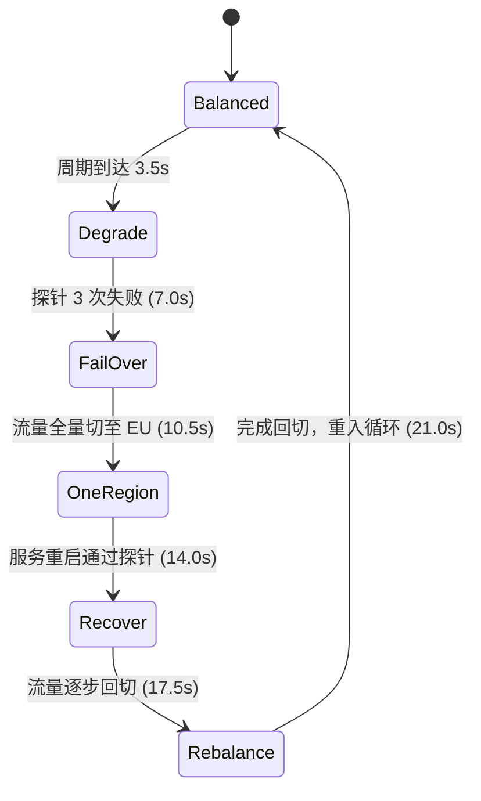

# Multi-Region Failover · 多区域容灾故障切换示意图

基于等轴测 2.5D 矢量拓扑与健康检查时序的多区域高可用架构演练示意图。包含三大核心机制：

1. **六阶段完整容灾生命周期时序**：在均衡分流（Balanced）、节点降级（Degrade）、故障转移（Fail over）、单区承载（One region）、服务恢复（Recover）与流量回切（Rebalance）6 大状态间循环推进（总周期 21 秒）；支持点击任意阶段即时跳转。
2. **流量数据包与健康探针模拟**：以 0.25s 间隔连续发射双向网络请求包；当主区域连续 3 次健康检查失败时，DNS/网关自动切断该区域流量并全量路由至备用区域。
3. **等轴测多维拓扑与智能减速**：支持 640px 响应式等轴测立体视角变换；悬停在数据中心或路由器上时，演示速率经刚度 40 弹簧从 1.0 平滑放缓至 0.7 方便审视。

## 原型清单

| 原型分组 | 原型元素 | 动效 / 状态变化 | 去向 |
| --- | --- | --- | --- |
| — | 阶段切换栏 `.failover-phases` | 6 阶段单选切换、当前进度高亮跟随 | `.phase-selector` |
| — | 等轴测拓扑画布 `svg.failover-svg` | 双区域立方体集群、路由管线、流量粒子与探针 | `.failover-svg` |
| — | 播放/暂停控制按钮 | 演示播放与平滑降速暂停 | `.failover-controls` |
| — | 实时指标看板（QPS / 区域状态） | 12,000 QPS 流量比例与健康状态文本 | `.failover-metrics` |
| — | 顶栏、外观切换 `#themeBtn`、舞台外壳 | — | 演示外壳，已删除 |

## 适用

- 云原生基础设施、数据库异地多活或容灾演练方案展示。
- 突发宕机自动剔除与故障恢复原理的教学与技术白皮书。
- 具备阶段进度选择、播放/暂停控制的高阶科技感架构图。

## 不适用

- 数据管道流式清洗转换图解 → [data-flow](data-flow.md)
- 跨境支付结算四方流转图解 → [payment-flow](payment-flow.md)
- 向量相似度检索与聚类图解 → [vector-search](vector-search.md)
- 几何路径循环加载器 → [morph-loader](../loaders/morph-loader.md)

## 状态机

| 状态 | 进入条件 | 视觉表现 | 退出到 |
| --- | --- | --- | --- |
| Balanced | 0s ~ 3.5s | 流量按 50%:50% 均匀分配至 US-East 与 EU-West 区域 | Degrade |
| Degrade | 3.5s ~ 7.0s | US-East 开始出现异常报错（红色闪烁），健康探针告警 | Fail over |
| Fail over | 7.0s ~ 10.5s | 流量发生动态转移，US-East 流量断开，EU-West 承受 100% | One region |
| One region | 10.5s ~ 14.0s | 单区域平稳承载全部业务流量，US-East 处于隔离维护态 | Recover |
| Recover | 14.0s ~ 17.5s | US-East 服务重启成功，连续 3 次探针通过，恢复绿灯 | Rebalance |
| Rebalance | 17.5s ~ 21.0s | 流量逐步回切，重新回到 50%:50% 双活状态并循环 | Balanced |



## 最小 DOM

```html
<div class="failover-root" role="region" aria-label="Multi-region failover illustration">
  <div class="failover-header">
    <div class="phase-selector" role="tablist" aria-label="Failover phases">
      <button type="button" role="tab" class="phase-btn" aria-selected="true" data-phase="0">Balanced</button>
      <button type="button" role="tab" class="phase-btn" aria-selected="false" data-phase="1">Degrade</button>
      <button type="button" role="tab" class="phase-btn" aria-selected="false" data-phase="2">Fail over</button>
      <button type="button" role="tab" class="phase-btn" aria-selected="false" data-phase="3">One region</button>
      <button type="button" role="tab" class="phase-btn" aria-selected="false" data-phase="4">Recover</button>
      <button type="button" role="tab" class="phase-btn" aria-selected="false" data-phase="5">Rebalance</button>
    </div>
    <div class="failover-controls">
      <button type="button" class="btn-toggle-play" aria-label="Pause animation">Pause</button>
    </div>
  </div>

  <div class="failover-stage">
    <svg class="failover-svg" viewBox="0 0 640 300" width="100%" height="300" aria-hidden="true">
      <!-- 路由器中心 -->
      <circle class="router-node" cx="320" cy="50" r="18"/>

      <!-- 双区域管线 -->
      <path class="route-line to-east" d="M320 50 L180 180"/>
      <path class="route-line to-west" d="M320 50 L460 180"/>

      <!-- 动态数据包 -->
      <circle class="packet-east" r="4"/>
      <circle class="packet-west" r="4"/>

      <!-- 区域节点 -->
      <g class="region-box east" transform="translate(140, 160)">
        <rect width="80" height="60" rx="8" class="box-bg"/>
        <text x="40" y="35" text-anchor="middle" class="box-label">US-East</text>
      </g>
      <g class="region-box west" transform="translate(420, 160)">
        <rect width="80" height="60" rx="8" class="box-bg"/>
        <text x="40" y="35" text-anchor="middle" class="box-label">EU-West</text>
      </g>
    </svg>
  </div>
</div>
```

- `.failover-root`：宿主容器。
- `.phase-selector`：6 阶段快速跳转导航。
- `.btn-toggle-play`：播放/暂停控制按钮。
- `.failover-svg`：绘制全局等轴测路由与多区域数据中心拓扑的矢量视口。
- `.route-line` 与数据包粒子：展示动态流量分配流向。
- `.region-box`：代表数据中心各实例集群的节点容器。

## 参数

| 名称 | 值 | 用于 | 来源 |
| --- | --- | --- | --- |
| periodSeconds | `21s` | 完整六阶段容灾大循环周期 | 原型 |
| wideAtPx | `640px` | 横向宽屏排版的容器断点宽度 | 原型 |
| rate.normal / hover / pause | `1.0 / 0.7 / 0.0` | 正常运行、节点悬停与暂停时的动画速率 | 原型 |
| failedChecks | `3 次` | 判定区域故障所需的连续探针失联阈值 | 原型 |
| normalSplit | `[0.5, 0.5]` | 平衡状态下各区域流量配比（各 50%） | 原型 |

## CSS

```css
.failover-root {
  --fo-bg: #f9f9f9;
  --fo-border: rgba(0, 0, 0, 0.08);
  --fo-text: #111827;
  --fo-text-muted: #6b7280;
  --fo-accent: #2563eb;
  --fo-success: #10b981;
  --fo-error: #ef4444;
  position: relative;
  display: flex;
  flex-direction: column;
  width: 100%;
  max-width: 680px;
  margin-inline: auto;
  border-radius: 16px;
  background: var(--fo-bg);
  border: 1px solid var(--fo-border);
  overflow: hidden;
  font-family: system-ui, -apple-system, sans-serif;
  user-select: none;
}

@media (prefers-color-scheme: dark) {
  .failover-root {
    --fo-bg: #111827;
    --fo-border: rgba(255, 255, 255, 0.1);
    --fo-text: #f9fafb;
    --fo-text-muted: #9ca3af;
  }
}

.failover-header {
  display: flex;
  align-items: center;
  justify-content: space-between;
  padding: 12px 16px;
  border-bottom: 1px solid var(--fo-border);
  gap: 8px;
}

.phase-selector {
  display: inline-flex;
  gap: 4px;
  background: rgba(0, 0, 0, 0.04);
  padding: 4px;
  border-radius: 9999px;
  overflow-x: auto;
}

.phase-btn {
  padding: 5px 12px;
  border: 0;
  border-radius: 9999px;
  background: transparent;
  color: var(--fo-text-muted);
  font-size: 12px;
  font-weight: 500;
  cursor: pointer;
  white-space: nowrap;
  transition: background-color 0.15s ease, color 0.15s ease, border-color 0.15s ease, transform 0.15s ease, opacity 0.15s ease, box-shadow 0.15s ease;
}

.phase-btn[aria-selected="true"] {
  background: #ffffff;
  color: var(--fo-text);
  box-shadow: 0 1px 3px rgba(0, 0, 0, 0.1);
}

@media (prefers-color-scheme: dark) {
  .phase-btn[aria-selected="true"] {
    background: #374151;
    color: #f9fafb;
  }
}

.btn-toggle-play {
  padding: 5px 12px;
  border-radius: 8px;
  border: 1px solid var(--fo-border);
  background: transparent;
  color: var(--fo-text);
  font-size: 12px;
  cursor: pointer;
}

.failover-stage {
  position: relative;
  width: 100%;
  height: 300px;
}

.failover-svg {
  display: block;
  width: 100%;
  height: 100%;
}

.router-node {
  fill: var(--fo-accent);
}

.route-line {
  fill: none;
  stroke: rgba(0, 0, 0, 0.1);
  stroke-width: 2;
  stroke-dasharray: 4 4;
}

@media (prefers-color-scheme: dark) {
  .route-line {
    stroke: rgba(255, 255, 255, 0.15);
  }
}

.packet-east, .packet-west {
  fill: var(--fo-accent);
}

.box-bg {
  fill: #ffffff;
  stroke: var(--fo-border);
  stroke-width: 1.5;
  transition: stroke 0.3s ease;
}

@media (prefers-color-scheme: dark) {
  .box-bg {
    fill: #1f2937;
  }
}

.box-label {
  fill: var(--fo-text);
  font-size: 13px;
  font-weight: 600;
}

@media (prefers-reduced-motion: reduce) {
  .packet-east, .packet-west {
    display: none;
  }
}
```

## JS

```js
export function createMultiRegionFailover(el, options = {}) {
  const phaseBtns = Array.from(el.querySelectorAll('.phase-btn'));
  const btnToggle = el.querySelector('.btn-toggle-play');
  const pEast = el.querySelector('.packet-east');
  const pWest = el.querySelector('.packet-west');
  const eastBg = el.querySelector('.region-box.east .box-bg');
  const westBg = el.querySelector('.region-box.west .box-bg');

  let currentPhase = 0; // 0..5
  let isPaused = false;
  let elapsed = 0;
  let animId = null;
  let lastTime = performance.now();
  let disposed = false;
  const isReduced = window.matchMedia('(prefers-reduced-motion: reduce)').matches;

  const PHASES = ['Balanced', 'Degrade', 'Fail over', 'One region', 'Recover', 'Rebalance'];

  function setPhase(idx) {
    currentPhase = idx;
    elapsed = idx * 3.5;
    phaseBtns.forEach((btn, i) => {
      btn.setAttribute('aria-selected', String(i === idx));
    });

    if (eastBg) {
      if (idx === 1) eastBg.style.stroke = '#f59e0b';
      else if (idx === 2 || idx === 3) eastBg.style.stroke = '#ef4444';
      else eastBg.style.stroke = '';
    }
  }

  function loop(now) {
    if (disposed) return;
    const dt = Math.min((now - lastTime) / 1000, 0.05);
    lastTime = now;

    if (!isPaused) {
      elapsed = (elapsed + dt) % 21;
      const computedPhase = Math.floor(elapsed / 3.5);
      if (computedPhase !== currentPhase) {
        setPhase(computedPhase);
      }
    }

    if (!isReduced) {
      const cycle = (elapsed % 1.2) / 1.2;

      // 依据当前阶段控制数据包流动
      if (currentPhase === 2 || currentPhase === 3) {
        // 全量切到 West，East 停止流量
        if (pEast) pEast.style.opacity = '0';
        if (pWest) {
          pWest.style.opacity = '1';
          pWest.setAttribute('cx', (320 + cycle * (460 - 320)).toFixed(1));
          pWest.setAttribute('cy', (50 + cycle * (180 - 50)).toFixed(1));
        }
      } else {
        // 正常双向流量
        if (pEast) {
          pEast.style.opacity = '1';
          pEast.setAttribute('cx', (320 - cycle * (320 - 180)).toFixed(1));
          pEast.setAttribute('cy', (50 + cycle * (180 - 50)).toFixed(1));
        }
        if (pWest) {
          pWest.style.opacity = '1';
          pWest.setAttribute('cx', (320 + cycle * (460 - 320)).toFixed(1));
          pWest.setAttribute('cy', (50 + cycle * (180 - 50)).toFixed(1));
        }
      }
    }

    animId = requestAnimationFrame(loop);
  }

  function togglePlay() {
    isPaused = !isPaused;
    if (btnToggle) btnToggle.textContent = isPaused ? 'Play' : 'Pause';
  }

  phaseBtns.forEach((btn, i) => {
    btn.addEventListener('click', () => setPhase(i));
  });

  btnToggle?.addEventListener('click', togglePlay);

  setPhase(0);
  animId = requestAnimationFrame(loop);

  return {
    seek(phaseIndex) {
      setPhase(phaseIndex);
    },
    destroy() {
      disposed = true;
      if (animId) cancelAnimationFrame(animId);
      phaseBtns.forEach((btn) => btn.replaceWith(btn.cloneNode(true)));
      btnToggle?.replaceWith(btnToggle.cloneNode(true));
    }
  };
}
```

## 接入目标项目

- 状态来源：目标基础设施平台的健康检查与多区域流量监控指标，驱动 `seek(phase)`。
- 尺寸策略：等轴测 SVG 画布宽度百分百自适应，在 640px 以下自动折行布局。
- 驱动方式：`const failover = createMultiRegionFailover(rootEl);`，页面卸载时调用 `failover.destroy()`。

## 重入与清理

- 用户点击切换阶段时，直接重置内部累计时间 `elapsed = idx * 3.5`，瞬间完成流向切变。
- 销毁时停止全部动画帧。

## 减少动态效果

- 在 `prefers-reduced-motion: reduce` 设置下，隐藏连续发射的数据包粒子，直接以静态边框色高亮表达各阶段。

## 焦点与键盘

- 阶段导航配置 `role="tablist"` 与 `role="tab"`，支持 Tab 键聚焦与键盘按键快速巡检。

## 兼容回退

| 特性 | 不支持时 |
| --- | --- |
| SVG `<g>` 变换 | 使用绝对定位 DIV 作为降级备选容器 |
| CSS `backdrop-filter` | 使用标准不透明背景替代 |

## 验收清单

- [ ] 页面加载后，流量粒子从顶部路由器分别向左右两侧区域平滑流动。
- [ ] 随时间推进，依次自动流转 Balanced → Degrade → Fail over → One region → Recover → Rebalance。
- [ ] 点击 Fail over 阶段按钮，US-East 边框变红并切断流量，EU-West 独立承载全部数据包。
- [ ] 点击 Pause 按钮，动画与时序在当前位置平稳暂停，再次点击继续运行。
- [ ] 开启系统的“减少动态效果”时，关闭流动粒子，展示代表性静态拓扑。
