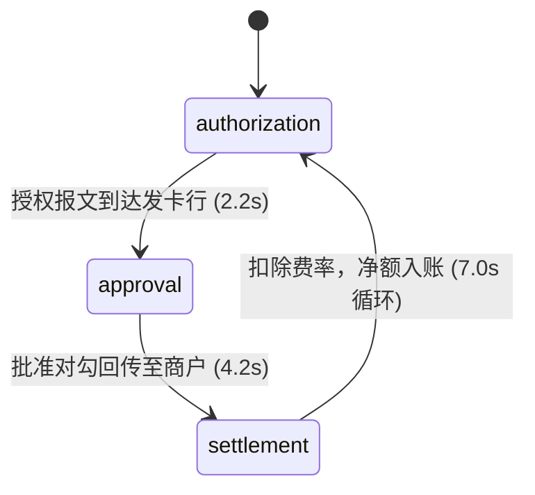

# Payment Flow · 四方支付授权结算流转图

基于四方支付体系（客户、商户、网关、银行）的授权、批准与结算全流程微动效架构图。包含三大核心机制：

1. **三阶段交易状态时序模型**：依次展示授权正向传递（Authorization）、银行批准回传（Approval）与资金结算扣费（Settlement）；总单笔周期清晰表达 $42.50 毛额、扣除 $1.53 手续费后 $40.97 净额入账流程。
2. **多跳网络光斑推进动力学**：授权阶段光斑以 0.72s/跳向前推进，银行批准以 0.64s/跳快速回传并在商户端书写绿色对勾；结算阶段分为清算、分账与净结算三段推进。
3. **账户余额动态滚轮累加与智能减速**：商户账户余额（初始 $1,284.10）在每轮结算完成时精确增加 $40.97；鼠标悬停在四方节点上时，动画速率从 1.0 平滑放缓至 0.6 方便审视。

## 原型清单

| 原型分组 | 原型元素 | 动效 / 状态变化 | 去向 |
| --- | --- | --- | --- |
| — | 四方实体节点卡片 | Customer、Merchant、Processor、Bank 悬停高亮 | `.payment-entity` |
| — | 传输管道与光斑粒子 | 授权黄线、批准绿线、结算蓝线及沿途光斑 | `.payment-tracks` |
| — | 账户余额看板 | 结算完成后净额递增累加 | `.balance-counter` |
| — | 阶段提示与手续费明细 | 展示 $42.50 毛额、-$1.53 费率、+$40.97 到账 | `.fee-breakdown` |
| — | 顶栏、外观切换 `#themeBtn`、舞台外壳 | — | 演示外壳，已删除 |

## 适用

- 跨境支付、聚合支付、Fintech 平台或电商结账架构白皮书。
- 解释收单机构、清算组织、发卡行之间底层流转的说明图解。
- 强调资金透明度、低延时授权与资金结算流向的可视化面板。

## 不适用

- ETL 数据清洗管道与记录分发图解 → [data-flow](data-flow.md)
- 多数据中心容灾与故障转移拓扑 → [multi-region-failover](multi-region-failover.md)
- 高维向量索引与最近邻搜索图解 → [vector-search](vector-search.md)
- 单个结账按钮本身的提交与成功勾选 → [action-button](../buttons/action-button.md)

## 状态机

| 状态 | 进入条件 | 视觉表现 | 退出到 |
| --- | --- | --- | --- |
| authorization | 0s ~ 2.2s | 客户刷卡发起支付，金色光斑从 Customer → Merchant → Processor → Bank 逐级跳跃 | approval |
| approval | 2.2s ~ 4.2s | 银行批准交易，绿色对勾光斑迅速向左原路回传，商户端确认通过 | settlement |
| settlement | 4.2s ~ 7.0s | 资金从银行清算分账，扣除 $1.53，净额 $40.97 入账，商户余额递增 | authorization |



## 最小 DOM

```html
<div class="payment-flow-root" role="region" aria-label="Payment flow architecture illustration">
  <div class="flow-header">
    <div class="flow-stage-label">
      <span class="stage-tag">Live Lifecycle</span>
      <span class="phase-name">Authorization</span>
    </div>
    <div class="balance-display">
      <span class="balance-label">Merchant Balance:</span>
      <span class="balance-val">$1,284.10</span>
    </div>
  </div>

  <div class="payment-stage">
    <svg class="payment-svg" viewBox="0 0 680 240" width="100%" height="240" aria-hidden="true">
      <!-- 实体间连线 -->
      <line class="pay-line line-auth" x1="100" y1="120" x2="260" y2="120"/>
      <line class="pay-line line-auth" x2="420" y1="120" x1="260" y2="120"/>
      <line class="pay-line line-auth" x2="580" y1="120" x1="420" y2="120"/>

      <!-- 动态数据光斑 -->
      <circle class="pay-packet packet-auth" r="5"/>
      <circle class="pay-packet packet-settle" r="5"/>
    </svg>

    <div class="payment-entities">
      <div class="payment-entity entity-cust" style="left: 60px;">
        <span class="entity-name">Customer</span>
        <span class="entity-role">Cardholder</span>
      </div>
      <div class="payment-entity entity-merch" style="left: 220px;">
        <span class="entity-name">Merchant</span>
        <span class="entity-role">Store</span>
      </div>
      <div class="payment-entity entity-proc" style="left: 380px;">
        <span class="entity-name">Processor</span>
        <span class="entity-role">Gateway</span>
      </div>
      <div class="payment-entity entity-bank" style="left: 540px;">
        <span class="entity-name">Bank</span>
        <span class="entity-role">Issuer</span>
      </div>
    </div>
  </div>
</div>
```

- `.payment-flow-root`：宿主容器。
- `.balance-display`：展示商户账户余额的动态递增看板。
- `.payment-svg`：绘制四方连线与数据包光斑的矢量容器。
- `.payment-entity`：四方主体卡片，支持悬停高亮与减速互动。

## 参数

| 名称 | 值 | 用于 | 来源 |
| --- | --- | --- | --- |
| grossUSD | `$42.50` | 交易原始总金额 | 原型 |
| feeUSD | `$1.53` | 网关与清算服务费率 | 原型 |
| netUSD | `$40.97` | 商户最终入账净额 | 原型 |
| initialBalanceUSD | `$1,284.10` | 商户账户初始余额 | 原型 |
| authorizationHopSeconds | `0.72s` | 授权阶段每跳耗时 | 原型 |
| approvalHopSeconds | `0.64s` | 批准回传阶段每跳耗时 | 原型 |
| rate.normal / hover | `1.0 / 0.6` | 正常速度与悬停节点减速比率 | 原型 |

## CSS

```css
.payment-flow-root {
  --pay-bg: #f9f9f9;
  --pay-border: rgba(0, 0, 0, 0.08);
  --pay-text: #111827;
  --pay-text-muted: #6b7280;
  --pay-accent: #2563eb;
  --pay-success: #10b981;
  --pay-gold: #f59e0b;
  position: relative;
  display: flex;
  flex-direction: column;
  width: 100%;
  max-width: 680px;
  margin-inline: auto;
  border-radius: 16px;
  background: var(--pay-bg);
  border: 1px solid var(--pay-border);
  overflow: hidden;
  font-family: system-ui, -apple-system, sans-serif;
  user-select: none;
}

@media (prefers-color-scheme: dark) {
  .payment-flow-root {
    --pay-bg: #111827;
    --pay-border: rgba(255, 255, 255, 0.1);
    --pay-text: #f9fafb;
    --pay-text-muted: #9ca3af;
  }
}

.flow-header {
  display: flex;
  align-items: center;
  justify-content: space-between;
  padding: 14px 20px;
  border-bottom: 1px solid var(--pay-border);
}

.stage-tag {
  font-size: 11px;
  text-transform: uppercase;
  color: var(--pay-accent);
  font-weight: 600;
  margin-right: 8px;
}

.phase-name {
  font-size: 14px;
  font-weight: 600;
  color: var(--pay-text);
}

.balance-val {
  font-family: ui-monospace, monospace;
  font-weight: 600;
  color: var(--pay-text);
}

.payment-stage {
  position: relative;
  width: 100%;
  height: 240px;
}

.payment-svg {
  position: absolute;
  inset: 0;
}

.pay-line {
  stroke: rgba(0, 0, 0, 0.1);
  stroke-width: 2;
  stroke-dasharray: 4 4;
}

@media (prefers-color-scheme: dark) {
  .pay-line {
    stroke: rgba(255, 255, 255, 0.15);
  }
}

.pay-packet {
  fill: var(--pay-accent);
}

.payment-entity {
  position: absolute;
  top: 80px;
  width: 90px;
  padding: 10px 8px;
  border-radius: 12px;
  background: #ffffff;
  border: 1px solid var(--pay-border);
  box-shadow: 0 4px 12px rgba(0, 0, 0, 0.05);
  display: flex;
  flex-direction: column;
  align-items: center;
  text-align: center;
  cursor: pointer;
  transition: background-color 0.2s ease, color 0.2s ease, border-color 0.2s ease, transform 0.2s ease, opacity 0.2s ease, box-shadow 0.2s ease;
  z-index: 2;
}

@media (prefers-color-scheme: dark) {
  .payment-entity {
    background: #1f2937;
  }
}

.payment-entity:hover {
  border-color: var(--pay-accent);
  box-shadow: 0 6px 18px rgba(37, 99, 235, 0.15);
}

.entity-name {
  font-size: 13px;
  font-weight: 600;
  color: var(--pay-text);
}

.entity-role {
  font-size: 11px;
  color: var(--pay-text-muted);
  margin-top: 2px;
}

@media (prefers-reduced-motion: reduce) {
  .pay-packet {
    display: none;
  }
}
```

## JS

```js
export function createPaymentFlow(el, options = {}) {
  const phaseLabel = el.querySelector('.phase-name');
  const balanceEl = el.querySelector('.balance-val');
  const entities = el.querySelectorAll('.payment-entity');
  const pAuth = el.querySelector('.packet-auth');

  let balance = 1284.10;
  let elapsed = 0;
  let targetRate = 1.0;
  let currentRate = 1.0;
  let animId = null;
  let lastTime = performance.now();
  let disposed = false;
  let cycleCompleted = false;
  const isReduced = window.matchMedia('(prefers-reduced-motion: reduce)').matches;

  function loop(now) {
    if (disposed) return;
    const dt = Math.min((now - lastTime) / 1000, 0.05);
    lastTime = now;

    currentRate += (targetRate - currentRate) * 0.1;
    elapsed += dt * currentRate;

    const cycle = elapsed % 7.0;

    // 阶段判断
    if (cycle < 2.2) {
      if (phaseLabel) phaseLabel.textContent = 'Authorization';
      cycleCompleted = false;
      if (!isReduced && pAuth) {
        pAuth.style.opacity = '1';
        pAuth.style.fill = '#f59e0b';
        // 沿 100 -> 580 像素横向移动
        const prog = cycle / 2.2;
        pAuth.setAttribute('cx', (100 + prog * (580 - 100)).toFixed(1));
        pAuth.setAttribute('cy', '120');
      }
    } else if (cycle < 4.2) {
      if (phaseLabel) phaseLabel.textContent = 'Approval';
      if (!isReduced && pAuth) {
        pAuth.style.opacity = '1';
        pAuth.style.fill = '#10b981';
        // 沿 580 -> 260 像素反向回传
        const prog = (cycle - 2.2) / 2.0;
        pAuth.setAttribute('cx', (580 - prog * (580 - 260)).toFixed(1));
        pAuth.setAttribute('cy', '120');
      }
    } else {
      if (phaseLabel) phaseLabel.textContent = 'Settlement ($40.97 net)';
      if (!isReduced && pAuth) {
        pAuth.style.opacity = '0';
      }
      if (!cycleCompleted) {
        cycleCompleted = true;
        balance += 40.97;
        if (balanceEl) balanceEl.textContent = `$${balance.toLocaleString('en-US', { minimumFractionDigits: 2 })}`;
      }
    }

    animId = requestAnimationFrame(loop);
  }

  entities.forEach((ent) => {
    ent.addEventListener('mouseenter', () => { targetRate = 0.6; });
    ent.addEventListener('mouseleave', () => { targetRate = 1.0; });
  });

  animId = requestAnimationFrame(loop);

  return {
    destroy() {
      disposed = true;
      if (animId) cancelAnimationFrame(animId);
      entities.forEach((ent) => ent.replaceWith(ent.cloneNode(true)));
    }
  };
}
```

## 接入目标项目

- 状态来源：目标网关或结账结算系统的交易事件驱动 `phaseLabel` 与 `balance` 增量。
- 尺寸策略：SVG viewBox 设为 `0 0 680 240`，自适应水平拉伸并保持实体四等分布局。
- 驱动方式：`const pf = createPaymentFlow(rootEl);`，离开页面时调用 `pf.destroy()`。

## 重入与清理

- 鼠标高频划过各主体时，速率通过线性插值平稳过渡，避免出现突兀加速或卡死。
- 销毁时停止 `requestAnimationFrame`。

## 减少动态效果

- 在 `prefers-reduced-motion: reduce` 设置下，隐藏连续飞跃的数据包粒子，仅保留阶段文案与结算数字更新。

## 焦点与键盘

- 提供完整的文字说明与区域标签，不阻断父级页面的焦点流。

## 兼容回退

| 特性 | 不支持时 |
| --- | --- |
| `Intl.NumberFormat` | 回退至标准 `toFixed(2)` 数字截断 |
| SVG 虚线 | 降级为常规实线管线 |

## 验收清单

- [ ] 页面加载后，光斑由 Customer 沿线传向 Bank（授权阶段）。
- [ ] 到达 Bank 后光斑变绿原路反向回传至 Merchant（批准阶段）。
- [ ] 结算阶段文案提示 $40.97 净额入账，右上角商户余额完成动态累加。
- [ ] 鼠标停留在任意实体上时，光斑传输速度明显降至 0.6 倍速。
- [ ] 开启系统的“减少动态效果”时，光斑粒子隐藏，展示静态拓扑。
