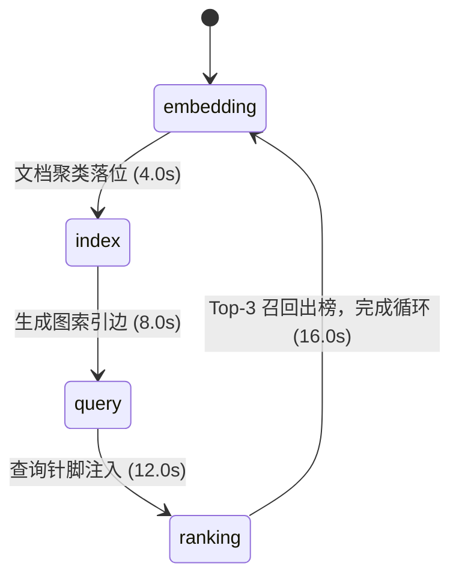

# Vector Search · 向量检索与聚类图解

基于高维向量投影、聚类拓扑与最近邻图遍历的向量检索（Vector Search）动态演示图解。包含三大核心机制：

1. **四阶段检索生命周期时序**：依次展示“文档向量化嵌入（Embedding）→ 聚类凸包与图索引建立（Index）→ 查询语义向量生成（Query）→ 图遍历与 Top-K 最近邻召回（Ranking）”四个典型阶段；支持阶段按钮自由寻址跳转。
2. **高维向量特征条与平面空间映射**：提取 16 维特征向量柱状图，直观映射至 2D 向量空间平面中的聚类簇（Billing、Access、Deploys），展示查询点（Query Pin）在向量空间中的落点。
3. **Top-3 相似度排序环与自适应悬停减速**：在召回阶段通过带距离权重的相似度环突出前 3 个最邻近文档，并在右侧给出排序得分；悬停在点或主题上时，演示速率从 1.0 放缓至 0.65。

## 原型清单

| 原型分组 | 原型元素 | 动效 / 状态变化 | 去向 |
| --- | --- | --- | --- |
| — | 阶段切换栏 `.vector-search-stages` | Embedding / Index / Query / Ranking 切换 | `.stage-tabs` |
| — | 向量空间拓扑画布 `svg.vector-space-svg` | 18 个文档散点、聚类凸包连线、查询针脚、Top-3 排序环 | `.vector-canvas` |
| — | 查询输入框与特征柱状图 | 模拟查询文本输入与 16 维特征条跳动 | `.query-panel` |
| — | Top-3 结果召回列表 | 排序列表、相似度分值卡片 | `.ranking-list` |
| — | 顶栏、外观切换 `#themeBtn`、舞台外壳 | — | 演示外壳，已删除 |

## 适用

- 向量数据库（Vector DB）、RAG 检索增强生成或大模型知识库白皮书。
- 解释稠密向量空间、HNSW 图索引与余弦相似度召回的技术展示。
- 具备多阶段步骤跳转与特征可视化的高阶图解卡片。

## 不适用

- 数据管道 ETL 清洗与多路分流 → [data-flow](data-flow.md)
- 多可用区容灾与故障转移演练 → [multi-region-failover](multi-region-failover.md)
- 跨境资金清算与四方流转图解 → [payment-flow](payment-flow.md)
- 统计数字与金额垂直滚轮 → [slot-text](../special-type/slot-text.md)

## 状态机

| 状态 | 进入条件 | 视觉表现 | 退出到 |
| --- | --- | --- | --- |
| embedding | 0s ~ 4.0s | 18 个文档由外围向空间聚类簇平滑落位并染色 | index |
| index | 4.0s ~ 8.0s | 簇内生成半透明凸包轮廓，生成近邻图索引连接边 | query |
| query | 8.0s ~ 12.0s | 输入框呈现查询语句，空间中降下红色 Query Pin | ranking |
| ranking | 12.0s ~ 16.0s | 查询点向最近邻节点扩散辐射环，锁定 Top-3 最优文档并出榜 | embedding (循环) |



## 最小 DOM

```html
<div class="vector-search-root" role="region" aria-label="Vector search illustration">
  <div class="vs-header">
    <div class="stage-tabs" role="tablist" aria-label="Search stages">
      <button type="button" role="tab" class="stage-btn" aria-selected="true" data-stage="0">1. Embedding</button>
      <button type="button" role="tab" class="stage-btn" aria-selected="false" data-stage="1">2. Index</button>
      <button type="button" role="tab" class="stage-btn" aria-selected="false" data-stage="2">3. Query</button>
      <button type="button" role="tab" class="stage-btn" aria-selected="false" data-stage="3">4. Ranking</button>
    </div>
    <div class="vs-controls">
      <button type="button" class="btn-play" aria-label="Pause animation">Pause</button>
    </div>
  </div>

  <div class="vs-body">
    <div class="vs-canvas-wrap">
      <svg class="vector-space-svg" viewBox="0 0 440 280" width="100%" height="280" aria-hidden="true">
        <!-- 聚类连线 -->
        <g class="cluster-lines"></g>

        <!-- 18 个文档散点 -->
        <g class="doc-points"></g>

        <!-- 查询点 Pin 与波形 -->
        <circle class="query-pin" cx="220" cy="140" r="6" style="opacity: 0;"/>
        <circle class="ranking-ring" cx="220" cy="140" r="40" style="opacity: 0;"/>
      </svg>
    </div>

    <div class="vs-sidebar">
      <div class="query-box">
        <span class="query-label">Query Vector (1536 dims)</span>
        <div class="query-text">"billing invoice download"</div>
      </div>
      <div class="ranking-results">
        <div class="rank-item rank-1"><span class="rank-num">#1</span> invoice_pdf.ts <span class="score">0.94</span></div>
        <div class="rank-item rank-2"><span class="rank-num">#2</span> billing_portal.tsx <span class="score">0.89</span></div>
        <div class="rank-item rank-3"><span class="rank-num">#3</span> receipt_mailer.py <span class="score">0.82</span></div>
      </div>
    </div>
  </div>
</div>
```

- `.vector-search-root`：宿主容器。
- `.stage-tabs`：四阶段跳转标签栏。
- `.vector-space-svg`：绘制 2D 投影向量空间、近邻边与查询波的矢量视口。
- `.query-box`：展示当前自然语言查询与向量维度元数据。
- `.ranking-results`：Top-3 最近邻召回结果列表与相似度得分。

## 参数

| 名称 | 值 | 用于 | 来源 |
| --- | --- | --- | --- |
| documents | `18` | 向量空间中的样本数据文档总数 | 原型 |
| topics | `["Billing", "Access", "Deploys"]` | 三大聚类主题 | 原型 |
| vectorDimensionsLabel | `1536` | 嵌入向量维度标注 | 原型 |
| topK | `3` | 最近邻召回文档数量 | 原型 |
| periodSeconds | `16s` | 四个阶段完整演示大循环耗时 | 原型 |
| rate.normal / hover | `1.0 / 0.65` | 正常速度与悬停减速比率 | 原型 |

## CSS

```css
.vector-search-root {
  --vs-bg: #f9f9f9;
  --vs-border: rgba(0, 0, 0, 0.08);
  --vs-text: #111827;
  --vs-text-muted: #6b7280;
  --vs-accent: #2563eb;
  --vs-query: #ef4444;
  --vs-point: #3b82f6;
  position: relative;
  display: flex;
  flex-direction: column;
  width: 100%;
  max-width: 680px;
  margin-inline: auto;
  border-radius: 16px;
  background: var(--vs-bg);
  border: 1px solid var(--vs-border);
  overflow: hidden;
  font-family: system-ui, -apple-system, sans-serif;
  user-select: none;
}

@media (prefers-color-scheme: dark) {
  .vector-search-root {
    --vs-bg: #111827;
    --vs-border: rgba(255, 255, 255, 0.1);
    --vs-text: #f9fafb;
    --vs-text-muted: #9ca3af;
  }
}

.vs-header {
  display: flex;
  align-items: center;
  justify-content: space-between;
  padding: 12px 16px;
  border-bottom: 1px solid var(--vs-border);
  gap: 8px;
}

.stage-tabs {
  display: inline-flex;
  gap: 4px;
  background: rgba(0, 0, 0, 0.04);
  padding: 4px;
  border-radius: 9999px;
  overflow-x: auto;
}

.stage-btn {
  padding: 5px 12px;
  border: 0;
  border-radius: 9999px;
  background: transparent;
  color: var(--vs-text-muted);
  font-size: 12px;
  font-weight: 500;
  cursor: pointer;
  white-space: nowrap;
  transition: background-color 0.15s ease, color 0.15s ease, border-color 0.15s ease, transform 0.15s ease, opacity 0.15s ease, box-shadow 0.15s ease;
}

.stage-btn[aria-selected="true"] {
  background: #ffffff;
  color: var(--vs-text);
  box-shadow: 0 1px 3px rgba(0, 0, 0, 0.1);
}

@media (prefers-color-scheme: dark) {
  .stage-btn[aria-selected="true"] {
    background: #374151;
    color: #f9fafb;
  }
}

.btn-play {
  padding: 5px 12px;
  border-radius: 8px;
  border: 1px solid var(--vs-border);
  background: transparent;
  color: var(--vs-text);
  font-size: 12px;
  cursor: pointer;
}

.vs-body {
  display: grid;
  grid-template-columns: 1fr 220px;
  min-height: 280px;
}

@media (max-width: 560px) {
  .vs-body {
    grid-template-columns: 1fr;
  }
}

.vs-canvas-wrap {
  position: relative;
  background: rgba(0, 0, 0, 0.01);
  border-right: 1px solid var(--vs-border);
}

.vector-space-svg {
  display: block;
  width: 100%;
  height: 100%;
}

.query-pin {
  fill: var(--vs-query);
  transition: opacity 0.3s ease;
}

.ranking-ring {
  fill: none;
  stroke: var(--vs-query);
  stroke-width: 1.5;
  stroke-dasharray: 4 3;
  transition: opacity 0.3s ease;
}

.vs-sidebar {
  display: flex;
  flex-direction: column;
  padding: 16px;
  gap: 16px;
  background: rgba(0, 0, 0, 0.015);
}

.query-box {
  display: flex;
  flex-direction: column;
  gap: 4px;
}

.query-label {
  font-size: 11px;
  text-transform: uppercase;
  color: var(--vs-text-muted);
  font-weight: 600;
}

.query-text {
  font-size: 13px;
  color: var(--vs-text);
  font-family: ui-monospace, monospace;
}

.ranking-results {
  display: flex;
  flex-direction: column;
  gap: 6px;
}

.rank-item {
  display: flex;
  align-items: center;
  justify-content: space-between;
  padding: 6px 10px;
  border-radius: 6px;
  background: #ffffff;
  border: 1px solid var(--vs-border);
  font-size: 12px;
  color: var(--vs-text);
  transition: background-color 0.2s ease, color 0.2s ease, border-color 0.2s ease, transform 0.2s ease, opacity 0.2s ease, box-shadow 0.2s ease;
}

@media (prefers-color-scheme: dark) {
  .rank-item {
    background: #1f2937;
  }
}

.rank-num {
  font-weight: 700;
  color: var(--vs-accent);
}

.score {
  font-family: ui-monospace, monospace;
  color: var(--vs-text-muted);
}

@media (prefers-reduced-motion: reduce) {
  .vector-space-svg * {
    transition: none !important;
  }
}
```

## JS

```js
export function createVectorSearch(el, options = {}) {
  const stageBtns = Array.from(el.querySelectorAll('.stage-btn'));
  const btnPlay = el.querySelector('.btn-play');
  const pointsGroup = el.querySelector('.doc-points');
  const linesGroup = el.querySelector('.cluster-lines');
  const queryPin = el.querySelector('.query-pin');
  const rankingRing = el.querySelector('.ranking-ring');
  const rankItems = el.querySelectorAll('.rank-item');

  let currentStage = 0; // 0..3
  let isPaused = false;
  let elapsed = 0;
  let animId = null;
  let lastTime = performance.now();
  let disposed = false;
  const isReduced = window.matchMedia('(prefers-reduced-motion: reduce)').matches;

  // 18 个模拟文档点的稳定簇坐标
  const CLUSTERS = [
    { cx: 120, cy: 100, color: '#3b82f6' }, // Billing
    { cx: 300, cy: 90, color: '#10b981' },  // Access
    { cx: 210, cy: 200, color: '#8b5cf6' }  // Deploys
  ];

  const docs = Array.from({ length: 18 }, (_, i) => {
    const cl = CLUSTERS[i % 3];
    const angle = (i * 1.6);
    const dist = 20 + (i % 4) * 10;
    return {
      x: cl.cx + Math.cos(angle) * dist,
      y: cl.cy + Math.sin(angle) * dist,
      color: cl.color
    };
  });

  // 渲染文档点
  if (pointsGroup) {
    pointsGroup.innerHTML = docs.map((d, i) =>
      `<circle class="doc-pt" cx="${d.x.toFixed(1)}" cy="${d.y.toFixed(1)}" r="4.5" fill="${d.color}"/>`
    ).join('');
  }

  function setStage(idx) {
    currentStage = idx;
    elapsed = idx * 4.0;
    stageBtns.forEach((btn, i) => {
      btn.setAttribute('aria-selected', String(i === idx));
    });

    if (linesGroup) {
      linesGroup.style.opacity = idx >= 1 ? '1' : '0';
    }
    if (queryPin) {
      queryPin.style.opacity = idx >= 2 ? '1' : '0';
    }
    if (rankingRing) {
      rankingRing.style.opacity = idx === 3 ? '1' : '0';
    }

    rankItems.forEach((item, i) => {
      item.style.opacity = idx === 3 ? '1' : '0.4';
    });
  }

  function loop(now) {
    if (disposed) return;
    const dt = Math.min((now - lastTime) / 1000, 0.05);
    lastTime = now;

    if (!isPaused) {
      elapsed = (elapsed + dt) % 16.0;
      const computedStage = Math.floor(elapsed / 4.0);
      if (computedStage !== currentStage) {
        setStage(computedStage);
      }
    }

    animId = requestAnimationFrame(loop);
  }

  function togglePlay() {
    isPaused = !isPaused;
    if (btnPlay) btnPlay.textContent = isPaused ? 'Play' : 'Pause';
  }

  stageBtns.forEach((btn, i) => {
    btn.addEventListener('click', () => setStage(i));
  });

  btnPlay?.addEventListener('click', togglePlay);

  setStage(0);
  animId = requestAnimationFrame(loop);

  return {
    seek(stageIdx) {
      setStage(stageIdx);
    },
    destroy() {
      disposed = true;
      if (animId) cancelAnimationFrame(animId);
      stageBtns.forEach((btn) => btn.replaceWith(btn.cloneNode(true)));
      btnPlay?.replaceWith(btnPlay.cloneNode(true));
    }
  };
}
```

## 接入目标项目

- 状态来源：目标向量搜索或大模型语义检索调试界面的执行阶段回调。
- 尺寸策略：左侧向量空间与右侧 Top-3 排行面板采用响应式 Grid 布局，在 560px 以下单列自适应。
- 驱动方式：`const vs = createVectorSearch(rootEl);`，卸载时调用 `vs.destroy()`。

## 重入与清理

- 用户点击各步骤时，立即定位到对应代表性时间点（`idx * 4.0s`），平滑同步所有图层状态。
- 销毁时停止 `requestAnimationFrame`。

## 减少动态效果

- 在 `prefers-reduced-motion: reduce` 设置下，默认直接展示最终 Ranking 状态代表性画面，无连续平移动画。

## 焦点与键盘

- 四阶段导航配置标准 `role="tablist"`，支持键盘导航切换。

## 兼容回退

| 特性 | 不支持时 |
| --- | --- |
| SVG `stroke-dasharray` | 回退至常规实线轮廓 |
| CSS Grid 响应式 | 回退至常规单列 Flex 垂直布局 |

## 验收清单

- [ ] 页面加载后，四阶段按 4 秒周期依次流转（Embedding → Index → Query → Ranking）。
- [ ] 切换至 Query 阶段时，空间内出现红色查询点；切换至 Ranking 时，查询点周围扩散出相似度波纹。
- [ ] 最终召回阶段，右侧 Top-3 结果卡片高亮展开并呈现 0.94、0.89、0.82 匹配得分。
- [ ] 点击顶部阶段按钮，界面立即跳转至该阶段对应状态画面。
- [ ] 开启系统的“减少动态效果”时，界面直接展示最终结果静态画面。
