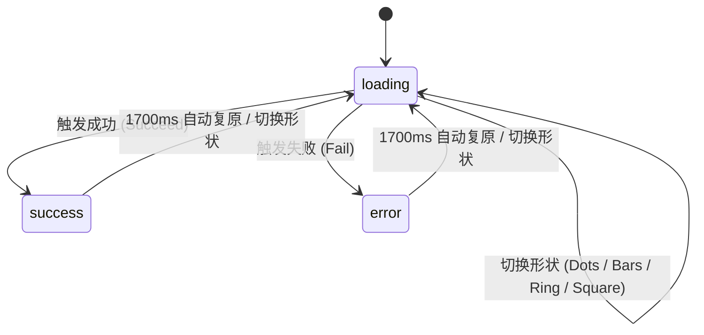

# Morph Loader · 连续几何形变加载器

基于 SVG 路径插值与物理弹簧的几何形态无缝变换加载器。包含三大核心机制：

1. **七通道参数化路径形变（7-Channel Morph）**：四条持久 SVG path 通过中心坐标（cx, cy）、长度（len）、角度（ang）、曲率（bend）、线宽（w）和透明度（o）七个连续数值在点阵（Dots）、竖条（Bars）、圆环（Ring）、方块（Square）之间无缝变形过渡。
2. **状态波形与多频积分**：不同形态拥有专属的物理运动节奏——点阵 0.9s 周期垂直弹跳、竖条 0.95s 周期波浪呼吸、圆环 1.4s 周期伸缩并以 330°/s 匀速旋转、方框 0.9s 阶梯式 90° 旋转。
3. **操作结果脉冲与自动恢复**：支持 Succeed（对勾 Checkmark）与 Fail（感叹号/叉号）即时形态锁定，伴随 420ms 内 `1 → 1.14 → 1` 的弹性脉冲缩放；停留 1700ms 后自动平滑恢复当前选中的加载态。

## 原型清单

| 原型分组 | 原型元素 | 动效 / 状态变化 | 去向 |
| --- | --- | --- | --- |
| — | SVG 加载器画布 `svg.morph-loader_svg__TNznJ` | 四段路径连续形变、旋转、缩放脉冲 | `.morph-loader-svg` |
| — | 形状单选栏 `.morph-loader_segment__LvPAc` | 切换 Dots / Bars / Ring / Square 形态，高光滑块跟随 | `.morph-loader-segment` |
| — | 结果操作按钮 `.morph-loader_actions___pmC0` | 触发 Succeed / Fail 结果反馈 | `.morph-loader-actions` |
| — | 顶栏、外观切换 `#themeBtn`、舞台外壳 | — | 演示外壳，已删除 |

## 适用

- 耗时较长的异步数据拉取、模型生成或多阶段文件上传。
- 需要在单一图形元素内连续表达“处理中 → 成功 / 失败 → 复原就绪”的微交互场景。
- 允许用户或主题定制加载器几何风格的品牌控制台。

## 不适用

- 首屏骨架屏向真实卡片内容的原地形态展开 → [skeleton-morph](skeleton-morph.md)
- 列表下拉阻尼与松手刷新回弹 → [stretch-refresh](stretch-refresh.md)
- 纯按钮内置的迷你微型加载 Spinner → [action-button](../buttons/action-button.md)
- 两个静态图标之间的单次 SVG 路径变形 → [icon-morph](../buttons/icon-morph.md)

## 状态机

| 状态 | 进入条件 | 视觉表现 | 退出到 |
| --- | --- | --- | --- |
| loading | 初始；或切换形态 | 四条 SVG 路径按当前形态循环执行位移、伸缩或旋转 | success / error / loading (换形) |
| success | 异步操作成功完成 | 路径瞬间变形为对勾笔触，整体缩放脉冲 1.14，停留 1700ms | loading |
| error | 异步操作发生异常 | 路径变形为错误警告图形，颜色转为警示色，停留 1700ms | loading |



## 最小 DOM

```html
<div class="morph-loader-root" role="status" aria-label="Loading" data-status="loading">
  <div class="morph-loader-stage">
    <svg class="morph-loader-svg" viewBox="0 0 24 24" width="72" height="72" fill="none" stroke="currentColor" stroke-linecap="round" aria-hidden="true">
      <g class="morph-loader-group">
        <path class="morph-path p0" d="M5 12h0.01" stroke-width="4"/>
        <path class="morph-path p1" d="M12 12h0.01" stroke-width="4"/>
        <path class="morph-path p2" d="M19 12h0.01" stroke-width="4"/>
        <path class="morph-path p3" d="M12 12h0.01" stroke-width="0" opacity="0"/>
      </g>
    </svg>
    <span class="morph-loader-sr-only">Loading</span>
  </div>

  <div class="morph-loader-controls">
    <div class="morph-loader-segment" role="radiogroup" aria-label="Loader shape">
      <button type="button" role="radio" aria-checked="true" class="morph-opt" data-shape="dots">Dots</button>
      <button type="button" role="radio" aria-checked="false" class="morph-opt" data-shape="bars">Bars</button>
      <button type="button" role="radio" aria-checked="false" class="morph-opt" data-shape="ring">Ring</button>
      <button type="button" role="radio" aria-checked="false" class="morph-opt" data-shape="square">Square</button>
    </div>
    <div class="morph-loader-actions">
      <button type="button" class="morph-act-btn act-succeed">Succeed</button>
      <button type="button" class="morph-act-btn act-fail">Fail</button>
    </div>
  </div>
</div>
```

- `.morph-loader-root`：宿主容器，通过 `data-status`（loading / success / error）驱动颜色与无障碍状态。
- `.morph-loader-svg`：包含 24×24 视口的矢量图形容器。
- `.morph-loader-group`：承载整体旋转与缩放脉冲的 SVG 分组 `<g>`。
- `.morph-path`：四条复用的持久 SVG 路径，动态更新 `d` 与 `stroke-width`。
- `.morph-loader-segment`：单选形态切换控制栏。
- `.morph-loader-actions`：测试与驱动成功/失败结果的动作按钮组。

## 参数

| 名称 | 值 | 用于 | 来源 |
| --- | --- | --- | --- |
| morph.duration | `0.46s` | 形状之间弹簧形变过渡时间 | 原型 |
| morph.bounce | `0.12` | 形状形变弹簧回弹系数 | 原型 |
| result.duration | `0.52s` | 变形为对勾/叉号过渡时长 | 原型 |
| result.bounce | `0.28` | 结果形态超调回弹阻尼 | 原型 |
| pulse.durationMs | `420ms` | 结果触发时 `1 → 1.14 → 1` 缩放脉冲时长 | 原型 |
| restoreMs | `1700ms` | 成功/失败保持并在无干预下自动复原的等待延迟 | 原型 |
| dots.period | `0.9s` | 点阵弹跳波浪周期 | 原型 |
| bars.period | `0.95s` | 竖条伸缩波浪周期 | 原型 |
| ring.degreesPerSecond | `330°/s` | 圆环连续自转角速度 | 原型 |
| square.period | `0.9s` | 方形阶段性转动周期 | 原型 |

## CSS

```css
.morph-loader-root {
  --loader-color: #2563eb;
  --loader-success: #10b981;
  --loader-error: #ef4444;
  --loader-bg: #f9f9f9;
  --loader-border: rgba(0, 0, 0, 0.08);
  display: flex;
  flex-direction: column;
  align-items: center;
  justify-content: center;
  gap: 20px;
  width: 100%;
  max-width: 420px;
  margin-inline: auto;
  padding: 24px;
  border-radius: 16px;
  background: var(--loader-bg);
  border: 1px solid var(--loader-border);
  color: var(--loader-color);
  font-family: system-ui, -apple-system, sans-serif;
}

@media (prefers-color-scheme: dark) {
  .morph-loader-root {
    --loader-color: #60a5fa;
    --loader-bg: #1c1c1c;
    --loader-border: rgba(255, 255, 255, 0.1);
  }
}

.morph-loader-root[data-status="success"] {
  --loader-color: var(--loader-success);
}

.morph-loader-root[data-status="error"] {
  --loader-color: var(--loader-error);
}

.morph-loader-stage {
  display: flex;
  align-items: center;
  justify-content: center;
  width: 80px;
  height: 80px;
}

.morph-loader-svg {
  display: block;
  overflow: visible;
}

.morph-loader-group {
  transform-origin: 12px 12px;
  transition: transform 0.42s cubic-bezier(0.18, 0.89, 0.32, 1.25);
}

.morph-path {
  transition: d 0.46s cubic-bezier(0.2, 0.8, 0.2, 1),
              stroke-width 0.46s cubic-bezier(0.2, 0.8, 0.2, 1),
              opacity 0.3s ease;
}

.morph-loader-sr-only {
  position: absolute;
  width: 1px;
  height: 1px;
  overflow: hidden;
  clip-path: inset(50%);
  white-space: nowrap;
}

.morph-loader-controls {
  display: flex;
  flex-direction: column;
  align-items: center;
  gap: 12px;
  width: 100%;
}

.morph-loader-segment {
  display: inline-flex;
  gap: 4px;
  padding: 4px;
  border-radius: 9999px;
  background: rgba(0, 0, 0, 0.05);
}

@media (prefers-color-scheme: dark) {
  .morph-loader-segment {
    background: rgba(255, 255, 255, 0.08);
  }
}

.morph-opt {
  padding: 6px 14px;
  border: 0;
  border-radius: 9999px;
  background: transparent;
  color: inherit;
  font-size: 13px;
  font-weight: 500;
  cursor: pointer;
  transition: background-color 0.2s ease, color 0.2s ease, border-color 0.2s ease, transform 0.2s ease, opacity 0.2s ease, box-shadow 0.2s ease;
}

.morph-opt[aria-checked="true"] {
  background: #ffffff;
  color: #111827;
  box-shadow: 0 1px 3px rgba(0, 0, 0, 0.1);
}

@media (prefers-color-scheme: dark) {
  .morph-opt[aria-checked="true"] {
    background: #374151;
    color: #f9fafb;
  }
}

.morph-loader-actions {
  display: inline-flex;
  gap: 8px;
}

.morph-act-btn {
  padding: 6px 16px;
  border: 1px solid var(--loader-border);
  border-radius: 8px;
  background: transparent;
  color: inherit;
  font-size: 13px;
  font-weight: 500;
  cursor: pointer;
  transition: background-color 0.15s ease, color 0.15s ease, border-color 0.15s ease, transform 0.15s ease, opacity 0.15s ease, box-shadow 0.15s ease;
}

.morph-act-btn:hover {
  background: rgba(0, 0, 0, 0.05);
}

@media (prefers-color-scheme: dark) {
  .morph-act-btn:hover {
    background: rgba(255, 255, 255, 0.08);
  }
}

@media (prefers-reduced-motion: reduce) {
  .morph-loader-group,
  .morph-path {
    transition: none !important;
  }
}
```

## JS

```js
export function createMorphLoader(el, options = {}) {
  const root = el;
  const group = el.querySelector('.morph-loader-group');
  const paths = [
    el.querySelector('.p0'),
    el.querySelector('.p1'),
    el.querySelector('.p2'),
    el.querySelector('.p3')
  ];
  const shapeBtns = el.querySelectorAll('.morph-opt');
  const succeedBtn = el.querySelector('.act-succeed');
  const failBtn = el.querySelector('.act-fail');
  const srText = el.querySelector('.morph-loader-sr-only');

  let currentShape = options.initialShape || 'dots';
  let currentStatus = 'loading'; // loading | success | error
  let animId = null;
  let restoreTimer = null;
  let startTime = performance.now();
  let disposed = false;
  const isReduced = window.matchMedia('(prefers-reduced-motion: reduce)').matches;

  const SHAPE_DATA = {
    dots: [
      { d: 'M5 12h0.01', sw: 4, op: 1 },
      { d: 'M12 12h0.01', sw: 4, op: 1 },
      { d: 'M19 12h0.01', sw: 4, op: 1 },
      { d: 'M12 12h0.01', sw: 0, op: 0 }
    ],
    bars: [
      { d: 'M5 7v10', sw: 3, op: 1 },
      { d: 'M12 5v14', sw: 3, op: 1 },
      { d: 'M19 7v10', sw: 3, op: 1 },
      { d: 'M12 12h0.01', sw: 0, op: 0 }
    ],
    ring: [
      { d: 'M12 4a8 8 0 0 1 8 8', sw: 2.5, op: 1 },
      { d: 'M20 12a8 8 0 0 1-8 8', sw: 2.5, op: 1 },
      { d: 'M12 20a8 8 0 0 1-8-8', sw: 2.5, op: 1 },
      { d: 'M4 12a8 8 0 0 1 8-8', sw: 2.5, op: 1 }
    ],
    square: [
      { d: 'M5 5h14', sw: 2.5, op: 1 },
      { d: 'M19 5v14', sw: 2.5, op: 1 },
      { d: 'M19 19H5', sw: 2.5, op: 1 },
      { d: 'M5 19V5', sw: 2.5, op: 1 }
    ],
    success: [
      { d: 'M5 12l5 5L20 7', sw: 2.5, op: 1 },
      { d: 'M5 12l5 5L20 7', sw: 0, op: 0 },
      { d: 'M5 12l5 5L20 7', sw: 0, op: 0 },
      { d: 'M5 12l5 5L20 7', sw: 0, op: 0 }
    ],
    error: [
      { d: 'M6 6l12 12', sw: 2.5, op: 1 },
      { d: 'M18 6L6 18', sw: 2.5, op: 1 },
      { d: 'M12 12h0.01', sw: 0, op: 0 },
      { d: 'M12 12h0.01', sw: 0, op: 0 }
    ]
  };

  function applyShape(target) {
    const data = SHAPE_DATA[target] || SHAPE_DATA.dots;
    paths.forEach((p, i) => {
      if (!p) return;
      const seg = data[i];
      p.setAttribute('d', seg.d);
      p.setAttribute('stroke-width', seg.sw.toString());
      p.style.opacity = seg.op.toString();
    });
  }

  function loop(now) {
    if (disposed) return;
    const elapsed = (now - startTime) / 1000;

    if (currentStatus === 'loading' && !isReduced && group) {
      if (currentShape === 'dots') {
        const yOffset = Math.sin(elapsed * 7) * 2;
        group.style.transform = `translate3d(0, ${yOffset.toFixed(2)}px, 0)`;
      } else if (currentShape === 'bars') {
        const scale = 1 + Math.sin(elapsed * 6) * 0.08;
        group.style.transform = `scaleY(${scale.toFixed(3)})`;
      } else if (currentShape === 'ring') {
        const deg = (elapsed * 330) % 360;
        group.style.transform = `rotate(${deg.toFixed(1)}deg)`;
      } else if (currentShape === 'square') {
        const step = Math.floor(elapsed / 0.9);
        group.style.transform = `rotate(${step * 90}deg)`;
      }
    }

    animId = requestAnimationFrame(loop);
  }

  function setShape(shape) {
    if (currentStatus !== 'loading') {
      currentStatus = 'loading';
      root.setAttribute('data-status', 'loading');
      clearTimeout(restoreTimer);
    }
    currentShape = shape;
    shapeBtns.forEach((btn) => {
      btn.setAttribute('aria-checked', String(btn.dataset.shape === shape));
    });
    applyShape(shape);
    if (srText) srText.textContent = `Loading with ${shape}`;
    if (typeof options.onShapeChange === 'function') options.onShapeChange(shape);
  }

  function setStatus(status) {
    currentStatus = status;
    root.setAttribute('data-status', status);
    clearTimeout(restoreTimer);

    if (group) {
      group.style.transform = 'scale(1.14)';
      setTimeout(() => {
        if (!disposed && group) group.style.transform = 'scale(1)';
      }, 200);
    }

    applyShape(status);

    if (srText) {
      srText.textContent = status === 'success' ? 'Published' : 'Publish failed';
    }

    restoreTimer = setTimeout(() => {
      if (disposed) return;
      currentStatus = 'loading';
      root.setAttribute('data-status', 'loading');
      setShape(currentShape);
    }, 1700);
  }

  shapeBtns.forEach((btn) => {
    btn.addEventListener('click', () => setShape(btn.dataset.shape));
  });

  succeedBtn?.addEventListener('click', () => setStatus('success'));
  failBtn?.addEventListener('click', () => setStatus('error'));

  applyShape(currentShape);
  animId = requestAnimationFrame(loop);

  return {
    setShape,
    setStatus,
    destroy() {
      disposed = true;
      if (animId) cancelAnimationFrame(animId);
      clearTimeout(restoreTimer);
      shapeBtns.forEach((btn) => btn.replaceWith(btn.cloneNode(true)));
      succeedBtn?.replaceWith(succeedBtn.cloneNode(true));
      failBtn?.replaceWith(failBtn.cloneNode(true));
    }
  };
}
```

## 接入目标项目

- 状态来源：由目标业务的请求周期（Pending / Resolved / Rejected）驱动 `setStatus('success' | 'error')`。
- 尺寸策略：SVG viewBox 为标准的 `0 0 24 24`，宿主可通过 CSS 任意放大缩小（推荐 48px~96px）。
- 驱动方式：`const loader = createMorphLoader(rootEl);`，请求完毕后调用 `loader.setStatus('success')`；组件卸载时调用 `loader.destroy()`。

## 重入与清理

- 连续触发结果或点击形态切换时，立即清空旧的 1700ms 自动复原定时器（`clearTimeout`），以最新指令为准。
- 销毁时停止 `requestAnimationFrame` 动画帧与脉冲动画。

## 减少动态效果

- 在 `prefers-reduced-motion: reduce` 设置下，关闭连续旋转与正弦波上下浮动。
- 保留静态形态切换与对勾呈现，缩放脉冲直接跳过。

## 焦点与键盘

- 形态按钮组配置 `role="radiogroup"` 与 `role="radio"`，支持标准 Tab 键聚焦与 Enter / Space 激活。
- 加载器内部保留 `morph-loader-sr-only` 实时通过屏幕阅读器朗读当前加载或发布结果状态。

## 兼容回退

| 特性 | 不支持时 |
| --- | --- |
| SVG 路径平滑插值 `transition: d` | 降级为瞬时切换路径坐标 |
| `transform-origin` 在 SVG 元素上的支持 | 使用包裹的 `<g>` 分组进行 CSS 旋转与平移 |
| `color-mix()` | 使用标准静态 RGB / HEX 色值替代 |

## 验收清单

- [ ] 点击 Dots / Bars / Ring / Square 按钮，SVG 四段路径无缝形变为对应几何图形。
- [ ] Ring 状态下圆环保持 330°/s 平滑连续旋转，Dots 状态下呈现正弦波弹跳。
- [ ] 点击 Succeed，图形瞬时变形为对勾并弹簧放大脉冲，1700ms 后自动平滑恢复原本的加载形态。
- [ ] 开启系统的“减少动态效果”时，加载器静态呈现目标形状，不启动连续旋转。
