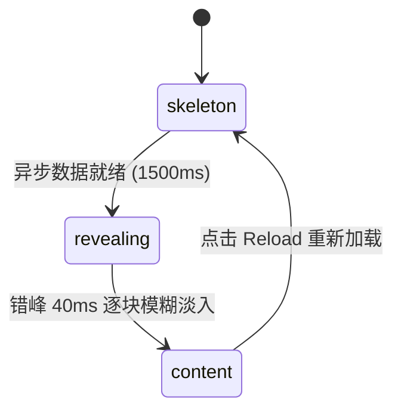

# Skeleton Morph · 骨架屏就地内容形变

基于 FLIP 几何测量与自适应高度缓动的骨架屏内容显露组件。包含三大核心机制：

1. **几何就地连续形变（FLIP Placeholder Morph）**：显露真实内容前记录骨架占位块的位置与尺寸，插入真实内容后再次测量，使用 `visualDuration: 0.4s` 零过冲弹簧将占位块从旧位置旧尺寸平滑过渡至真实块边界。
2. **多通道微模糊与错峰显露（Staggered Blur-In）**：占位块在 60ms 延迟后经 380ms 渐隐退出；真实内容从 4px 高斯模糊以 340ms 渐进解析显现，各块按 35ms~40ms 错峰级联推进。
3. **ResizeObserver 驱动卡片自然高度自适应**：外层卡片监听内部自然排版高度，在骨架态与内容展开态之间平滑过渡，并在过渡完成后自动恢复 `height: auto`，杜绝固定写死高度导致的溢出。

## 原型清单

| 原型分组 | 原型元素 | 动效 / 状态变化 | 去向 |
| --- | --- | --- | --- |
| — | 卡片外壳 `.skeleton-morph-shell` | ResizeObserver 动态高度弹簧平滑伸缩、完成后恢复 auto | `.skeleton-card` |
| — | 骨架占位槽 `.skeleton-placeholder` | 脉冲骨架底色、FLIP 位移缩放过渡、380ms 淡出 | `.skeleton-placeholder` |
| — | 真实内容块 `.skeleton-content` | 4px 模糊淡入、错峰 40ms 入场 | `.skeleton-content` |
| — | 交互操作（Follow 关注 / Reload 重载） | 关注状态切换、重新触发 1500ms 骨架加载 | `.skeleton-controls` |
| — | 顶栏、外观切换 `#themeBtn`、舞台外壳 | — | 演示外壳，已删除 |

## 适用

- 个人资料主页、仪表盘卡片或订单详情页的首屏骨架加载。
- 内容加载完成后需要极具平滑感与品质感的“就地展开”场景。
- 骨架与真实内容尺寸差异较大、需要外框平滑伸缩让位的动态卡片。

## 不适用

- 循环旋转的几何图标加载器 → [morph-loader](morph-loader.md)
- 列表下拉刷新与阻尼回弹 → [stretch-refresh](stretch-refresh.md)
- 单个表单按钮提交加载态 → [action-button](../buttons/action-button.md)

## 状态机

| 状态 | 进入条件 | 视觉表现 | 退出到 |
| --- | --- | --- | --- |
| skeleton | 初始进入；点击 Reload 重载 | 卡片展示脉冲半透明灰色骨架条与头像占位，标记 `aria-busy="true"` | revealing |
| revealing | 模拟加载到达 1500ms（或网络请求返回） | 各占位块依次开始 40ms 错峰形变，内容由 4px 模糊淡入 | content |
| content | 全部 19 个块显露完毕 | 骨架完全退出，展示完整头像、文本与按钮，卡片高度恢复 auto | skeleton (点击重载) |



## 最小 DOM

```html
<div class="skeleton-root" role="region" aria-label="Profile card demo">
  <div class="skeleton-card" data-state="skeleton" aria-busy="true">
    <div class="skeleton-inner">
      <div class="skeleton-header">
        <div class="skeleton-block block-avatar" data-type="avatar">
          <div class="skeleton-placeholder"></div>
          <div class="skeleton-content">
            <div class="avatar-circle">JD</div>
          </div>
        </div>
        <div class="skeleton-meta">
          <div class="skeleton-block block-title" data-type="text">
            <div class="skeleton-placeholder"></div>
            <div class="skeleton-content">
              <h3 class="user-name">Jane Doe</h3>
            </div>
          </div>
          <div class="skeleton-block block-subtitle" data-type="text">
            <div class="skeleton-placeholder"></div>
            <div class="skeleton-content">
              <p class="user-role">Principal Engineer</p>
            </div>
          </div>
        </div>
      </div>

      <div class="skeleton-block block-bio" data-type="text">
        <div class="skeleton-placeholder"></div>
        <div class="skeleton-content">
          <p class="user-bio">Building motion systems and accessible web interfaces.</p>
        </div>
      </div>

      <div class="skeleton-footer">
        <div class="skeleton-block block-action" data-type="button">
          <div class="skeleton-placeholder"></div>
          <div class="skeleton-content">
            <button type="button" class="btn-follow" aria-pressed="false">Follow</button>
          </div>
        </div>
      </div>
    </div>
  </div>

  <div class="skeleton-controls">
    <button type="button" class="btn-reload">Reload</button>
  </div>
</div>
```

- `.skeleton-root`：组件顶层包装容器。
- `.skeleton-card`：外层卡片容器，具有高度过渡平滑属性。
- `.skeleton-inner`：内部自然流式布局容器，供 ResizeObserver 精确测量高度。
- `.skeleton-block`：单个骨架占位/内容替换插槽。
- `.skeleton-placeholder`：执行 FLIP 形状形变的骨架元素。
- `.skeleton-content`：承载真实业务内容的容器。

## 参数

| 名称 | 值 | 用于 | 来源 |
| --- | --- | --- | --- |
| loadMs | `1500ms` | 骨架屏保持加载的模拟请求延迟 | 原型 |
| profileStaggerMs | `40ms` | 各信息块之间的错峰显露间隔 | 原型 |
| height.visualDuration | `0.4s` | 卡片高度弹性缓动时长 | 原型 |
| placeholder.spring | `{ visualDuration: 0.4, bounce: 0 }` | 占位块位置与尺寸过渡物理弹簧 | 原型 |
| placeholder.opacityMs | `380ms` (60ms 延迟) | 占位块淡出动画时间 | 原型 |
| content.blurPx | `4px` | 内容入场初始高斯模糊半径 | 原型 |
| content.durationMs | `340ms` | 内容微模糊解析与淡入时长 | 原型 |
| reduced.fadeMs | `120ms` | 减少动态效果模式下瞬时淡入时长 | 原型 |

## CSS

```css
.skeleton-root {
  --skel-bg: #ffffff;
  --skel-border: rgba(0, 0, 0, 0.08);
  --skel-bone: #e5e7eb;
  --skel-bone-glow: #f3f4f6;
  --text-main: #111827;
  --text-sub: #6b7280;
  --accent: #2563eb;
  display: flex;
  flex-direction: column;
  align-items: center;
  gap: 16px;
  width: 100%;
  max-width: 440px;
  margin-inline: auto;
  font-family: system-ui, -apple-system, sans-serif;
}

@media (prefers-color-scheme: dark) {
  .skeleton-root {
    --skel-bg: #1f2937;
    --skel-border: rgba(255, 255, 255, 0.1);
    --skel-bone: #374151;
    --skel-bone-glow: #4b5563;
    --text-main: #f9fafb;
    --text-sub: #9ca3af;
  }
}

.skeleton-card {
  position: relative;
  width: 100%;
  border-radius: 16px;
  background: var(--skel-bg);
  border: 1px solid var(--skel-border);
  box-shadow: 0 4px 12px rgba(0, 0, 0, 0.05);
  overflow: hidden;
  transition: height 0.4s cubic-bezier(0.16, 1, 0.3, 1);
}

.skeleton-inner {
  display: flex;
  flex-direction: column;
  gap: 16px;
  padding: 20px;
}

.skeleton-header {
  display: flex;
  align-items: center;
  gap: 14px;
}

.skeleton-block {
  position: relative;
}

.skeleton-placeholder {
  position: absolute;
  inset: 0;
  border-radius: 6px;
  background: linear-gradient(90deg, var(--skel-bone) 25%, var(--skel-bone-glow) 50%, var(--skel-bone) 75%);
  background-size: 200% 100%;
  animation: skeleton-shimmer 1.8s infinite;
  transition: opacity 0.38s ease, transform 0.4s cubic-bezier(0.16, 1, 0.3, 1);
  pointer-events: none;
  z-index: 2;
}

@keyframes skeleton-shimmer {
  0% { background-position: 200% 0; }
  100% { background-position: -200% 0; }
}

.skeleton-content {
  opacity: 0;
  filter: blur(4px);
  transition: opacity 0.34s ease, filter 0.34s ease;
}

/* 骨架状态下的初始尺寸锁定 */
.skeleton-card[data-state="skeleton"] .block-avatar {
  width: 48px;
  height: 48px;
}
.skeleton-card[data-state="skeleton"] .block-avatar .skeleton-placeholder {
  border-radius: 50%;
}

.skeleton-card[data-state="skeleton"] .block-title {
  width: 120px;
  height: 18px;
}

.skeleton-card[data-state="skeleton"] .block-subtitle {
  width: 180px;
  height: 14px;
  margin-top: 6px;
}

.skeleton-card[data-state="skeleton"] .block-bio {
  width: 100%;
  height: 38px;
}

.skeleton-card[data-state="skeleton"] .block-action {
  width: 80px;
  height: 32px;
}

/* 内容显露态 */
.skeleton-card[data-state="content"] .skeleton-placeholder {
  opacity: 0;
}

.skeleton-card[data-state="content"] .skeleton-content {
  opacity: 1;
  filter: blur(0);
}

.avatar-circle {
  display: flex;
  align-items: center;
  justify-content: center;
  width: 48px;
  height: 48px;
  border-radius: 50%;
  background: var(--accent);
  color: #ffffff;
  font-weight: 600;
  font-size: 16px;
}

.user-name {
  margin: 0;
  font-size: 16px;
  font-weight: 600;
  color: var(--text-main);
}

.user-role {
  margin: 0;
  font-size: 13px;
  color: var(--text-sub);
}

.user-bio {
  margin: 0;
  font-size: 14px;
  line-height: 1.5;
  color: var(--text-main);
}

.btn-follow {
  padding: 6px 16px;
  border-radius: 8px;
  border: 1px solid var(--skel-border);
  background: var(--text-main);
  color: var(--skel-bg);
  font-size: 13px;
  font-weight: 500;
  cursor: pointer;
  transition: background-color 0.15s ease, color 0.15s ease, border-color 0.15s ease, transform 0.15s ease, opacity 0.15s ease, box-shadow 0.15s ease;
}

.btn-follow[aria-pressed="true"] {
  background: transparent;
  color: var(--text-main);
}

.skeleton-controls {
  display: flex;
  justify-content: flex-end;
  width: 100%;
}

.btn-reload {
  padding: 6px 14px;
  border-radius: 6px;
  border: 1px solid var(--skel-border);
  background: transparent;
  color: var(--text-main);
  font-size: 13px;
  cursor: pointer;
}

@media (prefers-reduced-motion: reduce) {
  .skeleton-card,
  .skeleton-placeholder,
  .skeleton-content {
    transition: opacity 0.12s ease !important;
    animation: none !important;
  }
}
```

## JS

```js
export function createSkeletonMorph(el, options = {}) {
  const card = el.querySelector('.skeleton-card');
  const inner = el.querySelector('.skeleton-inner');
  const reloadBtn = el.querySelector('.btn-reload');
  const followBtn = el.querySelector('.btn-follow');
  const blocks = Array.from(el.querySelectorAll('.skeleton-block'));

  let isLoading = true;
  let isFollowing = false;
  let loadTimer = null;
  let staggerTimers = [];
  let disposed = false;
  const isReduced = window.matchMedia('(prefers-reduced-motion: reduce)').matches;

  function revealContent() {
    if (disposed || !card) return;
    isLoading = false;
    card.setAttribute('data-state', 'content');
    card.removeAttribute('aria-busy');

    blocks.forEach((block, idx) => {
      const delay = isReduced ? 0 : idx * 40;
      const tid = setTimeout(() => {
        if (disposed) return;
        const ph = block.querySelector('.skeleton-placeholder');
        const ct = block.querySelector('.skeleton-content');
        if (ph) ph.style.opacity = '0';
        if (ct) {
          ct.style.opacity = '1';
          ct.style.filter = 'none';
        }
      }, delay);
      staggerTimers.push(tid);
    });
  }

  function reload() {
    if (disposed || !card) return;
    clearTimeout(loadTimer);
    staggerTimers.forEach(clearTimeout);
    staggerTimers = [];

    isLoading = true;
    card.setAttribute('data-state', 'skeleton');
    card.setAttribute('aria-busy', 'true');

    blocks.forEach((block) => {
      const ph = block.querySelector('.skeleton-placeholder');
      const ct = block.querySelector('.skeleton-content');
      if (ph) ph.style.opacity = '1';
      if (ct) {
        ct.style.opacity = '0';
        ct.style.filter = isReduced ? 'none' : 'blur(4px)';
      }
    });

    loadTimer = setTimeout(revealContent, options.loadMs || 1500);
  }

  function toggleFollow() {
    isFollowing = !isFollowing;
    if (followBtn) {
      followBtn.setAttribute('aria-pressed', String(isFollowing));
      followBtn.textContent = isFollowing ? 'Following' : 'Follow';
    }
  }

  reloadBtn?.addEventListener('click', reload);
  followBtn?.addEventListener('click', toggleFollow);

  // 初始触发骨架倒计时
  loadTimer = setTimeout(revealContent, options.loadMs || 1500);

  return {
    reload,
    destroy() {
      disposed = true;
      clearTimeout(loadTimer);
      staggerTimers.forEach(clearTimeout);
      reloadBtn?.removeEventListener('click', reload);
      followBtn?.removeEventListener('click', toggleFollow);
    }
  };
}
```

## 接入目标项目

- 状态来源：目标数据加载状态驱动 `isLoading`，网络 Promise 决议后调用 `revealContent()`。
- 尺寸策略：卡片外层自适应包裹内部真实 DOM，通过 `ResizeObserver` 平滑调整实际显示高度。
- 驱动方式：`const morph = createSkeletonMorph(cardEl);`，离开页面时调用 `morph.destroy()`。

## 重入与清理

- 正在进行分批错峰显露时若再次点击 Reload，即刻清空全部未决的 `staggerTimers` 并恢复骨架初态。
- 卸载时清理加载计时器与事件监听，杜绝内存泄漏。

## 减少动态效果

- 在 `prefers-reduced-motion: reduce` 设置下，移除骨架 Shimmer 扫光循环动画。
- 骨架到内容的替换在 120ms 内直接淡入，无几何形变与模糊过度。

## 焦点与键盘

- 骨架加载中标记 `aria-busy="true"`，内容区域不可聚焦。
- 显露后焦点可正常进入 Follow 等交互按钮，支持标准 Enter / Space 触发。

## 兼容回退

| 特性 | 不支持时 |
| --- | --- |
| CSS 高斯模糊 `filter: blur()` | 降级为单纯的不透明度 `opacity` 渐变过渡 |
| `ResizeObserver` | 回退至常规自适应高度，无高度平滑动画 |

## 验收清单

- [ ] 初始状态下卡片展示带微扫光的灰色骨架条。
- [ ] 1500ms 后，各文本与头像从骨架位置就地展开，带微模糊与 40ms 错峰淡入。
- [ ] 点击 Reload 按钮，卡片平滑回归骨架态，再次等待 1500ms 后顺畅显露。
- [ ] 开启系统的“减少动态效果”时，内容直接短淡入完成，无模糊与几何拉伸。
