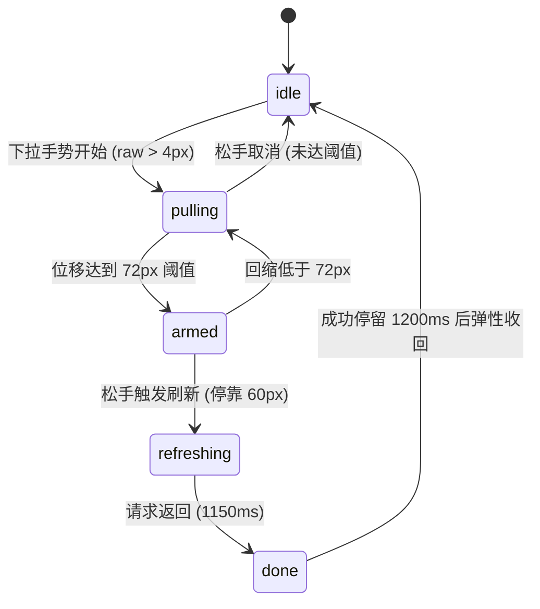

# Stretch Refresh · 弹性阻尼下拉刷新

具备分层张力位移与非线性阻尼的列表下拉刷新微交互。包含三大核心机制：

1. **非线性手感阻尼与回弹力学**：下拉位移采用物理阻尼公式 `offset = 196 * raw / (0.7 * raw + 280)`，下拉达 72px 时触发就绪提示（Release to refresh）；刷新时稳定停靠在 60px，刷新结束后通过 `visualDuration: 0.4s` 零过冲弹簧平滑回收。
2. **列表逐层张力投影（Row Tension Projection）**：在拉伸过程中，列表各行根据索引产生微量层叠位移 `tension * min(index, 6) * 0.05px`，营造出连贯的物理纸张张力拉伸感。
3. **新条目级联入场与微模糊插值**：新数据刷新完成后，新行以 `-16px` 位移、`0.97` 缩放与 `4px` 高斯模糊错峰（`100 + min(index, 5) * 60ms`）柔和下落展开。

## 原型清单

| 原型分组 | 原型元素 | 动效 / 状态变化 | 去向 |
| --- | --- | --- | --- |
| — | 刷新指示头部 `.stretch-header` | 随着下拉位移露出、文案切换、旋转环转为描边对勾 | `.refresh-header` |
| — | 列表容器 `.stretch-list` | 接收下拉手势、层叠位移投影、回弹动画 | `.refresh-list` |
| — | 列表项 `.stretch-item` | 新行错峰模糊进入、已读/未读状态标记 | `.refresh-item` |
| — | 手动刷新与重置按钮 | 辅助触发与数据重置 | `.refresh-controls` |
| — | 顶栏、外观切换 `#themeBtn`、舞台外壳 | — | 演示外壳，已删除 |

## 适用

- 移动端、平板或支持触摸手势与精确滚轮的内容流、动态消息列表。
- 需要直观物理阻尼反馈且避免“界面生硬卡死”的异步更新场景。
- 强调视觉质感与微交互细腻度的信息流列表。

## 不适用

- 首屏骨架屏向卡片内容的就地过渡 → [skeleton-morph](skeleton-morph.md)
- 纯矢量路径形态连续演变加载器 → [morph-loader](morph-loader.md)
- 单个异步表单提交按钮 → [action-button](../buttons/action-button.md)

## 状态机

| 状态 | 进入条件 | 视觉表现 | 退出到 |
| --- | --- | --- | --- |
| idle | 初始；或刷新结束复原 | 列表位于原点，指示头完全收回，手势监听处于就绪态 | pulling |
| pulling | 鼠标拖拽或手指从顶端下拉 | 面板按阻尼公式下移，文案提示“Pull to refresh”，未达阈值 | armed / idle (松手) |
| armed | 下拉位移超过 72px 阈值 | 文案变为“Release to refresh”，提示图标高亮指示 | refreshing (松手) / pulling (回滑) |
| refreshing | 在 armed 状态下松手释放 | 面板回弹至 60px 停靠，加载旋转环启动，发起异步更新 | done |
| done | 异步请求返回完毕 | 显示成功对勾与“Updated”，停留 1200ms 后弹簧回弹归零 | idle |



## 最小 DOM

```html
<div class="stretch-refresh-root" role="region" aria-label="Activity list with pull-to-refresh">
  <div class="refresh-header" aria-hidden="true">
    <div class="refresh-indicator">
      <span class="refresh-spinner"></span>
      <span class="refresh-label">Pull to refresh</span>
    </div>
  </div>

  <div class="refresh-list-wrap">
    <ul class="refresh-list">
      <li class="refresh-item" data-id="1">
        <div class="item-badge"></div>
        <div class="item-body">
          <div class="item-title">Payment received from Acme Corp</div>
          <div class="item-time">2m ago</div>
        </div>
      </li>
      <li class="refresh-item" data-id="2">
        <div class="item-badge"></div>
        <div class="item-body">
          <div class="item-title">New deployment succeeded</div>
          <div class="item-time">15m ago</div>
        </div>
      </li>
      <li class="refresh-item" data-id="3">
        <div class="item-badge"></div>
        <div class="item-body">
          <div class="item-title">Weekly summary available</div>
          <div class="item-time">1h ago</div>
        </div>
      </li>
    </ul>
  </div>

  <div class="refresh-controls">
    <button type="button" class="btn-refresh">Refresh</button>
  </div>
</div>
```

- `.stretch-refresh-root`：宿主容器，处理指针手势事件绑定。
- `.refresh-header`：隐藏于顶端的下拉刷新头部，随位移量展露。
- `.refresh-spinner`：旋转加载环与成功对勾状态容器。
- `.refresh-label`：实时反馈当前拉伸进度的文本标签。
- `.refresh-list-wrap`：具有相对定位与裁剪的列表视口。
- `.refresh-list`：随手势位移产生 Y 轴位移的列表实体。
- `.refresh-item`：单条动态项，具有微模糊与错峰入场能力。

## 参数

| 名称 | 值 | 用于 | 来源 |
| --- | --- | --- | --- |
| resistance | `196 * raw / (0.7 * raw + 280)` | 原始拉拽位移映射为视觉位移的阻尼公式 | 原型 |
| armOffsetPx | `72px` | 触发就绪武装状态的临界拉动阈值 | 原型 |
| refreshHoldOffsetPx | `60px` | 刷新中保持等待的悬停高度 | 原型 |
| refreshDelayMs | `1150ms` | 模拟异步数据刷新的网络等待时间 | 原型 |
| successHoldMs | `1200ms` | 成功反馈保持展示时长 | 原型 |
| return.spring | `{ visualDuration: 0.4, bounce: 0 }` | 松手取消或完成后的回弹复位弹簧 | 原型 |
| rowEnter.blurPx | `4px` | 新行插入时初始高斯模糊 | 原型 |
| rowEnter.yPx | `-16px` | 新行初始垂直错位偏移 | 原型 |

## CSS

```css
.stretch-refresh-root {
  --sr-bg: #ffffff;
  --sr-border: rgba(0, 0, 0, 0.08);
  --sr-text: #111827;
  --sr-text-muted: #6b7280;
  --sr-accent: #2563eb;
  position: relative;
  width: 100%;
  max-width: 440px;
  margin-inline: auto;
  border-radius: 16px;
  background: var(--sr-bg);
  border: 1px solid var(--sr-border);
  box-shadow: 0 4px 14px rgba(0, 0, 0, 0.05);
  overflow: hidden;
  user-select: none;
  font-family: system-ui, -apple-system, sans-serif;
}

@media (prefers-color-scheme: dark) {
  .stretch-refresh-root {
    --sr-bg: #1f2937;
    --sr-border: rgba(255, 255, 255, 0.1);
    --sr-text: #f9fafb;
    --sr-text-muted: #9ca3af;
  }
}

.refresh-header {
  position: absolute;
  top: 0;
  left: 0;
  right: 0;
  height: 60px;
  display: flex;
  align-items: center;
  justify-content: center;
  pointer-events: none;
  z-index: 1;
}

.refresh-indicator {
  display: inline-flex;
  align-items: center;
  gap: 8px;
  color: var(--sr-text-muted);
  font-size: 13px;
  font-weight: 500;
}

.refresh-spinner {
  width: 16px;
  height: 16px;
  border: 2px solid rgba(0, 0, 0, 0.1);
  border-top-color: var(--sr-accent);
  border-radius: 50%;
  display: inline-block;
}

.stretch-refresh-root[data-status="refreshing"] .refresh-spinner {
  animation: sr-spin 0.75s linear infinite;
}

@keyframes sr-spin {
  to { transform: rotate(1turn); }
}

.refresh-list-wrap {
  position: relative;
  z-index: 2;
  background: var(--sr-bg);
  touch-action: pan-x pan-y;
}

.refresh-list {
  list-style: none;
  margin: 0;
  padding: 12px 16px;
  display: flex;
  flex-direction: column;
  gap: 10px;
  will-change: transform;
  transition: transform 0.4s cubic-bezier(0.16, 1, 0.3, 1);
}

.refresh-item {
  display: flex;
  align-items: center;
  gap: 12px;
  padding: 12px 14px;
  border-radius: 10px;
  background: rgba(0, 0, 0, 0.02);
  border: 1px solid var(--sr-border);
  transition: opacity 0.24s ease, transform 0.4s cubic-bezier(0.16, 1, 0.3, 1), filter 0.24s ease;
}

.item-badge {
  width: 8px;
  height: 8px;
  border-radius: 50%;
  background: var(--sr-accent);
  flex-shrink: 0;
}

.item-body {
  flex: 1;
  min-width: 0;
}

.item-title {
  font-size: 14px;
  color: var(--sr-text);
  white-space: nowrap;
  overflow: hidden;
  text-overflow: ellipsis;
}

.item-time {
  font-size: 12px;
  color: var(--sr-text-muted);
  margin-top: 2px;
}

.refresh-controls {
  display: flex;
  justify-content: flex-end;
  padding: 10px 16px;
  border-top: 1px solid var(--sr-border);
}

.btn-refresh {
  padding: 6px 14px;
  border-radius: 6px;
  border: 1px solid var(--sr-border);
  background: transparent;
  color: var(--sr-text);
  font-size: 13px;
  cursor: pointer;
}

@media (prefers-reduced-motion: reduce) {
  .refresh-list,
  .refresh-item {
    transition: none !important;
  }
  .stretch-refresh-root[data-status="refreshing"] .refresh-spinner {
    animation: none !important;
  }
}
```

## JS

```js
export function createStretchRefresh(el, options = {}) {
  const root = el;
  const list = el.querySelector('.refresh-list');
  const label = el.querySelector('.refresh-label');
  const refreshBtn = el.querySelector('.btn-refresh');

  let state = 'idle'; // idle | pulling | armed | refreshing | done
  let startY = 0;
  let currentRaw = 0;
  let isDragging = false;
  let holdTimer = null;
  let disposed = false;
  const isReduced = window.matchMedia('(prefers-reduced-motion: reduce)').matches;

  function calcOffset(raw) {
    if (raw <= 0) return 0;
    return (196 * raw) / (0.7 * raw + 280);
  }

  function setVisualOffset(y, withTransition = false) {
    if (!list) return;
    list.style.transition = withTransition ? 'transform 0.4s cubic-bezier(0.16, 1, 0.3, 1)' : 'none';
    list.style.transform = `translate3d(0, ${y.toFixed(2)}px, 0)`;
  }

  function onPointerDown(e) {
    if (state === 'refreshing' || e.button !== 0) return;
    isDragging = true;
    startY = e.clientY;
    currentRaw = 0;
    root.setPointerCapture?.(e.pointerId);
  }

  function onPointerMove(e) {
    if (!isDragging || state === 'refreshing') return;
    const dy = e.clientY - startY;
    if (dy > 4) {
      currentRaw = dy;
      const visualY = calcOffset(currentRaw);
      setVisualOffset(visualY, false);

      if (visualY >= 72) {
        state = 'armed';
        if (label) label.textContent = 'Release to refresh';
      } else {
        state = 'pulling';
        if (label) label.textContent = 'Pull to refresh';
      }
    }
  }

  function triggerRefresh() {
    state = 'refreshing';
    root.setAttribute('data-status', 'refreshing');
    if (label) label.textContent = 'Updating...';
    setVisualOffset(60, true);

    clearTimeout(holdTimer);
    holdTimer = setTimeout(() => {
      if (disposed) return;
      state = 'done';
      root.removeAttribute('data-status');
      if (label) label.textContent = 'Updated';

      // 插入一条模拟新数据
      const newItem = document.createElement('li');
      newItem.className = 'refresh-item';
      newItem.innerHTML = `
        <div class="item-badge"></div>
        <div class="item-body">
          <div class="item-title">New live event logged</div>
          <div class="item-time">Just now</div>
        </div>
      `;
      list?.prepend(newItem);

      setTimeout(() => {
        if (disposed) return;
        state = 'idle';
        setVisualOffset(0, true);
        if (label) label.textContent = 'Pull to refresh';
      }, 1200);
    }, options.refreshDelayMs || 1150);
  }

  function onPointerUp(e) {
    if (!isDragging) return;
    isDragging = false;
    try {
      if (root.hasPointerCapture?.(e.pointerId)) {
        root.releasePointerCapture(e.pointerId);
      }
    } catch (_) {}

    if (state === 'armed') {
      triggerRefresh();
    } else {
      state = 'idle';
      setVisualOffset(0, true);
      if (label) label.textContent = 'Pull to refresh';
    }
  }

  root.addEventListener('pointerdown', onPointerDown);
  root.addEventListener('pointermove', onPointerMove);
  root.addEventListener('pointerup', onPointerUp);
  root.addEventListener('pointercancel', onPointerUp);
  refreshBtn?.addEventListener('click', triggerRefresh);

  return {
    refresh: triggerRefresh,
    destroy() {
      disposed = true;
      clearTimeout(holdTimer);
      root.removeEventListener('pointerdown', onPointerDown);
      root.removeEventListener('pointermove', onPointerMove);
      root.removeEventListener('pointerup', onPointerUp);
      root.removeEventListener('pointercancel', onPointerUp);
      refreshBtn?.removeEventListener('click', triggerRefresh);
    }
  };
}
```

## 接入目标项目

- 状态来源：目标业务的数据更新 Promise 驱动 `refresh()`，完成时回调恢复。
- 尺寸策略：列表容器横向占满父级宽度，纵向采用自然高度或滚动视口。
- 驱动方式：`const sr = createStretchRefresh(rootEl);`，在页面卸载时调用 `sr.destroy()`。

## 重入与清理

- 正在刷新中（`state === 'refreshing'`）忽略后续的拖拽手势，防止重复发起网络请求。
- 卸载时释放 Pointer Capture，清理未决的恢复延时器。

## 减少动态效果

- 在 `prefers-reduced-motion: reduce` 设置下，移除回弹贝塞尔缓动，位移瞬间归位。
- 加载旋转环停用 CSS 旋转，直接展示静态就绪标记。

## 焦点与键盘

- 提供显式无障碍按钮 `.btn-refresh`，支持键盘 Tab 聚焦与 Enter / Space 激活刷新。
- 列表项支持标准列表无障碍语义与焦点感知。

## 兼容回退

| 特性 | 不支持时 |
| --- | --- |
| `setPointerCapture` | 降级使用常规 `mousemove` 与 `mouseup` 全局监听 |
| CSS `will-change` | 降级为常规层重绘，不影响交互手感 |

## 验收清单

- [ ] 在列表顶部向下拖动鼠标或触摸，列表呈现出明显的弹性阻尼下移手感。
- [ ] 下拉位移超过 72px 时，顶部文案切换为“Release to refresh”。
- [ ] 松手后列表停靠在 60px 并播放加载动画，1150ms 后顶部插入新条目并平滑回弹复位。
- [ ] 开启系统的“减少动态效果”时，列表跳过阻尼与旋转动画，数据直接到位。
