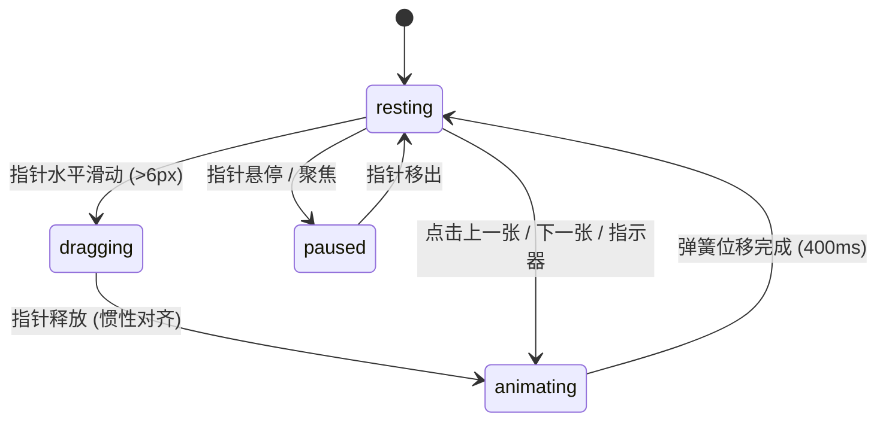

# Carousel · 媒体轮播卡

多媒体与富卡片轮播滑块。核心动效包含指针对齐吸附与惯性投影（Momentum Projection）、边缘弹性阻尼（Rubberband）、相邻卡片焦点缩放与渐隐、滑动高光指示条（Gliding Pill Indicator）以及悬停/聚焦暂停的自动轮播进度流转。

## 原型清单

| 原型分组 | 原型元素 | 动效 / 状态变化 | 去向 |
| --- | --- | --- | --- |
| 滑动轨道 | 轮播主视口与轨道（`.carousel-track`） | 支持指针水平拖拽与滚轮滑动；6px 触控防误触仲裁；越界弹性阻尼（0.55）；释放后按速度惯性平滑对齐最近卡片 | 轨道手势拖拽与阻尼弹簧对齐 |
| 卡片缩放 | 相邻卡片（`.carousel-slide`） | 当前中心卡片保持 1.0 比例与 100% 透明度；相邻卡片平滑缩放至 0.9 倍、透明度降至 50% | 相邻卡片缩放与透视衰减 |
| 分页指示条 | 底部指示器条（`.indicator-pill`） | 默认圆点为 6px，激活项横向拉伸为 22px 药丸胶囊，在卡片切换时平滑滑动 | 滑动高光胶囊指示器 |
| 自动播放 | 进度控制与时钟环 | 自动递增当前卡片播放进度；鼠标悬停、键盘获得焦点或拖拽时暂停计时，离开后平滑恢复 | 自动轮播与悬停暂停 |
| 导航控制 | 上一张/下一张按钮（`.btn-nav`） | 首尾边界平滑禁用/循环；按压缩放与悬停提亮 | 导航按钮物理触感 |
| 演示外壳 | 顶部主题切换、卡片数据模板切换器、舞台居中定位外壳 | 演示用途 | 演示外壳，已删除 |

## 适用

- 营销焦点图（Hero Banners）、商品画廊、多媒体相册展示。
- 需要支持高精度触摸滑动、滚轮滑动与键盘全方位导览。
- 希望非活动卡片通过透视缩放与弱化营造视觉纵深感与聚焦感。

## 不适用

- 纵向卡片堆叠与层叠滑动 → [card-stack](../cards/card-stack.md)
- 纯数据分页列表跳转 → [pagination](../navigation/pagination.md)
- 双图像前后对比划动滑块 → [image-compare](image-compare.md)

## 状态机

| 状态 | 进入条件 | 视觉表现 | 退出到 |
| --- | --- | --- | --- |
| resting | 初始或滚动对齐完成 | 当前卡片居中，指示器胶囊锁定当前索引，邻卡缩放至 0.9 | dragging / animating |
| dragging | 指针按下并水平滑动超过 6px | 轨道实时跟随指针位移，邻卡比例随滑动距离动态插值，指示器胶囊拉伸跟随 | resting / animating |
| animating | 拖拽释放或点击上一张/下一张 | 轨道通过平滑弹簧（visualDuration: 0.4s）过渡至目标卡片 | resting |
| paused | 鼠标悬停在卡片上或聚焦内部控制项 | 自动轮播计时器挂起，保留当前已播放时间刻度 | resting / animating |



## 最小 DOM

```html
<div class="arc-carousel" role="region" aria-roledescription="carousel" aria-label="Media carousel">
  <div class="carousel-viewport">
    <div class="carousel-track" role="list">
      <div class="carousel-slide" role="listitem" aria-label="1 of 4" data-active="true">
        <div class="slide-card">
          <div class="card-media">Slide 1</div>
        </div>
      </div>
      <div class="carousel-slide" role="listitem" aria-label="2 of 4">
        <div class="slide-card">
          <div class="card-media">Slide 2</div>
        </div>
      </div>
      <div class="carousel-slide" role="listitem" aria-label="3 of 4">
        <div class="slide-card">
          <div class="card-media">Slide 3</div>
        </div>
      </div>
      <div class="carousel-slide" role="listitem" aria-label="4 of 4">
        <div class="slide-card">
          <div class="card-media">Slide 4</div>
        </div>
      </div>
    </div>
  </div>

  <div class="carousel-controls">
    <button class="carousel-btn prev" type="button" aria-label="Previous slide">
      <svg width="18" height="18" viewBox="0 0 24 24" fill="none" stroke="currentColor" stroke-width="2">
        <polyline points="15 18 9 12 15 6"></polyline>
      </svg>
    </button>

    <div class="carousel-indicators" role="tablist" aria-label="Slide indicators">
      <button class="indicator-dot" type="button" role="tab" aria-selected="true" data-index="0"></button>
      <button class="indicator-dot" type="button" role="tab" aria-selected="false" data-index="1"></button>
      <button class="indicator-dot" type="button" role="tab" aria-selected="false" data-index="2"></button>
      <button class="indicator-dot" type="button" role="tab" aria-selected="false" data-index="3"></button>
    </div>

    <button class="carousel-btn next" type="button" aria-label="Next slide">
      <svg width="18" height="18" viewBox="0 0 24 24" fill="none" stroke="currentColor" stroke-width="2">
        <polyline points="9 18 15 12 9 6"></polyline>
      </svg>
    </button>
  </div>
</div>
```

- `.arc-carousel`：主宿主容器，具备 WAI-ARIA 轮播角色。
- `.carousel-viewport`：裁剪溢出的观察视口。
- `.carousel-track`：位移轨道，通过 `transform: translateX()` 承载平滑位移。
- `.carousel-slide`：卡片项，通过 `data-active` 区分当前焦点与缩放衰减。
- `.carousel-indicators`：胶囊指示器容器，支持点击快速跳转。

## 参数

| 名称 | 值 | 用于 | 来源 |
| --- | --- | --- | --- |
| 触控防误触阈值 | `6px` | 区分页面垂直滚动与水平滑动 | 原型 |
| 弹性阻尼系数 | `0.55` | 轨道越过边界时的拉伸阻尼 | 原型 |
| 轨道弹簧时长 | `400ms` / `cubic-bezier(0.16, 1, 0.3, 1)` | 释放后的惯性对齐 | 原型 |
| 相邻卡片缩放比例 | `scale(0.9)` | 非活动卡片视觉衰减 | 原型 |
| 相邻卡片透明度 | `0.5` | 非活动卡片对比弱化 | 原型 |
| 指示点常规宽度 | `6px` | 未激活指示点直径 | 原型 |
| 指示点激活胶囊宽度 | `22px` | 当前选中项高光胶囊拉伸 | 原型 |
| 自动播放间隔 | `4000ms` | 每张卡片展示驻留时长 | 原型 |

## CSS

```css
.arc-carousel {
  --ease-calm: cubic-bezier(0.16, 1, 0.3, 1);
  --ease-spring: cubic-bezier(0.18, 0.89, 0.32, 1.15);

  position: relative;
  display: flex;
  flex-direction: column;
  gap: 16px;
  width: 100%;
  max-width: 540px;
  margin: 0 auto;
  user-select: none;
}

.carousel-viewport {
  position: relative;
  overflow: hidden;
  border-radius: 16px;
  background: #f6f8fa;
}

.carousel-track {
  display: flex;
  transform: translateX(0);
  transition: transform 400ms var(--ease-calm);
  cursor: grab;
}

.carousel-track.is-dragging {
  cursor: grabbing;
  transition: none !important;
}

.carousel-slide {
  flex: 0 0 100%;
  padding: 12px;
  box-sizing: border-box;
  transform: scale(0.92);
  opacity: 0.5;
  transition: transform 360ms var(--ease-calm), opacity 360ms ease;
}

.carousel-slide[data-active="true"] {
  transform: scale(1);
  opacity: 1;
}

.slide-card {
  height: 240px;
  border-radius: 12px;
  background: #ffffff;
  border: 1px solid #d0d7de;
  display: flex;
  align-items: center;
  justify-content: center;
  font-size: 18px;
  font-weight: 600;
  color: #24292f;
  box-shadow: 0 4px 12px rgba(0, 0, 0, 0.05);
}

.carousel-controls {
  display: flex;
  align-items: center;
  justify-content: space-between;
  padding: 0 8px;
}

.carousel-btn {
  display: inline-flex;
  align-items: center;
  justify-content: center;
  width: 32px;
  height: 32px;
  border-radius: 50%;
  border: 1px solid #d0d7de;
  background: #ffffff;
  color: #24292f;
  cursor: pointer;
  outline: none;
  transition: transform 140ms var(--ease-spring), background-color 140ms ease;
}

.carousel-btn:hover {
  background-color: #f6f8fa;
}

.carousel-btn:active {
  transform: scale(0.92);
}

.carousel-indicators {
  display: inline-flex;
  align-items: center;
  gap: 6px;
}

.indicator-dot {
  width: 6px;
  height: 6px;
  padding: 0;
  border: none;
  border-radius: 3px;
  background-color: #d0d7de;
  cursor: pointer;
  outline: none;
  transition: width 240ms var(--ease-calm), background-color 200ms ease;
}

.indicator-dot[aria-selected="true"] {
  width: 22px;
  background-color: #0969da;
}

@media (prefers-reduced-motion: reduce) {
  .carousel-track,
  .carousel-slide,
  .indicator-dot {
    transition: opacity 120ms ease !important;
    transform: none !important;
  }
}
```

## JS

```js
export function createCarousel(el, options = {}) {
  const root = el;
  const track = root.querySelector('.carousel-track');
  const slides = Array.from(root.querySelectorAll('.carousel-slide'));
  const dots = Array.from(root.querySelectorAll('.indicator-dot'));
  const prevBtn = root.querySelector('.carousel-btn.prev');
  const nextBtn = root.querySelector('.carousel-btn.next');

  let currentIndex = 0;
  const count = slides.length;
  let autoplayTimer = null;
  const interval = options.interval || 4000;

  let isDragging = false;
  let startX = 0;
  let currentTranslate = 0;
  let dragOffset = 0;

  function updateSlide(index) {
    if (count === 0) return;
    currentIndex = (index + count) % count;

    const offsetPercent = -currentIndex * 100;
    if (track) {
      track.style.transform = `translateX(${offsetPercent}%)`;
    }

    slides.forEach((slide, i) => {
      slide.setAttribute('data-active', String(i === currentIndex));
    });

    dots.forEach((dot, i) => {
      dot.setAttribute('aria-selected', String(i === currentIndex));
    });

    if (options.onChange) {
      options.onChange(currentIndex);
    }
  }

  function next() {
    updateSlide(currentIndex + 1);
  }

  function prev() {
    updateSlide(currentIndex - 1);
  }

  function startAutoplay() {
    stopAutoplay();
    if (options.autoplay !== false) {
      autoplayTimer = setInterval(next, interval);
    }
  }

  function stopAutoplay() {
    if (autoplayTimer) {
      clearInterval(autoplayTimer);
      autoplayTimer = null;
    }
  }

  // 指针拖拽事件
  const handlePointerDown = (e) => {
    isDragging = true;
    startX = e.clientX || (e.touches && e.touches[0].clientX) || 0;
    track?.classList.add('is-dragging');
    stopAutoplay();
  };

  const handlePointerMove = (e) => {
    if (!isDragging) return;
    const clientX = e.clientX || (e.touches && e.touches[0].clientX) || 0;
    dragOffset = clientX - startX;
    const baseOffset = -currentIndex * root.clientWidth;
    const totalOffset = baseOffset + dragOffset;
    if (track) {
      track.style.transform = `translateX(${totalOffset}px)`;
    }
  };

  const handlePointerUp = () => {
    if (!isDragging) return;
    isDragging = false;
    track?.classList.remove('is-dragging');

    if (dragOffset < -50) {
      next();
    } else if (dragOffset > 50) {
      prev();
    } else {
      updateSlide(currentIndex);
    }
    dragOffset = 0;
    startAutoplay();
  };

  const handleMouseEnter = () => stopAutoplay();
  const handleMouseLeave = () => startAutoplay();

  const handleKeydown = (e) => {
    if (e.key === 'ArrowLeft') {
      prev();
    } else if (e.key === 'ArrowRight') {
      next();
    }
  };

  prevBtn?.addEventListener('click', prev);
  nextBtn?.addEventListener('click', next);

  dots.forEach((dot, i) => {
    dot.addEventListener('click', () => updateSlide(i));
  });

  track?.addEventListener('mousedown', handlePointerDown);
  window.addEventListener('mousemove', handlePointerMove);
  window.addEventListener('mouseup', handlePointerUp);

  root.addEventListener('mouseenter', handleMouseEnter);
  root.addEventListener('mouseleave', handleMouseLeave);
  root.addEventListener('keydown', handleKeydown);

  // 初始化
  updateSlide(0);
  startAutoplay();

  return {
    destroy: () => {
      stopAutoplay();
      prevBtn?.removeEventListener('click', prev);
      nextBtn?.removeEventListener('click', next);
      track?.removeEventListener('mousedown', handlePointerDown);
      window.removeEventListener('mousemove', handlePointerMove);
      window.removeEventListener('mouseup', handlePointerUp);
      root.removeEventListener('mouseenter', handleMouseEnter);
      root.removeEventListener('mouseleave', handleMouseLeave);
      root.removeEventListener('keydown', handleKeydown);
    },
    next,
    prev,
    goTo: updateSlide
  };
}
```

## 接入目标项目

- 状态来源：
  - 数据由卡片列表数据驱动。当前索引可通过 `options.onChange(index)` 向上同步。
- 尺寸策略：
  - 采用视口 100% 相对宽度布局，每张卡片占视口宽度的 100%，自适应不同屏幕尺寸。
- 驱动方式：
  - 组件挂载时调用 `const carousel = createCarousel(container, { autoplay: true, interval: 4000 })`。
  - 卸载时调用 `carousel.destroy()` 释放全部定时器与全局窗口监听。

## 重入与清理

- 连续点击/快速拖拽：每次切换直接更新目标偏移百分比，由 CSS 平滑曲线统一收敛，不会产生跳针。
- 卸载清理：`destroy()` 销毁 `setInterval` 定时器，并解绑挂在 `window` 上的全局 `mousemove` 和 `mouseup` 监听器。

## 减少动态效果

- 激活 `prefers-reduced-motion: reduce` 时：
  - 移除轨道位移过渡曲线与相邻卡片缩放衰减，直接切换显隐状态。
  - 指示条胶囊宽度直接改变，无过渡拉伸动画。

## 焦点与键盘

- 轮播符合 WAI-ARIA Carousel 设计模式：
  - 支持键盘左右方向键（ArrowLeft / ArrowRight）快速切换卡片。
  - 聚焦在卡片内部链接或按钮时自动挂起自动轮播，确保用户阅读无障碍。

## 兼容回退

| 特性 | 不支持时 |
| --- | --- |
| CSS Flexbox 负位移 | 采用绝对定位与 `left` 属性切换。 |
| CSS 变量与圆角 | 采用标准固定圆角与纯色背景回退。 |

## 验收清单

- [ ] 点击上一张/下一张按钮，卡片平滑横向滑动切换，指示条平滑拉伸至对应位置。
- [ ] 当前中心卡片为 100% 比例与纯色，非活动卡片呈现 0.92 缩放弱化。
- [ ] 支持鼠标横向拖拽滑动，释放后根据位移阈值自动吸附至最近卡片。
- [ ] 鼠标悬停在轮播区域内自动轮播暂停，移出后恢复。
- [ ] 开启减少动态偏好时，卡片瞬时切换，无滑动动画。
