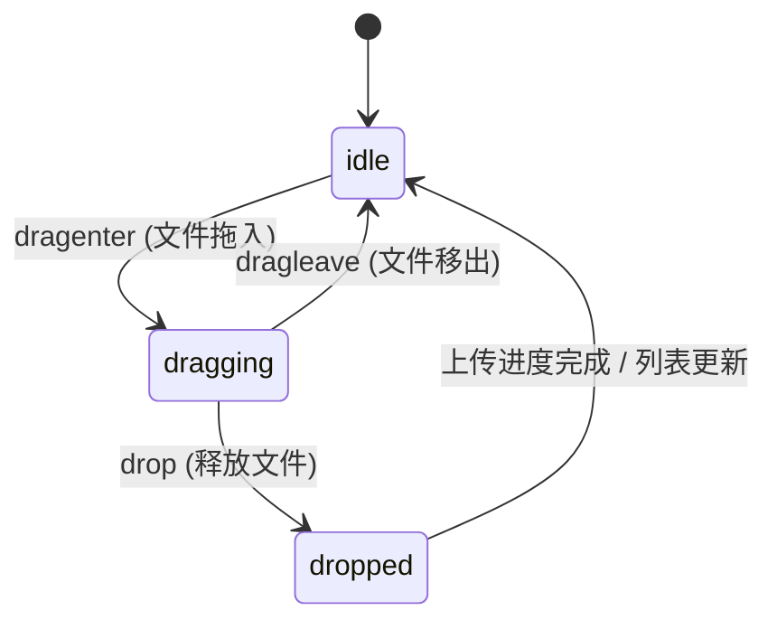

# File Dropzone · 媒体文件投递区

专为多媒体资产（图像、视频、设计素材）上传设计的互动文件投递区。核心动效包含三层素材卡片 3D 扇形展开（Three Sheets Fan-out）、SVG 环绕虚线边缘呼吸律动（Drop Breathe Animation）、多类型文件进度条平滑填充、失败项重试旋转以及条目移除时的高度折叠与淡出。

## 原型清单

| 原型分组 | 原型元素 | 动效 / 状态变化 | 去向 |
| --- | --- | --- | --- |
| 投递交互区 | 投递触发区（`#dropzone`） | 拖入悬停激活 `dragging` 类名，触发背景色调渐变与 2.2s `dropBreathe` 缩放呼吸循环 | 投递区呼吸律动与高亮 |
| 矢量卡片插画 | 三层素材纸张（`.sheet`） | 悬停与拖拽时后层与侧层自 ±10deg 扇形展开至 ±15deg，前层向上浮升 2px | 三层素材卡片 3D 扇形展开 |
| 动态边缘 | SVG 边框（`.edge rect`） | 虚线间距在拖入时由 4 4 动态切换为 8 0 实心强化，描边颜色高亮 | SVG 虚线边缘形变 |
| 资产列表 | 文件列表项（`.file-item`） | 插入时从下方淡入；移除时高度即时测量收窄至 0px 并伴随 280ms 透明度渐隐 | 列表项动态加载与平滑折叠 |
| 状态与进度 | 进度条与重试按钮 | 模拟与真实上传进度条平滑充盈；失败重试按钮图标 360° 无限旋转 | 进度条充盈与重试微动效 |
| 演示外壳 | 顶部主题切换按钮（`#themeToggle`）、全局舞台居中容器 | 演示用途 | 演示外壳，已删除 |

## 适用

- 媒体管理后台、相册中心、音视频处理平台的素材批量拖拽与投递上传。
- 支持拖放、点击文件选择器、以及系统剪贴板（Ctrl+V 粘贴图片）多通道投递。
- 需要实时展示文件缩略图、体积大小、上传百分比及单项重试/删除。

## 不适用

- 文档与编辑器内的内联附件插入 → [file-dropzone](../editors/file-dropzone.md)
- 轮播媒体卡片展示 → [carousel](carousel.md)
- 图像前后双图划动对比 → [image-compare](image-compare.md)

## 状态机

| 状态 | 进入条件 | 视觉表现 | 退出到 |
| --- | --- | --- | --- |
| idle | 初始静止或上传完成 | 三层素材纸张自然收聚，边框显示 4 4 规整虚线，投递区无呼吸缩放 | dragging |
| dragging | 外部文件拖拽经过投递区（`dragenter`） | 纸张向两侧扇形展开（±15deg），边框虚线加宽，全区执行 2.2s `dropBreathe` 缩放呼吸 | idle / dropped |
| dropped | 释放文件（`drop`）或选取文件完成 | 纸张复原收拢，文件列表插入新卡片并启动进度条动画 | idle |



## 最小 DOM

```html
<div class="arc-media-dropzone">
  <div class="dropzone-area" role="region" aria-label="Media dropzone">
    <!-- SVG 环绕边框 -->
    <svg class="dropzone-edge" aria-hidden="true">
      <rect width="100%" height="100%" rx="24" ry="24" />
    </svg>

    <button class="dropzone-trigger" type="button">
      <!-- 三层扇形素材插画 -->
      <span class="sheets-stack" aria-hidden="true">
        <span class="sheet" data-sheet="back"></span>
        <span class="sheet" data-sheet="side"></span>
        <span class="sheet" data-sheet="front">
          <svg width="16" height="16" viewBox="0 0 24 24" fill="none" stroke="currentColor" stroke-width="2">
            <line x1="12" y1="19" x2="12" y2="5" />
            <polyline points="5 12 12 5 19 12" />
          </svg>
        </span>
      </span>

      <span class="prompt-title">Add media assets</span>
      <span class="prompt-hint">Drop, paste, or choose files from your device</span>
      <span class="prompt-meta">Images, videos, or PDFs up to 50 MB</span>
    </button>

    <input class="file-input-hidden" type="file" multiple accept="image/*,video/*,.pdf" tabindex="-1">
  </div>

  <ul class="file-list" aria-label="Media uploads"></ul>
</div>
```

- `.arc-media-dropzone`：主组件容器。
- `.dropzone-area`：投递感应区，承载 `dragging` 状态与呼吸动画。
- `.dropzone-edge`：SVG 矢量虚线描边边框。
- `.sheets-stack`：三层纸张插画容器，通过 CSS 变换实现扇形展开。
- `.file-list`：已投递文件的动态列表容器。

## 参数

| 名称 | 值 | 用于 | 来源 |
| --- | --- | --- | --- |
| 拖拽呼吸动画周期 | `2.2s` / `cubic-bezier(0.4, 0, 0.2, 1)` | `.dropzone-area.dragging` 呼吸律动 | 原型 |
| 呼吸缩放幅度 | `scale(1.012)` | `dropBreathe` 关键帧峰值 | 原型 |
| 纸张扇形展开角度 | `±15deg`（默认 `±10deg`） | `.sheet[data-sheet="back|side"]` 变换 | 原型 |
| 纸张位移幅度 | `X 轴 ±13px`（默认 `±9px`） | 纸张展开间距 | 原型 |
| 列表项移除折叠时长 | `280ms` / `cubic-bezier(0.2, 0, 0, 1)` | 条目高度收敛至 0 与淡出 | 原型 |
| 重试按钮旋转速度 | `700ms linear infinite` | 失败项重试 Spinner 动效 | 原型 |

## CSS

```css
.arc-media-dropzone {
  --ease-spring: cubic-bezier(0.16, 1, 0.3, 1);
  --ease-calm: cubic-bezier(0.2, 0, 0, 1);

  display: flex;
  flex-direction: column;
  gap: 16px;
  width: 100%;
  max-width: 500px;
  margin: 0 auto;
  font-family: system-ui, -apple-system, sans-serif;
  color: #24292f;
  box-sizing: border-box;
}

.dropzone-area {
  position: relative;
  border-radius: 24px;
  background: #ffffff;
  box-sizing: border-box;
  transition: background-color 220ms var(--ease-calm), transform 340ms var(--ease-spring);
}

.dropzone-edge {
  position: absolute;
  inset: 1px;
  width: calc(100% - 2px);
  height: calc(100% - 2px);
  pointer-events: none;
  overflow: visible;
}

.dropzone-edge rect {
  fill: none;
  stroke: #d0d7de;
  stroke-width: 1.5;
  stroke-dasharray: 4 4;
  rx: 24;
  ry: 24;
  transition: stroke 140ms ease, stroke-dasharray 220ms ease;
}

.dropzone-area:hover .dropzone-edge rect {
  stroke: #57606a;
}

.dropzone-area.dragging {
  background: rgba(9, 105, 218, 0.04);
  animation: dropBreathe 2.2s cubic-bezier(0.4, 0, 0.2, 1) infinite;
}

.dropzone-area.dragging .dropzone-edge rect {
  stroke: #0969da;
  stroke-dasharray: 8 0;
}

@keyframes dropBreathe {
  0%, 100% { transform: scale(1); }
  50% { transform: scale(1.012); }
}

.dropzone-trigger {
  display: flex;
  flex-direction: column;
  align-items: center;
  justify-content: center;
  width: 100%;
  padding: 36px 20px;
  border: none;
  background: transparent;
  cursor: pointer;
  outline: none;
  border-radius: inherit;
}

/* 三层插画 */
.sheets-stack {
  position: relative;
  display: block;
  width: 36px;
  height: 44px;
  margin-bottom: 12px;
}

.sheet {
  --r: 0deg;
  --x: 0px;
  --y: 0px;
  position: absolute;
  inset: 0;
  border: 1px solid #d0d7de;
  border-radius: 6px;
  background: #ffffff;
  color: #57606a;
  box-shadow: 0 1px 3px rgba(0, 0, 0, 0.05);
  transform: translate(var(--x), var(--y)) rotate(var(--r));
  transform-origin: 50% 100%;
  transition: transform 340ms var(--ease-spring), border-color 220ms ease;
  display: grid;
  place-items: end center;
  padding-bottom: 4px;
}

.sheet[data-sheet="back"] {
  --r: -10deg;
  --x: -9px;
  --y: 2px;
}

.sheet[data-sheet="side"] {
  --r: 10deg;
  --x: 9px;
  --y: 2px;
}

.dropzone-area:hover .sheet[data-sheet="back"],
.dropzone-area.dragging .sheet[data-sheet="back"] {
  --r: -15deg;
  --x: -13px;
}

.dropzone-area:hover .sheet[data-sheet="side"],
.dropzone-area.dragging .sheet[data-sheet="side"] {
  --r: 15deg;
  --x: 13px;
}

.dropzone-area:hover .sheet[data-sheet="front"],
.dropzone-area.dragging .sheet[data-sheet="front"] {
  --y: -2px;
}

.prompt-title {
  font-size: 14px;
  font-weight: 600;
  color: #24292f;
  margin-bottom: 4px;
}

.prompt-hint {
  font-size: 12px;
  color: #57606a;
  margin-bottom: 4px;
}

.prompt-meta {
  font-size: 11px;
  color: #8c959f;
}

.file-input-hidden {
  display: none;
}

/* 已上传文件列表 */
.file-list {
  list-style: none;
  padding: 0;
  margin: 0;
  display: flex;
  flex-direction: column;
  gap: 8px;
}

.file-item {
  display: flex;
  align-items: center;
  justify-content: space-between;
  padding: 10px 14px;
  background: #ffffff;
  border: 1px solid #d0d7de;
  border-radius: 10px;
  font-size: 13px;
  overflow: hidden;
  transition: height 280ms var(--ease-calm), opacity 280ms ease, margin 280ms ease;
}

.file-item-info {
  display: flex;
  align-items: center;
  gap: 10px;
}

.file-name {
  font-weight: 500;
  color: #24292f;
}

.file-size {
  font-size: 11px;
  color: #57606a;
}

.file-actions {
  display: flex;
  align-items: center;
  gap: 8px;
}

.btn-file-remove {
  background: transparent;
  border: none;
  cursor: pointer;
  color: #57606a;
  padding: 4px;
  border-radius: 4px;
}

.btn-file-remove:hover {
  color: #cf222e;
}

@media (prefers-reduced-motion: reduce) {
  .dropzone-area.dragging {
    animation: none;
  }
  .sheet,
  .dropzone-area,
  .file-item {
    transition: opacity 120ms ease !important;
    transform: none !important;
  }
}
```

## JS

```js
export function createFileDropzone(el, options = {}) {
  const root = el;
  const dropzoneArea = root.querySelector('.dropzone-area');
  const trigger = root.querySelector('.dropzone-trigger');
  const fileInput = root.querySelector('.file-input-hidden');
  const fileList = root.querySelector('.file-list');

  let dragCounter = 0;

  function renderFiles(files) {
    if (!fileList || !files) return;
    Array.from(files).forEach(file => {
      const li = document.createElement('li');
      li.className = 'file-item';
      li.innerHTML = `
        <div class="file-item-info">
          <span class="file-name">${file.name}</span>
          <span class="file-size">${Math.round(file.size / 1024)} KB</span>
        </div>
        <div class="file-actions">
          <button class="btn-file-remove" type="button" aria-label="Remove file">
            <svg width="14" height="14" viewBox="0 0 24 24" fill="none" stroke="currentColor" stroke-width="2">
              <line x1="18" y1="6" x2="6" y2="18"></line>
              <line x1="6" y1="6" x2="18" y2="18"></line>
            </svg>
          </button>
        </div>
      `;
      fileList.appendChild(li);
    });

    if (options.onFiles) {
      options.onFiles(files);
    }
  }

  function removeFileItem(li) {
    if (!li) return;
    const height = li.offsetHeight;
    li.style.height = `${height}px`;
    void li.offsetHeight; // reflow
    li.style.height = '0px';
    li.style.opacity = '0';
    li.style.paddingTop = '0px';
    li.style.paddingBottom = '0px';
    li.style.marginBottom = '0px';

    setTimeout(() => {
      li.remove();
    }, 280);
  }

  // 触发原生文件弹窗
  const handleTriggerClick = () => {
    fileInput?.click();
  };

  const handleInputChange = (e) => {
    if (e.target.files && e.target.files.length) {
      renderFiles(e.target.files);
      e.target.value = '';
    }
  };

  // 拖拽事件监听
  const handleDragEnter = (e) => {
    e.preventDefault();
    e.stopPropagation();
    dragCounter++;
    dropzoneArea?.classList.add('dragging');
  };

  const handleDragOver = (e) => {
    e.preventDefault();
    e.stopPropagation();
  };

  const handleDragLeave = (e) => {
    e.preventDefault();
    e.stopPropagation();
    dragCounter--;
    if (dragCounter <= 0) {
      dropzoneArea?.classList.remove('dragging');
      dragCounter = 0;
    }
  };

  const handleDrop = (e) => {
    e.preventDefault();
    e.stopPropagation();
    dragCounter = 0;
    dropzoneArea?.classList.remove('dragging');
    if (e.dataTransfer && e.dataTransfer.files && e.dataTransfer.files.length) {
      renderFiles(e.dataTransfer.files);
    }
  };

  // 粘贴事件监听
  const handlePaste = (e) => {
    if (e.clipboardData && e.clipboardData.files && e.clipboardData.files.length) {
      renderFiles(e.clipboardData.files);
    }
  };

  // 委托删除按钮点击
  const handleListClick = (e) => {
    const removeBtn = e.target.closest('.btn-file-remove');
    if (removeBtn) {
      const li = removeBtn.closest('.file-item');
      removeFileItem(li);
    }
  };

  trigger?.addEventListener('click', handleTriggerClick);
  fileInput?.addEventListener('change', handleInputChange);
  dropzoneArea?.addEventListener('dragenter', handleDragEnter);
  dropzoneArea?.addEventListener('dragover', handleDragOver);
  dropzoneArea?.addEventListener('dragleave', handleDragLeave);
  dropzoneArea?.addEventListener('drop', handleDrop);
  fileList?.addEventListener('click', handleListClick);
  window.addEventListener('paste', handlePaste);

  return {
    destroy: () => {
      trigger?.removeEventListener('click', handleTriggerClick);
      fileInput?.removeEventListener('change', handleInputChange);
      dropzoneArea?.removeEventListener('dragenter', handleDragEnter);
      dropzoneArea?.removeEventListener('dragover', handleDragOver);
      dropzoneArea?.removeEventListener('dragleave', handleDragLeave);
      dropzoneArea?.removeEventListener('drop', handleDrop);
      fileList?.removeEventListener('click', handleListClick);
      window.removeEventListener('paste', handlePaste);
    }
  };
}
```

## 接入目标项目

- 状态来源：
  - 用户拖入、粘贴或选取文件后，通过 `options.onFiles(files)` 抛向业务层文件上传服务。
- 尺寸策略：
  - 投递感应区为流式宽度与固定高度（根据内容自动撑开），列表在下方自然垂直堆叠延伸。
- 驱动方式：
  - 挂载时调用 `const dropzone = createFileDropzone(container, { onFiles })`。
  - 卸载时调用 `dropzone.destroy()` 清理拖放与全局粘贴监听。

## 重入与清理

- 连续多次拖放：通过计数器 `dragCounter` 精准仲裁嵌套子元素的 `dragenter` 与 `dragleave`，避免光标滑过文字时边框闪烁退场。
- 卸载清理：`destroy()` 清除投递区所有 DOM 监听以及 `window` 级别的 `paste` 剪贴板事件。

## 减少动态效果

- 激活 `prefers-reduced-motion: reduce` 时：
  - 禁用 `dropBreathe` 呼吸循环缩放关键帧动画。
  - 禁用三层素材纸张的 3D 扇形展开与高度折叠位移，所有状态变更退化为纯透明度 120ms 切换。

## 焦点与键盘

- 投递触发区域为标准 `<button>`，原生支持通过 Tab 键聚焦并通过空格或回车调起本地文件选择窗口。
- 列表删除按钮具备独立无障碍文本 `aria-label="Remove file"`。

## 兼容回退

| 特性 | 不支持时 |
| --- | --- |
| HTML5 Drag and Drop API | 用户仍可完全通过点击中心触发区唤醒原生系统文件选择器完成上传。 |
| 剪贴板文件粘贴事件 | 自动忽略，不产生控制台错误。 |

## 验收清单

- [ ] 光标悬停投递区或外部文件拖入时，三层纸张插画平滑扇形展开（±15deg）。
- [ ] 拖入文件时投递区背景微亮，SVG 虚线变为实心，伴随 2.2s 呼吸律动。
- [ ] 释放文件后列表动态增加对应文件项并展示名称与体积。
- [ ] 点击列表项删除按钮，条目高度折叠收紧至 0 并平滑淡出移除。
- [ ] 开启系统减少动态偏好时，呼吸缩放与扇形展开停用，仅保留基础色彩与透明度提示。
