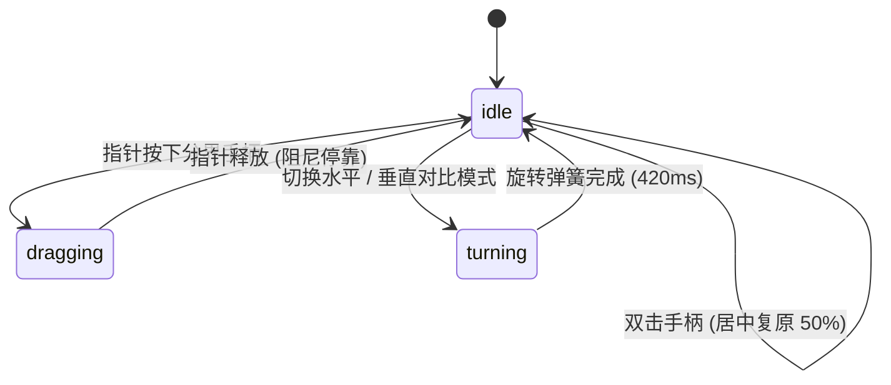

# Image Compare · 图像对比滑块

双图前后效果分割对比滑块。核心动效包含分界线与胶囊手柄的指针拖拽跟随（Pointer Drag & Catch-up Lag）、边缘弹性拉伸（Edge Rubberband）、双向（横向/纵向）90° 旋转形变切换（Quarter-turn Polygon Clip）、双击居中复位以及键盘无障碍步进。

## 原型清单

| 原型分组 | 原型元素 | 动效 / 状态变化 | 去向 |
| --- | --- | --- | --- |
| 分割视口 | 图像对比视口（`.compare-viewport`） | 承载底层“后”（After）图与动态裁剪层“前”（Before）图；90° 横竖方向旋转弹簧过渡 | 对比视口与裁剪分界线 |
| 裁剪图层 | 动态裁剪图层（`.layer-before`） | 使用 CSS `clip-path: polygon()` 依据手柄位置实时计算多边形遮罩 | 动态多边形遮罩裁剪 |
| 拖拽手柄 | 分割线与交互胶囊（`.compare-handle`） | 指针按下抓取、平滑跟随指针移动、释放后按阻尼弹簧停靠；边缘处具有 9px 弹性拉伸 | 分割线胶囊拖拽与阻尼弹簧 |
| 标签提示 | 前后标识徽章（`.compare-badge`） | 随手柄移动在接近边缘时平滑淡出，避免与手柄胶囊重叠 | 徽章边缘避让与淡入淡出 |
| 演示外壳 | 顶部主题切换、预设图片资源切换器、全屏居中定位舞台 | 演示用途 | 演示外壳，已删除 |

## 适用

- 修图、调色、降噪、超分辨率前后效果的实时交互对比。
- 3D 渲染图与线框草图、浅色模式与深色模式界面的同屏交互比对。
- 支持横向（水平滑动）或纵向（上下滑动）两种对比轴向。

## 不适用

- 多张图片轮播滑块 → [carousel](carousel.md)
- 文件上传拖拽投递 → [file-dropzone](file-dropzone.md)
- 文档编辑器内的文件附件投递区 → [file-dropzone](../editors/file-dropzone.md)

## 状态机

| 状态 | 进入条件 | 视觉表现 | 退出到 |
| --- | --- | --- | --- |
| idle | 初始居中（50%）或拖拽结束 | 分割线与胶囊静止，前后图依 50% 均分呈现，徽章清晰可见 | dragging / turning |
| dragging | 指针按下分界手柄并移动 | 手柄缩放至 1.05 抓取态，分界线与 `clip-path` 实时跟随指针，接近边界时产生弹性阻尼 | idle |
| turning | 切换对比方向（水平 ↔ 垂直） | 视口与分割线通过 420ms 弹簧完成 90° 旋转过渡并重构裁剪路径 | idle |



## 最小 DOM

```html
<div class="arc-image-compare" data-orientation="horizontal" role="region" aria-label="Image comparison">
  <div class="compare-viewport">
    <!-- 底层：After 图像 -->
    <div class="compare-layer layer-after">
      <rect width='100%' height='100%'/><text x='50%' y='50%' dominant-baseline='middle' text-anchor='middle' font-size='32' fill='%23111'>After</text></svg>" alt="After">
      <span class="compare-badge badge-after">After</span>
    </div>

    <!-- 顶层：Before 图像 (受 clip-path 裁剪) -->
    <div class="compare-layer layer-before">
      <rect width='100%' height='100%'/><text x='50%' y='50%' dominant-baseline='middle' text-anchor='middle' font-size='32' fill='%23111'>Before</text></svg>" alt="Before">
      <span class="compare-badge badge-before">Before</span>
    </div>

    <!-- 交互分界手柄 -->
    <div class="compare-handle" role="slider" aria-valuenow="50" aria-valuemin="0" aria-valuemax="100" aria-label="Compare position" tabindex="0">
      <div class="handle-line"></div>
      <div class="handle-capsule">
        <svg width="16" height="16" viewBox="0 0 24 24" fill="none" stroke="currentColor" stroke-width="2.5">
          <polyline points="15 18 9 12 15 6"></polyline>
        </svg>
        <svg width="16" height="16" viewBox="0 0 24 24" fill="none" stroke="currentColor" stroke-width="2.5">
          <polyline points="9 18 15 12 9 6"></polyline>
        </svg>
      </div>
    </div>
  </div>
</div>
```

- `.arc-image-compare`：根容器，由 `data-orientation` 控制水平或垂直方向。
- `.compare-viewport`：对比主视口，锁定宽高比并承载图层层叠。
- `.layer-before`：上层图层，CSS 依据 `--pos`（百分比）应用 `clip-path`。
- `.compare-handle`：交互手柄滑块，由 `--pos` 驱动绝对位移。

## 参数

| 名称 | 值 | 用于 | 来源 |
| --- | --- | --- | --- |
| 手柄移动弹簧 | `260ms` / `cubic-bezier(0.18, 0.89, 0.32, 1.15)` | 释放后的平滑惯性对齐 | 原型 |
| 旋转切换弹簧 | `420ms` / `cubic-bezier(0.16, 1, 0.3, 1)` | 水平与垂直模式 90° 旋转 | 原型 |
| 边缘弹性拉伸 | `9px` | 滑动手柄触碰边缘时的弹性回弹阻尼 | 原型 |
| 徽章避让淡出阈值 | `28px` | 手柄接近边缘标签时徽章透明度降低 | 原型 |
| 胶囊尺寸 | `40px × 24px`，圆角 `12px` | 手柄抓取胶囊形态 | 原型 |

## CSS

```css
.arc-image-compare {
  --pos: 50%;
  --ease-spring: cubic-bezier(0.18, 0.89, 0.32, 1.15);
  --ease-calm: cubic-bezier(0.16, 1, 0.3, 1);

  position: relative;
  width: 100%;
  max-width: 600px;
  margin: 0 auto;
  user-select: none;
  font-family: system-ui, -apple-system, sans-serif;
}

.compare-viewport {
  position: relative;
  width: 100%;
  aspect-ratio: 3 / 2;
  overflow: hidden;
  border-radius: 16px;
  background: #f6f8fa;
  box-shadow: 0 4px 20px rgba(0, 0, 0, 0.08);
}

.compare-layer {
  position: absolute;
  inset: 0;
  width: 100%;
  height: 100%;
}

.compare-layer img {
  width: 100%;
  height: 100%;
  object-fit: cover;
  display: block;
}

/* 裁剪路径控制 */
.arc-image-compare[data-orientation="horizontal"] .layer-before {
  clip-path: polygon(0 0, var(--pos) 0, var(--pos) 100%, 0 100%);
}

.arc-image-compare[data-orientation="vertical"] .layer-before {
  clip-path: polygon(0 0, 100% 0, 100% var(--pos), 0 var(--pos));
}

/* 状态角标 */
.compare-badge {
  position: absolute;
  padding: 4px 8px;
  border-radius: 6px;
  background: rgba(0, 0, 0, 0.65);
  color: #ffffff;
  font-size: 11px;
  font-weight: 500;
  pointer-events: none;
  backdrop-filter: blur(8px);
  transition: opacity 200ms ease;
}

.badge-before {
  top: 12px;
  left: 12px;
}

.badge-after {
  top: 12px;
  right: 12px;
}

/* 交互手柄 */
.compare-handle {
  position: absolute;
  top: 0;
  left: 0;
  width: 100%;
  height: 100%;
  pointer-events: none;
  outline: none;
}

.arc-image-compare[data-orientation="horizontal"] .compare-handle {
  transform: translateX(calc(var(--pos) - 50%));
}

.arc-image-compare[data-orientation="vertical"] .compare-handle {
  transform: translateY(calc(var(--pos) - 50%));
}

.handle-line {
  position: absolute;
  background: #ffffff;
  box-shadow: 0 0 6px rgba(0, 0, 0, 0.35);
}

.arc-image-compare[data-orientation="horizontal"] .handle-line {
  left: 50%;
  top: 0;
  width: 2px;
  height: 100%;
  transform: translateX(-50%);
}

.arc-image-compare[data-orientation="vertical"] .handle-line {
  top: 50%;
  left: 0;
  height: 2px;
  width: 100%;
  transform: translateY(-50%);
}

.handle-capsule {
  position: absolute;
  top: 50%;
  left: 50%;
  transform: translate(-50%, -50%);
  width: 40px;
  height: 24px;
  border-radius: 12px;
  background: #ffffff;
  box-shadow: 0 2px 8px rgba(0, 0, 0, 0.25);
  display: flex;
  align-items: center;
  justify-content: center;
  gap: 2px;
  color: #24292f;
  pointer-events: auto;
  cursor: grab;
  transition: transform 140ms var(--ease-spring), box-shadow 140ms ease;
}

.handle-capsule:active {
  cursor: grabbing;
  transform: translate(-50%, -50%) scale(1.08);
  box-shadow: 0 4px 14px rgba(0, 0, 0, 0.35);
}

.compare-handle:focus-visible .handle-capsule {
  box-shadow: 0 0 0 3px #0969da;
}

@media (prefers-reduced-motion: reduce) {
  .compare-handle,
  .layer-before,
  .handle-capsule {
    transition: none !important;
  }
}
```

## JS

```js
export function createImageCompare(el, options = {}) {
  const root = el;
  const viewport = root.querySelector('.compare-viewport');
  const handle = root.querySelector('.compare-handle');
  const capsule = root.querySelector('.handle-capsule');

  let position = options.defaultPosition ?? 50;
  let isDragging = false;
  let orientation = options.orientation || root.dataset.orientation || 'horizontal';

  function setPosition(pos) {
    position = Math.max(0, Math.min(100, pos));
    root.style.setProperty('--pos', `${position}%`);
    if (handle) {
      handle.setAttribute('aria-valuenow', String(Math.round(position)));
    }
    if (options.onChange) {
      options.onChange(position);
    }
  }

  function updateFromPointer(clientX, clientY) {
    if (!viewport) return;
    const rect = viewport.getBoundingClientRect();
    if (orientation === 'horizontal') {
      const x = clientX - rect.left;
      const pct = (x / rect.width) * 100;
      setPosition(pct);
    } else {
      const y = clientY - rect.top;
      const pct = (y / rect.height) * 100;
      setPosition(pct);
    }
  }

  const handlePointerDown = (e) => {
    isDragging = true;
    capsule?.classList.add('is-active');
    updateFromPointer(e.clientX, e.clientY);
  };

  const handlePointerMove = (e) => {
    if (!isDragging) return;
    updateFromPointer(e.clientX, e.clientY);
  };

  const handlePointerUp = () => {
    if (!isDragging) return;
    isDragging = false;
    capsule?.classList.remove('is-active');
  };

  const handleDoubleClick = () => {
    setPosition(50);
  };

  const handleKeydown = (e) => {
    const step = e.shiftKey ? 10 : 2;
    if (e.key === 'ArrowLeft' || e.key === 'ArrowUp') {
      e.preventDefault();
      setPosition(position - step);
    } else if (e.key === 'ArrowRight' || e.key === 'ArrowDown') {
      e.preventDefault();
      setPosition(position + step);
    } else if (e.key === 'Home') {
      e.preventDefault();
      setPosition(0);
    } else if (e.key === 'End') {
      e.preventDefault();
      setPosition(100);
    }
  };

  viewport?.addEventListener('mousedown', handlePointerDown);
  window.addEventListener('mousemove', handlePointerMove);
  window.addEventListener('mouseup', handlePointerUp);
  capsule?.addEventListener('dblclick', handleDoubleClick);
  handle?.addEventListener('keydown', handleKeydown);

  // 初始化位置
  setPosition(position);

  return {
    destroy: () => {
      viewport?.removeEventListener('mousedown', handlePointerDown);
      window.removeEventListener('mousemove', handlePointerMove);
      window.removeEventListener('mouseup', handlePointerUp);
      capsule?.removeEventListener('dblclick', handleDoubleClick);
      handle?.removeEventListener('keydown', handleKeydown);
    },
    setPosition,
    setOrientation: (newOrientation) => {
      orientation = newOrientation;
      root.dataset.orientation = newOrientation;
      setPosition(position);
    }
  };
}
```

## 接入目标项目

- 状态来源：
  - 由图像对比组件受控 `position` 或非受控 `defaultPosition` 驱动，变动时通过 `onChange(pos)` 广播当前百分比。
- 尺寸策略：
  - 容器通过 `aspect-ratio` 保证双图尺寸严格一致，图片通过 `object-fit: cover` 消除排版拉伸。
- 驱动方式：
  - 页面挂载时调用 `const compare = createImageCompare(container, { defaultPosition: 50 })`。
  - 卸载时调用 `compare.destroy()` 移除全局鼠标跟踪监听。

## 重入与清理

- 连续拖拽与边缘越界：位置在 0% 到 100% 之间被安全钳制，杜绝溢出视口。
- 卸载清理：`destroy()` 清理绑定在 `window` 上的 `mousemove` 与 `mouseup` 全局监听。

## 减少动态效果

- 激活 `prefers-reduced-motion: reduce` 时：
  - 禁用方向旋转与手柄位移过渡曲线，滑块完全以静态坐标更新呈现。

## 焦点与键盘

- 手柄具备 `role="slider"`，支持标准无障碍滑块属性（`aria-valuenow`, `aria-valuemin="0"`, `aria-valuemax="100"`）。
- 支持左右/上下方向键步进 2%，配合 Shift 键步进 10%，支持 Home（0%）与 End（100%）。

## 兼容回退

| 特性 | 不支持时 |
| --- | --- |
| CSS `clip-path: polygon()` | 回退至带有 `overflow: hidden` 的绝对定位遮罩容器。 |
| CSS `aspect-ratio` | 回退至 `padding-top: 66.66%` 传统占位容器。 |

## 验收清单

- [ ] 鼠标在视口内按下并拖拽，分界线与前图裁剪范围实时跟随指针平滑切分。
- [ ] 双击中间胶囊手柄，滑块自动平滑复位至 50% 居中位置。
- [ ] 键盘聚焦手柄时可通过方向键步进微调对比百分比。
- [ ] 开启减少动态偏好时，手柄位置瞬时同步，无缓动延迟。
