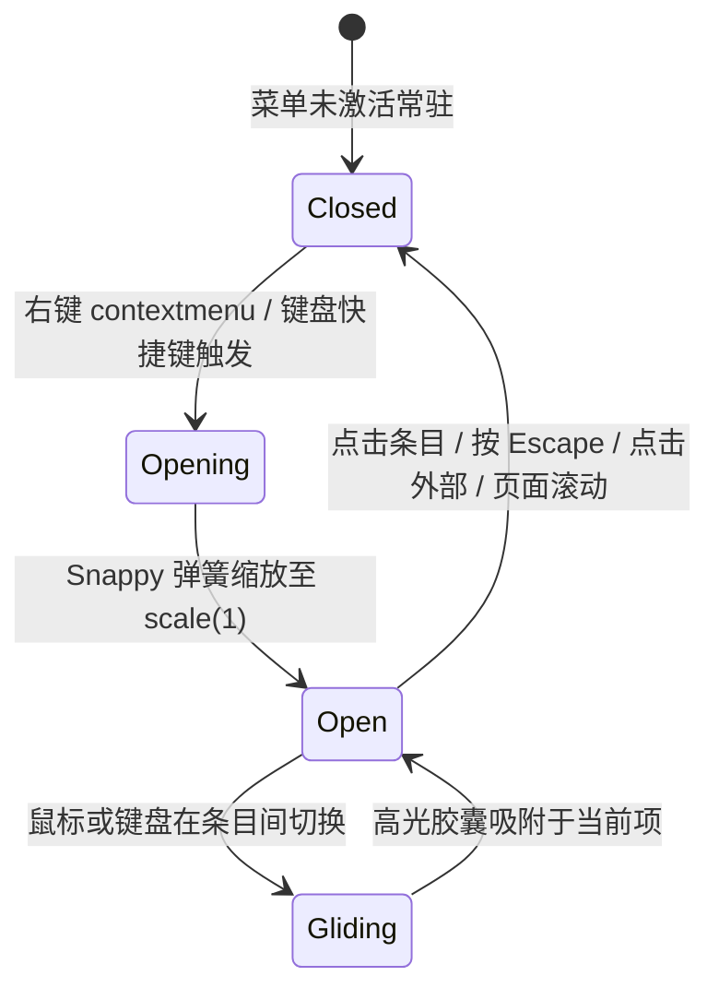

# Context Menu · 上下文菜单

光标精准定位的浮动右键/长按菜单。菜单从光标指针或键盘触发坐标作为动态原点（`transform-origin`）向外弹性展开；内置视口四向防溢出边界裁剪算法，条目间搭载平滑滑动的背景高光胶囊（Gliding Highlight）。涵盖四大核心机制：

1. 动态缩放原点与视口自适应裁剪（Origin-Aware Clamp & Spring Entrance）：根据鼠标右键坐标或键盘触发焦点边界，计算防止溢出屏幕的 `(x, y)` 坐标与相对 `transform-origin`，以 Snappy 弹簧从 `scale(0.96)` 向外弹性展开。
2. 条目间滑动高光胶囊（Gliding Highlight Pill）：菜单内单例高光底板在条目移动时以弹簧沿 Y 轴和高度平滑滑动追随；遇危险项（Destructive）自动赋以警示色；指针移出时 70ms 意图防抖淡出。
3. 阶梯错峰微动效（Staggered Item Entrance）：菜单项按顺序叠加 `min(i, 4) * 35ms` 微延迟，产生极其细腻的自上而下层叠浮现感。
4. 全键盘导航与环境变化自动收起：支持 `ArrowDown`/`ArrowUp`/`Home`/`End` 循环巡航与 `Escape` 键安全退出；外部发生鼠标按下、滚动（Scroll）或窗口缩放（Resize）时自动平滑淡出关闭。

## 原型清单

| 原型分组 | 原型元素 | 动效 / 状态变化 | 去向 |
| --- | --- | --- | --- |
| 官方上下文舞台 | 触发卡片 `#cmTarget` | 承载右键、长按与键盘呼出；悬停微变色 | 动态缩放原点与视口自适应裁剪 |
| 官方上下文舞台 | 浮动菜单容器 `.cm-menu` | 动态插入 body；Snappy 缩放与淡出动效 | 动态缩放原点与视口自适应裁剪 |
| 官方上下文舞台 | 滑动高光底板 `.cm-highlight` | 条目间纵向位移与高度弹簧追随；遇危险项变色 | 条目间滑动高光胶囊 |
| 官方上下文舞台 | 菜单条目 `.cm-item` | 阶梯错峰微淡入 (`cm-item-in`)；危险项危险色 | 阶梯错峰微动效 |
| 官方上下文舞台 | 状态提示槽 `#cmStatus` | 操作执行后的微模糊向上浮现文本 | 演示外壳，已删除 |
| — | 顶栏独立主题切换器 `#themeBtn` | 演示主题切换 | 演示外壳，已删除 |
| — | embed/postMessage 同步逻辑 | iframe 适配 | 演示外壳，已删除 |
| — | 全局失去焦点补丁 `__arc_blur_installed` | 焦点清除逻辑 | 演示外壳，已删除 |

## 适用

- 桌面端数据行、文件列表、画布元素或卡片的右键上下文菜单。
- 触控端针对特定元素的长按快捷操作弹层。
- 需要以交互点为视觉生长中心、兼顾极速键盘操作的高频快捷工具。

## 不适用

- 固定由某个标准按钮垂直向下弹出的常规下拉动作列表 → [dropdown-menu](dropdown-menu.md)
- 主动作带独立下拉箭头的紧凑型复合按钮 → [split-button](../buttons/split-button.md)
- 包含个人信息展示、多段式主题切换等复合设置面板 → [user-menu](user-menu.md)

## 状态机



| 状态 | 进入条件 | 视觉表现 | 退出到 |
| --- | --- | --- | --- |
| `closed` | 初始状态 / 点击外部 / 按 Escape | 菜单节点不在 DOM 中或以 scale(0.98) 淡出销毁 | `opening` |
| `opening` | 接收到右键坐标或键盘事件 | 测量自身尺寸并计算边界，以点击坐标为原点自 0.96 弹性放大 | `open` |
| `open` | 菜单就绪并聚焦首项 | 呈现固定定位浮动面板，条目按阶梯错峰微浮现 | `gliding`, `closed` |
| `gliding` | 指针或键盘上下切换项 | 高光胶囊以 520 stiffness 弹簧连续补间到目标项位置 | `open` |

## 最小 DOM

```html
<!-- 1. 触发目标区域 -->
<div class="cm-target" tabindex="0" role="button" aria-haspopup="menu" aria-expanded="false" aria-label="Project actions">
  <div class="cm-target-card">
    <div class="cm-copy">
      <strong>Quarterly launch</strong>
      <span>Product · Updated today</span>
    </div>
  </div>
</div>

<!-- 2. 动态生成的菜单模板 (由 JS 挂载在 body 根节点) -->
<div class="cm-menu" role="menu" aria-label="Project actions" tabindex="-1">
  <!-- 滑动高光胶囊底板 -->
  <span class="cm-highlight" aria-hidden="true"></span>

  <!-- 菜单项列表 -->
  <button type="button" role="menuitem" class="cm-item" data-index="0" style="--i: 0;">
    <span class="cm-icon" aria-hidden="true">
      <svg width="15" height="15" viewBox="0 0 24 24" fill="none" stroke="currentColor" stroke-width="2"><path d="M12 20h9"/><path d="M16.5 3.5a2.121 2.121 0 0 1 3 3L7 19l-4 1 1-4L16.5 3.5z"/></svg>
    </span>
    <span>Edit project</span>
  </button>

  <button type="button" role="menuitem" class="cm-item" data-index="1" style="--i: 1;">
    <span class="cm-icon" aria-hidden="true">
      <svg width="15" height="15" viewBox="0 0 24 24" fill="none" stroke="currentColor" stroke-width="2"><rect width="14" height="14" x="8" y="8" rx="2"/><path d="M4 16c-1.1 0-2-.9-2-2V4c0-1.1.9-2 2-2h10c1.1 0 2 .9 2 2"/></svg>
    </span>
    <span>Copy link</span>
  </button>

  <button type="button" role="menuitem" class="cm-item is-destructive" data-tone="danger" data-index="2" style="--i: 2;">
    <span class="cm-icon" aria-hidden="true">
      <svg width="15" height="15" viewBox="0 0 24 24" fill="none" stroke="currentColor" stroke-width="2"><path d="M3 6h18"/><path d="M19 6v14c0 1-1 2-2 2H7c-1 0-2-1-2-2V6"/></svg>
    </span>
    <span>Delete project</span>
  </button>
</div>
```

- `.cm-target`：右键捕获的宿主容器。
- `.cm-menu`：绝对定位于 `body` 的上下文悬浮容器，根据视口边界限制坐标。
- `.cm-highlight`：绝对定位滑动高光层。
- `.cm-item`：独立菜单项，携带有 `--i` 序号变量用于错峰动画。

## 参数

| 名称 | 值 | 用于 | 来源 |
| --- | --- | --- | --- |
| 菜单默认基准宽度 | `208px` | 未挂载前初始测量参考宽 | 原型 |
| 视口安全边距 | `8px` | 防止菜单贴近视口边缘的最小内缩 | 原型 |
| 展开 Snappy 弹簧 | `{ stiffness: 520, damping: 35, mass: 0.8 }` | 菜单弹出缩放及高光胶囊移动 | 原型 |
| 入场淡入时长 | `160ms cubic-bezier(0.16, 1, 0.3, 1)` | 菜单透明度 `0 -> 1` | 原型 |
| 退场收起时长 | `120ms cubic-bezier(0.22, 1, 0.36, 1)` | 菜单透明度与缩放 `1 -> 0.98` 退场 | 原型 |
| 阶梯入场延迟步进 | `35ms` | 条目入场错峰（`min(i, 4) * 35ms`） | 原型 |
| 移出高光防抖延迟 | `70ms` | 光标移出菜单后等待平滑淡出的窗口期 | 原型 |
| 危险反馈色 | `#f43f5e` | 删除等破坏性操作的高亮底色与文本色 | 原型 |

## CSS

```css
.cm-target {
  display: block;
  outline: none;
  border-radius: 18px;
  cursor: pointer;
  user-select: none;
}

.cm-target-card {
  display: flex;
  align-items: center;
  justify-content: space-between;
  min-width: 220px;
  padding: 14px 18px;
  border: 1px solid rgba(0, 0, 0, 0.08);
  border-radius: 18px;
  background: var(--surface-muted, #f4f4f4);
  color: var(--foreground, #0b0b0b);
  transition: border-color 160ms ease, background-color 160ms ease;
}
.cm-target:hover .cm-target-card {
  border-color: rgba(0, 0, 0, 0.16);
  background: #ffffff;
}
.cm-target:focus-visible .cm-target-card {
  outline: 2px solid currentColor;
  outline-offset: 2px;
}

.cm-copy {
  display: flex;
  flex-direction: column;
  gap: 4px;
}
.cm-copy strong {
  font-size: 14px;
  font-weight: 600;
}
.cm-copy span {
  font-size: 12px;
  color: #888888;
}

/* 浮动菜单容器 */
.cm-menu {
  position: fixed;
  z-index: 1000;
  min-width: min(13rem, calc(100vw - 16px));
  max-width: calc(100vw - 16px);
  max-height: min(300px, calc(100vh - 16px));
  overflow-y: auto;
  padding: 5px;
  border: 1px solid rgba(0, 0, 0, 0.08);
  border-radius: 14px;
  background: #ffffff;
  color: #0b0b0b;
  box-shadow: 0 16px 36px rgba(0, 0, 0, 0.12), 0 2px 6px rgba(0, 0, 0, 0.04);
  outline: none;
  will-change: transform, opacity;
}

/* 滑动高光胶囊 */
.cm-highlight {
  position: absolute;
  top: 0;
  right: 5px;
  left: 5px;
  border-radius: 9px;
  background: #f4f4f4;
  opacity: 0;
  pointer-events: none;
  will-change: transform, height, opacity;
  transition: background-color 160ms cubic-bezier(0.22, 1, 0.36, 1),
              opacity 120ms cubic-bezier(0.22, 1, 0.36, 1);
}
.cm-highlight[data-tone="danger"] {
  background: rgba(244, 63, 94, 0.12);
}

/* 菜单项 */
.cm-item {
  position: relative;
  display: flex;
  width: 100%;
  min-height: 34px;
  align-items: center;
  gap: 10px;
  padding: 0 12px;
  border: 0;
  border-radius: 9px;
  background: transparent;
  color: inherit;
  font: inherit;
  font-size: 13.5px;
  font-weight: 500;
  text-align: left;
  cursor: pointer;
  outline: none;
  user-select: none;
  transition: color 160ms cubic-bezier(0.22, 1, 0.36, 1);
  animation: cmItemIn 240ms cubic-bezier(0.16, 1, 0.3, 1) both;
  animation-delay: calc(min(var(--i, 0), 4) * 35ms);
}
.cm-item:active:not(:disabled) {
  background: rgba(0, 0, 0, 0.05);
}
.cm-item:disabled {
  opacity: 0.45;
  cursor: default;
}
.cm-item.is-destructive {
  color: #f43f5e;
}

.cm-icon {
  display: inline-flex;
  flex: none;
  width: 16px;
  align-items: center;
  justify-content: center;
  color: #666666;
}
.cm-item.is-destructive .cm-icon {
  color: currentColor;
}

@keyframes cmItemIn {
  from {
    opacity: 0;
    transform: translateY(-2px);
  }
  to {
    opacity: 1;
    transform: translateY(0);
  }
}
```

## JS

```js
const SNAPPY_SPRING = { stiffness: 520, damping: 35, mass: 0.8 };

function animateSpring(from, to, config, onUpdate, onComplete) {
  let current = from;
  let velocity = config.velocity || 0;
  const stiffness = config.stiffness || 520;
  const damping = config.damping || 35;
  const mass = config.mass || 0.8;
  const epsilon = config.epsilon || 0.001;
  let lastTime = performance.now();
  let rafId = null;
  let stopped = false;

  function step(now) {
    if (stopped) return;
    const dt = Math.min((now - lastTime) / 1000, 0.032);
    lastTime = now;
    const force = -stiffness * (current - to) - damping * velocity;
    const accel = force / mass;
    velocity += accel * dt;
    current += velocity * dt;

    if (Math.abs(current - to) < epsilon && Math.abs(velocity) < epsilon * 10) {
      current = to;
      onUpdate(current);
      if (onComplete) onComplete();
      return;
    }
    onUpdate(current);
    rafId = requestAnimationFrame(step);
  }

  rafId = requestAnimationFrame(step);
  return {
    stop() {
      stopped = true;
      if (rafId) cancelAnimationFrame(rafId);
    }
  };
}

function clampTo(x, y, width, height) {
  const left = Math.max(8, Math.min(x, window.innerWidth - width - 8));
  const top = Math.max(8, Math.min(y, window.innerHeight - height - 8));
  return {
    x: left,
    y: top,
    originX: Math.max(0, Math.min(width, x - left)),
    originY: Math.max(0, Math.min(height, y - top))
  };
}

/**
 * 绑定上下文菜单控制器
 * @param {HTMLElement} targetEl 触发上下文菜单的宿主元素
 * @param {Object} options 配置项
 * @param {Array<{id: string, label: string, icon?: string, destructive?: boolean, onSelect: Function}>} options.items 菜单项
 * @returns {{ close: Function, destroy: Function }} 控制句柄
 */
export function bindContextMenu(targetEl, { items = [] } = {}) {
  let isOpen = false;
  let activeInstance = null;

  function closeMenu(returnFocus = false) {
    if (!isOpen || !activeInstance) return;
    isOpen = false;
    targetEl.setAttribute("aria-expanded", "false");
    const inst = activeInstance;
    inst.live = false;
    activeInstance = null;

    if (inst.scaleAnim) inst.scaleAnim.stop();
    if (inst.hlTopAnim) inst.hlTopAnim.stop();

    inst.el.animate(
      [
        { opacity: 1, transform: "scale(1)" },
        { opacity: 0, transform: "scale(0.98)" }
      ],
      { duration: 120, easing: "cubic-bezier(0.22, 1, 0.36, 1)", fill: "forwards" }
    ).onfinish = () => inst.el.remove();

    if (returnFocus) targetEl.focus({ preventScroll: true });
  }

  function showMenu(rawX, rawY) {
    if (activeInstance) closeMenu(false);

    isOpen = true;
    targetEl.setAttribute("aria-expanded", "true");

    const menuEl = document.createElement("div");
    menuEl.className = "cm-menu";
    menuEl.setAttribute("role", "menu");
    menuEl.tabIndex = -1;

    const highlightEl = document.createElement("span");
    highlightEl.className = "cm-highlight";
    highlightEl.setAttribute("aria-hidden", "true");
    menuEl.appendChild(highlightEl);

    const inst = {
      el: menuEl,
      highlightEl,
      live: true,
      pointer: false,
      clearTimer: 0,
      highlight: null,
      hlY: 0,
      hlH: 34,
      hlTopAnim: null,
      scaleAnim: null
    };

    function placeHighlight(itemEl, glide) {
      window.clearTimeout(inst.clearTimer);
      const top = itemEl.offsetTop;
      const height = itemEl.offsetHeight;
      const isDanger = itemEl.dataset.tone === "danger";

      if (isDanger) highlightEl.setAttribute("data-tone", "danger");
      else highlightEl.removeAttribute("data-tone");
      highlightEl.style.opacity = "1";

      if (inst.hlTopAnim) inst.hlTopAnim.stop();

      if (glide && inst.highlight !== null) {
        inst.hlTopAnim = animateSpring(
          inst.hlY,
          top,
          { ...SNAPPY_SPRING, epsilon: 0.1 },
          (y) => {
            inst.hlY = y;
            highlightEl.style.transform = `translate3d(0, ${y}px, 0)`;
          }
        );
        highlightEl.style.height = `${height}px`;
      } else {
        inst.hlY = top;
        highlightEl.style.transform = `translate3d(0, ${top}px, 0)`;
        highlightEl.style.height = `${height}px`;
      }
      inst.highlight = { top, height };
    }

    function clearHighlight() {
      window.clearTimeout(inst.clearTimer);
      inst.clearTimer = window.setTimeout(() => {
        inst.highlight = null;
        highlightEl.style.opacity = "0";
      }, 70);
    }

    items.forEach((item, index) => {
      const btn = document.createElement("button");
      btn.type = "button";
      btn.setAttribute("role", "menuitem");
      btn.className = `cm-item${item.destructive ? " is-destructive" : ""}`;
      btn.tabIndex = -1;
      btn.dataset.index = String(index);
      if (item.destructive) btn.dataset.tone = "danger";
      btn.style.setProperty("--i", String(index));
      btn.innerHTML = `
        ${item.icon ? `<span class="cm-icon" aria-hidden="true">${item.icon}</span>` : ""}
        <span>${item.label}</span>
      `;

      btn.addEventListener("pointermove", () => {
        if (!inst.live) return;
        inst.pointer = true;
        window.clearTimeout(inst.clearTimer);
        btn.focus({ preventScroll: true });
        placeHighlight(btn, true);
      });

      btn.addEventListener("pointerleave", () => {
        if (inst.live) clearHighlight();
      });

      btn.addEventListener("click", (e) => {
        e.stopPropagation();
        closeMenu(true);
        if (typeof item.onSelect === "function") item.onSelect();
      });

      menuEl.appendChild(btn);
    });

    menuEl.addEventListener("keydown", (e) => {
      const enabled = Array.from(menuEl.querySelectorAll('[role="menuitem"]:not(:disabled)'));
      if (!enabled.length) return;
      const currentIdx = enabled.indexOf(document.activeElement);
      let nextIdx;

      if (e.key === "ArrowDown") nextIdx = (currentIdx + 1) % enabled.length;
      else if (e.key === "ArrowUp") nextIdx = currentIdx < 0 ? enabled.length - 1 : (currentIdx - 1 + enabled.length) % enabled.length;
      else if (e.key === "Home") nextIdx = 0;
      else if (e.key === "End") nextIdx = enabled.length - 1;
      else if (e.key === "Escape") {
        e.preventDefault();
        closeMenu(true);
        return;
      }

      if (nextIdx !== undefined) {
        e.preventDefault();
        inst.pointer = false;
        const target = enabled[nextIdx];
        target.focus({ preventScroll: true });
        placeHighlight(target, false);
      }
    });

    document.body.appendChild(menuEl);
    activeInstance = inst;

    // 视口四向防溢出计算
    const clamped = clampTo(rawX, rawY, menuEl.offsetWidth || 208, menuEl.offsetHeight || 120);
    menuEl.style.left = `${clamped.x}px`;
    menuEl.style.top = `${clamped.y}px`;
    menuEl.style.transformOrigin = `${clamped.originX}px ${clamped.originY}px`;

    menuEl.animate([{ opacity: 0 }, { opacity: 1 }], {
      duration: 160,
      easing: "cubic-bezier(0.16, 1, 0.3, 1)",
      fill: "forwards"
    });
    inst.scaleAnim = animateSpring(0.96, 1, SNAPPY_SPRING, (s) => {
      menuEl.style.transform = `scale(${s})`;
    });

    const firstItem = menuEl.querySelector('[role="menuitem"]:not(:disabled)');
    if (firstItem) firstItem.focus({ preventScroll: true });
  }

  const onContextMenu = (e) => {
    e.preventDefault();
    showMenu(e.clientX, e.clientY);
  };

  const onTargetClick = (e) => {
    const rect = targetEl.getBoundingClientRect();
    showMenu(rect.left + 12, rect.bottom + 8);
  };

  const onTargetKeyDown = (e) => {
    if (e.key === "ContextMenu" || (e.shiftKey && e.key === "F10") || e.key === "Enter" || e.key === " ") {
      e.preventDefault();
      const rect = targetEl.getBoundingClientRect();
      showMenu(rect.left + 12, rect.bottom + 8);
    }
  };

  const onDocPointerDown = (e) => {
    if (isOpen && activeInstance && !activeInstance.el.contains(e.target) && !targetEl.contains(e.target)) {
      closeMenu(false);
    }
  };

  const onScrollOrResize = () => {
    if (isOpen) closeMenu(false);
  };

  targetEl.addEventListener("contextmenu", onContextMenu);
  targetEl.addEventListener("click", onTargetClick);
  targetEl.addEventListener("keydown", onTargetKeyDown);
  document.addEventListener("pointerdown", onDocPointerDown);
  window.addEventListener("scroll", onScrollOrResize, true);
  window.addEventListener("resize", onScrollOrResize);

  return {
    close: () => closeMenu(false),
    destroy() {
      closeMenu(false);
      targetEl.removeEventListener("contextmenu", onContextMenu);
      targetEl.removeEventListener("click", onTargetClick);
      targetEl.removeEventListener("keydown", onTargetKeyDown);
      document.removeEventListener("pointerdown", onDocPointerDown);
      window.removeEventListener("scroll", onScrollOrResize, true);
      window.removeEventListener("resize", onScrollOrResize);
    }
  };
}
```

## 接入目标项目

- 状态来源：目标元素选中的实体数据。在 `items` 中传递操作回调 `onSelect`，可绑定具体的业务编辑、复制或删除动作。
- 尺寸策略：自适应条目文本长度，通过 CSS `min-width: min(13rem, calc(100vw - 16px))` 与 `max-width` 限制最大最小范围。
- 驱动方式：通过传入目标 DOM 并调用 `bindContextMenu(el, { items })` 即可全权托管右键捕获、菜单渲染、弹簧追随与销毁。

## 重入与清理

- 连续右键防重：如果在已有菜单激活状态下在别处再次右键，立即调用 `closeMenu(false)` 销毁前序菜单，并在新坐标即时挂载新菜单，杜绝重复多重弹窗。
- 销毁清理：调用 `destroy()` 将彻底解除在 `window` 与 `document` 上挂载的滚动、缩放和指针监听。

## 减少动态效果

系统开启 `prefers-reduced-motion: reduce` 时：
1. 移除 `scale(0.96) -> 1` 弹簧缩放与高光底板的平移动画，直接瞬时显示。
2. 移除条目间 `cmItemIn` 阶梯延迟位移动画。

```css
@media (prefers-reduced-motion: reduce) {
  .cm-menu,
  .cm-item,
  .cm-highlight {
    animation: none !important;
    transition: none !important;
  }
}
```

## 焦点与键盘

- 键盘触发：支持原生右键快捷键（`ContextMenu`、`Shift+F10`）以及聚焦时的 `Space` 或 `Enter` 键弹出。
- 焦点管理：打开时焦点自动注入首个可用菜单项；选择操作或按 `Escape` 键关闭菜单后焦点安全返还给触发宿主元素。

## 兼容回退

| 特性 | 不支持时 |
| --- | --- |
| CSS `color-mix()` | 危险高光背景直接使用 `rgba(244, 63, 94, 0.12)` 颜色回退。 |
| Pointer Events | 原生回退到标准 `mousemove` 与 `click` 事件。 |

## 验收清单

- [ ] 在触发区域点击鼠标右键，菜单紧贴光标坐标弹出，并以点击点为圆心产生平滑的 0.96 弹簧微放大。
- [ ] 在屏幕右侧或底部边缘触发右键，菜单自动检测视口边界并智能向内收敛，不发生溢出截断。
- [ ] 鼠标指针在菜单项之间快速滑动，高光胶囊底板平滑跟手滑动并自适应高度；光标离开 70ms 后平滑淡出。
- [ ] 选中危险性操作项（如 Delete），高光底板立即应用浅红色警示反馈。
- [ ] 按下键盘上下方向键（ArrowDown/ArrowUp），焦点在条目间循环遍历，高光瞬时切换至目标项。
- [ ] 按下键盘 Escape 键或滚动页面，菜单以 scale(0.98) 平滑淡出关闭，焦点返还触发元素。
- [ ] 系统开启减弱动态效果时，缩放与滑动高光动画关闭，功能完整可用。
