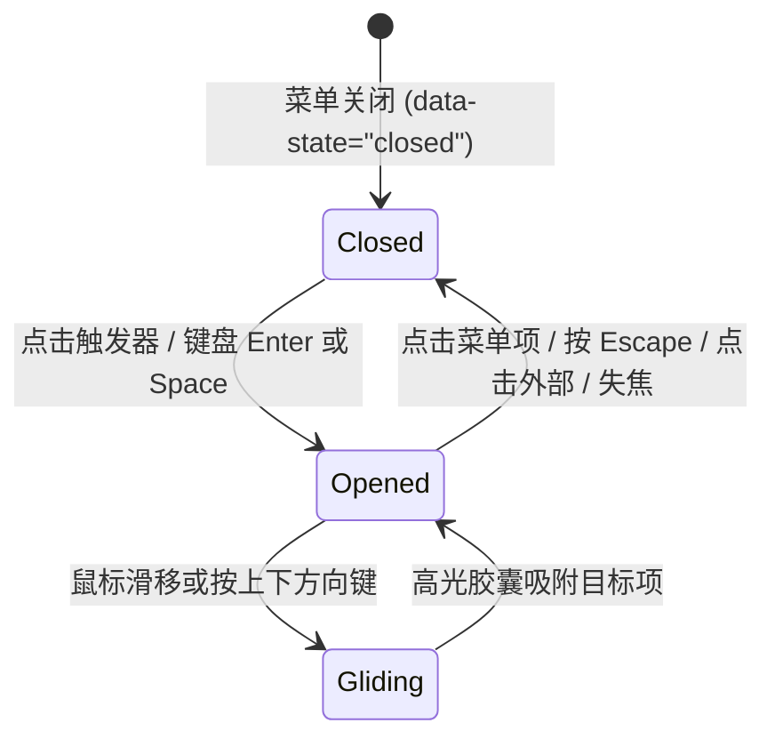

# Dropdown Menu · 下拉菜单

用于操作栏与列表头的高保真下拉动作菜单。包含触发器文字自适应测量、智能视口防遮挡翻转（Collision Flip）、背景模态锁（Modal Lock）以及键入首字母快速检索（Typeahead）。涵盖四大核心机制：

1. 触发器文字动态标尺（Trigger Label Morphing）：触发器内部包含幽灵标尺 `.dropdown-menu-label-measure`，通过 `ResizeObserver` 实时监听文本宽度，并在文案变更时以弹簧曲线驱动容器宽度横向伸缩；Chevron 折角箭头在打开时平滑翻转 180°。
2. 智能碰撞检测与对齐翻转（Smart Collision Flip & Anchor Placement）：
   - 动态测算触发器距离视口底部（`below`）与顶部（`above`）的可用距离。
   - 当下方垂直空间受限且上方空间更充裕时，自动翻转至 `data-side="top"`，并将动画形变原点设为 `100% 100%`，确保从触发器边缘精准弹入。
3. 模态背景锁定与视口防抖（Modal Lock & Scrollbar Compensation）：
   - 菜单展开瞬间将 `document.body` 设为 `overflow: hidden` 与 `pointer-events: none`，自动计算并以 `paddingRight` 补偿滚动条宽度，杜绝背景内容跳动。
   - 对页面其余主体节点自动注入 `aria-hidden="true"`。
4. 全键盘首字母检索与滑动高光胶囊（Typeahead & Gliding Highlight）：
   - 支持键盘直接键入英文字符，1000ms 缓存窗口期内自动模糊匹配并将焦点跳转到目标菜单项。
   - 条目间移动时单例高光底板在 Y 轴以 520 刚度弹簧顺滑追随。

## 原型清单

| 原型分组 | 原型元素 | 动效 / 状态变化 | 去向 |
| --- | --- | --- | --- |
| 官方菜单舞台 | 触发按钮 `.dropdown-menu-trigger` | 宽度自适应测量；Chevron 顺时针 180° 翻转 | 触发器文字动态标尺 |
| 官方菜单舞台 | 触发器文字框架 `.dropdown-menu-label` | 幽灵测量文本驱动宽度弹簧伸缩 | 触发器文字动态标尺 |
| 官方菜单舞台 | 浮动挂载门面 `.dropdown-menu-portal` | 动态插入 `body`；根据触发器相对视口定位 | 智能碰撞检测与对齐翻转 |
| 官方菜单舞台 | 菜单本体面板 `.dropdown-menu-menu` | 缩放弹簧入场与原点对齐；视口边界上下自适应翻转 | 智能碰撞检测与对齐翻转 |
| 官方菜单舞台 | 滑动高光胶囊 `.dropdown-menu-highlight` | 条目间纵向位移与高度弹簧追随 | 全键盘首字母检索与滑动高光胶囊 |
| 官方菜单舞台 | 菜单条目 `.dropdown-menu-item` | 悬停/键盘聚焦激活；支持禁用态与危险态 | 全键盘首字母检索与滑动高光胶囊 |
| 官方菜单舞台 | 分割线 `.dropdown-menu-separator` | 语义分割容器 | 最小 DOM |
| 官方菜单舞台 | 状态提示槽 `[role="status"]` | 操作执行反馈提示 | 演示外壳，已删除 |
| — | 顶栏独立主题切换器 `#themeBtn` | 演示主题切换 | 演示外壳，已删除 |
| — | 外层舞台卡片与居中展示外壳 | 演示居中外壳 | 演示外壳，已删除 |

## 适用

- 工具栏操作按钮、表格行操作扩展选项。
- 页面底部操作栏（需自动向上翻转展开以防被屏幕裁剪）。
- 需要完整的首字母键入查找（Typeahead）与滚动锁定保护的复杂业务菜单。

## 不适用

- 依赖光标右键或触控长按在任意坐标呼出的上下文菜单 → [context-menu](context-menu.md)
- 主动作带独立下拉箭头的紧凑型分割按钮 → [split-button](../buttons/split-button.md)
- 包含个人身份展示与行内主题滑块的用户设置菜单 → [user-menu](user-menu.md)

## 状态机



| 状态 | 进入条件 | 视觉表现 | 退出到 |
| --- | --- | --- | --- |
| `closed` | 初始载入 / 确认选择 / 点击遮罩 / 按 Escape | 菜单自 DOM 中卸载或缩放渐隐；触发器 chevron 归位 0°；页面解锁滚动 | `opened` |
| `opened` | 点击触发器 / 聚焦按下 Enter 或 Space | 菜单节点挂载，计算最佳展开侧（top/bottom）；触发器 chevron 翻转 180°；页面背景锁死 | `gliding`, `closed` |
| `gliding` | 指针或键盘在选项间滑动 | 高光底板沿 Y 轴以 Snappy 弹簧平滑追随 | `opened` |

## 最小 DOM

```html
<!-- 1. 触发器按钮 -->
<button type="button" class="dropdown-menu-trigger" aria-haspopup="menu" aria-expanded="false" data-state="closed">
  <span class="dropdown-menu-trigger-icon" aria-hidden="true">
    <svg width="15" height="15" viewBox="0 0 24 24" fill="none" stroke="currentColor" stroke-width="2"><circle cx="12" cy="12" r="1"/><circle cx="19" cy="12" r="1"/><circle cx="5" cy="12" r="1"/></svg>
  </span>
  <span class="dropdown-menu-label">
    <span class="dropdown-menu-label-measure" aria-hidden="true">Project actions</span>
    <span class="dropdown-menu-label-text">Project actions</span>
  </span>
  <svg class="dropdown-menu-chevron" width="15" height="15" viewBox="0 0 24 24" fill="none" stroke="currentColor" stroke-width="1.8"><path d="m6 9 6 6 6-6"/></svg>
</button>

<!-- 2. 菜单挂载模板 (由 JS 克隆并插入至 body portal) -->
<template id="dropdown-template">
  <div class="dropdown-menu-portal" style="position: fixed; left: 0px; top: 0px; z-index: 1000;">
    <div class="dropdown-menu-menu" role="menu" tabindex="-1" data-state="open" data-side="bottom" data-align="end">
      <!-- 滑动高光胶囊 -->
      <span class="dropdown-menu-highlight" aria-hidden="true"></span>

      <!-- 菜单条目 -->
      <div class="dropdown-menu-item" role="menuitem" data-value="edit" tabindex="-1" style="--i: 0;">
        <span class="dropdown-menu-icon" aria-hidden="true">
          <svg width="15" height="15" viewBox="0 0 24 24" fill="none" stroke="currentColor" stroke-width="2"><path d="M12 20h9"/><path d="M16.5 3.5a2.121 2.121 0 0 1 3 3L7 19l-4 1 1-4L16.5 3.5z"/></svg>
        </span>
        <span>Edit project</span>
      </div>

      <div class="dropdown-menu-item" role="menuitem" data-value="download" tabindex="-1" style="--i: 1;">
        <span class="dropdown-menu-icon" aria-hidden="true">
          <svg width="15" height="15" viewBox="0 0 24 24" fill="none" stroke="currentColor" stroke-width="2"><path d="M12 15V3"/><path d="M21 15v4a2 2 0 0 1-2 2H5a2 2 0 0 1-2-2v-4"/><path d="m7 10 5 5 5-5"/></svg>
        </span>
        <span>Download brief</span>
      </div>

      <div role="separator" class="dropdown-menu-separator"></div>

      <div class="dropdown-menu-item" role="menuitem" data-value="archive" data-tone="danger" tabindex="-1" style="--i: 2;">
        <span class="dropdown-menu-icon" aria-hidden="true">
          <svg width="15" height="15" viewBox="0 0 24 24" fill="none" stroke="currentColor" stroke-width="2"><rect width="20" height="5" x="2" y="3" rx="1"/><path d="M4 8v11a2 2 0 0 0 2 2h12a2 2 0 0 0 2-2V8"/><path d="M10 12h4"/></svg>
        </span>
        <span>Archive</span>
      </div>
    </div>
  </div>
</template>
```

- `.dropdown-menu-trigger`：主触发入口，响应 `[data-state="open"]` 翻转折角图标。
- `.dropdown-menu-label-measure`：宽度测算标尺。
- `.dropdown-menu-portal`：外层挂载宿主容器，接收 `translate(x, y)` 绝对视口坐标。
- `.dropdown-menu-menu`：弹出菜单容器，携带有 `data-side="top|bottom"` 与 `data-state="open|closed"`。

## 参数

| 名称 | 值 | 用于 | 来源 |
| --- | --- | --- | --- |
| 视口安全边距 | `12px` | 防止菜单贴近视口边缘的内缩距离 | 原型 |
| 触发器外间隙 | `6px` | 菜单与触发器之间的垂直间距 | 原型 |
| Snappy 弹簧 (高光与缩放) | `{ stiffness: 520, damping: 35, mass: 0.8 }` | 高光追随与弹出层弹性放大 | 原型 |
| Morph 弹簧 (文字标尺) | `{ stiffness: 380, damping: 32, mass: 0.9 }` | 触发器文案变化时的横向宽度补间 | 原型 |
| 入场动画时长 | `160ms cubic-bezier(0.16, 1, 0.3, 1)` | 菜单缩放与淡入时长 | 原型 |
| 退场动画时长 | `120ms cubic-bezier(0.22, 1, 0.36, 1)` | 菜单缩放与淡出时长 | 原型 |
| Typeahead 缓存失效时间 | `1000ms` | 键盘连续输入过滤的重置时间 | 原型 |
| 高光移出防抖 | `70ms` | 光标移出后等待高光淡出的延迟 | 原型 |

## CSS

```css
.dropdown-menu-trigger {
  position: relative;
  display: inline-flex;
  align-items: center;
  justify-content: center;
  gap: 8px;
  height: 38px;
  padding: 0 14px;
  border: 1px solid rgba(0, 0, 0, 0.08);
  border-radius: 9999px;
  background: var(--surface, #ffffff);
  color: var(--foreground, #0b0b0b);
  font: inherit;
  font-size: 13.5px;
  font-weight: 500;
  cursor: pointer;
  user-select: none;
  outline: none;
  box-shadow: 0 1px 3px rgba(0, 0, 0, 0.05);
  transition: background-color 160ms ease, border-color 160ms ease;
}
.dropdown-menu-trigger:hover {
  background: var(--surface-muted, #f4f4f4);
  border-color: rgba(0, 0, 0, 0.16);
}
.dropdown-menu-trigger:focus-visible {
  outline: 2px solid currentColor;
  outline-offset: 2px;
}

.dropdown-menu-chevron {
  transition: transform 240ms cubic-bezier(0.22, 1, 0.36, 1);
}
.dropdown-menu-trigger[data-state="open"] .dropdown-menu-chevron {
  transform: rotate(180deg);
}

.dropdown-menu-label {
  position: relative;
  display: inline-flex;
  align-items: center;
  overflow: hidden;
  white-space: nowrap;
  transition: width 240ms cubic-bezier(0.16, 1, 0.3, 1);
}
.dropdown-menu-label-measure {
  position: absolute;
  visibility: hidden;
  pointer-events: none;
}

/* 浮动菜单本体 */
.dropdown-menu-menu {
  --menu-x: 0px;
  --menu-y: -5px;
  position: relative;
  min-width: 180px;
  max-width: calc(100vw - 24px);
  max-height: min(320px, calc(100vh - 24px));
  overflow-y: auto;
  padding: 5px;
  border: 1px solid rgba(0, 0, 0, 0.08);
  border-radius: 14px;
  background: #ffffff;
  color: #0b0b0b;
  box-shadow: 0 16px 36px rgba(0, 0, 0, 0.12), 0 2px 6px rgba(0, 0, 0, 0.04);
  outline: none;
  transform-origin: var(--radix-dropdown-menu-content-transform-origin, 100% 0%);
  transition:
    opacity 160ms cubic-bezier(0.16, 1, 0.3, 1),
    transform 580ms cubic-bezier(0.22, 1, 0.36, 1);
}
.dropdown-menu-menu[data-side="top"] {
  --menu-y: 5px;
}
@starting-style {
  .dropdown-menu-menu[data-state="open"] {
    opacity: 0;
    transform: translate(var(--menu-x), var(--menu-y)) scale(0.97);
  }
  .dropdown-menu-menu[data-state="open"] .dropdown-menu-item {
    opacity: 0;
    transform: translate(calc(var(--menu-x) * 0.4), calc(var(--menu-y) * 0.4));
  }
}
.dropdown-menu-menu[data-state="closed"] {
  opacity: 0;
  transform: translate(calc(var(--menu-x) * 0.5), calc(var(--menu-y) * 0.5)) scale(0.985);
  transition:
    opacity 130ms cubic-bezier(0.22, 1, 0.36, 1),
    transform 130ms cubic-bezier(0.22, 1, 0.36, 1);
  pointer-events: none;
}

/* 滑动高光胶囊 */
.dropdown-menu-highlight {
  position: absolute;
  top: 0;
  right: 5px;
  left: 5px;
  border-radius: 9px;
  background: #f4f4f4;
  opacity: 0;
  pointer-events: none;
  will-change: transform, height, opacity;
  transition: background-color 160ms ease, opacity 80ms ease;
}
.dropdown-menu-highlight[data-tone="danger"] {
  background: rgba(244, 63, 94, 0.12);
}

.dropdown-menu-item {
  position: relative;
  display: flex;
  width: 100%;
  min-height: 34px;
  align-items: center;
  gap: 10px;
  padding: 0 12px;
  border: 0;
  border-radius: 9px;
  background: transparent;
  color: inherit;
  font: inherit;
  font-size: 13.5px;
  font-weight: 500;
  text-align: left;
  transition:
    color 160ms cubic-bezier(0.22, 1, 0.36, 1),
    opacity 240ms cubic-bezier(0.16, 1, 0.3, 1) calc(min(var(--i, 0), 4) * 35ms),
    transform 240ms cubic-bezier(0.16, 1, 0.3, 1) calc(min(var(--i, 0), 4) * 35ms);
  cursor: pointer;
  outline: none;
  user-select: none;
  box-sizing: border-box;
}
.dropdown-menu-item[data-tone="danger"] {
  color: #f43f5e;
}
.dropdown-menu-item:active:not(:disabled) {
  background: rgba(0, 0, 0, 0.05);
}

.dropdown-menu-icon {
  display: inline-flex;
  flex: none;
  width: 16px;
  align-items: center;
  justify-content: center;
  color: #666666;
}
.dropdown-menu-item[data-tone="danger"] .dropdown-menu-icon {
  color: currentColor;
}

.dropdown-menu-separator {
  height: 1px;
  margin: 4px 6px;
  background: rgba(0, 0, 0, 0.06);
}
```

## JS

```js
const SNAPPY_SPRING = { stiffness: 520, damping: 35, mass: 0.8 };

function animateSpring(from, to, config, onUpdate, onComplete) {
  let current = from;
  let velocity = config.velocity || 0;
  const stiffness = config.stiffness || 520;
  const damping = config.damping || 35;
  const mass = config.mass || 0.8;
  const epsilon = config.epsilon || 0.001;
  let lastTime = performance.now();
  let rafId = null;
  let stopped = false;

  function step(now) {
    if (stopped) return;
    const dt = Math.min((now - lastTime) / 1000, 0.032);
    lastTime = now;
    const force = -stiffness * (current - to) - damping * velocity;
    const accel = force / mass;
    velocity += accel * dt;
    current += velocity * dt;

    if (Math.abs(current - to) < epsilon && Math.abs(velocity) < epsilon * 10) {
      current = to;
      onUpdate(current);
      if (onComplete) onComplete();
      return;
    }
    onUpdate(current);
    rafId = requestAnimationFrame(step);
  }

  rafId = requestAnimationFrame(step);
  return {
    stop() {
      stopped = true;
      if (rafId) cancelAnimationFrame(rafId);
    }
  };
}

/**
 * 绑定下拉菜单控制器
 * @param {HTMLElement} triggerEl 触发器按钮
 * @param {HTMLTemplateElement} templateEl 菜单模板
 * @param {Object} options 配置项
 * @param {(val: string, label: string) => void} [options.onSelect] 选中条目回调
 * @returns {{ open: Function, close: Function, destroy: Function }} 控制接口
 */
export function bindDropdownMenu(triggerEl, templateEl, { onSelect } = {}) {
  let menu = null;
  let portal = null;
  let opened = false;
  let pointer = false;
  let highlighted = null;
  let clearTimer = 0;
  let searchTimer = 0;
  let search = '';
  let modalState = null;
  let hlTopAnim = null;
  let hlY = 0;

  function items() {
    return menu ? Array.from(menu.querySelectorAll('[role="menuitem"]:not(:disabled)')) : [];
  }

  function setHighlight(node) {
    clearTimeout(clearTimer);
    if (!menu) return;
    const highlight = menu.querySelector('.dropdown-menu-highlight');
    if (!highlight) return;

    if (!node) {
      clearTimer = setTimeout(() => {
        highlighted = null;
        highlight.style.opacity = '0';
      }, pointer ? 70 : 0);
      return;
    }

    const glide = pointer && highlighted !== null;
    if (node.dataset.tone === 'danger') highlight.setAttribute('data-tone', 'danger');
    else highlight.removeAttribute('data-tone');

    highlight.style.opacity = '1';
    highlight.style.height = `${node.offsetHeight}px`;

    if (hlTopAnim) hlTopAnim.stop();
    if (glide) {
      hlTopAnim = animateSpring(
        hlY,
        node.offsetTop,
        { ...SNAPPY_SPRING, epsilon: 0.1 },
        (y) => {
          hlY = y;
          highlight.style.transform = `translateY(${y}px)`;
        }
      );
    } else {
      hlY = node.offsetTop;
      highlight.style.transform = `translateY(${node.offsetTop}px)`;
    }
    highlighted = node;
  }

  function lockModal() {
    if (modalState) return;
    const scrollbar = window.innerWidth - document.documentElement.clientWidth;
    modalState = {
      overflow: document.body.style.overflow,
      paddingRight: document.body.style.paddingRight
    };
    if (scrollbar > 0) {
      document.body.style.paddingRight = `${(parseFloat(getComputedStyle(document.body).paddingRight) || 0) + scrollbar}px`;
    }
    document.body.style.overflow = 'hidden';
  }

  function unlockModal() {
    if (!modalState) return;
    document.body.style.overflow = modalState.overflow;
    document.body.style.paddingRight = modalState.paddingRight;
    modalState = null;
  }

  function place() {
    if (!menu || !portal) return;
    const rect = triggerEl.getBoundingClientRect();
    const padding = 12;
    const width = menu.offsetWidth || 180;
    const height = menu.offsetHeight || 130;
    const below = window.innerHeight - padding - rect.bottom - 6;
    const above = rect.top - padding - 6;
    const side = height > below && above > below ? 'top' : 'bottom';

    const x = Math.round(Math.max(padding, Math.min(rect.right - width, window.innerWidth - padding - width)));
    const y = Math.round(side === 'top' ? Math.max(padding, rect.top - height - 6) : Math.min(rect.bottom + 6, window.innerHeight - padding - height));

    menu.setAttribute('data-side', side);
    menu.style.setProperty('--radix-dropdown-menu-content-transform-origin', `100% ${side === 'top' ? '100%' : '0%'}`);
    portal.style.transform = `translate(${x}px, ${y}px)`;
  }

  function select(node) {
    if (!opened || node.hasAttribute('disabled')) return;
    const val = node.dataset.value;
    const text = node.textContent.trim();
    close(true);
    if (typeof onSelect === 'function') onSelect(val, text);
  }

  function typeahead(key) {
    search += key;
    clearTimeout(searchTimer);
    searchTimer = setTimeout(() => { search = ''; }, 1000);

    const all = items();
    const match = all.find(item => item.textContent.trim().toLowerCase().startsWith(search.toLowerCase()));
    if (match) {
      match.focus({ preventScroll: true });
      setHighlight(match);
    }
  }

  function wireMenu() {
    menu.addEventListener('pointermove', () => { pointer = true; }, true);

    menu.addEventListener('focusin', (e) => {
      const item = e.target.closest('[role="menuitem"]');
      if (item) setHighlight(item);
    });

    menu.addEventListener('pointermove', (e) => {
      const item = e.target.closest('[role="menuitem"]');
      if (item) {
        item.focus({ preventScroll: true });
        setHighlight(item);
      }
    });

    menu.addEventListener('pointerleave', () => {
      setHighlight(null);
    });

    menu.addEventListener('click', (e) => {
      const item = e.target.closest('[role="menuitem"]');
      if (item) select(item);
    });

    menu.addEventListener('keydown', (e) => {
      pointer = false;
      if (e.key === 'Escape') {
        e.preventDefault();
        close(true);
        return;
      }
      if (e.key === 'Enter' || e.key === ' ') {
        const item = e.target.closest('[role="menuitem"]');
        if (item) {
          e.preventDefault();
          select(item);
          return;
        }
      }

      const all = items();
      const currentIdx = all.indexOf(document.activeElement);
      let next = null;

      if (e.key === 'ArrowDown') next = all[(currentIdx + 1) % all.length];
      else if (e.key === 'ArrowUp') next = all[currentIdx < 0 ? all.length - 1 : (currentIdx - 1 + all.length) % all.length];
      else if (e.key === 'Home') next = all[0];
      else if (e.key === 'End') next = all[all.length - 1];

      if (next) {
        e.preventDefault();
        next.focus({ preventScroll: true });
        setHighlight(next);
      } else if (e.key.length === 1 && !e.ctrlKey && !e.metaKey && !e.altKey) {
        typeahead(e.key);
      }
    });
  }

  function open() {
    if (opened) return;
    opened = true;
    triggerEl.setAttribute('data-state', 'open');
    triggerEl.setAttribute('aria-expanded', 'true');

    if (!portal) {
      portal = templateEl.content.firstElementChild.cloneNode(true);
      menu = portal.querySelector('.dropdown-menu-menu');
      document.body.appendChild(portal);
      wireMenu();
    }

    menu.setAttribute('data-state', 'open');
    lockModal();
    place();

    const first = items()[0];
    if (first) {
      first.focus({ preventScroll: true });
      setHighlight(first);
    }
  }

  function close(returnFocus = true) {
    if (!opened) return;
    opened = false;
    triggerEl.setAttribute('data-state', 'closed');
    triggerEl.setAttribute('aria-expanded', 'false');

    if (menu) {
      menu.setAttribute('data-state', 'closed');
      setTimeout(() => {
        if (!opened && portal) {
          portal.remove();
          portal = null;
          menu = null;
        }
      }, 120);
    }

    unlockModal();
    if (returnFocus) triggerEl.focus({ preventScroll: true });
  }

  const onTriggerClick = () => {
    if (opened) close(true);
    else open();
  };

  const onDocPointerDown = (e) => {
    if (!opened) return;
    if (portal && !portal.contains(e.target) && !triggerEl.contains(e.target)) {
      close(false);
    }
  };

  triggerEl.addEventListener('click', onTriggerClick);
  document.addEventListener('pointerdown', onDocPointerDown);

  return {
    open,
    close,
    destroy() {
      close(false);
      triggerEl.removeEventListener('click', onTriggerClick);
      document.removeEventListener('pointerdown', onDocPointerDown);
    }
  };
}
```

## 接入目标项目

- 状态来源：目标业务操作。在 `onSelect(value, label)` 中响应选中的动作并驱动相应前端逻辑。
- 尺寸策略：触发器为自适应圆角胶囊（高度 38px）；菜单本体自动限制在 `calc(100vw - 24px)` 范围内。
- 驱动方式：实例化 `bindDropdownMenu(triggerEl, templateEl, { onSelect })` 即可全权托管定位计算、键盘首字母搜索及模态锁定。

## 重入与清理

- 滚动与窗口形变保护：当窗口尺寸发生变动时，`place()` 方法会重新测算 `top` 或 `bottom` 最优视口侧。
- 销毁机制：在离开页面或组件卸载时调用 `destroy()` 解除滚动锁定并从 DOM 中移除浮动 portal。

## 减少动态效果

系统偏好开启 `prefers-reduced-motion: reduce` 时：
1. 移除菜单入场退场 scale 弹簧缩放与高光底板的平移动画。
2. 保留背景模态锁定与定位功能。

```css
@media (prefers-reduced-motion: reduce) {
  .dropdown-menu-menu,
  .dropdown-menu-highlight,
  .dropdown-menu-chevron,
  .dropdown-menu-label {
    animation: none !important;
    transition: none !important;
  }
}
```

## 焦点与键盘

- 键盘展开：触发器聚焦时支持通过 `Space` 或 `Enter` 键展开，焦点自动流转至首个有效条目。
- 首字母检索（Typeahead）：连续键入字符自动定位对应菜单项。
- 退出返还：按下 `Escape` 键后关闭菜单，焦点无缝返还给触发器按钮。

## 兼容回退

| 特性 | 不支持时 |
| --- | --- |
| `ResizeObserver` | 触发器宽度改用固定宽度，不影响核心菜单弹出逻辑。 |
| CSS 自定义属性 `transform-origin` | 统一回退到标准 `top right` 锚点缩放。 |

## 验收清单

- [ ] 点击触发器按钮，折角 Chevron 图标平滑顺时针翻转 180°，菜单顺畅弹出。
- [ ] 菜单在屏幕底部空间不足时，自动碰撞翻转到触发器上方（`data-side="top"`）。
- [ ] 菜单弹出时，页面滚动被安全锁定，滚动条宽度得到平滑补偿，背景不产生位移抖动。
- [ ] 鼠标在菜单条目间滑动，高光胶囊沿 Y 轴平滑滑动追随。
- [ ] 连续按下键盘英文字母，焦点迅速跳转到首字母匹配的菜单条目上。
- [ ] 按下键盘 Escape 键，菜单平滑淡出，焦点安全返还触发器按钮。
- [ ] 开启减弱动态效果时，所有缩放与翻转动画立即瞬切，功能正常。
