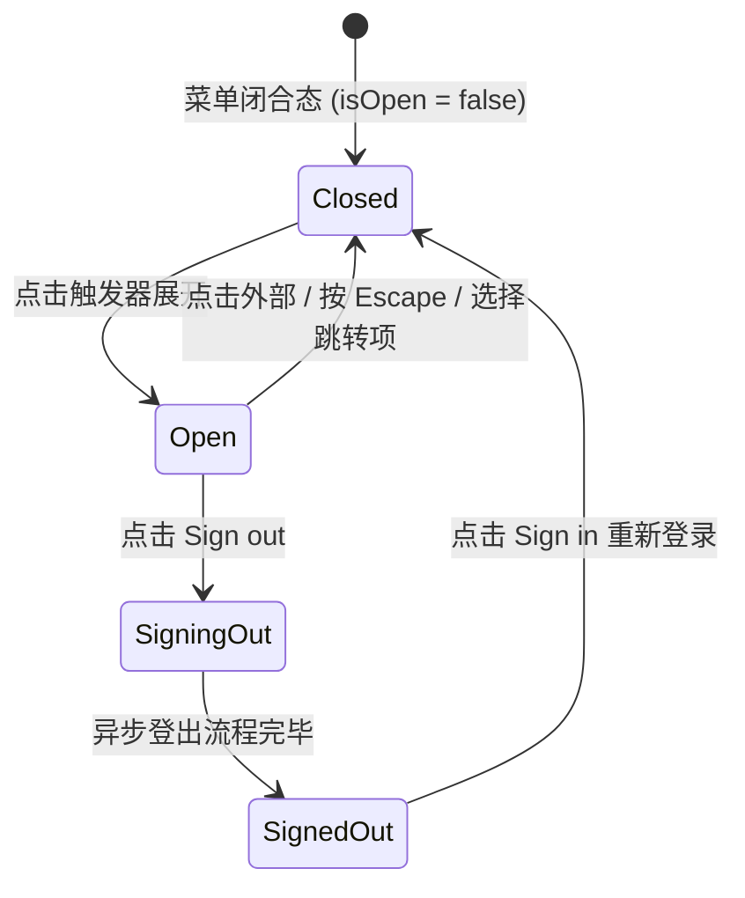

# User Menu · 用户账户菜单

综合型用户个人中心与设置下拉面板。包含触发器头像/名称联动、面板自顶部中心向外展开的弹簧物理补间、条目间单例滑动高光底板、内嵌三段式昼夜主题滑块控制器，以及退出登录时的异步等待态（Sign out 转换为 Signing out... 配合 Spinner 旋转）和登出后回退为 Sign in 的闭环逻辑。涵盖四大核心机制：

1. 顶角展开与弹簧阻尼入场（Panel Spring Entrance）：面板以 `50% 0px` 为变换原点，通过 `PANEL_SPRING`（stiffness: 420, damping: 34）驱动 `scale(0.96) -> 1` 与透明度渐进，折角 Chevron 图标顺时针旋转 180°。
2. 条目单例滑动高光（Gliding Highlight）：菜单列表内统一单例高光底板，随鼠标或键盘巡航平滑纵向位移与高度调整；指针离开时 70ms 意图防抖淡出。
3. 行内三段式主题切换滑块（Inline Segmented Theme Switch）：菜单行内内嵌 Light / Dark / System 三项分段切换，滑块拇指（Thumb）通过 CSS 变量 `--index`（0 / 1 / 2）平滑横向滑动切换系统外观。
4. 退出登录异步状态流转（Sign Out Async Morph & Fallback）：
   - 点击退出登录时，门栓置为禁用，图标替换为旋转 Spinner，文字通过带微模糊的纵向位移切为过去式 "Signing out..."。
   - 异步完成（如 700ms）后，面板平滑收起，界面平滑退场切换为已登出备用的 "Sign in" 入口按钮。

## 原型清单

| 原型分组 | 原型元素 | 动效 / 状态变化 | 去向 |
| --- | --- | --- | --- |
| 官方账户舞台 | 触发按钮 `#umTrigger` | 悬停/激活底色过渡；Chevron 180° 翻转 | 顶角展开与弹簧阻尼入场 |
| 官方账户舞台 | 用户头像与姓名 `.um-portrait`, `.um-trigger-name` | 触发器内的身份要素呈现 | 最小 DOM |
| 官方账户舞台 | 悬浮账户面板 `#umPanel` | 顶部居中原点 `scale(0.96) -> 1` 弹簧展开与淡出收起 | 顶角展开与弹簧阻尼入场 |
| 官方账户舞台 | 个人信息头 `.um-header` | 头像放大、姓名、订阅徽章 (Pro) 与邮箱展示 | 最小 DOM |
| 官方账户舞台 | 列表高光底板 `#umHighlight` | 条目间纵向位移与高度自适应弹簧追随 | 条目单例滑动高光 |
| 官方账户舞台 | 快捷操作条目 (Profile, Settings, Billing) | 键盘快捷键标签展示 (⌘P, ⌘,) 与点击反馈 | 最小 DOM |
| 官方账户舞台 | 行内主题控制器 `#umThemeSegments` | Light / Dark / System 滑块滑动切换 | 行内三段式主题切换滑块 |
| 官方账户舞台 | 退出登录条目 `#umSignOutBtn` | 图标切 Spinner + 文字位移切 "Signing out..." | 退出登录异步状态流转 |
| 官方账户舞台 | 登出备用入口 `#umSignInControl` / `#umSignInBtn` | 登出后退出的备用 Sign in 按钮形态 | 退出登录异步状态流转 |
| 官方账户舞台 | 状态提示槽 `#umNote` | 操作反馈提示微模糊上浮动效 | 演示外壳，已删除 |
| — | 顶栏独立主题切换器 `#themeBtn` | 演示主题切换 | 演示外壳，已删除 |
| — | embed/postMessage 同步逻辑 | iframe 适配 | 演示外壳，已删除 |
| — | 全局失去焦点补丁 `__arc_blur_installed` | 焦点清除逻辑 | 演示外壳，已删除 |

## 适用

- 站点右上角全局导航栏中的当前登录用户操作坞。
- 需要将个人信息摘要、全局配置项（如主题模式）与系统级危险操作（登出）聚合呈现的综合面板。
- 需要优雅展示异步退出过程、提供顺畅注销反馈的用户体系。

## 不适用

- 任意元素右键或触控长按在光标处呼出的上下文菜单 → [context-menu](context-menu.md)
- 仅展示纯操作条目、无内嵌控件与个人信息的标准下拉菜单 → [dropdown-menu](dropdown-menu.md)
- 仅作为主动作右侧附属的简单次级菜单 → [split-button](../buttons/split-button.md)

## 状态机



| 状态 | 进入条件 | 视觉表现 | 退出到 |
| --- | --- | --- | --- |
| `closed` | 初始载入 / 外部点击 / 按 Escape | 面板以 scale(0.96) 与 opacity 淡出隐藏；Chevron 旋转回 0° | `open` |
| `open` | 点击触发器按钮 | 面板以 `50% 0px` 锚点弹簧放大展开；Chevron 翻转 180°；高光就绪 | `closed`, `signingOut` |
| `signingOut` | 点击退出登录项 | 选项锁定；图标切为旋转 Spinner；文字位移切为 "Signing out..." | `signedOut` |
| `signedOut` | 登出请求结算 | 面板淡出收起，隐藏用户菜单，显露原生 "Sign in" 入口按钮 | `closed` |

## 最小 DOM

```html
<div class="um-root">
  <!-- 1. 触发器按钮 -->
  <button type="button" class="um-trigger" aria-haspopup="menu" aria-expanded="false" data-state="closed" aria-label="Account menu">
    <span class="um-face">
      
    </span>
    <span class="um-trigger-name">Emma Collins</span>
    <svg class="um-chevron" width="16" height="16" viewBox="0 0 24 24" fill="none" stroke="currentColor" stroke-width="1.75"><path d="m6 9 6 6 6-6"/></svg>
  </button>

  <!-- 2. 下拉账户面板 -->
  <div class="um-panel is-closed" role="menu" tabindex="-1">
    <!-- 个人信息头部 -->
    <div class="um-header">
      <span class="um-face">
        
      </span>
      <div class="um-identity">
        <div class="um-name-row">
          <span class="um-name">Emma Collins</span>
          <span class="um-plan">Pro</span>
        </div>
        <span class="um-email">emma@example.com</span>
      </div>
    </div>

    <div class="um-list">
      <!-- 单例滑动高光胶囊 -->
      <span class="um-highlight" aria-hidden="true"></span>

      <div class="um-separator" role="separator"></div>

      <!-- 常规条目 -->
      <button type="button" role="menuitem" tabindex="-1" class="um-item" data-action="profile">
        <span class="um-icon" aria-hidden="true">
          <svg width="16" height="16" viewBox="0 0 24 24" fill="none" stroke="currentColor" stroke-width="1.75"><circle cx="12" cy="8" r="5"/><path d="M20 21a8 8 0 0 0-16 0"/></svg>
        </span>
        <span class="um-item-label">Profile</span>
        <kbd class="um-keys" aria-hidden="true"><kbd class="um-key">⌘</kbd><kbd class="um-key">P</kbd></kbd>
      </button>

      <button type="button" role="menuitem" tabindex="-1" class="um-item" data-action="settings">
        <span class="um-icon" aria-hidden="true">
          <svg width="16" height="16" viewBox="0 0 24 24" fill="none" stroke="currentColor" stroke-width="1.75"><circle cx="12" cy="12" r="3"/><path d="M19.4 15a1.65 1.65 0 0 0 .33 1.82l.06.06a2 2 0 0 1 0 2.83 2 2 0 0 1-2.83 0l-.06-.06a1.65 1.65 0 0 0-1.82-.33 1.65 1.65 0 0 0-1 1.51V21a2 2 0 0 1-2 2 2 2 0 0 1-2-2v-.09A1.65 1.65 0 0 0 9 19.4a1.65 1.65 0 0 0-1.82.33l-.06.06a2 2 0 0 1-2.83 0 2 2 0 0 1 0-2.83l.06-.06a1.65 1.65 0 0 0 .33-1.82 1.65 1.65 0 0 0-1.51-1H3a2 2 0 0 1-2-2 2 2 0 0 1 2-2h.09A1.65 1.65 0 0 0 4.6 9a1.65 1.65 0 0 0-.33-1.82l-.06-.06a2 2 0 0 1 0-2.83 2 2 0 0 1 2.83 0l.06.06a1.65 1.65 0 0 0 1.82.33H9a1.65 1.65 0 0 0 1-1.51V3a2 2 0 0 1 2-2 2 2 0 0 1 2 2v.09a1.65 1.65 0 0 0 1 1.51 1.65 1.65 0 0 0 1.82-.33l.06-.06a2 2 0 0 1 2.83 0 2 2 0 0 1 0 2.83l-.06.06a1.65 1.65 0 0 0-.33 1.82V9a1.65 1.65 0 0 0 1.51 1H21a2 2 0 0 1 2 2 2 2 0 0 1-2 2h-.09a1.65 1.65 0 0 0-1.51 1z"/></svg>
        </span>
        <span class="um-item-label">Settings</span>
        <kbd class="um-keys" aria-hidden="true"><kbd class="um-key">⌘</kbd><kbd class="um-key">,</kbd></kbd>
      </button>

      <div class="um-separator" role="separator"></div>

      <!-- 行内三段式主题切换控制器 -->
      <div class="um-row" data-label="Theme">
        <span class="um-icon" aria-hidden="true">
          <svg width="16" height="16" viewBox="0 0 24 24" fill="none" stroke="currentColor" stroke-width="1.75"><circle cx="12" cy="12" r="4"/><path d="M12 2v2"/><path d="M12 20v2"/></svg>
        </span>
        <span class="um-row-label">Theme</span>
        <div class="um-segments" style="--index: 2;">
          <span class="um-thumb" aria-hidden="true"></span>
          <button type="button" role="menuitemradio" class="um-segment" data-val="light" aria-checked="false" aria-label="Light"><svg width="14" height="14" viewBox="0 0 24 24" fill="none" stroke="currentColor" stroke-width="1.75"><circle cx="12" cy="12" r="4"/><path d="M12 2v2M12 20v2M4.93 4.93l1.41 1.41M17.66 17.66l1.41 1.41M2 12h2M20 12h2M6.34 17.66l-1.41 1.41M19.07 4.93l-1.41 1.41"/></svg></button>
          <button type="button" role="menuitemradio" class="um-segment" data-val="dark" aria-checked="false" aria-label="Dark"><svg width="14" height="14" viewBox="0 0 24 24" fill="none" stroke="currentColor" stroke-width="1.75"><path d="M12 3a6 6 0 0 0 9 9 9 9 0 1 1-9-9Z"/></svg></button>
          <button type="button" role="menuitemradio" class="um-segment" data-val="system" aria-checked="true" aria-label="System"><svg width="14" height="14" viewBox="0 0 24 24" fill="none" stroke="currentColor" stroke-width="1.75"><rect width="20" height="14" x="2" y="3" rx="2"/><line x1="8" x2="16" y1="21" y2="21"/><line x1="12" x2="12" y1="17" y2="21"/></svg></button>
        </div>
      </div>

      <div class="um-separator" role="separator"></div>

      <!-- 退出登录条目 -->
      <button type="button" role="menuitem" tabindex="-1" class="um-item is-signout" data-tone="danger">
        <span class="um-icon signout-icon" aria-hidden="true">
          <svg width="16" height="16" viewBox="0 0 24 24" fill="none" stroke="currentColor" stroke-width="1.75"><path d="m16 17 5-5-5-5"/><path d="M21 12H9"/><path d="M9 21H5a2 2 0 0 1-2-2V5a2 2 0 0 1 2-2h4"/></svg>
        </span>
        <span class="um-item-label signout-label-wrap">
          <span class="um-rise">Sign out</span>
        </span>
        <kbd class="um-keys" aria-hidden="true"><kbd class="um-key">⇧</kbd><kbd class="um-key">⌘</kbd><kbd class="um-key">Q</kbd></kbd>
      </button>
    </div>
  </div>

  <!-- 3. 登出后的备用登录入口 -->
  <button type="button" class="um-signin-btn" style="display: none;">Sign in</button>
</div>
```

- `.um-trigger`：带头像与姓名的胶囊触发器。
- `.um-panel`：以中上方为锚点展开的账户弹出面板。
- `.um-thumb`：三段式主题控制器滑动的物理底板（基于 `--index` 变量）。
- `.signout-icon` / `.signout-label-wrap`：承载退出登录异步 Spinner 与文本形变流转。

## 参数

| 名称 | 值 | 用于 | 来源 |
| --- | --- | --- | --- |
| 面板展开弹簧 | `{ stiffness: 420, damping: 34, mass: 0.85 }` | 面板展开与缩放补间 | 原型 |
| 高光追随弹簧 | `{ stiffness: 520, damping: 35, mass: 0.8 }` | 条目高光底板纵向滑动 | 原型 |
| 主题滑块滑动时长 | `240ms cubic-bezier(0.22, 1, 0.36, 1)` | 拇指滑块 `--index` 位移 | 原型 |
| 文本微模糊位移入场 | `240ms cubic-bezier(0.16, 1, 0.3, 1)` | 登出文案纵向位移与模糊淡入 | 原型 |
| 文本微模糊退场 | `160ms cubic-bezier(0.22, 1, 0.36, 1)` | 旧文案纵向位移与模糊淡出 | 原型 |
| 登出模拟耗时 | `700ms` | 退出登录至切为 Sign in 的过渡时间 | 原型 |
| 面板宽度 | `15.5rem` (`248px`) | 账户卡片标准宽度 | 原型 |

## CSS

```css
.um-root {
  position: relative;
  display: inline-flex;
  vertical-align: middle;
}

.um-trigger {
  position: relative;
  display: inline-flex;
  height: 40px;
  align-items: center;
  gap: 8px;
  padding: 4px 10px 4px 4px;
  border: 0;
  border-radius: 9999px;
  background: transparent;
  color: var(--foreground, #0b0b0b);
  font: inherit;
  font-size: 13.5px;
  cursor: pointer;
  outline: none;
  user-select: none;
  transition: background-color 160ms ease;
}
.um-trigger:hover,
.um-trigger[data-state="open"] {
  background: rgba(0, 0, 0, 0.05);
}

.um-face {
  display: inline-grid;
  width: 32px;
  height: 32px;
  flex: none;
}
.um-portrait {
  width: 100%;
  height: 100%;
  border-radius: 9999px;
  object-fit: cover;
}

.um-trigger-name {
  max-width: 11rem;
  overflow: hidden;
  font-weight: 500;
  text-overflow: ellipsis;
  white-space: nowrap;
}

.um-chevron {
  flex: none;
  transition: transform 240ms cubic-bezier(0.22, 1, 0.36, 1);
  color: #888888;
}
.um-trigger[data-state="open"] .um-chevron {
  transform: rotate(180deg);
  color: currentColor;
}

/* 浮动面板本体 */
.um-panel {
  position: absolute;
  top: calc(100% + 8px);
  left: 50%;
  margin-left: -7.75rem;
  z-index: 100;
  width: 15.5rem;
  box-sizing: border-box;
  padding: 4px;
  border: 1px solid rgba(0, 0, 0, 0.08);
  border-radius: 12px;
  background: #ffffff;
  color: #0b0b0b;
  box-shadow: 0 16px 36px rgba(0, 0, 0, 0.12), 0 2px 6px rgba(0, 0, 0, 0.04);
  outline: none;
  transform-origin: 50% 0px;
  will-change: transform, opacity;
  animation: umPanelIn 200ms cubic-bezier(0.16, 1, 0.3, 1) forwards;
}
.um-panel.is-closed {
  display: none;
}

@keyframes umPanelIn {
  from { opacity: 0; transform: scale(0.96); }
  to { opacity: 1; transform: scale(1); }
}

.um-header {
  display: flex;
  align-items: center;
  gap: 10px;
  padding: 8px;
}
.um-identity {
  display: flex;
  flex-direction: column;
  gap: 2px;
  min-width: 0;
  flex: 1;
}
.um-name-row {
  display: flex;
  align-items: center;
  gap: 6px;
}
.um-name {
  font-size: 13px;
  font-weight: 600;
  white-space: nowrap;
  overflow: hidden;
  text-overflow: ellipsis;
}
.um-plan {
  height: 17px;
  padding: 0 5px;
  border: 1px solid rgba(0, 0, 0, 0.12);
  border-radius: 4px;
  font-size: 11px;
  font-weight: 600;
  line-height: 16px;
  color: #555555;
}
.um-email {
  font-size: 12px;
  color: #888888;
  white-space: nowrap;
  overflow: hidden;
  text-overflow: ellipsis;
}

.um-list {
  position: relative;
}

.um-separator {
  height: 1px;
  margin: 4px -4px;
  background: rgba(0, 0, 0, 0.06);
}

/* 滑动高光胶囊 */
.um-highlight {
  position: absolute;
  top: 0;
  right: 0;
  left: 0;
  border-radius: 6px;
  background: rgba(0, 0, 0, 0.05);
  opacity: 0;
  pointer-events: none;
  will-change: transform, opacity;
  transition: opacity 120ms ease;
}

.um-item {
  position: relative;
  display: flex;
  width: 100%;
  height: 32px;
  align-items: center;
  gap: 10px;
  padding: 0 8px;
  border: 0;
  border-radius: 6px;
  background: transparent;
  color: inherit;
  font: inherit;
  font-size: 13px;
  cursor: pointer;
  outline: none;
  user-select: none;
  box-sizing: border-box;
}
.um-item[data-tone="danger"] {
  color: #f43f5e;
}

.um-icon {
  display: inline-grid;
  width: 16px;
  flex: none;
  place-items: center;
  color: #666666;
}
.um-item[data-tone="danger"] .um-icon {
  color: currentColor;
}

.um-item-label {
  position: relative;
  display: inline-grid;
  align-items: center;
  min-width: 0;
  flex: 1;
}

.um-rise {
  grid-area: 1 / 1;
  display: inline-block;
  white-space: nowrap;
  will-change: transform, opacity, filter;
}

.um-keys {
  display: inline-flex;
  gap: 2px;
  margin-left: auto;
  color: #999999;
  font-size: 11px;
}
.um-key {
  min-width: 1.1em;
  text-align: center;
}

/* 行内三段式主题切换 */
.um-row {
  position: relative;
  display: flex;
  height: 36px;
  align-items: center;
  gap: 10px;
  padding: 0 4px 0 8px;
}
.um-row-label {
  flex: 1;
  font-size: 13px;
}

.um-segments {
  --segment: 28px;
  --index: 2;
  position: relative;
  display: inline-grid;
  height: 26px;
  grid-auto-columns: var(--segment);
  grid-auto-flow: column;
  padding: 2px;
  border-radius: 7px;
  background: rgba(0, 0, 0, 0.05);
}

.um-thumb {
  position: absolute;
  top: 2px;
  bottom: 2px;
  left: 2px;
  width: var(--segment);
  border-radius: 5px;
  background: #ffffff;
  box-shadow: 0 1px 2px rgba(0, 0, 0, 0.08);
  transform: translateX(calc(var(--index) * 100%));
  transition: transform 240ms cubic-bezier(0.22, 1, 0.36, 1);
}

.um-segment {
  display: grid;
  place-items: center;
  border: 0;
  background: transparent;
  color: #888888;
  cursor: pointer;
  outline: none;
}
.um-segment[aria-checked="true"] {
  color: #0b0b0b;
}

.um-spinner {
  animation: umSpin 0.8s linear infinite;
}
@keyframes umSpin {
  to { transform: rotate(360deg); }
}

.um-signin-btn {
  display: inline-flex;
  height: 36px;
  align-items: center;
  justify-content: center;
  padding: 0 14px;
  border: 1px solid rgba(0, 0, 0, 0.12);
  border-radius: 18px;
  background: #ffffff;
  color: #0b0b0b;
  font: inherit;
  font-size: 13.5px;
  font-weight: 500;
  cursor: pointer;
}
```

## JS

```js
const SNAPPY_SPRING = { stiffness: 520, damping: 35, mass: 0.8 };
const SPINNER_SVG = `<svg class="um-spinner" width="16" height="16" viewBox="0 0 24 24" fill="none" stroke="currentColor" stroke-width="1.75"><path d="M21 12a9 9 0 1 1-6.219-8.56"></path></svg>`;

function animateSpring(from, to, config, onUpdate, onComplete) {
  let current = from;
  let velocity = config.velocity || 0;
  const stiffness = config.stiffness || 520;
  const damping = config.damping || 35;
  const mass = config.mass || 0.8;
  const epsilon = config.epsilon || 0.001;
  let lastTime = performance.now();
  let rafId = null;
  let stopped = false;

  function step(now) {
    if (stopped) return;
    const dt = Math.min((now - lastTime) / 1000, 0.032);
    lastTime = now;
    const force = -stiffness * (current - to) - damping * velocity;
    const accel = force / mass;
    velocity += accel * dt;
    current += velocity * dt;

    if (Math.abs(current - to) < epsilon && Math.abs(velocity) < epsilon * 10) {
      current = to;
      onUpdate(current);
      if (onComplete) onComplete();
      return;
    }
    onUpdate(current);
    rafId = requestAnimationFrame(step);
  }

  rafId = requestAnimationFrame(step);
  return {
    stop() {
      stopped = true;
      if (rafId) cancelAnimationFrame(rafId);
    }
  };
}

function morphRiseText(container, nextText) {
  const oldSpan = container.querySelector(".um-rise:last-child");
  if (oldSpan && oldSpan.textContent === nextText) return;

  const newSpan = document.createElement("span");
  newSpan.className = "um-rise";
  newSpan.textContent = nextText;
  container.appendChild(newSpan);

  if (oldSpan) {
    oldSpan.animate(
      [
        { opacity: 1, transform: "translateY(0em)", filter: "blur(0px)" },
        { opacity: 0, transform: "translateY(-0.35em)", filter: "blur(2px)" }
      ],
      { duration: 160, easing: "cubic-bezier(0.22, 1, 0.36, 1)" }
    ).onfinish = () => oldSpan.remove();
  }

  newSpan.animate(
    [
      { opacity: 0, transform: "translateY(0.35em)", filter: "blur(2px)" },
      { opacity: 1, transform: "translateY(0em)", filter: "blur(0px)" }
    ],
    { duration: 240, easing: "cubic-bezier(0.16, 1, 0.3, 1)" }
  );
}

/**
 * 绑定综合账户菜单控制器
 * @param {HTMLElement} rootEl .um-root 根节点
 * @param {Object} options 配置项
 * @param {(theme: 'light'|'dark'|'system') => void} [options.onThemeChange] 主题切换回调
 * @param {() => Promise<void>|void} [options.onSignOut] 退出登录回调
 * @returns {Object} 控制句柄
 */
export function bindUserMenu(rootEl, { onThemeChange, onSignOut } = {}) {
  const trigger = rootEl.querySelector(".um-trigger");
  const panel = rootEl.querySelector(".um-panel");
  const highlight = rootEl.querySelector(".um-highlight");
  const segments = rootEl.querySelector(".um-segments");
  const signOutBtn = rootEl.querySelector(".is-signout");
  const signOutIcon = rootEl.querySelector(".signout-icon");
  const signOutLabelWrap = rootEl.querySelector(".signout-label-wrap");
  const signInBtn = rootEl.querySelector(".um-signin-btn");

  let isOpen = false;
  let isSigningOut = false;
  let clearTimer = 0;
  let hlTopAnim = null;
  let hlY = 0;

  function placeHighlight(itemEl) {
    clearTimeout(clearTimer);
    highlight.style.opacity = '1';
    highlight.style.height = `${itemEl.offsetHeight}px`;

    if (hlTopAnim) hlTopAnim.stop();
    hlTopAnim = animateSpring(
      hlY,
      itemEl.offsetTop,
      { ...SNAPPY_SPRING, epsilon: 0.1 },
      (y) => {
        hlY = y;
        highlight.style.transform = `translateY(${y}px)`;
      }
    );
  }

  function clearHighlight() {
    clearTimeout(clearTimer);
    clearTimer = setTimeout(() => {
      highlight.style.opacity = '0';
    }, 70);
  }

  function open() {
    if (isOpen || isSigningOut) return;
    isOpen = true;
    trigger.setAttribute("data-state", "open");
    trigger.setAttribute("aria-expanded", "true");
    panel.classList.remove("is-closed");
  }

  function close() {
    if (!isOpen) return;
    isOpen = false;
    trigger.setAttribute("data-state", "closed");
    trigger.setAttribute("aria-expanded", "false");
    panel.classList.add("is-closed");
    clearHighlight();
  }

  // 触发器点击
  trigger.addEventListener("click", () => {
    if (isOpen) close();
    else open();
  });

  // 条目悬停高光
  panel.querySelectorAll(".um-item").forEach(item => {
    item.addEventListener("pointermove", () => placeHighlight(item));
    item.addEventListener("pointerleave", clearHighlight);
    item.addEventListener("click", (e) => {
      if (item === signOutBtn) return;
      close();
    });
  });

  // 三段式主题切换
  if (segments) {
    segments.querySelectorAll(".um-segment").forEach(btn => {
      btn.addEventListener("click", (e) => {
        e.stopPropagation();
        const val = btn.dataset.val;
        const indexMap = { light: 0, dark: 1, system: 2 };
        segments.style.setProperty("--index", String(indexMap[val]));
        segments.querySelectorAll(".um-segment").forEach(b => b.setAttribute("aria-checked", String(b === btn)));
        if (typeof onThemeChange === "function") onThemeChange(val);
      });
    });
  }

  // 退出登录流转
  if (signOutBtn) {
    signOutBtn.addEventListener("click", async (e) => {
      e.stopPropagation();
      if (isSigningOut) return;
      isSigningOut = true;
      signOutBtn.setAttribute("disabled", "true");
      signOutIcon.innerHTML = SPINNER_SVG;
      morphRiseText(signOutLabelWrap, "Signing out...");

      try {
        if (typeof onSignOut === "function") {
          await onSignOut();
        } else {
          await new Promise(r => setTimeout(r, 700));
        }
      } finally {
        close();
        isSigningOut = false;
        trigger.style.display = "none";
        panel.style.display = "none";
        if (signInBtn) signInBtn.style.display = "inline-flex";
      }
    });
  }

  // 重新登录按钮恢复
  if (signInBtn) {
    signInBtn.addEventListener("click", () => {
      signInBtn.style.display = "none";
      trigger.style.display = "inline-flex";
      panel.style.display = "";
      trigger.setAttribute("data-state", "closed");
      if (signOutBtn) {
        signOutBtn.removeAttribute("disabled");
        signOutIcon.innerHTML = `<svg width="16" height="16" viewBox="0 0 24 24" fill="none" stroke="currentColor" stroke-width="1.75"><path d="m16 17 5-5-5-5"/><path d="M21 12H9"/><path d="M9 21H5a2 2 0 0 1-2-2V5a2 2 0 0 1 2-2h4"/></svg>`;
        morphRiseText(signOutLabelWrap, "Sign out");
      }
    });
  }

  // 点击外部关闭
  const onDocPointerDown = (e) => {
    if (isOpen && !rootEl.contains(e.target)) {
      close();
    }
  };
  document.addEventListener("pointerdown", onDocPointerDown);

  return {
    open,
    close,
    destroy() {
      close();
      document.removeEventListener("pointerdown", onDocPointerDown);
    }
  };
}
```

## 接入目标项目

- 状态来源：目标项目的全局用户认证 Session 与外观 Theme Context。在 `onSignOut` 接入注销接口，在 `onThemeChange` 响应系统配色切换。
- 尺寸策略：面板固定尺寸 248px（15.5rem），自触发器底部中点对称向下展开。
- 驱动方式：实例化 `bindUserMenu(rootEl, { onThemeChange, onSignOut })` 即可全权托管展开、高光滑动、主题滑块与注销逻辑。

## 重入与清理

- 连续多次点击登出保护：进入注销时将 `isSigningOut` 置为 true 并将按钮属性设为 `disabled`，阻断重复请求。
- 销毁机制：调用 `destroy()` 移除全局外部点击监听器。

## 减少动态效果

系统开启 `prefers-reduced-motion: reduce` 时：
1. 移除面板 scale 弹簧展开与高光底板的平移过渡。
2. 文本切换由微模糊位移降级为瞬时文本替换。

```css
@media (prefers-reduced-motion: reduce) {
  .um-panel,
  .um-highlight,
  .um-thumb,
  .um-rise {
    animation: none !important;
    transition: none !important;
  }
}
```

## 焦点与键盘

- 键盘激活：触发器支持通过 Tab 键聚焦与 Enter/Space 键呼出。
- Escape 键防险退出：按下 Escape 键后立即收起面板并清空高光。

## 兼容回退

| 特性 | 不支持时 |
| --- | --- |
| CSS `color-mix()` | 边框与透明底色直接使用标准 `rgba(0, 0, 0, 0.08)` 回退。 |
| CSS Grid 嵌套 | 主题控制器滑块降级为标准 inline-block 排版。 |

## 验收清单

- [ ] 点击用户头像触发器，面板以中上方为轴心平滑弹性展开，Chevron 折角箭头顺畅翻转 180°。
- [ ] 鼠标指针在菜单项之间滑动，高光胶囊沿 Y 轴平滑滑动追随，移出 70ms 后平滑淡出。
- [ ] 点击 Theme 控制器中的 Light / Dark / System 选项，白色拇指滑块（Thumb）平滑移动至对应位置。
- [ ] 点击 Sign out 选项，图标切换为旋转 Spinner，文字顺畅过渡为 "Signing out..."。
- [ ] 登出结算完毕后，面板平滑收起，用户触发器替换为 "Sign in" 备用登录按钮。
- [ ] 点击外部区域或按键盘 Escape 键，面板平滑淡出关闭。
- [ ] 系统开启减弱动态效果时，所有弹簧缩放与位移动画即时瞬切完成。
