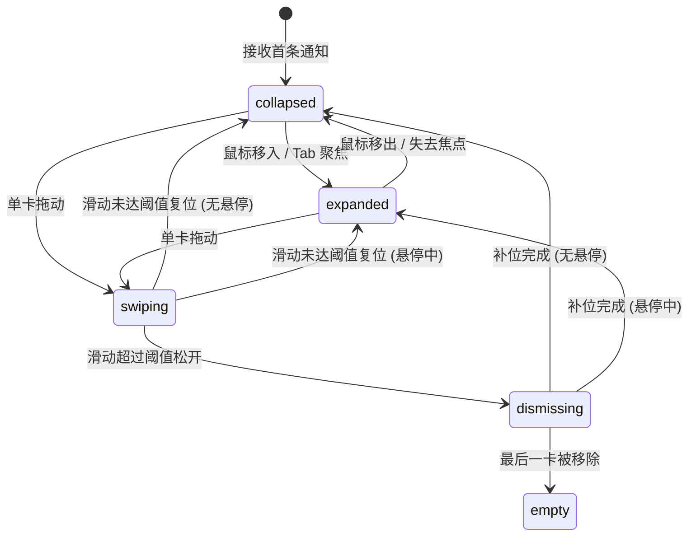

# Toast Stack · 吐司通知栈

用于在视口右下角管理多条并发通知的层叠堆叠（Card Stacking）与弹性展开组件。包含三大核心动效机制：

1. 多层级窥视堆叠（Peek Stacking）：默认收拢态下，最新的通知处于最前排（front），次新通知沿 Y 轴向上偏移 14px 并按 0.05 步长微缩（`scale(0.95)`、`scale(0.90)`），仅露出头部边沿；超量通知平滑潜入后方。
2. 悬停聚焦手风琴式纵向展开（Hover Expansion Morph）：光标悬停或键盘聚焦到通知栈时，所有卡片伴随弹簧动画（visualDuration 0.42s, bounce 0.16）纵向平滑展开为 12px 间隔的完整列表，光标移出后弹性收归堆叠。
3. 单卡手势轻扫抛掷与后序升阶（Swipe Dismiss & Queue Promotion）：单张卡片支持水平拖拽丢弃，移除后下级卡片自后方按物理弹簧曲线升阶补位。

## 原型清单

| 原型分组 | 原型元素 | 动效 / 状态变化 | 去向 |
| --- | --- | --- | --- |
| — | 堆栈视口（`.arc-toast-stack` / `.arc-toast-viewport`） | 屏幕右下角定位、收拢态与展开态切换、外层高度过渡 | 悬停聚焦手风琴式纵向展开 |
| — | 通知卡片实体（`.arc-toast-card`） | 堆叠态下的位置偏移 `translateY(-peek)` 与按阶梯缩放 `scale(1 - 0.05 * i)` | 多层级窥视堆叠 |
| — | 展开状态流转（`[data-expanded="true"]`） | 纵向平铺展开、间距 12px、所有卡片恢复 `scale(1)` 与完全不透明度 | 悬停聚焦手风琴式纵向展开 |
| — | 水平拖拽手势与单卡丢弃（Swipe to Dismiss） | 单卡水平位移追踪、透明度淡化、抛掷移出与队列升阶动画 | 单卡手势轻扫抛掷与后序升阶 |
| — | 卡片内图标、文案与关闭按钮（`.arc-toast-icon`, `.arc-toast-title`, `.arc-toast-close`） | 图标与文字布局、关闭按钮悬停与按压缩放 | 多层级窥视堆叠 |
| — | 演示外壳（底部 5 个触发通知测试按钮、快捷键） | — | 演示外壳，已删除 |

## 适用

- 复杂业务系统在同一时间段可能连续触发多条系统通知、发布消息或任务完成警示。
- 屏幕空间敏感，未交互时只需展示最新一条并窥视堆叠，避免遮挡主要内容。
- 用户需要将鼠标移入通知区域时逐一浏览、阅读详情并分别处理或关闭。

## 不适用

- 单一、低频的瞬时反馈提示 → [toast.md](toast.md)
- 页面局部的内联表单警示或错误提示条 → [alert.md](alert.md)
- 顶部通栏公告与轮播横幅 → [announcement-bar.md](announcement-bar.md)

## 状态机

| 状态 | 进入条件 | 视觉表现 | 退出到 |
| --- | --- | --- | --- |
| collapsed | 初始加载；或光标移出且无键盘聚焦 | 最多前 3 张卡片可见，后排卡片向上偏移 14px 并逐级缩放 `scale(0.95)`, `scale(0.90)` | expanded / empty |
| expanded | 鼠标悬停进入堆栈视口；或 Tab 键聚焦到卡片 | 所有卡片以 12px 间隙纵向平铺展开，全部恢复 `scale(1)` 且解除高度遮挡 | collapsed |
| swiping | 用户按住其中一张卡片水平拖动 | 被拖拽卡片跟随光标水平平移，其余卡片在原位保持稳定 | collapsed / expanded / dismissing |
| dismissing | 卡片被抛掷或点击关闭按钮 | 被移除卡片向侧边滑出并淡出，后续卡片依序升阶补位 | collapsed / expanded |
| empty | 所有卡片均被关闭移除 | 堆栈视口隐藏，释放屏幕空间 | collapsed (新通知入场) |



## 最小 DOM

```html
<div class="arc-toast-stack" data-expanded="false" aria-live="polite">
  <div class="arc-toast-viewport">
    <div class="arc-toast-card" data-index="0" data-front="true" role="status">
      <div class="arc-toast-inner">
        <div class="arc-toast-icon" aria-hidden="true">
          <svg width="18" height="18" viewBox="0 0 24 24" fill="none" stroke="currentColor" stroke-width="2" stroke-linecap="round" stroke-linejoin="round">
            <circle cx="12" cy="12" r="10"></circle>
            <path d="M12 16v-4"></path>
            <path d="M12 8h.01"></path>
          </svg>
        </div>
        <div class="arc-toast-body">
          <strong class="arc-toast-title">Version 2.4 deployed</strong>
          <p class="arc-toast-description">Workspace refreshed with new features.</p>
        </div>
        <button type="button" class="arc-toast-close" aria-label="Dismiss">
          <svg width="14" height="14" viewBox="0 0 24 24" fill="none" stroke="currentColor" stroke-width="2" stroke-linecap="round" stroke-linejoin="round">
            <path d="M18 6 6 18"></path>
            <path d="m6 6 12 12"></path>
          </svg>
        </button>
      </div>
    </div>
  </div>
</div>
```

- `.arc-toast-stack`：屏幕固定定位外壳，管理 `data-expanded` 属性。
- `.arc-toast-viewport`：卡片渲染视口，提供定位上下文。
- `.arc-toast-card`：单张通知卡片，通过 `data-index` 与 `data-front` 标定层级。
- `.arc-toast-inner`：卡片内部排版容器，包含图标、文本主体与关闭按钮。
- `.arc-toast-body`：承载标题 `.arc-toast-title` 与描述 `.arc-toast-description`。
- `.arc-toast-close`：关闭按钮。

## 参数

| 名称 | 值 | 用于 | 来源 |
| --- | --- | --- | --- |
| 窥视偏移阶梯 | `14px` | 收拢态下后序卡片向上浮露高度 | 原型 |
| 缩放缩减阶梯 | `0.05` | 收拢态后序卡片缩放 (`1, 0.95, 0.90`) | 原型 |
| 展开纵向间隙 | `12px` | 展开态卡片之间的垂直间距 | 原型 |
| 最大可见窥视数 | `3` | 收拢态最多透出的卡片数 | 原型 |
| 展开折叠弹簧曲线 | `visualDuration: 0.42s` / `bounce: 0.16` | 卡片形态变换弹簧 | 原型 |
| 入场透明度过渡 | `240ms` / `cubic-bezier(0.16, 1, 0.3, 1)` | 新卡片升起渐显 | 原型 |
| 滑动丢弃距离阈值 | `80px` | 手势轻扫移除距离 | 原型 |
| 减动效过渡时长 | `160ms linear` | prefers-reduced-motion 纯透明度 | 原型 |

## CSS

```css
.arc-toast-stack {
  position: fixed;
  bottom: 24px;
  right: 24px;
  z-index: 1000;
  box-sizing: border-box;
}

.arc-toast-viewport {
  position: relative;
  width: 360px;
  min-height: 72px;
  display: flex;
  flex-direction: column-reverse;
  align-items: flex-end;
}

.arc-toast-card {
  --card-bg: #ffffff;
  --card-border: rgba(0, 0, 0, 0.08);
  --card-color: #0f172a;
  --card-desc: #64748b;
  --card-shadow: 0 10px 25px -5px rgba(0, 0, 0, 0.1), 0 8px 10px -6px rgba(0, 0, 0, 0.04);

  position: absolute;
  bottom: 0;
  right: 0;
  width: 100%;
  background: var(--card-bg);
  color: var(--card-color);
  border: 1px solid var(--card-border);
  border-radius: 12px;
  box-shadow: var(--card-shadow);
  padding: 12px 14px;
  box-sizing: border-box;
  user-select: none;
  cursor: grab;
  touch-action: pan-y;
  transform-origin: 50% 100%;
  transition:
    transform 420ms cubic-bezier(0.16, 1, 0.3, 1),
    opacity 240ms ease,
    box-shadow 240ms ease;
  will-change: transform, opacity;
}

.arc-toast-card:active {
  cursor: grabbing;
}

.arc-toast-inner {
  display: flex;
  align-items: flex-start;
  gap: 10px;
}

.arc-toast-icon {
  flex: 0 0 auto;
  width: 18px;
  height: 18px;
  margin-top: 2px;
  color: #2563eb;
  display: flex;
  align-items: center;
  justify-content: center;
}

.arc-toast-body {
  flex: 1;
  min-width: 0;
}

.arc-toast-title {
  display: block;
  font-size: 13px;
  font-weight: 600;
  line-height: 1.4;
  color: var(--card-color);
}

.arc-toast-description {
  margin: 2px 0 0;
  font-size: 12px;
  line-height: 1.4;
  color: var(--card-desc);
}

.arc-toast-close {
  flex: 0 0 auto;
  display: inline-flex;
  align-items: center;
  justify-content: center;
  width: 20px;
  height: 20px;
  margin: -2px -2px -2px 4px;
  border: none;
  border-radius: 4px;
  background: transparent;
  color: #94a3b8;
  cursor: pointer;
  padding: 0;
  transition: color 150ms ease, background-color 150ms ease, transform 120ms ease;
}

.arc-toast-close:hover {
  color: var(--card-color);
  background: rgba(0, 0, 0, 0.05);
}

.arc-toast-close:active {
  transform: scale(0.94);
}

@media (prefers-reduced-motion: reduce) {
  .arc-toast-card {
    transition: opacity 160ms linear !important;
    transform: none !important;
  }
  .arc-toast-close:active {
    transform: none !important;
  }
}
```

## JS

```js
/**
 * 创建并绑定 ToastStack 动效与手势控制器
 * @param {HTMLElement} el 宿主容器元素
 * @param {Object} [options]
 * @param {number} [options.peek=14] 收拢态卡片窥视偏移 (px)
 * @param {number} [options.gap=12] 展开态卡片垂直间隙 (px)
 * @param {number} [options.maxPeek=3] 收拢态最大可见层数
 */
export function createToastStack(el, options = {}) {
  const stack = el.classList.contains('arc-toast-stack') ? el : el.querySelector('.arc-toast-stack') || el;
  const viewport = stack.querySelector('.arc-toast-viewport') || stack;

  const peek = options.peek || 14;
  const gap = options.gap || 12;
  const maxPeek = options.maxPeek || 3;

  let isExpanded = false;
  let isDisposed = false;
  let cards = [];

  function updateLayout() {
    if (isDisposed) return;
    const reduced = window.matchMedia('(prefers-reduced-motion: reduce)').matches;
    stack.dataset.expanded = String(isExpanded);

    let cumulativeHeight = 0;
    const total = cards.length;

    cards.forEach((cardEl, i) => {
      // 索引 0 为最新（最前排）
      const reverseIndex = i; // 0, 1, 2...
      cardEl.dataset.index = String(reverseIndex);
      cardEl.dataset.front = reverseIndex === 0 ? 'true' : 'false';

      if (reduced) {
        cardEl.style.transform = 'none';
        cardEl.style.opacity = '1';
        return;
      }

      if (isExpanded) {
        // 展开态：全部纵向平铺
        cardEl.style.transform = `translateY(-${cumulativeHeight}px) scale(1)`;
        cardEl.style.opacity = '1';
        cardEl.style.zIndex = `${total - reverseIndex}`;
        cumulativeHeight += cardEl.offsetHeight + gap;
      } else {
        // 收拢态：按窥视阶梯堆叠
        if (reverseIndex < maxPeek) {
          const translateY = -reverseIndex * peek;
          const scale = 1 - reverseIndex * 0.05;
          const opacity = reverseIndex === 0 ? 1 : reverseIndex === 1 ? 0.9 : 0.7;
          cardEl.style.transform = `translateY(${translateY}px) scale(${scale})`;
          cardEl.style.opacity = `${opacity}`;
          cardEl.style.zIndex = `${total - reverseIndex}`;
        } else {
          // 超出最大可见深度的卡片隐入底层
          cardEl.style.transform = `translateY(-${(maxPeek - 1) * peek}px) scale(${1 - maxPeek * 0.05})`;
          cardEl.style.opacity = '0';
          cardEl.style.zIndex = '0';
        }
      }
    });

    if (isExpanded) {
      viewport.style.height = `${cumulativeHeight}px`;
    } else {
      const frontCard = cards[0];
      const baseHeight = frontCard ? frontCard.offsetHeight : 0;
      viewport.style.height = `${baseHeight + (Math.min(total, maxPeek) - 1) * peek}px`;
    }
  }

  function bindCardGestures(cardEl) {
    let isDragging = false;
    let startX = 0;
    let currentDeltaX = 0;

    function onPointerDown(e) {
      if (e.target.closest('.arc-toast-close')) return;
      isDragging = true;
      startX = e.clientX;
      currentDeltaX = 0;
      cardEl.setPointerCapture(e.pointerId);
    }

    function onPointerMove(e) {
      if (!isDragging) return;
      currentDeltaX = e.clientX - startX;
      cardEl.style.transform += ` translateX(${currentDeltaX}px)`;
      cardEl.style.opacity = `${Math.max(0.2, 1 - Math.abs(currentDeltaX) / 240)}`;
    }

    function onPointerUp(e) {
      if (!isDragging) return;
      isDragging = false;
      try { cardEl.releasePointerCapture(e.pointerId); } catch (_) {}

      if (Math.abs(currentDeltaX) > 80) {
        removeCard(cardEl, currentDeltaX > 0 ? 300 : -300);
      } else {
        updateLayout();
      }
    }

    cardEl.addEventListener('pointerdown', onPointerDown);
    cardEl.addEventListener('pointermove', onPointerMove);
    cardEl.addEventListener('pointerup', onPointerUp);
    cardEl.addEventListener('pointercancel', onPointerUp);

    const closeBtn = cardEl.querySelector('.arc-toast-close');
    if (closeBtn) {
      closeBtn.addEventListener('click', (e) => {
        e.stopPropagation();
        removeCard(cardEl);
      });
    }
  }

  function removeCard(cardEl, throwX = 0) {
    if (throwX !== 0) {
      cardEl.style.transition = 'transform 200ms ease-out, opacity 200ms ease-out';
      cardEl.style.transform = `translateX(${throwX}px)`;
      cardEl.style.opacity = '0';
    } else {
      cardEl.style.transition = 'transform 180ms ease, opacity 180ms ease';
      cardEl.style.opacity = '0';
    }

    setTimeout(() => {
      if (isDisposed) return;
      cards = cards.filter(c => c !== cardEl);
      cardEl.remove();
      updateLayout();
    }, 200);
  }

  function expand() {
    if (isExpanded) return;
    isExpanded = true;
    updateLayout();
  }

  function collapse() {
    if (!isExpanded) return;
    isExpanded = false;
    updateLayout();
  }

  function onMouseEnter() { expand(); }
  function onMouseLeave() { collapse(); }
  function onFocusIn() { expand(); }
  function onFocusOut(e) {
    if (!stack.contains(e.relatedTarget)) {
      collapse();
    }
  }

  stack.addEventListener('mouseenter', onMouseEnter);
  stack.addEventListener('mouseleave', onMouseLeave);
  stack.addEventListener('focusin', onFocusIn);
  stack.addEventListener('focusout', onFocusOut);

  // 初始化已有卡片
  cards = Array.from(viewport.querySelectorAll('.arc-toast-card'));
  cards.forEach(bindCardGestures);
  updateLayout();

  return {
    addToast({ title, description, icon }) {
      if (isDisposed) return;
      const card = document.createElement('div');
      card.className = 'arc-toast-card';
      card.setAttribute('role', 'status');

      card.innerHTML = `
        <div class="arc-toast-inner">
          <div class="arc-toast-icon" aria-hidden="true">
            ${icon || '<svg width="18" height="18" viewBox="0 0 24 24" fill="none" stroke="currentColor" stroke-width="2" stroke-linecap="round" stroke-linejoin="round"><circle cx="12" cy="12" r="10"></circle><path d="M12 16v-4"></path><path d="M12 8h.01"></path></svg>'}
          </div>
          <div class="arc-toast-body">
            <strong class="arc-toast-title">${title || 'Notification'}</strong>
            <p class="arc-toast-description">${description || ''}</p>
          </div>
          <button type="button" class="arc-toast-close" aria-label="Dismiss">
            <svg width="14" height="14" viewBox="0 0 24 24" fill="none" stroke="currentColor" stroke-width="2" stroke-linecap="round" stroke-linejoin="round"><path d="M18 6 6 18"></path><path d="m6 6 12 12"></path></svg>
          </button>
        </div>
      `;

      bindCardGestures(card);
      viewport.prepend(card);
      cards.unshift(card);
      updateLayout();
    },
    expand,
    collapse,
    destroy() {
      isDisposed = true;
      stack.removeEventListener('mouseenter', onMouseEnter);
      stack.removeEventListener('mouseleave', onMouseLeave);
      stack.removeEventListener('focusin', onFocusIn);
      stack.removeEventListener('focusout', onFocusOut);
    }
  };
}
```

## 接入目标项目

- 状态来源：目标业务系统派发的全局提示事件总线。支持调用 `addToast({ title, description, icon })` 动态追加新通知。
- 尺寸策略：固定在视口右下角（`position: fixed`），宽度 360px，高度根据卡片数量及展开/收拢状态动态计算。
- 驱动方式：实例化 `createToastStack(el)`，业务通过实例注入新卡片，组件卸载时调用 `destroy()`。

## 重入与清理

- 连续快速调用 `addToast()` 时，内部队列重新排序并即时触发 `updateLayout()` 重新计算位移阶梯，避免堆叠坐标重叠错乱。
- 实例销毁（`destroy()`）注销全部悬停、失焦与手势事件，释放指针捕获。

## 减少动态效果

- 满足 `prefers-reduced-motion: reduce` 时：
  - 停用堆叠卡片的缩放与窥视位移动画。
  - 展开与折叠时直接呈现为自然纵向列表，不执行平移动画。
  - 卡片轻扫抛掷改为纯透明度淡出。

## 焦点与键盘

- 外层容器标注 `aria-live="polite"`，新通知追加时由屏幕阅读器静默宣读。
- 支持键盘 Tab 键依次导航遍历堆栈中的卡片与关闭按钮；一旦检测到键盘焦点进入堆栈，自动展开手风琴，全部卡片移出焦点后自动折叠。
- 关闭按钮具备语义化 `type="button"` 与明确的 `aria-label="Dismiss"`。

## 兼容回退

| 特性 | 不支持时 |
| --- | --- |
| CSS `transform-origin` / 3D 变换 | 回退至标准垂直定位（top / bottom），保证多卡片顺序清晰排列。 |
| 指针事件 `setPointerCapture` | 回退至右上角明确的点击关闭按钮进行单卡清理。 |

## 验收清单

- [ ] 多张卡片初始以 14px 阶梯紧凑堆叠在视口右下角，前排卡片视觉完整，后序卡片微缩透出。
- [ ] 鼠标指针悬停到卡片堆叠区域时，所有卡片平滑纵向展开成间距 12px 的完整列表。
- [ ] 鼠标离开通知栈后，所有卡片按弹簧物理规律弹性收拢回归窥视堆叠状态。
- [ ] 键盘使用 Tab 键聚焦到通知栈内部时，堆栈自动展开让位；全部失焦后自动收拢。
- [ ] 水平轻扫单张卡片超过 80px，该卡片向外侧抛掷消失，后序卡片平滑升阶补位。
- [ ] 在系统启用减少动态效果时，所有阶梯位移与缩放被停用，改由轻量淡出完成交互。
