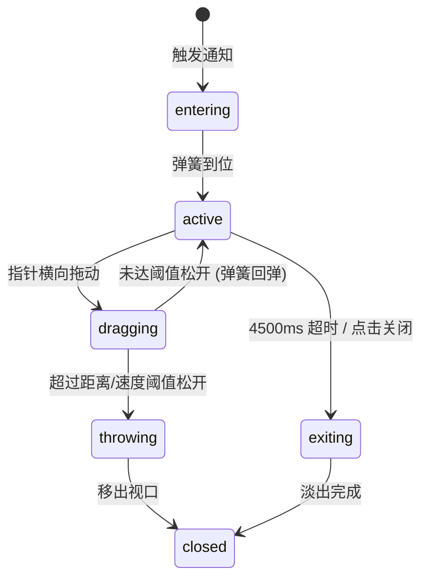

# Toast · 吐司提示

用于在页面边缘悬浮呈现轻量级、非阻塞型操作反馈（如“草稿已保存”、“链接已复制”）的瞬态通知组件。包含三大核心动效机制：

1. 触感微弹性升起（Spring Rise Enter）：通知生成时自下方 16px 处伴随 `scale(0.96)` 微缩弹性升起，透明度在 240ms 内平滑显现，触感柔和沉降。
2. 指针水平拖拽轻扫丢弃（Swipe to Dismiss）：支持触控与鼠标横向手势轻扫。滑动超过 80px 或瞬时释放速度超过 480px/s 时，执行向外侧加速抛掷移出动画；未达阈值则原位弹簧回弹。
3. 动态文案无顿挫置换（Micro-Blur Text Swap）：同一条通知在异步执行阶段（如“正在保存…”→“已保存”）发生文案更新时，新旧文本通过微模糊淡入淡出无缝置换，杜绝外框跳动。

## 原型清单

| 原型分组 | 原型元素 | 动效 / 状态变化 | 去向 |
| --- | --- | --- | --- |
| — | 浮层视口与容器（`.arc-toast-portal` / `.arc-toast`） | 屏幕边缘定位、入场弹簧位移 `translateY(16px -> 0)` 与缩放 `scale(0.96 -> 1)`、退场淡出 | 触感微弹性升起 |
| — | 手势滑动跟踪（水平 PointerDrag） | 水平位移跟随、拖拽距离关联透明度递减、速度判定投掷动画与回弹恢复 | 指针水平拖拽轻扫丢弃 |
| — | 文本排版区（`.arc-toast-copy`, `.arc-toast-title`, `.arc-toast-description`） | 标题与描述更新时的微模糊过渡、高度自适应 | 动态文案无顿挫置换 |
| — | 状态图标与关闭按钮（`.arc-toast-icon`, `.arc-toast-close`） | 图标弹性入场、关闭按钮悬停与按压微缩 `scale(0.94)` | 触感微弹性升起 |
| — | 演示外壳（底部 Save draft 触发按钮、快捷键） | — | 演示外壳，已删除 |

## 适用

- 各种异步交互完成后的轻量级成功、警告或常规信息通知。
- 自动倒计时消失（默认 4500ms），不需要强制用户操作确认。
- 移动端或触控屏上需要自然的横向单指轻扫删除体验。

## 不适用

- 多条通知在同一角落层叠堆砌与批量管理 → [toast-stack.md](toast-stack.md)
- 页面局部的持久性内联警示或错误提示 → [alert.md](alert.md)
- 站点顶部的全宽运营公告与轮播横幅 → [announcement-bar.md](announcement-bar.md)
- 破坏性删除操作的原地倒计时与 Undo 撤销 → [confirm-morph.md](../buttons/confirm-morph.md)

## 状态机

| 状态 | 进入条件 | 视觉表现 | 退出到 |
| --- | --- | --- | --- |
| entering | 实例创建挂载 | `translateY(16px) scale(0.96)` 弹簧升起，透明度 0 至 1 | active |
| active | 入场完成；倒计时推进中 | 原位静止居中，倒计时进行；鼠标悬停时计时器暂停 | dragging / exiting |
| dragging | 用户按住卡片并横向移动超过 3px | 卡片随光标横向移动，透明度随距离平滑衰减 | throwing / active (回弹) |
| throwing | 拖拽松开且位移 > 80px 或速度 > 480px/s | 加速向拖拽方向滑出屏幕并淡出至 0 | closed |
| exiting | 倒计时到期或用户点击关闭按钮 | 向下平移 8px，微缩至 0.97，180ms 内透明度淡出至 0 | closed |
| closed | 退出动画结束 | 容器完全隐藏或从 DOM 中安全卸载 | entering (若重新触发) |



## 最小 DOM

```html
<div class="arc-toast-portal" aria-live="polite" aria-atomic="true">
  <div class="arc-toast" role="status" data-state="visible">
    <div class="arc-toast-content">
      <div class="arc-toast-icon" aria-hidden="true">
        <svg width="18" height="18" viewBox="0 0 24 24" fill="none" stroke="currentColor" stroke-width="2" stroke-linecap="round" stroke-linejoin="round">
          <path d="M20 6 9 17l-5-5"></path>
        </svg>
      </div>
      <div class="arc-toast-copy">
        <strong class="arc-toast-title">Draft saved</strong>
        <p class="arc-toast-description">Saved to cloud storage just now.</p>
      </div>
      <button type="button" class="arc-toast-close" aria-label="Dismiss notification">
        <svg width="14" height="14" viewBox="0 0 24 24" fill="none" stroke="currentColor" stroke-width="2" stroke-linecap="round" stroke-linejoin="round">
          <path d="M18 6 6 18"></path>
          <path d="m6 6 12 12"></path>
        </svg>
      </button>
    </div>
  </div>
</div>
```

- `.arc-toast-portal`：屏幕固定定位锚点槽，在视口右下角或底部居中。
- `.arc-toast`：Toast 物理表面，承载弹簧入场、手势平移变换与阴影。
- `.arc-toast-content`：内联弹性布局行，水平排列图标、文案与关闭按钮。
- `.arc-toast-icon`：状态指示图标槽位。
- `.arc-toast-copy`：文案排版容器，包含标题 `.arc-toast-title` 与描述 `.arc-toast-description`。
- `.arc-toast-close`：右上角关闭按钮，提供按压微触感与键盘快捷访问。

## 参数

| 名称 | 值 | 用于 | 来源 |
| --- | --- | --- | --- |
| 默认停留时间 | `4500ms` | 自动消失倒计时 | 原型 |
| 弹簧入场位移与缩放 | `translateY(16px)` / `scale(0.96)` | 初始进入位置 | 原型 |
| 弹簧入场物理参数 | `visualDuration: 0.42s` / `bounce: 0.16` | 入场弹性回弹曲线 | 原型 |
| 入场透明度过渡 | `240ms` / `cubic-bezier(0.16, 1, 0.3, 1)` | 入场渐显过渡 | 原型 |
| 手势丢弃滑动距离阈值 | `80px` | 拖拽触发抛掷距离 | 原型 |
| 手势丢弃释放速度阈值 | `480px/s` | 拖拽触发快速甩出速度 | 原型 |
| 常规退出位移与缩放 | `translateY(8px)` / `scale(0.97)` | 超时退出目标状态 | 原型 |
| 常规退出时长与曲线 | `180ms` / `cubic-bezier(0.22, 1, 0.36, 1)` | 正常超时淡出动画 | 原型 |
| 手势抛掷动画时长 | `200ms ease-out` | 甩出屏幕动画 | 原型 |
| 减动效淡入淡出时长 | `120ms linear` | prefers-reduced-motion 纯透明度 | 原型 |

## CSS

```css
.arc-toast-portal {
  position: fixed;
  bottom: 24px;
  right: 24px;
  z-index: 1000;
  pointer-events: none;
  box-sizing: border-box;
}

.arc-toast {
  --toast-bg: #ffffff;
  --toast-color: #0f172a;
  --toast-desc: #64748b;
  --toast-border: rgba(0, 0, 0, 0.08);
  --toast-shadow: 0 10px 25px -5px rgba(0, 0, 0, 0.1), 0 8px 10px -6px rgba(0, 0, 0, 0.05);

  pointer-events: auto;
  min-width: 280px;
  max-width: 380px;
  background: var(--toast-bg);
  color: var(--toast-color);
  border: 1px solid var(--toast-border);
  border-radius: 12px;
  box-shadow: var(--toast-shadow);
  padding: 12px 14px;
  box-sizing: border-box;
  touch-action: pan-y;
  user-select: none;
  cursor: grab;
  transition: transform 420ms cubic-bezier(0.16, 1, 0.3, 1), opacity 240ms ease;
  will-change: transform, opacity;
}

.arc-toast:active {
  cursor: grabbing;
}

.arc-toast-content {
  display: flex;
  align-items: flex-start;
  gap: 10px;
}

.arc-toast-icon {
  flex: 0 0 auto;
  width: 18px;
  height: 18px;
  margin-top: 2px;
  color: #16a34a;
  display: flex;
  align-items: center;
  justify-content: center;
}

.arc-toast-copy {
  flex: 1;
  min-width: 0;
}

.arc-toast-title {
  display: block;
  font-size: 13px;
  font-weight: 600;
  line-height: 1.4;
  color: var(--toast-color);
}

.arc-toast-description {
  margin: 2px 0 0;
  font-size: 12px;
  line-height: 1.4;
  color: var(--toast-desc);
}

.arc-toast-close {
  flex: 0 0 auto;
  display: inline-flex;
  align-items: center;
  justify-content: center;
  width: 20px;
  height: 20px;
  margin: -2px -2px -2px 4px;
  border: none;
  border-radius: 4px;
  background: transparent;
  color: #94a3b8;
  cursor: pointer;
  padding: 0;
  transition: color 150ms ease, background-color 150ms ease, transform 120ms ease;
}

.arc-toast-close:hover {
  color: var(--toast-color);
  background: rgba(0, 0, 0, 0.05);
}

.arc-toast-close:active {
  transform: scale(0.94);
}

@media (prefers-reduced-motion: reduce) {
  .arc-toast {
    transition: opacity 120ms linear !important;
    transform: none !important;
  }
  .arc-toast-close:active {
    transform: none !important;
  }
}
```

## JS

```js
/**
 * 创建并绑定 Toast 动效与手势控制器
 * @param {HTMLElement} el 宿主容器或 Portal 元素
 * @param {Object} [options]
 * @param {string} [options.title=''] 标题文案
 * @param {string} [options.description=''] 详细描述文案
 * @param {number} [options.duration=4500] 停留时长 (ms)，设为 0 表示不自动关闭
 * @param {Function} [options.onDismiss] 移除回调
 */
export function createToast(el, options = {}) {
  const portal = el.classList.contains('arc-toast-portal') ? el : el.querySelector('.arc-toast-portal') || el;
  const toast = portal.querySelector('.arc-toast') || portal;
  const closeBtn = toast.querySelector('.arc-toast-close');
  const titleEl = toast.querySelector('.arc-toast-title');
  const descEl = toast.querySelector('.arc-toast-description');

  const duration = options.duration !== undefined ? options.duration : 4500;
  let isDisposed = false;
  let timerId = null;

  // 手势拖拽状态
  let isDragging = false;
  let startX = 0;
  let currentDeltaX = 0;
  let lastX = 0;
  let lastTime = 0;
  let velocityX = 0;

  function dismiss(method = 'timeout') {
    if (isDisposed) return;
    clearTimeout(timerId);

    const reduced = window.matchMedia('(prefers-reduced-motion: reduce)').matches;
    if (reduced) {
      toast.style.transition = 'opacity 120ms linear';
      toast.style.opacity = '0';
    } else if (method === 'swipe-right') {
      toast.style.transition = 'transform 200ms ease-out, opacity 200ms ease-out';
      toast.style.transform = `translateX(${toast.offsetWidth + 80}px)`;
      toast.style.opacity = '0';
    } else if (method === 'swipe-left') {
      toast.style.transition = 'transform 200ms ease-out, opacity 200ms ease-out';
      toast.style.transform = `translateX(-${toast.offsetWidth + 80}px)`;
      toast.style.opacity = '0';
    } else {
      toast.style.transition = 'transform 180ms cubic-bezier(0.22, 1, 0.36, 1), opacity 180ms ease';
      toast.style.transform = 'translateY(8px) scale(0.97)';
      toast.style.opacity = '0';
    }

    setTimeout(() => {
      if (isDisposed) return;
      toast.style.display = 'none';
      if (typeof options.onDismiss === 'function') {
        options.onDismiss();
      }
    }, 200);
  }

  function startTimer() {
    if (duration > 0) {
      clearTimeout(timerId);
      timerId = setTimeout(() => {
        dismiss('timeout');
      }, duration);
    }
  }

  function pauseTimer() {
    clearTimeout(timerId);
  }

  function onPointerDown(e) {
    if (e.target.closest('.arc-toast-close')) return;
    isDragging = true;
    startX = e.clientX;
    lastX = e.clientX;
    lastTime = performance.now();
    currentDeltaX = 0;
    velocityX = 0;
    toast.style.transition = 'none';
    pauseTimer();
    toast.setPointerCapture(e.pointerId);
  }

  function onPointerMove(e) {
    if (!isDragging) return;
    const now = performance.now();
    const dt = now - lastTime;
    currentDeltaX = e.clientX - startX;

    if (dt > 16) {
      velocityX = ((e.clientX - lastX) / dt) * 1000;
      lastX = e.clientX;
      lastTime = now;
    }

    const fadeProgress = Math.min(1, Math.abs(currentDeltaX) / 280);
    toast.style.transform = `translateX(${currentDeltaX}px)`;
    toast.style.opacity = `${1 - fadeProgress * 0.7}`;
  }

  function onPointerUp(e) {
    if (!isDragging) return;
    isDragging = false;
    try {
      toast.releasePointerCapture(e.pointerId);
    } catch (_) {}

    const shouldDismiss = Math.abs(currentDeltaX) > 80 || Math.abs(velocityX) > 480;

    if (shouldDismiss) {
      const direction = currentDeltaX > 0 || velocityX > 0 ? 'swipe-right' : 'swipe-left';
      dismiss(direction);
    } else {
      // 弹簧回弹归位
      toast.style.transition = 'transform 360ms cubic-bezier(0.18, 0.89, 0.32, 1.15), opacity 200ms ease';
      toast.style.transform = 'translate(0, 0) scale(1)';
      toast.style.opacity = '1';
      startTimer();
    }
  }

  // 悬停时暂停计时
  toast.addEventListener('mouseenter', pauseTimer);
  toast.addEventListener('mouseleave', startTimer);

  toast.addEventListener('pointerdown', onPointerDown);
  toast.addEventListener('pointermove', onPointerMove);
  toast.addEventListener('pointerup', onPointerUp);
  toast.addEventListener('pointercancel', onPointerUp);

  if (closeBtn) {
    closeBtn.addEventListener('click', () => dismiss('close-btn'));
  }

  // 初始入场动效
  const reduced = window.matchMedia('(prefers-reduced-motion: reduce)').matches;
  if (!reduced) {
    toast.style.transform = 'translateY(16px) scale(0.96)';
    toast.style.opacity = '0';
    requestAnimationFrame(() => {
      toast.style.transition = 'transform 420ms cubic-bezier(0.16, 1, 0.3, 1), opacity 240ms ease';
      toast.style.transform = 'translateY(0) scale(1)';
      toast.style.opacity = '1';
    });
  }

  startTimer();

  return {
    update({ title, description }) {
      if (isDisposed) return;
      if (title && titleEl) titleEl.textContent = title;
      if (description && descEl) descEl.textContent = description;
      startTimer();
    },
    dismiss: () => dismiss('manual'),
    destroy() {
      isDisposed = true;
      clearTimeout(timerId);
      toast.removeEventListener('mouseenter', pauseTimer);
      toast.removeEventListener('mouseleave', startTimer);
      toast.removeEventListener('pointerdown', onPointerDown);
      toast.removeEventListener('pointermove', onPointerMove);
      toast.removeEventListener('pointerup', onPointerUp);
      toast.removeEventListener('pointercancel', onPointerUp);
    }
  };
}
```

## 接入目标项目

- 状态来源：目标业务层各类异步成功或警告动作（如保存、发布、复制、删除）。
- 尺寸策略：屏幕右下角固定定位（`position: fixed`），宽度自适应内容（min 280px，max 380px）。
- 驱动方式：业务触发时调用 `createToast(el, { title, description, duration })`；如需更新调用 `update()`；卸载时调用 `destroy()`。

## 重入与清理

- 拖拽进行中如果收到销毁指令，捕获的指针立即释放，计时器彻底清除。
- 鼠标悬停时自动重置并挂起倒计时，移出时重新激活，确保用户阅读期间通知不会意外消失。

## 减少动态效果

- 满足 `prefers-reduced-motion: reduce` 时：
  - 停用垂直弹性升起、缩放及手势横向位移抛掷动画。
  - 所有状态切换与进入退出改用纯透明度淡入淡出（120ms）呈现。
  - 保留手势滑动功能，但在松开触发后直接淡出隐藏。

## 焦点与键盘

- 外层容器使用 `aria-live="polite"` 与 `aria-atomic="true"`，不打断用户当前的屏幕阅读器焦点，静默完成播报。
- 根元素设置 `role="status"` 标识当前为操作反馈状态。
- 关闭按钮提供清晰的键盘 Tab 聚焦轮廓与 `aria-label="Dismiss notification"`，按回车或空格直接触发退出。

## 兼容回退

| 特性 | 不支持时 |
| --- | --- |
| `Pointer Events` (指针事件) | 若旧版浏览器不支持 PointerEvent，滑动丢弃特性优雅失效，依赖右上角关闭按钮与 4500ms 自动倒计时退出。 |
| CSS `touch-action: pan-y` | 回退至标准触摸滚动，卡片依然可通过点击关闭按钮安全移除。 |

## 验收清单

- [ ] 挂载激活时自右下方微弹性升起淡入，文字与图标对齐规整，投影柔和。
- [ ] 经过 4500ms 倒计时后，Toast 自动微移并平滑淡出视口。
- [ ] 鼠标光标悬停在 Toast 上时，倒计时自动暂停；光标离开后倒计时重新计时。
- [ ] 鼠标或手指水平拖动卡片，卡片精确跟手位移且透明度按比例衰减；释放未达 80px 弹性回弹原位。
- [ ] 快速向左或向右甩出（位移 > 80px 或释放速度 > 480px/s），卡片向对应方向快速抛掷淡出。
- [ ] 在系统启用减少动态效果时，所有位移和弹簧被停用，改由轻量淡入淡出完成生命周期。
