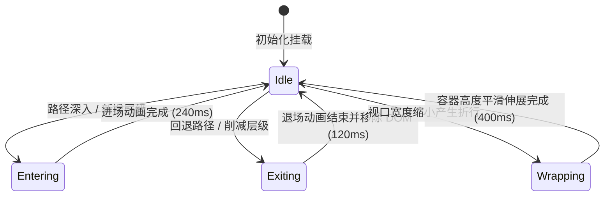

# Breadcrumb · 面包屑导航

用于层级化页面路径导航与上下文层级回溯。包含四大核心动效机制：

1. FLIP 平滑位移重排（Layout Projection）：层级发生增删时，保留的原面包屑节点通过 FLIP（First-Last-Invert-Play）算得相对位移，以 `cubic-bezier(0.16, 1, 0.3, 1)` 弹簧曲线顺滑位移到新槽位。
2. 进场与脱流退场（Crumb Enter & Exit）：新面包屑项带 `translateX(-8px) blur(2px)` 错峰淡入（240ms）；退场节点瞬间设为 `position: absolute` 脱离 Flex 排版流，以 `translateX(-4px) blur(2px)` 120ms 加速淡出后从 DOM 彻底移除，杜绝兄弟节点排版跳变。
3. 容器折行高度自适应平滑伸缩（Height Morphing）：多层级路径在容器边界处自动折行，外层容器借助 `ResizeObserver` 测算内层高度变化，以 400ms 平滑弹簧顺滑伸缩高度。
4. 伪元素中等字重防抖（Ghost Sizer via ::after）：所有链接与按钮通过 `::after` 注入隐藏的同名 `attr(data-label)` 并预设中等字重（font-weight: 500），在状态切换为当前页加粗时外框尺寸绝对保持 0 像素抖动。

## 原型清单

| 原型分组 | 原型元素 | 动效 / 状态变化 | 去向 |
| --- | --- | --- | --- |
| 面包屑导航栏 | 导航容器 `nav[aria-label="Breadcrumb"]` | 承载语义与可访问性标签 | 最小 DOM |
| 面包屑导航栏 | 高度弹性外框 `.breadcrumb-frame` | `ResizeObserver` 动态监听并以 400ms 弹簧伸缩高度 | 容器折行高度自适应平滑伸缩 |
| 面包屑导航栏 | 路径列表 `.breadcrumb-list` | Flex 换行排版与节点插入锚点 | FLIP 平滑位移重排 |
| 面包屑导航栏 | 面包屑条目 `li` | 进场 `translateX(-8px)` 淡入；退场绝对定位脱流 `translateX(-4px)` 淡出 | 进场与脱流退场 |
| 面包屑导航栏 | 折角分隔图标 `svg.breadcrumb-separator` | 随条目进入与离开 | 进场与脱流退场 |
| 面包屑导航栏 | 路径操作按钮/链接 `button`/`a` | 悬停下划线显隐；`::after` 占位中等字重防抖；`aria-current="page"` 高亮 | 伪元素中等字重防抖 |
| 演示页面列表 | 下级页面面板 `.breadcrumb_pages__7l_Ga` | 演示下级文件夹与文档点击跳转 | 演示外壳，已删除 |
| — | 顶栏独立主题切换器 `#themeBtn` | 演示主题切换 | 演示外壳，已删除 |
| — | 外层演示舞台卡片 `.breadcrumb_demo__2z3uo` | 演示卡片外框 | 演示外壳，已删除 |

## 适用

- 存在明确上下级父子关系的深层多级路径导航（如“项目 > 模块 > 详情”）。
- 用户需要快速回溯到任一上级路径，且路径深度发生动态变动。
- 空间有限导致路径在窄屏下发生换行，需要容器高度顺滑展开而非突兀截断。

## 不适用

- 平级同维度的视图视图组切换 → [tabs](tabs.md)
- 顺序数字编号的长列表分页控制 → [pagination](pagination.md)
- 包含丰富操作项的悬浮操作菜单 → [dropdown-menu](../menus/dropdown-menu.md)

## 状态机



| 状态 | 进入条件 | 视觉表现 | 退出到 |
| --- | --- | --- | --- |
| idle | 初始挂载或动画结束 | 各级链接正常显示，末项高亮且为纯文本 | entering / exiting / wrapping |
| entering | 路径变深，新增子层级 | 新增项从 `translateX(-8px) blur(2px)` 240ms 淡入，旧项 FLIP 右移 | idle |
| exiting | 点击上级回退，裁剪子层级 | 移除项脱流绝对定位并以 120ms 淡出，保留项 FLIP 左移紧缩 | idle |
| wrapping | 容器宽度受限导致折行 | frame 外框高度以 400ms 弹簧收敛至目标高度 | idle |

## 最小 DOM

```html
<nav class="breadcrumb" aria-label="Breadcrumb">
  <div class="breadcrumb-frame">
    <div class="breadcrumb-frame-inner">
      <ol class="breadcrumb-list">
        <li>
          <button type="button" data-label="Projects">Projects</button>
        </li>
        <li>
          <svg class="breadcrumb-separator" width="14" height="14" viewBox="0 0 24 24" fill="none" stroke="currentColor" stroke-width="2" stroke-linecap="round" stroke-linejoin="round" aria-hidden="true">
            <path d="m9 18 6-6-6-6" />
          </svg>
          <button type="button" data-label="Arc launch">Arc launch</button>
        </li>
        <li>
          <svg class="breadcrumb-separator" width="14" height="14" viewBox="0 0 24 24" fill="none" stroke="currentColor" stroke-width="2" stroke-linecap="round" stroke-linejoin="round" aria-hidden="true">
            <path d="m9 18 6-6-6-6" />
          </svg>
          <span aria-current="page" data-label="Design review">Design review</span>
        </li>
      </ol>
    </div>
  </div>
</nav>
```

- `.breadcrumb`：语义化导航外壳，承载无障碍 `aria-label`。
- `.breadcrumb-frame`：高度伸缩容器，`overflow: hidden`，配合 JS 弹簧平滑变化 height。
- `.breadcrumb-frame-inner`：内容测量载体，供 `ResizeObserver` 实时读取自然排版高度。
- `.breadcrumb-list`：Flex wrap 弹性列表，承载各级面包屑项。
- `li`：单级面包屑节点。内部包含前置分隔图标与可点击操作按钮/链接。
- `.breadcrumb-separator`：折角分隔符，对屏幕阅读器隐去（`aria-hidden="true"`）。
- `button` / `span[aria-current="page"]`：非末尾项为交互控件；末项为不可点击的当前页标识。`data-label` 供 `::after` 伪元素测量中等字重。

## 参数

| 名称 | 值 | 用于 | 来源 |
| --- | --- | --- | --- |
| 节点进场时长与位移 | `240ms` / `translateX(-8px) blur(2px)` | 新增面包屑入场 | 原型 |
| 节点进场缓动曲线 | `cubic-bezier(0.16, 1, 0.3, 1)` | `.breadcrumb-list li` 入场 | 原型 |
| 节点退场时长与位移 | `120ms` / `translateX(-4px) blur(2px)` | 移除面包屑出场 | 原型 |
| 节点退场缓动曲线 | `cubic-bezier(0.22, 1, 0.36, 1)` | `.breadcrumb-list li` 出场 | 原型 |
| FLIP 重排弹簧周期 | `400ms` / `cubic-bezier(0.16, 1, 0.3, 1)` | 保留节点位置更新 | 原型 |
| 容器折行高度伸缩 | `400ms` / `cubic-bezier(0.16, 1, 0.3, 1)` | `.breadcrumb-frame` height 过渡 | 原型 |
| 文本加粗防抖字重 | `font-weight: 500` | `::after` 伪元素尺寸占位 | 原型 |
| 悬停下划线颜色过渡 | `160ms` / `cubic-bezier(0.22, 1, 0.36, 1)` | `a:hover`, `button:hover` | 原型 |

## CSS

```css
.breadcrumb {
  --breadcrumb-text-secondary: oklch(46% 0 0);
  --breadcrumb-text-muted: oklch(59% 0 0);
  --breadcrumb-accent: oklch(24% 0 0);
  --breadcrumb-border-strong: oklch(82% 0 0);
  --breadcrumb-ease-enter: cubic-bezier(0.16, 1, 0.3, 1);
  --breadcrumb-ease-exit: cubic-bezier(0.22, 1, 0.36, 1);
  --breadcrumb-duration-fast: 160ms;
  --breadcrumb-duration-enter: 240ms;
  --breadcrumb-duration-exit: 120ms;
  --breadcrumb-duration-frame: 400ms;

  position: relative;
  display: block;
  width: 100%;
}

.breadcrumb-frame {
  position: relative;
  overflow: hidden;
  height: auto;
  transition: height var(--breadcrumb-duration-frame) var(--breadcrumb-ease-enter);
  will-change: height;
}

.breadcrumb-frame-inner {
  display: block;
  padding: 4px 0;
}

.breadcrumb-list {
  position: relative;
  display: flex;
  flex-wrap: wrap;
  align-items: center;
  gap: 2px 6px;
  margin: 0;
  padding: 0;
  list-style: none;
}

.breadcrumb-list li {
  display: inline-flex;
  align-items: center;
  gap: 6px;
  color: var(--breadcrumb-text-muted);
  font-size: 0.875rem;
  line-height: 1.4;
  white-space: nowrap;
  will-change: transform, opacity, filter;
  transition: transform var(--breadcrumb-duration-frame) var(--breadcrumb-ease-enter);
}

.breadcrumb-list li > svg.breadcrumb-separator {
  width: 14px;
  height: 14px;
  flex: 0 0 auto;
  color: var(--breadcrumb-border-strong);
  stroke-width: 1.75;
}

.breadcrumb-list a,
.breadcrumb-list li > span,
.breadcrumb-list li > button {
  display: inline-flex;
  flex-direction: column;
  position: relative;
  border-radius: 6px;
  padding: 3px 2px;
  color: var(--breadcrumb-text-secondary);
  font: inherit;
  line-height: inherit;
  text-decoration: underline 1px transparent;
  text-underline-offset: 4px;
  transition:
    color var(--breadcrumb-duration-fast) var(--breadcrumb-ease-exit),
    text-decoration-color var(--breadcrumb-duration-fast) var(--breadcrumb-ease-exit);
}

/* 伪元素中等字重防抖：提前预留 500 字重物理宽度 */
.breadcrumb-list a::after,
.breadcrumb-list li > span::after,
.breadcrumb-list li > button::after {
  display: block;
  height: 0;
  overflow: hidden;
  content: attr(data-label);
  font-weight: 500;
  visibility: hidden;
  user-select: none;
  pointer-events: none;
}

.breadcrumb-list li > button {
  border: 0;
  margin: 0;
  background: transparent;
  text-align: start;
  cursor: pointer;
}

.breadcrumb-list [aria-current="page"] {
  color: var(--breadcrumb-accent);
  font-weight: 500;
  cursor: default;
  text-decoration: none !important;
}

@media (hover: hover) and (pointer: fine) {
  .breadcrumb-list a:hover,
  .breadcrumb-list li > button:hover {
    color: var(--breadcrumb-accent);
    text-decoration-color: currentColor;
  }
}

@media (prefers-reduced-motion: reduce) {
  .breadcrumb-frame {
    transition: none !important;
  }
  .breadcrumb-list li {
    transition: none !important;
  }
  .breadcrumb-list a,
  .breadcrumb-list li > button,
  .breadcrumb-list [aria-current="page"] {
    transition: none !important;
  }
}
```

## JS

```js
/**
 * 创建轻量级纯原生 Breadcrumb 控制器
 * @param {HTMLElement} el 包含 .breadcrumb 的根节点
 * @param {Object} [options] 配置选项
 * @param {Array<{ label: string, href?: string, onClick?: (e: MouseEvent) => void }>} [options.items] 面包屑项
 * @param {(items: Array<{ label: string }>) => void} [options.onChange] 路径变更回调
 * @returns {{ setItems: Function, getItems: Function, destroy: Function }}
 */
export function createBreadcrumb(el, options = {}) {
  const frame = el.querySelector('.breadcrumb-frame') || el;
  const inner = el.querySelector('.breadcrumb-frame-inner') || frame;
  const list = el.querySelector('.breadcrumb-list');
  if (!list) return { destroy: () => {} };

  let currentItems = options.items || parseDomItems(list);
  let isReduced = window.matchMedia('(prefers-reduced-motion: reduce)').matches;
  let disposed = false;
  let resizeObserver = null;

  function parseDomItems(listEl) {
    const lis = Array.from(listEl.querySelectorAll('li'));
    if (!lis.length) return [{ label: 'Home' }];
    return lis.map(li => {
      const target = li.querySelector('button, a, span');
      return {
        label: target ? target.textContent.trim() : li.textContent.trim()
      };
    });
  }

  // 1. 容器高度自适应监听
  if (typeof ResizeObserver !== 'undefined' && frame !== inner) {
    resizeObserver = new ResizeObserver(() => {
      if (disposed) return;
      const nextHeight = inner.offsetHeight;
      if (isReduced) {
        frame.style.height = `${nextHeight}px`;
      } else {
        frame.style.height = `${nextHeight}px`;
      }
    });
    resizeObserver.observe(inner);
  }

  // 2. 渲染条目并执行 FLIP + 进场/出场动画
  function render(newItems) {
    if (disposed) return;
    const oldLiNodes = Array.from(list.querySelectorAll('li:not(.breadcrumb-exiting)'));
    const oldBoxes = new Map();
    oldLiNodes.forEach((li, idx) => {
      const label = li.querySelector('button, a, span')?.getAttribute('data-label') || li.textContent.trim();
      oldBoxes.set(`${label}-${idx}`, li.getBoundingClientRect());
    });

    const isLast = (idx, total) => idx === total - 1;

    // 清除已标记退场的临时节点
    list.querySelectorAll('.breadcrumb-exiting').forEach(n => n.remove());

    // 找出移除项并应用脱流退场动画
    const newKeys = new Set(newItems.map((item, i) => `${item.label}-${i}`));
    oldLiNodes.forEach((li, idx) => {
      const label = li.querySelector('button, a, span')?.getAttribute('data-label') || li.textContent.trim();
      const key = `${label}-${idx}`;
      if (!newKeys.has(key)) {
        li.classList.add('breadcrumb-exiting');
        const box = li.getBoundingClientRect();
        const listRect = list.getBoundingClientRect();
        li.style.position = 'absolute';
        li.style.left = `${box.left - listRect.left}px`;
        li.style.top = `${box.top - listRect.top}px`;
        li.style.pointerEvents = 'none';

        if (!isReduced && typeof li.animate === 'function') {
          const anim = li.animate([
            { opacity: 1, transform: 'translateX(0)', filter: 'blur(0)' },
            { opacity: 0, transform: 'translateX(-4px)', filter: 'blur(2px)' }
          ], {
            duration: 120,
            easing: 'cubic-bezier(0.22, 1, 0.36, 1)',
            fill: 'forwards'
          });
          anim.onfinish = () => {
            if (li.parentNode) li.remove();
          };
        } else {
          li.remove();
        }
      }
    });

    // 构造新 DOM 结构
    list.innerHTML = '';
    const newElements = [];

    newItems.forEach((item, index) => {
      const li = document.createElement('li');
      if (index > 0) {
        const svg = document.createElementNS('http://www.w3.org/2000/svg', 'svg');
        svg.setAttribute('class', 'breadcrumb-separator');
        svg.setAttribute('width', '14');
        svg.setAttribute('height', '14');
        svg.setAttribute('viewBox', '0 0 24 24');
        svg.setAttribute('fill', 'none');
        svg.setAttribute('stroke', 'currentColor');
        svg.setAttribute('stroke-width', '2');
        svg.setAttribute('stroke-linecap', 'round');
        svg.setAttribute('stroke-linejoin', 'round');
        svg.setAttribute('aria-hidden', 'true');
        const path = document.createElementNS('http://www.w3.org/2000/svg', 'path');
        path.setAttribute('d', 'm9 18 6-6-6-6');
        svg.appendChild(path);
        li.appendChild(svg);
      }

      let contentEl;
      if (isLast(index, newItems.length)) {
        contentEl = document.createElement('span');
        contentEl.setAttribute('aria-current', 'page');
      } else if (item.href) {
        contentEl = document.createElement('a');
        contentEl.href = item.href;
      } else {
        contentEl = document.createElement('button');
        contentEl.type = 'button';
      }

      contentEl.textContent = item.label;
      contentEl.setAttribute('data-label', item.label);
      if (contentEl.tagName !== 'SPAN') {
        contentEl.addEventListener('click', (e) => {
          if (item.onClick) item.onClick(e);
          setItems(newItems.slice(0, index + 1));
        });
      }

      li.appendChild(contentEl);
      list.appendChild(li);
      newElements.push({ li, key: `${item.label}-${index}` });
    });

    // FLIP 计算与新入场动画
    if (!isReduced) {
      newElements.forEach(({ li, key }) => {
        const oldBox = oldBoxes.get(key);
        if (oldBox) {
          const newBox = li.getBoundingClientRect();
          const dx = oldBox.left - newBox.left;
          const dy = oldBox.top - newBox.top;
          if (Math.abs(dx) > 0.5 || Math.abs(dy) > 0.5) {
            li.style.transform = `translate(${dx}px, ${dy}px)`;
            li.style.transition = 'none';
            requestAnimationFrame(() => {
              li.style.transition = 'transform 400ms cubic-bezier(0.16, 1, 0.3, 1)';
              li.style.transform = 'none';
            });
          }
        } else if (typeof li.animate === 'function') {
          // 新增节点渐显进入
          li.animate([
            { opacity: 0, transform: 'translateX(-8px)', filter: 'blur(2px)' },
            { opacity: 1, transform: 'none', filter: 'blur(0)' }
          ], {
            duration: 240,
            easing: 'cubic-bezier(0.16, 1, 0.3, 1)',
            fill: 'forwards'
          });
        }
      });
    }

    currentItems = newItems;
    if (typeof options.onChange === 'function') {
      options.onChange(currentItems);
    }
  }

  function setItems(nextItems) {
    if (!Array.isArray(nextItems) || !nextItems.length) return;
    render(nextItems);
  }

  // 初始渲染
  render(currentItems);

  const reducedMatcher = window.matchMedia('(prefers-reduced-motion: reduce)');
  const onMotionPreferenceChange = (e) => {
    isReduced = e.matches;
  };
  reducedMatcher.addEventListener('change', onMotionPreferenceChange);

  return {
    setItems,
    getItems: () => [...currentItems],
    destroy() {
      disposed = true;
      if (resizeObserver) resizeObserver.disconnect();
      reducedMatcher.removeEventListener('change', onMotionPreferenceChange);
      list.querySelectorAll('.breadcrumb-exiting').forEach(n => n.remove());
    }
  };
}
```

## 接入目标项目

- 状态来源：
  - 接入单页路由系统（如 Vue Router / React Router）或全局导航状态存储，将路由层级映射为 `items` 数组。
- 尺寸策略：
  - 外层宽度支持流式 100% 弹性拉伸。多层级折行时由 `.breadcrumb-frame` 自动测算并自适应伸缩高度。
- 驱动方式：
  - 组件初始化时调用 `createBreadcrumb(navEl, { items, onChange })`。
  - 路由或目录层级发生变更时调用 `setItems(newPath)`。
  - 组件销毁时调用 `destroy()` 断开 ResizeObserver 监听并回收 DOM。

## 重入与清理

- 连续快速切换路径时，先前的退场节点（`.breadcrumb-exiting`）会被立即批量清理，阻断旧动画回调；
- 销毁函数 `destroy()` 负责断开 `ResizeObserver`，移除 `prefers-reduced-motion` 媒体查询监听，并清退未完成动画的临时脱流节点。

## 减少动态效果

- 开启 `prefers-reduced-motion: reduce` 时：
  - 禁用节点的位移过渡与模糊滤镜（`translateX` / `blur`），退场节点同步移除，入场节点瞬时呈现。
  - 容器的高度弹簧伸缩（`transition: height`）被禁用，改为直接赋予即时计算的高度值。
  - 依然完整保留所有 DOM 结构、ARIA 标签和点击功能。

## 焦点与键盘

- 键盘使用 Tab 键即可顺次对可交互的面包屑项进行聚焦；
- 尾部的当前页项通过 `aria-current="page"` 明确告知辅助技术，且不提供聚焦与点击行为；
- 折角分隔符图标配置 `aria-hidden="true"`，防止屏幕阅读器多余朗读；
- 退场过程中的元素立即追加 `pointer-events: none` 并脱离文档流，杜绝残存焦点捕获。

## 兼容回退

| 特性 | 不支持时 |
| --- | --- |
| `ResizeObserver` | 降级为常规高度自适应（`height: auto`），高度即刻变动无平滑伸缩。 |
| Web Animations API (`Element.animate`) | 回退到静态 DOM 挂载与卸载，无入场渐变。 |

## 验收清单

- [ ] 初始渲染显示清晰的面包屑层级与折角分隔图标，末项标为 `aria-current="page"`。
- [ ] 深入下级路径时，新条目以淡入位移进入，已有条目平滑右移。
- [ ] 回溯上级路径时，裁剪的子项脱流淡出，保留项以 FLIP 平滑左移紧缩。
- [ ] 窄屏或长路径折行时，外层容器高度平滑伸缩，无突兀跳动。
- [ ] 状态切换为当前页加粗时，借助 `::after` 占位，外层尺寸保持 0 像素抖动。
- [ ] 开启减少动态效果时，所有位移和弹簧被停用，状态直接呈现，语义完备。
