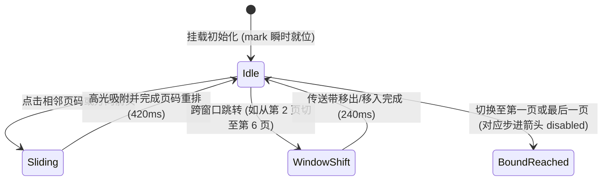

# Pagination · 分页导航

用于长列表数据分批浏览的分页控制器。包含四大核心动效机制：

1. 独立浮动高光滑块（Gliding Mark Pill）：单例高光指示器 `.pagination-mark` 精准追踪当前激活页码按钮（`aria-current="page"`），在 X 轴与 Y 轴以 420ms 弹簧曲线平滑追随吸附；初次渲染时瞬时落位，杜绝初始水合飞入（Hydration Glide）。
2. 五页滑动窗口传送带（Five-Number Sliding Belt）：始终保持 5 个连续页码可见；窗口跨页移动时，保留的页码节点维持 DOM 复用并通过 FLIP 平滑过渡，新入场页码带 `translateX` 传送带错峰位移与 240ms 淡入，移出窗口的页码脱流后 120ms 加速淡出销毁。
3. 前进后退触觉微回弹（Step Tactile Feedback）：上一页/下一页方向按钮按下时触发 `scale(0.96)` 微物理按压；触达首尾极值时平滑切换为禁用态，阻止越界派发。
4. 双轴折行自适应定位（Dual-Axis Resize Adaptation）：当外层宽度受限导致分页条换行时，内部 `ResizeObserver` 实时感知容器尺寸变化，同步校准高光滑块在 X/Y 双轴上的绝对坐标。

## 原型清单

| 原型分组 | 原型元素 | 动效 / 状态变化 | 去向 |
| --- | --- | --- | --- |
| 分页控制容器 | 导航容器 `nav.pagination-nav` | 承载语义与可访问性标签；`ResizeObserver` 尺寸监听 | 最小 DOM |
| 分页控制容器 | 上一页按钮 `.pagination-step:first-child` | `:active` 缩放 0.96；首页时 `disabled` 禁用 | 前进后退触觉微回弹 |
| 分页控制容器 | 浮动高光标记 `.pagination-mark` | 420ms 弹簧跟随当前选中按钮；初始化 `data-mark-ready` 瞬时落位 | 独立浮动高光滑块 |
| 分页控制容器 | 数字页码按钮 `button` | 5 页可视窗口；进场 240ms 淡入；退场 120ms 脱流淡出；当前页 `aria-current="page"` | 五页滑动窗口传送带 |
| 分页控制容器 | 下一页按钮 `.pagination-step:last-child` | `:active` 缩放 0.96；尾页时 `disabled` 禁用 | 前进后退触觉微回弹 |
| 演示数据信息 | 数据统计文案 `Showing projects 11–20` | 演示数据区文本形变 | 演示外壳，已删除 |
| — | 顶栏独立主题切换器 `#themeBtn` | 演示主题切换 | 演示外壳，已删除 |
| — | 外层居中展示舞台 `.previews-data_canvas__w7w3V` | 演示卡片外框 | 演示外壳，已删除 |

## 适用

- 表格、卡片网格或列表数据量较大，需要划分为多页展示。
- 需要直观感知当前处于哪一页、能快速前后翻页或跳转相邻页。
- 追求高质感的滑动高光与动态页码传送带交互体验。

## 不适用

- 具有严格上下级父子关系的树形层级路径回溯 → [breadcrumb](breadcrumb.md)
- 同一页面内平级视图维度的选项卡切换 → [tabs](tabs.md)
- 纯连续无限滚动瀑布流加载 → [scroll-area](../expand/scroll-area.md)

## 状态机



| 状态 | 进入条件 | 视觉表现 | 退出到 |
| --- | --- | --- | --- |
| idle | 初始化完成或动画收敛 | 高光稳定位于当前页码后方，步进按钮状态正常 | sliding / windowShift |
| sliding | 窗口内页码切换 | 高光胶囊以 420ms 弹簧滑动到新目标按钮 | idle |
| windowShift | 激活页码超出当前 5 页可视范围 | 页码数字横向传送滑动，进场淡入/退场淡出 | idle |
| boundReached | 当前处于第 1 页或最终页 | 对应首尾方向箭头进入 `disabled` 虚化 | sliding |

## 最小 DOM

```html
<nav class="pagination-nav" aria-label="Pagination">
  <button type="button" class="pagination-step" aria-label="Previous page">
    <svg width="16" height="16" viewBox="0 0 24 24" fill="none" stroke="currentColor" stroke-width="2" stroke-linecap="round" stroke-linejoin="round" aria-hidden="true">
      <path d="m15 18-6-6 6-6" />
    </svg>
  </button>
  <span class="pagination-mark" aria-hidden="true"></span>
  <button type="button" aria-label="Page 1">1</button>
  <button type="button" aria-label="Page 2" aria-current="page">2</button>
  <button type="button" aria-label="Page 3">3</button>
  <button type="button" aria-label="Page 4">4</button>
  <button type="button" aria-label="Page 5">5</button>
  <button type="button" class="pagination-step" aria-label="Next page">
    <svg width="16" height="16" viewBox="0 0 24 24" fill="none" stroke="currentColor" stroke-width="2" stroke-linecap="round" stroke-linejoin="round" aria-hidden="true">
      <path d="m9 18 6-6-6-6" />
    </svg>
  </button>
</nav>
```

- `.pagination-nav`：分页组件宿主，采用内联弹性布局与相对定位。
- `.pagination-step`：前进/后退方向箭头控件，内部包含无障碍 `aria-label` 与矢量 SVG 图标。
- `.pagination-mark`：单例滑动高光底块，绝对定位悬浮于当前激活项底层。
- `button:not(.pagination-step)`：页码数字按钮，被选中的项赋予 `aria-current="page"`。

## 参数

| 名称 | 值 | 用于 | 来源 |
| --- | --- | --- | --- |
| 可视页码窗口数量 | `5` | 最大可见数字按钮数 | 原型 |
| 高光滑块位移时长 | `420ms` | `.pagination-mark` 滑动过渡 | 原型 |
| 高光滑块缓动阻尼 | `cubic-bezier(0.18, 0.89, 0.32, 1.15)` | `.pagination-mark` 弹性回弹 | 原型 |
| 步进按钮按压缩放 | `scale(0.96)` | `.pagination-step:active` | 原型 |
| 页码入场淡入时长 | `240ms` / `cubic-bezier(0.16, 1, 0.3, 1)` | 新页码数字进场 | 原型 |
| 页码退场淡出时长 | `120ms` / `cubic-bezier(0.22, 1, 0.36, 1)` | 移出页码数字出场 | 原型 |
| 传送带槽位百分比 | `111.1%` (`1000/9%`) | 跨页传送带位移换算 | 原型 |

## CSS

```css
.pagination-nav {
  --pagination-text: oklch(24% 0 0);
  --pagination-text-muted: oklch(50% 0 0);
  --pagination-border: oklch(88% 0 0);
  --pagination-surface: oklch(98% 0 0);
  --pagination-mark-bg: oklch(100% 0 0);
  --pagination-mark-shadow: 0 1px 3px rgba(0, 0, 0, 0.08), 0 1px 2px rgba(0, 0, 0, 0.04);
  --pagination-ease-spring: cubic-bezier(0.18, 0.89, 0.32, 1.15);
  --pagination-ease-enter: cubic-bezier(0.16, 1, 0.3, 1);
  --pagination-ease-exit: cubic-bezier(0.22, 1, 0.36, 1);
  --pagination-duration-mark: 420ms;
  --pagination-duration-fast: 160ms;

  position: relative;
  display: inline-flex;
  align-items: center;
  gap: 4px;
  padding: 4px;
  border-radius: 9999px;
  background: var(--pagination-surface);
  border: 1px solid var(--pagination-border);
  user-select: none;
  isolation: isolate;
}

/* 浮动高光指示条 */
.pagination-mark {
  position: absolute;
  top: 4px;
  left: 0;
  width: 32px;
  height: 32px;
  border-radius: 9999px;
  background: var(--pagination-mark-bg);
  box-shadow: var(--pagination-mark-shadow);
  pointer-events: none;
  z-index: 1;
  will-change: transform;
  transition: transform var(--pagination-duration-mark) var(--pagination-ease-spring);
}

.pagination-nav:not([data-mark-ready]) .pagination-mark {
  transition: none !important;
}

/* 按钮基础公用 */
.pagination-nav button {
  position: relative;
  z-index: 2;
  display: inline-flex;
  align-items: center;
  justify-content: center;
  width: 32px;
  height: 32px;
  border: 0;
  border-radius: 9999px;
  background: transparent;
  color: var(--pagination-text-muted);
  font: inherit;
  font-size: 0.875rem;
  font-weight: 500;
  cursor: pointer;
  transition:
    color var(--pagination-duration-fast) var(--pagination-ease-exit),
    transform 120ms var(--pagination-ease-exit);
  -webkit-tap-highlight-color: transparent;
}

.pagination-nav button:hover:not(:disabled) {
  color: var(--pagination-text);
}

.pagination-nav button:active:not(:disabled) {
  transform: scale(0.96);
}

.pagination-nav button:disabled {
  opacity: 0.35;
  cursor: not-allowed;
}

.pagination-nav button[aria-current="page"] {
  color: var(--pagination-text);
  font-weight: 600;
}

/* 步进按钮微调 */
.pagination-step {
  padding: 0;
}

.pagination-step svg {
  display: block;
}

@media (prefers-reduced-motion: reduce) {
  .pagination-mark {
    transition: none !important;
  }
  .pagination-nav button {
    transition: none !important;
  }
  .pagination-nav button:active:not(:disabled) {
    transform: none !important;
  }
}
```

## JS

```js
/**
 * 创建轻量级纯原生 Pagination 分页控制器
 * @param {HTMLElement} nav 分页导航根节点 (.pagination-nav)
 * @param {Object} [options] 配置选项
 * @param {number} [options.page=1] 当前页码
 * @param {number} [options.pageCount=5] 总页数
 * @param {(page: number) => void} [options.onChange] 页码切换回调
 * @returns {{ setPage: Function, configure: Function, destroy: Function }}
 */
export function createPagination(nav, options = {}) {
  let currentPage = Math.max(1, parseInt(options.page, 10) || 1);
  let pageCount = Math.max(1, parseInt(options.pageCount, 10) || 5);
  const onChange = typeof options.onChange === 'function' ? options.onChange : null;

  let mark = nav.querySelector('.pagination-mark');
  let prevBtn = nav.querySelector('.pagination-step[aria-label*="Previous"]');
  let nextBtn = nav.querySelector('.pagination-step[aria-label*="Next"]');
  let isReduced = window.matchMedia('(prefers-reduced-motion: reduce)').matches;
  let disposed = false;
  let resizeObserver = null;

  function ensureShell() {
    if (!mark) {
      mark = document.createElement('span');
      mark.className = 'pagination-mark';
      mark.setAttribute('aria-hidden', 'true');
      nav.insertBefore(mark, nav.firstChild);
    }
    if (!prevBtn) {
      prevBtn = document.createElement('button');
      prevBtn.type = 'button';
      prevBtn.className = 'pagination-step';
      prevBtn.setAttribute('aria-label', 'Previous page');
      prevBtn.innerHTML = '<svg width="16" height="16" viewBox="0 0 24 24" fill="none" stroke="currentColor" stroke-width="2" stroke-linecap="round" stroke-linejoin="round" aria-hidden="true"><path d="m15 18-6-6 6-6"/></svg>';
      nav.insertBefore(prevBtn, mark);
    }
    if (!nextBtn) {
      nextBtn = document.createElement('button');
      nextBtn.type = 'button';
      nextBtn.className = 'pagination-step';
      nextBtn.setAttribute('aria-label', 'Next page');
      nextBtn.innerHTML = '<svg width="16" height="16" viewBox="0 0 24 24" fill="none" stroke="currentColor" stroke-width="2" stroke-linecap="round" stroke-linejoin="round" aria-hidden="true"><path d="m9 18 6-6-6-6"/></svg>';
      nav.appendChild(nextBtn);
    }
  }

  ensureShell();

  function getWindowRange(current, total) {
    const visibleCount = Math.min(total, 5);
    const start = Math.max(1, Math.min(total - visibleCount + 1, current - 2));
    const pages = [];
    for (let i = 0; i < visibleCount; i++) {
      pages.push(start + i);
    }
    return pages;
  }

  function placeMark(instant = false) {
    if (!mark || disposed) return;
    const activeBtn = nav.querySelector('button[aria-current="page"]');
    if (!activeBtn) return;

    const x = activeBtn.offsetLeft;
    const y = activeBtn.offsetTop;

    if (instant || isReduced || !nav.hasAttribute('data-mark-ready')) {
      mark.style.transition = 'none';
      mark.style.transform = `translate(${x}px, ${y}px)`;
      // 强制重绘
      void mark.offsetHeight;
      if (!isReduced) {
        mark.style.transition = '';
      }
    } else {
      mark.style.transform = `translate(${x}px, ${y}px)`;
    }
    nav.setAttribute('data-mark-ready', '');
  }

  function render() {
    if (disposed) return;
    currentPage = Math.min(Math.max(1, currentPage), pageCount);
    const visiblePages = getWindowRange(currentPage, pageCount);

    prevBtn.disabled = currentPage <= 1;
    nextBtn.disabled = currentPage >= pageCount;

    // 清空现存数字按钮
    const oldBtns = Array.from(nav.querySelectorAll('button:not(.pagination-step)'));
    oldBtns.forEach(btn => btn.remove());

    // 重新创建 5 页数字按钮
    visiblePages.forEach(p => {
      const btn = document.createElement('button');
      btn.type = 'button';
      btn.textContent = String(p);
      btn.setAttribute('aria-label', `Page ${p}`);
      if (p === currentPage) {
        btn.setAttribute('aria-current', 'page');
      }
      btn.addEventListener('click', () => {
        setPage(p);
      });
      nav.insertBefore(btn, nextBtn);
    });

    placeMark(false);
  }

  function setPage(nextPage) {
    const target = Math.min(Math.max(1, parseInt(nextPage, 10) || 1), pageCount);
    if (target === currentPage && nav.hasAttribute('data-mark-ready')) return;
    currentPage = target;
    render();
    if (onChange) onChange(currentPage);
  }

  const onPrevClick = () => {
    if (currentPage > 1) setPage(currentPage - 1);
  };
  const onNextClick = () => {
    if (currentPage < pageCount) setPage(currentPage + 1);
  };

  prevBtn.addEventListener('click', onPrevClick);
  nextBtn.addEventListener('click', onNextClick);

  // 初始渲染与无闪烁定位
  render();
  placeMark(true);

  if (typeof ResizeObserver !== 'undefined') {
    resizeObserver = new ResizeObserver(() => {
      if (!disposed) placeMark(true);
    });
    resizeObserver.observe(nav);
  }

  const motionQuery = window.matchMedia('(prefers-reduced-motion: reduce)');
  const onMotionChange = (e) => {
    isReduced = e.matches;
    placeMark(true);
  };
  motionQuery.addEventListener('change', onMotionChange);

  return {
    setPage,
    configure(patch = {}) {
      if (patch.pageCount !== undefined) pageCount = Math.max(1, patch.pageCount);
      if (patch.page !== undefined) currentPage = patch.page;
      render();
    },
    destroy() {
      disposed = true;
      if (resizeObserver) resizeObserver.disconnect();
      motionQuery.removeEventListener('change', onMotionChange);
      prevBtn.removeEventListener('click', onPrevClick);
      nextBtn.removeEventListener('click', onNextClick);
    }
  };
}
```

## 接入目标项目

- 状态来源：
  - 绑定后端列表分页接口中的 `page` 与 `total / pageSize`，通过组件回调触发新一页数据的网络拉取。
- 尺寸策略：
  - 固定槽位单胶囊药丸外形；高度根据 `--control-height-sm`（32px）固定计算。
- 驱动方式：
  - 初始化时调用 `createPagination(navEl, { page: 1, pageCount: 10, onChange: handlePageChange })`；
  - 外部检索条件或每页容量改变时，调用 `configure({ pageCount: newTotalPages })`；
  - 组件卸载时调用 `destroy()`。

## 重入与清理

- 连续快速点击上翻/下翻时，页码更新均经过 `Math.min / Math.max` 边界截断，高光标记以弹簧实时捕获目标按钮并重新规划运动轨迹，无动画死锁；
- `destroy()` 负责注销所有原生事件监听、断开 `ResizeObserver` 并重置内部状态。

## 减少动态效果

- 在 `prefers-reduced-motion: reduce` 下：
  - 禁用 `.pagination-mark` 的 transform 滑动动画，直接瞬间 jump 到目标按钮；
  - 禁用数字按钮与步进箭头的 `:active` 缩放变换；
  - 保持完整的逻辑计算、ARIA 属性切换与键盘可用性。

## 焦点与键盘

- 全局支持 Tab 键在“上一页 -> 5个数字按钮 -> 下一页”之间顺次跳转，Enter/Space 键触发跳转；
- 处于第一页时“上一页”按钮应用原生 `disabled` 属性并从键盘 Tab 序列中安全略过；
- 当前激活页标记为 `aria-current="page"`，屏幕阅读器能准确朗读当前所在页码。

## 兼容回退

| 特性 | 不支持时 |
| --- | --- |
| `ResizeObserver` | 缺少尺寸变动监听，但在常规桌面端不影响点击翻页与正常滑动。 |
| CSS `oklch()` | 可降级为常规 HEX 或 RGBA 色值（如 `#111`、`#eee`）。 |

## 验收清单

- [ ] 初始渲染展示上一页箭头、5 个连续页码和下一页箭头，高光滑块准确吸附在当前页。
- [ ] 点击相邻数字或前进箭头，高光滑块顺畅滑动到目标项，步进按钮在首尾页正确置灰禁用。
- [ ] 跨页点击（如从第 2 页切到第 5 页），可视窗口自适应平移，高光无超调稳定吸附。
- [ ] 连续高频点击，状态与高光能够即时响应，无卡死或文字错位。
- [ ] 开启系统减少动态效果，高光滑块瞬时切换无动画，无视觉跳跃。
