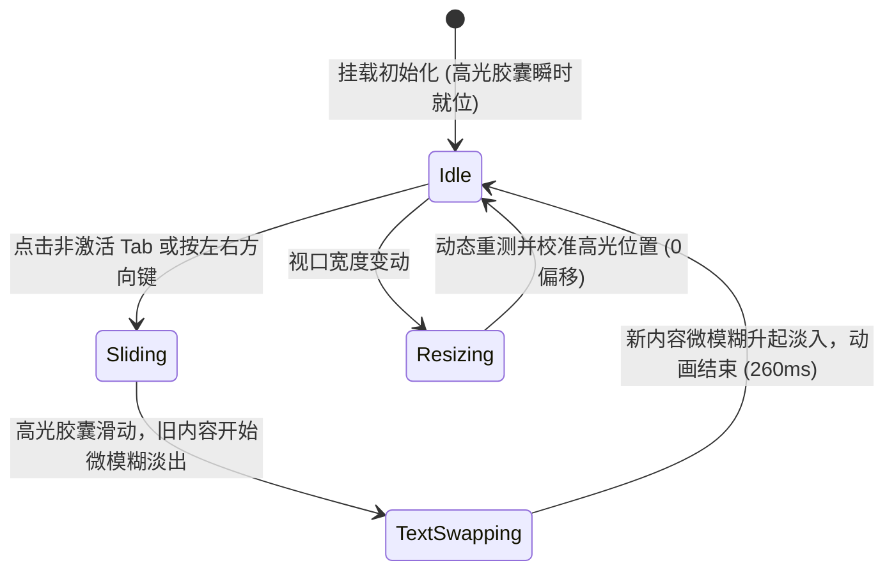

# Tabs · 选项卡导航

用于同级视图维度与上下文模块切换的分段选项卡。包含四大核心动效机制：

1. 共享硬件加速滑动高光胶囊（Gliding Pill）：单例高光胶囊 `.gliding-pill` 位于激活项底层，借助硬件加速 `translate3d(x, 0, 0)` 与 `width` 双重平滑弹簧（260ms `cubic-bezier(0.16, 1, 0.3, 1)`）平滑跟随激活项横向伸缩与滑动；初始挂载瞬时落位，杜绝水合飞入。
2. 内容微模糊沉降置换（Micro-Blur Caption Transition）：切换选项卡时，对应内容文字进入 `.is-fading` 态，以 180ms 产生 `translateY(4px)` 微下沉与 `blur(2px)` 高斯模糊淡出，120ms 时序无缝置换内容文本并回弹复原。
3. 全键盘方向键巡礼导向（Roving Tabindex Navigation）：在 `[role="tablist"]` 容器上监听 `ArrowLeft` / `ArrowRight`，支持左右键循环切换相邻选项卡，Enter / Space 激活，自动调度无障碍焦点。
4. 容器自适应防偏位重测（Resize Adaptation）：通过 `ResizeObserver` 实时监听父容器与选项卡尺寸变化，动态校准高光胶囊的精确像素坐标与物理宽度，确保无视觉偏差。

## 原型清单

| 原型分组 | 原型元素 | 动效 / 状态变化 | 去向 |
| --- | --- | --- | --- |
| 选项卡控制栏 | 选项卡容器 `.tabs-shell` | 承载 `[role="tablist"]` 语义与弹性横向布局 | 最小 DOM |
| 选项卡控制栏 | 滑动高光胶囊 `.gliding-pill` | 260ms 平滑弹簧跟随激活项 X 轴位移与宽度变化 | 共享硬件加速滑动高光胶囊 |
| 选项卡控制栏 | 选项卡按钮 `.tab-btn` | 悬停颜色过渡；激活项文字加深；点击与键盘事件捕获 | 全键盘方向键巡礼导向 |
| 选项卡内容区 | 内容容器 `.caption-container` | 承载 `[role="tabpanel"]` 语义 | 最小 DOM |
| 选项卡内容区 | 内容展示文本 `.caption-text` | 切换时触发 `.is-fading`（180ms `translateY(4px) blur(2px)`）微模糊置换 | 内容微模糊沉降置换 |
| — | 顶栏独立主题切换器 `#themeToggle` | 演示主题切换 | 演示外壳，已删除 |
| — | 外层演示舞台 `.stage` | 演示卡片外框 | 演示外壳，已删除 |

## 适用

- 页面同级不同视图维度、内容模块或筛选分组的水平切换（如“Overview / Activity / Settings”）。
- 需要兼具灵敏按压、滑动高光药丸与丝滑文本淡入淡出的优质交互面板。
- 空间有限，需要一组紧凑、优雅且自带微交互的胶囊导航栏。

## 不适用

- 纵向多层级折叠面板 → [accordion](../expand/accordion.md)
- 存在父子继承关系的路径深度导航 → [breadcrumb](breadcrumb.md)
- 大批量连续数字分页切换 → [pagination](pagination.md)

## 状态机



| 状态 | 进入条件 | 视觉表现 | 退出到 |
| --- | --- | --- | --- |
| idle | 初始挂载或动画收敛 | 高光胶囊对齐激活项，内容文本清晰稳定呈现 | sliding / resizing |
| sliding | 切换选项卡 | 高光胶囊以 260ms 弹簧横向滑动并改变宽度 | textSwapping |
| textSwapping | 选项卡变更中 | 内容文本添加 `.is-fading`，下沉 4px 并模糊淡出后换字回弹 | idle |
| resizing | 容器尺寸变动 | 瞬时重测并精准对齐高光胶囊位置与宽度 | idle |

## 最小 DOM

```html
<div class="tabs-container">
  <div class="tabs-shell" role="tablist" aria-label="Tabs">
    <div class="gliding-pill" aria-hidden="true"></div>
    <button class="tab-btn" role="tab" id="tab-overview" data-value="overview" aria-selected="true" data-state="active">Overview</button>
    <button class="tab-btn" role="tab" id="tab-activity" data-value="activity" aria-selected="false" data-state="inactive">Activity</button>
    <button class="tab-btn" role="tab" id="tab-settings" data-value="settings" aria-selected="false" data-state="inactive">Settings</button>
  </div>
  <div class="caption-container">
    <p class="caption-text" role="tabpanel" aria-labelledby="tab-overview">Overview content</p>
  </div>
</div>
```

- `.tabs-container`：整体选项卡与关联面板外包容器。
- `.tabs-shell`：药丸形选项卡槽位外框，配置 `role="tablist"`。
- `.gliding-pill`：硬件加速滑动高光胶囊，绝对定位在底层（`z-index: 1`）。
- `.tab-btn`：各个选项卡按钮，配置 `role="tab"` 与 `aria-selected`。
- `.caption-container`：内容展示槽位，居中布局。
- `.caption-text`：关联的内容文本，配置 `role="tabpanel"` 与 `aria-labelledby`。

## 参数

| 名称 | 值 | 用于 | 来源 |
| --- | --- | --- | --- |
| 高光胶囊位移与宽度过渡 | `260ms` / `cubic-bezier(0.16, 1, 0.3, 1)` | `.gliding-pill` 弹簧跟手滑动 | 原型 |
| 文本淡出沉降时长 | `180ms` / `cubic-bezier(0.22, 1, 0.36, 1)` | `.caption-text` 下沉淡出 | 原型 |
| 文本下沉位移与模糊 | `translateY(4px) blur(2px)` | `.caption-text.is-fading` | 原型 |
| 文本置换时钟延时 | `120ms` | 文本更新触发点 | 原型 |
| 文本升起过渡时长 | `200ms` / `cubic-bezier(0.16, 1, 0.3, 1)` | `.caption-text` 升起恢复 | 原型 |
| 按钮文字悬停过渡 | `160ms` / `cubic-bezier(0.22, 1, 0.36, 1)` | `.tab-btn` 颜色渐变 | 原型 |

## CSS

```css
.tabs-container {
  --tabs-bg: oklch(98% 0 0);
  --tabs-border: oklch(90% 0 0);
  --tabs-pill-bg: oklch(100% 0 0);
  --tabs-pill-shadow: 0 1px 3px rgba(0, 0, 0, 0.08), 0 1px 2px rgba(0, 0, 0, 0.04);
  --tabs-text-muted: oklch(50% 0 0);
  --tabs-text-active: oklch(15% 0 0);
  --tabs-ease-spring: cubic-bezier(0.16, 1, 0.3, 1);
  --tabs-ease-standard: cubic-bezier(0.22, 1, 0.36, 1);
  --tabs-duration-fast: 160ms;
  --tabs-duration-pill: 260ms;

  position: relative;
  display: flex;
  flex-direction: column;
  align-items: center;
  width: 100%;
}

.tabs-shell {
  position: relative;
  display: inline-flex;
  align-items: center;
  padding: 4px;
  border: 1px solid var(--tabs-border);
  border-radius: 9999px;
  background: var(--tabs-bg);
  isolation: isolate;
  user-select: none;
}

/* 硬件加速滑动高光胶囊 */
.gliding-pill {
  position: absolute;
  top: 4px;
  left: 0;
  height: calc(100% - 8px);
  background: var(--tabs-pill-bg);
  border-radius: 9999px;
  box-shadow: var(--tabs-pill-shadow);
  border: 1px solid var(--tabs-border);
  pointer-events: none;
  z-index: 1;
  will-change: transform, width;
  transition:
    transform var(--tabs-duration-pill) var(--tabs-ease-spring),
    width var(--tabs-duration-pill) var(--tabs-ease-spring);
}

/* 选项卡按钮 */
.tab-btn {
  position: relative;
  z-index: 2;
  display: inline-flex;
  align-items: center;
  justify-content: center;
  min-width: 5.5rem;
  height: 32px;
  padding: 0 16px;
  border: 0;
  border-radius: 9999px;
  background: transparent;
  color: var(--tabs-text-muted);
  font: inherit;
  font-size: 0.875rem;
  font-weight: 500;
  white-space: nowrap;
  cursor: pointer;
  -webkit-tap-highlight-color: transparent;
  transition: color var(--tabs-duration-fast) var(--tabs-ease-standard);
}

.tab-btn:hover {
  color: var(--tabs-text-active);
}

.tab-btn[data-state="active"] {
  color: var(--tabs-text-active);
  font-weight: 600;
}

/* 内容展示容器 */
.caption-container {
  margin-top: 16px;
  min-height: 28px;
  display: flex;
  align-items: center;
  justify-content: center;
  text-align: center;
}

.caption-text {
  margin: 0;
  color: var(--tabs-text-muted);
  font-size: 0.875rem;
  line-height: 1.5;
  transition:
    opacity 180ms var(--tabs-ease-standard),
    transform 200ms var(--tabs-ease-spring),
    filter 180ms var(--tabs-ease-standard);
}

.caption-text.is-fading {
  opacity: 0;
  transform: translateY(4px);
  filter: blur(2px);
}

@media (prefers-reduced-motion: reduce) {
  .gliding-pill {
    transition: none !important;
  }
  .caption-text {
    transition: opacity 120ms linear !important;
    transform: none !important;
    filter: none !important;
  }
  .caption-text.is-fading {
    transform: none !important;
    filter: none !important;
  }
}
```

## JS

```js
/**
 * 创建纯原生 Tabs 选项卡控制器
 * @param {HTMLElement} el 包含 .tabs-shell 的根节点或 .tabs-shell 本身
 * @param {Object} [options] 配置选项
 * @param {string} [options.defaultValue] 默认激活的 tab 键值
 * @param {Record<string, string>} [options.data] 键值对应的文本内容映射
 * @param {(value: string) => void} [options.onChange] 选中项变动回调
 * @returns {{ select: Function, getValue: Function, destroy: Function }}
 */
export function createTabs(el, options = {}) {
  const shell = el.classList.contains('tabs-shell') ? el : el.querySelector('.tabs-shell');
  if (!shell) return { destroy: () => {} };

  const pill = shell.querySelector('.gliding-pill');
  const btns = Array.from(shell.querySelectorAll('.tab-btn'));
  const captionText = el.querySelector('.caption-text');
  const data = options.data || {};
  const onChange = typeof options.onChange === 'function' ? options.onChange : null;

  let currentVal = options.defaultValue ||
    btns.find(b => b.getAttribute('data-state') === 'active')?.getAttribute('data-value') ||
    btns[0]?.getAttribute('data-value') || '';

  let isReduced = window.matchMedia('(prefers-reduced-motion: reduce)').matches;
  let disposed = false;
  let textTimer = null;
  let resizeObserver = null;

  function updatePillPosition(activeBtn, animate = true) {
    if (!pill || !activeBtn || disposed) return;
    const shellRect = shell.getBoundingClientRect();
    const btnRect = activeBtn.getBoundingClientRect();

    const x = btnRect.left - shellRect.left;
    const w = btnRect.width;

    if (!animate || isReduced) {
      pill.style.transition = 'none';
      pill.style.transform = `translate3d(${x}px, 0, 0)`;
      pill.style.width = `${w}px`;
      void pill.offsetHeight;
      if (!isReduced) pill.style.transition = '';
    } else {
      pill.style.transform = `translate3d(${x}px, 0, 0)`;
      pill.style.width = `${w}px`;
    }
  }

  function selectTab(value, shouldFocus = false) {
    if (disposed) return;
    const targetBtn = btns.find(b => b.getAttribute('data-value') === value);
    if (!targetBtn) return;

    currentVal = value;

    btns.forEach(btn => {
      const match = btn === targetBtn;
      btn.setAttribute('data-state', match ? 'active' : 'inactive');
      btn.setAttribute('aria-selected', match ? 'true' : 'false');
    });

    updatePillPosition(targetBtn, true);

    if (captionText) {
      if (isReduced) {
        if (data[value]) captionText.textContent = data[value];
        captionText.setAttribute('aria-labelledby', `tab-${value}`);
      } else {
        clearTimeout(textTimer);
        captionText.classList.add('is-fading');
        textTimer = setTimeout(() => {
          if (data[value]) captionText.textContent = data[value];
          captionText.setAttribute('aria-labelledby', `tab-${value}`);
          captionText.classList.remove('is-fading');
        }, 120);
      }
    }

    if (shouldFocus) {
      targetBtn.focus();
    }

    if (onChange) {
      onChange(value);
    }
  }

  // 1. 点击事件绑定
  const onBtnClick = (e) => {
    const btn = e.currentTarget;
    const val = btn.getAttribute('data-value');
    selectTab(val, false);
  };
  btns.forEach(btn => btn.addEventListener('click', onBtnClick));

  // 2. 键盘导航（左右方向键切换）
  const onKeydown = (e) => {
    const activeIndex = btns.findIndex(b => b.getAttribute('data-value') === currentVal);
    let nextIndex = activeIndex;

    if (e.key === 'ArrowRight') {
      e.preventDefault();
      nextIndex = (activeIndex + 1) % btns.length;
    } else if (e.key === 'ArrowLeft') {
      e.preventDefault();
      nextIndex = (activeIndex - 1 + btns.length) % btns.length;
    }

    if (nextIndex !== activeIndex && nextIndex >= 0) {
      const nextVal = btns[nextIndex].getAttribute('data-value');
      selectTab(nextVal, true);
    }
  };
  shell.addEventListener('keydown', onKeydown);

  // 3. 尺寸监听
  if (typeof ResizeObserver !== 'undefined') {
    resizeObserver = new ResizeObserver(() => {
      const activeBtn = btns.find(b => b.getAttribute('data-value') === currentVal);
      if (activeBtn) updatePillPosition(activeBtn, false);
    });
    resizeObserver.observe(shell);
  }

  // 4. 初始化位置（无过渡瞬时落位）
  const initialBtn = btns.find(b => b.getAttribute('data-value') === currentVal) || btns[0];
  if (initialBtn) updatePillPosition(initialBtn, false);

  const motionQuery = window.matchMedia('(prefers-reduced-motion: reduce)');
  const onMotionChange = (e) => {
    isReduced = e.matches;
    const active = btns.find(b => b.getAttribute('data-value') === currentVal);
    if (active) updatePillPosition(active, false);
  };
  motionQuery.addEventListener('change', onMotionChange);

  return {
    select: (val) => selectTab(val, false),
    getValue: () => currentVal,
    destroy() {
      disposed = true;
      clearTimeout(textTimer);
      if (resizeObserver) resizeObserver.disconnect();
      motionQuery.removeEventListener('change', onMotionChange);
      btns.forEach(btn => btn.removeEventListener('click', onBtnClick));
      shell.removeEventListener('keydown', onKeydown);
    }
  };
}
```

## 接入目标项目

- 状态来源：
  - 绑定当前页面或模块的活动 Tab 状态（如 React state / Vue reactive），在回调 `onChange(val)` 中触发视图同步。
- 尺寸策略：
  - 药丸状自适应排版，内部 Tab 拥有 `min-width: 5.5rem` 与自动内边距。
- 驱动方式：
  - 调用 `createTabs(el, { defaultValue: 'overview', data, onChange })` 挂载实例；
  - 外部状态切换时直接调用 `select(tabId)`；
  - 组件销毁时调用 `destroy()`。

## 重入与清理

- 连续高频切换 Tab 时，文本置换计时器 `textTimer` 会在下一轮被立即清除，防止旧文本异步覆盖新激活项文案；
- 销毁函数 `destroy()` 负责注销所有点击监听、解绑键盘监听、断开 `ResizeObserver`，防止闭包内存泄漏。

## 减少动态效果

- 在 `prefers-reduced-motion: reduce` 下：
  - 停用 `.gliding-pill` 的 transform 与 width 过渡，滑块瞬时吸附；
  - 停用 `.caption-text` 的下沉与高斯模糊，降级为轻量级线性透明度淡出淡入；
  - 保留完整的 ARIA 属性和键盘导航能力。

## 焦点与键盘

- 采用 WAI-ARIA Tabs 规范，整个列表声明为 `role="tablist"`，按钮赋予 `role="tab"`；
- 左右方向键循环激活相邻 Tab，Enter/Space 执行选中；
- 内容容器关联 `role="tabpanel"` 与 `aria-labelledby`，确保无障碍辅助设备可感知关联关系。

## 兼容回退

| 特性 | 不支持时 |
| --- | --- |
| `ResizeObserver` | 缺少动态尺寸监听，视口变化时通过重新触发点击校准高光位置。 |
| CSS `filter: blur()` | 退化为纯不透明度 `opacity` 过渡，不影响功能逻辑。 |

## 验收清单

- [ ] 初始加载时高光胶囊精准位于默认激活项下方，无任何从左上角飞入的跳变。
- [ ] 点击其他 Tab 项，高光胶囊以 260ms 平滑弹簧曲线拉伸并滑动到位。
- [ ] 切换时下方关联内容出现微模糊沉降淡出，随后快速回弹呈现新内容。
- [ ] 聚焦在 Tab 列表后，按左右方向键能够循环切换选中项并自动更新高光胶囊。
- [ ] 缩放浏览器视口，高光胶囊自动重新测算位置，无错位或溢出。
- [ ] 开启减少动态效果，高光胶囊瞬时移动，文本无位移与模糊直接呈现。
