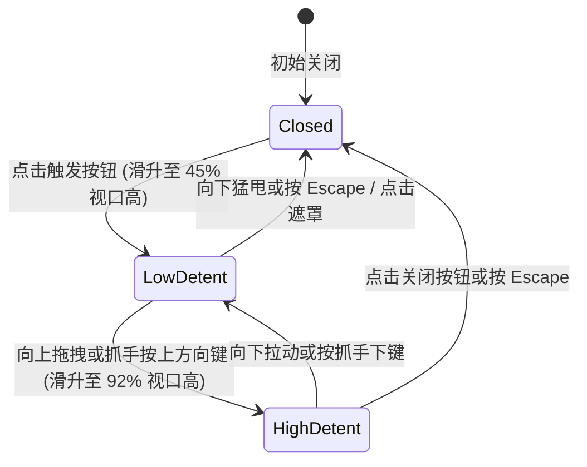

# Bottom Sheet · 底部抽屉

用于移动端或紧凑视口下自底部滑出的多档停靠交互面板。包含四大核心动效机制：

1. 多档停靠点弹性吸附（Multi-Detent Snapping）：支持例如 `[0.45, 0.92]` 的高度比例分档；在各档位之间滑动或释放时，以 400ms 阻尼弹簧（`visualDuration: 0.4, bounce: 0`）平滑吸附至最近停靠点。
2. 顶部抓手与头部拖拽手势（Grabber & Header Pointer Drag）：按住顶部抓手 `.bottom-sheet-grabber` 或头部拖拽时，面板 1:1 跟手移动；拖拽超出最大档位时产生橡皮筋阻尼拉伸；释放时根据即时速度（飞掷阈值 320px/s）自动升降档或直接关闭。
3. 遮罩透明度联动映射（Position-Derived Backdrop Dimming）：半透明黑色遮罩 `.bottom-sheet-overlay` 的透明度直接根据抽屉当前的屏幕露出高度比例动态计算映射，从收起时的 0 平滑过渡到展开时的 0.78。
4. 全键盘与无障碍闭环（WAI-ARIA Dialog & Escape）：展开后焦点自动锁定于抽屉对话框容器，抓手控件支持方向键按档位升降，点击遮罩或按 `Escape` 键平滑滑出屏幕外并清理 DOM。

## 原型清单

| 原型分组 | 原型元素 | 动效 / 状态变化 | 去向 |
| --- | --- | --- | --- |
| 外部触发器 | 触发按钮 `.bottom-sheet_trigger__Dt9JD` | 悬停/按压反馈；点击唤出抽屉 | 最小 DOM |
| 半透明背景 | 背景遮罩 `.bottom-sheet-overlay` | 随抽屉高度动态映射透明度；点击关闭 | 遮罩透明度联动映射 |
| 抽屉浮动实体 | 抽屉面板 `.bottom-sheet-sheet` | 自底部滑入；400ms 弹簧停靠多档位；橡皮筋阻尼拉伸 | 多档停靠点弹性吸附 |
| 头部拖拽区域 | 顶部抓手 `.bottom-sheet-grabber` | 指针抓取拖拽；上下方向键升降档；Home/End 极值切换 | 顶部抓手与头部拖拽手势 |
| 头部信息栏 | 标题与副标题 `.bottom-sheet-title` | 语义化标签 | 最小 DOM |
| 头部关闭操作 | 关闭按钮 `.bottom-sheet-close` | 点击触发滑出退场 | 全键盘与无障碍闭环 |
| 抽屉内容容器 | 滚动内容体 `.bottom-sheet-body` | 内部长内容自适应原生滚动 | 最小 DOM |
| — | 顶栏独立主题切换器 `#themeBtn` | 演示主题切换 | 演示外壳，已删除 |
| — | 外层线框模型页面 | 演示外壳，已删除 | 演示外壳，已删除 |

## 适用

- 移动端或窄屏环境下的复杂表单填写、航班详情、行程总览、操作面板。
- 用户需要保留底层页面部分可见度，并在多级高度（半屏概览、近全屏深读）之间灵活拖拽。
- 需要高度自然的触感阻尼、飞掷甩动手势与无缝键盘支持。

## 不适用

- 桌面端居中固定弹出的确认对话框 → [dialog](dialog.md)
- 桌面端自左右两侧滑出的侧边抽屉 → [drawer](drawer.md)
- 局部行内手风琴折叠展开 → [accordion](../expand/accordion.md)

## 状态机



| 状态 | 进入条件 | 视觉表现 | 退出到 |
| --- | --- | --- | --- |
| closed | 初始或退场结束 | 抽屉位移至视口下方 `100% + 40px`，遮罩透明度为 0 | lowDetent / highDetent |
| lowDetent | 开启抽屉或向下吸附 | 抽屉停靠在 45% 屏幕高度，遮罩透明度为 0.78 | highDetent / closed |
| highDetent | 向上拖拽或展开至最大 | 抽屉停靠在 92% 屏幕高度，内部长内容可向下滚动 | lowDetent / closed |
| dragging | 指针按住抓手或头部 | 抽屉 1:1 跟随指针 Y 轴移动，超出产生阻尼 | lowDetent / highDetent / closed |

## 最小 DOM

```html
<div class="bottom-sheet-root">
  <button type="button" class="bottom-sheet-trigger" aria-haspopup="dialog" aria-expanded="false">
    Open Bottom Sheet
  </button>
  <div class="bottom-sheet-portal" data-state="closed">
    <div class="bottom-sheet-overlay" aria-hidden="true"></div>
    <div class="bottom-sheet-sheet" role="dialog" aria-modal="true" aria-labelledby="sheet-title-1" tabindex="-1">
      <div class="bottom-sheet-header">
        <button type="button" class="bottom-sheet-grabber" aria-label="Resize sheet">
          <span class="bottom-sheet-grabber-bar" aria-hidden="true"></span>
        </button>
        <div class="bottom-sheet-head-row">
          <h2 id="sheet-title-1" class="bottom-sheet-title">Sheet Title</h2>
          <button type="button" class="bottom-sheet-close" aria-label="Close sheet">
            <svg width="16" height="16" viewBox="0 0 24 24" fill="none" stroke="currentColor" stroke-width="2" stroke-linecap="round" stroke-linejoin="round">
              <path d="M18 6 6 18" />
              <path d="m6 6 12 12" />
            </svg>
          </button>
        </div>
      </div>
      <div class="bottom-sheet-body">
        <p>Sheet detailed content goes here.</p>
      </div>
    </div>
  </div>
</div>
```

- `.bottom-sheet-root`：组件宿主。
- `.bottom-sheet-trigger`：开启抽屉的触发按钮。
- `.bottom-sheet-portal`：抽屉层级门面，控制显示与隐藏。
- `.bottom-sheet-overlay`：背景遮罩，承载动态透明度映射。
- `.bottom-sheet-sheet`：抽屉实体，承载 Y 轴位移弹簧与触摸阻尼。
- `.bottom-sheet-grabber`：顶部抓手，承载拖拽手势与键盘上下键。
- `.bottom-sheet-close`：关闭按钮。
- `.bottom-sheet-body`：内部滚动容器。

## 参数

| 名称 | 值 | 用于 | 来源 |
| --- | --- | --- | --- |
| 默认档位吸附点 | `[0.45, 0.92]` | 视口高度比例分档 | 原型 |
| 停靠弹簧过渡时长 | `400ms` / `cubic-bezier(0.16, 1, 0.3, 1)` | 档位吸附位移 | 原型 |
| 飞掷速度阈值 | `320px/s` | 判定快速滑出关闭的初速度 | 原型 |
| 橡皮筋最大向上拉伸 | `120px` | 超出最大档位后的物理抗力上限 | 原型 |
| 遮罩最大不透明度 | `0.78` | `.bottom-sheet-overlay` 展开态 opacity | 原型 |
| 退场滑出时长 | `240ms` / `cubic-bezier(0.22, 1, 0.36, 1)` | 抽屉向下离开视口 | 原型 |

## CSS

```css
.bottom-sheet-portal {
  --sheet-ease-spring: cubic-bezier(0.16, 1, 0.3, 1);
  --sheet-ease-exit: cubic-bezier(0.22, 1, 0.36, 1);
  --sheet-duration-spring: 400ms;
  --sheet-duration-exit: 240ms;

  position: fixed;
  inset: 0;
  z-index: 1000;
  display: flex;
  flex-direction: column;
  justify-content: flex-end;
  pointer-events: none;
}

.bottom-sheet-portal[data-state="closed"] {
  display: none;
}

.bottom-sheet-overlay {
  position: absolute;
  inset: 0;
  background: rgba(0, 0, 0, 0.65);
  opacity: 0;
  pointer-events: auto;
  transition: opacity var(--sheet-duration-spring) var(--sheet-ease-spring);
  will-change: opacity;
}

.bottom-sheet-sheet {
  position: relative;
  width: 100%;
  max-width: 640px;
  margin: 0 auto;
  max-height: 92vh;
  border-radius: 20px 20px 0 0;
  background: #ffffff;
  box-shadow: 0 -4px 24px rgba(0, 0, 0, 0.12);
  display: flex;
  flex-direction: column;
  pointer-events: auto;
  transform: translateY(100%);
  transition: transform var(--sheet-duration-spring) var(--sheet-ease-spring);
  will-change: transform;
  outline: none;
}

@starting-style {
  .bottom-sheet-portal[data-state="open"] .bottom-sheet-overlay {
    opacity: 0;
  }
  .bottom-sheet-portal[data-state="open"] .bottom-sheet-sheet {
    transform: translateY(100%);
  }
}

.bottom-sheet-header {
  display: flex;
  flex-direction: column;
  align-items: center;
  padding: 8px 16px 12px;
  border-bottom: 1px solid rgba(0, 0, 0, 0.08);
  user-select: none;
}

.bottom-sheet-grabber {
  display: flex;
  align-items: center;
  justify-content: center;
  width: 48px;
  height: 16px;
  border: 0;
  background: transparent;
  cursor: grab;
  padding: 0;
}

.bottom-sheet-grabber:active {
  cursor: grabbing;
}

.bottom-sheet-grabber-bar {
  width: 36px;
  height: 4px;
  border-radius: 99px;
  background: rgba(0, 0, 0, 0.2);
}

.bottom-sheet-head-row {
  display: flex;
  width: 100%;
  align-items: center;
  justify-content: space-between;
  margin-top: 4px;
}

.bottom-sheet-title {
  margin: 0;
  font-size: 1.125rem;
  font-weight: 600;
  color: #111111;
}

.bottom-sheet-close {
  display: inline-flex;
  align-items: center;
  justify-content: center;
  width: 32px;
  height: 32px;
  border: 0;
  border-radius: 99px;
  background: transparent;
  color: #666666;
  cursor: pointer;
}

.bottom-sheet-close:hover {
  background: rgba(0, 0, 0, 0.05);
  color: #111111;
}

.bottom-sheet-body {
  overflow-y: auto;
  padding: 20px 24px;
  font-size: 0.875rem;
  line-height: 1.5;
  color: #333333;
}

@media (prefers-reduced-motion: reduce) {
  .bottom-sheet-sheet,
  .bottom-sheet-overlay {
    transition: none !important;
  }
}
```

## JS

```js
/**
 * 创建纯原生 BottomSheet 底部抽屉控制器
 * @param {HTMLElement} root 组件挂载宿主
 * @param {Object} [options] 配置项
 * @param {number[]} [options.detents=[0.45, 0.92]] 停靠高度分档 (0..1)
 * @param {number} [options.initialDetent=0] 默认停靠档位索引
 * @param {(isOpen: boolean) => void} [options.onOpenChange] 开启关闭回调
 * @returns {{ open: Function, close: Function, setDetent: Function, destroy: Function }}
 */
export function createBottomSheet(root, options = {}) {
  const trigger = root.querySelector('.bottom-sheet-trigger');
  const portal = root.querySelector('.bottom-sheet-portal');
  if (!portal) return { destroy: () => {} };

  const overlay = portal.querySelector('.bottom-sheet-overlay');
  const sheet = portal.querySelector('.bottom-sheet-sheet');
  const grabber = portal.querySelector('.bottom-sheet-grabber');
  const closeBtn = portal.querySelector('.bottom-sheet-close');

  const detents = options.detents || [0.45, 0.92];
  let currentDetentIndex = options.initialDetent !== undefined ? options.initialDetent : 0;
  let isOpen = false;
  let isDragging = false;
  let startY = 0;
  let startSheetY = 0;
  let currentSheetY = 0;
  let isReduced = window.matchMedia('(prefers-reduced-motion: reduce)').matches;
  let disposed = false;

  function getDetentY(index) {
    const fraction = detents[index] || 0.45;
    const windowH = window.innerHeight;
    return Math.round(windowH * (1 - fraction));
  }

  function applyPosition(y, animate = true) {
    currentSheetY = y;
    if (!animate || isReduced) {
      sheet.style.transition = 'none';
      sheet.style.transform = `translateY(${y}px)`;
      void sheet.offsetHeight;
      if (!isReduced) sheet.style.transition = '';
    } else {
      sheet.style.transform = `translateY(${y}px)`;
    }

    // 遮罩透明度联动映射
    const windowH = window.innerHeight;
    const progress = Math.max(0, Math.min(1, (windowH - y) / (windowH * detents[detents.length - 1])));
    if (overlay) {
      overlay.style.opacity = String(progress * 0.78);
    }
  }

  function openSheet(detentIdx = currentDetentIndex) {
    if (disposed) return;
    isOpen = true;
    currentDetentIndex = detentIdx;
    portal.setAttribute('data-state', 'open');
    if (trigger) trigger.setAttribute('aria-expanded', 'true');

    document.body.style.overflow = 'hidden';
    applyPosition(getDetentY(currentDetentIndex), true);
    sheet?.focus();
    if (typeof options.onOpenChange === 'function') options.onOpenChange(true);
  }

  function closeSheet() {
    if (disposed || !isOpen) return;
    isOpen = false;
    if (trigger) trigger.setAttribute('aria-expanded', 'false');

    const windowH = window.innerHeight;
    applyPosition(windowH + 40, true);

    setTimeout(() => {
      if (!isOpen && portal) {
        portal.setAttribute('data-state', 'closed');
        document.body.style.overflow = '';
        trigger?.focus();
        if (typeof options.onOpenChange === 'function') options.onOpenChange(false);
      }
    }, isReduced ? 0 : 240);
  }

  // 1. 拖拽手势
  function onPointerDown(e) {
    if (!isOpen) return;
    isDragging = true;
    startY = e.clientY;
    startSheetY = currentSheetY;
    sheet.style.transition = 'none';

    window.addEventListener('pointermove', onPointerMove);
    window.addEventListener('pointerup', onPointerUp);
    window.addEventListener('pointercancel', onPointerUp);
  }

  function onPointerMove(e) {
    if (!isDragging) return;
    const deltaY = e.clientY - startY;
    let nextY = startSheetY + deltaY;
    const minY = getDetentY(detents.length - 1);

    if (nextY < minY) {
      // 橡皮筋阻尼
      const over = minY - nextY;
      nextY = minY - Math.min(over * 0.35, 120);
    }
    applyPosition(nextY, false);
  }

  function onPointerUp(e) {
    if (!isDragging) return;
    isDragging = false;
    window.removeEventListener('pointermove', onPointerMove);
    window.removeEventListener('pointerup', onPointerUp);
    window.removeEventListener('pointercancel', onPointerUp);
    sheet.style.transition = '';

    const deltaY = e.clientY - startY;
    const windowH = window.innerHeight;

    // 超过向下 140px 或位移占屏幕 20% 则关闭
    if (deltaY > 140 || currentSheetY > windowH * 0.75) {
      closeSheet();
    } else {
      // 吸附到最近档位
      let closestIdx = 0;
      let minDiff = Infinity;
      detents.forEach((d, i) => {
        const detY = getDetentY(i);
        const diff = Math.abs(currentSheetY - detY);
        if (diff < minDiff) {
          minDiff = diff;
          closestIdx = i;
        }
      });
      currentDetentIndex = closestIdx;
      applyPosition(getDetentY(currentDetentIndex), true);
    }
  }

  // 2. 键盘 Escape 与方向键
  function onKeydown(e) {
    if (!isOpen) return;
    if (e.key === 'Escape') {
      e.stopPropagation();
      closeSheet();
    } else if (e.key === 'ArrowUp') {
      if (currentDetentIndex < detents.length - 1) {
        e.preventDefault();
        currentDetentIndex++;
        applyPosition(getDetentY(currentDetentIndex), true);
      }
    } else if (e.key === 'ArrowDown') {
      if (currentDetentIndex > 0) {
        e.preventDefault();
        currentDetentIndex--;
        applyPosition(getDetentY(currentDetentIndex), true);
      } else {
        closeSheet();
      }
    }
  }

  if (trigger) trigger.addEventListener('click', () => openSheet());
  if (closeBtn) closeBtn.addEventListener('click', closeSheet);
  if (overlay) overlay.addEventListener('click', closeSheet);
  if (grabber) grabber.addEventListener('pointerdown', onPointerDown);
  portal.addEventListener('keydown', onKeydown);

  const motionQuery = window.matchMedia('(prefers-reduced-motion: reduce)');
  const onMotionChange = (e) => {
    isReduced = e.matches;
  };
  motionQuery.addEventListener('change', onMotionChange);

  return {
    open: (idx) => openSheet(idx),
    close: closeSheet,
    setDetent: (idx) => {
      if (isOpen && detents[idx] !== undefined) {
        currentDetentIndex = idx;
        applyPosition(getDetentY(idx), true);
      }
    },
    destroy() {
      disposed = true;
      closeSheet();
      motionQuery.removeEventListener('change', onMotionChange);
      if (trigger) trigger.removeEventListener('click', () => openSheet());
      if (closeBtn) closeBtn.removeEventListener('click', closeSheet);
      if (overlay) overlay.removeEventListener('click', closeSheet);
      if (grabber) grabber.removeEventListener('pointerdown', onPointerDown);
      portal.removeEventListener('keydown', onKeydown);
    }
  };
}
```

## 接入目标项目

- 状态来源：
  - 绑定业务抽屉展示状态，通过 `open()` / `close()` 与 `onOpenChange(boolean)` 回调双向同步。
- 尺寸策略：
  - 水平方向最大宽度 640px 居中适应；高度由当前档位比例（如 45% 或 92% 视口高）精确计算。
- 驱动方式：
  - 挂载时调用 `createBottomSheet(rootEl, { detents: [0.45, 0.92] })`；
  - 卸载时调用 `destroy()`。

## 重入与清理

- 连续触发开关时，未结束的位移 transition 会被新位置平滑覆盖；关闭时延时清理防止未完成动画被硬切；
- `destroy()` 负责解除所有指针、键盘与遮罩点击监听，并恢复 `body.style.overflow`。

## 减少动态效果

- 在 `prefers-reduced-motion: reduce` 下：
  - 停用抽屉位移与遮罩的过渡动画（`transition: none`），状态瞬时呈现；
  - 手势直接拖拽仍保持即时跟随。

## 焦点与键盘

- 打开抽屉后，焦点自动落入抽屉容器内；
- 抓手支持键盘 `ArrowUp` 升高一档、`ArrowDown` 降低一档或关闭；
- 按 `Escape` 键即刻关闭并将焦点返还触发器。

## 兼容回退

| 特性 | 不支持时 |
| --- | --- |
| Pointer Events | 回退为常规 Mouse 和 Touch 事件。 |

## 验收清单

- [ ] 点击触发按钮，黑色半透明遮罩淡入，抽屉自底部以 400ms 弹簧顺畅升起至第一档（45%）。
- [ ] 按住顶部抓手向上拖拽，抽屉 1:1 跟手升起，松手后平滑吸附在第二档（92%）。
- [ ] 拖拽超出最大高度时，橡皮筋阻尼生效，不会发生结构错位。
- [ ] 向下拉动超过阈值或点击遮罩外部，抽屉顺畅下滑退出视口，遮罩淡化隐去。
- [ ] 聚焦在抽屉内按 Escape 键或按方向下键可顺畅收起，焦点自动归还触发按钮。
- [ ] 开启系统减少动态效果，抽屉与遮罩直接瞬时呈现目标位置。
