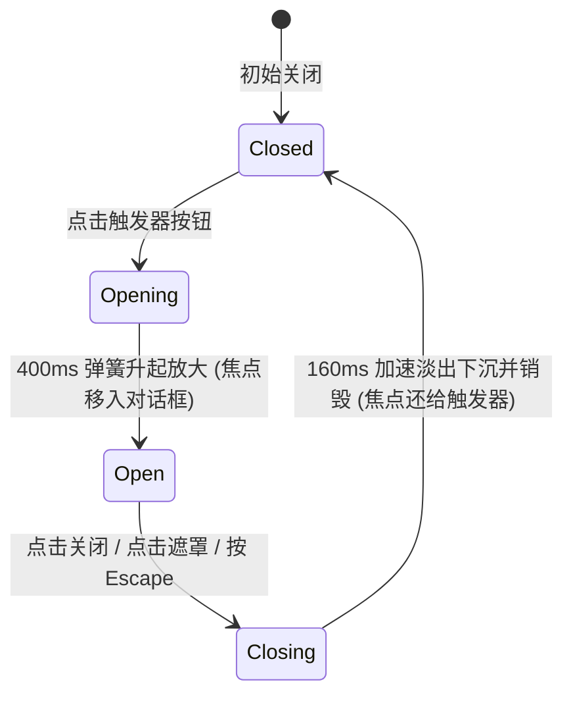

# Dialog · 对话框

用于承载关键业务决策、不可逆操作二次确认与聚焦任务流的居中模态对话框。包含四大核心动效机制：

1. 居中模态入场与微缩放升起（Center Modal Spring In & Scale-Up）：弹窗面板 `.dialog-content` 入场时从轻微下沉位移与微缩放（`translateY(8px) scale(0.96)`）开始，以 400ms 平滑阻尼弹簧（`visualDuration: 0.4, bounce: 0`）升起并扩张至原尺寸；退场时以 160ms 加速下沉（`translateY(4px) scale(0.98)`）淡出。
2. 背景毛玻璃遮罩渐隐（Backdrop Blur & Dimming）：全屏遮罩 `.dialog-overlay` 入场时以 240ms 完成半透明深色覆盖与 `backdrop-filter: blur(7px)` 高斯毛玻璃弥散；退场时在 160ms 内柔和淡出，带来极具景深感的沉浸交互。
3. 模态背景锁定与滚动条补偿（Modal Lock & Scrollbar Compensation）：弹窗展开时将 `document.body` 设为 `overflow: hidden`，同时测量当前视口原生滚动条宽度并以 `paddingRight` 补偿，彻底杜绝背景内容横向晃动。
4. 焦点陷阱与 Escape 键盘闭环（Focus Trap & Escape Dismiss）：打开时焦点自动捕获至首个操作按钮；Tab 键在弹窗内部首尾循环锁死；按 `Escape` 键或点击外部遮罩立即触发安全退场并将焦点无缝归还给触发器。

## 原型清单

| 原型分组 | 原型元素 | 动效 / 状态变化 | 去向 |
| --- | --- | --- | --- |
| 外部触发操作 | 触发按钮 `.previews-disclosure-feedback_action__iy3Gz` | 悬停/按压反馈；点击唤出对话框 | 最小 DOM |
| 全屏遮罩层 | 背景遮罩 `.dialog-overlay` | 240ms 淡入并施加 blur(7px) 毛玻璃；点击遮罩退出 | 背景毛玻璃遮罩渐隐 |
| 对话框主体面板 | 弹窗面板 `.dialog-content` | 400ms 弹簧从 translateY(8px) scale(0.96) 升起放大；退出微下沉缩小 | 居中模态入场与微缩放升起 |
| 头部标题副标题 | 标题区 `.dialog-title` / `.dialog-description` | 语义化无障碍标签 | 最小 DOM |
| 头部关闭按钮 | 关闭图标按钮 `.dialog-close` | 悬停底色变化；点击关闭 | 焦点陷阱与 Escape 键盘闭环 |
| 操作按钮组 | 底部决策操作栏 `.previews-disclosure-feedback_dialogActions__CUYNL` | 保留与发布按钮交互 | 最小 DOM |
| — | 顶栏独立主题切换器 `#themeBtn` | 演示主题切换 | 演示外壳，已删除 |
| — | 外层演示居中舞台卡片 | 演示卡片外框 | 演示外壳，已删除 |

## 适用

- 破坏性操作确认（如删除仓库、终止实例、重置凭证）。
- 关键阶段性决策（如“立即发布”或“继续编辑”）。
- 需要强模态聚焦、阻断背景干扰并锁定视口滚动条的场景。

## 不适用

- 自屏幕边缘或底部滑出的抽屉面板 → [drawer](drawer.md) / [bottom-sheet](bottom-sheet.md)
- 紧贴触发器轻量展示的上下文浮层 → [popover](popover.md)
- 仅作为轻量提示的纯文本气泡 → [tooltip](tooltip.md)

## 状态机



| 状态 | 进入条件 | 视觉表现 | 退出到 |
| --- | --- | --- | --- |
| closed | 初始或退场结束 | 遮罩与面板均不渲染（display none 或脱流移除） | opening |
| opening | 点击触发器 | 遮罩 240ms 淡入，面板自 `translateY(8px) scale(0.96)` 弹簧升起 | open |
| open | 动画完成 | 面板居中稳定，背景锁定不可滚动，焦点捕获在弹窗内 | closing |
| closing | 点击关闭或按 Escape | 面板 160ms 下沉淡出，遮罩淡化隐去 | closed |

## 最小 DOM

```html
<div class="dialog-root">
  <button type="button" class="dialog-trigger" aria-haspopup="dialog" aria-expanded="false">
    Open Dialog
  </button>
  <div class="dialog-portal" data-state="closed">
    <div class="dialog-overlay" aria-hidden="true"></div>
    <div class="dialog-content" role="dialog" aria-modal="true" aria-labelledby="dialog-title-1" aria-describedby="dialog-desc-1" tabindex="-1">
      <div class="dialog-header">
        <div>
          <h2 id="dialog-title-1" class="dialog-title">Publish workspace</h2>
          <p id="dialog-desc-1" class="dialog-description">Your team will see these changes immediately.</p>
        </div>
        <button type="button" class="dialog-close" aria-label="Close dialog">
          <svg width="16" height="16" viewBox="0 0 24 24" fill="none" stroke="currentColor" stroke-width="2" stroke-linecap="round" stroke-linejoin="round">
            <path d="M18 6 6 18" />
            <path d="m6 6 12 12" />
          </svg>
        </button>
      </div>
      <div class="dialog-body">
        <p>Three files are ready to publish. You can still revise them later.</p>
      </div>
      <div class="dialog-footer">
        <button type="button" class="dialog-btn-secondary">Cancel</button>
        <button type="button" class="dialog-btn-primary">Confirm</button>
      </div>
    </div>
  </div>
</div>
```

- `.dialog-root`：组件宿主。
- `.dialog-trigger`：开启弹窗的触发按钮。
- `.dialog-portal`：模态全屏挂载容器。
- `.dialog-overlay`：背景遮罩，承载毛玻璃滤镜与淡入淡出。
- `.dialog-content`：居中弹窗主体，承载缩放位移弹簧。
- `.dialog-header` / `.dialog-body` / `.dialog-footer`：标准弹窗结构。
- `.dialog-close`：右上角关闭按钮。

## 参数

| 名称 | 值 | 用于 | 来源 |
| --- | --- | --- | --- |
| 弹簧升起入场过渡 | `400ms` / `cubic-bezier(0.16, 1, 0.3, 1)` | `.dialog-content` 进场 | 原型 |
| 弹窗入场位移与缩放 | `translateY(8px) scale(0.96)` | `.dialog-content` 初始入场帧 | 原型 |
| 遮罩入场时长 | `240ms` / `cubic-bezier(0.16, 1, 0.3, 1)` | `.dialog-overlay` 渐入 | 原型 |
| 遮罩高斯毛玻璃模糊 | `blur(7px)` | `.dialog-overlay` backdrop-filter | 原型 |
| 弹窗加速退场时长 | `160ms` / `cubic-bezier(0.22, 1, 0.36, 1)` | `.dialog-content` 退出 | 原型 |
| 弹窗退场位移与缩放 | `translateY(4px) scale(0.98)` | `.dialog-content` 退出目标帧 | 原型 |
| 视口边缘安全边距 | `16px` | 移动端贴边最小间距 | 原型 |

## CSS

```css
.dialog-portal {
  --dialog-ease-spring: cubic-bezier(0.16, 1, 0.3, 1);
  --dialog-ease-exit: cubic-bezier(0.22, 1, 0.36, 1);
  --dialog-duration-enter: 400ms;
  --dialog-duration-exit: 160ms;

  position: fixed;
  inset: 0;
  z-index: 1000;
  display: flex;
  align-items: center;
  justify-content: center;
  padding: 16px;
  pointer-events: none;
}

.dialog-portal[data-state="closed"] {
  display: none;
}

/* 背景毛玻璃遮罩 */
.dialog-overlay {
  position: absolute;
  inset: 0;
  background: rgba(0, 0, 0, 0.45);
  backdrop-filter: blur(7px);
  -webkit-backdrop-filter: blur(7px);
  opacity: 0;
  pointer-events: auto;
  transition: opacity 240ms var(--dialog-ease-spring);
  will-change: opacity;
}

.dialog-portal[data-state="open"] .dialog-overlay {
  opacity: 1;
}

/* 居中弹窗实体 */
.dialog-content {
  position: relative;
  width: 100%;
  max-width: 440px;
  border-radius: 16px;
  border: 1px solid rgba(255, 255, 255, 0.12);
  background: #ffffff;
  box-shadow: 0 20px 48px rgba(0, 0, 0, 0.12), 0 4px 12px rgba(0, 0, 0, 0.05);
  display: flex;
  flex-direction: column;
  pointer-events: auto;
  opacity: 0;
  transform: translateY(8px) scale(0.96);
  transition:
    transform var(--dialog-duration-enter) var(--dialog-ease-spring),
    opacity 160ms var(--dialog-ease-spring);
  will-change: transform, opacity;
  outline: none;
  box-sizing: border-box;
}

.dialog-portal[data-state="open"] .dialog-content {
  opacity: 1;
  transform: translateY(0) scale(1);
}

@starting-style {
  .dialog-portal[data-state="open"] .dialog-overlay {
    opacity: 0;
  }
  .dialog-portal[data-state="open"] .dialog-content {
    opacity: 0;
    transform: translateY(8px) scale(0.96);
  }
}

.dialog-portal[data-state="closing"] .dialog-content {
  opacity: 0;
  transform: translateY(4px) scale(0.98);
  transition:
    transform var(--dialog-duration-exit) var(--dialog-ease-exit),
    opacity var(--dialog-duration-exit) var(--dialog-ease-exit);
}

.dialog-portal[data-state="closing"] .dialog-overlay {
  opacity: 0;
  transition: opacity var(--dialog-duration-exit) var(--dialog-ease-exit);
}

.dialog-header {
  display: flex;
  align-items: flex-start;
  justify-content: space-between;
  padding: 20px 20px 12px;
}

.dialog-title {
  margin: 0;
  font-size: 1.125rem;
  font-weight: 600;
  color: #111111;
  line-height: 1.3;
}

.dialog-description {
  margin: 4px 0 0;
  font-size: 0.875rem;
  color: #666666;
  line-height: 1.4;
}

.dialog-close {
  display: inline-flex;
  align-items: center;
  justify-content: center;
  width: 28px;
  height: 28px;
  border: 0;
  border-radius: 99px;
  background: transparent;
  color: #777777;
  cursor: pointer;
  margin: -4px -4px 0 0;
}

.dialog-close:hover {
  background: rgba(0, 0, 0, 0.06);
  color: #111111;
}

.dialog-body {
  padding: 0 20px 16px;
  font-size: 0.875rem;
  color: #444444;
  line-height: 1.5;
}

.dialog-footer {
  display: flex;
  align-items: center;
  justify-content: flex-end;
  gap: 8px;
  padding: 12px 20px 20px;
}

.dialog-btn-secondary,
.dialog-btn-primary {
  height: 36px;
  padding: 0 16px;
  border-radius: 8px;
  font-size: 0.875rem;
  font-weight: 500;
  cursor: pointer;
}

.dialog-btn-secondary {
  border: 1px solid rgba(0, 0, 0, 0.12);
  background: transparent;
  color: #333333;
}

.dialog-btn-secondary:hover {
  background: rgba(0, 0, 0, 0.04);
}

.dialog-btn-primary {
  border: 0;
  background: #0f172a;
  color: #ffffff;
}

.dialog-btn-primary:hover {
  background: #1e293b;
}

@media (prefers-reduced-motion: reduce) {
  .dialog-content,
  .dialog-overlay {
    transition: none !important;
  }
}
```

## JS

```js
/**
 * 创建纯原生 Dialog 居中模态对话框控制器
 * @param {HTMLElement} root 挂载宿主节点
 * @param {Object} [options] 配置项
 * @param {(open: boolean) => void} [options.onOpenChange] 开启关闭回调
 * @returns {{ open: Function, close: Function, destroy: Function }}
 */
export function createDialog(root, options = {}) {
  const trigger = root.querySelector('.dialog-trigger');
  const portal = root.querySelector('.dialog-portal');
  if (!portal) return { destroy: () => {} };

  const overlay = portal.querySelector('.dialog-overlay');
  const content = portal.querySelector('.dialog-content');
  const closeBtn = portal.querySelector('.dialog-close');
  const cancelBtn = portal.querySelector('.dialog-btn-secondary');

  let isOpen = false;
  let closeTimer = null;
  let isReduced = window.matchMedia('(prefers-reduced-motion: reduce)').matches;
  let disposed = false;
  let scrollbarWidth = 0;

  function lockScroll() {
    scrollbarWidth = window.innerWidth - document.documentElement.clientWidth;
    if (scrollbarWidth > 0) {
      document.body.style.paddingRight = `${scrollbarWidth}px`;
    }
    document.body.style.overflow = 'hidden';
  }

  function unlockScroll() {
    document.body.style.overflow = '';
    document.body.style.paddingRight = '';
  }

  function open() {
    if (disposed || isOpen) return;
    isOpen = true;
    clearTimeout(closeTimer);
    lockScroll();

    portal.setAttribute('data-state', 'open');
    if (trigger) trigger.setAttribute('aria-expanded', 'true');

    // 下一帧对焦弹窗
    requestAnimationFrame(() => {
      content?.focus();
    });

    if (typeof options.onOpenChange === 'function') options.onOpenChange(true);
  }

  function close() {
    if (disposed || !isOpen) return;
    isOpen = false;
    portal.setAttribute('data-state', 'closing');
    if (trigger) trigger.setAttribute('aria-expanded', 'false');

    const duration = isReduced ? 0 : 160;
    closeTimer = setTimeout(() => {
      if (!isOpen && portal) {
        portal.setAttribute('data-state', 'closed');
        unlockScroll();
        trigger?.focus();
        if (typeof options.onOpenChange === 'function') options.onOpenChange(false);
      }
    }, duration);
  }

  // 1. 焦点陷阱与 Escape 退出
  function onKeydown(e) {
    if (!isOpen) return;
    if (e.key === 'Escape') {
      e.stopPropagation();
      close();
      return;
    }

    if (e.key === 'Tab') {
      const focusables = Array.from(content.querySelectorAll(
        'button, [href], input, select, textarea, [tabindex]:not([tabindex="-1"])'
      )).filter(el => !el.hasAttribute('disabled'));

      if (!focusables.length) return;
      const first = focusables[0];
      const last = focusables[focusables.length - 1];

      if (e.shiftKey && document.activeElement === first) {
        e.preventDefault();
        last.focus();
      } else if (!e.shiftKey && document.activeElement === last) {
        e.preventDefault();
        first.focus();
      }
    }
  }

  if (trigger) trigger.addEventListener('click', open);
  if (closeBtn) closeBtn.addEventListener('click', close);
  if (cancelBtn) cancelBtn.addEventListener('click', close);
  if (overlay) overlay.addEventListener('click', close);
  portal.addEventListener('keydown', onKeydown);

  const motionQuery = window.matchMedia('(prefers-reduced-motion: reduce)');
  const onMotionChange = (e) => {
    isReduced = e.matches;
  };
  motionQuery.addEventListener('change', onMotionChange);

  return {
    open,
    close,
    destroy() {
      disposed = true;
      clearTimeout(closeTimer);
      unlockScroll();
      motionQuery.removeEventListener('change', onMotionChange);
      if (trigger) trigger.removeEventListener('click', open);
      if (closeBtn) closeBtn.removeEventListener('click', close);
      if (cancelBtn) cancelBtn.removeEventListener('click', close);
      if (overlay) overlay.removeEventListener('click', close);
      portal.removeEventListener('keydown', onKeydown);
    }
  };
}
```

## 接入目标项目

- 状态来源：
  - 接入业务确认动作状态机，通过 `open()` / `close()` 与 `onOpenChange(boolean)` 回调建立数据同步。
- 尺寸策略：
  - 最大宽度 440px 居中自适应，最小左右边距 16px 保证移动端安全显示。
- 驱动方式：
  - 调用 `createDialog(rootEl, { onOpenChange })` 绑定实例；
  - 组件销毁时调用 `destroy()`。

## 重入与清理

- 快速开关保护：退出期间再次触发打开会清除 `closeTimer`，平滑回切至展开态；
- 销毁时清理：`destroy()` 强制释放滚动条补偿与锁，防止页面永久失去滚动能力。

## 减少动态效果

- 在 `prefers-reduced-motion: reduce` 下：
  - 停用面板缩放与位移过渡（`transition: none`）；
  - 遮罩直接瞬时呈现，不执行淡入淡出；
  - 完整保留所有的焦点捕获与 Escape 逃生能力。

## 焦点与键盘

- 声明 `role="dialog"` 与 `aria-modal="true"`；
- 弹窗内置 Tab 焦点死循环循环陷阱，防止焦点游离到遮罩底层；
- 按 `Escape` 键立即平滑关闭并将焦点退回至原触发按钮。

## 兼容回退

| 特性 | 不支持时 |
| --- | --- |
| `backdrop-filter` | 降级为单纯的半透明深色遮罩（`background: rgba(0, 0, 0, 0.75)`）。 |

## 验收清单

- [ ] 点击触发按钮，背景毛玻璃遮罩迅速淡入，弹窗自 `translateY(8px) scale(0.96)` 弹簧升起放大。
- [ ] 弹窗展开期间，页面原有滚动条被锁定，且内容不产生横向跳变。
- [ ] 焦点被限制在弹窗内，按 Tab 键在关闭按钮与底部决策按钮之间顺畅循环。
- [ ] 按 Escape 键或点击遮罩外部，弹窗以 160ms 加速下沉缩小淡出，焦点精准归还原按钮。
- [ ] 开启系统减少动态效果，弹窗与遮罩直接瞬时呈现，无任何动效延迟。
