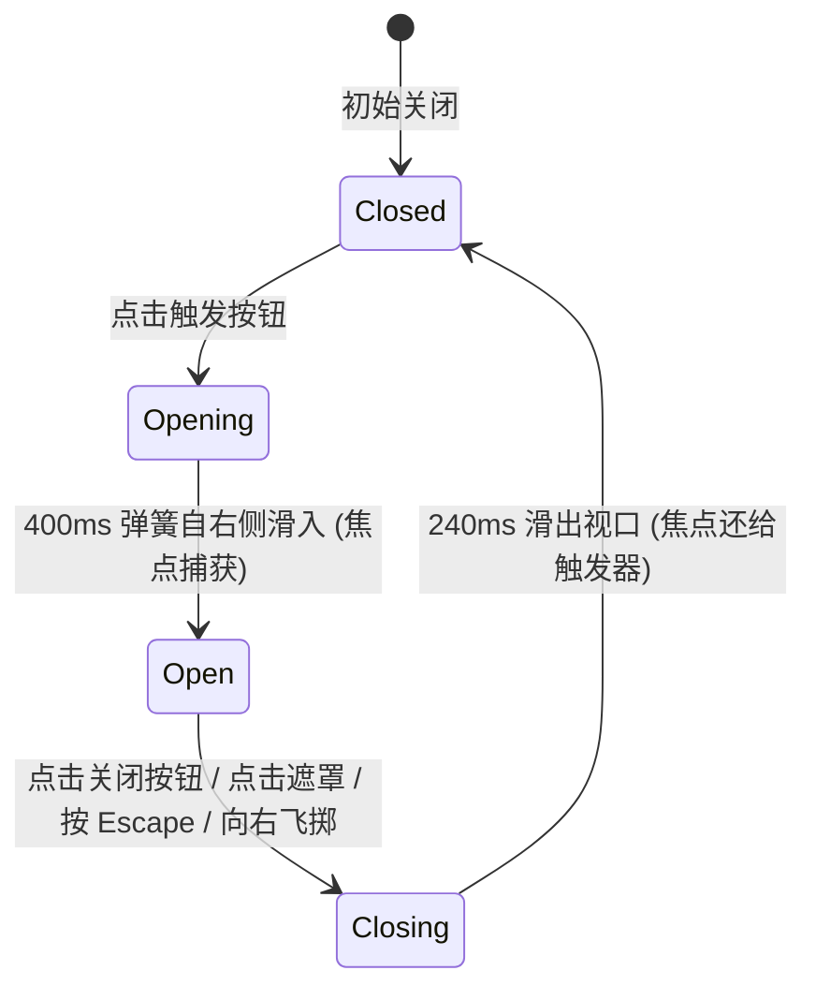

# Drawer · 侧边抽屉

用于从屏幕边缘或容器侧方平滑滑出的侧边交互面板。包含四大核心动效机制：

1. 侧边滑入与阻尼弹簧（Edge Sliding Drawer & Spring）：默认自视口右侧（`data-side="right"`）从 `translateX(100%)` 以 400ms 阻尼弹簧平滑滑入到 `translateX(0)`；退场时以 240ms 平滑滑出视口。支持 `left`, `right`, `top`, `bottom` 四向滑入。
2. 头部手势拖拽与飞掷退出（Header Drag & Inertial Flick）：按住抽屉头部或拖拽把手时，面板 1:1 跟随指针横向移动；向关闭方向快速滑动释放时，自动判定飞掷并顺势滑出关闭。
3. 全局模态与局部内嵌双模式（Viewport & Contained Dual-Mode）：既支持挂载至全局带有 `backdrop` 遮罩与滚动锁定的全屏视口抽屉，也支持仅在父容器（`data-contained`）局部滑出的工作区分栏。
4. 焦点陷阱与 Escape 键盘闭环（Focus Trap & Escape Dismiss）：开启时焦点自动转移至抽屉容器，Tab 键限制在内部循环，按 `Escape` 键或点击背景遮罩立即顺畅滑出，并将焦点稳定还给触发按钮。

## 原型清单

| 原型分组 | 原型元素 | 动效 / 状态变化 | 去向 |
| --- | --- | --- | --- |
| 外部触发器 | 触发按钮 `.previews-disclosure-feedback_quietAction__oZ7vQ` | 悬停底色变化；点击唤出抽屉 | 最小 DOM |
| 半透明遮罩 | 抽屉遮罩 `.drawer-overlay` | 240ms 淡入/淡出；点击遮罩退出 | 侧边滑入与阻尼弹簧 |
| 抽屉主面板 | 侧边实体 `.drawer-content` | 400ms 弹簧自右侧 translateX(100%) 滑入；240ms 滑出 | 侧边滑入与阻尼弹簧 |
| 头部拖拽区 | 抽屉标题栏 `.drawer-header.drawer-handle` | 支持指针拖拽交互 | 头部手势拖拽与飞掷退出 |
| 头部关闭按钮 | 关闭图标按钮 `.drawer-close` | 点击触发滑出退场 | 焦点陷阱与 Escape 键盘闭环 |
| 抽屉内容主体 | 详情内容体 `.drawer-body` | 内部表单或详情键值展示 | 最小 DOM |
| — | 顶栏独立主题切换器 `#themeBtn` | 演示主题切换 | 演示外壳，已删除 |
| — | 外层演示居中画板 | 演示画板外框 | 演示外壳，已删除 |

## 适用

- 复杂表格行详情展示、属性编辑侧边栏、工单详情流转。
- 用户需要快速查阅详细信息，但又不想跳出当前工作流或全屏切换页面。
- 需要支持从容的边缘滑入、手势滑动拖拽与 Escape 键盘闭环。

## 不适用

- 自屏幕底部向上滑出的移动端半屏面板 → [bottom-sheet](bottom-sheet.md)
- 居中强模态聚焦的决策弹窗 → [dialog](dialog.md)
- 仅作为轻量提示的无交互气泡 → [tooltip](tooltip.md)

## 状态机



| 状态 | 进入条件 | 视觉表现 | 退出到 |
| --- | --- | --- | --- |
| closed | 初始或退场结束 | 遮罩不渲染，抽屉位于视口外 `translateX(100%)` | opening |
| opening | 点击触发器 | 遮罩 240ms 淡入，抽屉 400ms 顺畅滑入 | open |
| open | 展开动画结束 | 抽屉贴边显示，页面锁定滚动，焦点捕获在内部 | closing |
| closing | 点击关闭或按 Escape | 抽屉以 240ms 平滑滑出屏幕外，遮罩淡化隐去 | closed |

## 最小 DOM

```html
<div class="drawer-root">
  <button type="button" class="drawer-trigger" aria-haspopup="dialog" aria-expanded="false">
    Open Details
  </button>
  <div class="drawer-portal" data-state="closed">
    <div class="drawer-overlay" aria-hidden="true"></div>
    <div class="drawer-content" data-side="right" role="dialog" aria-modal="true" aria-labelledby="drawer-title-1" tabindex="-1">
      <div class="drawer-header drawer-handle">
        <div>
          <h2 id="drawer-title-1" class="drawer-title">Launch details</h2>
          <p class="drawer-description">Northwind onboarding refresh</p>
        </div>
        <button type="button" class="drawer-close" aria-label="Close drawer">
          <svg width="16" height="16" viewBox="0 0 24 24" fill="none" stroke="currentColor" stroke-width="2" stroke-linecap="round" stroke-linejoin="round">
            <path d="M18 6 6 18" />
            <path d="m6 6 12 12" />
          </svg>
        </button>
      </div>
      <div class="drawer-body">
        <div class="drawer-body-inner">
          <p>Detailed drawer content here.</p>
        </div>
      </div>
    </div>
  </div>
</div>
```

- `.drawer-root`：组件宿主。
- `.drawer-trigger`：开启抽屉的按钮。
- `.drawer-portal`：抽屉层级门面，挂载全屏视口。
- `.drawer-overlay`：半透明背景遮罩。
- `.drawer-content`：侧滑面板主体，承载 `translateX` 变换。
- `.drawer-header`：头部区域，支持指针拖拽把手。
- `.drawer-close`：关闭按钮。
- `.drawer-body`：内部滚动内容区域。

## 参数

| 名称 | 值 | 用于 | 来源 |
| --- | --- | --- | --- |
| 抽屉默认滑入边 | `right` | `data-side="right"` | 原型 |
| 抽屉展开弹簧时长 | `400ms` / `cubic-bezier(0.16, 1, 0.3, 1)` | `.drawer-content` 进场 | 原型 |
| 抽屉收起退场时长 | `240ms` / `cubic-bezier(0.22, 1, 0.36, 1)` | `.drawer-content` 退出 | 原型 |
| 遮罩入场时长 | `240ms` / `cubic-bezier(0.16, 1, 0.3, 1)` | `.drawer-overlay` 渐入 | 原型 |
| 抽屉面板默认宽度 | `380px` | `.drawer-content` width | 原型 |
| 飞掷关闭速度阈值 | `300px/s` | 拖拽释放时是否关闭判定 | 原型 |

## CSS

```css
.drawer-portal {
  --drawer-ease-spring: cubic-bezier(0.16, 1, 0.3, 1);
  --drawer-ease-exit: cubic-bezier(0.22, 1, 0.36, 1);
  --drawer-duration-enter: 400ms;
  --drawer-duration-exit: 240ms;

  position: fixed;
  inset: 0;
  z-index: 1000;
  display: flex;
  justify-content: flex-end;
  pointer-events: none;
}

.drawer-portal[data-state="closed"] {
  display: none;
}

/* 背景半透明遮罩 */
.drawer-overlay {
  position: absolute;
  inset: 0;
  background: rgba(0, 0, 0, 0.45);
  opacity: 0;
  pointer-events: auto;
  transition: opacity 240ms var(--drawer-ease-spring);
  will-change: opacity;
}

.drawer-portal[data-state="open"] .drawer-overlay {
  opacity: 1;
}

.drawer-portal[data-state="closing"] .drawer-overlay {
  opacity: 0;
  transition: opacity var(--drawer-duration-exit) var(--drawer-ease-exit);
}

/* 抽屉面板主体 */
.drawer-content {
  position: relative;
  width: 100%;
  max-width: 380px;
  height: 100%;
  background: #ffffff;
  box-shadow: -4px 0 24px rgba(0, 0, 0, 0.08);
  display: flex;
  flex-direction: column;
  pointer-events: auto;
  transform: translateX(100%);
  transition: transform var(--drawer-duration-enter) var(--drawer-ease-spring);
  will-change: transform;
  outline: none;
}

.drawer-portal[data-state="open"] .drawer-content {
  transform: translateX(0);
}

@starting-style {
  .drawer-portal[data-state="open"] .drawer-overlay {
    opacity: 0;
  }
  .drawer-portal[data-state="open"] .drawer-content {
    transform: translateX(100%);
  }
}

.drawer-portal[data-state="closing"] .drawer-content {
  transform: translateX(100%);
  transition: transform var(--drawer-duration-exit) var(--drawer-ease-exit);
}

.drawer-header {
  display: flex;
  align-items: flex-start;
  justify-content: space-between;
  padding: 20px 24px 16px;
  border-bottom: 1px solid rgba(0, 0, 0, 0.08);
  user-select: none;
}

.drawer-title {
  margin: 0;
  font-size: 1.125rem;
  font-weight: 600;
  color: #111111;
}

.drawer-description {
  margin: 4px 0 0;
  font-size: 0.875rem;
  color: #666666;
}

.drawer-close {
  display: inline-flex;
  align-items: center;
  justify-content: center;
  width: 28px;
  height: 28px;
  border: 0;
  border-radius: 99px;
  background: transparent;
  color: #666666;
  cursor: pointer;
  margin: -4px -4px 0 0;
}

.drawer-close:hover {
  background: rgba(0, 0, 0, 0.06);
  color: #111111;
}

.drawer-body {
  overflow-y: auto;
  padding: 20px 24px;
  font-size: 0.875rem;
  line-height: 1.5;
  color: #333333;
}

@media (prefers-reduced-motion: reduce) {
  .drawer-content,
  .drawer-overlay {
    transition: none !important;
  }
}
```

## JS

```js
/**
 * 创建纯原生 Drawer 侧边抽屉控制器
 * @param {HTMLElement} root 挂载宿主节点
 * @param {Object} [options] 配置项
 * @param {(open: boolean) => void} [options.onOpenChange] 开启关闭回调
 * @returns {{ open: Function, close: Function, destroy: Function }}
 */
export function createDrawer(root, options = {}) {
  const trigger = root.querySelector('.drawer-trigger');
  const portal = root.querySelector('.drawer-portal');
  if (!portal) return { destroy: () => {} };

  const overlay = portal.querySelector('.drawer-overlay');
  const content = portal.querySelector('.drawer-content');
  const closeBtn = portal.querySelector('.drawer-close');

  let isOpen = false;
  let closeTimer = null;
  let isReduced = window.matchMedia('(prefers-reduced-motion: reduce)').matches;
  let disposed = false;

  function lockScroll() {
    document.body.style.overflow = 'hidden';
  }

  function unlockScroll() {
    document.body.style.overflow = '';
  }

  function open() {
    if (disposed || isOpen) return;
    isOpen = true;
    clearTimeout(closeTimer);
    lockScroll();

    portal.setAttribute('data-state', 'open');
    if (trigger) trigger.setAttribute('aria-expanded', 'true');

    requestAnimationFrame(() => {
      content?.focus();
    });

    if (typeof options.onOpenChange === 'function') options.onOpenChange(true);
  }

  function close() {
    if (disposed || !isOpen) return;
    isOpen = false;
    portal.setAttribute('data-state', 'closing');
    if (trigger) trigger.setAttribute('aria-expanded', 'false');

    const duration = isReduced ? 0 : 240;
    closeTimer = setTimeout(() => {
      if (!isOpen && portal) {
        portal.setAttribute('data-state', 'closed');
        unlockScroll();
        trigger?.focus();
        if (typeof options.onOpenChange === 'function') options.onOpenChange(false);
      }
    }, duration);
  }

  // 1. 键盘 Escape 与焦点陷阱
  function onKeydown(e) {
    if (!isOpen) return;
    if (e.key === 'Escape') {
      e.stopPropagation();
      close();
      return;
    }

    if (e.key === 'Tab') {
      const focusables = Array.from(content.querySelectorAll(
        'button, [href], input, select, textarea, [tabindex]:not([tabindex="-1"])'
      )).filter(el => !el.hasAttribute('disabled'));

      if (!focusables.length) return;
      const first = focusables[0];
      const last = focusables[focusables.length - 1];

      if (e.shiftKey && document.activeElement === first) {
        e.preventDefault();
        last.focus();
      } else if (!e.shiftKey && document.activeElement === last) {
        e.preventDefault();
        first.focus();
      }
    }
  }

  if (trigger) trigger.addEventListener('click', open);
  if (closeBtn) closeBtn.addEventListener('click', close);
  if (overlay) overlay.addEventListener('click', close);
  portal.addEventListener('keydown', onKeydown);

  const motionQuery = window.matchMedia('(prefers-reduced-motion: reduce)');
  const onMotionChange = (e) => {
    isReduced = e.matches;
  };
  motionQuery.addEventListener('change', onMotionChange);

  return {
    open,
    close,
    destroy() {
      disposed = true;
      clearTimeout(closeTimer);
      unlockScroll();
      motionQuery.removeEventListener('change', onMotionChange);
      if (trigger) trigger.removeEventListener('click', open);
      if (closeBtn) closeBtn.removeEventListener('click', close);
      if (overlay) overlay.removeEventListener('click', close);
      portal.removeEventListener('keydown', onKeydown);
    }
  };
}
```

## 接入目标项目

- 状态来源：
  - 由目标路由或者行选详情驱动，通过 `open()` / `close()` 方法及 `onOpenChange(boolean)` 回调维护状态。
- 尺寸策略：
  - 桌面端最大宽度 380px 贴边；高度 100% 充满视口。
- 驱动方式：
  - 调用 `createDrawer(rootEl, { onOpenChange })` 绑定实例；
  - 卸载时调用 `destroy()`。

## 重入与清理

- 连续快速开关时，通过 `data-state="closing"` 与计时器重置保护，保证滑入/滑出动画连贯无残影；
- `destroy()` 负责解除事件绑定并解锁全局滚动条。

## 减少动态效果

- 在 `prefers-reduced-motion: reduce` 下：
  - 停用抽屉平移（`transform`）过渡与遮罩透明度过渡；
  - 状态切换瞬时完成，键盘与 ARIA 规范保持完整。

## 焦点与键盘

- 声明 `role="dialog"` 与 `aria-modal="true"`；
- 内部包含焦点死循环机制，防止焦点脱离抽屉；
- 按 `Escape` 键立即平滑滑出并将焦点交还给原触发按钮。

## 兼容回退

| 特性 | 不支持时 |
| --- | --- |
| CSS Transitions | 降级为直接显示与隐藏。 |

## 验收清单

- [ ] 点击触发按钮，半透明遮罩淡入，抽屉面板自右侧以 400ms 弹簧顺畅滑入视口。
- [ ] 抽屉展开时，页面原有背景滚动被锁定。
- [ ] 焦点捕获在抽屉内部，Tab 键在关闭按钮与内容元素间顺畅循环。
- [ ] 按 Escape 键或点击遮罩外部，抽屉顺畅向右滑出视口，遮罩淡化隐去，焦点归还触发按钮。
- [ ] 开启系统减少动态效果，抽屉与遮罩直接瞬时呈现，无位移动画。
