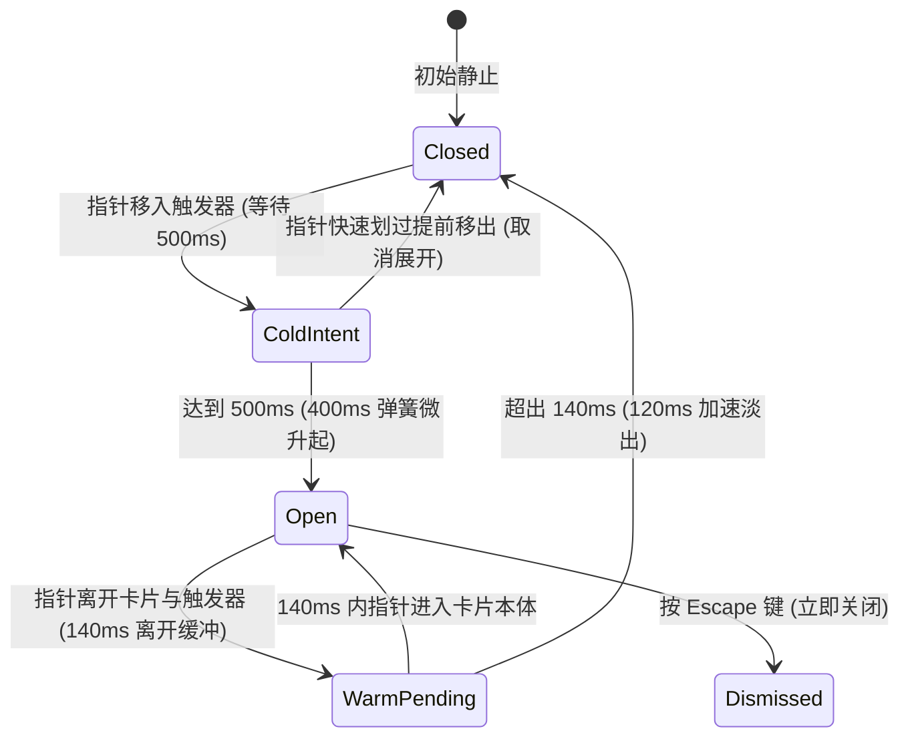

# Hover Card · 悬停卡片

用于在链接或提及元素上方通过光标悬停快速预览用户画像或富文本信息的浮动卡片。包含四大核心动效机制：

1. 悬停意图防抖与智能预热（Cold Delay & Warm Intent Switching）：光标首次移入触发器具有 500ms 冷启动意图防抖延迟，彻底杜绝划过界面的误触闪烁；一旦开启，系统激活 300ms 预热窗口期，此时划过其他相关触发器只需 80ms 极速响应；光标移开时提供 140ms 缓冲保护走廊，允许光标平稳滑入卡片本体。
2. 锚定跟随与视口防遮挡翻转（Collision Flip & Anchor Placement）：默认停靠于触发器下方（`data-side="bottom"`），当屏幕底部空间受限时智能自动翻转至上方（`data-side="top"`），形变原点（transform-origin）动态对齐触发边缘。
3. 卡片弹性微升起与透明度淡入（Cold Grow & Micro-Blur Stagger）：冷启动展开时卡片从 `translateY(4px) scale(0.96)` 伴随 400ms 平滑弹簧升起并恢复真实比例；预热切换时改以轻量级 90ms 快速交叉淡化呈现。
4. 全键盘聚焦即时唤出与 Escape 逃生（Keyboard Instant In & Escape Dismiss）：键盘 Tab 聚焦到触发器时跳过 500ms 延迟瞬时就位；在触发器或卡片内部按 `Escape` 键立即隐退卡片，并阻止原地重复弹窗。

## 原型清单

| 原型分组 | 原型元素 | 动效 / 状态变化 | 去向 |
| --- | --- | --- | --- |
| 外部触发器 | 提及按钮 `.hover-card_mention__q_h9W` | 悬停颜色过渡；指针进入启动 500ms 计时；键盘聚焦即时唤出 | 悬停意图防抖与智能预热 |
| 浮动卡片外壳 | 悬停卡片实体 `.hover-card-card` | 400ms 弹簧从 translateY(4px) scale(0.96) 升起；自动翻转 | 卡片弹性微升起与透明度淡入 |
| 资料头部区域 | 用户身份栏 `.hover-card-head` | 头像加载与名称展示 | 最小 DOM |
| 资料生平描述 | 个人简介 `.hover-card-bio` | 描述文字排版 | 最小 DOM |
| 统计与元数据 | 数据统计与时区 `.hover-card-stats` / `.hover-card-meta` | 结构化元数据信息 | 最小 DOM |
| — | 顶栏独立主题切换器 `#themeBtn` | 演示主题切换 | 演示外壳，已删除 |
| — | 外层演示居中舞台画布 | 演示卡片外框 | 演示外壳，已删除 |

## 适用

- 评论区或协作文档中的 @提及（Mention）用户卡片预览。
- 链接超文本的维基百科式摘要卡片、商品缩略卡片。
- 需要平滑悬停防抖，且允许光标安全滑入卡片复制文本或点击操作的富信息面板。

## 不适用

- 纯点击触发且包含表单输入的模态弹出层 → [popover](popover.md)
- 仅展示简短单行说明文字的只读标签气泡 → [tooltip](tooltip.md)
- 强模态居中决策对话框 → [dialog](dialog.md)

## 状态机



| 状态 | 进入条件 | 视觉表现 | 退出到 |
| --- | --- | --- | --- |
| closed | 初始或完全收起 | 卡片 DOM 移除或不可见（opacity: 0） | coldIntent / open (键盘聚焦) |
| coldIntent | 光标进入冷启动触发器 | 触发器高亮，等待 500ms 意图防抖计时 | open / closed |
| open | 防抖完成或预热切换 | 卡片以 400ms 弹簧升起放大，保持完全不透明 | warmPending / dismissed |
| warmPending | 光标移出当前卡片/触发器 | 维持显示 140ms，允许跨越空白走廊进入卡片 | open / closed |
| dismissed | 按 Escape 键 | 卡片立即隐退，光标离开前不再重复唤出 | closed |

## 最小 DOM

```html
<div class="hover-card-root">
  <button type="button" class="hover-card-trigger" aria-haspopup="dialog" aria-expanded="false">
    <span>Jasmine Brooks</span>
  </button>
  <div class="hover-card-portal" data-state="closed">
    <div class="hover-card-card" role="tooltip" tabindex="-1" data-side="bottom">
      <div class="hover-card-profile">
        <div class="hover-card-head">
          <span class="hover-card-name">Jasmine Brooks</span>
          <span class="hover-card-role">Engineering manager, Billing</span>
        </div>
        <p class="hover-card-bio">Leads the billing team of seven. Runs launch review.</p>
      </div>
    </div>
  </div>
</div>
```

- `.hover-card-root`：宿主容器。
- `.hover-card-trigger`：可悬停或聚焦的触发器。
- `.hover-card-portal`：浮层绝对定位挂载门面。
- `.hover-card-card`：悬停卡片本体，配置 `role="tooltip"`。
- `.hover-card-profile`：内容容器。

## 参数

| 名称 | 值 | 用于 | 来源 |
| --- | --- | --- | --- |
| 冷启动意图防抖延迟 | `500ms` | 首次指针悬停等待期 | 原型 |
| 离开缓冲保护期 | `140ms` | 光标移出触发器至进入卡片的宽限期 | 原型 |
| 预热切换判定窗口 | `300ms` | 允许快速切换相邻卡片的时间窗 | 原型 |
| 预热切换意图延迟 | `80ms` | 处于预热态时的极短防抖等待 | 原型 |
| 冷启动入场弹簧 | `400ms` / `cubic-bezier(0.16, 1, 0.3, 1)` | `.hover-card-card` 升起淡入 | 原型 |
| 卡片入场微缩放与位移 | `translateY(4px) scale(0.96)` | 卡片初始入场帧 | 原型 |
| 正常退场加速淡出 | `120ms` / `cubic-bezier(0.22, 1, 0.36, 1)` | 卡片隐退时长 | 原型 |
| 锚点与卡片间距 | `8px` | 卡片与触发器间的物理间距 | 原型 |

## CSS

```css
.hover-card-portal {
  --hover-ease-spring: cubic-bezier(0.16, 1, 0.3, 1);
  --hover-ease-exit: cubic-bezier(0.22, 1, 0.36, 1);
  --hover-duration-spring: 400ms;
  --hover-duration-exit: 120ms;

  position: absolute;
  z-index: 1000;
  pointer-events: none;
}

.hover-card-portal[data-state="closed"] {
  display: none;
}

.hover-card-card {
  position: relative;
  width: 296px;
  border-radius: 12px;
  border: 1px solid rgba(0, 0, 0, 0.08);
  background: #ffffff;
  box-shadow: 0 10px 30px rgba(0, 0, 0, 0.08), 0 2px 6px rgba(0, 0, 0, 0.04);
  padding: 16px;
  pointer-events: auto;
  opacity: 0;
  transform: translateY(4px) scale(0.96);
  transform-origin: top left;
  transition:
    transform var(--hover-duration-spring) var(--hover-ease-spring),
    opacity 160ms var(--hover-ease-spring);
  will-change: transform, opacity;
  box-sizing: border-box;
}

.hover-card-portal[data-state="open"] .hover-card-card {
  opacity: 1;
  transform: translateY(0) scale(1);
}

.hover-card-card[data-side="top"] {
  transform: translateY(-4px) scale(0.96);
  transform-origin: bottom left;
}

.hover-card-portal[data-state="open"] .hover-card-card[data-side="top"] {
  transform: translateY(0) scale(1);
}

@starting-style {
  .hover-card-portal[data-state="open"] .hover-card-card {
    opacity: 0;
    transform: translateY(4px) scale(0.96);
  }
}

.hover-card-portal[data-state="closing"] .hover-card-card {
  opacity: 0;
  transform: translateY(2px) scale(0.98);
  transition:
    transform var(--hover-duration-exit) var(--hover-ease-exit),
    opacity var(--hover-duration-exit) var(--hover-ease-exit);
}

.hover-card-head {
  display: flex;
  flex-direction: column;
  gap: 2px;
}

.hover-card-name {
  font-size: 0.9375rem;
  font-weight: 600;
  color: #111111;
}

.hover-card-role {
  font-size: 0.8125rem;
  color: #666666;
}

.hover-card-bio {
  margin: 10px 0 0;
  font-size: 0.8125rem;
  color: #444444;
  line-height: 1.45;
}

@media (prefers-reduced-motion: reduce) {
  .hover-card-card {
    transition: none !important;
  }
}
```

## JS

```js
/**
 * 创建轻量级纯原生 HoverCard 控制器
 * @param {HTMLElement} root 挂载宿主容器
 * @param {Object} [options] 配置项
 * @param {number} [options.openDelay=500] 冷启动延迟 (ms)
 * @param {number} [options.closeDelay=140] 离开缓冲 (ms)
 * @returns {{ open: Function, close: Function, destroy: Function }}
 */
export function createHoverCard(root, options = {}) {
  const trigger = root.querySelector('.hover-card-trigger');
  const portal = root.querySelector('.hover-card-portal');
  if (!portal || !trigger) return { destroy: () => {} };

  const card = portal.querySelector('.hover-card-card');
  const openDelay = options.openDelay || 500;
  const closeDelay = options.closeDelay || 140;

  let openTimer = null;
  let closeTimer = null;
  let isOpen = false;
  let isReduced = window.matchMedia('(prefers-reduced-motion: reduce)').matches;
  let disposed = false;

  function place() {
    const rect = trigger.getBoundingClientRect();
    const cardH = card.offsetHeight || 140;
    const padding = 8;
    const below = window.innerHeight - rect.bottom - padding;
    const above = rect.top - padding;
    const side = cardH > below && above > below ? 'top' : 'bottom';

    card.setAttribute('data-side', side);
    const top = side === 'top' ? rect.top - cardH - padding : rect.bottom + padding;
    const left = Math.max(12, Math.min(rect.left, window.innerWidth - 308));

    portal.style.top = `${top + window.scrollY}px`;
    portal.style.left = `${left + window.scrollX}px`;
  }

  function open(instant = false) {
    if (disposed || isOpen) return;
    clearTimeout(closeTimer);
    clearTimeout(openTimer);

    const delay = instant || isReduced ? 0 : openDelay;
    openTimer = setTimeout(() => {
      isOpen = true;
      portal.setAttribute('data-state', 'open');
      trigger.setAttribute('aria-expanded', 'true');
      place();
    }, delay);
  }

  function close() {
    if (disposed || !isOpen) {
      clearTimeout(openTimer);
      return;
    }
    clearTimeout(openTimer);
    clearTimeout(closeTimer);

    closeTimer = setTimeout(() => {
      isOpen = false;
      portal.setAttribute('data-state', 'closed');
      trigger.setAttribute('aria-expanded', 'false');
    }, isReduced ? 0 : closeDelay);
  }

  const onPointerEnter = () => open(false);
  const onPointerLeave = () => close();
  const onFocus = () => open(true);
  const onBlur = () => close();

  const onKeydown = (e) => {
    if (e.key === 'Escape' && isOpen) {
      e.stopPropagation();
      clearTimeout(openTimer);
      clearTimeout(closeTimer);
      isOpen = false;
      portal.setAttribute('data-state', 'closed');
      trigger.setAttribute('aria-expanded', 'false');
    }
  };

  trigger.addEventListener('pointerenter', onPointerEnter);
  trigger.addEventListener('pointerleave', onPointerLeave);
  trigger.addEventListener('focus', onFocus);
  trigger.addEventListener('blur', onBlur);

  card.addEventListener('pointerenter', () => clearTimeout(closeTimer));
  card.addEventListener('pointerleave', onPointerLeave);
  window.addEventListener('keydown', onKeydown);

  const motionQuery = window.matchMedia('(prefers-reduced-motion: reduce)');
  const onMotionChange = (e) => {
    isReduced = e.matches;
  };
  motionQuery.addEventListener('change', onMotionChange);

  return {
    open: () => open(true),
    close: () => close(),
    destroy() {
      disposed = true;
      clearTimeout(openTimer);
      clearTimeout(closeTimer);
      motionQuery.removeEventListener('change', onMotionChange);
      trigger.removeEventListener('pointerenter', onPointerEnter);
      trigger.removeEventListener('pointerleave', onPointerLeave);
      trigger.removeEventListener('focus', onFocus);
      trigger.removeEventListener('blur', onBlur);
      window.removeEventListener('keydown', onKeydown);
    }
  };
}
```

## 接入目标项目

- 状态来源：
  - 由光标与键盘聚焦事件天然驱动；支持调用 `open()` 与 `close()` 进行程序化控制。
- 尺寸策略：
  - 卡片宽度固定为 296px，高度由简介与信息内容自然撑开。
- 驱动方式：
  - 调用 `createHoverCard(rootEl, { openDelay: 500, closeDelay: 140 })`；
  - 卸载时调用 `destroy()`。

## 重入与清理

- 光标快速在触发器与卡片间划过时，`openTimer` 与 `closeTimer` 互相排斥清除，杜绝卡片残留；
- `destroy()` 负责卸载全局键盘监听与指针监听。

## 减少动态效果

- 在 `prefers-reduced-motion: reduce` 下：
  - 停用卡片的弹簧缩放与位移过渡（`transition: none`）；
  - 状态切换瞬时完成，计时器延迟压缩至 0ms。

## 焦点与键盘

- 触发器支持通过 Tab 键获取焦点；
- 获得焦点时触发即时唤出；失去焦点时触发关闭；
- 按 `Escape` 键立即隐退卡片。

## 兼容回退

| 特性 | 不支持时 |
| --- | --- |
| Pointer Events | 降级为 `mouseenter` 与 `mouseleave`。 |

## 验收清单

- [ ] 指针快速划过触发器停留不足 500ms 时，卡片绝不闪现弹出。
- [ ] 悬停超过 500ms，卡片自 `translateY(4px) scale(0.96)` 以 400ms 弹簧平滑升起呈现。
- [ ] 指针离开触发器并在 140ms 缓冲期内滑入卡片内部，卡片稳定保持展开。
- [ ] 键盘使用 Tab 键聚焦到触发器，卡片瞬时唤出，按 Escape 键立即隐退。
- [ ] 视口底部受限时，卡片自动翻转至触发器上方展开。
- [ ] 开启系统减少动态效果，卡片直接瞬时呈现，无任何动效位移。
