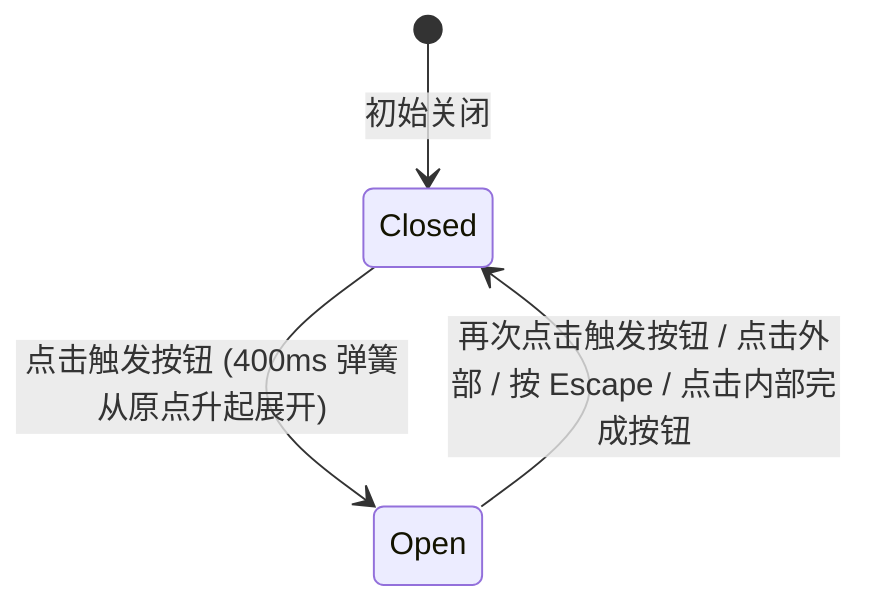

# Popover · 弹出框

用于在锚点按钮邻近区域展开上下文交互、微型表单或辅助说明的浮动浮层。包含四大核心动效机制：

1. 锚定跟随与智能碰撞翻转（Anchored Positioning & Collision Flip）：点击触发按钮后，卡片在触发器边缘弹出；自动测算视口边界空间，当下方空间不足时自动翻转至上方（`data-side="top"`），左右受限时横向对齐偏移（Alignment Shift）。
2. 缩放弹簧入场与原点对齐（Spring In & Transform Origin Align）：面板 `.popover-content` 从 `translateY(4px) scale(0.96)` 以 400ms 平滑阻尼弹簧升起并恢复真实尺寸；形变原点根据当前朝向动态对准触发边缘，带来从触发器边缘自然膨胀的有机动效。
3. 点击外部延迟关闭（Outside Pointer Dismissal）：监听 document 指针事件，当点击发生在面板与触发器外部时，触发优雅退场动画（120ms 加速淡出）；防止操作意外穿透。
4. 全键盘交互与 Escape 闭环（WAI-ARIA Dialog & Escape）：配置 `role="dialog"`，打开时焦点自动捕获在面板内部首个可操作元素；Tab 键在面板内部循环；按 `Escape` 键即刻退出并将焦点交还给触发按钮。

## 原型清单

| 原型分组 | 原型元素 | 动效 / 状态变化 | 去向 |
| --- | --- | --- | --- |
| 外部触发器 | 锚点按钮 `.popover-anchor` | 悬停/按压反馈；点击触发展开/折叠 | 最小 DOM |
| 弹出卡片外壳 | 弹出层实体 `.popover-content` | 400ms 弹簧自 translateY(4px) scale(0.96) 升起；自动翻转 | 缩放弹簧入场与原点对齐 |
| 弹出层内容体 | 内部文案与操作 `.previews-disclosure-feedback_popoverBody__at5vI` | 加粗标题、解释段落与“知道了”按钮 | 最小 DOM |
| — | 顶栏独立主题切换器 `#themeBtn` | 演示主题切换 | 演示外壳，已删除 |
| — | 外层演示居中画板 | 演示卡片外框 | 演示外壳，已删除 |

## 适用

- 字段旁带有丰富排版与交互动作的上下文解释（如“为什么显示此状态？”）。
- 行内微型筛选面板、日期快速选择器、标签添加气泡。
- 需要用户在不离开当前屏幕上下文的前提下完成小型交互。

## 不适用

- 纯悬停预览、光标移走即消失的用户卡片 → [hover-card](hover-card.md)
- 纯只读的单行微提示气泡 → [tooltip](tooltip.md)
- 破坏性操作的居中全屏模态对话框 → [dialog](dialog.md)

## 状态机



| 状态 | 进入条件 | 视觉表现 | 退出到 |
| --- | --- | --- | --- |
| closed | 初始或收起完成 | 弹出卡片 DOM 不渲染或处于不可见状态 | open |
| open | 点击触发器 | 卡片自触发边缘 400ms 弹簧升起并淡入，焦点落入内部 | closed |

## 最小 DOM

```html
<div class="popover-root">
  <button type="button" class="popover-anchor" aria-haspopup="dialog" aria-expanded="false">
    <svg width="15" height="15" viewBox="0 0 24 24" fill="none" stroke="currentColor" stroke-width="2" stroke-linecap="round" stroke-linejoin="round" aria-hidden="true">
      <circle cx="12" cy="12" r="10" />
      <path d="M9.09 9a3 3 0 0 1 5.83 1c0 2-3 3-3 3" />
      <path d="M12 17h.01" />
    </svg>
    <span>Why this status?</span>
  </button>
  <div class="popover-portal" data-state="closed">
    <div class="popover-content" role="dialog" tabindex="-1" data-side="bottom">
      <div class="popover-body">
        <strong>Ready for review</strong>
        <p>All required checks passed. Invite a teammate when you want a second pair of eyes.</p>
        <button type="button" class="popover-btn-done">Got it</button>
      </div>
    </div>
  </div>
</div>
```

- `.popover-root`：宿主容器。
- `.popover-anchor`：触发按钮，配置 `aria-haspopup="dialog"`。
- `.popover-portal`：绝对定位挂载门面。
- `.popover-content`：浮动卡片本体，承载缩放与位移。
- `.popover-body`：内部图文内容与动作按钮。

## 参数

| 名称 | 值 | 用于 | 来源 |
| --- | --- | --- | --- |
| 卡片展开弹簧时长 | `400ms` / `cubic-bezier(0.16, 1, 0.3, 1)` | `.popover-content` 进场 | 原型 |
| 卡片入场微缩放与位移 | `translateY(4px) scale(0.96)` | 卡片初始入场帧 | 原型 |
| 卡片退场加速淡出时长 | `120ms` / `cubic-bezier(0.22, 1, 0.36, 1)` | `.popover-content` 退出 | 原型 |
| 锚点与卡片间距 | `8px` | 卡片与触发器垂直间距 | 原型 |
| 视口边缘碰撞避让边距 | `12px` | 靠近屏幕边缘时的安全距离 | 原型 |

## CSS

```css
.popover-root {
  position: relative;
  display: inline-block;
}

.popover-portal {
  --popover-ease-spring: cubic-bezier(0.16, 1, 0.3, 1);
  --popover-ease-exit: cubic-bezier(0.22, 1, 0.36, 1);
  --popover-duration-spring: 400ms;
  --popover-duration-exit: 120ms;

  position: absolute;
  z-index: 1000;
  pointer-events: none;
}

.popover-portal[data-state="closed"] {
  display: none;
}

.popover-content {
  position: relative;
  width: 280px;
  border-radius: 12px;
  border: 1px solid rgba(0, 0, 0, 0.08);
  background: #ffffff;
  box-shadow: 0 10px 30px rgba(0, 0, 0, 0.08), 0 2px 6px rgba(0, 0, 0, 0.04);
  padding: 16px;
  pointer-events: auto;
  opacity: 0;
  transform: translateY(4px) scale(0.96);
  transform-origin: top left;
  transition:
    transform var(--popover-duration-spring) var(--popover-ease-spring),
    opacity 160ms var(--popover-ease-spring);
  will-change: transform, opacity;
  box-sizing: border-box;
  outline: none;
}

.popover-portal[data-state="open"] .popover-content {
  opacity: 1;
  transform: translateY(0) scale(1);
}

.popover-content[data-side="top"] {
  transform: translateY(-4px) scale(0.96);
  transform-origin: bottom left;
}

.popover-portal[data-state="open"] .popover-content[data-side="top"] {
  transform: translateY(0) scale(1);
}

@starting-style {
  .popover-portal[data-state="open"] .popover-content {
    opacity: 0;
    transform: translateY(4px) scale(0.96);
  }
}

.popover-portal[data-state="closing"] .popover-content {
  opacity: 0;
  transform: translateY(2px) scale(0.98);
  transition:
    transform var(--popover-duration-exit) var(--popover-ease-exit),
    opacity var(--popover-duration-exit) var(--popover-ease-exit);
}

.popover-body strong {
  display: block;
  font-size: 0.9375rem;
  color: #111111;
  margin-bottom: 6px;
}

.popover-body p {
  margin: 0 0 12px;
  font-size: 0.8125rem;
  color: #666666;
  line-height: 1.45;
}

.popover-btn-done {
  height: 28px;
  padding: 0 12px;
  border: 1px solid rgba(0, 0, 0, 0.12);
  border-radius: 6px;
  background: transparent;
  color: #333333;
  font-size: 0.75rem;
  font-weight: 500;
  cursor: pointer;
}

.popover-btn-done:hover {
  background: rgba(0, 0, 0, 0.04);
}

@media (prefers-reduced-motion: reduce) {
  .popover-content {
    transition: none !important;
  }
}
```

## JS

```js
/**
 * 创建纯原生 Popover 弹出层控制器
 * @param {HTMLElement} root 宿主节点
 * @param {Object} [options] 配置项
 * @param {(open: boolean) => void} [options.onOpenChange] 状态改变回调
 * @returns {{ open: Function, close: Function, toggle: Function, destroy: Function }}
 */
export function createPopover(root, options = {}) {
  const trigger = root.querySelector('.popover-anchor');
  const portal = root.querySelector('.popover-portal');
  if (!portal || !trigger) return { destroy: () => {} };

  const content = portal.querySelector('.popover-content');
  const doneBtn = portal.querySelector('.popover-btn-done');

  let isOpen = false;
  let isReduced = window.matchMedia('(prefers-reduced-motion: reduce)').matches;
  let disposed = false;

  function place() {
    const rect = trigger.getBoundingClientRect();
    const popoverH = content.offsetHeight || 130;
    const padding = 8;
    const below = window.innerHeight - rect.bottom - padding;
    const above = rect.top - padding;
    const side = popoverH > below && above > below ? 'top' : 'bottom';

    content.setAttribute('data-side', side);
    const top = side === 'top' ? rect.top - popoverH - padding : rect.bottom + padding;
    const left = Math.max(12, Math.min(rect.left, window.innerWidth - 292));

    portal.style.top = `${top + window.scrollY}px`;
    portal.style.left = `${left + window.scrollX}px`;
  }

  function open() {
    if (disposed || isOpen) return;
    isOpen = true;
    portal.setAttribute('data-state', 'open');
    trigger.setAttribute('aria-expanded', 'true');
    place();

    requestAnimationFrame(() => {
      content?.focus();
    });

    if (typeof options.onOpenChange === 'function') options.onOpenChange(true);
  }

  function close() {
    if (disposed || !isOpen) return;
    isOpen = false;
    portal.setAttribute('data-state', 'closed');
    trigger.setAttribute('aria-expanded', 'false');
    trigger.focus();

    if (typeof options.onOpenChange === 'function') options.onOpenChange(false);
  }

  function toggle() {
    if (isOpen) close();
    else open();
  }

  const onTriggerClick = (e) => {
    e.stopPropagation();
    toggle();
  };

  const onDocClick = (e) => {
    if (!isOpen) return;
    if (!portal.contains(e.target) && !trigger.contains(e.target)) {
      close();
    }
  };

  const onKeydown = (e) => {
    if (!isOpen) return;
    if (e.key === 'Escape') {
      e.stopPropagation();
      close();
    }
  };

  trigger.addEventListener('click', onTriggerClick);
  document.addEventListener('pointerdown', onDocClick);
  window.addEventListener('keydown', onKeydown);
  if (doneBtn) doneBtn.addEventListener('click', close);

  const motionQuery = window.matchMedia('(prefers-reduced-motion: reduce)');
  const onMotionChange = (e) => {
    isReduced = e.matches;
  };
  motionQuery.addEventListener('change', onMotionChange);

  return {
    open,
    close,
    toggle,
    destroy() {
      disposed = true;
      motionQuery.removeEventListener('change', onMotionChange);
      trigger.removeEventListener('click', onTriggerClick);
      document.removeEventListener('pointerdown', onDocClick);
      window.removeEventListener('keydown', onKeydown);
      if (doneBtn) doneBtn.removeEventListener('click', close);
    }
  };
}
```

## 接入目标项目

- 状态来源：
  - 点击锚点触发，或由表单校验错误提示主动调用 `open()` 唤出。
- 尺寸策略：
  - 卡片宽度固定为 280px；高度由内部文本自动撑开。
- 驱动方式：
  - 调用 `createPopover(rootEl, { onOpenChange })`；
  - 卸载时调用 `destroy()`。

## 重入与清理

- 连续点击触发按钮时执行顺畅的 `toggle()` 切换；点击外部时安全收起；
- `destroy()` 负责解除全局 `pointerdown` 与 `keydown` 监听。

## 减少动态效果

- 在 `prefers-reduced-motion: reduce` 下：
  - 停用卡片的弹簧缩放与位移过渡（`transition: none`），状态瞬时呈现。

## 焦点与键盘

- 触发器声明 `aria-haspopup="dialog"`；
- 打开后焦点转入面板内部，支持 Tab 在内部按钮间聚焦；
- 按 `Escape` 键立即收起并将焦点还回触发按钮。

## 兼容回退

| 特性 | 不支持时 |
| --- | --- |
| CSS Transitions | 降级为直接显示/隐藏。 |

## 验收清单

- [ ] 点击触发按钮，气泡面板自锚点边缘以 400ms 弹簧顺畅升起展开。
- [ ] 视口下方空间受限时，气泡自动向上翻转并在上方展开。
- [ ] 点击气泡外部区域，气泡即刻收起关闭。
- [ ] 聚焦在气泡内部按 Escape 键或点击内部操作按钮，气泡顺畅退出并将焦点返还触发器。
- [ ] 开启系统减少动态效果，气泡瞬时出现与消失。
