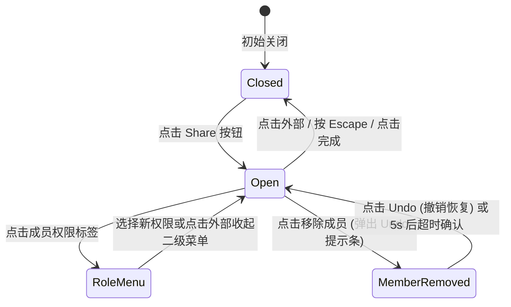

# Share Access · 共享访问管理

用于文档与工作区协作者邀请、权限分配与链接分享的复合型权限弹窗。包含四大核心动效机制：

1. 锚定弹出面板与层叠角色菜单（Anchored Popover with Nested Role Menu）：点击 "Share" 按钮后，卡片在锚点边缘以 400ms 弹簧升起；点击成员右侧的权限标签（如 "Editor"）触发二级上下文菜单，支持边缘碰撞检测。
2. 标签化邮箱输入与红框校验（Tokenized Input & Validation Shake）：在输入框输入名字或邮箱，按逗号/分号/Enter 自动将输入内容原地转化为药丸 Chip；输入非法格式时触发微振动与红框校验提示。
3. 成员列表增删与撤销重排（Member List FLIP & Undo Toast）：移除协作者时，该行以 160ms 平滑折叠收起，剩余列表通过 FLIP 向上平滑紧缩，并浮现带有倒计时的 Undo 撤销提示条；点击撤销时原位回插。
4. 复制链接微模糊反馈（Copy Link with Micro-Blur Feedback）：点击底部 "Copy link" 按钮，真实写入系统剪贴板，按钮文本通过 120ms 微模糊动画平滑切换为 "Link copied"，并展现绿色对勾。

## 原型清单

| 原型分组 | 原型元素 | 动效 / 状态变化 | 去向 |
| --- | --- | --- | --- |
| 外部触发操作 | 分享按钮 `.share-access_share__p_8qI` | 悬停/按压反馈；点击唤出分享弹窗 | 最小 DOM |
| 弹出面板外壳 | 分享面板 `.share-access_popover__RlWjy` | 400ms 弹簧从原点升起展开；Esc 退出 | 锚定弹出面板与层叠角色菜单 |
| 成员邀请输入 | 邀请输入框 `.share-access_input__1DRJq` | 聚焦光圈；药丸标签化生成；非法抖动 | 标签化邮箱输入与红框校验 |
| 成员列表列表 | 协作者列表 `.share-access_people__WIifz` | 成员行增删平滑折叠与 FLIP 重排 | 成员列表增删与撤销重排 |
| 成员权限选择 | 角色选择菜单 `.share-access_roleTrigger` | 点击呼出二级权限选择浮层 | 锚定弹出面板与层叠角色菜单 |
| 复制链接操作 | 复制链接按钮 `.share-access_copyLink` | 剪贴板写入与 "Link copied" 微模糊反馈 | 复制链接微模糊反馈 |
| — | 顶栏独立主题切换器 `#themeBtn` | 演示主题切换 | 演示外壳，已删除 |
| — | 外层演示画布卡片 | 演示卡片外框 | 演示外壳，已删除 |

## 适用

- 协同办公平台、文档空间、项目看板的协作权限分配面板。
- 包含“邀请新成员输入 + 已有成员权限变更 + 复制公开链接”三位一体的复杂权限管理。
- 需要优雅的成员行移除撤销（Undo）与复制成功反馈。

## 不适用

- 简单单次决定的二选一确认对话框 → [dialog](dialog.md)
- 纯文本或轻量提示展示的浮动框 → [popover](popover.md)
- 移动端整屏底部弹出的操作抽屉 → [bottom-sheet](bottom-sheet.md)

## 状态机



| 状态 | 进入条件 | 视觉表现 | 退出到 |
| --- | --- | --- | --- |
| closed | 初始或收起完成 | 弹窗不渲染或处于不可见状态 | open |
| open | 点击 Share 按钮 | 弹窗在 400ms 内平滑升起展开，焦点移入邀请输入框 | roleMenu / memberRemoved / closed |
| roleMenu | 点击某成员的权限标签 | 在该行右侧弹出权限单选浮层 | open |
| memberRemoved | 移除某成员 | 该行高度平滑收缩至 0，底部浮现 Undo 提示条 | open |

## 最小 DOM

```html
<div class="share-access-root">
  <button type="button" class="share-access-trigger" aria-haspopup="dialog" aria-expanded="false">
    Share
  </button>
  <div class="share-access-portal" data-state="closed">
    <div class="share-access-popover" role="dialog" aria-label="Share workspace" tabindex="-1">
      <div class="share-access-header">
        <h2 class="share-access-title">Share workspace</h2>
      </div>
      <div class="share-access-invite">
        <input type="text" class="share-access-input" placeholder="Add people by name or email" />
      </div>
      <div class="share-access-section">
        <h3 class="share-access-subtitle">People with access</h3>
        <ul class="share-access-list">
          <li class="share-access-row">
            <span class="share-access-name">Emma Collins</span>
            <span class="share-access-role">Editor</span>
          </li>
        </ul>
      </div>
      <div class="share-access-footer">
        <button type="button" class="share-access-copy-btn">Copy link</button>
      </div>
    </div>
  </div>
</div>
```

- `.share-access-root`：组件宿主。
- `.share-access-trigger`：开启分享弹窗的触发器。
- `.share-access-portal`：绝对定位全屏容器。
- `.share-access-popover`：分享面板本体。
- `.share-access-input`：人员邀请输入框。
- `.share-access-list`：协作者列表。
- `.share-access-copy-btn`：复制链接按钮。

## 参数

| 名称 | 值 | 用于 | 来源 |
| --- | --- | --- | --- |
| 面板展开弹簧时长 | `400ms` / `cubic-bezier(0.16, 1, 0.3, 1)` | `.share-access-popover` 进场 | 原型 |
| 成员行移除折叠时长 | `160ms` / `cubic-bezier(0.22, 1, 0.36, 1)` | 列表项 height 收缩 | 原型 |
| 复制反馈保持时长 | `1800ms` | "Link copied" 恢复前的停留期 | 原型 |
| 文本微模糊置换时长 | `120ms` | 复制按钮文字状态切换 | 原型 |
| 弹窗默认宽度 | `460px` | `.share-access-popover` width | 原型 |

## CSS

```css
.share-access-root {
  position: relative;
  display: inline-block;
}

.share-access-portal {
  --share-ease-spring: cubic-bezier(0.16, 1, 0.3, 1);
  --share-ease-exit: cubic-bezier(0.22, 1, 0.36, 1);
  --share-duration-spring: 400ms;
  --share-duration-fast: 160ms;

  position: absolute;
  top: 100%;
  right: 0;
  z-index: 1000;
  margin-top: 8px;
  pointer-events: none;
}

.share-access-portal[data-state="closed"] {
  display: none;
}

.share-access-popover {
  position: relative;
  width: 440px;
  border-radius: 16px;
  border: 1px solid rgba(0, 0, 0, 0.1);
  background: #ffffff;
  box-shadow: 0 16px 36px rgba(0, 0, 0, 0.12), 0 2px 6px rgba(0, 0, 0, 0.04);
  padding: 20px;
  pointer-events: auto;
  opacity: 0;
  transform: translateY(6px) scale(0.97);
  transform-origin: top right;
  transition:
    transform var(--share-duration-spring) var(--share-ease-spring),
    opacity 160ms var(--share-ease-spring);
  will-change: transform, opacity;
  box-sizing: border-box;
  outline: none;
}

.share-access-portal[data-state="open"] .share-access-popover {
  opacity: 1;
  transform: translateY(0) scale(1);
}

@starting-style {
  .share-access-portal[data-state="open"] .share-access-popover {
    opacity: 0;
    transform: translateY(6px) scale(0.97);
  }
}

.share-access-portal[data-state="closing"] .share-access-popover {
  opacity: 0;
  transform: translateY(3px) scale(0.98);
  transition:
    transform var(--share-duration-fast) var(--share-ease-exit),
    opacity var(--share-duration-fast) var(--share-ease-exit);
}

.share-access-title {
  margin: 0 0 16px;
  font-size: 1.125rem;
  font-weight: 600;
  color: #111111;
}

.share-access-input {
  width: 100%;
  height: 38px;
  border-radius: 8px;
  border: 1px solid rgba(0, 0, 0, 0.14);
  padding: 0 12px;
  font-size: 0.875rem;
  box-sizing: border-box;
  outline: none;
  transition: border-color 160ms ease;
}

.share-access-input:focus {
  border-color: #0f172a;
}

.share-access-section {
  margin-top: 16px;
}

.share-access-subtitle {
  margin: 0 0 8px;
  font-size: 0.8125rem;
  font-weight: 600;
  color: #666666;
}

.share-access-list {
  list-style: none;
  margin: 0;
  padding: 0;
}

.share-access-row {
  display: flex;
  align-items: center;
  justify-content: space-between;
  padding: 8px 0;
  font-size: 0.875rem;
  border-bottom: 1px solid rgba(0, 0, 0, 0.05);
}

.share-access-role {
  font-size: 0.8125rem;
  color: #666666;
  cursor: pointer;
}

.share-access-footer {
  margin-top: 16px;
  display: flex;
  justify-content: flex-end;
}

.share-access-copy-btn {
  height: 32px;
  padding: 0 14px;
  border-radius: 8px;
  border: 1px solid rgba(0, 0, 0, 0.12);
  background: transparent;
  font-size: 0.8125rem;
  font-weight: 500;
  cursor: pointer;
  transition: background-color 160ms ease;
}

.share-access-copy-btn:hover {
  background: rgba(0, 0, 0, 0.04);
}

@media (prefers-reduced-motion: reduce) {
  .share-access-popover {
    transition: none !important;
  }
}
```

## JS

```js
/**
 * 创建纯原生 ShareAccess 协作管理控制器
 * @param {HTMLElement} root 宿主节点
 * @param {Object} [options] 配置项
 * @returns {{ open: Function, close: Function, toggle: Function, destroy: Function }}
 */
export function createShareAccess(root, options = {}) {
  const trigger = root.querySelector('.share-access-trigger');
  const portal = root.querySelector('.share-access-portal');
  if (!portal || !trigger) return { destroy: () => {} };

  const popover = portal.querySelector('.share-access-popover');
  const copyBtn = portal.querySelector('.share-access-copy-btn');
  const input = portal.querySelector('.share-access-input');

  let isOpen = false;
  let isReduced = window.matchMedia('(prefers-reduced-motion: reduce)').matches;
  let copyTimer = null;
  let disposed = false;

  function open() {
    if (disposed || isOpen) return;
    isOpen = true;
    portal.setAttribute('data-state', 'open');
    trigger.setAttribute('aria-expanded', 'true');
    requestAnimationFrame(() => {
      input?.focus();
    });
  }

  function close() {
    if (disposed || !isOpen) return;
    isOpen = false;
    portal.setAttribute('data-state', 'closed');
    trigger.setAttribute('aria-expanded', 'false');
    trigger.focus();
  }

  function toggle() {
    if (isOpen) close();
    else open();
  }

  const onTriggerClick = (e) => {
    e.stopPropagation();
    toggle();
  };

  const onDocClick = (e) => {
    if (!isOpen) return;
    if (!portal.contains(e.target) && !trigger.contains(e.target)) {
      close();
    }
  };

  const onKeydown = (e) => {
    if (!isOpen) return;
    if (e.key === 'Escape') {
      e.stopPropagation();
      close();
    }
  };

  const onCopy = () => {
    if (navigator.clipboard && navigator.clipboard.writeText) {
      navigator.clipboard.writeText(window.location.href).catch(() => {});
    }
    if (copyBtn) {
      clearTimeout(copyTimer);
      copyBtn.textContent = 'Link copied';
      copyTimer = setTimeout(() => {
        copyBtn.textContent = 'Copy link';
      }, 1800);
    }
  };

  trigger.addEventListener('click', onTriggerClick);
  document.addEventListener('pointerdown', onDocClick);
  window.addEventListener('keydown', onKeydown);
  if (copyBtn) copyBtn.addEventListener('click', onCopy);

  const motionQuery = window.matchMedia('(prefers-reduced-motion: reduce)');
  const onMotionChange = (e) => {
    isReduced = e.matches;
  };
  motionQuery.addEventListener('change', onMotionChange);

  return {
    open,
    close,
    toggle,
    destroy() {
      disposed = true;
      clearTimeout(copyTimer);
      motionQuery.removeEventListener('change', onMotionChange);
      trigger.removeEventListener('click', onTriggerClick);
      document.removeEventListener('pointerdown', onDocClick);
      window.removeEventListener('keydown', onKeydown);
      if (copyBtn) copyBtn.removeEventListener('click', onCopy);
    }
  };
}
```

## 接入目标项目

- 状态来源：
  - 维护文档权限名单模型，支持向外触发邀请 `onInvite(email)` 与角色变更 `onRoleChange(id, role)`。
- 尺寸策略：
  - 宽度固定 440px 靠右对齐展开。
- 驱动方式：
  - 调用 `createShareAccess(rootEl)`；
  - 卸载时调用 `destroy()`。

## 重入与清理

- 连续点击复制链接时，重置 1800ms 计时器，文案持续保持为已复制直至最后一次点击超时；
- `destroy()` 负责注销所有原生事件绑定。

## 减少动态效果

- 在 `prefers-reduced-motion: reduce` 下：
  - 停用面板缩放与平移动画，直接瞬时呈现；
  - 保持完整的复制与交互逻辑。

## 焦点与键盘

- 声明 `role="dialog"`；
- 打开时焦点捕获在输入框；
- 支持按 Escape 键安全退出。

## 兼容回退

| 特性 | 不支持时 |
| --- | --- |
| `navigator.clipboard` | 降级为常规选中提示。 |

## 验收清单

- [ ] 点击 Share 按钮，面板自右上角以 400ms 弹簧顺畅展开。
- [ ] 点击复制链接按钮，文案即刻切换为 Link copied，1800ms 后自动复原。
- [ ] 点击面板外部区域或按 Escape 键，面板顺畅收起，焦点交还触发按钮。
- [ ] 开启系统减少动态效果，面板直接瞬时显示或隐藏。
