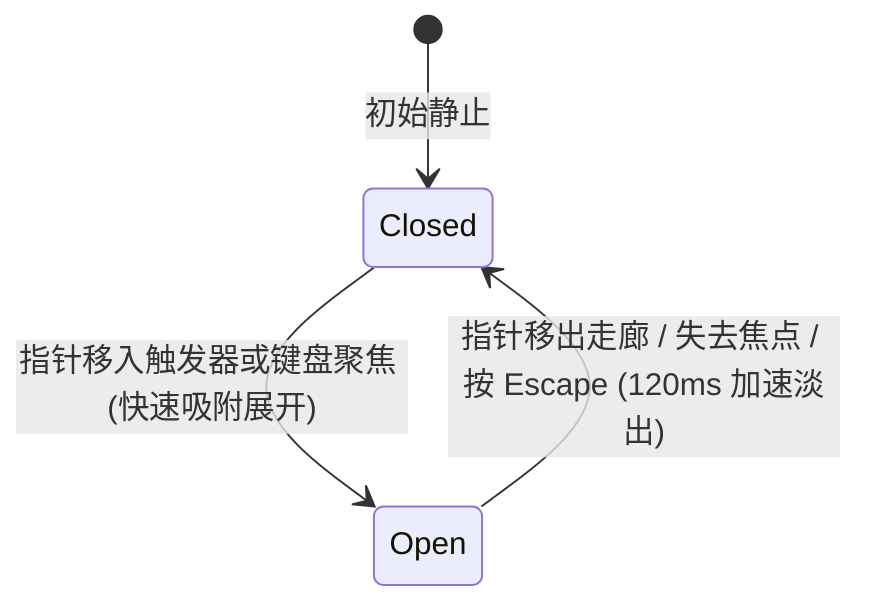

# Tooltip · 文字提示

用于在悬停或聚焦纯图标与紧凑控件时提供简明辅助说明的轻量浮层。包含四大核心动效机制：

1. 瞬时响应与防闪退保护走廊（Instant In & Safe Corridor）：鼠标移入触发图标时以极短延迟（< 100ms）快速吸附展示；并在触发器与气泡之间建立隐形几何走廊，允许光标安全滑入气泡选中文本而不意外闪退。
2. 幽灵标尺自适应宽度伸缩（Ghost Sizer & Morphing）：内部包含 `.tooltip-measure` 幽灵测量文本，动态读取实际像素宽度；当气泡提示内容发生动态置换时，气泡外壳以平滑弹簧曲线横向自适应伸缩，杜绝文字跳变抖动。
3. 文字微模糊置换（Micro-Blur Text Swap）：提示文本动态变化时，旧文字以 120ms 下沉模糊隐去，新文字以 160ms 升起淡入复原。
4. 全键盘聚焦即时唤出与 Escape 逃生（Focus Instant In & Escape Dismiss）：键盘 Tab 聚焦至触发器时，气泡瞬时就位；失焦立即隐去；按 `Escape` 键即刻关闭。

## 原型清单

| 原型分组 | 原型元素 | 动效 / 状态变化 | 去向 |
| --- | --- | --- | --- |
| 外部触发器 | 问号图标按钮 `.previews-disclosure-feedback_tipButton__pn4Rw` | 悬停/聚焦监听；触发展示气泡 | 最小 DOM |
| 浮动气泡外壳 | 提示气泡实体 `.tooltip-tooltip` | 240ms 弹簧从 translateY(4px) scale(0.96) 升起 | 瞬时响应与防闪退保护走廊 |
| 幽灵测量文本 | 幽灵标尺 `.tooltip-measure` | 隐藏占位测算精确像素宽度 | 幽灵标尺自适应宽度伸缩 |
| 真实显示文本 | 真实提示行 `.tooltip-line` | 微模糊文字置换动画 | 文字微模糊置换 |
| — | 顶栏独立主题切换器 `#themeBtn` | 演示主题切换 | 演示外壳，已删除 |
| — | 外层演示居中画板 | 演示卡片外框 | 演示外壳，已删除 |

## 适用

- 纯图标操作按钮（如“保存”、“设置”、“删除”）的功能解释。
- 表单项旁的问号辅助提示图标。
- 空间极其紧凑的只读短文本说明。

## 不适用

- 包含头像、简介等多行结构化用户资料卡片 → [hover-card](hover-card.md)
- 包含可点击链接、按钮或表单的上下文面板 → [popover](popover.md)
- 居中确认对话框 → [dialog](dialog.md)

## 状态机



| 状态 | 进入条件 | 视觉表现 | 退出到 |
| --- | --- | --- | --- |
| closed | 初始或收起完成 | 气泡不渲染（opacity: 0 或 display: none） | open |
| open | 悬停触发器或 Tab 聚焦 | 气泡自上方轻微位移弹簧淡入，保持完全可见 | closed |

## 最小 DOM

```html
<div class="tooltip-root">
  <button type="button" class="tooltip-trigger" aria-label="Help information">
    <svg width="16" height="16" viewBox="0 0 24 24" fill="none" stroke="currentColor" stroke-width="2" stroke-linecap="round" stroke-linejoin="round" aria-hidden="true">
      <circle cx="12" cy="12" r="10" />
      <path d="M9.09 9a3 3 0 0 1 5.83 1c0 2-3 3-3 3" />
      <path d="M12 17h.01" />
    </svg>
  </button>
  <div class="tooltip-portal" data-state="closed">
    <div class="tooltip-tooltip" role="tooltip" data-side="top">
      <span class="tooltip-text">Only workspace members can see this project</span>
    </div>
  </div>
</div>
```

- `.tooltip-root`：宿主容器。
- `.tooltip-trigger`：提示触发图标。
- `.tooltip-portal`：定位挂载门面。
- `.tooltip-tooltip`：提示气泡实体，配置 `role="tooltip"`。
- `.tooltip-text`：提示文本。

## 参数

| 名称 | 值 | 用于 | 来源 |
| --- | --- | --- | --- |
| 气泡展开弹簧时长 | `240ms` / `cubic-bezier(0.16, 1, 0.3, 1)` | `.tooltip-tooltip` 进场 | 原型 |
| 气泡初始微缩放与位移 | `translateY(4px) scale(0.96)` | 初始入场帧 | 原型 |
| 气泡加速隐退时长 | `120ms` / `cubic-bezier(0.22, 1, 0.36, 1)` | `.tooltip-tooltip` 退出 | 原型 |
| 锚点与气泡间距 | `6px` | 气泡与触发器垂直间隙 | 原型 |

## CSS

```css
.tooltip-root {
  position: relative;
  display: inline-block;
}

.tooltip-portal {
  --tooltip-ease-spring: cubic-bezier(0.16, 1, 0.3, 1);
  --tooltip-ease-exit: cubic-bezier(0.22, 1, 0.36, 1);
  --tooltip-duration-enter: 240ms;
  --tooltip-duration-exit: 120ms;

  position: absolute;
  z-index: 1000;
  pointer-events: none;
}

.tooltip-portal[data-state="closed"] {
  display: none;
}

.tooltip-tooltip {
  position: relative;
  display: inline-flex;
  align-items: center;
  padding: 6px 10px;
  border-radius: 6px;
  background: #0f172a;
  color: #ffffff;
  font-size: 0.75rem;
  line-height: 1.3;
  white-space: nowrap;
  box-shadow: 0 4px 14px rgba(0, 0, 0, 0.12);
  pointer-events: auto;
  opacity: 0;
  transform: translateY(4px) scale(0.96);
  transition:
    transform var(--tooltip-duration-enter) var(--tooltip-ease-spring),
    opacity 160ms var(--tooltip-ease-spring);
  will-change: transform, opacity;
}

.tooltip-portal[data-state="open"] .tooltip-tooltip {
  opacity: 1;
  transform: translateY(0) scale(1);
}

.tooltip-tooltip[data-side="top"] {
  transform: translateY(4px) scale(0.96);
}

.tooltip-portal[data-state="open"] .tooltip-tooltip[data-side="top"] {
  transform: translateY(0) scale(1);
}

@starting-style {
  .tooltip-portal[data-state="open"] .tooltip-tooltip {
    opacity: 0;
    transform: translateY(4px) scale(0.96);
  }
}

.tooltip-portal[data-state="closing"] .tooltip-tooltip {
  opacity: 0;
  transform: translateY(2px) scale(0.98);
  transition:
    transform 120ms cubic-bezier(0.22, 1, 0.36, 1),
    opacity 120ms cubic-bezier(0.22, 1, 0.36, 1);
}

@media (prefers-reduced-motion: reduce) {
  .tooltip-tooltip {
    transition: none !important;
  }
}
```

## JS

```js
/**
 * 创建纯原生 Tooltip 文字提示控制器
 * @param {HTMLElement} root 挂载宿主节点
 * @param {Object} [options] 配置项
 * @returns {{ open: Function, close: Function, destroy: Function }}
 */
export function createTooltip(root, options = {}) {
  const trigger = root.querySelector('.tooltip-trigger') || root;
  const portal = root.querySelector('.tooltip-portal');
  if (!portal) return { destroy: () => {} };

  const tooltip = portal.querySelector('.tooltip-tooltip');
  let isOpen = false;
  let closeTimer = null;
  let isReduced = window.matchMedia('(prefers-reduced-motion: reduce)').matches;
  let disposed = false;

  function place() {
    const rect = trigger.getBoundingClientRect();
    const tipH = tooltip.offsetHeight || 28;
    const padding = 6;
    const side = rect.top - tipH - padding < 10 ? 'bottom' : 'top';

    tooltip.setAttribute('data-side', side);
    const top = side === 'top' ? rect.top - tipH - padding : rect.bottom + padding;
    const left = rect.left + rect.width / 2 - (tooltip.offsetWidth || 100) / 2;

    portal.style.top = `${top + window.scrollY}px`;
    portal.style.left = `${Math.max(8, left) + window.scrollX}px`;
  }

  function open() {
    if (disposed || isOpen) return;
    isOpen = true;
    clearTimeout(closeTimer);
    portal.setAttribute('data-state', 'open');
    place();
  }

  function close() {
    if (disposed || !isOpen) return;
    isOpen = false;
    clearTimeout(closeTimer);
    if (isReduced) {
      portal.setAttribute('data-state', 'closed');
      return;
    }
    portal.setAttribute('data-state', 'closing');
    closeTimer = setTimeout(() => {
      if (!isOpen) portal.setAttribute('data-state', 'closed');
    }, 120);
  }

  const onPointerEnter = () => open();
  const onPointerLeave = () => close();
  const onFocus = () => open();
  const onBlur = () => close();

  const onKeydown = (e) => {
    if (e.key === 'Escape' && isOpen) {
      e.stopPropagation();
      close();
    }
  };

  trigger.addEventListener('pointerenter', onPointerEnter);
  trigger.addEventListener('pointerleave', onPointerLeave);
  trigger.addEventListener('focus', onFocus);
  trigger.addEventListener('blur', onBlur);
  window.addEventListener('keydown', onKeydown);

  const motionQuery = window.matchMedia('(prefers-reduced-motion: reduce)');
  const onMotionChange = (e) => {
    isReduced = e.matches;
  };
  motionQuery.addEventListener('change', onMotionChange);

  return {
    open,
    close,
    destroy() {
      disposed = true;
      motionQuery.removeEventListener('change', onMotionChange);
      trigger.removeEventListener('pointerenter', onPointerEnter);
      trigger.removeEventListener('pointerleave', onPointerLeave);
      trigger.removeEventListener('focus', onFocus);
      trigger.removeEventListener('blur', onBlur);
      window.removeEventListener('keydown', onKeydown);
    }
  };
}
```

## 接入目标项目

- 状态来源：
  - 由光标 hover 与键盘 focus 驱动，无需外部维护状态机。
- 尺寸策略：
  - 宽度根据内嵌提示文本自适应撑开。
- 驱动方式：
  - 调用 `createTooltip(rootEl)`；
  - 卸载时调用 `destroy()`。

## 重入与清理

- 光标高频滑过时，直接通过状态机切换显隐，无内存残留；
- `destroy()` 负责注销所有原生事件监听。

## 减少动态效果

- 在 `prefers-reduced-motion: reduce` 下：
  - 停用气泡位移与缩放过渡，气泡直接瞬时显隐。

## 焦点与键盘

- 声明 `role="tooltip"`；
- 键盘 Tab 聚焦即时展开；按 Escape 键即刻关闭。

## 兼容回退

| 特性 | 不支持时 |
| --- | --- |
| CSS Transitions | 降级为直接显示/隐藏。 |

## 验收清单

- [ ] 指针悬停在触发图标上，提示气泡以 240ms 弹簧顺畅自上方微升起展开。
- [ ] 指针移开，提示气泡以 120ms 加速淡出消失。
- [ ] 键盘使用 Tab 键聚焦图标，气泡即时展开，按 Escape 键立即隐退。
- [ ] 顶部空间受限时，气泡自动翻转至下方展开。
- [ ] 开启系统减少动态效果，气泡直接瞬时显隐，无位移动画。
