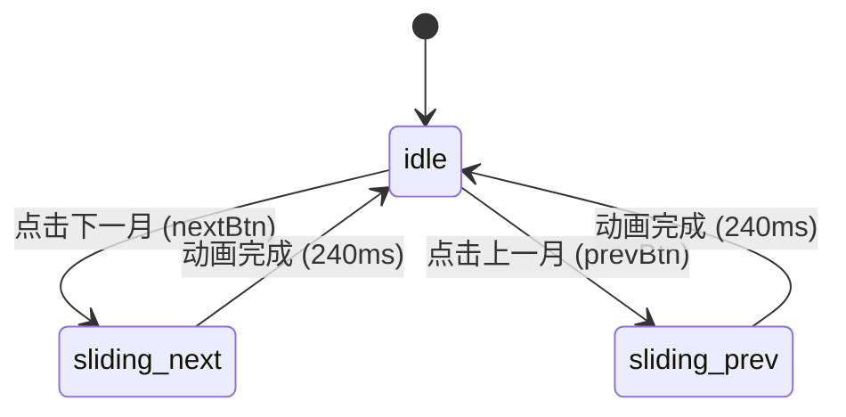

# Calendar · 日历

用于独立视图或嵌入卡片中的月度日期选择与浏览面板。包含恒定 6 周 42 天零抖动网格、月份标题错峰滑移、整网格方向性平滑切页以及今天指示圆点。涵盖三大核心机制：

1. 恒定 42 天零抖动网格（Zero-Jitter 42-Day Layout）：无论当月包含 28、30 还是 31 天，固定渲染包含上月尾部与下月头部的完整 6 周 42 个单元格，彻底杜绝月份切换时容器高度上下颠簸。
2. 方向性月份滑移过渡（Directional Slide Transition）：点击上一月或下一月时，标题与日期网格同步按物理移动方向滑出与滑入（向后切月份从右侧移入，向前切月份从左侧移入，时长 220ms–240ms）。
3. 触感微缩与状态指示（Tactile Press & Semantic Badges）：日期单元格与导航按钮按压带有物理阻尼缩放（`scale(0.94)`），当天（Today）附带底部 4px 微圆点，选中项呈现高对比度正圆实体胶囊。

## 原型清单

| 原型分组 | 原型元素 | 动效 / 状态变化 | 去向 |
| --- | --- | --- | --- |
| 官方日历舞台 | 日历卡片 `.calendar-card` | 基础面板容器、圆角 24px 与多层投影 | 最小 DOM |
| 官方日历舞台 | 月份标题 `#calendarTitle` | 切换月份时左右定向滑出（80ms）与滑入（220ms） | 方向性月份滑移过渡 |
| 官方日历舞台 | 今日按钮 `#todayBtn` | 按压 `scale(0.96)`；点击计算跨度并快速回到今天 | 触感微缩与状态指示 |
| 官方日历舞台 | 翻月按钮 `#prevBtn` / `#nextBtn` | 悬停底色、按压 `scale(0.94)` | 触感微缩与状态指示 |
| 官方日历舞台 | 星期表头 `.weekdays-grid` | 静态 7 列文本居中排版 | 最小 DOM |
| 官方日历舞台 | 日期网格 `#daysGrid` | 42 单元格网格；切月时带位移与透明度入场过渡 | 恒定 42 天零抖动网格 |
| 官方日历舞台 | 日期单元格 `.day-btn` | 悬停背景、按压 `scale(0.94)`、非本月淡化 0.38、今日圆点、选中高亮 | 触感微缩与状态指示 |
| — | 顶栏主题切换按钮 `#themeBtn` | 演示主题切换 | 演示外壳，已删除 |
| — | 外层舞台居中容器 `.stage` | 演示居中排版 | 演示外壳，已删除 |

## 适用

- 页面内需要常驻展示完整月份、直接供用户点选或查看日程的独立日历区块。
- 仪表盘侧边栏、任务计划面板、签到概览。
- 需要平滑浏览相邻月份并保持外框尺寸绝对锁定的场景。

## 不适用

- 表单输入框触发的浮动弹层式日期选择器 → [date-picker](date-picker.md)
- 双月联动的大跨度时间范围区间选取 → [date-range-picker](date-range-picker.md)
- 仅需要选择具体时间（小时/分钟）的场景 → [time-picker](time-picker.md)

## 状态机

| 状态 | 进入条件 | 视觉表现 | 退出到 |
| --- | --- | --- | --- |
| `idle` | 初始载入 / 动画完成 | 当前月份标题静态居中，网格静态展示，选中项高亮 | `sliding-next`, `sliding-prev` |
| `sliding-next` | 点击下个月或点击下月补白日期 | 标题向左淡出后自右侧滑入；网格整体由右侧 18px 滑入 | `idle` |
| `sliding-prev` | 点击上个月或点击上月补白日期 | 标题向右淡出后自左侧滑入；网格整体由左侧 -18px 滑入 | `idle` |



## 最小 DOM

```html
<div class="calendar-card" role="region" aria-label="Calendar">
  <div class="calendar-header">
    <div class="calendar-heading">
      <span class="calendar-title" id="calendarTitle">October 2026</span>
    </div>
    <div class="calendar-nav">
      <button type="button" class="today-btn" id="todayBtn">Today</button>
      <button type="button" class="nav-btn" id="prevBtn" aria-label="Previous month">
        <svg width="16" height="16" viewBox="0 0 24 24" fill="none" stroke="currentColor" stroke-width="2" stroke-linecap="round" stroke-linejoin="round">
          <path d="m15 18-6-6 6-6" />
        </svg>
      </button>
      <button type="button" class="nav-btn" id="nextBtn" aria-label="Next month">
        <svg width="16" height="16" viewBox="0 0 24 24" fill="none" stroke="currentColor" stroke-width="2" stroke-linecap="round" stroke-linejoin="round">
          <path d="m9 18 6-6-6-6" />
        </svg>
      </button>
    </div>
  </div>

  <div class="weekdays-grid" aria-hidden="true">
    <span class="weekday-item">Su</span>
    <span class="weekday-item">Mo</span>
    <span class="weekday-item">Tu</span>
    <span class="weekday-item">We</span>
    <span class="weekday-item">Th</span>
    <span class="weekday-item">Fr</span>
    <span class="weekday-item">Sa</span>
  </div>

  <div class="month-viewport">
    <div class="days-grid" id="daysGrid"></div>
  </div>
</div>
```

- `.calendar-card`：日历宿主容器，定义固定最大宽度 368px、内边距与边框投影。
- `.calendar-header`：头部区域，左侧为标题行，右侧为导航控制区。
- `.calendar-title`：月份与年份文本，挂载左右切入切出动画类。
- `.today-btn` / `.nav-btn`：快速回到今日与前后月翻页控制按钮。
- `.weekdays-grid`：星期标签静态行，无交互、不接收焦点。
- `.month-viewport`：网格视口裁切层，锁定高度并防止滑移产生横向溢出。
- `.days-grid`：42 单元格的 CSS Grid 容器，接收动画类。

## 参数

| 名称 | 值 | 用于 | 来源 |
| --- | --- | --- | --- |
| 面板最大宽度 | `368px` | `.calendar-card` | 原型 |
| 面板圆角 | `24px` | `.calendar-card` | 原型 |
| 标题退场时长 | `80ms` | `slideLeftOut` / `slideRightOut` | 原型 |
| 标题进场时长 | `220ms` | `slideLeftIn` / `slideRightIn` | 原型 |
| 网格滑入时长 | `240ms` | `gridSlideLeftIn` / `gridSlideRightIn` | 原型 |
| 进场曲线 | `cubic-bezier(0, 0, 0.2, 1)` | 进场位移插值 | 原型 |
| 退场曲线 | `cubic-bezier(0.2, 0, 0, 1)` | 退场位移插值 | 原型 |
| 按压触感缩放 | `scale(0.94)` | `.day-btn:active`, `.nav-btn:active` | 原型 |
| 今日按钮按压缩放 | `scale(0.96)` | `.today-btn:active` | 原型 |
| 非本月淡化透明度 | `0.38` | `.day-btn.is-outside` | 原型 |
| 今日标记圆点尺寸 | `4px` | `.day-btn.is-today .day-num::after` | 原型 |

## CSS

```css
.calendar-card {
  --cal-bg: var(--surface, #ffffff);
  --cal-fg: var(--foreground, #111111);
  --cal-muted: var(--text-muted, #737373);
  --cal-secondary: var(--text-secondary, #525252);
  --cal-border: var(--border, rgba(0, 0, 0, 0.08));
  --cal-hover: var(--surface-muted, #f5f5f5);
  --cal-accent: var(--accent, #111111);
  --cal-accent-fg: var(--accent-foreground, #ffffff);

  position: relative;
  width: 100%;
  max-width: 368px;
  padding: 24px 20px 22px;
  border: 1px solid var(--cal-border);
  border-radius: 24px;
  background: var(--cal-bg);
  box-shadow: 0 20px 48px -12px rgba(0, 0, 0, 0.08), 0 1px 2px rgba(0, 0, 0, 0.04);
  user-select: none;
  box-sizing: border-box;
}

.calendar-header {
  display: flex;
  align-items: center;
  justify-content: space-between;
  min-height: 34px;
  margin-bottom: 18px;
}

.calendar-heading {
  position: relative;
  display: flex;
  align-items: center;
  overflow: hidden;
  height: 26px;
}

.calendar-title {
  font-size: 16px;
  font-weight: 600;
  letter-spacing: -0.015em;
  color: var(--cal-fg);
  white-space: nowrap;
}

.calendar-title.slide-left-enter { animation: calSlideLeftIn 220ms cubic-bezier(0, 0, 0.2, 1) forwards; }
.calendar-title.slide-left-exit { animation: calSlideLeftOut 80ms cubic-bezier(0.2, 0, 0, 1) forwards; }
.calendar-title.slide-right-enter { animation: calSlideRightIn 220ms cubic-bezier(0, 0, 0.2, 1) forwards; }
.calendar-title.slide-right-exit { animation: calSlideRightOut 80ms cubic-bezier(0.2, 0, 0, 1) forwards; }

@keyframes calSlideLeftIn {
  from { opacity: 0; transform: translateX(12px); }
  to { opacity: 1; transform: translateX(0); }
}
@keyframes calSlideLeftOut {
  from { opacity: 1; transform: translateX(0); }
  to { opacity: 0; transform: translateX(-12px); }
}
@keyframes calSlideRightIn {
  from { opacity: 0; transform: translateX(-12px); }
  to { opacity: 1; transform: translateX(0); }
}
@keyframes calSlideRightOut {
  from { opacity: 1; transform: translateX(0); }
  to { opacity: 0; transform: translateX(12px); }
}

.calendar-nav {
  display: inline-flex;
  align-items: center;
  gap: 4px;
}

.today-btn {
  display: inline-flex;
  align-items: center;
  height: 30px;
  padding: 0 11px;
  border: 0;
  border-radius: 9999px;
  background: transparent;
  color: var(--cal-secondary);
  font-size: 13px;
  font-weight: 500;
  cursor: pointer;
  transition: background-color 140ms ease, color 140ms ease, transform 140ms ease;
}
.today-btn:hover { background: var(--cal-hover); color: var(--cal-fg); }
.today-btn:active { transform: scale(0.96); }

.nav-btn {
  display: grid;
  place-items: center;
  width: 30px;
  height: 30px;
  border: 0;
  border-radius: 9999px;
  background: transparent;
  color: var(--cal-muted);
  cursor: pointer;
  transition: background-color 140ms ease, color 140ms ease, transform 140ms ease;
}
.nav-btn:hover { background: var(--cal-hover); color: var(--cal-fg); }
.nav-btn:active { transform: scale(0.94); }

.weekdays-grid {
  display: grid;
  grid-template-columns: repeat(7, 1fr);
  column-gap: 4px;
  margin-bottom: 8px;
}

.weekday-item {
  display: flex;
  align-items: center;
  justify-content: center;
  height: 24px;
  color: var(--cal-muted);
  font-size: 12px;
  font-weight: 500;
}

.month-viewport {
  position: relative;
  overflow: hidden;
  min-height: 252px;
}

.days-grid {
  display: grid;
  grid-template-columns: repeat(7, 1fr);
  gap: 4px;
}

.days-grid.slide-left-enter { animation: calGridSlideLeftIn 240ms cubic-bezier(0, 0, 0.2, 1) forwards; }
.days-grid.slide-right-enter { animation: calGridSlideRightIn 240ms cubic-bezier(0, 0, 0.2, 1) forwards; }

@keyframes calGridSlideLeftIn {
  from { opacity: 0; transform: translateX(18px); }
  to { opacity: 1; transform: translateX(0); }
}
@keyframes calGridSlideRightIn {
  from { opacity: 0; transform: translateX(-18px); }
  to { opacity: 1; transform: translateX(0); }
}

.day-cell {
  position: relative;
  display: flex;
  align-items: center;
  justify-content: center;
  width: 100%;
  height: 38px;
}

.day-btn {
  position: relative;
  display: grid;
  place-items: center;
  width: 38px;
  height: 38px;
  border: 0;
  border-radius: 50%;
  background: transparent;
  color: var(--cal-fg);
  font-size: 13.5px;
  font-weight: 400;
  line-height: 1;
  font-variant-numeric: tabular-nums;
  cursor: pointer;
  transition: background-color 140ms ease, color 140ms ease, transform 140ms cubic-bezier(0.175, 0.885, 0.32, 1.15);
}
.day-btn:hover:not(.is-selected) { background: var(--cal-hover); }
.day-btn:active { transform: scale(0.94); }

.day-btn.is-outside {
  color: var(--cal-muted);
  opacity: 0.38;
}

.day-btn.is-today .day-num::after {
  content: "";
  position: absolute;
  top: calc(100% + 3px);
  left: 50%;
  width: 4px;
  height: 4px;
  margin-left: -2px;
  border-radius: 50%;
  background: currentColor;
}

.day-btn.is-selected {
  background: var(--cal-accent) !important;
  color: var(--cal-accent-fg) !important;
  font-weight: 500;
  opacity: 1 !important;
  box-shadow: 0 2px 8px rgba(0, 0, 0, 0.12);
}

.day-num {
  position: relative;
  pointer-events: none;
}

@media (prefers-reduced-motion: reduce) {
  .calendar-title, .days-grid, .day-btn, .today-btn, .nav-btn {
    animation: none !important;
    transition: none !important;
    transform: none !important;
  }
}
```

## JS

```js
const MONTH_NAMES = [
  "January", "February", "March", "April", "May", "June",
  "July", "August", "September", "October", "November", "December"
];

function isSameDay(d1, d2) {
  return d1 && d2 &&
    d1.getFullYear() === d2.getFullYear() &&
    d1.getMonth() === d2.getMonth() &&
    d1.getDate() === d2.getDate();
}

/**
 * 初始化原生 Calendar 组件
 * @param {HTMLElement} root 日历卡片根节点
 * @param {Object} [options] 配置选项
 * @param {Date} [options.selectedDate] 初始选中日期
 * @param {Date} [options.today] 今日基准日期
 * @param {(date: Date) => void} [options.onSelect] 选中回调
 * @returns {{ getValue: () => Date, setValue: (d: Date) => void, destroy: () => void }}
 */
export function createCalendar(root, options = {}) {
  const titleEl = root.querySelector('#calendarTitle') || root.querySelector('.calendar-title');
  const gridEl = root.querySelector('#daysGrid') || root.querySelector('.days-grid');
  const prevBtn = root.querySelector('#prevBtn') || root.querySelector('[aria-label="Previous month"]');
  const nextBtn = root.querySelector('#nextBtn') || root.querySelector('[aria-label="Next month"]');
  const todayBtn = root.querySelector('#todayBtn') || root.querySelector('.today-btn');

  const today = options.today ? new Date(options.today) : new Date();
  let selectedDate = options.selectedDate ? new Date(options.selectedDate) : new Date(today);
  let currentMonth = new Date(selectedDate.getFullYear(), selectedDate.getMonth(), 1);

  let titleTimer = 0;
  let gridTimer = 0;

  function updateTitle(animDirection) {
    if (!titleEl) return;
    const text = `${MONTH_NAMES[currentMonth.getMonth()]} ${currentMonth.getFullYear()}`;
    if (!animDirection) {
      titleEl.textContent = text;
      titleEl.className = 'calendar-title';
      return;
    }

    clearTimeout(titleTimer);
    titleEl.className = 'calendar-title ' + (animDirection > 0 ? 'slide-left-exit' : 'slide-right-exit');
    titleTimer = setTimeout(() => {
      titleEl.textContent = text;
      titleEl.className = 'calendar-title ' + (animDirection > 0 ? 'slide-left-enter' : 'slide-right-enter');
    }, 80);
  }

  function renderGrid(animDirection = 0) {
    if (!gridEl) return;
    updateTitle(animDirection);

    const year = currentMonth.getFullYear();
    const month = currentMonth.getMonth();

    const firstDayOfMonth = new Date(year, month, 1);
    const startDayOfWeek = firstDayOfMonth.getDay();
    const startDate = new Date(year, month, 1 - startDayOfWeek);

    const fragment = document.createDocumentFragment();

    for (let i = 0; i < 42; i++) {
      const cellDate = new Date(startDate.getFullYear(), startDate.getMonth(), startDate.getDate() + i);
      const isCurrentMonth = cellDate.getMonth() === month;
      const isSelected = isSameDay(cellDate, selectedDate);
      const isTodayDate = isSameDay(cellDate, today);

      const cell = document.createElement('div');
      cell.className = 'day-cell';

      const btn = document.createElement('button');
      btn.type = 'button';
      btn.className = 'day-btn' +
        (!isCurrentMonth ? ' is-outside' : '') +
        (isSelected ? ' is-selected' : '') +
        (isTodayDate ? ' is-today' : '');
      btn.setAttribute('aria-label', `${cellDate.toLocaleDateString()}`);
      btn.setAttribute('aria-pressed', isSelected ? 'true' : 'false');

      const span = document.createElement('span');
      span.className = 'day-num';
      span.textContent = String(cellDate.getDate());
      btn.appendChild(span);

      btn.addEventListener('click', () => {
        selectedDate = new Date(cellDate);
        if (cellDate.getMonth() !== month) {
          const diff = (cellDate.getFullYear() * 12 + cellDate.getMonth()) - (year * 12 + month);
          currentMonth = new Date(cellDate.getFullYear(), cellDate.getMonth(), 1);
          renderGrid(diff);
        } else {
          renderGrid(0);
        }
        if (typeof options.onSelect === 'function') {
          options.onSelect(new Date(selectedDate));
        }
      });

      cell.appendChild(btn);
      fragment.appendChild(cell);
    }

    gridEl.innerHTML = '';
    gridEl.appendChild(fragment);

    if (animDirection) {
      clearTimeout(gridTimer);
      gridEl.className = 'days-grid ' + (animDirection > 0 ? 'slide-left-enter' : 'slide-right-enter');
      gridTimer = setTimeout(() => {
        if (gridEl) gridEl.className = 'days-grid';
      }, 240);
    }
  }

  function handlePrev() {
    currentMonth = new Date(currentMonth.getFullYear(), currentMonth.getMonth() - 1, 1);
    renderGrid(-1);
  }

  function handleNext() {
    currentMonth = new Date(currentMonth.getFullYear(), currentMonth.getMonth() + 1, 1);
    renderGrid(1);
  }

  function handleToday() {
    const diff = (today.getFullYear() * 12 + today.getMonth()) - (currentMonth.getFullYear() * 12 + currentMonth.getMonth());
    currentMonth = new Date(today.getFullYear(), today.getMonth(), 1);
    selectedDate = new Date(today);
    renderGrid(diff || 0);
    if (typeof options.onSelect === 'function') {
      options.onSelect(new Date(selectedDate));
    }
  }

  if (prevBtn) prevBtn.addEventListener('click', handlePrev);
  if (nextBtn) nextBtn.addEventListener('click', handleNext);
  if (todayBtn) todayBtn.addEventListener('click', handleToday);

  renderGrid(0);

  return {
    getValue: () => new Date(selectedDate),
    setValue: (nextDate) => {
      selectedDate = new Date(nextDate);
      currentMonth = new Date(selectedDate.getFullYear(), selectedDate.getMonth(), 1);
      renderGrid(0);
    },
    destroy: () => {
      clearTimeout(titleTimer);
      clearTimeout(gridTimer);
      if (prevBtn) prevBtn.removeEventListener('click', handlePrev);
      if (nextBtn) nextBtn.removeEventListener('click', handleNext);
      if (todayBtn) todayBtn.removeEventListener('click', handleToday);
      if (gridEl) gridEl.innerHTML = '';
    }
  };
}
```

## 接入目标项目

- 状态来源：目标业务层传入初始选中日期 `selectedDate`，并监听 `onSelect(date)` 回调更新应用级时间筛选状态。
- 尺寸策略：卡片最大宽度固定为 368px，内部网格由 7 等分 `grid-template-columns: repeat(7, 1fr)` 撑开，高度锁定在恒定 6 行。
- 驱动方式：通过 `createCalendar(container, { selectedDate, onSelect })` 挂载，离开页面调用返回的 `destroy()` 清理定时器与监听器。

## 重入与清理

- 连续快速点击上一月/下一月时，每次调用 `updateTitle` 和 `renderGrid` 会重置 `titleTimer` 与 `gridTimer`，避免旧定时器清除新的进场样式类。
- 卸载时 `destroy()` 负责注销各按钮的点击事件，重置网格节点，彻底杜绝内存泄漏。

## 减少动态效果

- 激活 `prefers-reduced-motion: reduce` 时：
  - 移除全部切月位移动画（`calSlideLeftIn`, `calSlideRightIn` 等）。
  - 日期和按钮点击的 `scale(0.94)` 缩放效果禁用。
  - 数据切换立即完成，保持完全可访问的即时状态更新。

## 焦点与键盘

- 每个日期单元格为原生 `<button>`，支持使用 Tab 键在各控件与单元格之间流转。
- 单元格通过 `aria-label` 输出完整可读日期字符串（例如 "2026/10/14"），并以 `aria-pressed="true|false"` 表达选中语义。
- 非当月补白日期（`.is-outside`）视觉淡化，但依然支持键盘聚焦与点击触发跨月跳转。

## 兼容回退

| 特性 | 不支持时 |
| --- | --- |
| `CSS Grid repeat(7, 1fr)` | 回退至 `float: left` 配合 `width: 14.28%` |
| `font-variant-numeric: tabular-nums` | 数字等宽失效，单元格水平居中依然保持居中对齐 |

## 验收清单

- [ ] 日历卡片初始渲染展示 42 个单元格，外框高度稳定无抖动。
- [ ] 点击下一月，月份标题向左淡出后自右侧滑入，网格整体向左平滑过渡进场。
- [ ] 点击上一月，标题与网格反向自左侧进场。
- [ ] 点击非当月（灰色淡化）日期，月份自动联动切换至该日期所在月份。
- [ ] 点击 Today 按钮，日历无缝滑回当前日期，选中标记与今日圆点正确呈现。
- [ ] 开启减弱动态效果时，所有位移与缩放动画停用，切月瞬间完成。
