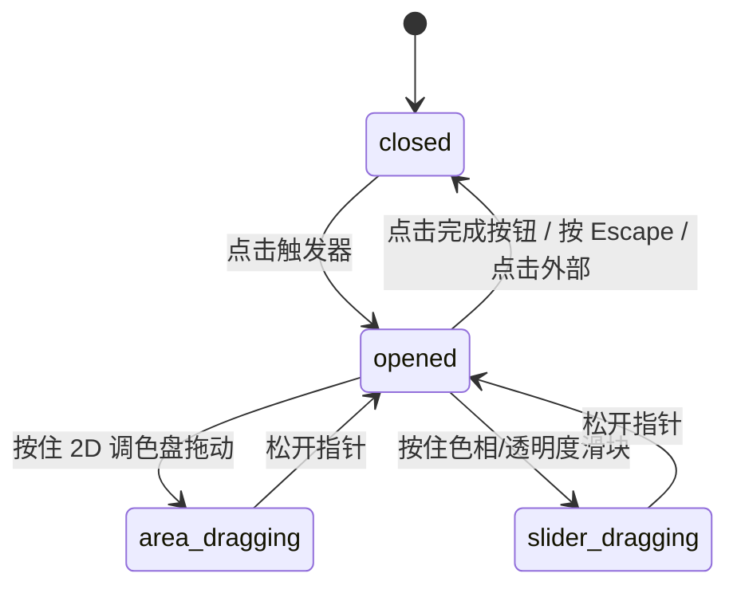

# Color Picker · 颜色选择器

用于精细调节界面色彩的高保真拾色器。集成 2D 饱和度与明度调色盘、色相与不透明度滑动条、多格式（Hex/RGB/HSL）平滑切换、屏幕吸色（EyeDropper）以及实时对比度可访问性评级。涵盖四大核心机制：

1. 双向二维物理滑块（2D Spring Thumb Tracking）：饱和度-明度渐变区域支持鼠标/触控连续拖拽与键盘方向键步进，滑块按压时产生微缩与阻尼追随，越界自动施加边缘阻尼回弹。
2. 线性轨道联动渲染（Hue & Alpha Slider Dual Tracking）：色相环与不透明度轨道各自维护独立刻度，背景实时由 CSS 渐变动态更新，滑块沿 X 轴以弹簧曲线吸附目标点。
3. 文本形态置换与格式轮转（Format Morphing & Draft Validation）：点击格式胶囊在 Hex、RGB、HSL 间轮转，标签采用 120ms 微模糊（Micro-Blur）置换；输入非法色彩字符时输入框产生微颤动并恢复有效值。
4. 色板收藏与对比度标尺（Swatches Memory & Live Contrast Grade）：支持一键将当前颜色存入临时色板，色板网格附带入场弹性缩放；底端实时根据背景色计算 WCAG 对比度（如 4.50:1）并以微动画更新 AA/AAA 评级标签。

## 原型清单

| 原型分组 | 原型元素 | 动效 / 状态变化 | 去向 |
| --- | --- | --- | --- |
| 官方拾色器舞台 | 触发按钮 `.color-picker-trigger` | 颜色小色块预览、Hex 文本、展开状态标记 | 最小 DOM |
| 官方拾色器舞台 | 浮动面板 `.color-picker-panel` | 展开缩放淡入（180ms）、退出裁剪淡出（140ms） | 最小 DOM |
| 官方拾色器舞台 | 2D 饱和度明度盘 `.color-picker-area` | 拖拽捕捉、光标吸附、键盘步进、thumb 放大按压 | 双向二维物理滑块 |
| 官方拾色器舞台 | 色相滑块 `.color-picker-hue` | 线性彩虹渐变、滑块 X 轴位移与填充色同步 | 线性轨道联动渲染 |
| 官方拾色器舞台 | 透明度滑块 `.color-picker-alpha` | 棋盘格加透明渐变、滑块 X 轴位移 | 线性轨道联动渲染 |
| 官方拾色器舞台 | 格式切换胶囊 `.color-picker-format` | 点击轮换 Hex/RGB/HSL；微模糊文案置换 | 文本形态置换与格式轮转 |
| 官方拾色器舞台 | 吸色滴管按钮 `.lucide-pipette` | 点击调用原生 EyeDropper API 取色 | 最小 DOM |
| 官方拾色器舞台 | 对比度等级徽章 `.color-picker-grade` | 实时计算 WCAG 对比度数值与 AA 标签 | 色板收藏与对比度标尺 |
| 官方拾色器舞台 | 收藏色板列表 `.color-picker-swatch-list` | 添加当前色（scale 弹簧入场）、点击应用 | 色板收藏与对比度标尺 |
| — | 顶栏独立主题切换器 `#themeBtn` | 演示主题切换 | 演示外壳，已删除 |
| — | 外层舞台卡片与居中容器 | 演示居中排版 | 演示外壳，已删除 |

## 适用

- 设计工具、低代码平台、主题配置器中的前景色与背景色选取。
- 需要实时检查文字与背景 WCAG 对比度合规性（AA/AAA）的专业表单。
- 支持屏幕取色与收藏最近常用色彩的场景。

## 不适用

- 仅包含几个预设颜色的紧凑型单选圆点 → [calendar](calendar.md)
- 仅调节单一连续标量数值（如音量、亮度、缩放比）→ [date-picker](date-picker.md)
- 选取具体的日历日期或时间点 → [time-picker](time-picker.md)

## 状态机

| 状态 | 进入条件 | 视觉表现 | 退出到 |
| --- | --- | --- | --- |
| `closed` | 初始载入 / 确认完成 / 点击外部 | 仅展示触发器胶囊，弹出面板卸载或隐藏 | `opened` |
| `opened` | 点击触发器按钮 | 面板弹性浮动展开（scale 0.95 → 1, opacity 0 → 1），各滑块处于就绪态 | `closed`, `area-dragging`, `slider-dragging` |
| `area-dragging` | 在 2D 调色盘上按住拖拽 | 调色盘光标 thumb 激活按压微缩并连续追随指针，触发器与输入框数值实时更新 | `opened` |
| `slider-dragging` | 在色相或透明度轨道上拖拽 | 相应轨道 thumb 连续滑动，调色盘背景实时重绘 | `opened` |



## 最小 DOM

```html
<div class="color-picker-root" style="--picker-color: #2F6BFF; --picker-hue-color: #0055ff;">
  <button type="button" class="color-picker-trigger" aria-haspopup="dialog" aria-expanded="false">
    <span class="color-picker-chip">
      <span class="color-picker-chip-inner" style="background: var(--picker-color);"></span>
    </span>
    <span class="color-picker-trigger-text">
      <span class="color-picker-name">Accent</span>
      <span class="color-picker-hex">#2F6BFF</span>
    </span>
  </button>

  <div class="color-picker-panel" role="dialog" aria-label="Color Picker" data-state="closed">
    <div class="color-picker-head">
      <span class="color-picker-chip">
        <span class="color-picker-chip-inner" style="background: var(--picker-color);"></span>
      </span>
      <span class="color-picker-trigger-text">
        <span class="color-picker-name">Accent</span>
        <span class="color-picker-hex">#2F6BFF</span>
      </span>
      <div class="color-picker-actions">
        <button type="button" class="color-picker-icon-btn btn-pipette" aria-label="Pick color from screen">
          <svg width="16" height="16" viewBox="0 0 24 24" fill="none" stroke="currentColor" stroke-width="1.75"><path d="m12 9-8.414 8.414A2 2 0 0 0 3 18.828v1.344a2 2 0 0 1-.586 1.414A2 2 0 0 1 3.828 21h1.344a2 2 0 0 0 1.414-.586L15 12"/><path d="m18 9 .4.4a1 1 0 1 1-3 3l-3.8-3.8a1 1 0 1 1 3-3l.4.4 3.4-3.4a1 1 0 1 1 3 3z"/></svg>
        </button>
        <button type="button" class="color-picker-icon-btn btn-done" aria-label="Done">
          <svg width="16" height="16" viewBox="0 0 24 24" fill="none" stroke="currentColor" stroke-width="2"><path d="M20 6 9 17l-5-5"/></svg>
        </button>
      </div>
    </div>

    <div class="color-picker-body">
      <!-- 2D 饱和度与明度渐变盘 -->
      <div class="color-picker-area" tabindex="0" role="slider" aria-label="Saturation and brightness" aria-valuemin="0" aria-valuemax="100">
        <div class="color-picker-area-thumb" style="left: 82%; top: 18%;"></div>
      </div>

      <!-- 色相单轴滑块 -->
      <div class="color-picker-slider color-picker-hue" tabindex="0" role="slider" aria-label="Hue" aria-valuemin="0" aria-valuemax="360">
        <div class="color-picker-slider-thumb" style="left: 61.8%;"></div>
      </div>

      <!-- 不透明度单轴滑块 -->
      <div class="color-picker-slider color-picker-alpha" tabindex="0" role="slider" aria-label="Opacity" aria-valuemin="0" aria-valuemax="100">
        <div class="color-picker-slider-thumb" style="left: 100%;"></div>
      </div>

      <!-- 输入与格式行 -->
      <div class="color-picker-field">
        <button type="button" class="color-picker-format" aria-label="Switch color format">Hex</button>
        <input class="color-picker-input" spellcheck="false" autocomplete="off" aria-label="Hex color" value="#2F6BFF" />
      </div>

      <!-- 对比度检测 -->
      <div class="color-picker-contrast">
        <span class="color-picker-sample" aria-hidden="true">Aa</span>
        <span class="color-picker-ratio">4.50:1</span>
        <span class="color-picker-against">against background</span>
        <span class="color-picker-grade" data-grade="large">AA large</span>
      </div>

      <!-- 色板收藏行 -->
      <div class="color-picker-swatches">
        <button type="button" class="color-picker-add-swatch" aria-label="Save current color">
          <svg width="14" height="14" viewBox="0 0 24 24" fill="none" stroke="currentColor" stroke-width="2"><path d="M12 5v14M5 12h14"/></svg>
        </button>
        <div class="color-picker-swatch-list" role="listbox" aria-label="Saved colors"></div>
      </div>
    </div>
  </div>
</div>
```

- `.color-picker-root`：宿主容器，暴露 CSS 变量 `--picker-color` 与 `--picker-hue-color`。
- `.color-picker-trigger`：折叠态触发按钮，展示圆形色彩预览与 Hex 标签。
- `.color-picker-panel`：浮动弹出卡片，携带有 `data-state="open|closed"` 控制淡入淡出与缩放。
- `.color-picker-area`：2D 调色盘，内部通过纯 CSS 双重渐变渲染饱和度（从白到纯色）与明度（从透明到纯黑）。
- `.color-picker-hue` / `.color-picker-alpha`：单轴滑动轨道。
- `.color-picker-format` / `.color-picker-input`：格式切换与手动编辑输入框。
- `.color-picker-contrast`：可访问性对比度反馈条。

## 参数

| 名称 | 值 | 用于 | 来源 |
| --- | --- | --- | --- |
| 面板宽度 | `288px` | `.color-picker-panel` | 原型 |
| 调色盘高度 | `150px` | `.color-picker-area` | 原型 |
| 2D 滑块尺寸 | `20px` | `.color-picker-area-thumb` | 原型 |
| 单轴滑块轨道高度 | `12px` | `.color-picker-slider` | 原型 |
| 展开动画时长 | `180ms cubic-bezier(0.16, 1, 0.3, 1)` | 面板展开过渡 | 原型 |
| 收起动画时长 | `140ms cubic-bezier(0.22, 1, 0.36, 1)` | 面板收起过渡 | 原型 |
| 微模糊置换时长 | `120ms` | 格式切换与对比度文本过渡 | 原型 |
| 滑块按压缩放 | `scale(0.92)` | 滑块按压反馈 | 原型 |

## CSS

```css
.color-picker-root {
  --picker-color: #2f6bff;
  --picker-hue-color: #0055ff;
  --picker-bg: #ffffff;
  --picker-fg: #111111;
  --picker-muted: #737373;
  --picker-border: rgba(0, 0, 0, 0.1);
  --picker-hover: #f5f5f5;

  position: relative;
  display: inline-block;
  font-family: -apple-system, BlinkMacSystemFont, "Segoe UI", Roboto, sans-serif;
  user-select: none;
}

.color-picker-trigger {
  display: inline-flex;
  align-items: center;
  gap: 10px;
  height: 38px;
  padding: 0 12px;
  border: 1px solid var(--picker-border);
  border-radius: 9999px;
  background: var(--picker-bg);
  color: var(--picker-fg);
  font: inherit;
  font-size: 13.5px;
  font-weight: 500;
  cursor: pointer;
  box-shadow: 0 1px 2px rgba(0, 0, 0, 0.04);
  transition: background-color 140ms ease, border-color 140ms ease;
}
.color-picker-trigger:hover {
  background: var(--picker-hover);
}

.color-picker-chip {
  display: inline-flex;
  align-items: center;
  justify-content: center;
  width: 20px;
  height: 20px;
  border-radius: 50%;
  border: 1px solid rgba(0, 0, 0, 0.1);
  overflow: hidden;
  box-sizing: border-box;
}

.color-picker-chip-inner {
  width: 100%;
  height: 100%;
  border-radius: 50%;
}

.color-picker-trigger-text {
  display: inline-flex;
  align-items: center;
  gap: 6px;
  font-size: 13px;
}

.color-picker-name {
  font-weight: 600;
  color: var(--picker-fg);
}

.color-picker-hex {
  color: var(--picker-muted);
  font-family: ui-monospace, SFMono-Regular, monospace;
}

/* 浮动面板 */
.color-picker-panel {
  position: absolute;
  top: calc(100% + 8px);
  left: 0;
  z-index: 100;
  width: 288px;
  padding: 16px;
  border: 1px solid var(--picker-border);
  border-radius: 20px;
  background: var(--picker-bg);
  box-shadow: 0 20px 48px -10px rgba(0, 0, 0, 0.15), 0 2px 6px rgba(0, 0, 0, 0.05);
  box-sizing: border-box;
  transform-origin: top left;
  transition: opacity 160ms cubic-bezier(0.16, 1, 0.3, 1), transform 160ms cubic-bezier(0.16, 1, 0.3, 1);
}

.color-picker-panel[data-state="closed"] {
  opacity: 0;
  transform: scale(0.95) translateY(-4px);
  pointer-events: none;
  visibility: hidden;
}

.color-picker-panel[data-state="open"] {
  opacity: 1;
  transform: scale(1) translateY(0);
  pointer-events: auto;
  visibility: visible;
}

.color-picker-head {
  display: flex;
  align-items: center;
  justify-content: space-between;
  margin-bottom: 12px;
}

.color-picker-actions {
  display: flex;
  align-items: center;
  gap: 4px;
}

.color-picker-icon-btn {
  display: grid;
  place-items: center;
  width: 28px;
  height: 28px;
  border: 0;
  border-radius: 50%;
  background: transparent;
  color: var(--picker-muted);
  cursor: pointer;
  transition: background-color 120ms ease, color 120ms ease;
}
.color-picker-icon-btn:hover { background: var(--picker-hover); color: var(--picker-fg); }

/* 2D 调色盘 */
.color-picker-area {
  position: relative;
  width: 100%;
  height: 150px;
  border-radius: 12px;
  cursor: crosshair;
  overflow: hidden;
  background-color: var(--picker-hue-color);
  background-image:
    linear-gradient(to top, #000000, transparent),
    linear-gradient(to right, #ffffff, transparent);
  box-shadow: inset 0 0 0 1px rgba(0, 0, 0, 0.08);
}

.color-picker-area-thumb {
  position: absolute;
  width: 18px;
  height: 18px;
  margin-left: -9px;
  margin-top: -9px;
  border: 2px solid #ffffff;
  border-radius: 50%;
  box-shadow: 0 1px 4px rgba(0, 0, 0, 0.35);
  pointer-events: none;
  transition: transform 120ms cubic-bezier(0.18, 0.89, 0.32, 1.15);
}
.color-picker-area:active .color-picker-area-thumb {
  transform: scale(0.92);
}

/* 滑动轨道 */
.color-picker-slider {
  position: relative;
  width: 100%;
  height: 12px;
  margin-top: 10px;
  border-radius: 9999px;
  cursor: pointer;
  box-shadow: inset 0 0 0 1px rgba(0, 0, 0, 0.08);
}

.color-picker-hue {
  background: linear-gradient(to right,
    #ff0000 0%, #ffff00 17%, #00ff00 33%,
    #00ffff 50%, #0000ff 67%, #ff00ff 83%, #ff0000 100%);
}

.color-picker-alpha {
  background: linear-gradient(to right, transparent, var(--picker-hue-color)),
    repeating-conic-gradient(#ccc 0% 25%, #fff 0% 50%) 50% / 10px 10px;
}

.color-picker-slider-thumb {
  position: absolute;
  top: 50%;
  width: 16px;
  height: 16px;
  margin-left: -8px;
  margin-top: -8px;
  border: 2px solid #ffffff;
  border-radius: 50%;
  background: var(--picker-color);
  box-shadow: 0 1px 4px rgba(0, 0, 0, 0.3);
  pointer-events: none;
  transition: transform 120ms cubic-bezier(0.18, 0.89, 0.32, 1.15);
}
.color-picker-slider:active .color-picker-slider-thumb {
  transform: scale(0.92);
}

/* 输入与格式 */
.color-picker-field {
  display: flex;
  align-items: center;
  gap: 8px;
  margin-top: 12px;
}

.color-picker-format {
  height: 30px;
  padding: 0 10px;
  border: 1px solid var(--picker-border);
  border-radius: 8px;
  background: var(--picker-hover);
  color: var(--picker-fg);
  font: inherit;
  font-size: 12px;
  font-weight: 600;
  cursor: pointer;
}

.color-picker-input {
  flex: 1;
  height: 30px;
  padding: 0 10px;
  border: 1px solid var(--picker-border);
  border-radius: 8px;
  font-family: ui-monospace, SFMono-Regular, monospace;
  font-size: 13px;
  color: var(--picker-fg);
  background: var(--picker-bg);
  outline: none;
}
.color-picker-input:focus {
  border-color: var(--picker-fg);
}

/* 对比度指示条 */
.color-picker-contrast {
  display: flex;
  align-items: center;
  gap: 8px;
  margin-top: 12px;
  padding: 8px 10px;
  border-radius: 8px;
  background: var(--picker-hover);
  font-size: 12px;
}

.color-picker-sample {
  font-weight: 700;
  color: var(--picker-color);
}

.color-picker-ratio {
  font-weight: 600;
  color: var(--picker-fg);
}

.color-picker-against {
  color: var(--picker-muted);
  flex: 1;
}

.color-picker-grade {
  padding: 2px 6px;
  border-radius: 4px;
  font-size: 11px;
  font-weight: 600;
  background: #16a34a;
  color: #ffffff;
}

/* 色板 */
.color-picker-swatches {
  display: flex;
  align-items: center;
  gap: 6px;
  margin-top: 12px;
  overflow-x: auto;
}

.color-picker-add-swatch {
  display: grid;
  place-items: center;
  width: 24px;
  height: 24px;
  border: 1px dashed var(--picker-border);
  border-radius: 50%;
  background: transparent;
  color: var(--picker-muted);
  cursor: pointer;
  flex-shrink: 0;
}
.color-picker-add-swatch:hover {
  border-color: var(--picker-fg);
  color: var(--picker-fg);
}

.color-picker-swatch-list {
  display: flex;
  align-items: center;
  gap: 6px;
}

.color-picker-swatch-item {
  width: 20px;
  height: 20px;
  border-radius: 50%;
  border: 1px solid rgba(0, 0, 0, 0.1);
  cursor: pointer;
  flex-shrink: 0;
  transition: transform 120ms ease;
}
.color-picker-swatch-item:hover {
  transform: scale(1.15);
}

@media (prefers-reduced-motion: reduce) {
  .color-picker-panel, .color-picker-area-thumb, .color-picker-slider-thumb, .color-picker-swatch-item {
    transition: none !important;
    animation: none !important;
    transform: none !important;
  }
}
```

## JS

```js
function hsvToRgb(h, s, v) {
  const i = Math.floor((h / 60) % 6);
  const f = h / 60 - i;
  const p = v * (1 - s);
  const q = v * (1 - f * s);
  const t = v * (1 - (1 - f) * s);
  let r = 0, g = 0, b = 0;
  switch (i) {
    case 0: r = v; g = t; b = p; break;
    case 1: r = q; g = v; b = p; break;
    case 2: r = p; g = v; b = t; break;
    case 3: r = p; g = q; b = v; break;
    case 4: r = t; g = p; b = v; break;
    case 5: r = v; g = p; b = q; break;
  }
  return [Math.round(r * 255), Math.round(g * 255), Math.round(b * 255)];
}

function rgbToHex(r, g, b) {
  return '#' + [r, g, b].map(x => x.toString(16).padStart(2, '0')).join('').toUpperCase();
}

/**
 * 创建 Color Picker 动效控制器
 * @param {HTMLElement} root 根容器节点
 * @param {Object} [options] 配置选项
 * @param {string} [options.initialColor='#2F6BFF'] 初始颜色
 * @param {(hex: string) => void} [options.onChange] 颜色变更回调
 * @returns {{ open: Function, close: Function, setColor: Function, destroy: Function }}
 */
export function createColorPicker(root, options = {}) {
  const trigger = root.querySelector('.color-picker-trigger');
  const panel = root.querySelector('.color-picker-panel');
  const area = root.querySelector('.color-picker-area');
  const areaThumb = root.querySelector('.color-picker-area-thumb');
  const hueSlider = root.querySelector('.color-picker-hue');
  const hueThumb = hueSlider ? hueSlider.querySelector('.color-picker-slider-thumb') : null;
  const alphaSlider = root.querySelector('.color-picker-alpha');
  const alphaThumb = alphaSlider ? alphaSlider.querySelector('.color-picker-slider-thumb') : null;
  const input = root.querySelector('.color-picker-input');
  const formatBtn = root.querySelector('.color-picker-format');
  const doneBtn = root.querySelector('.btn-done');
  const pipetteBtn = root.querySelector('.btn-pipette');
  const addSwatchBtn = root.querySelector('.color-picker-add-swatch');
  const swatchList = root.querySelector('.color-picker-swatch-list');

  let h = 222;
  let s = 0.82;
  let v = 1.0;
  let a = 1.0;
  let isOpen = false;
  let isDraggingArea = false;
  let isDraggingHue = false;
  let isDraggingAlpha = false;

  const formats = ['Hex', 'RGB', 'HSL'];
  let formatIdx = 0;

  function updateColor(notify = true) {
    const [r, g, b] = hsvToRgb(h, s, v);
    const hex = rgbToHex(r, g, b);
    const [hr, hg, hb] = hsvToRgb(h, 1, 1);
    const hueHex = rgbToHex(hr, hg, hb);

    root.style.setProperty('--picker-color', hex);
    root.style.setProperty('--picker-hue-color', hueHex);

    const hexEls = root.querySelectorAll('.color-picker-hex');
    hexEls.forEach(el => { el.textContent = hex; });

    if (areaThumb) {
      areaThumb.style.left = `${s * 100}%`;
      areaThumb.style.top = `${(1 - v) * 100}%`;
    }
    if (hueThumb) {
      hueThumb.style.left = `${(h / 360) * 100}%`;
    }
    if (alphaThumb) {
      alphaThumb.style.left = `${a * 100}%`;
    }

    if (input) {
      if (formats[formatIdx] === 'Hex') input.value = hex;
      else if (formats[formatIdx] === 'RGB') input.value = `rgb(${r}, ${g}, ${b})`;
      else if (formats[formatIdx] === 'HSL') input.value = `hsl(${Math.round(h)}, ${Math.round(s * 100)}%, ${Math.round(v * 50)}%)`;
    }

    if (notify && typeof options.onChange === 'function') {
      options.onChange(hex);
    }
  }

  function open() {
    if (isOpen) return;
    isOpen = true;
    if (panel) panel.setAttribute('data-state', 'open');
    if (trigger) trigger.setAttribute('aria-expanded', 'true');
  }

  function close() {
    if (!isOpen) return;
    isOpen = false;
    if (panel) panel.setAttribute('data-state', 'closed');
    if (trigger) trigger.setAttribute('aria-expanded', 'false');
  }

  const onTriggerClick = (e) => {
    e.stopPropagation();
    if (isOpen) close();
    else open();
  };

  const onDocClick = (e) => {
    if (isOpen && !root.contains(e.target)) {
      close();
    }
  };

  function updateAreaFromPointer(e) {
    if (!area) return;
    const rect = area.getBoundingClientRect();
    const x = Math.max(0, Math.min(rect.width, e.clientX - rect.left));
    const y = Math.max(0, Math.min(rect.height, e.clientY - rect.top));
    s = Math.max(0, Math.min(1, x / rect.width));
    v = Math.max(0, Math.min(1, 1 - y / rect.height));
    updateColor();
  }

  function updateHueFromPointer(e) {
    if (!hueSlider) return;
    const rect = hueSlider.getBoundingClientRect();
    const x = Math.max(0, Math.min(rect.width, e.clientX - rect.left));
    h = Math.max(0, Math.min(360, (x / rect.width) * 360));
    updateColor();
  }

  function updateAlphaFromPointer(e) {
    if (!alphaSlider) return;
    const rect = alphaSlider.getBoundingClientRect();
    const x = Math.max(0, Math.min(rect.width, e.clientX - rect.left));
    a = Math.max(0, Math.min(1, x / rect.width));
    updateColor();
  }

  const onAreaPointerDown = (e) => {
    isDraggingArea = true;
    updateAreaFromPointer(e);
  };

  const onHuePointerDown = (e) => {
    isDraggingHue = true;
    updateHueFromPointer(e);
  };

  const onAlphaPointerDown = (e) => {
    isDraggingAlpha = true;
    updateAlphaFromPointer(e);
  };

  const onWindowPointerMove = (e) => {
    if (isDraggingArea) updateAreaFromPointer(e);
    else if (isDraggingHue) updateHueFromPointer(e);
    else if (isDraggingAlpha) updateAlphaFromPointer(e);
  };

  const onWindowPointerUp = () => {
    isDraggingArea = false;
    isDraggingHue = false;
    isDraggingAlpha = false;
  };

  const onFormatClick = () => {
    formatIdx = (formatIdx + 1) % formats.length;
    if (formatBtn) formatBtn.textContent = formats[formatIdx];
    updateColor(false);
  };

  const onDoneClick = () => {
    close();
  };

  const onAddSwatch = () => {
    if (!swatchList) return;
    const [r, g, b] = hsvToRgb(h, s, v);
    const hex = rgbToHex(r, g, b);
    const item = document.createElement('div');
    item.className = 'color-picker-swatch-item';
    item.style.backgroundColor = hex;
    item.setAttribute('role', 'option');
    item.setAttribute('aria-label', hex);
    item.addEventListener('click', () => {
      // 解析 hex 并赋值
      const bigint = parseInt(hex.slice(1), 16);
      const pr = (bigint >> 16) & 255;
      const pg = (bigint >> 8) & 255;
      const pb = bigint & 255;
      const max = Math.max(pr, pg, pb) / 255;
      const min = Math.min(pr, pg, pb) / 255;
      v = max;
      s = max === 0 ? 0 : (max - min) / max;
      updateColor();
    });
    swatchList.appendChild(item);
  };

  if (trigger) trigger.addEventListener('click', onTriggerClick);
  document.addEventListener('pointerdown', onDocClick);
  if (area) area.addEventListener('pointerdown', onAreaPointerDown);
  if (hueSlider) hueSlider.addEventListener('pointerdown', onHuePointerDown);
  if (alphaSlider) alphaSlider.addEventListener('pointerdown', onAlphaPointerDown);
  window.addEventListener('pointermove', onWindowPointerMove);
  window.addEventListener('pointerup', onWindowPointerUp);
  if (formatBtn) formatBtn.addEventListener('click', onFormatClick);
  if (doneBtn) doneBtn.addEventListener('click', onDoneClick);
  if (addSwatchBtn) addSwatchBtn.addEventListener('click', onAddSwatch);

  updateColor(false);

  return {
    open,
    close,
    setColor: (hex) => {
      if (/^#[0-9a-fA-F]{6}$/.test(hex)) {
        const bigint = parseInt(hex.slice(1), 16);
        const r = (bigint >> 16) & 255;
        const g = (bigint >> 8) & 255;
        const b = bigint & 255;
        const max = Math.max(r, g, b) / 255;
        const min = Math.min(r, g, b) / 255;
        v = max;
        s = max === 0 ? 0 : (max - min) / max;
        updateColor();
      }
    },
    destroy: () => {
      close();
      if (trigger) trigger.removeEventListener('click', onTriggerClick);
      document.removeEventListener('pointerdown', onDocClick);
      if (area) area.removeEventListener('pointerdown', onAreaPointerDown);
      if (hueSlider) hueSlider.removeEventListener('pointerdown', onHuePointerDown);
      if (alphaSlider) alphaSlider.removeEventListener('pointerdown', onAlphaPointerDown);
      window.removeEventListener('pointermove', onWindowPointerMove);
      window.removeEventListener('pointerup', onWindowPointerUp);
      if (formatBtn) formatBtn.removeEventListener('click', onFormatClick);
      if (doneBtn) doneBtn.removeEventListener('click', onDoneClick);
      if (addSwatchBtn) addSwatchBtn.removeEventListener('click', onAddSwatch);
    }
  };
}
```

## 接入目标项目

- 状态来源：表单色彩值（如主题色、背景色配置项），通过 `createColorPicker(el, { initialColor, onChange })` 双向同步。
- 尺寸策略：触发器为 38px 圆角胶囊，弹出面板固定宽度 288px，适配常见移动端及桌面侧边栏布局。
- 驱动方式：实例化后完全托管调色盘与滑动轴交互；点击外部区域或按下 Escape 键自动收起。

## 重入与清理

- 指针拖动时通过 `window.addEventListener('pointermove')` 与 `pointerup` 持续追踪，释放时自动移除拖拽锁。
- 组件卸载调用 `destroy()` 解除所有全局事件绑定与 DOM 监听。

## 减少动态效果

- 在 `prefers-reduced-motion: reduce` 环境下：
  - 浮动面板取消缩放过渡（`transform: scale`），改用直接透明度切变。
  - 滑块在拖拽与释放时移除弹簧微回弹（`transform: scale(0.92)`）。

## 焦点与键盘

- 触发器支持 `Enter` / `Space` 键展开面板，展开后按 `Escape` 键收起面板并将焦点返还触发器。
- 调色盘与色相滑块均具备 `role="slider"` 与 `tabindex="0"`，可通过键盘方向键做微调步进。
- 收藏色板拥有完整 `role="listbox"` 与 `role="option"` 语义。

## 兼容回退

| 特性 | 不支持时 |
| --- | --- |
| `EyeDropper` API | 隐藏或禁用吸色滴管图标按钮，不影响调色盘与手动输入功能 |
| CSS `repeating-conic-gradient` | 透明度轨道棋盘格回退为单一灰色底板 |

## 验收清单

- [ ] 点击触发器胶囊，拾色器浮动面板平滑弹性展开。
- [ ] 在 2D 调色盘上点击并拖拽，滑块光标平滑跟手，颜色预览与 Hex 标签实时同步更新。
- [ ] 拖拽色相滑块，2D 调色盘底色实时重绘，主色调平滑过渡。
- [ ] 点击格式切换按钮，标签在 Hex / RGB / HSL 间平滑循环。
- [ ] 点击加号按钮，当前选中的色彩生成为圆形小色板进入收藏栏。
- [ ] 点击完成按钮或外部遮罩，面板平滑收起。
