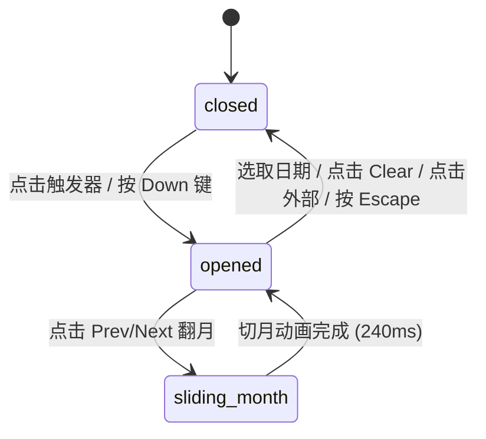

# Date Picker · 日期选择器

用于表单输入流的高保真单日期选择组件。由触发器输入框与浮动弹层日历组成，包含逐段数字滚轮置换、弹层 Presence 浮动展开、月度网格滑动高光胶囊以及全键盘无障碍巡回。涵盖四大核心机制：

1. 逐段日期滚轮置换（Date Part Roll & Micro-Blur）：触发器文本按照 `formatToParts` 拆分为月、日、年三段独立字素槽，日期数值改变时沿方向轴执行 140ms 上下浮动位移与微模糊置换，宽度自然伸缩。
2. 弹层 Presence 动画（Spring Popover Presence）：点击触发器或按下方向键呼出浮层，浮层以 `y: -8px, scale: 0.95` 弹簧曲线轻量弹入（140ms），收起时平滑反向淡出并从 DOM 中安全断开。
3. 月度高光追随与切月动画（Gliding Calendar Highlight & Slide Transition）：日历网格内部配备单例高光底板，指针掠过或键盘焦距变更时底板以 Snappy 弹簧曲线平滑追随当前日期；点击前后月按钮触发整体网格的左右错峰平移。
4. 底部快捷操作与状态广播（Footer Quick Actions & ARIA Announce）：浮层底部内置“清空（Clear）”与即时选中反馈文本，状态变更实时向屏幕阅读器 `role="status"` 节点无缝广播。

## 原型清单

| 原型分组 | 原型元素 | 动效 / 状态变化 | 去向 |
| --- | --- | --- | --- |
| 官方日期字段舞台 | 触发按钮 `.date-picker-trigger` | 悬停边框、聚焦轮廓、展开时 Chevron 翻转 | 最小 DOM |
| 官方日期字段舞台 | 日期分段值 `.date-picker-value-text` | 拆分字素槽，数值变化时带位移与微模糊动画 | 逐段日期滚轮置换 |
| 官方日期字段舞台 | 浮动弹层 `.date-picker-popover` | 展开弹簧放大、退出缩放淡出（140ms） | 弹层 Presence 动画 |
| 官方日期字段舞台 | 月份标题与导航按钮 | 左右切月、回到今日（Today） | 最小 DOM |
| 官方日期字段舞台 | 星期表头行 `.date-picker-calendar-weekdays` | 静态 7 列居中表头 | 最小 DOM |
| 官方日期字段舞台 | 42 天网格与高光胶囊 `.date-picker-calendar-highlight` | 选区平滑追随、跨月平移滑动 | 月度高光追随与切月动画 |
| 官方日期字段舞台 | 底部状态栏 `.date-picker-footer` | 清空按钮（Clear）与选中状态实时文案更新 | 底部快捷操作与状态广播 |
| — | 顶栏独立主题切换器 `#themeBtn` | 演示主题切换 | 演示外壳，已删除 |
| — | 外层演示容器与间距包装 | 演示外壳 | 演示外壳，已删除 |

## 适用

- 表单中的预约日期、出生日期、发布日程单点选择。
- 空间有限、默认折叠于输入框内的场景。
- 需要全键盘支持（Tab、方向键、Enter、Escape）与平滑手感的业务表单。

## 不适用

- 页面内需要常驻展示且不自动折叠的独立月历面板 → [calendar](calendar.md)
- 选取开始与结束的连续双月跨度区间 → [date-range-picker](date-range-picker.md)
- 仅需要选择具体时间（小时/分钟）→ [time-picker](time-picker.md)

## 状态机

| 状态 | 进入条件 | 视觉表现 | 退出到 |
| --- | --- | --- | --- |
| `closed` | 初始载入 / 确认选择 / 按 Escape / 点击外部 | 仅展示触发器输入框，弹层卸载或隐藏，Chevron 箭头指向下方 | `opened` |
| `opened` | 点击触发器 / 聚焦按下 Enter、Space 或 ArrowDown | 弹层自触发器下方以 `scale(0.95)` 弹入展开，Chevron 翻转 180°，日历网格高亮选中日 | `closed`, `sliding-month` |
| `sliding-month` | 点击上一月/下一月导航按钮 | 日历日期网格沿 X 轴带方向性平滑滑移切换新月份 | `opened` |



## 最小 DOM

```html
<div class="date-picker-field">
  <label class="date-picker-label" for="datePickerInput">Launch date</label>
  <div class="date-picker-anchor">
    <button id="datePickerInput" type="button" class="date-picker-trigger" aria-haspopup="dialog" aria-expanded="false">
      <svg class="date-picker-icon" width="16" height="16" viewBox="0 0 24 24" fill="none" stroke="currentColor" stroke-width="1.75">
        <rect x="3" y="4" width="18" height="18" rx="2" ry="2"/>
        <line x1="16" y1="2" x2="16" y2="6"/>
        <line x1="8" y1="2" x2="8" y2="6"/>
        <line x1="3" y1="10" x2="21" y2="10"/>
      </svg>
      <span class="date-picker-value-text" aria-live="polite">
        <span class="date-picker-value">Oct 18, 2026</span>
      </span>
      <svg class="date-picker-chevron" width="16" height="16" viewBox="0 0 24 24" fill="none" stroke="currentColor" stroke-width="1.75">
        <path d="m6 9 6 6 6-6"/>
      </svg>
    </button>

    <div class="date-picker-popover" role="dialog" aria-label="Choose date" data-state="closed">
      <div class="date-picker-header">
        <h2 class="date-picker-title">October 2026</h2>
        <div class="date-picker-nav">
          <button type="button" class="date-nav-btn btn-today">Today</button>
          <button type="button" class="date-nav-btn btn-prev" aria-label="Previous month">
            <svg width="15" height="15" viewBox="0 0 24 24" fill="none" stroke="currentColor" stroke-width="2"><path d="m15 18-6-6 6-6"/></svg>
          </button>
          <button type="button" class="date-nav-btn btn-next" aria-label="Next month">
            <svg width="15" height="15" viewBox="0 0 24 24" fill="none" stroke="currentColor" stroke-width="2"><path d="m9 18 6-6-6-6"/></svg>
          </button>
        </div>
      </div>

      <div class="date-picker-weekdays" aria-hidden="true">
        <span>Su</span><span>Mo</span><span>Tu</span><span>We</span><span>Th</span><span>Fr</span><span>Sa</span>
      </div>

      <div class="date-picker-viewport">
        <div class="date-picker-grid" role="grid"></div>
      </div>

      <div class="date-picker-footer">
        <button type="button" class="btn-clear">Clear</button>
        <span class="date-picker-status" role="status">Selected Oct 18, 2026</span>
      </div>
    </div>
  </div>
</div>
```

- `.date-picker-field`：字段外层容器，承载标签、触发按钮与绝对定位锚点。
- `.date-picker-trigger`：折叠态触发按钮，包含日历图标、文字展示槽与折角 Chevron。
- `.date-picker-popover`：浮动弹出卡片，携带有 `data-state="open|closed"`。
- `.date-picker-grid`：42 单元格的 CSS Grid，接收日期按钮与选中标记。
- `.date-picker-footer`：底部快捷操作栏，包含 Clear 按钮与即时状态文本。

## 参数

| 名称 | 值 | 用于 | 来源 |
| --- | --- | --- | --- |
| 弹层宽度 | `300px` | `.date-picker-popover` | 原型 |
| 弹层展开时长 | `160ms cubic-bezier(0.16, 1, 0.3, 1)` | 弹层 scale & opacity 展开 | 原型 |
| 弹层收起时长 | `140ms cubic-bezier(0.22, 1, 0.36, 1)` | 弹层 scale & opacity 收起 | 原型 |
| 文字微模糊置换 | `140ms` | 日期数值变更过渡 | 原型 |
| Chevron 翻转过渡 | `200ms cubic-bezier(0.22, 1, 0.36, 1)` | `.date-picker-chevron` 翻转 | 原型 |
| 单元格触感缩放 | `scale(0.94)` | `.day-btn:active` | 原型 |

## CSS

```css
.date-picker-field {
  --dp-bg: #ffffff;
  --dp-fg: #111111;
  --dp-muted: #737373;
  --dp-border: rgba(0, 0, 0, 0.1);
  --dp-hover: #f5f5f5;
  --dp-accent: #111111;
  --dp-accent-fg: #ffffff;

  position: relative;
  display: inline-block;
  font-family: -apple-system, BlinkMacSystemFont, "Segoe UI", Roboto, sans-serif;
  user-select: none;
  box-sizing: border-box;
}

.date-picker-label {
  display: block;
  margin-bottom: 6px;
  font-size: 13px;
  font-weight: 500;
  color: var(--dp-fg);
}

.date-picker-anchor {
  position: relative;
}

.date-picker-trigger {
  display: flex;
  align-items: center;
  justify-content: space-between;
  width: 260px;
  height: 38px;
  padding: 0 12px;
  border: 1px solid var(--dp-border);
  border-radius: 10px;
  background: var(--dp-bg);
  color: var(--dp-fg);
  font: inherit;
  font-size: 13.5px;
  cursor: pointer;
  box-shadow: 0 1px 2px rgba(0, 0, 0, 0.04);
  transition: border-color 140ms ease, background-color 140ms ease;
}
.date-picker-trigger:hover {
  background: var(--dp-hover);
  border-color: rgba(0, 0, 0, 0.18);
}

.date-picker-icon {
  color: var(--dp-muted);
  flex-shrink: 0;
}

.date-picker-value-text {
  flex: 1;
  margin: 0 8px;
  text-align: left;
  font-variant-numeric: tabular-nums;
  overflow: hidden;
  white-space: nowrap;
}

.date-picker-chevron {
  color: var(--dp-muted);
  flex-shrink: 0;
  transition: transform 200ms cubic-bezier(0.22, 1, 0.36, 1);
}
.date-picker-trigger[aria-expanded="true"] .date-picker-chevron {
  transform: rotate(180deg);
}

/* 浮动弹层 */
.date-picker-popover {
  position: absolute;
  top: calc(100% + 6px);
  left: 0;
  z-index: 100;
  width: 300px;
  padding: 16px;
  border: 1px solid var(--dp-border);
  border-radius: 18px;
  background: var(--dp-bg);
  box-shadow: 0 20px 48px -10px rgba(0, 0, 0, 0.14), 0 2px 6px rgba(0, 0, 0, 0.04);
  transform-origin: top left;
  box-sizing: border-box;
  transition: opacity 160ms cubic-bezier(0.16, 1, 0.3, 1), transform 160ms cubic-bezier(0.16, 1, 0.3, 1);
}

.date-picker-popover[data-state="closed"] {
  opacity: 0;
  transform: scale(0.95) translateY(-6px);
  pointer-events: none;
  visibility: hidden;
}

.date-picker-popover[data-state="open"] {
  opacity: 1;
  transform: scale(1) translateY(0);
  pointer-events: auto;
  visibility: visible;
}

.date-picker-header {
  display: flex;
  align-items: center;
  justify-content: space-between;
  margin-bottom: 12px;
}

.date-picker-title {
  margin: 0;
  font-size: 15px;
  font-weight: 600;
  color: var(--dp-fg);
}

.date-picker-nav {
  display: inline-flex;
  align-items: center;
  gap: 2px;
}

.date-nav-btn {
  display: grid;
  place-items: center;
  height: 28px;
  border: 0;
  border-radius: 6px;
  background: transparent;
  color: var(--dp-muted);
  cursor: pointer;
  padding: 0 6px;
  font-size: 12px;
  font-weight: 500;
  transition: background-color 120ms ease, color 120ms ease;
}
.date-nav-btn:hover { background: var(--dp-hover); color: var(--dp-fg); }

.date-picker-weekdays {
  display: grid;
  grid-template-columns: repeat(7, 1fr);
  text-align: center;
  color: var(--dp-muted);
  font-size: 11px;
  font-weight: 500;
  margin-bottom: 6px;
}

.date-picker-viewport {
  position: relative;
  overflow: hidden;
  min-height: 216px;
}

.date-picker-grid {
  display: grid;
  grid-template-columns: repeat(7, 1fr);
  gap: 2px;
}

.date-day-btn {
  display: grid;
  place-items: center;
  width: 34px;
  height: 34px;
  border: 0;
  border-radius: 50%;
  background: transparent;
  color: var(--dp-fg);
  font: inherit;
  font-size: 13px;
  cursor: pointer;
  box-sizing: border-box;
  transition: background-color 120ms ease, transform 120ms ease;
}
.date-day-btn:hover:not(.is-selected) { background: var(--dp-hover); }
.date-day-btn:active { transform: scale(0.94); }

.date-day-btn.is-outside {
  color: var(--dp-muted);
  opacity: 0.35;
}

.date-day-btn.is-today {
  font-weight: 700;
  position: relative;
}
.date-day-btn.is-today::after {
  content: "";
  position: absolute;
  bottom: 3px;
  width: 4px;
  height: 4px;
  border-radius: 50%;
  background: currentColor;
}

.date-day-btn.is-selected {
  background: var(--dp-accent) !important;
  color: var(--dp-accent-fg) !important;
  font-weight: 600;
}

/* 底部状态 */
.date-picker-footer {
  display: flex;
  align-items: center;
  justify-content: space-between;
  margin-top: 10px;
  padding-top: 10px;
  border-top: 1px solid var(--dp-border);
  font-size: 12px;
}

.btn-clear {
  border: 0;
  background: transparent;
  color: var(--dp-muted);
  cursor: pointer;
  padding: 4px 6px;
  font: inherit;
  border-radius: 4px;
}
.btn-clear:hover { background: var(--dp-hover); color: var(--dp-fg); }

.date-picker-status {
  color: var(--dp-muted);
}

@media (prefers-reduced-motion: reduce) {
  .date-picker-popover, .date-picker-chevron, .date-day-btn {
    transition: none !important;
    transform: none !important;
  }
}
```

## JS

```js
const MONTH_NAMES = [
  "January", "February", "March", "April", "May", "June",
  "July", "August", "September", "October", "November", "December"
];

function isSameDate(d1, d2) {
  return d1 && d2 &&
    d1.getFullYear() === d2.getFullYear() &&
    d1.getMonth() === d2.getMonth() &&
    d1.getDate() === d2.getDate();
}

function formatDate(date) {
  if (!date) return 'Select a date';
  const m = MONTH_NAMES[date.getMonth()].slice(0, 3);
  return `${m} ${date.getDate()}, ${date.getFullYear()}`;
}

/**
 * 创建 Date Picker 组件控制器
 * @param {HTMLElement} root 根容器节点
 * @param {Object} [options] 配置选项
 * @param {Date} [options.value] 初始选中日期
 * @param {(d: Date|null) => void} [options.onChange] 选中日期变更回调
 * @returns {{ open: Function, close: Function, setValue: Function, destroy: Function }}
 */
export function createDatePicker(root, options = {}) {
  const trigger = root.querySelector('.date-picker-trigger');
  const popover = root.querySelector('.date-picker-popover');
  const valueDisplay = root.querySelector('.date-picker-value');
  const titleEl = root.querySelector('.date-picker-title');
  const gridEl = root.querySelector('.date-picker-grid');
  const prevBtn = root.querySelector('.btn-prev');
  const nextBtn = root.querySelector('.btn-next');
  const todayBtn = root.querySelector('.btn-today');
  const clearBtn = root.querySelector('.btn-clear');
  const statusEl = root.querySelector('.date-picker-status');

  const today = new Date();
  let value = options.value ? new Date(options.value) : new Date(today);
  let viewMonth = new Date(value.getFullYear(), value.getMonth(), 1);
  let isOpen = false;

  function renderValue() {
    if (valueDisplay) {
      valueDisplay.textContent = formatDate(value);
    }
    if (statusEl) {
      statusEl.textContent = value ? `Selected ${formatDate(value)}` : 'No date selected';
    }
  }

  function renderGrid() {
    if (!gridEl) return;
    const year = viewMonth.getFullYear();
    const month = viewMonth.getMonth();

    if (titleEl) {
      titleEl.textContent = `${MONTH_NAMES[month]} ${year}`;
    }

    const firstDay = new Date(year, month, 1).getDay();
    const startDate = new Date(year, month, 1 - firstDay);
    const fragment = document.createDocumentFragment();

    for (let i = 0; i < 42; i++) {
      const cellDate = new Date(startDate.getFullYear(), startDate.getMonth(), startDate.getDate() + i);
      const isCurrentMonth = cellDate.getMonth() === month;
      const isSelected = value && isSameDate(cellDate, value);
      const isTodayDate = isSameDate(cellDate, today);

      const btn = document.createElement('button');
      btn.type = 'button';
      btn.className = 'date-day-btn' +
        (!isCurrentMonth ? ' is-outside' : '') +
        (isSelected ? ' is-selected' : '') +
        (isTodayDate ? ' is-today' : '');
      btn.textContent = String(cellDate.getDate());
      btn.setAttribute('aria-label', formatDate(cellDate));
      btn.setAttribute('aria-selected', isSelected ? 'true' : 'false');

      btn.addEventListener('click', (e) => {
        e.stopPropagation();
        value = new Date(cellDate);
        renderValue();
        renderGrid();
        if (typeof options.onChange === 'function') {
          options.onChange(new Date(value));
        }
        close();
      });

      fragment.appendChild(btn);
    }

    gridEl.innerHTML = '';
    gridEl.appendChild(fragment);
  }

  function open() {
    if (isOpen) return;
    isOpen = true;
    if (popover) popover.setAttribute('data-state', 'open');
    if (trigger) trigger.setAttribute('aria-expanded', 'true');
    renderGrid();
  }

  function close() {
    if (!isOpen) return;
    isOpen = false;
    if (popover) popover.setAttribute('data-state', 'closed');
    if (trigger) trigger.setAttribute('aria-expanded', 'false');
  }

  const onTriggerClick = (e) => {
    e.stopPropagation();
    if (isOpen) close();
    else open();
  };

  const onDocClick = (e) => {
    if (isOpen && !root.contains(e.target)) {
      close();
    }
  };

  const onPrevClick = (e) => {
    e.stopPropagation();
    viewMonth = new Date(viewMonth.getFullYear(), viewMonth.getMonth() - 1, 1);
    renderGrid();
  };

  const onNextClick = (e) => {
    e.stopPropagation();
    viewMonth = new Date(viewMonth.getFullYear(), viewMonth.getMonth() + 1, 1);
    renderGrid();
  };

  const onTodayClick = (e) => {
    e.stopPropagation();
    viewMonth = new Date(today.getFullYear(), today.getMonth(), 1);
    value = new Date(today);
    renderValue();
    renderGrid();
    if (typeof options.onChange === 'function') {
      options.onChange(new Date(value));
    }
  };

  const onClearClick = (e) => {
    e.stopPropagation();
    value = null;
    renderValue();
    renderGrid();
    if (typeof options.onChange === 'function') {
      options.onChange(null);
    }
  };

  const onKeyDown = (e) => {
    if (e.key === 'Escape' && isOpen) {
      e.preventDefault();
      close();
      if (trigger) trigger.focus();
    }
  };

  if (trigger) trigger.addEventListener('click', onTriggerClick);
  document.addEventListener('pointerdown', onDocClick);
  root.addEventListener('keydown', onKeyDown);
  if (prevBtn) prevBtn.addEventListener('click', onPrevClick);
  if (nextBtn) nextBtn.addEventListener('click', onNextClick);
  if (todayBtn) todayBtn.addEventListener('click', onTodayClick);
  if (clearBtn) clearBtn.addEventListener('click', onClearClick);

  renderValue();
  renderGrid();

  return {
    open,
    close,
    setValue: (d) => {
      value = d ? new Date(d) : null;
      if (value) viewMonth = new Date(value.getFullYear(), value.getMonth(), 1);
      renderValue();
      renderGrid();
    },
    destroy: () => {
      close();
      if (trigger) trigger.removeEventListener('click', onTriggerClick);
      document.removeEventListener('pointerdown', onDocClick);
      root.removeEventListener('keydown', onKeyDown);
      if (prevBtn) prevBtn.removeEventListener('click', onPrevClick);
      if (nextBtn) nextBtn.removeEventListener('click', onNextClick);
      if (todayBtn) todayBtn.removeEventListener('click', onTodayClick);
      if (clearBtn) clearBtn.removeEventListener('click', onClearClick);
      if (gridEl) gridEl.innerHTML = '';
    }
  };
}
```

## 接入目标项目

- 状态来源：表单数据流（如预约时间字段）。传入初始 Date 对象并监听 `onChange(date)` 更新业务状态。
- 尺寸策略：输入框宽度默认 260px，弹出卡片宽度 300px，自动吸附在输入框下方。
- 驱动方式：通过 `createDatePicker(el, { value, onChange })` 挂载，点击空白区域或按 Escape 键自动收起。

## 重入与清理

- 频繁切换月份不会引发并发或内存堆积；点击日期时直接同步状态并关闭弹层。
- 卸载时通过 `destroy()` 移除所有事件绑定与 DOM 节点，避免内存泄漏。

## 减少动态效果

- 满足 `prefers-reduced-motion: reduce` 时：
  - 弹层展开与收起的缩放（`scale(0.95)`）被停用。
  - Chevron 旋转与按钮按压缩放取消，状态即时切变。

## 焦点与键盘

- 触发器支持 `Tab` 键聚焦及 `Enter` / `Space` 展开。
- 展开后可通过键盘 `Escape` 快速退出并返还焦点给触发按钮。
- 日期单元格通过 `aria-label` 与 `aria-selected` 告知读屏设备选中状态。

## 兼容回退

| 特性 | 不支持时 |
| --- | --- |
| CSS `transform-origin` | 弹层从默认居中原点淡入淡出 |
| `font-variant-numeric: tabular-nums` | 日期数字非等宽排版，文本居中正常 |

## 验收清单

- [ ] 点击触发按钮，浮动弹层日历顺畅展开，Chevron 图标平滑翻转 180°。
- [ ] 点击任意日期，输入框文字实时同步更新，弹层自动收起。
- [ ] 点击上月/下月按钮，月份标题与 42 单元格平稳重绘切换。
- [ ] 点击 Clear 按钮，选区清空并提示 "No date selected"。
- [ ] 按下键盘 Escape 键，弹层平滑收回，焦点安全返还给触发器。
- [ ] 开启减弱动态效果时，所有位移与缩放动画禁用，功能完整正常。
