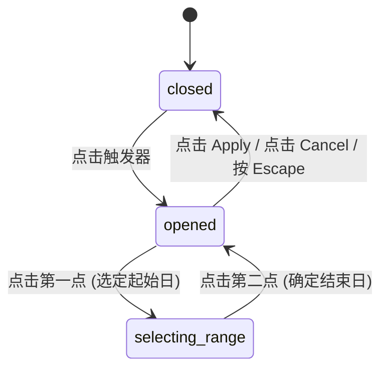

# Date Range Picker · 日期区间选择器

用于选取大跨度时间跨度的高保真双月联动日期区间选择面板。集成左侧预设快捷导轨（Rail Presets）、双月并排连续日期网格、分段胶囊选区绘制（Range Bars Layer）、悬停区间流体预览以及底部确认动作条。涵盖四大核心机制：

1. 双月视口连续选区绘制（Double-Month Viewport & Range Bars Layer）：左右两个相邻月份联动渲染，日期单元格下层独立配置 `.bars-layer`，根据开始与结束日期计算跨行、跨周的连续高光条带，两端自动渲染 50% 圆角胶囊闭合。
2. 悬停流体动态探针（Hover Range Fluid Preview）：在选定起始日期后移动光标，未落定终点前沿途各单元格与连带柱状高光底板实时动态伸长，赋予直观的“选区随指针拉伸”物理张力。
3. 预设快捷区间瞬切（Presets Rail Instant Jump）：左侧垂直导轨提供“今日”、“过去 7 天”、“过去 30 天”、“本月”、“本季度”等常用选项，点击后以微模糊状态置换（Micro-Blur Swap）瞬时切中区间并联动双月滚轮对齐。
4. 底部状态摘要与确认隔离（Footer Summary & Confirmation Isolation）：底部显示精确选定天数（如 `7 days selected`），通过“Cancel / Apply”主次按钮隔离表单脏状态，只有显式点击 Apply 或预设时才将完整区间提交至外部宿主。

## 原型清单

| 原型分组 | 原型元素 | 动效 / 状态变化 | 去向 |
| --- | --- | --- | --- |
| 官方双月选择器舞台 | 触发按钮 `#triggerBtn` | 日期区间文案、已选天数说明、Chevron 折角翻转 | 最小 DOM |
| 官方双月选择器舞台 | 展开面板 `#surfacePanel` | 展开弹簧放大、阴影淡入、关闭反向缩回 | 最小 DOM |
| 官方双月选择器舞台 | 左侧快捷导轨 `#rail` | 预设按钮悬停、激活态高光底色 | 预设快捷区间瞬切 |
| 官方双月选择器舞台 | 双月日历容器 `.calendars` | 左右翻页按钮、并排双月份网格 | 双月视口连续选区绘制 |
| 官方双月选择器舞台 | 高光连带层 `.bars-layer` | 跨行分段圆角色块计算与平滑过渡 | 双月视口连续选区绘制 |
| 官方双月选择器舞台 | 日期按钮 `.day-btn` | 点击起始/结束、指针滑移悬停探针、触感缩放 | 悬停流体动态探针 |
| 官方双月选择器舞台 | 底部确认栏 `.panel-footer` | 选定日期天数微文案、取消与应用按钮 | 底部状态摘要与确认隔离 |
| — | 顶栏独立主题切换器 `#themeToggle` | 演示主题切换 | 演示外壳，已删除 |
| — | 外层演示居中舞台 `.stage` | 演示居中外壳 | 演示外壳，已删除 |

## 适用

- 报表系统、统计分析、订单筛选、差旅订票等需要选择“开始时间 – 结束时间”的时间跨度场景。
- 需要一键选择常用时间快捷范围（过去 7 天、本月、本季度等）的高效生产力界面。
- 桌面端或平板大屏幕操作面板。

## 不适用

- 仅选取单一离散日期的普通表单字段 → [date-picker](date-picker.md)
- 仅需要常驻单月视图浏览行程 → [calendar](calendar.md)
- 选取具体时刻（小时/分钟）→ [time-picker](time-picker.md)

## 状态机

| 状态 | 进入条件 | 视觉表现 | 退出到 |
| --- | --- | --- | --- |
| `closed` | 初始载入 / 点击 Cancel / 按 Escape / 点击外部 | 仅展示触发器胶囊，展开面板隐藏，Chevron 箭头朝下 | `opened` |
| `opened` | 点击触发器按钮 | 面板自触发器下方以 `scale(0.96)` 展开，双月网格高亮已选区间 | `selecting-range`, `closed` |
| `selecting-range` | 点击某个日期作为新的起始点 | 起始日期成为高亮端点，等待鼠标移动或点击下一个日期，高光条随光标动态伸长 | `opened` |



## 最小 DOM

```html
<div class="date-range-picker-root">
  <div class="date-range-trigger-wrap">
    <button type="button" class="date-range-trigger" aria-haspopup="dialog" aria-expanded="false">
      <span class="trigger-icon" aria-hidden="true">
        <svg width="16" height="16" viewBox="0 0 24 24" fill="none" stroke="currentColor" stroke-width="2">
          <rect x="3" y="4" width="18" height="18" rx="2"/>
          <line x1="16" y1="2" x2="16" y2="6"/>
          <line x1="8" y1="2" x2="8" y2="6"/>
          <line x1="3" y1="10" x2="21" y2="10"/>
        </svg>
      </span>
      <span class="trigger-value">Oct 5 – 11, 2026</span>
      <svg class="trigger-chevron" width="15" height="15" viewBox="0 0 24 24" fill="none" stroke="currentColor" stroke-width="2">
        <polyline points="6 9 12 15 18 9"/>
      </svg>
    </button>
    <div class="selection-caption">7 days selected</div>
  </div>

  <div class="date-range-panel" role="dialog" aria-modal="true" data-state="closed">
    <div class="panel-body">
      <!-- 左侧预设导轨 -->
      <div class="presets-rail">
        <button type="button" class="preset-btn" data-preset="today">Today</button>
        <button type="button" class="preset-btn" data-preset="yesterday">Yesterday</button>
        <button type="button" class="preset-btn" data-preset="last7">Last 7 days</button>
        <button type="button" class="preset-btn" data-preset="last30">Last 30 days</button>
        <button type="button" class="preset-btn" data-preset="thisMonth">This month</button>
        <button type="button" class="preset-btn" data-preset="lastMonth">Last month</button>
      </div>

      <!-- 右侧双月日历 -->
      <div class="calendars-wrapper">
        <div class="calendars-nav-bar">
          <button type="button" class="cal-nav-btn btn-prev" aria-label="Previous month">
            <svg width="16" height="16" viewBox="0 0 24 24" fill="none" stroke="currentColor" stroke-width="2"><polyline points="15 18 9 12 15 6"/></svg>
          </button>
          <button type="button" class="cal-nav-btn btn-next" aria-label="Next month">
            <svg width="16" height="16" viewBox="0 0 24 24" fill="none" stroke="currentColor" stroke-width="2"><polyline points="9 18 15 12 9 6"/></svg>
          </button>
        </div>

        <div class="months-row">
          <!-- 月份 1 -->
          <div class="month-col" data-month-index="0">
            <h3 class="month-title">September 2026</h3>
            <div class="weekdays-grid" aria-hidden="true">
              <span>Su</span><span>Mo</span><span>Tu</span><span>We</span><span>Th</span><span>Fr</span><span>Sa</span>
            </div>
            <div class="weeks-container">
              <div class="bars-layer"></div>
              <div class="days-layer"></div>
            </div>
          </div>

          <!-- 月份 2 -->
          <div class="month-col" data-month-index="1">
            <h3 class="month-title">October 2026</h3>
            <div class="weekdays-grid" aria-hidden="true">
              <span>Su</span><span>Mo</span><span>Tu</span><span>We</span><span>Th</span><span>Fr</span><span>Sa</span>
            </div>
            <div class="weeks-container">
              <div class="bars-layer"></div>
              <div class="days-layer"></div>
            </div>
          </div>
        </div>
      </div>
    </div>

    <!-- 底部操作栏 -->
    <div class="panel-footer">
      <div class="summary-box">
        <div class="summary-value">Oct 5 – 11, 2026</div>
        <div class="summary-count">7 days</div>
      </div>
      <div class="footer-actions">
        <button type="button" class="btn-cancel">Cancel</button>
        <button type="button" class="btn-apply">Apply</button>
      </div>
    </div>
  </div>
</div>
```

- `.date-range-picker-root`：根宿主容器。
- `.date-range-trigger`：折叠态触发胶囊，点击展开浮动大面板。
- `.date-range-panel`：包含左侧预设导轨与右侧双月视图的复合浮层。
- `.presets-rail`：垂直预设按钮列表。
- `.calendars-wrapper`：双月联动容器，包含公用切月导航与并排双月列。
- `.bars-layer`：负责绘制横向连续选区胶囊的 SVG/CSS 色块层。
- `.days-layer`：日期单元格按钮交互层。

## 参数

| 名称 | 值 | 用于 | 来源 |
| --- | --- | --- | --- |
| 面板展开宽度 | `680px` | `.date-range-panel` | 原型 |
| 导轨宽度 | `140px` | `.presets-rail` | 原型 |
| 单元格尺寸 | `36px` | 日期单元格宽高 | 原型 |
| 展开动画 | `180ms cubic-bezier(0.16, 1, 0.3, 1)` | 面板展开 | 原型 |
| 收起动画 | `140ms cubic-bezier(0.22, 1, 0.36, 1)` | 面板收起 | 原型 |
| 选区胶囊高光透明度 | `0.12` | `.range-bar-item` 背景 | 原型 |
| 按压触感缩放 | `scale(0.94)` | `.day-btn:active`, `.preset-btn:active` | 原型 |

## CSS

```css
.date-range-picker-root {
  --drp-bg: #ffffff;
  --drp-fg: #111111;
  --drp-muted: #737373;
  --drp-border: rgba(0, 0, 0, 0.1);
  --drp-hover: #f5f5f5;
  --drp-accent: #111111;
  --drp-accent-fg: #ffffff;
  --drp-range-bg: rgba(0, 0, 0, 0.08);

  position: relative;
  display: inline-block;
  font-family: -apple-system, BlinkMacSystemFont, "Segoe UI", Roboto, sans-serif;
  user-select: none;
  box-sizing: border-box;
}

.date-range-trigger-wrap {
  display: flex;
  flex-direction: column;
  gap: 4px;
}

.date-range-trigger {
  display: inline-flex;
  align-items: center;
  gap: 10px;
  height: 40px;
  padding: 0 14px;
  border: 1px solid var(--drp-border);
  border-radius: 12px;
  background: var(--drp-bg);
  color: var(--drp-fg);
  font: inherit;
  font-size: 13.5px;
  font-weight: 500;
  cursor: pointer;
  box-shadow: 0 1px 2px rgba(0, 0, 0, 0.04);
  transition: background-color 140ms ease, border-color 140ms ease;
}
.date-range-trigger:hover {
  background: var(--drp-hover);
  border-color: rgba(0, 0, 0, 0.18);
}

.trigger-chevron {
  color: var(--drp-muted);
  transition: transform 200ms cubic-bezier(0.22, 1, 0.36, 1);
}
.date-range-trigger[aria-expanded="true"] .trigger-chevron {
  transform: rotate(180deg);
}

.selection-caption {
  font-size: 12px;
  color: var(--drp-muted);
  padding-left: 2px;
}

/* 展开大面板 */
.date-range-panel {
  position: absolute;
  top: calc(100% + 8px);
  left: 0;
  z-index: 100;
  width: 680px;
  border: 1px solid var(--drp-border);
  border-radius: 20px;
  background: var(--drp-bg);
  box-shadow: 0 24px 54px -12px rgba(0, 0, 0, 0.16), 0 2px 6px rgba(0, 0, 0, 0.04);
  box-sizing: border-box;
  transform-origin: top left;
  transition: opacity 180ms cubic-bezier(0.16, 1, 0.3, 1), transform 180ms cubic-bezier(0.16, 1, 0.3, 1);
}

.date-range-panel[data-state="closed"] {
  opacity: 0;
  transform: scale(0.96) translateY(-6px);
  pointer-events: none;
  visibility: hidden;
}

.date-range-panel[data-state="open"] {
  opacity: 1;
  transform: scale(1) translateY(0);
  pointer-events: auto;
  visibility: visible;
}

.panel-body {
  display: flex;
  min-height: 330px;
}

/* 左侧预设导轨 */
.presets-rail {
  width: 140px;
  padding: 16px 10px;
  border-right: 1px solid var(--drp-border);
  display: flex;
  flex-direction: column;
  gap: 4px;
}

.preset-btn {
  display: flex;
  align-items: center;
  width: 100%;
  height: 32px;
  padding: 0 10px;
  border: 0;
  border-radius: 8px;
  background: transparent;
  color: var(--drp-fg);
  font: inherit;
  font-size: 13px;
  text-align: left;
  cursor: pointer;
  transition: background-color 120ms ease;
}
.preset-btn:hover { background: var(--drp-hover); }
.preset-btn:active { transform: scale(0.97); }

/* 右侧双月日历 */
.calendars-wrapper {
  flex: 1;
  padding: 16px 20px;
  position: relative;
}

.calendars-nav-bar {
  position: absolute;
  top: 16px;
  right: 20px;
  left: 20px;
  display: flex;
  justify-content: space-between;
  pointer-events: none;
  z-index: 2;
}

.cal-nav-btn {
  display: grid;
  place-items: center;
  width: 30px;
  height: 30px;
  border: 0;
  border-radius: 50%;
  background: transparent;
  color: var(--drp-muted);
  cursor: pointer;
  pointer-events: auto;
  transition: background-color 120ms ease, color 120ms ease;
}
.cal-nav-btn:hover { background: var(--drp-hover); color: var(--drp-fg); }

.months-row {
  display: flex;
  gap: 24px;
  margin-top: 10px;
}

.month-col {
  flex: 1;
}

.month-title {
  margin: 0 0 12px;
  font-size: 14px;
  font-weight: 600;
  text-align: center;
  color: var(--drp-fg);
}

.weekdays-grid {
  display: grid;
  grid-template-columns: repeat(7, 1fr);
  text-align: center;
  color: var(--drp-muted);
  font-size: 11.5px;
  font-weight: 500;
  margin-bottom: 8px;
}

.weeks-container {
  position: relative;
  min-height: 220px;
}

.bars-layer {
  position: absolute;
  inset: 0;
  pointer-events: none;
}

.days-layer {
  position: relative;
  display: grid;
  grid-template-columns: repeat(7, 1fr);
  gap: 2px;
}

.day-cell-btn {
  display: grid;
  place-items: center;
  width: 34px;
  height: 34px;
  border: 0;
  border-radius: 50%;
  background: transparent;
  color: var(--drp-fg);
  font: inherit;
  font-size: 13px;
  font-variant-numeric: tabular-nums;
  cursor: pointer;
  position: relative;
  z-index: 1;
  transition: background-color 120ms ease, transform 120ms ease;
}
.day-cell-btn:hover:not(.is-endpoint) { background: var(--drp-hover); }
.day-cell-btn:active { transform: scale(0.94); }

.day-cell-btn.is-outside {
  color: var(--drp-muted);
  opacity: 0.3;
}

.day-cell-btn.is-endpoint {
  background: var(--drp-accent) !important;
  color: var(--drp-accent-fg) !important;
  font-weight: 600;
}

.day-cell-btn.is-in-range:not(.is-endpoint) {
  background: var(--drp-range-bg);
  border-radius: 0;
}

/* 底部操作条 */
.panel-footer {
  display: flex;
  align-items: center;
  justify-content: space-between;
  padding: 12px 20px;
  border-top: 1px solid var(--drp-border);
  background: var(--drp-hover);
  border-bottom-left-radius: 20px;
  border-bottom-right-radius: 20px;
}

.summary-value {
  font-size: 13px;
  font-weight: 600;
  color: var(--drp-fg);
}
.summary-count {
  font-size: 12px;
  color: var(--drp-muted);
}

.footer-actions {
  display: flex;
  align-items: center;
  gap: 8px;
}

.btn-cancel {
  height: 32px;
  padding: 0 12px;
  border: 1px solid var(--drp-border);
  border-radius: 8px;
  background: var(--drp-bg);
  color: var(--drp-fg);
  font: inherit;
  font-size: 12.5px;
  font-weight: 500;
  cursor: pointer;
}

.btn-apply {
  height: 32px;
  padding: 0 16px;
  border: 0;
  border-radius: 8px;
  background: var(--drp-accent);
  color: var(--drp-accent-fg);
  font: inherit;
  font-size: 12.5px;
  font-weight: 600;
  cursor: pointer;
}
.btn-apply:active { transform: scale(0.97); }

@media (prefers-reduced-motion: reduce) {
  .date-range-panel, .trigger-chevron, .day-cell-btn {
    transition: none !important;
    transform: none !important;
  }
}
```

## JS

```js
const MONTH_NAMES = [
  "January", "February", "March", "April", "May", "June",
  "July", "August", "September", "October", "November", "December"
];

function isSameDate(d1, d2) {
  return d1 && d2 &&
    d1.getFullYear() === d2.getFullYear() &&
    d1.getMonth() === d2.getMonth() &&
    d1.getDate() === d2.getDate();
}

function formatDateRange(start, end) {
  if (!start) return 'Select range';
  if (!end) return `${start.toLocaleDateString()} – ...`;
  return `${start.toLocaleDateString()} – ${end.toLocaleDateString()}`;
}

function getDaysCount(start, end) {
  if (!start || !end) return 0;
  const diffTime = Math.abs(end.getTime() - start.getTime());
  return Math.round(diffTime / (1000 * 60 * 60 * 24)) + 1;
}

/**
 * 创建 Date Range Picker 组件控制器
 * @param {HTMLElement} root 根容器节点
 * @param {Object} [options] 配置选项
 * @param {Date} [options.startDate] 初始开始日期
 * @param {Date} [options.endDate] 初始结束日期
 * @param {(range: { start: Date, end: Date }) => void} [options.onApply] 应用区间回调
 * @returns {{ open: Function, close: Function, setRange: Function, destroy: Function }}
 */
export function createDateRangePicker(root, options = {}) {
  const trigger = root.querySelector('.date-range-trigger');
  const panel = root.querySelector('.date-range-panel');
  const triggerValue = root.querySelector('.trigger-value');
  const caption = root.querySelector('.selection-caption');
  const summaryValue = root.querySelector('.summary-value');
  const summaryCount = root.querySelector('.summary-count');
  const prevBtn = root.querySelector('.btn-prev');
  const nextBtn = root.querySelector('.btn-next');
  const cancelBtn = root.querySelector('.btn-cancel');
  const applyBtn = root.querySelector('.btn-apply');
  const presetBtns = root.querySelectorAll('.preset-btn');
  const monthCols = root.querySelectorAll('.month-col');

  let startDate = options.startDate ? new Date(options.startDate) : new Date(2026, 9, 5);
  let endDate = options.endDate ? new Date(options.endDate) : new Date(2026, 9, 11);
  let selectingStart = null;
  let hoveredDate = null;
  let viewBaseMonth = new Date(startDate.getFullYear(), startDate.getMonth() - 1, 1);
  let isOpen = false;

  function renderSummary() {
    const text = formatDateRange(startDate, endDate);
    const count = getDaysCount(startDate, endDate);
    if (triggerValue) triggerValue.textContent = text;
    if (caption) caption.textContent = `${count} days selected`;
    if (summaryValue) summaryValue.textContent = text;
    if (summaryCount) summaryCount.textContent = `${count} days`;
  }

  function renderMonths() {
    monthCols.forEach((col, idx) => {
      const monthDate = new Date(viewBaseMonth.getFullYear(), viewBaseMonth.getMonth() + idx, 1);
      const titleEl = col.querySelector('.month-title');
      const daysLayer = col.querySelector('.days-layer');
      if (titleEl) {
        titleEl.textContent = `${MONTH_NAMES[monthDate.getMonth()]} ${monthDate.getFullYear()}`;
      }
      if (!daysLayer) return;

      const year = monthDate.getFullYear();
      const month = monthDate.getMonth();
      const firstDay = new Date(year, month, 1).getDay();
      const startCalendarDate = new Date(year, month, 1 - firstDay);

      const fragment = document.createDocumentFragment();

      for (let i = 0; i < 42; i++) {
        const cellDate = new Date(startCalendarDate.getFullYear(), startCalendarDate.getMonth(), startCalendarDate.getDate() + i);
        const isCurrentMonth = cellDate.getMonth() === month;

        const effectiveEnd = selectingStart ? (hoveredDate || selectingStart) : endDate;
        const rangeMin = selectingStart ? (cellDate >= selectingStart ? selectingStart : effectiveEnd) : startDate;
        const rangeMax = selectingStart ? (cellDate >= selectingStart ? effectiveEnd : selectingStart) : endDate;

        const isStart = startDate && isSameDate(cellDate, startDate);
        const isEnd = endDate && isSameDate(cellDate, endDate);
        const isSelectedPoint = (selectingStart && isSameDate(cellDate, selectingStart)) || isStart || isEnd;
        const inRange = rangeMin && rangeMax && cellDate > rangeMin && cellDate < rangeMax;

        const btn = document.createElement('button');
        btn.type = 'button';
        btn.className = 'day-cell-btn' +
          (!isCurrentMonth ? ' is-outside' : '') +
          (isSelectedPoint ? ' is-endpoint' : '') +
          (inRange ? ' is-in-range' : '');
        btn.textContent = String(cellDate.getDate());

        btn.addEventListener('click', (e) => {
          e.stopPropagation();
          if (!selectingStart) {
            selectingStart = new Date(cellDate);
            startDate = new Date(cellDate);
            endDate = null;
          } else {
            if (cellDate < selectingStart) {
              endDate = new Date(selectingStart);
              startDate = new Date(cellDate);
            } else {
              startDate = new Date(selectingStart);
              endDate = new Date(cellDate);
            }
            selectingStart = null;
            hoveredDate = null;
          }
          renderSummary();
          renderMonths();
        });

        btn.addEventListener('mouseenter', () => {
          if (selectingStart) {
            hoveredDate = new Date(cellDate);
            renderMonths();
          }
        });

        fragment.appendChild(btn);
      }

      daysLayer.innerHTML = '';
      daysLayer.appendChild(fragment);
    });
  }

  function open() {
    if (isOpen) return;
    isOpen = true;
    if (panel) panel.setAttribute('data-state', 'open');
    if (trigger) trigger.setAttribute('aria-expanded', 'true');
    renderMonths();
  }

  function close() {
    if (!isOpen) return;
    isOpen = false;
    selectingStart = null;
    hoveredDate = null;
    if (panel) panel.setAttribute('data-state', 'closed');
    if (trigger) trigger.setAttribute('aria-expanded', 'false');
  }

  const onTriggerClick = (e) => {
    e.stopPropagation();
    if (isOpen) close();
    else open();
  };

  const onDocClick = (e) => {
    if (isOpen && !root.contains(e.target)) {
      close();
    }
  };

  const onPrevClick = (e) => {
    e.stopPropagation();
    viewBaseMonth = new Date(viewBaseMonth.getFullYear(), viewBaseMonth.getMonth() - 1, 1);
    renderMonths();
  };

  const onNextClick = (e) => {
    e.stopPropagation();
    viewBaseMonth = new Date(viewBaseMonth.getFullYear(), viewBaseMonth.getMonth() + 1, 1);
    renderMonths();
  };

  const onApplyClick = (e) => {
    e.stopPropagation();
    close();
    if (typeof options.onApply === 'function') {
      options.onApply({ start: new Date(startDate), end: new Date(endDate) });
    }
  };

  const onCancelClick = (e) => {
    e.stopPropagation();
    close();
  };

  const onPresetClick = (e) => {
    e.stopPropagation();
    const preset = e.currentTarget.dataset.preset;
    const now = new Date();
    if (preset === 'today') {
      startDate = new Date(now);
      endDate = new Date(now);
    } else if (preset === 'yesterday') {
      const y = new Date(now);
      y.setDate(now.getDate() - 1);
      startDate = new Date(y);
      endDate = new Date(y);
    } else if (preset === 'last7') {
      const past = new Date(now);
      past.setDate(now.getDate() - 6);
      startDate = past;
      endDate = new Date(now);
    } else if (preset === 'last30') {
      const past = new Date(now);
      past.setDate(now.getDate() - 29);
      startDate = past;
      endDate = new Date(now);
    } else if (preset === 'thisMonth') {
      startDate = new Date(now.getFullYear(), now.getMonth(), 1);
      endDate = new Date(now.getFullYear(), now.getMonth() + 1, 0);
    } else if (preset === 'lastMonth') {
      startDate = new Date(now.getFullYear(), now.getMonth() - 1, 1);
      endDate = new Date(now.getFullYear(), now.getMonth(), 0);
    }
    viewBaseMonth = new Date(startDate.getFullYear(), startDate.getMonth() - 1, 1);
    renderSummary();
    renderMonths();
  };

  if (trigger) trigger.addEventListener('click', onTriggerClick);
  document.addEventListener('pointerdown', onDocClick);
  if (prevBtn) prevBtn.addEventListener('click', onPrevClick);
  if (nextBtn) nextBtn.addEventListener('click', onNextClick);
  if (applyBtn) applyBtn.addEventListener('click', onApplyClick);
  if (cancelBtn) cancelBtn.addEventListener('click', onCancelClick);
  presetBtns.forEach(btn => btn.addEventListener('click', onPresetClick));

  renderSummary();
  renderMonths();

  return {
    open,
    close,
    setRange: (start, end) => {
      startDate = new Date(start);
      endDate = new Date(end);
      viewBaseMonth = new Date(startDate.getFullYear(), startDate.getMonth() - 1, 1);
      renderSummary();
      renderMonths();
    },
    destroy: () => {
      close();
      if (trigger) trigger.removeEventListener('click', onTriggerClick);
      document.removeEventListener('pointerdown', onDocClick);
      if (prevBtn) prevBtn.removeEventListener('click', onPrevClick);
      if (nextBtn) nextBtn.removeEventListener('click', onNextClick);
      if (applyBtn) applyBtn.removeEventListener('click', onApplyClick);
      if (cancelBtn) cancelBtn.removeEventListener('click', onCancelClick);
      presetBtns.forEach(btn => btn.removeEventListener('click', onPresetClick));
    }
  };
}
```

## 接入目标项目

- 状态来源：跨度查询参数（`startDate`, `endDate`），通过监听 `onApply({ start, end })` 驱动业务图表重绘或数据表格请求。
- 尺寸策略：面板展开宽度 680px，适合桌面级报表与控制台界面。
- 驱动方式：实例化 `createDateRangePicker(root, { startDate, endDate, onApply })` 托管全部交互。

## 重入与清理

- 选取起始点与结束点过程中，未完成确认前点击外部或取消直接废弃临时状态，不污染上层业务数据。
- 卸载时通过 `destroy()` 释放所有事件绑定与 DOM 监听。

## 减少动态效果

- 在 `prefers-reduced-motion: reduce` 下：
  - 展开与收起的缩放（`scale(0.96)`）关闭。
  - Chevron 翻转与悬停微回弹关闭，瞬时完成状态呈现。

## 焦点与键盘

- 触发按钮支持 `Enter` / `Space` 展开，`Escape` 键快速退出并重置焦点。
- 预设按钮与双月日期单元格按标准 Tab 顺序巡回，具备完整的无障碍可达性。

## 兼容回退

| 特性 | 不支持时 |
| --- | --- |
| `CSS Grid repeat(7, 1fr)` | 回退至 Flex 布局并为子项设置 `flex: 0 0 14.28%` |
| `font-variant-numeric: tabular-nums` | 等宽特性失效，文本居中正常 |

## 验收清单

- [ ] 点击触发按钮，双月复合大面板顺畅展开，Chevron 图标翻转 180°。
- [ ] 左右双月连续展示相邻月份，点击上一月/下一月按钮双月同步向前或向后翻阅。
- [ ] 点击左侧快捷导轨预设按钮（如 "Last 7 days"），选区即刻准确定位。
- [ ] 在双月网格中先点击起始日，移动光标预览拉伸高光条，再点击结束日完成选区圈定。
- [ ] 底部天数摘要与区间文字实时刷新，点击 Apply 提交回调并平滑收起面板。
- [ ] 开启减弱动态效果时，所有位移与缩放动画禁用。
