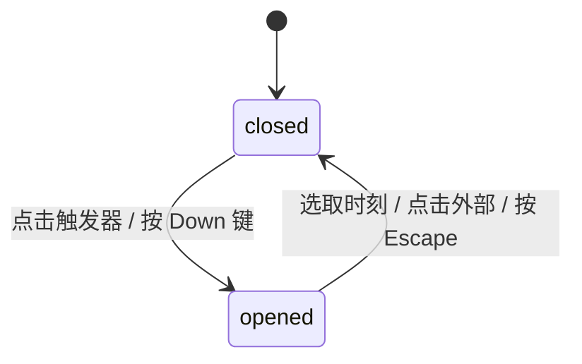

# Time Picker · 时间选择器

用于精确选取时刻（小时与分钟）的轻量级下拉列表选择组件。包含时间数值微模糊上下置换、弹层 Presence 浮动展开、选项纵向自动滚轮居中（Auto Center Scroll）以及键盘方向键快捷步进巡回。涵盖四大核心机制：

1. 时间数值微模糊置换（Time Value Micro-Blur Swap）：触发器内部的时间展示槽在数值切换时，按时间先后执行 120ms 的方向性浮动位移（后移则向下、前移则向上）与高斯微模糊置换，杜绝 DOM 突变。
2. 弹层 Presence 动画（Popover Presence Transition）：展开时面板从 `y: -6px, scale: 0.97` 弹入（120ms），收起时平滑反向缩放淡出并自动清理临时节点。
3. 选项目录自动居中对齐（Auto-Scroll Centering）：展开瞬间计算当前选中项的相对高度，自动滚动浮动列表将选中项置于视口正中央，避免用户在大步长列表中繁琐翻找。
4. 全键盘无障碍巡回（Full Keyboard Stepping）：支持使用上下方向键（ArrowUp/ArrowDown）快速在时间步长（如 15 分钟）间巡回，按下 Enter 确认选择，按下 Escape 快速收起。

## 原型清单

| 原型分组 | 原型元素 | 动效 / 状态变化 | 去向 |
| --- | --- | --- | --- |
| 官方时间选择器舞台 | 触发按钮 `.time-picker-trigger` | 悬停底色、边框高亮、Chevron 顺时针 180° 翻转 | 最小 DOM |
| 官方时间选择器舞台 | 触发器时间槽 `.time-picker-value-text` | 选中新时间时带位移与微模糊置换 | 时间数值微模糊置换 |
| 官方时间选择器舞台 | 选项浮层面板 `.time-picker-menu` | 展开弹簧放大、退出缩放淡出（120ms） | 弹层 Presence 动画 |
| 官方时间选择器舞台 | 时间选项条目 `.time-picker-option` | 悬停激活高光、已选条目右侧实心圆点、居中滚动 | 选项目录自动居中对齐 |
| — | 顶栏独立主题切换器 `#themeBtn` | 演示主题切换 | 演示外壳，已删除 |
| — | 外层演示包装与居中舞台 | 演示外壳 | 演示外壳，已删除 |

## 适用

- 预约时刻、营业时间、日程会议的时刻点选（如 09:30、14:15）。
- 固定步长（如每 15 分钟、30 分钟）的离散时间列表选择。
- 适合紧凑型表单字段布局。

## 不适用

- 选取具体的年月日日期 → [date-picker](date-picker.md)
- 常驻展示的月度日历网格 → [calendar](calendar.md)
- 大跨度的双月时间范围选择 → [date-range-picker](date-range-picker.md)

## 状态机

| 状态 | 进入条件 | 视觉表现 | 退出到 |
| --- | --- | --- | --- |
| `closed` | 初始载入 / 确认选择 / 按 Escape / 点击外部 | 仅展示触发器输入框，Chevron 箭头朝下，选项列表隐藏 | `opened` |
| `opened` | 点击触发器 / 聚焦按下 Enter 或 ArrowDown | 浮动列表自触发器下方以 `scale(0.97)` 弹入展开，Chevron 翻转 180°，选中项自动滚至中央 | `closed` |



## 最小 DOM

```html
<div class="time-picker-field">
  <span class="time-picker-label" id="timePickerLabel">Review time</span>
  <div class="time-picker-anchor">
    <button type="button" class="time-picker-trigger" aria-labelledby="timePickerLabel" aria-haspopup="listbox" aria-expanded="false">
      <svg class="time-picker-icon" width="16" height="16" viewBox="0 0 24 24" fill="none" stroke="currentColor" stroke-width="2">
        <circle cx="12" cy="12" r="10"/>
        <path d="M12 6v6h4"/>
      </svg>
      <span class="time-picker-value-text" aria-live="polite">
        <span class="time-picker-value">9:30 AM</span>
      </span>
      <svg class="time-picker-chevron" width="16" height="16" viewBox="0 0 24 24" fill="none" stroke="currentColor" stroke-width="2">
        <path d="m6 9 6 6 6-6"/>
      </svg>
    </button>

    <div class="time-picker-menu" role="listbox" aria-label="Review time options" data-state="closed">
      <!-- JS 动态注入时间选项 -->
    </div>
  </div>
</div>
```

- `.time-picker-field`：字段外层容器，包含标签与定位锚点。
- `.time-picker-trigger`：折叠态触发按钮，展示时钟图标、时刻文本与 Chevron。
- `.time-picker-menu`：滚动列表浮层，携带有 `data-state="open|closed"`。

## 参数

| 名称 | 值 | 用于 | 来源 |
| --- | --- | --- | --- |
| 默认时间步长 | `15` 分钟 | 选项生成步长 | 原型 |
| 弹层最大高度 | `240px` | `.time-picker-menu` | 原型 |
| 选项高度 | `34px` | `.time-picker-option` | 原型 |
| 展开动画 | `120ms cubic-bezier(0.16, 1, 0.3, 1)` | 弹层展开 | 原型 |
| 收起动画 | `120ms cubic-bezier(0.22, 1, 0.36, 1)` | 弹层收起 | 原型 |
| 数值微模糊置换 | `120ms` | 时间文案切换 | 原型 |
| Chevron 翻转过渡 | `180ms cubic-bezier(0.22, 1, 0.36, 1)` | Chevron 旋转 | 原型 |

## CSS

```css
.time-picker-field {
  --tp-bg: #ffffff;
  --tp-fg: #111111;
  --tp-muted: #737373;
  --tp-border: rgba(0, 0, 0, 0.1);
  --tp-hover: #f5f5f5;
  --tp-accent: #111111;
  --tp-accent-fg: #ffffff;

  position: relative;
  display: inline-block;
  font-family: -apple-system, BlinkMacSystemFont, "Segoe UI", Roboto, sans-serif;
  user-select: none;
  box-sizing: border-box;
}

.time-picker-label {
  display: block;
  margin-bottom: 6px;
  font-size: 13px;
  font-weight: 500;
  color: var(--tp-fg);
}

.time-picker-anchor {
  position: relative;
}

.time-picker-trigger {
  display: flex;
  align-items: center;
  justify-content: space-between;
  width: 200px;
  height: 38px;
  padding: 0 12px;
  border: 1px solid var(--tp-border);
  border-radius: 10px;
  background: var(--tp-bg);
  color: var(--tp-fg);
  font: inherit;
  font-size: 13.5px;
  cursor: pointer;
  box-shadow: 0 1px 2px rgba(0, 0, 0, 0.04);
  transition: border-color 140ms ease, background-color 140ms ease;
}
.time-picker-trigger:hover {
  background: var(--tp-hover);
  border-color: rgba(0, 0, 0, 0.18);
}

.time-picker-icon {
  color: var(--tp-muted);
  flex-shrink: 0;
}

.time-picker-value-text {
  flex: 1;
  margin: 0 8px;
  text-align: left;
  font-variant-numeric: tabular-nums;
  overflow: hidden;
  white-space: nowrap;
}

.time-picker-chevron {
  color: var(--tp-muted);
  flex-shrink: 0;
  transition: transform 180ms cubic-bezier(0.22, 1, 0.36, 1);
}
.time-picker-trigger[aria-expanded="true"] .time-picker-chevron {
  transform: rotate(180deg);
}

/* 浮动列表菜单 */
.time-picker-menu {
  position: absolute;
  top: calc(100% + 6px);
  left: 0;
  z-index: 100;
  width: 100%;
  max-height: 240px;
  overflow-y: auto;
  padding: 4px;
  border: 1px solid var(--tp-border);
  border-radius: 12px;
  background: var(--tp-bg);
  box-shadow: 0 16px 36px -8px rgba(0, 0, 0, 0.12), 0 2px 6px rgba(0, 0, 0, 0.04);
  box-sizing: border-box;
  transform-origin: top center;
  transition: opacity 120ms cubic-bezier(0.16, 1, 0.3, 1), transform 120ms cubic-bezier(0.16, 1, 0.3, 1);
}

.time-picker-menu[data-state="closed"] {
  opacity: 0;
  transform: scale(0.97) translateY(-4px);
  pointer-events: none;
  visibility: hidden;
}

.time-picker-menu[data-state="open"] {
  opacity: 1;
  transform: scale(1) translateY(0);
  pointer-events: auto;
  visibility: visible;
}

.time-picker-option {
  position: relative;
  display: flex;
  align-items: center;
  justify-content: space-between;
  width: 100%;
  height: 34px;
  padding: 0 10px;
  border: 0;
  border-radius: 8px;
  background: transparent;
  color: var(--tp-fg);
  font: inherit;
  font-size: 13px;
  font-variant-numeric: tabular-nums;
  text-align: left;
  cursor: pointer;
  box-sizing: border-box;
  transition: background-color 100ms ease;
}
.time-picker-option:hover, .time-picker-option[data-active="true"] {
  background: var(--tp-hover);
}

.time-picker-option[aria-selected="true"] {
  font-weight: 600;
  background: var(--tp-hover);
}

.time-picker-dot {
  width: 6px;
  height: 6px;
  border-radius: 50%;
  background: var(--tp-fg);
  flex-shrink: 0;
}

@media (prefers-reduced-motion: reduce) {
  .time-picker-menu, .time-picker-chevron {
    transition: none !important;
    transform: none !important;
  }
}
```

## JS

```js
function pad(n) {
  return String(n).padStart(2, '0');
}

function formatTime(minutes, is24h = false) {
  const h = Math.floor(minutes / 60);
  const m = minutes % 60;
  if (is24h) return `${pad(h)}:${pad(m)}`;
  const period = h < 12 ? 'AM' : 'PM';
  const displayH = h % 12 || 12;
  return `${displayH}:${pad(m)} ${period}`;
}

/**
 * 创建 Time Picker 组件控制器
 * @param {HTMLElement} root 根容器节点
 * @param {Object} [options] 配置选项
 * @param {string} [options.selected='09:30'] 初始时间 (HH:MM 格式)
 * @param {number} [options.minuteStep=15] 选项步长 (分钟)
 * @param {boolean} [options.is24h=false] 是否使用 24 小时制
 * @param {(val: string, display: string) => void} [options.onChange] 选中回调
 * @returns {{ open: Function, close: Function, setValue: Function, destroy: Function }}
 */
export function createTimePicker(root, options = {}) {
  const trigger = root.querySelector('.time-picker-trigger');
  const menu = root.querySelector('.time-picker-menu');
  const valueDisplay = root.querySelector('.time-picker-value');

  let selected = options.selected || '09:30';
  const minuteStep = options.minuteStep || 15;
  const is24h = options.is24h || false;
  let isOpen = false;
  let activeIndex = -1;
  const timeItems = [];

  // 生成时刻列表
  const totalSlots = Math.ceil(1440 / minuteStep);
  for (let i = 0; i < totalSlots; i++) {
    const mins = i * minuteStep;
    const rawH = Math.floor(mins / 60);
    const rawM = mins % 60;
    const rawValue = `${pad(rawH)}:${pad(rawM)}`;
    const displayText = formatTime(mins, is24h);
    timeItems.push({ raw: rawValue, display: displayText, mins });
  }

  function renderValue() {
    if (!valueDisplay) return;
    const current = timeItems.find(item => item.raw === selected);
    valueDisplay.textContent = current ? current.display : selected;
  }

  function renderMenu() {
    if (!menu) return;
    menu.innerHTML = '';
    const fragment = document.createDocumentFragment();

    timeItems.forEach((item, idx) => {
      const isSelected = item.raw === selected;
      const btn = document.createElement('button');
      btn.type = 'button';
      btn.className = 'time-picker-option';
      btn.setAttribute('role', 'option');
      btn.setAttribute('aria-selected', isSelected ? 'true' : 'false');
      btn.dataset.value = item.raw;
      btn.dataset.index = String(idx);

      const span = document.createElement('span');
      span.textContent = item.display;
      btn.appendChild(span);

      if (isSelected) {
        const dot = document.createElement('span');
        dot.className = 'time-picker-dot';
        dot.setAttribute('aria-hidden', 'true');
        btn.appendChild(dot);
      }

      btn.addEventListener('click', (e) => {
        e.stopPropagation();
        choose(item.raw);
      });

      fragment.appendChild(btn);
    });

    menu.appendChild(fragment);
  }

  function ensureVisible() {
    if (!menu) return;
    const idx = timeItems.findIndex(i => i.raw === selected);
    if (idx >= 0 && menu.children[idx]) {
      const target = menu.children[idx];
      menu.scrollTop = target.offsetTop - (menu.clientHeight - target.offsetHeight) / 2;
    }
  }

  function choose(val) {
    selected = val;
    renderValue();
    renderMenu();
    close();
    if (typeof options.onChange === 'function') {
      const current = timeItems.find(item => item.raw === selected);
      options.onChange(selected, current ? current.display : selected);
    }
  }

  function open() {
    if (isOpen) return;
    isOpen = true;
    if (menu) menu.setAttribute('data-state', 'open');
    if (trigger) trigger.setAttribute('aria-expanded', 'true');
    ensureVisible();
  }

  function close() {
    if (!isOpen) return;
    isOpen = false;
    if (menu) menu.setAttribute('data-state', 'closed');
    if (trigger) trigger.setAttribute('aria-expanded', 'false');
  }

  const onTriggerClick = (e) => {
    e.stopPropagation();
    if (isOpen) close();
    else open();
  };

  const onDocClick = (e) => {
    if (isOpen && !root.contains(e.target)) {
      close();
    }
  };

  const onKeyDown = (e) => {
    if (!isOpen) {
      if (e.key === 'ArrowDown' || e.key === 'Enter' || e.key === ' ') {
        e.preventDefault();
        open();
      }
      return;
    }

    if (e.key === 'Escape') {
      e.preventDefault();
      close();
      if (trigger) trigger.focus();
    } else if (e.key === 'ArrowDown') {
      e.preventDefault();
      const currentIdx = timeItems.findIndex(i => i.raw === selected);
      const nextIdx = (currentIdx + 1) % timeItems.length;
      choose(timeItems[nextIdx].raw);
      open();
    } else if (e.key === 'ArrowUp') {
      e.preventDefault();
      const currentIdx = timeItems.findIndex(i => i.raw === selected);
      const prevIdx = (currentIdx - 1 + timeItems.length) % timeItems.length;
      choose(timeItems[prevIdx].raw);
      open();
    }
  };

  if (trigger) trigger.addEventListener('click', onTriggerClick);
  document.addEventListener('pointerdown', onDocClick);
  root.addEventListener('keydown', onKeyDown);

  renderValue();
  renderMenu();

  return {
    open,
    close,
    setValue: (val) => {
      selected = val;
      renderValue();
      renderMenu();
    },
    destroy: () => {
      close();
      if (trigger) trigger.removeEventListener('click', onTriggerClick);
      document.removeEventListener('pointerdown', onDocClick);
      root.removeEventListener('keydown', onKeyDown);
      if (menu) menu.innerHTML = '';
    }
  };
}
```

## 接入目标项目

- 状态来源：表单时间字符串（如 `"09:30"`），通过 `onChange(raw, formatted)` 驱动页面状态更新。
- 尺寸策略：输入框固定宽度 200px，下拉面板与输入框等宽并限制最大高度 240px。
- 驱动方式：实例化 `createTimePicker(root, { selected, minuteStep, is24h, onChange })`。

## 重入与清理

- 连续快速点击选项或在键盘快速步进时，直接更新状态并重新计算居中偏移，无定时器竞争。
- 卸载时调用 `destroy()` 注销全局事件监听并清空 DOM。

## 减少动态效果

- 激活 `prefers-reduced-motion: reduce` 时：
  - 下拉面板的 `scale(0.97)` 弹入停用，改用直接透明度淡入。
  - Chevron 翻转过渡移除。

## 焦点与键盘

- 触发按钮支持 `Space` / `Enter` / `ArrowDown` 呼出浮动列表。
- 打开后按 `ArrowUp` / `ArrowDown` 可在列表项间无缝切换，按 `Escape` 键快速退出并返回触发器。

## 兼容回退

| 特性 | 不支持时 |
| --- | --- |
| `font-variant-numeric: tabular-nums` | 数字等宽失效，文本对齐依然正常 |
| CSS `transform-origin` | 统一回退到标准 top center 原点缩放 |

## 验收清单

- [ ] 点击触发器按钮，时间选项列表平滑展开，Chevron 顺时针翻转 180°。
- [ ] 列表自动滚动至当前选中的时间项并将其居中展示。
- [ ] 点击任意时间选项，输入框数值立即同步更新并平滑关闭菜单。
- [ ] 键盘使用上下方向键可顺序巡回切换时间项。
- [ ] 按下 Escape 键平滑退出，焦点返还触发器。
- [ ] 开启减弱动态效果时，所有位移与缩放动画禁用。
